# Cartographie systématique des opportunités d’innovation
### AI Foundry — Recherche préalable à l’idéation d’une application Android
**Version : 1.0 — 23 septembre 2026 · Périmètre : Bénin, Afrique de l’Ouest, marchés francophones · Statut : hypothèses structurées, non validées sur le terrain.**

> **Mode de lecture :** voici le livrable d’analyse, et non une réécriture du master prompt. Les 36 domaines de la liste originale ont été conservés (le « 35 » de la demande est interprété comme les 35 autres domaines en plus du domaine 1). Les solutions actuelles sont des **pistes de pratiques plausibles**, pas des constats empiriques ni un inventaire de concurrents vérifiés. Chaque opportunité est une **piste d’amélioration**, non une idée d’application ni une promesse validée.

## 0. Mode d’emploi et traçabilité
Chaque branche se lit **Domaine → Activité → Action → Friction → Solution actuelle possible → Piste d’amélioration**. Les identifiants sont stables à l’intérieur de cette version : `D01-A01-E01`, par exemple, désigne la première action de la première activité du domaine 1. Les autres colonnes de cette ligne sont reliées au même identifiant. Les diagrammes Mermaid visualisent l’arbre domaine → activités ; les tableaux développent les branches action par action.

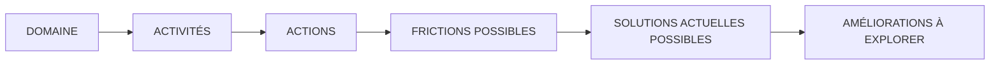

**Discipline d’analyse :** « plausible » ≠ « confirmé ». Aucun entretien, chiffre, niveau de fréquence ni succès commercial n’est présumé. Vérifier ensuite, pour chaque friction retenue : l’expérience récente d’utilisateurs réels, la fréquence, le coût ou la conséquence, le contournement effectivement employé, la disponibilité des solutions, la disposition à changer et, le cas échéant, à payer. Ne pas confondre une amélioration d’un processus avec un produit à construire. L’IA n’est pas un passage obligé.

**Limites :** inventaire large mais non exhaustif ; parcours types, susceptibles de changer selon pays, ville/campagne, langue, revenu, connectivité, profil et activité formelle/informelle. Les « solutions actuelles » ne sont pas validées par une enquête concurrentielle en direct ; leur examen détaillé constitue une phase ultérieure.

### Sommaire par famille et domaine

**A — Économie, argent et activités commerciales**
- [D01 — Commerce, vente et distribution de produits](#d01)
- [D02 — Achats, consommation et recherche de bonnes affaires](#d02)
- [D03 — Marketing, publicité, prospection et acquisition de clients](#d03)
- [D04 — Entrepreneuriat, création et gestion de petites entreprises](#d04)
- [D05 — Emploi, recrutement et recherche de revenus](#d05)
- [D06 — Travail indépendant, prestations et métiers professionnels](#d06)
- [D07 — Gestion financière personnelle, budget, épargne et tontines](#d07)
- [D08 — Paiements, crédit, emprunts, assurances et services financiers](#d08)
- [D09 — Approvisionnement, commerce international, importation et exportation](#d09)
- [D10 — Création de contenu, économie numérique et monétisation des talents](#d10)

**B — Production, habitat et services essentiels**
- [D11 — Agriculture, élevage, pêche et transformation agricole](#d11)
- [D12 — Alimentation, restauration et préparation des repas](#d12)
- [D13 — Transport, déplacements et mobilité quotidienne](#d13)
- [D14 — Livraison, logistique et circulation des marchandises](#d14)
- [D15 — Recherche et accès aux services de proximité](#d15)
- [D16 — Logement, location et immobilier](#d16)
- [D17 — Construction, entretien, réparation et maintenance](#d17)
- [D18 — Eau, électricité, énergie et assainissement](#d18)

**C — Éducation, compétences et organisation**
- [D19 — Éducation scolaire et universitaire](#d19)
- [D20 — Formation professionnelle, apprentissage et acquisition de compétences](#d20)
- [D21 — Orientation académique, examens, bourses et opportunités de carrière](#d21)
- [D22 — Organisation personnelle, gestion du temps et responsabilités quotidiennes](#d22)

**D — Santé, famille et relations humaines**
- [D23 — Santé, soins médicaux et accès aux professionnels de santé](#d23)
- [D24 — Sport, activité physique et bien-être](#d24)
- [D25 — Famille, parentalité et accompagnement des personnes dépendantes](#d25)
- [D26 — Vie sociale, rencontres et organisation d'événements](#d26)
- [D27 — Vie religieuse, spirituelle, associative et communautaire](#d27)
- [D28 — Inclusion, handicap, accessibilité et autonomie personnelle](#d28)

**E — Institutions, sécurité et environnement numérique**
- [D29 — Administration publique, documents officiels et démarches administratives](#d29)
- [D30 — Justice, droits, contrats et protection des consommateurs](#d30)
- [D31 — Sécurité personnelle, prévention des risques et situations d'urgence](#d31)
- [D32 — Télécommunications, connectivité, outils numériques et cybersécurité](#d32)

**F — Loisirs, mobilité internationale et environnement**
- [D33 — Divertissement, culture, musique, jeux et loisirs](#d33)
- [D34 — Voyage, tourisme, hébergement et hospitalité](#d34)
- [D35 — Diaspora, mobilité internationale et relations transfrontalières](#d35)
- [D36 — Environnement, gestion des déchets, climat et protection des ressources](#d36)

## Inventaire détaillé par domaine


# A — Économie, argent et activités commerciales

<a id="d01"></a>
## D01 — Commerce, vente et distribution de produits
**Personnes / organisations concernées :** Détaillants, vendeurs ambulants, grossistes, responsables de points de vente, acheteurs professionnels, distributeurs, clients.
**Inventaire :** 10 activités détaillées. Les personnes peuvent cumuler plusieurs rôles et les parcours ci-dessous ne sont pas exclusifs.

**Carte de navigation du domaine**
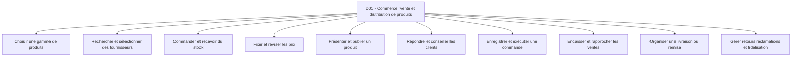

**Accès rapide aux activités :** [A01](#d01-a01) · [A02](#d01-a02) · [A03](#d01-a03) · [A04](#d01-a04) · [A05](#d01-a05) · [A06](#d01-a06) · [A07](#d01-a07) · [A08](#d01-a08) · [A09](#d01-a09) · [A10](#d01-a10)

<a id="d01-a01"></a>
### D01-A01 — Choisir une gamme de produits
**Résultat recherché :** Proposer une offre correspondant à une demande solvable.

| Réf. action | Action concrète (ordre indicatif) | Friction potentielle liée | Solution / contournement possible *(à vérifier)* | Amélioration à explorer *(hypothèse)* |
|---|---|---|---|---|
| `D01-A01-E01` | Observer les demandes | Avis dispersés et biaisés | Discussions clients et observation du marché | Rendre visibles les demandes récurrentes |
| `D01-A01-E02` | Comparer les articles | Confusion entre popularité et marge | Comparaison manuelle de catalogues | Relier demandes coûts et contraintes |
| `D01-A01-E03` | Tester de petites quantités | Risque d'invendus | Vente pilote informelle | Définir des seuils de test |
| `D01-A01-E04` | Décider du renouvellement | Décision fondée sur la mémoire | Carnet des ventes | Aider à réexaminer les signaux utiles |

*Point de contrôle terrain D01-A01 : demander à une personne concernée de raconter sa dernière réalisation de cette activité ; identifier les étapes réellement suivies, les incidents concrets et le coût d’un incident, puis vérifier si les contournements et les améliorations de ce tableau ont du sens pour elle.*

<a id="d01-a02"></a>
### D01-A02 — Rechercher et sélectionner des fournisseurs
**Résultat recherché :** Acheter à une source adaptée.

| Réf. action | Action concrète (ordre indicatif) | Friction potentielle liée | Solution / contournement possible *(à vérifier)* | Amélioration à explorer *(hypothèse)* |
|---|---|---|---|---|
| `D01-A02-E01` | Recenser des sources | Contacts incomplets | Recommandations et groupes de messagerie | Rassembler des pistes traçables |
| `D01-A02-E02` | Demander les conditions | Prix et minimums peu comparables | Appels et messages | Structurer les devis reçus |
| `D01-A02-E03` | Évaluer la fiabilité | Qualité incertaine et fraude possible | Échantillons et bouche-à-oreille | Formaliser les vérifications |
| `D01-A02-E04` | Choisir un fournisseur | Arbitrages opaques entre prix et délai | Notes personnelles | Comparer les compromis réels |

*Point de contrôle terrain D01-A02 : demander à une personne concernée de raconter sa dernière réalisation de cette activité ; identifier les étapes réellement suivies, les incidents concrets et le coût d’un incident, puis vérifier si les contournements et les améliorations de ce tableau ont du sens pour elle.*

<a id="d01-a03"></a>
### D01-A03 — Commander et recevoir du stock
**Résultat recherché :** Disposer des quantités commandées en bon état.

| Réf. action | Action concrète (ordre indicatif) | Friction potentielle liée | Solution / contournement possible *(à vérifier)* | Amélioration à explorer *(hypothèse)* |
|---|---|---|---|---|
| `D01-A03-E01` | Évaluer les besoins | Ruptures ou surstock | Comptage et carnet | Signaler les seuils à examiner |
| `D01-A03-E02` | Passer commande | Variantes et quantités mal transmises | Messages et appels | Standardiser la commande |
| `D01-A03-E03` | Suivre l'acheminement | Retards non signalés | Relances téléphoniques | Rassembler les jalons de livraison |
| `D01-A03-E04` | Contrôler la réception | Manquants ou défauts détectés tard | Bon papier et inspection | Documenter les écarts à réception |

*Point de contrôle terrain D01-A03 : demander à une personne concernée de raconter sa dernière réalisation de cette activité ; identifier les étapes réellement suivies, les incidents concrets et le coût d’un incident, puis vérifier si les contournements et les améliorations de ce tableau ont du sens pour elle.*

<a id="d01-a04"></a>
### D01-A04 — Fixer et réviser les prix
**Résultat recherché :** Vendre avec une marge soutenable.

| Réf. action | Action concrète (ordre indicatif) | Friction potentielle liée | Solution / contournement possible *(à vérifier)* | Amélioration à explorer *(hypothèse)* |
|---|---|---|---|---|
| `D01-A04-E01` | Calculer le coût complet | Transport et pertes oubliés | Calculatrice et carnet | Inclure tous les postes |
| `D01-A04-E02` | Observer les prix alternatifs | Références peu comparables | Visites et consultations des annonces | Comparer des offres équivalentes |
| `D01-A04-E03` | Choisir un prix | Marge ou demande mal anticipée | Discussion avec collègues | Tester plusieurs scénarios |
| `D01-A04-E04` | Réviser le tarif | Étiquettes et annonces incohérentes | Correction manuelle | Synchroniser les supports de prix |

*Point de contrôle terrain D01-A04 : demander à une personne concernée de raconter sa dernière réalisation de cette activité ; identifier les étapes réellement suivies, les incidents concrets et le coût d’un incident, puis vérifier si les contournements et les améliorations de ce tableau ont du sens pour elle.*

<a id="d01-a05"></a>
### D01-A05 — Présenter et publier un produit
**Résultat recherché :** Rendre une offre compréhensible et attractive.

| Réf. action | Action concrète (ordre indicatif) | Friction potentielle liée | Solution / contournement possible *(à vérifier)* | Amélioration à explorer *(hypothèse)* |
|---|---|---|---|---|
| `D01-A05-E01` | Préparer le produit | État ou variante mal précisé | Inspection physique | Utiliser une liste de préparation |
| `D01-A05-E02` | Créer photos et description | Photos floues et détails manquants | Caméra du téléphone | Contrôler les informations clés |
| `D01-A05-E03` | Diffuser l'offre | Publications éparpillées ou oubliées | Statuts et pages sociales | Suivre les canaux publiés |
| `D01-A05-E04` | Actualiser disponibilité | Article vendu toujours affiché | Modification manuelle | Réduire les annonces périmées |

*Point de contrôle terrain D01-A05 : demander à une personne concernée de raconter sa dernière réalisation de cette activité ; identifier les étapes réellement suivies, les incidents concrets et le coût d’un incident, puis vérifier si les contournements et les améliorations de ce tableau ont du sens pour elle.*

<a id="d01-a06"></a>
### D01-A06 — Répondre et conseiller les clients
**Résultat recherché :** Aider un acheteur à décider en connaissance de cause.

| Réf. action | Action concrète (ordre indicatif) | Friction potentielle liée | Solution / contournement possible *(à vérifier)* | Amélioration à explorer *(hypothèse)* |
|---|---|---|---|---|
| `D01-A06-E01` | Recevoir une demande | Messages noyés parmi d'autres | Messagerie et appels | Distinguer les demandes de vente |
| `D01-A06-E02` | Comprendre le besoin | Mauvaise variante recommandée | Questions orales | Structurer les questions utiles |
| `D01-A06-E03` | Expliquer conditions et usage | Réponses répétitives ou contradictoires | Messages enregistrés | Maintenir des réponses fiables |
| `D01-A06-E04` | Relancer sans insister | Intéressés perdus de vue | Mémoire et agenda | Suivre les demandes en attente |

*Point de contrôle terrain D01-A06 : demander à une personne concernée de raconter sa dernière réalisation de cette activité ; identifier les étapes réellement suivies, les incidents concrets et le coût d’un incident, puis vérifier si les contournements et les améliorations de ce tableau ont du sens pour elle.*

<a id="d01-a07"></a>
### D01-A07 — Enregistrer et exécuter une commande
**Résultat recherché :** Livrer exactement ce qui a été convenu.

| Réf. action | Action concrète (ordre indicatif) | Friction potentielle liée | Solution / contournement possible *(à vérifier)* | Amélioration à explorer *(hypothèse)* |
|---|---|---|---|---|
| `D01-A07-E01` | Confirmer produit et quantité | Malentendus sur la variante | Capture de conversation | Récapituler la commande |
| `D01-A07-E02` | Relever coordonnées | Adresse imprécise | Appel et repère local | Valider le lieu de remise |
| `D01-A07-E03` | Réserver l'article | Double vente d'un même stock | Mise de côté physique | Relier réservation et disponibilité |
| `D01-A07-E04` | Confirmer le délai | Promesses incompatibles avec la logistique | Appel au livreur | Aligner délai et capacité réelle |

*Point de contrôle terrain D01-A07 : demander à une personne concernée de raconter sa dernière réalisation de cette activité ; identifier les étapes réellement suivies, les incidents concrets et le coût d’un incident, puis vérifier si les contournements et les améliorations de ce tableau ont du sens pour elle.*

<a id="d01-a08"></a>
### D01-A08 — Encaisser et rapprocher les ventes
**Résultat recherché :** Recevoir et justifier les paiements dus.

| Réf. action | Action concrète (ordre indicatif) | Friction potentielle liée | Solution / contournement possible *(à vérifier)* | Amélioration à explorer *(hypothèse)* |
|---|---|---|---|---|
| `D01-A08-E01` | Annoncer le montant | Remises et frais contestés | Message de récapitulatif | Clarifier les composantes du prix |
| `D01-A08-E02` | Accepter le moyen de paiement | Canal indisponible ou frais inattendus | Espèces et Mobile Money | Prévoir une alternative compréhensible |
| `D01-A08-E03` | Vérifier réception | Fausse preuve ou paiement en attente | Contrôle du solde | Réconcilier preuve et réception |
| `D01-A08-E04` | Reporter la vente | Entrées oubliées ou dupliquées | Carnet de caisse | Rendre le suivi moins fragile |

*Point de contrôle terrain D01-A08 : demander à une personne concernée de raconter sa dernière réalisation de cette activité ; identifier les étapes réellement suivies, les incidents concrets et le coût d’un incident, puis vérifier si les contournements et les améliorations de ce tableau ont du sens pour elle.*

<a id="d01-a09"></a>
### D01-A09 — Organiser une livraison ou remise
**Résultat recherché :** Faire parvenir le bon article au bon destinataire.

| Réf. action | Action concrète (ordre indicatif) | Friction potentielle liée | Solution / contournement possible *(à vérifier)* | Amélioration à explorer *(hypothèse)* |
|---|---|---|---|---|
| `D01-A09-E01` | Choisir le mode de remise | Coût ou distance mal évalués | Livreur habituel | Comparer les conditions |
| `D01-A09-E02` | Préparer le colis | Erreur de produit ou emballage insuffisant | Vérification manuelle | Sécuriser la préparation |
| `D01-A09-E03` | Coordonner l'itinéraire | Destinataire absent ou introuvable | Appels successifs | Partager les repères nécessaires |
| `D01-A09-E04` | Confirmer la remise | Litige sans preuve claire | Message de confirmation | Conserver une preuve proportionnée |

*Point de contrôle terrain D01-A09 : demander à une personne concernée de raconter sa dernière réalisation de cette activité ; identifier les étapes réellement suivies, les incidents concrets et le coût d’un incident, puis vérifier si les contournements et les améliorations de ce tableau ont du sens pour elle.*

<a id="d01-a10"></a>
### D01-A10 — Gérer retours réclamations et fidélisation
**Résultat recherché :** Résoudre les incidents et favoriser un nouvel achat.

| Réf. action | Action concrète (ordre indicatif) | Friction potentielle liée | Solution / contournement possible *(à vérifier)* | Amélioration à explorer *(hypothèse)* |
|---|---|---|---|---|
| `D01-A10-E01` | Recevoir la réclamation | Client renvoyé d'un interlocuteur à l'autre | Messagerie personnelle | Centraliser le suivi |
| `D01-A10-E02` | Vérifier les faits | Preuves dispersées | Photos et reçus | Rapprocher commande et incident |
| `D01-A10-E03` | Proposer une issue | Règles imprécises ou perçues comme injustes | Négociation directe | Clarifier les conditions |
| `D01-A10-E04` | Recontacter après résolution | Client oublié ou sollicité abusivement | Agenda personnel | Adapter un suivi consenti |

*Point de contrôle terrain D01-A10 : demander à une personne concernée de raconter sa dernière réalisation de cette activité ; identifier les étapes réellement suivies, les incidents concrets et le coût d’un incident, puis vérifier si les contournements et les améliorations de ce tableau ont du sens pour elle.*

**Transversalité :** rechercher les connexions avec les autres domaines à partir des mêmes actions (information, comparaison, confiance, paiement, coordination, déplacement, suivi) et non en fusionnant artificiellement des activités distinctes.

<a id="d02"></a>
## D02 — Achats, consommation et recherche de bonnes affaires
**Personnes / organisations concernées :** Ménages, étudiants, consommateurs occasionnels, achats collectifs, proches qui achètent à distance.
**Inventaire :** 8 activités détaillées. Les personnes peuvent cumuler plusieurs rôles et les parcours ci-dessous ne sont pas exclusifs.

**Carte de navigation du domaine**
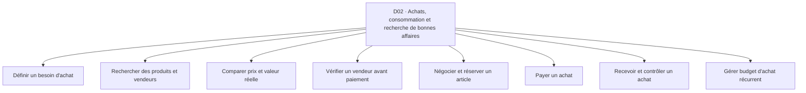

**Accès rapide aux activités :** [A01](#d02-a01) · [A02](#d02-a02) · [A03](#d02-a03) · [A04](#d02-a04) · [A05](#d02-a05) · [A06](#d02-a06) · [A07](#d02-a07) · [A08](#d02-a08)

<a id="d02-a01"></a>
### D02-A01 — Définir un besoin d'achat
**Résultat recherché :** Savoir quoi acheter et pourquoi.

| Réf. action | Action concrète (ordre indicatif) | Friction potentielle liée | Solution / contournement possible *(à vérifier)* | Amélioration à explorer *(hypothèse)* |
|---|---|---|---|---|
| `D02-A01-E01` | Constater le besoin | Achat impulsif ou besoin mal formulé | Liste manuscrite | Clarifier l'usage recherché |
| `D02-A01-E02` | Évaluer l'urgence | Achat reporté malgré nécessité | Discussion familiale | Distinguer urgence et confort |
| `D02-A01-E03` | Fixer les contraintes | Budget et caractéristiques flous | Notes et calculatrice | Formaliser budget et exigences |
| `D02-A01-E04` | Établir les priorités | Choix concurrents désorganisés | Liste classée | Rendre les arbitrages explicites |

*Point de contrôle terrain D02-A01 : demander à une personne concernée de raconter sa dernière réalisation de cette activité ; identifier les étapes réellement suivies, les incidents concrets et le coût d’un incident, puis vérifier si les contournements et les améliorations de ce tableau ont du sens pour elle.*

<a id="d02-a02"></a>
### D02-A02 — Rechercher des produits et vendeurs
**Résultat recherché :** Trouver des offres accessibles.

| Réf. action | Action concrète (ordre indicatif) | Friction potentielle liée | Solution / contournement possible *(à vérifier)* | Amélioration à explorer *(hypothèse)* |
|---|---|---|---|---|
| `D02-A02-E01` | Choisir des sources | Offres non visibles hors réseau personnel | Marchés et groupes | Diversifier les pistes pertinentes |
| `D02-A02-E02` | Formuler la recherche | Termes et catégories variables | Demandes à des proches | Faciliter le vocabulaire local |
| `D02-A02-E03` | Contacter des vendeurs | Absence de réponse ou disponibilité fictive | Appels et messages | Préqualifier les disponibilités |
| `D02-A02-E04` | Rassembler les offres | Informations réparties entre conversations | Captures d'écran | Comparer sans recopier |

*Point de contrôle terrain D02-A02 : demander à une personne concernée de raconter sa dernière réalisation de cette activité ; identifier les étapes réellement suivies, les incidents concrets et le coût d’un incident, puis vérifier si les contournements et les améliorations de ce tableau ont du sens pour elle.*

<a id="d02-a03"></a>
### D02-A03 — Comparer prix et valeur réelle
**Résultat recherché :** Choisir une offre selon le coût complet.

| Réf. action | Action concrète (ordre indicatif) | Friction potentielle liée | Solution / contournement possible *(à vérifier)* | Amélioration à explorer *(hypothèse)* |
|---|---|---|---|---|
| `D02-A03-E01` | Relever les prix | Tailles et qualités non équivalentes | Carnet comparatif | Normaliser les unités |
| `D02-A03-E02` | Ajouter transport et frais | Prix affiché trompeur sur coût final | Calculatrice | Afficher le coût rendu |
| `D02-A03-E03` | Évaluer la qualité | Difficulté à vérifier l'authenticité | Démonstration et avis de proches | Structurer des critères vérifiables |
| `D02-A03-E04` | Arbitrer | Choix précipité ou paralysie | Discussion avec un proche | Mettre en évidence les compromis |

*Point de contrôle terrain D02-A03 : demander à une personne concernée de raconter sa dernière réalisation de cette activité ; identifier les étapes réellement suivies, les incidents concrets et le coût d’un incident, puis vérifier si les contournements et les améliorations de ce tableau ont du sens pour elle.*

<a id="d02-a04"></a>
### D02-A04 — Vérifier un vendeur avant paiement
**Résultat recherché :** Limiter les risques de mauvaise transaction.

| Réf. action | Action concrète (ordre indicatif) | Friction potentielle liée | Solution / contournement possible *(à vérifier)* | Amélioration à explorer *(hypothèse)* |
|---|---|---|---|---|
| `D02-A04-E01` | Identifier l'interlocuteur | Usurpation ou identité peu claire | Appel direct | Encourager la vérification indépendante |
| `D02-A04-E02` | Contrôler l'offre | Promesse irréaliste | Demande de vidéo ou visite | Recouper les éléments |
| `D02-A04-E03` | Examiner les conditions | Garantie et retour absents | Messages écrits | Rendre les clauses explicites |
| `D02-A04-E04` | Choisir la remise | Paiement anticipé risqué | Rencontre ou paiement à réception | Comparer les protections possibles |

*Point de contrôle terrain D02-A04 : demander à une personne concernée de raconter sa dernière réalisation de cette activité ; identifier les étapes réellement suivies, les incidents concrets et le coût d’un incident, puis vérifier si les contournements et les améliorations de ce tableau ont du sens pour elle.*

<a id="d02-a05"></a>
### D02-A05 — Négocier et réserver un article
**Résultat recherché :** Obtenir un accord compréhensible.

| Réf. action | Action concrète (ordre indicatif) | Friction potentielle liée | Solution / contournement possible *(à vérifier)* | Amélioration à explorer *(hypothèse)* |
|---|---|---|---|---|
| `D02-A05-E01` | Exposer ses contraintes | Malentendu sur le budget | Message vocal | Préciser le cadre |
| `D02-A05-E02` | Discuter prix et accessoires | Frais ajoutés tardivement | Conversation directe | Récapituler la proposition |
| `D02-A05-E03` | Fixer le lieu et l'heure | Rendez-vous manqués | Appels | Formaliser le rendez-vous |
| `D02-A05-E04` | Confirmer la réservation | Article revendu ou acompte contesté | Capture du message | Documenter les conditions |

*Point de contrôle terrain D02-A05 : demander à une personne concernée de raconter sa dernière réalisation de cette activité ; identifier les étapes réellement suivies, les incidents concrets et le coût d’un incident, puis vérifier si les contournements et les améliorations de ce tableau ont du sens pour elle.*

<a id="d02-a06"></a>
### D02-A06 — Payer un achat
**Résultat recherché :** Régler la bonne personne et le bon montant.

| Réf. action | Action concrète (ordre indicatif) | Friction potentielle liée | Solution / contournement possible *(à vérifier)* | Amélioration à explorer *(hypothèse)* |
|---|---|---|---|---|
| `D02-A06-E01` | Choisir le canal | Frais ou plafond inattendu | Espèces et Mobile Money | Informer sur les contraintes |
| `D02-A06-E02` | Vérifier le bénéficiaire | Erreur de numéro ou fraude | Double lecture du numéro | Créer un contrôle avant envoi |
| `D02-A06-E03` | Exécuter le paiement | Connexion ou service interrompu | Autre canal | Prévoir le cas d'échec |
| `D02-A06-E04` | Conserver la preuve | Reçu perdu ou peu lisible | Capture d'écran | Rapprocher achat et paiement |

*Point de contrôle terrain D02-A06 : demander à une personne concernée de raconter sa dernière réalisation de cette activité ; identifier les étapes réellement suivies, les incidents concrets et le coût d’un incident, puis vérifier si les contournements et les améliorations de ce tableau ont du sens pour elle.*

<a id="d02-a07"></a>
### D02-A07 — Recevoir et contrôler un achat
**Résultat recherché :** Obtenir l'article promis.

| Réf. action | Action concrète (ordre indicatif) | Friction potentielle liée | Solution / contournement possible *(à vérifier)* | Amélioration à explorer *(hypothèse)* |
|---|---|---|---|---|
| `D02-A07-E01` | Suivre l'arrivée | Manque de visibilité | Appels au vendeur | Afficher des jalons simples |
| `D02-A07-E02` | Vérifier identité du colis | Remise à un tiers imprévu | Code ou appel | Renforcer la confirmation |
| `D02-A07-E03` | Inspecter qualité et quantité | Défaut constaté après départ | Déballage sur place | Guider le contrôle de réception |
| `D02-A07-E04` | Signaler un écart | Litige tardif ou non documenté | Photo et conversation | Conserver la chronologie |

*Point de contrôle terrain D02-A07 : demander à une personne concernée de raconter sa dernière réalisation de cette activité ; identifier les étapes réellement suivies, les incidents concrets et le coût d’un incident, puis vérifier si les contournements et les améliorations de ce tableau ont du sens pour elle.*

<a id="d02-a08"></a>
### D02-A08 — Gérer budget d'achat récurrent
**Résultat recherché :** Acheter sans déséquilibrer ses dépenses.

| Réf. action | Action concrète (ordre indicatif) | Friction potentielle liée | Solution / contournement possible *(à vérifier)* | Amélioration à explorer *(hypothèse)* |
|---|---|---|---|---|
| `D02-A08-E01` | Lister les achats réguliers | Postes oubliés | Liste familiale | Mémoriser les besoins récurrents |
| `D02-A08-E02` | Estimer la dépense | Prix variables | Carnet du marché | Prévoir une fourchette réaliste |
| `D02-A08-E03` | Planifier les achats | Dépenses concentrées un mauvais jour | Calendrier | Étaler selon priorités |
| `D02-A08-E04` | Contrôler le réalisé | Dépassement invisible | Reçus et mémoire | Comparer prévu et dépensé |

*Point de contrôle terrain D02-A08 : demander à une personne concernée de raconter sa dernière réalisation de cette activité ; identifier les étapes réellement suivies, les incidents concrets et le coût d’un incident, puis vérifier si les contournements et les améliorations de ce tableau ont du sens pour elle.*

**Transversalité :** rechercher les connexions avec les autres domaines à partir des mêmes actions (information, comparaison, confiance, paiement, coordination, déplacement, suivi) et non en fusionnant artificiellement des activités distinctes.

<a id="d03"></a>
## D03 — Marketing, publicité, prospection et acquisition de clients
**Personnes / organisations concernées :** Commerçants, prestataires, associations, indépendants, responsables de marque, petites équipes.
**Inventaire :** 8 activités détaillées. Les personnes peuvent cumuler plusieurs rôles et les parcours ci-dessous ne sont pas exclusifs.

**Carte de navigation du domaine**
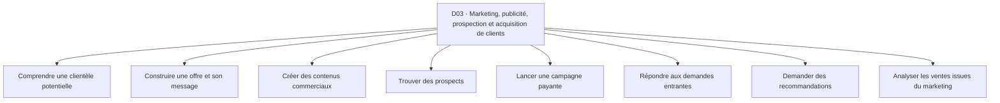

**Accès rapide aux activités :** [A01](#d03-a01) · [A02](#d03-a02) · [A03](#d03-a03) · [A04](#d03-a04) · [A05](#d03-a05) · [A06](#d03-a06) · [A07](#d03-a07) · [A08](#d03-a08)

<a id="d03-a01"></a>
### D03-A01 — Comprendre une clientèle potentielle
**Résultat recherché :** Décrire un besoin et son contexte.

| Réf. action | Action concrète (ordre indicatif) | Friction potentielle liée | Solution / contournement possible *(à vérifier)* | Amélioration à explorer *(hypothèse)* |
|---|---|---|---|---|
| `D03-A01-E01` | Recueillir des situations d'usage | Opinions vagues | Conversations clients | Rechercher des exemples vécus |
| `D03-A01-E02` | Segmenter les profils | Profils trop généraux | Notes de vente | Relier profil et tâche |
| `D03-A01-E03` | Identifier les alternatives | Concurrents et pratiques informelles oubliés | Observation des annonces | Cartographier les choix actuels |
| `D03-A01-E04` | Formuler l'hypothèse | Promesse fondée sur une intuition | Document de travail | Lister les faits à vérifier |

*Point de contrôle terrain D03-A01 : demander à une personne concernée de raconter sa dernière réalisation de cette activité ; identifier les étapes réellement suivies, les incidents concrets et le coût d’un incident, puis vérifier si les contournements et les améliorations de ce tableau ont du sens pour elle.*

<a id="d03-a02"></a>
### D03-A02 — Construire une offre et son message
**Résultat recherché :** Expliquer une valeur concrète.

| Réf. action | Action concrète (ordre indicatif) | Friction potentielle liée | Solution / contournement possible *(à vérifier)* | Amélioration à explorer *(hypothèse)* |
|---|---|---|---|---|
| `D03-A02-E01` | Choisir le bénéfice | Promesses génériques | Brouillon sur téléphone | Formuler un résultat spécifique |
| `D03-A02-E02` | Recueillir des preuves | Témoignages impossibles à confirmer | Photos de travaux autorisées | Séparer faits et arguments |
| `D03-A02-E03` | Rédiger les supports | Texte peu compréhensible | Messages de proches | Tester la clarté |
| `D03-A02-E04` | Adapter la langue | Public mal rejoint | Traduction informelle | Adapter le vocabulaire d'usage |

*Point de contrôle terrain D03-A02 : demander à une personne concernée de raconter sa dernière réalisation de cette activité ; identifier les étapes réellement suivies, les incidents concrets et le coût d’un incident, puis vérifier si les contournements et les améliorations de ce tableau ont du sens pour elle.*

<a id="d03-a03"></a>
### D03-A03 — Créer des contenus commerciaux
**Résultat recherché :** Disposer de supports utilisables.

| Réf. action | Action concrète (ordre indicatif) | Friction potentielle liée | Solution / contournement possible *(à vérifier)* | Amélioration à explorer *(hypothèse)* |
|---|---|---|---|---|
| `D03-A03-E01` | Préparer un scénario | Idée déconnectée de l'offre | Inspiration réseaux sociaux | Relier chaque contenu à un usage |
| `D03-A03-E02` | Rassembler les éléments | Photos ou droits manquants | Téléphone et banque d'images | Préparer les preuves autorisées |
| `D03-A03-E03` | Produire et monter | Temps et compétences limités | Applications de montage | Simplifier la production |
| `D03-A03-E04` | Contrôler et publier | Erreur de prix ou cadrage | Relecture manuelle | Vérifier contenu et format |

*Point de contrôle terrain D03-A03 : demander à une personne concernée de raconter sa dernière réalisation de cette activité ; identifier les étapes réellement suivies, les incidents concrets et le coût d’un incident, puis vérifier si les contournements et les améliorations de ce tableau ont du sens pour elle.*

<a id="d03-a04"></a>
### D03-A04 — Trouver des prospects
**Résultat recherché :** Identifier des personnes potentiellement intéressées.

| Réf. action | Action concrète (ordre indicatif) | Friction potentielle liée | Solution / contournement possible *(à vérifier)* | Amélioration à explorer *(hypothèse)* |
|---|---|---|---|---|
| `D03-A04-E01` | Définir les critères | Contacts non pertinents | Réseau personnel | Rendre les critères explicites |
| `D03-A04-E02` | Trouver des canaux | Dépendance à un seul groupe | Groupes et bouche-à-oreille | Comparer l'accessibilité |
| `D03-A04-E03` | Obtenir un contact licite | Données collectées sans accord | Demande directe de permission | Clarifier le consentement |
| `D03-A04-E04` | Organiser les contacts | Doublons et contacts perdus | Carnet ou feuille de calcul | Structurer le suivi |

*Point de contrôle terrain D03-A04 : demander à une personne concernée de raconter sa dernière réalisation de cette activité ; identifier les étapes réellement suivies, les incidents concrets et le coût d’un incident, puis vérifier si les contournements et les améliorations de ce tableau ont du sens pour elle.*

<a id="d03-a05"></a>
### D03-A05 — Lancer une campagne payante
**Résultat recherché :** Faire connaître une offre avec un budget contrôlé.

| Réf. action | Action concrète (ordre indicatif) | Friction potentielle liée | Solution / contournement possible *(à vérifier)* | Amélioration à explorer *(hypothèse)* |
|---|---|---|---|---|
| `D03-A05-E01` | Fixer objectif et budget | Dépenses sans résultat défini | Conseil d'un pair | Choisir une mesure utile |
| `D03-A05-E02` | Configurer audience et création | Réglages erronés | Tutoriels et agence | Rendre les choix compréhensibles |
| `D03-A05-E03` | Surveiller la diffusion | Budget consommé à mauvais rythme | Tableau de bord de plateforme | Signaler les écarts |
| `D03-A05-E04` | Comparer les résultats | Clics confondus avec ventes | Notes de commandes | Rapprocher campagne et résultat réel |

*Point de contrôle terrain D03-A05 : demander à une personne concernée de raconter sa dernière réalisation de cette activité ; identifier les étapes réellement suivies, les incidents concrets et le coût d’un incident, puis vérifier si les contournements et les améliorations de ce tableau ont du sens pour elle.*

<a id="d03-a06"></a>
### D03-A06 — Répondre aux demandes entrantes
**Résultat recherché :** Transformer l'intérêt en échange utile.

| Réf. action | Action concrète (ordre indicatif) | Friction potentielle liée | Solution / contournement possible *(à vérifier)* | Amélioration à explorer *(hypothèse)* |
|---|---|---|---|---|
| `D03-A06-E01` | Repérer une demande | Commentaires et messages dispersés | Notifications natives | Réunir les points de contact |
| `D03-A06-E02` | Qualifier le besoin | Questions répétitives | Questionnaire oral | Établir un minimum de contexte |
| `D03-A06-E03` | Envoyer l'offre adaptée | Réponses contradictoires | Modèles de messages | Maintenir les informations à jour |
| `D03-A06-E04` | Prévoir un suivi | Intention oubliée après échange | Rappel de téléphone | Suivre avec permission |

*Point de contrôle terrain D03-A06 : demander à une personne concernée de raconter sa dernière réalisation de cette activité ; identifier les étapes réellement suivies, les incidents concrets et le coût d’un incident, puis vérifier si les contournements et les améliorations de ce tableau ont du sens pour elle.*

<a id="d03-a07"></a>
### D03-A07 — Demander des recommandations
**Résultat recherché :** Obtenir des clients par confiance.

| Réf. action | Action concrète (ordre indicatif) | Friction potentielle liée | Solution / contournement possible *(à vérifier)* | Amélioration à explorer *(hypothèse)* |
|---|---|---|---|---|
| `D03-A07-E01` | Repérer un client satisfait | Demande faite trop tôt | Échange après livraison | Choisir le bon moment |
| `D03-A07-E02` | Demander l'accord | Pression ou gêne | Message personnel | Faciliter le refus |
| `D03-A07-E03` | Partager une référence | Coordonnées mal transmises | Carte et lien | Rendre le contact exact |
| `D03-A07-E04` | Remercier et mesurer | Origine d'une recommandation inconnue | Question au nouveau client | Tracer la provenance déclarée |

*Point de contrôle terrain D03-A07 : demander à une personne concernée de raconter sa dernière réalisation de cette activité ; identifier les étapes réellement suivies, les incidents concrets et le coût d’un incident, puis vérifier si les contournements et les améliorations de ce tableau ont du sens pour elle.*

<a id="d03-a08"></a>
### D03-A08 — Analyser les ventes issues du marketing
**Résultat recherché :** Comprendre ce qui apporte des clients.

| Réf. action | Action concrète (ordre indicatif) | Friction potentielle liée | Solution / contournement possible *(à vérifier)* | Amélioration à explorer *(hypothèse)* |
|---|---|---|---|---|
| `D03-A08-E01` | Collecter provenance | Clients ne savent plus d'où ils viennent | Question à la commande | Enregistrer une réponse simple |
| `D03-A08-E02` | Rapprocher coûts et ventes | Données dans plusieurs outils | Feuille de calcul | Consolider les postes |
| `D03-A08-E03` | Distinguer nouveaux et récurrents | Double comptage | Carnet client | Éviter de gonfler les résultats |
| `D03-A08-E04` | Décider un ajustement | Conclusion hâtive sur petit échantillon | Discussion équipe | Afficher l'incertitude |

*Point de contrôle terrain D03-A08 : demander à une personne concernée de raconter sa dernière réalisation de cette activité ; identifier les étapes réellement suivies, les incidents concrets et le coût d’un incident, puis vérifier si les contournements et les améliorations de ce tableau ont du sens pour elle.*

**Transversalité :** rechercher les connexions avec les autres domaines à partir des mêmes actions (information, comparaison, confiance, paiement, coordination, déplacement, suivi) et non en fusionnant artificiellement des activités distinctes.

<a id="d04"></a>
## D04 — Entrepreneuriat, création et gestion de petites entreprises
**Personnes / organisations concernées :** Entrepreneurs débutants, artisans, commerces informels et formels, responsables d'équipes, coopératives.
**Inventaire :** 8 activités détaillées. Les personnes peuvent cumuler plusieurs rôles et les parcours ci-dessous ne sont pas exclusifs.

**Carte de navigation du domaine**
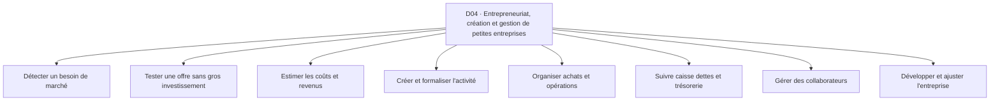

**Accès rapide aux activités :** [A01](#d04-a01) · [A02](#d04-a02) · [A03](#d04-a03) · [A04](#d04-a04) · [A05](#d04-a05) · [A06](#d04-a06) · [A07](#d04-a07) · [A08](#d04-a08)

<a id="d04-a01"></a>
### D04-A01 — Détecter un besoin de marché
**Résultat recherché :** Identifier une situation qui mérite enquête.

| Réf. action | Action concrète (ordre indicatif) | Friction potentielle liée | Solution / contournement possible *(à vérifier)* | Amélioration à explorer *(hypothèse)* |
|---|---|---|---|---|
| `D04-A01-E01` | Observer des parcours | Idées basées sur ses préférences | Observation du terrain | Noter les situations concrètes |
| `D04-A01-E02` | Parler d'expériences récentes | Réponses de politesse | Entretiens informels | Poser des questions non suggestives |
| `D04-A01-E03` | Comparer les alternatives | Solutions informelles invisibles | Visites et recherche | Inclure les contournements |
| `D04-A01-E04` | Formuler une hypothèse | Problème supposé universel | Fiche papier | Définir le profil exact |

*Point de contrôle terrain D04-A01 : demander à une personne concernée de raconter sa dernière réalisation de cette activité ; identifier les étapes réellement suivies, les incidents concrets et le coût d’un incident, puis vérifier si les contournements et les améliorations de ce tableau ont du sens pour elle.*

<a id="d04-a02"></a>
### D04-A02 — Tester une offre sans gros investissement
**Résultat recherché :** Obtenir un signal d'intérêt réel.

| Réf. action | Action concrète (ordre indicatif) | Friction potentielle liée | Solution / contournement possible *(à vérifier)* | Amélioration à explorer *(hypothèse)* |
|---|---|---|---|---|
| `D04-A02-E01` | Formuler la promesse | Valeur trop vague | Présentation orale | Décrire un résultat tangible |
| `D04-A02-E02` | Présenter à des personnes ciblées | Échantillon de proches biaisé | Réseau et marchés | Varier les profils |
| `D04-A02-E03` | Demander une action concrète | Compliments confondus avec demande | Précommande ou essai explicite | Distinguer parole et engagement |
| `D04-A02-E04` | Consigner les refus | Raisons de rejet perdues | Carnet d'entretien | Classer les objections |

*Point de contrôle terrain D04-A02 : demander à une personne concernée de raconter sa dernière réalisation de cette activité ; identifier les étapes réellement suivies, les incidents concrets et le coût d’un incident, puis vérifier si les contournements et les améliorations de ce tableau ont du sens pour elle.*

<a id="d04-a03"></a>
### D04-A03 — Estimer les coûts et revenus
**Résultat recherché :** Savoir si l'activité pourrait être viable.

| Réf. action | Action concrète (ordre indicatif) | Friction potentielle liée | Solution / contournement possible *(à vérifier)* | Amélioration à explorer *(hypothèse)* |
|---|---|---|---|---|
| `D04-A03-E01` | Lister les coûts | Dépenses cachées | Factures et mémoire | Inclure les charges indirectes |
| `D04-A03-E02` | Estimer les volumes | Prévisions excessives | Hypothèses prudentes | Comparer plusieurs scénarios |
| `D04-A03-E03` | Calculer la marge | Confusion chiffre d'affaires et bénéfice | Calculatrice | Visualiser la marge nette |
| `D04-A03-E04` | Tester un seuil | Besoin de trésorerie sous-estimé | Tableur | Repérer le point de tension |

*Point de contrôle terrain D04-A03 : demander à une personne concernée de raconter sa dernière réalisation de cette activité ; identifier les étapes réellement suivies, les incidents concrets et le coût d’un incident, puis vérifier si les contournements et les améliorations de ce tableau ont du sens pour elle.*

<a id="d04-a04"></a>
### D04-A04 — Créer et formaliser l'activité
**Résultat recherché :** Choisir un cadre d'exploitation adapté.

| Réf. action | Action concrète (ordre indicatif) | Friction potentielle liée | Solution / contournement possible *(à vérifier)* | Amélioration à explorer *(hypothèse)* |
|---|---|---|---|---|
| `D04-A04-E01` | Choisir la forme | Confusion sur les obligations | Conseil professionnel | Présenter des questions à vérifier |
| `D04-A04-E02` | Préparer les informations | Pièces manquantes | Chemise de documents | Vérifier un dossier avant déplacement |
| `D04-A04-E03` | Effectuer les démarches | Files et changements de procédure | Guichet et portails officiels | Organiser les étapes à jour |
| `D04-A04-E04` | Archiver les preuves | Justificatifs égarés | Dossier papier | Relier pièces et échéances |

*Point de contrôle terrain D04-A04 : demander à une personne concernée de raconter sa dernière réalisation de cette activité ; identifier les étapes réellement suivies, les incidents concrets et le coût d’un incident, puis vérifier si les contournements et les améliorations de ce tableau ont du sens pour elle.*

<a id="d04-a05"></a>
### D04-A05 — Organiser achats et opérations
**Résultat recherché :** Faire fonctionner l'entreprise régulièrement.

| Réf. action | Action concrète (ordre indicatif) | Friction potentielle liée | Solution / contournement possible *(à vérifier)* | Amélioration à explorer *(hypothèse)* |
|---|---|---|---|---|
| `D04-A05-E01` | Planifier les besoins | Commandes urgentes coûteuses | Agenda | Anticiper les besoins |
| `D04-A05-E02` | Répartir les tâches | Responsabilités floues | Consignes orales | Clarifier les rôles |
| `D04-A05-E03` | Vérifier l'exécution | Erreurs détectées tard | Ronde du responsable | Suivre les points critiques |
| `D04-A05-E04` | Réagir aux imprévus | Décision retardée | Groupe de messagerie | Définir des plans simples |

*Point de contrôle terrain D04-A05 : demander à une personne concernée de raconter sa dernière réalisation de cette activité ; identifier les étapes réellement suivies, les incidents concrets et le coût d’un incident, puis vérifier si les contournements et les améliorations de ce tableau ont du sens pour elle.*

<a id="d04-a06"></a>
### D04-A06 — Suivre caisse dettes et trésorerie
**Résultat recherché :** Savoir ce qui est disponible et dû.

| Réf. action | Action concrète (ordre indicatif) | Friction potentielle liée | Solution / contournement possible *(à vérifier)* | Amélioration à explorer *(hypothèse)* |
|---|---|---|---|---|
| `D04-A06-E01` | Enregistrer les entrées | Ventes oubliées | Carnet | Réduire la double saisie |
| `D04-A06-E02` | Noter les sorties | Petits frais non comptés | Enveloppes et reçus | Prévoir un relevé simple |
| `D04-A06-E03` | Suivre les créances | Relances embarrassantes | Messages personnels | Rappeler les échéances sans exposer les clients |
| `D04-A06-E04` | Préparer les paiements futurs | Manque de liquidités imprévu | Calendrier | Visualiser les obligations proches |

*Point de contrôle terrain D04-A06 : demander à une personne concernée de raconter sa dernière réalisation de cette activité ; identifier les étapes réellement suivies, les incidents concrets et le coût d’un incident, puis vérifier si les contournements et les améliorations de ce tableau ont du sens pour elle.*

<a id="d04-a07"></a>
### D04-A07 — Gérer des collaborateurs
**Résultat recherché :** Assurer un travail coordonné.

| Réf. action | Action concrète (ordre indicatif) | Friction potentielle liée | Solution / contournement possible *(à vérifier)* | Amélioration à explorer *(hypothèse)* |
|---|---|---|---|---|
| `D04-A07-E01` | Exprimer les tâches | Consignes ambiguës | Réunion courte | Formaliser les résultats attendus |
| `D04-A07-E02` | Planifier la présence | Absences annoncées tard | Appels et tableau papier | Rendre visible la disponibilité |
| `D04-A07-E03` | Contrôler la qualité | Retour tardif | Observation directe | Donner un feedback rapide |
| `D04-A07-E04` | Gérer rémunération | Heures ou commissions contestées | Carnet signé | Conserver les calculs lisibles |

*Point de contrôle terrain D04-A07 : demander à une personne concernée de raconter sa dernière réalisation de cette activité ; identifier les étapes réellement suivies, les incidents concrets et le coût d’un incident, puis vérifier si les contournements et les améliorations de ce tableau ont du sens pour elle.*

<a id="d04-a08"></a>
### D04-A08 — Développer et ajuster l'entreprise
**Résultat recherché :** Choisir une croissance soutenable.

| Réf. action | Action concrète (ordre indicatif) | Friction potentielle liée | Solution / contournement possible *(à vérifier)* | Amélioration à explorer *(hypothèse)* |
|---|---|---|---|---|
| `D04-A08-E01` | Observer la demande | Pics temporaires pris pour tendance | Historique de commandes | Séparer saisonnalité et tendance |
| `D04-A08-E02` | Tester un canal | Effort commercial mal mesuré | Vente pilote | Définir un test limité |
| `D04-A08-E03` | Mesurer les conséquences | Croissance qui dégrade la qualité | Retours clients | Suivre la capacité réelle |
| `D04-A08-E04` | Décider d'investir | Crédit engagé trop tôt | Avis de conseiller | Comparer risques et alternatives |

*Point de contrôle terrain D04-A08 : demander à une personne concernée de raconter sa dernière réalisation de cette activité ; identifier les étapes réellement suivies, les incidents concrets et le coût d’un incident, puis vérifier si les contournements et les améliorations de ce tableau ont du sens pour elle.*

**Transversalité :** rechercher les connexions avec les autres domaines à partir des mêmes actions (information, comparaison, confiance, paiement, coordination, déplacement, suivi) et non en fusionnant artificiellement des activités distinctes.

<a id="d05"></a>
## D05 — Emploi, recrutement et recherche de revenus
**Personnes / organisations concernées :** Chercheurs d'emploi, jeunes diplômés, salariés en transition, recruteurs, employeurs, travailleurs occasionnels.
**Inventaire :** 8 activités détaillées. Les personnes peuvent cumuler plusieurs rôles et les parcours ci-dessous ne sont pas exclusifs.

**Carte de navigation du domaine**
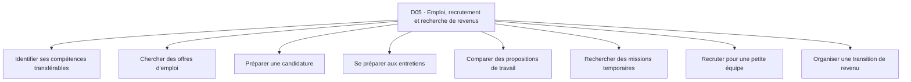

**Accès rapide aux activités :** [A01](#d05-a01) · [A02](#d05-a02) · [A03](#d05-a03) · [A04](#d05-a04) · [A05](#d05-a05) · [A06](#d05-a06) · [A07](#d05-a07) · [A08](#d05-a08)

<a id="d05-a01"></a>
### D05-A01 — Identifier ses compétences transférables
**Résultat recherché :** Clarifier les activités que l'on sait réaliser.

| Réf. action | Action concrète (ordre indicatif) | Friction potentielle liée | Solution / contournement possible *(à vérifier)* | Amélioration à explorer *(hypothèse)* |
|---|---|---|---|---|
| `D05-A01-E01` | Recenser ses expériences | Travail informel oublié | Discussion et carnet | Mettre en évidence les tâches réelles |
| `D05-A01-E02` | Associer des preuves | Réalisations non documentées | Photos et attestations | Organiser un portefeuille fiable |
| `D05-A01-E03` | Comparer à des métiers | Intitulés mal compris | Annonces et conseils | Traduire compétences en tâches |
| `D05-A01-E04` | Identifier une lacune | Formation choisie au hasard | Auto-évaluation | Prioriser une compétence utile |

*Point de contrôle terrain D05-A01 : demander à une personne concernée de raconter sa dernière réalisation de cette activité ; identifier les étapes réellement suivies, les incidents concrets et le coût d’un incident, puis vérifier si les contournements et les améliorations de ce tableau ont du sens pour elle.*

<a id="d05-a02"></a>
### D05-A02 — Chercher des offres d'emploi
**Résultat recherché :** Repérer des postes réellement pertinents.

| Réf. action | Action concrète (ordre indicatif) | Friction potentielle liée | Solution / contournement possible *(à vérifier)* | Amélioration à explorer *(hypothèse)* |
|---|---|---|---|---|
| `D05-A02-E01` | Choisir les sources | Offres relayées sans origine | Réseau et pages d'entreprises | Conserver l'origine |
| `D05-A02-E02` | Filtrer les annonces | Critères incomplets | Lecture manuelle | Vérifier l'adéquation minimale |
| `D05-A02-E03` | Contrôler l'authenticité | Fausse annonce ou frais de recrutement suspects | Contact officiel | Proposer des vérifications |
| `D05-A02-E04` | Suivre les dates | Opportunité expirée | Agenda | Signaler les échéances |

*Point de contrôle terrain D05-A02 : demander à une personne concernée de raconter sa dernière réalisation de cette activité ; identifier les étapes réellement suivies, les incidents concrets et le coût d’un incident, puis vérifier si les contournements et les améliorations de ce tableau ont du sens pour elle.*

<a id="d05-a03"></a>
### D05-A03 — Préparer une candidature
**Résultat recherché :** Présenter des éléments vrais et adaptés.

| Réf. action | Action concrète (ordre indicatif) | Friction potentielle liée | Solution / contournement possible *(à vérifier)* | Amélioration à explorer *(hypothèse)* |
|---|---|---|---|---|
| `D05-A03-E01` | Lire les exigences | Pièces indispensables négligées | Liste manuscrite | Extraire une checklist |
| `D05-A03-E02` | Adapter le CV | CV trop général | Modèle bureautique | Faire ressortir les preuves pertinentes |
| `D05-A03-E03` | Préparer les documents | Formats ou scans illisibles | Photocopie et scanner | Contrôler la qualité |
| `D05-A03-E04` | Envoyer et enregistrer | Dossier ou version confondus | Courriel et messagerie | Relier envoi et poste |

*Point de contrôle terrain D05-A03 : demander à une personne concernée de raconter sa dernière réalisation de cette activité ; identifier les étapes réellement suivies, les incidents concrets et le coût d’un incident, puis vérifier si les contournements et les améliorations de ce tableau ont du sens pour elle.*

<a id="d05-a04"></a>
### D05-A04 — Se préparer aux entretiens
**Résultat recherché :** Expliquer clairement sa valeur.

| Réf. action | Action concrète (ordre indicatif) | Friction potentielle liée | Solution / contournement possible *(à vérifier)* | Amélioration à explorer *(hypothèse)* |
|---|---|---|---|---|
| `D05-A04-E01` | Comprendre le poste | Attentes mal identifiées | Lecture d'annonce | Clarifier les responsabilités |
| `D05-A04-E02` | Préparer des exemples | Réponses abstraites | Entraînement avec un proche | Structurer faits et résultats |
| `D05-A04-E03` | Anticiper la logistique | Retard ou mauvaise connexion | Repérage du lieu | Planifier des alternatives |
| `D05-A04-E04` | Faire le bilan | Erreurs répétées | Notes après entretien | Capitaliser les apprentissages |

*Point de contrôle terrain D05-A04 : demander à une personne concernée de raconter sa dernière réalisation de cette activité ; identifier les étapes réellement suivies, les incidents concrets et le coût d’un incident, puis vérifier si les contournements et les améliorations de ce tableau ont du sens pour elle.*

<a id="d05-a05"></a>
### D05-A05 — Comparer des propositions de travail
**Résultat recherché :** Évaluer une offre au-delà du salaire annoncé.

| Réf. action | Action concrète (ordre indicatif) | Friction potentielle liée | Solution / contournement possible *(à vérifier)* | Amélioration à explorer *(hypothèse)* |
|---|---|---|---|---|
| `D05-A05-E01` | Lire la rémunération | Primes ou retenues mal comprises | Questions au recruteur | Rendre explicite le revenu net |
| `D05-A05-E02` | Évaluer les coûts | Transport et garde ignorés | Calculatrice | Calculer le gain réel |
| `D05-A05-E03` | Vérifier les conditions | Horaires et clauses flous | Contrat et conseil | Lister les points à clarifier |
| `D05-A05-E04` | Décider | Pression pour accepter immédiatement | Discussion familiale | Comparer des scénarios |

*Point de contrôle terrain D05-A05 : demander à une personne concernée de raconter sa dernière réalisation de cette activité ; identifier les étapes réellement suivies, les incidents concrets et le coût d’un incident, puis vérifier si les contournements et les améliorations de ce tableau ont du sens pour elle.*

<a id="d05-a06"></a>
### D05-A06 — Rechercher des missions temporaires
**Résultat recherché :** Obtenir des tâches rémunérées ponctuelles.

| Réf. action | Action concrète (ordre indicatif) | Friction potentielle liée | Solution / contournement possible *(à vérifier)* | Amélioration à explorer *(hypothèse)* |
|---|---|---|---|---|
| `D05-A06-E01` | Identifier une demande | Offres circulant entre initiés | Réseau local | Mieux repérer les missions |
| `D05-A06-E02` | Démontrer sa disponibilité | Délai de réponse trop long | Appel et statut | Clarifier créneaux et lieu |
| `D05-A06-E03` | Convenir du tarif | Malentendu sur le périmètre | Accord oral | Récapituler le travail |
| `D05-A06-E04` | Obtenir paiement | Retard ou contestation | Relance et reçu | Tracer accord et réalisation |

*Point de contrôle terrain D05-A06 : demander à une personne concernée de raconter sa dernière réalisation de cette activité ; identifier les étapes réellement suivies, les incidents concrets et le coût d’un incident, puis vérifier si les contournements et les améliorations de ce tableau ont du sens pour elle.*

<a id="d05-a07"></a>
### D05-A07 — Recruter pour une petite équipe
**Résultat recherché :** Trouver une personne adaptée à un travail précis.

| Réf. action | Action concrète (ordre indicatif) | Friction potentielle liée | Solution / contournement possible *(à vérifier)* | Amélioration à explorer *(hypothèse)* |
|---|---|---|---|---|
| `D05-A07-E01` | Décrire le poste | Besoins exprimés en termes vagues | Annonce orale | Décrire tâches et contraintes |
| `D05-A07-E02` | Diffuser la recherche | Candidats hors profil | Références personnelles | Clarifier les critères |
| `D05-A07-E03` | Évaluer avec équité | Sélection uniquement par connaissance | Essai pratique | Standardiser les observations |
| `D05-A07-E04` | Informer les candidats | Silence et perte de temps | Messages individuels | Suivre les réponses |

*Point de contrôle terrain D05-A07 : demander à une personne concernée de raconter sa dernière réalisation de cette activité ; identifier les étapes réellement suivies, les incidents concrets et le coût d’un incident, puis vérifier si les contournements et les améliorations de ce tableau ont du sens pour elle.*

<a id="d05-a08"></a>
### D05-A08 — Organiser une transition de revenu
**Résultat recherché :** Passer progressivement vers une nouvelle activité.

| Réf. action | Action concrète (ordre indicatif) | Friction potentielle liée | Solution / contournement possible *(à vérifier)* | Amélioration à explorer *(hypothèse)* |
|---|---|---|---|---|
| `D05-A08-E01` | Définir une cible | Objectif irréaliste | Conseil personnel | Scinder l'objectif en jalons |
| `D05-A08-E02` | Évaluer ses ressources | Temps et dépenses disponibles méconnus | Budget papier | Mesurer la marge de manœuvre |
| `D05-A08-E03` | Tester une première activité | Risque de tout abandonner trop tôt | Petit projet pilote | Limiter l'exposition |
| `D05-A08-E04` | Ajuster après essai | Leçons non conservées | Journal personnel | Comparer prévisions et réalité |

*Point de contrôle terrain D05-A08 : demander à une personne concernée de raconter sa dernière réalisation de cette activité ; identifier les étapes réellement suivies, les incidents concrets et le coût d’un incident, puis vérifier si les contournements et les améliorations de ce tableau ont du sens pour elle.*

**Transversalité :** rechercher les connexions avec les autres domaines à partir des mêmes actions (information, comparaison, confiance, paiement, coordination, déplacement, suivi) et non en fusionnant artificiellement des activités distinctes.

<a id="d06"></a>
## D06 — Travail indépendant, prestations et métiers professionnels
**Personnes / organisations concernées :** Artisans, consultants, créateurs, techniciens, aides à domicile, indépendants, clients professionnels et particuliers.
**Inventaire :** 8 activités détaillées. Les personnes peuvent cumuler plusieurs rôles et les parcours ci-dessous ne sont pas exclusifs.

**Carte de navigation du domaine**
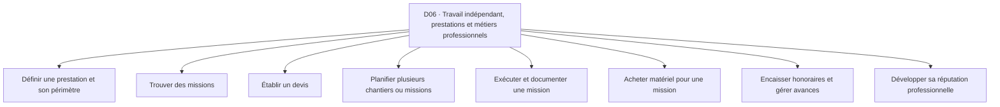

**Accès rapide aux activités :** [A01](#d06-a01) · [A02](#d06-a02) · [A03](#d06-a03) · [A04](#d06-a04) · [A05](#d06-a05) · [A06](#d06-a06) · [A07](#d06-a07) · [A08](#d06-a08)

<a id="d06-a01"></a>
### D06-A01 — Définir une prestation et son périmètre
**Résultat recherché :** Offrir un service compréhensible.

| Réf. action | Action concrète (ordre indicatif) | Friction potentielle liée | Solution / contournement possible *(à vérifier)* | Amélioration à explorer *(hypothèse)* |
|---|---|---|---|---|
| `D06-A01-E01` | Identifier le résultat client | Demande imprécise | Entretien direct | Reformuler le résultat |
| `D06-A01-E02` | Lister les tâches incluses | Travail supplémentaire non payé | Devis papier | Clarifier les limites |
| `D06-A01-E03` | Évaluer le délai | Promesse incompatible avec la charge | Agenda | Estimer la capacité |
| `D06-A01-E04` | Présenter les conditions | Client retient seulement le prix | Message récapitulatif | Rendre visibles exclusions et délais |

*Point de contrôle terrain D06-A01 : demander à une personne concernée de raconter sa dernière réalisation de cette activité ; identifier les étapes réellement suivies, les incidents concrets et le coût d’un incident, puis vérifier si les contournements et les améliorations de ce tableau ont du sens pour elle.*

<a id="d06-a02"></a>
### D06-A02 — Trouver des missions
**Résultat recherché :** Entrer en relation avec des clients pertinents.

| Réf. action | Action concrète (ordre indicatif) | Friction potentielle liée | Solution / contournement possible *(à vérifier)* | Amélioration à explorer *(hypothèse)* |
|---|---|---|---|---|
| `D06-A02-E01` | Montrer des réalisations | Preuves dispersées | Portfolio sur téléphone | Regrouper des exemples autorisés |
| `D06-A02-E02` | Rechercher les demandes | Opportunités cachées dans les groupes | Bouche-à-oreille | Faciliter le repérage |
| `D06-A02-E03` | Qualifier les prospects | Déplacements pour demandes non sérieuses | Appel préalable | Préciser budget et urgence |
| `D06-A02-E04` | Fixer une visite | Rendez-vous manqué | Message de rappel | Confirmer avant déplacement |

*Point de contrôle terrain D06-A02 : demander à une personne concernée de raconter sa dernière réalisation de cette activité ; identifier les étapes réellement suivies, les incidents concrets et le coût d’un incident, puis vérifier si les contournements et les améliorations de ce tableau ont du sens pour elle.*

<a id="d06-a03"></a>
### D06-A03 — Établir un devis
**Résultat recherché :** Donner un prix fondé sur la mission.

| Réf. action | Action concrète (ordre indicatif) | Friction potentielle liée | Solution / contournement possible *(à vérifier)* | Amélioration à explorer *(hypothèse)* |
|---|---|---|---|---|
| `D06-A03-E01` | Recueillir les exigences | Informations manquantes | Visite du lieu | Guider la collecte |
| `D06-A03-E02` | Estimer matériel et temps | Petits coûts oubliés | Calculatrice et carnet | Comparer au coût complet |
| `D06-A03-E03` | Rédiger les options | Client ne distingue pas les niveaux de service | Devis manuscrit | Présenter des variantes explicites |
| `D06-A03-E04` | Obtenir l'accord | Modification orale contestée | Signature ou message | Conserver l'acceptation |

*Point de contrôle terrain D06-A03 : demander à une personne concernée de raconter sa dernière réalisation de cette activité ; identifier les étapes réellement suivies, les incidents concrets et le coût d’un incident, puis vérifier si les contournements et les améliorations de ce tableau ont du sens pour elle.*

<a id="d06-a04"></a>
### D06-A04 — Planifier plusieurs chantiers ou missions
**Résultat recherché :** Éviter les conflits d'agenda.

| Réf. action | Action concrète (ordre indicatif) | Friction potentielle liée | Solution / contournement possible *(à vérifier)* | Amélioration à explorer *(hypothèse)* |
|---|---|---|---|---|
| `D06-A04-E01` | Lister les engagements | Réservations non consignées | Agenda du téléphone | Centraliser les engagements |
| `D06-A04-E02` | Prévoir déplacements | Temps de trajet sous-estimé | Connaissance du quartier | Tenir compte des trajets |
| `D06-A04-E03` | Coordonner les intervenants | Absence d'un partenaire | Appels | Confirmer les dépendances |
| `D06-A04-E04` | Informer des retards | Client attend sans nouvelles | Message vocal | Déclencher une mise à jour |

*Point de contrôle terrain D06-A04 : demander à une personne concernée de raconter sa dernière réalisation de cette activité ; identifier les étapes réellement suivies, les incidents concrets et le coût d’un incident, puis vérifier si les contournements et les améliorations de ce tableau ont du sens pour elle.*

<a id="d06-a05"></a>
### D06-A05 — Exécuter et documenter une mission
**Résultat recherché :** Livrer le résultat convenu.

| Réf. action | Action concrète (ordre indicatif) | Friction potentielle liée | Solution / contournement possible *(à vérifier)* | Amélioration à explorer *(hypothèse)* |
|---|---|---|---|---|
| `D06-A05-E01` | Préparer les outils | Matériel oublié | Sac préparé la veille | Créer un contrôle |
| `D06-A05-E02` | Valider le point de départ | État initial discuté plus tard | Photos avec accord | Documenter la situation |
| `D06-A05-E03` | Réaliser par étapes | Défaut découvert trop tard | Contrôle visuel | Créer des points de vérification |
| `D06-A05-E04` | Présenter la réalisation | Client ne sait pas ce qui a changé | Démonstration sur place | Relier livrable et devis |

*Point de contrôle terrain D06-A05 : demander à une personne concernée de raconter sa dernière réalisation de cette activité ; identifier les étapes réellement suivies, les incidents concrets et le coût d’un incident, puis vérifier si les contournements et les améliorations de ce tableau ont du sens pour elle.*

<a id="d06-a06"></a>
### D06-A06 — Acheter matériel pour une mission
**Résultat recherché :** Disposer des bons intrants au bon moment.

| Réf. action | Action concrète (ordre indicatif) | Friction potentielle liée | Solution / contournement possible *(à vérifier)* | Amélioration à explorer *(hypothèse)* |
|---|---|---|---|---|
| `D06-A06-E01` | Établir la liste | Dimensions et quantités incorrectes | Croquis papier | Relier mesures et achats |
| `D06-A06-E02` | Comparer les vendeurs | Qualité incertaine | Marché local | Structurer les critères |
| `D06-A06-E03` | Régler la commande | Acompte sans confirmation | Reçu manuscrit | Relier paiement et article |
| `D06-A06-E04` | Vérifier la réception | Manquant découvert sur chantier | Comptage | Contrôler avant démarrage |

*Point de contrôle terrain D06-A06 : demander à une personne concernée de raconter sa dernière réalisation de cette activité ; identifier les étapes réellement suivies, les incidents concrets et le coût d’un incident, puis vérifier si les contournements et les améliorations de ce tableau ont du sens pour elle.*

<a id="d06-a07"></a>
### D06-A07 — Encaisser honoraires et gérer avances
**Résultat recherché :** Réduire les litiges de paiement.

| Réf. action | Action concrète (ordre indicatif) | Friction potentielle liée | Solution / contournement possible *(à vérifier)* | Amélioration à explorer *(hypothèse)* |
|---|---|---|---|---|
| `D06-A07-E01` | Fixer les étapes de paiement | Acompte mal compris | Accord par message | Lier échéances et livrables |
| `D06-A07-E02` | Envoyer la demande | Montant ou coordonnées erronés | Facture papier | Vérifier les données |
| `D06-A07-E03` | Constater le règlement | Preuve non confirmée | Contrôle du compte | Rapprocher chaque versement |
| `D06-A07-E04` | Clore le dossier | Solde oublié | Carnet | Signaler les montants dus |

*Point de contrôle terrain D06-A07 : demander à une personne concernée de raconter sa dernière réalisation de cette activité ; identifier les étapes réellement suivies, les incidents concrets et le coût d’un incident, puis vérifier si les contournements et les améliorations de ce tableau ont du sens pour elle.*

<a id="d06-a08"></a>
### D06-A08 — Développer sa réputation professionnelle
**Résultat recherché :** Obtenir des commandes récurrentes sur des preuves réelles.

| Réf. action | Action concrète (ordre indicatif) | Friction potentielle liée | Solution / contournement possible *(à vérifier)* | Amélioration à explorer *(hypothèse)* |
|---|---|---|---|---|
| `D06-A08-E01` | Demander un retour | Retour oublié après mission | Appel de courtoisie | Planifier la demande |
| `D06-A08-E02` | Recueillir une preuve autorisée | Photo publiée sans consentement | Autorisation orale | Tracer les accords |
| `D06-A08-E03` | Répondre à un incident | Plainte publique laissée sans suite | Appel direct | Structurer la résolution |
| `D06-A08-E04` | Entretenir le lien | Messages intrusifs | Carnet clientèle | Adapter les contacts consentis |

*Point de contrôle terrain D06-A08 : demander à une personne concernée de raconter sa dernière réalisation de cette activité ; identifier les étapes réellement suivies, les incidents concrets et le coût d’un incident, puis vérifier si les contournements et les améliorations de ce tableau ont du sens pour elle.*

**Transversalité :** rechercher les connexions avec les autres domaines à partir des mêmes actions (information, comparaison, confiance, paiement, coordination, déplacement, suivi) et non en fusionnant artificiellement des activités distinctes.

<a id="d07"></a>
## D07 — Gestion financière personnelle, budget, épargne et tontines
**Personnes / organisations concernées :** Ménages, salariés, petits entrepreneurs, étudiants, responsables de tontines, proches vivant à distance.
**Inventaire :** 8 activités détaillées. Les personnes peuvent cumuler plusieurs rôles et les parcours ci-dessous ne sont pas exclusifs.

**Carte de navigation du domaine**
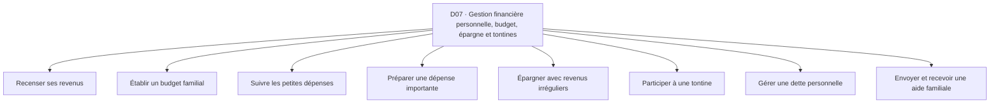

**Accès rapide aux activités :** [A01](#d07-a01) · [A02](#d07-a02) · [A03](#d07-a03) · [A04](#d07-a04) · [A05](#d07-a05) · [A06](#d07-a06) · [A07](#d07-a07) · [A08](#d07-a08)

<a id="d07-a01"></a>
### D07-A01 — Recenser ses revenus
**Résultat recherché :** Savoir combien entre réellement.

| Réf. action | Action concrète (ordre indicatif) | Friction potentielle liée | Solution / contournement possible *(à vérifier)* | Amélioration à explorer *(hypothèse)* |
|---|---|---|---|---|
| `D07-A01-E01` | Lister les sources | Petits revenus oubliés | Carnet | Rassembler les sources |
| `D07-A01-E02` | Distinguer net et brut | Confusion sur les montants disponibles | Calculatrice | Déduire les charges associées |
| `D07-A01-E03` | Noter les dates | Revenus irréguliers difficiles à prévoir | Agenda | Visualiser les périodes creuses |
| `D07-A01-E04` | Mettre à jour | Estimation vite périmée | Note mensuelle | Faciliter la révision |

*Point de contrôle terrain D07-A01 : demander à une personne concernée de raconter sa dernière réalisation de cette activité ; identifier les étapes réellement suivies, les incidents concrets et le coût d’un incident, puis vérifier si les contournements et les améliorations de ce tableau ont du sens pour elle.*

<a id="d07-a02"></a>
### D07-A02 — Établir un budget familial
**Résultat recherché :** Répartir des ressources limitées.

| Réf. action | Action concrète (ordre indicatif) | Friction potentielle liée | Solution / contournement possible *(à vérifier)* | Amélioration à explorer *(hypothèse)* |
|---|---|---|---|---|
| `D07-A02-E01` | Lister charges fixes | Dépenses habituelles oubliées | Discussion du ménage | Préparer un inventaire |
| `D07-A02-E02` | Estimer dépenses variables | Variation des prix | Carnet de marché | Utiliser des fourchettes |
| `D07-A02-E03` | Arbitrer les priorités | Conflits sur les besoins | Réunion familiale | Expliciter les compromis |
| `D07-A02-E04` | Suivre l'exécution | Budget abandonné après quelques jours | Enveloppes | Réduire l'effort de suivi |

*Point de contrôle terrain D07-A02 : demander à une personne concernée de raconter sa dernière réalisation de cette activité ; identifier les étapes réellement suivies, les incidents concrets et le coût d’un incident, puis vérifier si les contournements et les améliorations de ce tableau ont du sens pour elle.*

<a id="d07-a03"></a>
### D07-A03 — Suivre les petites dépenses
**Résultat recherché :** Comprendre où part l'argent.

| Réf. action | Action concrète (ordre indicatif) | Friction potentielle liée | Solution / contournement possible *(à vérifier)* | Amélioration à explorer *(hypothèse)* |
|---|---|---|---|---|
| `D07-A03-E01` | Repérer les paiements | Microdépenses invisibles | Reçus et historique Mobile Money | Rapprocher les traces |
| `D07-A03-E02` | Classer les dépenses | Catégories ambiguës | Cahier | Utiliser des catégories simples |
| `D07-A03-E03` | Comparer aux limites | Découverte tardive du dépassement | Calculatrice | Signaler un écart |
| `D07-A03-E04` | Décider quoi réduire | Économies au mauvais endroit | Discussion personnelle | Montrer l'effet des choix |

*Point de contrôle terrain D07-A03 : demander à une personne concernée de raconter sa dernière réalisation de cette activité ; identifier les étapes réellement suivies, les incidents concrets et le coût d’un incident, puis vérifier si les contournements et les améliorations de ce tableau ont du sens pour elle.*

<a id="d07-a04"></a>
### D07-A04 — Préparer une dépense importante
**Résultat recherché :** Financer un achat ou événement sans déséquilibre.

| Réf. action | Action concrète (ordre indicatif) | Friction potentielle liée | Solution / contournement possible *(à vérifier)* | Amélioration à explorer *(hypothèse)* |
|---|---|---|---|---|
| `D07-A04-E01` | Définir l'échéance | Projet sans date claire | Calendrier | Clarifier le délai |
| `D07-A04-E02` | Estimer le coût complet | Frais annexes omis | Devis et notes | Tester plusieurs scénarios |
| `D07-A04-E03` | Choisir une stratégie | Épargne irréaliste | Enveloppe dédiée | Proposer des jalons réalistes |
| `D07-A04-E04` | Suivre l'avancement | Argent réaffecté sans visibilité | Carnet séparé | Rendre visible le reste à financer |

*Point de contrôle terrain D07-A04 : demander à une personne concernée de raconter sa dernière réalisation de cette activité ; identifier les étapes réellement suivies, les incidents concrets et le coût d’un incident, puis vérifier si les contournements et les améliorations de ce tableau ont du sens pour elle.*

<a id="d07-a05"></a>
### D07-A05 — Épargner avec revenus irréguliers
**Résultat recherché :** Mettre de côté sans compromettre l'essentiel.

| Réf. action | Action concrète (ordre indicatif) | Friction potentielle liée | Solution / contournement possible *(à vérifier)* | Amélioration à explorer *(hypothèse)* |
|---|---|---|---|---|
| `D07-A05-E01` | Repérer les périodes favorables | Épargne décidée au hasard | Souvenir des ventes | Lire les variations |
| `D07-A05-E02` | Fixer un montant soutenable | Montant rigide inadapté | Règle personnelle | Autoriser un plan flexible |
| `D07-A05-E03` | Mettre de côté | Somme confondue avec caisse courante | Compte séparé ou enveloppe | Clarifier la réserve |
| `D07-A05-E04` | Faire face à l'imprévu | Retrait sans plan de reconstitution | Carnet | Prévoir la reprise |

*Point de contrôle terrain D07-A05 : demander à une personne concernée de raconter sa dernière réalisation de cette activité ; identifier les étapes réellement suivies, les incidents concrets et le coût d’un incident, puis vérifier si les contournements et les améliorations de ce tableau ont du sens pour elle.*

<a id="d07-a06"></a>
### D07-A06 — Participer à une tontine
**Résultat recherché :** Cotiser et recevoir conformément aux règles.

| Réf. action | Action concrète (ordre indicatif) | Friction potentielle liée | Solution / contournement possible *(à vérifier)* | Amélioration à explorer *(hypothèse)* |
|---|---|---|---|---|
| `D07-A06-E01` | Comprendre le fonctionnement | Ordre de passage ambigu | Réunion et règlement oral | Formaliser les conditions |
| `D07-A06-E02` | Verser une cotisation | Versement non attribué | Reçu ou message | Rapprocher paiement et membre |
| `D07-A06-E03` | Suivre les tours | Dates et montants oubliés | Carnet du responsable | Afficher un calendrier commun |
| `D07-A06-E04` | Traiter un défaut | Conflit entre membres | Médiation du groupe | Documenter les décisions |

*Point de contrôle terrain D07-A06 : demander à une personne concernée de raconter sa dernière réalisation de cette activité ; identifier les étapes réellement suivies, les incidents concrets et le coût d’un incident, puis vérifier si les contournements et les améliorations de ce tableau ont du sens pour elle.*

<a id="d07-a07"></a>
### D07-A07 — Gérer une dette personnelle
**Résultat recherché :** Rembourser sans perdre le fil.

| Réf. action | Action concrète (ordre indicatif) | Friction potentielle liée | Solution / contournement possible *(à vérifier)* | Amélioration à explorer *(hypothèse)* |
|---|---|---|---|---|
| `D07-A07-E01` | Lister les créanciers | Petits emprunts omis | Carnet | Centraliser les engagements |
| `D07-A07-E02` | Vérifier conditions | Frais et échéances mal compris | Messages et contrat | Rendre lisible le coût |
| `D07-A07-E03` | Planifier les versements | Promesses irréalistes | Agenda | Aligner avec les rentrées |
| `D07-A07-E04` | Conserver les preuves | Remboursement contesté | Reçus | Associer chaque versement à une dette |

*Point de contrôle terrain D07-A07 : demander à une personne concernée de raconter sa dernière réalisation de cette activité ; identifier les étapes réellement suivies, les incidents concrets et le coût d’un incident, puis vérifier si les contournements et les améliorations de ce tableau ont du sens pour elle.*

<a id="d07-a08"></a>
### D07-A08 — Envoyer et recevoir une aide familiale
**Résultat recherché :** Transférer un soutien au bon moment.

| Réf. action | Action concrète (ordre indicatif) | Friction potentielle liée | Solution / contournement possible *(à vérifier)* | Amélioration à explorer *(hypothèse)* |
|---|---|---|---|---|
| `D07-A08-E01` | Confirmer le besoin | Montant incomplet | Appel familial | Clarifier l'objet |
| `D07-A08-E02` | Vérifier le bénéficiaire | Erreur de numéro | Double vérification | Réduire les erreurs d'envoi |
| `D07-A08-E03` | Transférer l'argent | Frais ou plafond imprévus | Mobile Money et espèces | Comparer les contraintes |
| `D07-A08-E04` | Confirmer réception et usage | Malentendu ou versement non reçu | Appel et reçu | Tracer la confirmation |

*Point de contrôle terrain D07-A08 : demander à une personne concernée de raconter sa dernière réalisation de cette activité ; identifier les étapes réellement suivies, les incidents concrets et le coût d’un incident, puis vérifier si les contournements et les améliorations de ce tableau ont du sens pour elle.*

**Transversalité :** rechercher les connexions avec les autres domaines à partir des mêmes actions (information, comparaison, confiance, paiement, coordination, déplacement, suivi) et non en fusionnant artificiellement des activités distinctes.

<a id="d08"></a>
## D08 — Paiements, crédit, emprunts, assurances et services financiers
**Personnes / organisations concernées :** Usagers Mobile Money, commerçants, emprunteurs, prêteurs, assurés, agents, associations.
**Inventaire :** 8 activités détaillées. Les personnes peuvent cumuler plusieurs rôles et les parcours ci-dessous ne sont pas exclusifs.

**Carte de navigation du domaine**
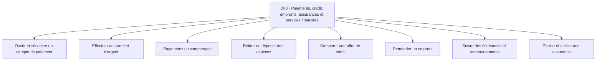

**Accès rapide aux activités :** [A01](#d08-a01) · [A02](#d08-a02) · [A03](#d08-a03) · [A04](#d08-a04) · [A05](#d08-a05) · [A06](#d08-a06) · [A07](#d08-a07) · [A08](#d08-a08)

<a id="d08-a01"></a>
### D08-A01 — Ouvrir et sécuriser un compte de paiement
**Résultat recherché :** Utiliser un service à son nom et sous contrôle.

| Réf. action | Action concrète (ordre indicatif) | Friction potentielle liée | Solution / contournement possible *(à vérifier)* | Amélioration à explorer *(hypothèse)* |
|---|---|---|---|---|
| `D08-A01-E01` | Comparer les modalités | Frais et conditions peu compris | Conseils d'agent | Présenter les questions utiles |
| `D08-A01-E02` | Préparer l'identification | Document refusé ou incomplet | Guichet | Vérifier les pièces |
| `D08-A01-E03` | Activer le service | Étapes techniques mal suivies | Aide de l'agent | Guider sans exposer de secrets |
| `D08-A01-E04` | Protéger l'accès | Code divulgué à un tiers | Conseil familial | Rappeler les bonnes pratiques |

*Point de contrôle terrain D08-A01 : demander à une personne concernée de raconter sa dernière réalisation de cette activité ; identifier les étapes réellement suivies, les incidents concrets et le coût d’un incident, puis vérifier si les contournements et les améliorations de ce tableau ont du sens pour elle.*

<a id="d08-a02"></a>
### D08-A02 — Effectuer un transfert d'argent
**Résultat recherché :** Envoyer le montant au destinataire voulu.

| Réf. action | Action concrète (ordre indicatif) | Friction potentielle liée | Solution / contournement possible *(à vérifier)* | Amélioration à explorer *(hypothèse)* |
|---|---|---|---|---|
| `D08-A02-E01` | Obtenir les coordonnées | Numéro transmis avec erreur | Message de confirmation | Valider l'identité |
| `D08-A02-E02` | Vérifier frais et solde | Montant final inattendu | Menu opérateur | Prévisualiser le coût |
| `D08-A02-E03` | Autoriser le transfert | Manipulation ou escroquerie | Relecture avant validation | Introduire des pauses de contrôle |
| `D08-A02-E04` | Vérifier le résultat | Échec supposé succès | SMS ou solde | Différencier statut et preuve |

*Point de contrôle terrain D08-A02 : demander à une personne concernée de raconter sa dernière réalisation de cette activité ; identifier les étapes réellement suivies, les incidents concrets et le coût d’un incident, puis vérifier si les contournements et les améliorations de ce tableau ont du sens pour elle.*

<a id="d08-a03"></a>
### D08-A03 — Payer chez un commerçant
**Résultat recherché :** Régler un achat et libérer la marchandise.

| Réf. action | Action concrète (ordre indicatif) | Friction potentielle liée | Solution / contournement possible *(à vérifier)* | Amélioration à explorer *(hypothèse)* |
|---|---|---|---|---|
| `D08-A03-E01` | Choisir le moyen accepté | Canal indisponible | Espèces de secours | Connaître les alternatives |
| `D08-A03-E02` | Vérifier le montant | Mauvais montant saisi | Annonce orale | Présenter un récapitulatif |
| `D08-A03-E03` | Payer | Réseau instable ou double tentative | Attente puis vérification | Éviter les paiements répétés |
| `D08-A03-E04` | Confirmer au vendeur | Capture frauduleuse | Contrôle du compte bénéficiaire | Rapprocher l'encaissement |

*Point de contrôle terrain D08-A03 : demander à une personne concernée de raconter sa dernière réalisation de cette activité ; identifier les étapes réellement suivies, les incidents concrets et le coût d’un incident, puis vérifier si les contournements et les améliorations de ce tableau ont du sens pour elle.*

<a id="d08-a04"></a>
### D08-A04 — Retirer ou déposer des espèces
**Résultat recherché :** Convertir un solde en liquidités ou inversement.

| Réf. action | Action concrète (ordre indicatif) | Friction potentielle liée | Solution / contournement possible *(à vérifier)* | Amélioration à explorer *(hypothèse)* |
|---|---|---|---|---|
| `D08-A04-E01` | Localiser un point | Agent éloigné ou fermé | Appel à un contact | Préqualifier l'accès |
| `D08-A04-E02` | Vérifier liquidités | Agent sans espèces suffisantes | Question au guichet | Limiter les trajets inutiles |
| `D08-A04-E03` | Effectuer l'opération | Erreur de montant ou fraude | Reçu et contrôle immédiat | Structurer le contrôle |
| `D08-A04-E04` | Vérifier solde et reçu | Anomalie découverte plus tard | SMS et carnet | Faciliter le rapprochement |

*Point de contrôle terrain D08-A04 : demander à une personne concernée de raconter sa dernière réalisation de cette activité ; identifier les étapes réellement suivies, les incidents concrets et le coût d’un incident, puis vérifier si les contournements et les améliorations de ce tableau ont du sens pour elle.*

<a id="d08-a05"></a>
### D08-A05 — Comparer une offre de crédit
**Résultat recherché :** Comprendre l'engagement financier.

| Réf. action | Action concrète (ordre indicatif) | Friction potentielle liée | Solution / contournement possible *(à vérifier)* | Amélioration à explorer *(hypothèse)* |
|---|---|---|---|---|
| `D08-A05-E01` | Décrire le besoin | Montant demandé supérieur au besoin | Budget papier | Calculer le besoin net |
| `D08-A05-E02` | Recueillir les offres | Comparaison sur taux seul | Visites et fiches | Comparer coût total |
| `D08-A05-E03` | Lire les obligations | Pénalités ignorées | Conseil d'un professionnel | Rendre les échéances claires |
| `D08-A05-E04` | Tester remboursement | Capacité de payer surestimée | Tableur | Simuler des mois difficiles |

*Point de contrôle terrain D08-A05 : demander à une personne concernée de raconter sa dernière réalisation de cette activité ; identifier les étapes réellement suivies, les incidents concrets et le coût d’un incident, puis vérifier si les contournements et les améliorations de ce tableau ont du sens pour elle.*

<a id="d08-a06"></a>
### D08-A06 — Demander un emprunt
**Résultat recherché :** Constituer un dossier cohérent.

| Réf. action | Action concrète (ordre indicatif) | Friction potentielle liée | Solution / contournement possible *(à vérifier)* | Amélioration à explorer *(hypothèse)* |
|---|---|---|---|---|
| `D08-A06-E01` | Vérifier éligibilité | Temps perdu sur une offre inaccessible | Renseignement au guichet | Préfiltrer les critères |
| `D08-A06-E02` | Réunir les preuves | Revenus informels mal documentés | Carnet et relevés | Organiser les justificatifs |
| `D08-A06-E03` | Soumettre la demande | Dossier incomplet | Agent d'accompagnement | Contrôler avant dépôt |
| `D08-A06-E04` | Suivre la réponse | Relances sans référence | Appels | Relier demande et statut |

*Point de contrôle terrain D08-A06 : demander à une personne concernée de raconter sa dernière réalisation de cette activité ; identifier les étapes réellement suivies, les incidents concrets et le coût d’un incident, puis vérifier si les contournements et les améliorations de ce tableau ont du sens pour elle.*

<a id="d08-a07"></a>
### D08-A07 — Suivre des échéances et remboursements
**Résultat recherché :** Éviter oubli et contestation.

| Réf. action | Action concrète (ordre indicatif) | Friction potentielle liée | Solution / contournement possible *(à vérifier)* | Amélioration à explorer *(hypothèse)* |
|---|---|---|---|---|
| `D08-A07-E01` | Recenser les échéances | Multiples prêts confondus | Calendrier | Créer une vue commune |
| `D08-A07-E02` | Préparer les fonds | Échéance avant rentrée d'argent | Budget | Anticiper les tensions |
| `D08-A07-E03` | Payer la bonne référence | Versement mal imputé | Reçu | Contrôler l'affectation |
| `D08-A07-E04` | Conserver l'historique | Solde contesté | Dossier papier | Rapprocher historique et contrat |

*Point de contrôle terrain D08-A07 : demander à une personne concernée de raconter sa dernière réalisation de cette activité ; identifier les étapes réellement suivies, les incidents concrets et le coût d’un incident, puis vérifier si les contournements et les améliorations de ce tableau ont du sens pour elle.*

<a id="d08-a08"></a>
### D08-A08 — Choisir et utiliser une assurance
**Résultat recherché :** Comprendre couverture et démarches.

| Réf. action | Action concrète (ordre indicatif) | Friction potentielle liée | Solution / contournement possible *(à vérifier)* | Amélioration à explorer *(hypothèse)* |
|---|---|---|---|---|
| `D08-A08-E01` | Identifier le risque | Produit inadapté | Conseil d'agent | Clarifier le besoin |
| `D08-A08-E02` | Lire exclusions et plafonds | Promesse interprétée trop largement | Notice contractuelle | Résumer les limites vérifiables |
| `D08-A08-E03` | Conserver les documents | Police égarée | Chemise papier | Rassembler les preuves |
| `D08-A08-E04` | Déclarer un sinistre | Délai ou pièce ignorés | Appel à l'assureur | Guider vers les étapes officielles |

*Point de contrôle terrain D08-A08 : demander à une personne concernée de raconter sa dernière réalisation de cette activité ; identifier les étapes réellement suivies, les incidents concrets et le coût d’un incident, puis vérifier si les contournements et les améliorations de ce tableau ont du sens pour elle.*

**Transversalité :** rechercher les connexions avec les autres domaines à partir des mêmes actions (information, comparaison, confiance, paiement, coordination, déplacement, suivi) et non en fusionnant artificiellement des activités distinctes.

<a id="d09"></a>
## D09 — Approvisionnement, commerce international, importation et exportation
**Personnes / organisations concernées :** Importateurs, exportateurs, grossistes, transitaires, acheteurs de petites entreprises, producteurs.
**Inventaire :** 8 activités détaillées. Les personnes peuvent cumuler plusieurs rôles et les parcours ci-dessous ne sont pas exclusifs.

**Carte de navigation du domaine**
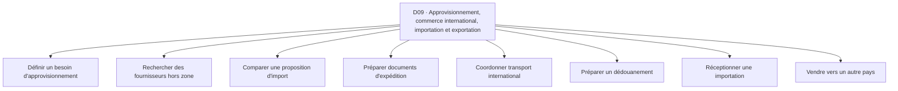

**Accès rapide aux activités :** [A01](#d09-a01) · [A02](#d09-a02) · [A03](#d09-a03) · [A04](#d09-a04) · [A05](#d09-a05) · [A06](#d09-a06) · [A07](#d09-a07) · [A08](#d09-a08)

<a id="d09-a01"></a>
### D09-A01 — Définir un besoin d'approvisionnement
**Résultat recherché :** Savoir quoi commander en quelle quantité.

| Réf. action | Action concrète (ordre indicatif) | Friction potentielle liée | Solution / contournement possible *(à vérifier)* | Amélioration à explorer *(hypothèse)* |
|---|---|---|---|---|
| `D09-A01-E01` | Prévoir la demande | Volumes incertains | Historique des ventes | Comparer plusieurs hypothèses |
| `D09-A01-E02` | Spécifier l'article | Norme ou variante oubliée | Photo et fiche technique | Établir un cahier de besoins |
| `D09-A01-E03` | Déterminer budget | Transport et taxes ignorés | Calculatrice | Inclure le coût rendu |
| `D09-A01-E04` | Valider le calendrier | Commande lancée trop tard | Agenda | Aligner besoin et délai |

*Point de contrôle terrain D09-A01 : demander à une personne concernée de raconter sa dernière réalisation de cette activité ; identifier les étapes réellement suivies, les incidents concrets et le coût d’un incident, puis vérifier si les contournements et les améliorations de ce tableau ont du sens pour elle.*

<a id="d09-a02"></a>
### D09-A02 — Rechercher des fournisseurs hors zone
**Résultat recherché :** Trouver une source crédible.

| Réf. action | Action concrète (ordre indicatif) | Friction potentielle liée | Solution / contournement possible *(à vérifier)* | Amélioration à explorer *(hypothèse)* |
|---|---|---|---|---|
| `D09-A02-E01` | Identifier les canaux | Intermédiaires opaques | Recommandations et annuaires | Conserver la provenance |
| `D09-A02-E02` | Demander un devis | Unités et devises confondues | Courriel | Normaliser les demandes |
| `D09-A02-E03` | Contrôler l'entreprise | Faux documents ou identité incertaine | Vérification indépendante | Définir les contrôles |
| `D09-A02-E04` | Tester un échantillon | Qualité différente du lot | Commande test | Relier essai et achat futur |

*Point de contrôle terrain D09-A02 : demander à une personne concernée de raconter sa dernière réalisation de cette activité ; identifier les étapes réellement suivies, les incidents concrets et le coût d’un incident, puis vérifier si les contournements et les améliorations de ce tableau ont du sens pour elle.*

<a id="d09-a03"></a>
### D09-A03 — Comparer une proposition d'import
**Résultat recherché :** Choisir une offre au coût et risque compréhensibles.

| Réf. action | Action concrète (ordre indicatif) | Friction potentielle liée | Solution / contournement possible *(à vérifier)* | Amélioration à explorer *(hypothèse)* |
|---|---|---|---|---|
| `D09-A03-E01` | Lire les conditions | Incoterms ou périmètre mal compris | Conseil transitaire | Clarifier qui paie quoi |
| `D09-A03-E02` | Estimer frais de route | Coût final sous-estimé | Devis de transport | Construire coût rendu |
| `D09-A03-E03` | Vérifier documents requis | Marchandise bloquée | Conseil administratif officiel | Créer une checklist actualisable |
| `D09-A03-E04` | Arbitrer fournisseur et délai | Prix bas mais retard coûteux | Tableur | Comparer scénarios |

*Point de contrôle terrain D09-A03 : demander à une personne concernée de raconter sa dernière réalisation de cette activité ; identifier les étapes réellement suivies, les incidents concrets et le coût d’un incident, puis vérifier si les contournements et les améliorations de ce tableau ont du sens pour elle.*

<a id="d09-a04"></a>
### D09-A04 — Préparer documents d'expédition
**Résultat recherché :** Réduire erreurs et blocages.

| Réf. action | Action concrète (ordre indicatif) | Friction potentielle liée | Solution / contournement possible *(à vérifier)* | Amélioration à explorer *(hypothèse)* |
|---|---|---|---|---|
| `D09-A04-E01` | Lister pièces nécessaires | Exigence changeante selon produit | Administration et transitaire | Vérifier à la source |
| `D09-A04-E02` | Obtenir factures et certificats | Incohérence de noms ou quantités | Échange avec fournisseur | Contrôler les champs |
| `D09-A04-E03` | Soumettre au bon acteur | Envoi à mauvais interlocuteur | Courriel | Tracer les remises |
| `D09-A04-E04` | Archiver versions | Document périmé utilisé | Dossier partagé | Identifier la version valide |

*Point de contrôle terrain D09-A04 : demander à une personne concernée de raconter sa dernière réalisation de cette activité ; identifier les étapes réellement suivies, les incidents concrets et le coût d’un incident, puis vérifier si les contournements et les améliorations de ce tableau ont du sens pour elle.*

<a id="d09-a05"></a>
### D09-A05 — Coordonner transport international
**Résultat recherché :** Acheminer dans les conditions convenues.

| Réf. action | Action concrète (ordre indicatif) | Friction potentielle liée | Solution / contournement possible *(à vérifier)* | Amélioration à explorer *(hypothèse)* |
|---|---|---|---|---|
| `D09-A05-E01` | Choisir un transporteur | Offres difficiles à comparer | Transitaire habituel | Rendre visibles services inclus |
| `D09-A05-E02` | Réserver la capacité | Date de départ non garantie | Appels | Confirmer le jalon |
| `D09-A05-E03` | Suivre la cargaison | Statuts incomplets | Messages du transporteur | Regrouper les mises à jour |
| `D09-A05-E04` | Gérer retard ou avarie | Responsabilités contestées | Réclamation papier | Conserver la chronologie |

*Point de contrôle terrain D09-A05 : demander à une personne concernée de raconter sa dernière réalisation de cette activité ; identifier les étapes réellement suivies, les incidents concrets et le coût d’un incident, puis vérifier si les contournements et les améliorations de ce tableau ont du sens pour elle.*

<a id="d09-a06"></a>
### D09-A06 — Préparer un dédouanement
**Résultat recherché :** Rendre les marchandises admissibles selon les règles applicables.

| Réf. action | Action concrète (ordre indicatif) | Friction potentielle liée | Solution / contournement possible *(à vérifier)* | Amélioration à explorer *(hypothèse)* |
|---|---|---|---|---|
| `D09-A06-E01` | Vérifier la classification | Produit classé de manière erronée | Expert et sources officielles | Contrôle de cohérence |
| `D09-A06-E02` | Rassembler justificatifs | Pièces incomplètes | Transitaire | Checklist personnalisée |
| `D09-A06-E03` | Calculer taxes et frais | Charge imprévue | Devis professionnel | Prévoir les postes |
| `D09-A06-E04` | Suivre la mainlevée | Blocage sans explication claire | Appels au déclarant | Tracer motifs et statut |

*Point de contrôle terrain D09-A06 : demander à une personne concernée de raconter sa dernière réalisation de cette activité ; identifier les étapes réellement suivies, les incidents concrets et le coût d’un incident, puis vérifier si les contournements et les améliorations de ce tableau ont du sens pour elle.*

<a id="d09-a07"></a>
### D09-A07 — Réceptionner une importation
**Résultat recherché :** Vérifier conformité physique et documentaire.

| Réf. action | Action concrète (ordre indicatif) | Friction potentielle liée | Solution / contournement possible *(à vérifier)* | Amélioration à explorer *(hypothèse)* |
|---|---|---|---|---|
| `D09-A07-E01` | Préparer le lieu de réception | Stockage insuffisant | Entrepôt partenaire | Réserver la capacité |
| `D09-A07-E02` | Comparer colis et facture | Quantités discordantes | Comptage | Rapprocher les pièces |
| `D09-A07-E03` | Contrôler dommages | Avarie découverte tard | Photos datées | Structurer les constats |
| `D09-A07-E04` | Traiter un écart | Réclamation hors délai | Message au fournisseur | Organiser les preuves |

*Point de contrôle terrain D09-A07 : demander à une personne concernée de raconter sa dernière réalisation de cette activité ; identifier les étapes réellement suivies, les incidents concrets et le coût d’un incident, puis vérifier si les contournements et les améliorations de ce tableau ont du sens pour elle.*

<a id="d09-a08"></a>
### D09-A08 — Vendre vers un autre pays
**Résultat recherché :** Servir une clientèle transfrontalière.

| Réf. action | Action concrète (ordre indicatif) | Friction potentielle liée | Solution / contournement possible *(à vérifier)* | Amélioration à explorer *(hypothèse)* |
|---|---|---|---|---|
| `D09-A08-E01` | Qualifier le marché | Demande surestimée | Réseau de distributeurs | Rechercher un signal d'achat |
| `D09-A08-E02` | Adapter offre et documents | Étiquetage ou langue inadaptés | Conseil local | Prévoir les adaptations |
| `D09-A08-E03` | Fixer prix et règlement | Change et risque de paiement mal anticipés | Devis et avance | Calculer le revenu réel |
| `D09-A08-E04` | Organiser livraison et support | Client distant sans suivi | Transporteur et messagerie | Clarifier les responsabilités |

*Point de contrôle terrain D09-A08 : demander à une personne concernée de raconter sa dernière réalisation de cette activité ; identifier les étapes réellement suivies, les incidents concrets et le coût d’un incident, puis vérifier si les contournements et les améliorations de ce tableau ont du sens pour elle.*

**Transversalité :** rechercher les connexions avec les autres domaines à partir des mêmes actions (information, comparaison, confiance, paiement, coordination, déplacement, suivi) et non en fusionnant artificiellement des activités distinctes.

<a id="d10"></a>
## D10 — Création de contenu, économie numérique et monétisation des talents
**Personnes / organisations concernées :** Créateurs, musiciens, éducateurs, vidéastes, graphistes, communautés, marques, indépendants.
**Inventaire :** 8 activités détaillées. Les personnes peuvent cumuler plusieurs rôles et les parcours ci-dessous ne sont pas exclusifs.

**Carte de navigation du domaine**
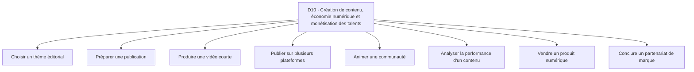

**Accès rapide aux activités :** [A01](#d10-a01) · [A02](#d10-a02) · [A03](#d10-a03) · [A04](#d10-a04) · [A05](#d10-a05) · [A06](#d10-a06) · [A07](#d10-a07) · [A08](#d10-a08)

<a id="d10-a01"></a>
### D10-A01 — Choisir un thème éditorial
**Résultat recherché :** Servir un public avec un angle cohérent.

| Réf. action | Action concrète (ordre indicatif) | Friction potentielle liée | Solution / contournement possible *(à vérifier)* | Amélioration à explorer *(hypothèse)* |
|---|---|---|---|---|
| `D10-A01-E01` | Identifier les besoins du public | Intuition confondue avec demande | Commentaires et échanges | Classer les questions concrètes |
| `D10-A01-E02` | Étudier les formats existants | Imitation sans différenciation | Observation de chaînes | Cartographier les attentes |
| `D10-A01-E03` | Définir une promesse | Thème trop large | Note éditoriale | Préciser le résultat attendu |
| `D10-A01-E04` | Tester l'intérêt | Vues ponctuelles mal interprétées | Publication pilote | Comparer plusieurs essais |

*Point de contrôle terrain D10-A01 : demander à une personne concernée de raconter sa dernière réalisation de cette activité ; identifier les étapes réellement suivies, les incidents concrets et le coût d’un incident, puis vérifier si les contournements et les améliorations de ce tableau ont du sens pour elle.*

<a id="d10-a02"></a>
### D10-A02 — Préparer une publication
**Résultat recherché :** Rassembler éléments nécessaires avant création.

| Réf. action | Action concrète (ordre indicatif) | Friction potentielle liée | Solution / contournement possible *(à vérifier)* | Amélioration à explorer *(hypothèse)* |
|---|---|---|---|---|
| `D10-A02-E01` | Définir l'objectif | Contenu sans appel clair | Brief papier | Relier format et but |
| `D10-A02-E02` | Écrire le plan | Messages désordonnés | Notes de téléphone | Structurer la progression |
| `D10-A02-E03` | Rassembler actifs et droits | Images sans autorisation | Fichiers personnels | Tracer les permissions |
| `D10-A02-E04` | Prévoir le temps | Production interrompue | Agenda | Découper en tâches |

*Point de contrôle terrain D10-A02 : demander à une personne concernée de raconter sa dernière réalisation de cette activité ; identifier les étapes réellement suivies, les incidents concrets et le coût d’un incident, puis vérifier si les contournements et les améliorations de ce tableau ont du sens pour elle.*

<a id="d10-a03"></a>
### D10-A03 — Produire une vidéo courte
**Résultat recherché :** Créer un contenu regardable et compréhensible.

| Réf. action | Action concrète (ordre indicatif) | Friction potentielle liée | Solution / contournement possible *(à vérifier)* | Amélioration à explorer *(hypothèse)* |
|---|---|---|---|---|
| `D10-A03-E01` | Préparer le tournage | Son ou lumière médiocres | Test smartphone | Vérifier les paramètres |
| `D10-A03-E02` | Enregistrer | Multiples prises coûteuses | Script imprimé | Faciliter le découpage |
| `D10-A03-E03` | Monter et sous-titrer | Sous-titres faux ou coupés | Éditeur mobile | Contrôler la lisibilité |
| `D10-A03-E04` | Exporter au bon format | Recadrage ou fichier trop lourd | Essai privé | Vérifier avant publication |

*Point de contrôle terrain D10-A03 : demander à une personne concernée de raconter sa dernière réalisation de cette activité ; identifier les étapes réellement suivies, les incidents concrets et le coût d’un incident, puis vérifier si les contournements et les améliorations de ce tableau ont du sens pour elle.*

<a id="d10-a04"></a>
### D10-A04 — Publier sur plusieurs plateformes
**Résultat recherché :** Diffuser correctement un contenu.

| Réf. action | Action concrète (ordre indicatif) | Friction potentielle liée | Solution / contournement possible *(à vérifier)* | Amélioration à explorer *(hypothèse)* |
|---|---|---|---|---|
| `D10-A04-E01` | Adapter les proportions | Image ou texte tronqué | Éditeurs distincts | Contrôler les zones sûres |
| `D10-A04-E02` | Préparer titres et descriptions | Texte copié sans contexte | Notes modèles | Adapter le message |
| `D10-A04-E03` | Programmer les sorties | Publications oubliées | Agenda | Visualiser le calendrier |
| `D10-A04-E04` | Vérifier après mise en ligne | Lien ou audio indisponible | Ouverture manuelle | Contrôler le rendu final |

*Point de contrôle terrain D10-A04 : demander à une personne concernée de raconter sa dernière réalisation de cette activité ; identifier les étapes réellement suivies, les incidents concrets et le coût d’un incident, puis vérifier si les contournements et les améliorations de ce tableau ont du sens pour elle.*

<a id="d10-a05"></a>
### D10-A05 — Animer une communauté
**Résultat recherché :** Entretenir des échanges utiles.

| Réf. action | Action concrète (ordre indicatif) | Friction potentielle liée | Solution / contournement possible *(à vérifier)* | Amélioration à explorer *(hypothèse)* |
|---|---|---|---|---|
| `D10-A05-E01` | Lire les commentaires | Demandes importantes noyées | Notifications | Trier les sujets |
| `D10-A05-E02` | Répondre avec cohérence | Informations contradictoires | Réponses sauvegardées | Maintenir une base de réponses |
| `D10-A05-E03` | Modérer les abus | Tensions et harcèlement | Règles du groupe | Clarifier les procédures |
| `D10-A05-E04` | Organiser la participation | Communauté passive | Sondages | Tester des formats d'échange |

*Point de contrôle terrain D10-A05 : demander à une personne concernée de raconter sa dernière réalisation de cette activité ; identifier les étapes réellement suivies, les incidents concrets et le coût d’un incident, puis vérifier si les contournements et les améliorations de ce tableau ont du sens pour elle.*

<a id="d10-a06"></a>
### D10-A06 — Analyser la performance d'un contenu
**Résultat recherché :** Comprendre des signaux plutôt que courir les vues.

| Réf. action | Action concrète (ordre indicatif) | Friction potentielle liée | Solution / contournement possible *(à vérifier)* | Amélioration à explorer *(hypothèse)* |
|---|---|---|---|---|
| `D10-A06-E01` | Choisir un objectif | Mauvais indicateur suivi | Tableau de bord natif | Distinguer portée et action |
| `D10-A06-E02` | Collecter les chiffres | Plateformes incomparables | Feuille de calcul | Harmoniser les unités |
| `D10-A06-E03` | Observer les retours qualitatifs | Commentaires représentatifs ignorés | Lecture manuelle | Classer les signaux |
| `D10-A06-E04` | Adapter la ligne éditoriale | Conclusion hâtive | Réunion éditoriale | Conserver les hypothèses |

*Point de contrôle terrain D10-A06 : demander à une personne concernée de raconter sa dernière réalisation de cette activité ; identifier les étapes réellement suivies, les incidents concrets et le coût d’un incident, puis vérifier si les contournements et les améliorations de ce tableau ont du sens pour elle.*

<a id="d10-a07"></a>
### D10-A07 — Vendre un produit numérique
**Résultat recherché :** Livrer légalement un fichier ou un accès payé.

| Réf. action | Action concrète (ordre indicatif) | Friction potentielle liée | Solution / contournement possible *(à vérifier)* | Amélioration à explorer *(hypothèse)* |
|---|---|---|---|---|
| `D10-A07-E01` | Décrire le contenu | Acheteur comprend mal les limites | Page de vente | Rendre explicite le contenu |
| `D10-A07-E02` | Recevoir le paiement | Conversion et frais imprévus | Mobile Money ou virement | Clarifier coût et canal |
| `D10-A07-E03` | Donner accès | Lien expiré ou partagé | Envoi manuel | Contrôler la livraison |
| `D10-A07-E04` | Assurer le support | Acheteur bloqué sans contact | Messagerie | Prévoir une aide simple |

*Point de contrôle terrain D10-A07 : demander à une personne concernée de raconter sa dernière réalisation de cette activité ; identifier les étapes réellement suivies, les incidents concrets et le coût d’un incident, puis vérifier si les contournements et les améliorations de ce tableau ont du sens pour elle.*

<a id="d10-a08"></a>
### D10-A08 — Conclure un partenariat de marque
**Résultat recherché :** Exécuter une collaboration transparente.

| Réf. action | Action concrète (ordre indicatif) | Friction potentielle liée | Solution / contournement possible *(à vérifier)* | Amélioration à explorer *(hypothèse)* |
|---|---|---|---|---|
| `D10-A08-E01` | Vérifier la marque | Interlocuteur frauduleux | Courriel officiel | Recouper l'identité |
| `D10-A08-E02` | Négocier les livrables | Nombre de révisions flou | Contrat écrit | Clarifier périmètre et droits |
| `D10-A08-E03` | Produire et faire valider | Allers-retours coûteux | Messagerie | Suivre les versions |
| `D10-A08-E04` | Déclarer et facturer | Paiement tardif ou publicité non signalée | Facture et mention publique | Tracer les obligations |

*Point de contrôle terrain D10-A08 : demander à une personne concernée de raconter sa dernière réalisation de cette activité ; identifier les étapes réellement suivies, les incidents concrets et le coût d’un incident, puis vérifier si les contournements et les améliorations de ce tableau ont du sens pour elle.*

**Transversalité :** rechercher les connexions avec les autres domaines à partir des mêmes actions (information, comparaison, confiance, paiement, coordination, déplacement, suivi) et non en fusionnant artificiellement des activités distinctes.


# B — Production, habitat et services essentiels

<a id="d11"></a>
## D11 — Agriculture, élevage, pêche et transformation agricole
**Personnes / organisations concernées :** Exploitants, éleveurs, pêcheurs, groupements, collecteurs, transformateurs, acheteurs.
**Inventaire :** 8 activités détaillées. Les personnes peuvent cumuler plusieurs rôles et les parcours ci-dessous ne sont pas exclusifs.

**Carte de navigation du domaine**
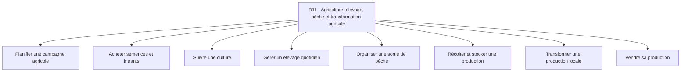

**Accès rapide aux activités :** [A01](#d11-a01) · [A02](#d11-a02) · [A03](#d11-a03) · [A04](#d11-a04) · [A05](#d11-a05) · [A06](#d11-a06) · [A07](#d11-a07) · [A08](#d11-a08)

<a id="d11-a01"></a>
### D11-A01 — Planifier une campagne agricole
**Résultat recherché :** Choisir quoi produire et quand.

| Réf. action | Action concrète (ordre indicatif) | Friction potentielle liée | Solution / contournement possible *(à vérifier)* | Amélioration à explorer *(hypothèse)* |
|---|---|---|---|---|
| `D11-A01-E01` | Évaluer ressources et parcelle | Surface ou eau mal estimées | Visite terrain | Structurer le diagnostic |
| `D11-A01-E02` | Choisir les cultures | Variétés inadaptées | Conseil local | Comparer contraintes |
| `D11-A01-E03` | Calculer intrants | Sous-estimation des besoins | Carnet agricole | Préparer un budget complet |
| `D11-A01-E04` | Fixer calendrier | Fenêtre saisonnière manquée | Calendrier communautaire | Associer tâches et périodes |

*Point de contrôle terrain D11-A01 : demander à une personne concernée de raconter sa dernière réalisation de cette activité ; identifier les étapes réellement suivies, les incidents concrets et le coût d’un incident, puis vérifier si les contournements et les améliorations de ce tableau ont du sens pour elle.*

<a id="d11-a02"></a>
### D11-A02 — Acheter semences et intrants
**Résultat recherché :** Obtenir des produits adaptés et traçables.

| Réf. action | Action concrète (ordre indicatif) | Friction potentielle liée | Solution / contournement possible *(à vérifier)* | Amélioration à explorer *(hypothèse)* |
|---|---|---|---|---|
| `D11-A02-E01` | Préciser les caractéristiques | Produits mal identifiés | Conseil de vendeur | Documenter les références |
| `D11-A02-E02` | Comparer les sources | Contrefaçon ou qualité incertaine | Coopérative | Renforcer les vérifications |
| `D11-A02-E03` | Planifier la livraison | Rupture au moment utile | Appels | Anticiper les commandes |
| `D11-A02-E04` | Contrôler les lots | Défaut vu après usage | Inspection et étiquette | Enregistrer lot et date |

*Point de contrôle terrain D11-A02 : demander à une personne concernée de raconter sa dernière réalisation de cette activité ; identifier les étapes réellement suivies, les incidents concrets et le coût d’un incident, puis vérifier si les contournements et les améliorations de ce tableau ont du sens pour elle.*

<a id="d11-a03"></a>
### D11-A03 — Suivre une culture
**Résultat recherché :** Repérer tôt les écarts de développement.

| Réf. action | Action concrète (ordre indicatif) | Friction potentielle liée | Solution / contournement possible *(à vérifier)* | Amélioration à explorer *(hypothèse)* |
|---|---|---|---|---|
| `D11-A03-E01` | Planifier les visites | Parcelle oubliée pendant période critique | Routine | Calendrier de surveillance |
| `D11-A03-E02` | Observer symptômes | Confusion entre causes | Conseil agronome | Documenter observation sans diagnostic hâtif |
| `D11-A03-E03` | Décider une intervention | Dosage ou méthode inadaptés | Avis qualifié | Orienter vers des consignes fiables |
| `D11-A03-E04` | Noter résultats | Même erreur répétée | Cahier | Conserver un historique par parcelle |

*Point de contrôle terrain D11-A03 : demander à une personne concernée de raconter sa dernière réalisation de cette activité ; identifier les étapes réellement suivies, les incidents concrets et le coût d’un incident, puis vérifier si les contournements et les améliorations de ce tableau ont du sens pour elle.*

<a id="d11-a04"></a>
### D11-A04 — Gérer un élevage quotidien
**Résultat recherché :** Maintenir soins alimentation et suivi.

| Réf. action | Action concrète (ordre indicatif) | Friction potentielle liée | Solution / contournement possible *(à vérifier)* | Amélioration à explorer *(hypothèse)* |
|---|---|---|---|---|
| `D11-A04-E01` | Identifier les animaux | Mélange de lots | Marquage et cahier | Suivre les groupes |
| `D11-A04-E02` | Prévoir alimentation | Manque de stock | Routine du responsable | Alerter sur besoins |
| `D11-A04-E03` | Observer l'état | Signe préoccupant non signalé | Visite de l'éleveur | Faciliter l'appel à un professionnel |
| `D11-A04-E04` | Consigner interventions | Traçabilité insuffisante | Registre | Lier date animal et traitement |

*Point de contrôle terrain D11-A04 : demander à une personne concernée de raconter sa dernière réalisation de cette activité ; identifier les étapes réellement suivies, les incidents concrets et le coût d’un incident, puis vérifier si les contournements et les améliorations de ce tableau ont du sens pour elle.*

<a id="d11-a05"></a>
### D11-A05 — Organiser une sortie de pêche
**Résultat recherché :** Optimiser une sortie en limitant les risques.

| Réf. action | Action concrète (ordre indicatif) | Friction potentielle liée | Solution / contournement possible *(à vérifier)* | Amélioration à explorer *(hypothèse)* |
|---|---|---|---|---|
| `D11-A05-E01` | Préparer équipement | Panne en mer ou sur plan d'eau | Inspection visuelle | Créer un contrôle préalable |
| `D11-A05-E02` | Consulter conditions autorisées | Information météo ou règles incomplètes | Radio et service compétent | Regrouper informations officielles |
| `D11-A05-E03` | Coordonner l'équipage | Départ mal communiqué | Appels | Confirmer les rôles |
| `D11-A05-E04` | Déclarer la capture | Quantités et espèces mal suivies | Carnet | Simplifier le relevé |

*Point de contrôle terrain D11-A05 : demander à une personne concernée de raconter sa dernière réalisation de cette activité ; identifier les étapes réellement suivies, les incidents concrets et le coût d’un incident, puis vérifier si les contournements et les améliorations de ce tableau ont du sens pour elle.*

<a id="d11-a06"></a>
### D11-A06 — Récolter et stocker une production
**Résultat recherché :** Préserver la quantité et la qualité.

| Réf. action | Action concrète (ordre indicatif) | Friction potentielle liée | Solution / contournement possible *(à vérifier)* | Amélioration à explorer *(hypothèse)* |
|---|---|---|---|---|
| `D11-A06-E01` | Préparer main-d'œuvre | Récolte retardée | Réseau familial | Anticiper les besoins |
| `D11-A06-E02` | Trier et conditionner | Mélange de qualités | Sacs et paniers | Définir des catégories |
| `D11-A06-E03` | Transporter vers stockage | Pertes en route | Tricycle et camion | Planifier le transfert |
| `D11-A06-E04` | Surveiller conservation | Détérioration non repérée | Inspection régulière | Suivre lots et dates |

*Point de contrôle terrain D11-A06 : demander à une personne concernée de raconter sa dernière réalisation de cette activité ; identifier les étapes réellement suivies, les incidents concrets et le coût d’un incident, puis vérifier si les contournements et les améliorations de ce tableau ont du sens pour elle.*

<a id="d11-a07"></a>
### D11-A07 — Transformer une production locale
**Résultat recherché :** Créer un produit stable et vendable.

| Réf. action | Action concrète (ordre indicatif) | Friction potentielle liée | Solution / contournement possible *(à vérifier)* | Amélioration à explorer *(hypothèse)* |
|---|---|---|---|---|
| `D11-A07-E01` | Sélectionner matière première | Variabilité de qualité | Contrôle à l'achat | Consigner les critères |
| `D11-A07-E02` | Organiser les opérations | Étape oubliée | Routine de l'atelier | Établir une séquence |
| `D11-A07-E03` | Vérifier hygiène et conditionnement | Risque de contamination | Checklist papier | Documenter les contrôles |
| `D11-A07-E04` | Calculer coût du lot | Rendement non suivi | Carnet | Relier intrants et produits finis |

*Point de contrôle terrain D11-A07 : demander à une personne concernée de raconter sa dernière réalisation de cette activité ; identifier les étapes réellement suivies, les incidents concrets et le coût d’un incident, puis vérifier si les contournements et les améliorations de ce tableau ont du sens pour elle.*

<a id="d11-a08"></a>
### D11-A08 — Vendre sa production
**Résultat recherché :** Obtenir un débouché au prix convenu.

| Réf. action | Action concrète (ordre indicatif) | Friction potentielle liée | Solution / contournement possible *(à vérifier)* | Amélioration à explorer *(hypothèse)* |
|---|---|---|---|---|
| `D11-A08-E01` | Recenser acheteurs | Dépendance à un seul collecteur | Réseau coopératif | Diversifier les contacts |
| `D11-A08-E02` | Comparer offres | Unités et qualités non identiques | Appels | Normaliser les critères |
| `D11-A08-E03` | Négocier conditions | Prix final modifié à la pesée | Accord oral | Récapituler qualité et pesée |
| `D11-A08-E04` | Recouvrer le paiement | Retard de règlement | Reçu et relance | Tracer les montants dus |

*Point de contrôle terrain D11-A08 : demander à une personne concernée de raconter sa dernière réalisation de cette activité ; identifier les étapes réellement suivies, les incidents concrets et le coût d’un incident, puis vérifier si les contournements et les améliorations de ce tableau ont du sens pour elle.*

**Transversalité :** rechercher les connexions avec les autres domaines à partir des mêmes actions (information, comparaison, confiance, paiement, coordination, déplacement, suivi) et non en fusionnant artificiellement des activités distinctes.

<a id="d12"></a>
## D12 — Alimentation, restauration et préparation des repas
**Personnes / organisations concernées :** Ménages, restaurateurs, vendeurs de rue, cantines, traiteurs, clients.
**Inventaire :** 8 activités détaillées. Les personnes peuvent cumuler plusieurs rôles et les parcours ci-dessous ne sont pas exclusifs.

**Carte de navigation du domaine**
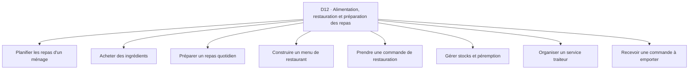

**Accès rapide aux activités :** [A01](#d12-a01) · [A02](#d12-a02) · [A03](#d12-a03) · [A04](#d12-a04) · [A05](#d12-a05) · [A06](#d12-a06) · [A07](#d12-a07) · [A08](#d12-a08)

<a id="d12-a01"></a>
### D12-A01 — Planifier les repas d'un ménage
**Résultat recherché :** Servir des repas adaptés au budget et aux contraintes.

| Réf. action | Action concrète (ordre indicatif) | Friction potentielle liée | Solution / contournement possible *(à vérifier)* | Amélioration à explorer *(hypothèse)* |
|---|---|---|---|---|
| `D12-A01-E01` | Recueillir préférences | Besoins incompatibles | Discussion familiale | Rendre les contraintes visibles |
| `D12-A01-E02` | Choisir les menus | Répétition ou ingrédients introuvables | Carnet de recettes | Relier recettes et disponibilité |
| `D12-A01-E03` | Prévoir quantités | Gaspillage ou insuffisance | Estimation habituelle | Ajuster aux portions |
| `D12-A01-E04` | Préparer achats | Oubli d'ingrédients | Liste papier | Produire une liste cohérente |

*Point de contrôle terrain D12-A01 : demander à une personne concernée de raconter sa dernière réalisation de cette activité ; identifier les étapes réellement suivies, les incidents concrets et le coût d’un incident, puis vérifier si les contournements et les améliorations de ce tableau ont du sens pour elle.*

<a id="d12-a02"></a>
### D12-A02 — Acheter des ingrédients
**Résultat recherché :** Obtenir quantité et qualité voulues.

| Réf. action | Action concrète (ordre indicatif) | Friction potentielle liée | Solution / contournement possible *(à vérifier)* | Amélioration à explorer *(hypothèse)* |
|---|---|---|---|---|
| `D12-A02-E01` | Vérifier les stocks | Double achat | Inspection cuisine | Noter les disponibilités |
| `D12-A02-E02` | Choisir les vendeurs | Prix et fraîcheur variables | Marché habituel | Comparer les critères |
| `D12-A02-E03` | Acheter et transporter | Rupture ou transport cher | Appels et paniers | Préparer un trajet |
| `D12-A02-E04` | Ranger et conserver | Mauvaise rotation | Étiquettes et observation | Suivre les dates |

*Point de contrôle terrain D12-A02 : demander à une personne concernée de raconter sa dernière réalisation de cette activité ; identifier les étapes réellement suivies, les incidents concrets et le coût d’un incident, puis vérifier si les contournements et les améliorations de ce tableau ont du sens pour elle.*

<a id="d12-a03"></a>
### D12-A03 — Préparer un repas quotidien
**Résultat recherché :** Servir à l'heure et sans erreurs.

| Réf. action | Action concrète (ordre indicatif) | Friction potentielle liée | Solution / contournement possible *(à vérifier)* | Amélioration à explorer *(hypothèse)* |
|---|---|---|---|---|
| `D12-A03-E01` | Préparer ingrédients | Oubli et découpe tardive | Mise en place | Créer une séquence simple |
| `D12-A03-E02` | Gérer cuissons | Temps mal coordonné | Minuteur | Synchroniser les étapes |
| `D12-A03-E03` | Vérifier goût et sécurité | Allergène ou cuisson incorrecte | Contrôle du cuisinier | Renforcer les vérifications |
| `D12-A03-E04` | Servir | Portions inégales | Mesures habituelles | Standardiser les portions |

*Point de contrôle terrain D12-A03 : demander à une personne concernée de raconter sa dernière réalisation de cette activité ; identifier les étapes réellement suivies, les incidents concrets et le coût d’un incident, puis vérifier si les contournements et les améliorations de ce tableau ont du sens pour elle.*

<a id="d12-a04"></a>
### D12-A04 — Construire un menu de restaurant
**Résultat recherché :** Offrir des plats réalisables et rentables.

| Réf. action | Action concrète (ordre indicatif) | Friction potentielle liée | Solution / contournement possible *(à vérifier)* | Amélioration à explorer *(hypothèse)* |
|---|---|---|---|---|
| `D12-A04-E01` | Observer les commandes | Plats populaires mal identifiés | Cahier de ventes | Comparer les choix réels |
| `D12-A04-E02` | Calculer coût matière | Épices et pertes oubliées | Calculatrice | Compléter les fiches recettes |
| `D12-A04-E03` | Choisir les prix | Marge incorrecte | Menu papier | Visualiser le coût complet |
| `D12-A04-E04` | Mettre à jour la carte | Plat indisponible toujours annoncé | Ardoise | Gérer la disponibilité |

*Point de contrôle terrain D12-A04 : demander à une personne concernée de raconter sa dernière réalisation de cette activité ; identifier les étapes réellement suivies, les incidents concrets et le coût d’un incident, puis vérifier si les contournements et les améliorations de ce tableau ont du sens pour elle.*

<a id="d12-a05"></a>
### D12-A05 — Prendre une commande de restauration
**Résultat recherché :** Servir ce qui a été demandé.

| Réf. action | Action concrète (ordre indicatif) | Friction potentielle liée | Solution / contournement possible *(à vérifier)* | Amélioration à explorer *(hypothèse)* |
|---|---|---|---|---|
| `D12-A05-E01` | Présenter les plats | Client ne connaît pas le contenu | Menu oral | Clarifier ingrédients et prix |
| `D12-A05-E02` | Noter préférences | Allergies ou restrictions mal transmises | Carnet | Mettre en évidence les exigences |
| `D12-A05-E03` | Transmettre en cuisine | Commande incomplète | Ticket papier | Réduire les pertes de détails |
| `D12-A05-E04` | Confirmer service | Table ou client confondu | Appel verbal | Associer commande et destinataire |

*Point de contrôle terrain D12-A05 : demander à une personne concernée de raconter sa dernière réalisation de cette activité ; identifier les étapes réellement suivies, les incidents concrets et le coût d’un incident, puis vérifier si les contournements et les améliorations de ce tableau ont du sens pour elle.*

<a id="d12-a06"></a>
### D12-A06 — Gérer stocks et péremption
**Résultat recherché :** Limiter pertes alimentaires.

| Réf. action | Action concrète (ordre indicatif) | Friction potentielle liée | Solution / contournement possible *(à vérifier)* | Amélioration à explorer *(hypothèse)* |
|---|---|---|---|---|
| `D12-A06-E01` | Enregistrer les entrées | Approvisionnement non compté | Cahier cuisine | Simplifier le suivi |
| `D12-A06-E02` | Surveiller les dates | Produit ancien caché | Contrôle visuel | Alerter sur les lots |
| `D12-A06-E03` | Prévoir les besoins | Achat excessif | Observation des repas servis | Lier ventes et préparation |
| `D12-A06-E04` | Gérer surplus | Gaspillage ou don tardif | Promotion de fin de journée | Organiser une décision rapide |

*Point de contrôle terrain D12-A06 : demander à une personne concernée de raconter sa dernière réalisation de cette activité ; identifier les étapes réellement suivies, les incidents concrets et le coût d’un incident, puis vérifier si les contournements et les améliorations de ce tableau ont du sens pour elle.*

<a id="d12-a07"></a>
### D12-A07 — Organiser un service traiteur
**Résultat recherché :** Livrer un repas collectif conforme au contrat.

| Réf. action | Action concrète (ordre indicatif) | Friction potentielle liée | Solution / contournement possible *(à vérifier)* | Amélioration à explorer *(hypothèse)* |
|---|---|---|---|---|
| `D12-A07-E01` | Recueillir nombre de convives | Effectif changé tardivement | Appels organisateur | Suivre les confirmations |
| `D12-A07-E02` | Établir menu et devis | Options mal comprises | Devis PDF | Clarifier inclusions |
| `D12-A07-E03` | Planifier achats et équipe | Préparation concentrée au dernier moment | Tableau papier | Répartir les tâches |
| `D12-A07-E04` | Livrer et servir | Retard ou panne de conservation | Véhicule et glacière | Contrôler les jalons |

*Point de contrôle terrain D12-A07 : demander à une personne concernée de raconter sa dernière réalisation de cette activité ; identifier les étapes réellement suivies, les incidents concrets et le coût d’un incident, puis vérifier si les contournements et les améliorations de ce tableau ont du sens pour elle.*

<a id="d12-a08"></a>
### D12-A08 — Recevoir une commande à emporter
**Résultat recherché :** Fournir le bon repas au bon client.

| Réf. action | Action concrète (ordre indicatif) | Friction potentielle liée | Solution / contournement possible *(à vérifier)* | Amélioration à explorer *(hypothèse)* |
|---|---|---|---|---|
| `D12-A08-E01` | Recevoir via canal | Message oublié | Téléphone du restaurant | Centraliser la demande |
| `D12-A08-E02` | Annoncer délai et prix | Attente imprévue | Réponse manuelle | Vérifier la capacité |
| `D12-A08-E03` | Préparer et emballer | Échange de commandes | Étiquette papier | Associer commande et sac |
| `D12-A08-E04` | Confirmer collecte | Livreur ou client introuvable | Appel | Fluidifier la remise |

*Point de contrôle terrain D12-A08 : demander à une personne concernée de raconter sa dernière réalisation de cette activité ; identifier les étapes réellement suivies, les incidents concrets et le coût d’un incident, puis vérifier si les contournements et les améliorations de ce tableau ont du sens pour elle.*

**Transversalité :** rechercher les connexions avec les autres domaines à partir des mêmes actions (information, comparaison, confiance, paiement, coordination, déplacement, suivi) et non en fusionnant artificiellement des activités distinctes.

<a id="d13"></a>
## D13 — Transport, déplacements et mobilité quotidienne
**Personnes / organisations concernées :** Passagers, conducteurs, personnes à mobilité réduite, employeurs, parents, voyageurs occasionnels.
**Inventaire :** 8 activités détaillées. Les personnes peuvent cumuler plusieurs rôles et les parcours ci-dessous ne sont pas exclusifs.

**Carte de navigation du domaine**
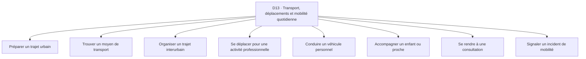

**Accès rapide aux activités :** [A01](#d13-a01) · [A02](#d13-a02) · [A03](#d13-a03) · [A04](#d13-a04) · [A05](#d13-a05) · [A06](#d13-a06) · [A07](#d13-a07) · [A08](#d13-a08)

<a id="d13-a01"></a>
### D13-A01 — Préparer un trajet urbain
**Résultat recherché :** Arriver à destination au moment souhaité.

| Réf. action | Action concrète (ordre indicatif) | Friction potentielle liée | Solution / contournement possible *(à vérifier)* | Amélioration à explorer *(hypothèse)* |
|---|---|---|---|---|
| `D13-A01-E01` | Identifier la destination | Adresse fondée sur un repère ambigu | Appel au destinataire | Clarifier le point d'arrivée |
| `D13-A01-E02` | Comparer les modes | Tarifs et durées peu prévisibles | Conseil d'un proche | Comparer selon contexte |
| `D13-A01-E03` | Prévoir l'heure de départ | Embouteillages ou attente ignorés | Habitude du quartier | Prévoir une marge |
| `D13-A01-E04` | Prévoir le paiement | Monnaie indisponible | Espèces et Mobile Money | Anticiper les modes acceptés |

*Point de contrôle terrain D13-A01 : demander à une personne concernée de raconter sa dernière réalisation de cette activité ; identifier les étapes réellement suivies, les incidents concrets et le coût d’un incident, puis vérifier si les contournements et les améliorations de ce tableau ont du sens pour elle.*

<a id="d13-a02"></a>
### D13-A02 — Trouver un moyen de transport
**Résultat recherché :** Obtenir une place ou un véhicule adapté.

| Réf. action | Action concrète (ordre indicatif) | Friction potentielle liée | Solution / contournement possible *(à vérifier)* | Amélioration à explorer *(hypothèse)* |
|---|---|---|---|---|
| `D13-A02-E01` | Rejoindre un point de départ | Lieu d'embarquement incertain | Indications orales | Rendre les lieux intelligibles |
| `D13-A02-E02` | Identifier les véhicules | Confusion sur la destination | Question au conducteur | Clarifier trajet et destination |
| `D13-A02-E03` | Négocier ou confirmer tarif | Surprise au paiement | Accord verbal | Récapituler le prix |
| `D13-A02-E04` | Confirmer sécurité du départ | Véhicule ou conducteur non adapté | Observation personnelle | Aider à formuler des vérifications |

*Point de contrôle terrain D13-A02 : demander à une personne concernée de raconter sa dernière réalisation de cette activité ; identifier les étapes réellement suivies, les incidents concrets et le coût d’un incident, puis vérifier si les contournements et les améliorations de ce tableau ont du sens pour elle.*

<a id="d13-a03"></a>
### D13-A03 — Organiser un trajet interurbain
**Résultat recherché :** Relier deux villes avec moins d'incertitude.

| Réf. action | Action concrète (ordre indicatif) | Friction potentielle liée | Solution / contournement possible *(à vérifier)* | Amélioration à explorer *(hypothèse)* |
|---|---|---|---|---|
| `D13-A03-E01` | Choisir horaire et compagnie | Informations contradictoires | Appels aux gares | Recouper les départs |
| `D13-A03-E02` | Réserver ou se présenter | Place non garantie | Billet papier | Clarifier le statut |
| `D13-A03-E03` | Préparer bagages | Restrictions découvertes tard | Question au transporteur | Préparer une checklist |
| `D13-A03-E04` | Suivre les changements | Retard non communiqué | Appel familial | Partager les jalons utiles |

*Point de contrôle terrain D13-A03 : demander à une personne concernée de raconter sa dernière réalisation de cette activité ; identifier les étapes réellement suivies, les incidents concrets et le coût d’un incident, puis vérifier si les contournements et les améliorations de ce tableau ont du sens pour elle.*

<a id="d13-a04"></a>
### D13-A04 — Se déplacer pour une activité professionnelle
**Résultat recherché :** Limiter les trajets inutiles.

| Réf. action | Action concrète (ordre indicatif) | Friction potentielle liée | Solution / contournement possible *(à vérifier)* | Amélioration à explorer *(hypothèse)* |
|---|---|---|---|---|
| `D13-A04-E01` | Regrouper les rendez-vous | Allers-retours coûteux | Agenda | Optimiser l'ordre |
| `D13-A04-E02` | Confirmer les interlocuteurs | Destinataire absent | Appel préalable | Vérifier avant départ |
| `D13-A04-E03` | Choisir itinéraire | Voie impraticable | Conseil local | Enregistrer des alternatives |
| `D13-A04-E04` | Justifier les frais | Reçus perdus | Carnet de dépenses | Associer coûts et mission |

*Point de contrôle terrain D13-A04 : demander à une personne concernée de raconter sa dernière réalisation de cette activité ; identifier les étapes réellement suivies, les incidents concrets et le coût d’un incident, puis vérifier si les contournements et les améliorations de ce tableau ont du sens pour elle.*

<a id="d13-a05"></a>
### D13-A05 — Conduire un véhicule personnel
**Résultat recherché :** Maintenir un déplacement fiable.

| Réf. action | Action concrète (ordre indicatif) | Friction potentielle liée | Solution / contournement possible *(à vérifier)* | Amélioration à explorer *(hypothèse)* |
|---|---|---|---|---|
| `D13-A05-E01` | Prévoir carburant | Panne sèche | Jauge et station habituelle | Estimer l'autonomie |
| `D13-A05-E02` | Contrôler état du véhicule | Défaut non repéré | Inspection manuelle | Rappeler les points essentiels |
| `D13-A05-E03` | Adapter le trajet | Route dégradée ou fermée | Information locale | Conserver des alternatives |
| `D13-A05-E04` | Réagir à un incident | Absence de contact d'assistance | Appels à des proches | Organiser un plan de secours |

*Point de contrôle terrain D13-A05 : demander à une personne concernée de raconter sa dernière réalisation de cette activité ; identifier les étapes réellement suivies, les incidents concrets et le coût d’un incident, puis vérifier si les contournements et les améliorations de ce tableau ont du sens pour elle.*

<a id="d13-a06"></a>
### D13-A06 — Accompagner un enfant ou proche
**Résultat recherché :** Assurer une remise au bon lieu et bon moment.

| Réf. action | Action concrète (ordre indicatif) | Friction potentielle liée | Solution / contournement possible *(à vérifier)* | Amélioration à explorer *(hypothèse)* |
|---|---|---|---|---|
| `D13-A06-E01` | Confirmer horaires | Changement de programme | Appel établissement | Centraliser les horaires |
| `D13-A06-E02` | Organiser accompagnateur | Responsabilité floue | Discussion familiale | Confirmer le responsable |
| `D13-A06-E03` | Prévoir la remise | Destinataire inattendu | Code familial ou appel | Clarifier les autorisations |
| `D13-A06-E04` | Signaler arrivée | Inquiétude du foyer | Message | Partager une confirmation minimale |

*Point de contrôle terrain D13-A06 : demander à une personne concernée de raconter sa dernière réalisation de cette activité ; identifier les étapes réellement suivies, les incidents concrets et le coût d’un incident, puis vérifier si les contournements et les améliorations de ce tableau ont du sens pour elle.*

<a id="d13-a07"></a>
### D13-A07 — Se rendre à une consultation
**Résultat recherché :** Arriver avec les documents et le temps requis.

| Réf. action | Action concrète (ordre indicatif) | Friction potentielle liée | Solution / contournement possible *(à vérifier)* | Amélioration à explorer *(hypothèse)* |
|---|---|---|---|---|
| `D13-A07-E01` | Confirmer l'adresse | Service déplacé ou mal indiqué | Appel au centre | Vérifier les détails |
| `D13-A07-E02` | Prévoir affluence | Attente incompatible avec le travail | Conseil d'autres patients | Mieux anticiper |
| `D13-A07-E03` | Préparer dossiers | Résultats oubliés | Chemise de documents | Établir une liste |
| `D13-A07-E04` | Organiser le retour | Transport difficile après soin | Appel à un accompagnant | Prévoir un plan de retour |

*Point de contrôle terrain D13-A07 : demander à une personne concernée de raconter sa dernière réalisation de cette activité ; identifier les étapes réellement suivies, les incidents concrets et le coût d’un incident, puis vérifier si les contournements et les améliorations de ce tableau ont du sens pour elle.*

<a id="d13-a08"></a>
### D13-A08 — Signaler un incident de mobilité
**Résultat recherché :** Obtenir aide ou adaptation du trajet.

| Réf. action | Action concrète (ordre indicatif) | Friction potentielle liée | Solution / contournement possible *(à vérifier)* | Amélioration à explorer *(hypothèse)* |
|---|---|---|---|---|
| `D13-A08-E01` | Se mettre en sécurité | Décision prise dans la précipitation | Appel aux services compétents | Clarifier les priorités |
| `D13-A08-E02` | Décrire le lieu | Repère imprécis | Partage de position si disponible | Améliorer la localisation |
| `D13-A08-E03` | Contacter une aide | Numéro utile inconnu | Proche ou police selon cas | Rassembler contacts officiels |
| `D13-A08-E04` | Informer les personnes attendues | Absence prolongée inexpliquée | Message | Faciliter un avis bref |

*Point de contrôle terrain D13-A08 : demander à une personne concernée de raconter sa dernière réalisation de cette activité ; identifier les étapes réellement suivies, les incidents concrets et le coût d’un incident, puis vérifier si les contournements et les améliorations de ce tableau ont du sens pour elle.*

**Transversalité :** rechercher les connexions avec les autres domaines à partir des mêmes actions (information, comparaison, confiance, paiement, coordination, déplacement, suivi) et non en fusionnant artificiellement des activités distinctes.

<a id="d14"></a>
## D14 — Livraison, logistique et circulation des marchandises
**Personnes / organisations concernées :** Coursiers, vendeurs, clients, responsables d'entrepôt, chauffeurs, coopératives.
**Inventaire :** 8 activités détaillées. Les personnes peuvent cumuler plusieurs rôles et les parcours ci-dessous ne sont pas exclusifs.

**Carte de navigation du domaine**
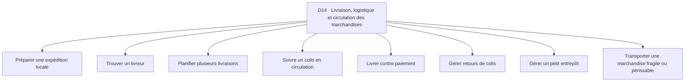

**Accès rapide aux activités :** [A01](#d14-a01) · [A02](#d14-a02) · [A03](#d14-a03) · [A04](#d14-a04) · [A05](#d14-a05) · [A06](#d14-a06) · [A07](#d14-a07) · [A08](#d14-a08)

<a id="d14-a01"></a>
### D14-A01 — Préparer une expédition locale
**Résultat recherché :** Remettre un colis correctement préparé.

| Réf. action | Action concrète (ordre indicatif) | Friction potentielle liée | Solution / contournement possible *(à vérifier)* | Amélioration à explorer *(hypothèse)* |
|---|---|---|---|---|
| `D14-A01-E01` | Confirmer contenu | Produit ou quantité erronés | Bon papier | Comparer commande et colis |
| `D14-A01-E02` | Choisir emballage | Casse ou fuite | Carton et sachet | Guider selon nature du produit |
| `D14-A01-E03` | Étiqueter | Contact ou destinataire confondus | Écriture manuelle | Rendre visibles les données utiles |
| `D14-A01-E04` | Prévenir du départ | Destinataire non prêt | Appel | Coordonner la remise |

*Point de contrôle terrain D14-A01 : demander à une personne concernée de raconter sa dernière réalisation de cette activité ; identifier les étapes réellement suivies, les incidents concrets et le coût d’un incident, puis vérifier si les contournements et les améliorations de ce tableau ont du sens pour elle.*

<a id="d14-a02"></a>
### D14-A02 — Trouver un livreur
**Résultat recherché :** Attribuer une course à un acteur disponible.

| Réf. action | Action concrète (ordre indicatif) | Friction potentielle liée | Solution / contournement possible *(à vérifier)* | Amélioration à explorer *(hypothèse)* |
|---|---|---|---|---|
| `D14-A02-E01` | Décrire la course | Volume ou distance mal évalués | Message vocal | Standardiser le brief |
| `D14-A02-E02` | Chercher un prestataire | Disponibilité inconnue | Carnet de contacts | Qualifier rapidement les options |
| `D14-A02-E03` | Comparer prix et délai | Prix final modifié | Appels | Récapituler les conditions |
| `D14-A02-E04` | Confirmer l'attribution | Course promise à deux livreurs | Message | Tracer l'accord |

*Point de contrôle terrain D14-A02 : demander à une personne concernée de raconter sa dernière réalisation de cette activité ; identifier les étapes réellement suivies, les incidents concrets et le coût d’un incident, puis vérifier si les contournements et les améliorations de ce tableau ont du sens pour elle.*

<a id="d14-a03"></a>
### D14-A03 — Planifier plusieurs livraisons
**Résultat recherché :** Utiliser efficacement une tournée.

| Réf. action | Action concrète (ordre indicatif) | Friction potentielle liée | Solution / contournement possible *(à vérifier)* | Amélioration à explorer *(hypothèse)* |
|---|---|---|---|---|
| `D14-A03-E01` | Lister les adresses | Destinations incomplètes | Cahier de bord | Vérifier chaque destination |
| `D14-A03-E02` | Regrouper les zones | Trajets croisés inutiles | Connaissance terrain | Visualiser les regroupements |
| `D14-A03-E03` | Confirmer les créneaux | Client absent | Appels | Synchroniser attentes |
| `D14-A03-E04` | Réviser au fil de la journée | Nouvelle course perturbe tout | Messages d'équipe | Recalculer les priorités |

*Point de contrôle terrain D14-A03 : demander à une personne concernée de raconter sa dernière réalisation de cette activité ; identifier les étapes réellement suivies, les incidents concrets et le coût d’un incident, puis vérifier si les contournements et les améliorations de ce tableau ont du sens pour elle.*

<a id="d14-a04"></a>
### D14-A04 — Suivre un colis en circulation
**Résultat recherché :** Savoir où il se trouve et ce qui reste à faire.

| Réf. action | Action concrète (ordre indicatif) | Friction potentielle liée | Solution / contournement possible *(à vérifier)* | Amélioration à explorer *(hypothèse)* |
|---|---|---|---|---|
| `D14-A04-E01` | Enregistrer le départ | Colis sans référence | Carnet expéditeur | Créer un identifiant simple |
| `D14-A04-E02` | Recevoir jalons | Silence entre deux étapes | Appels au conducteur | Structurer les statuts |
| `D14-A04-E03` | Signaler un retard | Destinataire non informé | Message personnel | Prévenir avec contexte |
| `D14-A04-E04` | Clore le suivi | Livraison dite faite sans preuve | Signature ou photo consentie | Vérifier la remise |

*Point de contrôle terrain D14-A04 : demander à une personne concernée de raconter sa dernière réalisation de cette activité ; identifier les étapes réellement suivies, les incidents concrets et le coût d’un incident, puis vérifier si les contournements et les améliorations de ce tableau ont du sens pour elle.*

<a id="d14-a05"></a>
### D14-A05 — Livrer contre paiement
**Résultat recherché :** Remettre la marchandise et encaisser correctement.

| Réf. action | Action concrète (ordre indicatif) | Friction potentielle liée | Solution / contournement possible *(à vérifier)* | Amélioration à explorer *(hypothèse)* |
|---|---|---|---|---|
| `D14-A05-E01` | Confirmer le montant dû | Montant discordant | Appel au vendeur | Rendre cohérents les chiffres |
| `D14-A05-E02` | Présenter le colis | Client conteste le contenu | Ouverture convenue | Prévoir un contrôle |
| `D14-A05-E03` | Encaisser | Fausse preuve ou manque de monnaie | Vérification du solde | Rapprocher paiement |
| `D14-A05-E04` | Rendre compte au vendeur | Argent ou information remis tard | Carnet de tournée | Clore la course clairement |

*Point de contrôle terrain D14-A05 : demander à une personne concernée de raconter sa dernière réalisation de cette activité ; identifier les étapes réellement suivies, les incidents concrets et le coût d’un incident, puis vérifier si les contournements et les améliorations de ce tableau ont du sens pour elle.*

<a id="d14-a06"></a>
### D14-A06 — Gérer retours de colis
**Résultat recherché :** Récupérer et réaffecter un colis non livré.

| Réf. action | Action concrète (ordre indicatif) | Friction potentielle liée | Solution / contournement possible *(à vérifier)* | Amélioration à explorer *(hypothèse)* |
|---|---|---|---|---|
| `D14-A06-E01` | Recevoir le motif | Cause mal documentée | Appel client | Classer la cause |
| `D14-A06-E02` | Organiser la reprise | Deuxième trajet coûteux | Livreur habituel | Regrouper les retours |
| `D14-A06-E03` | Contrôler l'état | Dégradation contestée | Photo à réception | Tracer l'état |
| `D14-A06-E04` | Mettre à jour stock et argent | Article réintégré deux fois | Cahier | Rapprocher les mouvements |

*Point de contrôle terrain D14-A06 : demander à une personne concernée de raconter sa dernière réalisation de cette activité ; identifier les étapes réellement suivies, les incidents concrets et le coût d’un incident, puis vérifier si les contournements et les améliorations de ce tableau ont du sens pour elle.*

<a id="d14-a07"></a>
### D14-A07 — Gérer un petit entrepôt
**Résultat recherché :** Connaître l'emplacement et la disponibilité.

| Réf. action | Action concrète (ordre indicatif) | Friction potentielle liée | Solution / contournement possible *(à vérifier)* | Amélioration à explorer *(hypothèse)* |
|---|---|---|---|---|
| `D14-A07-E01` | Réceptionner | Lot sans vérification | Bon de réception | Contrôler à l'entrée |
| `D14-A07-E02` | Ranger | Produit difficile à retrouver | Étiquettes | Associer article et emplacement |
| `D14-A07-E03` | Prélever une commande | Erreur de variante | Liste papier | Guider la préparation |
| `D14-A07-E04` | Faire l'inventaire | Écart découvert trop tard | Comptage périodique | Cibler les anomalies |

*Point de contrôle terrain D14-A07 : demander à une personne concernée de raconter sa dernière réalisation de cette activité ; identifier les étapes réellement suivies, les incidents concrets et le coût d’un incident, puis vérifier si les contournements et les améliorations de ce tableau ont du sens pour elle.*

<a id="d14-a08"></a>
### D14-A08 — Transporter une marchandise fragile ou périssable
**Résultat recherché :** Préserver son état jusqu'à livraison.

| Réf. action | Action concrète (ordre indicatif) | Friction potentielle liée | Solution / contournement possible *(à vérifier)* | Amélioration à explorer *(hypothèse)* |
|---|---|---|---|---|
| `D14-A08-E01` | Identifier les contraintes | Exigence de température oubliée | Consigne du fournisseur | Formaliser les conditions |
| `D14-A08-E02` | Choisir véhicule et contenants | Équipement insuffisant | Glacière ou protection | Contrôler l'adéquation |
| `D14-A08-E03` | Surveiller durant trajet | Rupture de conservation invisible | Contrôle ponctuel | Tracer les vérifications |
| `D14-A08-E04` | Confirmer état à remise | Responsabilité contestée | Inspection contradictoire | Documenter la réception |

*Point de contrôle terrain D14-A08 : demander à une personne concernée de raconter sa dernière réalisation de cette activité ; identifier les étapes réellement suivies, les incidents concrets et le coût d’un incident, puis vérifier si les contournements et les améliorations de ce tableau ont du sens pour elle.*

**Transversalité :** rechercher les connexions avec les autres domaines à partir des mêmes actions (information, comparaison, confiance, paiement, coordination, déplacement, suivi) et non en fusionnant artificiellement des activités distinctes.

<a id="d15"></a>
## D15 — Recherche et accès aux services de proximité
**Personnes / organisations concernées :** Habitants, familles, visiteurs, artisans, commerces de quartier, personnes nouvellement installées.
**Inventaire :** 8 activités détaillées. Les personnes peuvent cumuler plusieurs rôles et les parcours ci-dessous ne sont pas exclusifs.

**Carte de navigation du domaine**
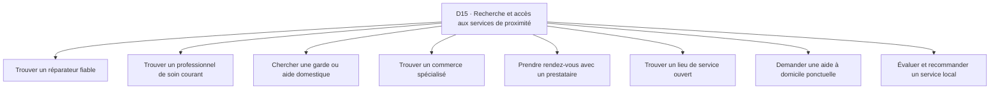

**Accès rapide aux activités :** [A01](#d15-a01) · [A02](#d15-a02) · [A03](#d15-a03) · [A04](#d15-a04) · [A05](#d15-a05) · [A06](#d15-a06) · [A07](#d15-a07) · [A08](#d15-a08)

<a id="d15-a01"></a>
### D15-A01 — Trouver un réparateur fiable
**Résultat recherché :** Faire résoudre une panne locale.

| Réf. action | Action concrète (ordre indicatif) | Friction potentielle liée | Solution / contournement possible *(à vérifier)* | Amélioration à explorer *(hypothèse)* |
|---|---|---|---|---|
| `D15-A01-E01` | Décrire la panne | Symptôme trop vague | Photo ou appel | Préparer une description utile |
| `D15-A01-E02` | Identifier des professionnels | Recommandations limitées au réseau | Voisinage | Diversifier les pistes |
| `D15-A01-E03` | Comparer disponibilité et conditions | Prix non comparable | Appels | Clarifier déplacement et diagnostic |
| `D15-A01-E04` | Vérifier après intervention | Panne persistante | Essai sur place | Rendre explicites les contrôles |

*Point de contrôle terrain D15-A01 : demander à une personne concernée de raconter sa dernière réalisation de cette activité ; identifier les étapes réellement suivies, les incidents concrets et le coût d’un incident, puis vérifier si les contournements et les améliorations de ce tableau ont du sens pour elle.*

<a id="d15-a02"></a>
### D15-A02 — Trouver un professionnel de soin courant
**Résultat recherché :** Accéder au bon type de service.

| Réf. action | Action concrète (ordre indicatif) | Friction potentielle liée | Solution / contournement possible *(à vérifier)* | Amélioration à explorer *(hypothèse)* |
|---|---|---|---|---|
| `D15-A02-E01` | Décrire le besoin non urgent | Mauvais professionnel ciblé | Conseil du centre de santé | Orienter vers des informations sûres |
| `D15-A02-E02` | Repérer les structures | Coordonnées obsolètes | Réseau familial | Vérifier les points de service |
| `D15-A02-E03` | Confirmer horaires et coûts | Déplacement inutile | Appel préalable | Faciliter la confirmation |
| `D15-A02-E04` | Préparer la visite | Pièces et antécédents non disponibles | Chemise santé | Lister les éléments utiles |

*Point de contrôle terrain D15-A02 : demander à une personne concernée de raconter sa dernière réalisation de cette activité ; identifier les étapes réellement suivies, les incidents concrets et le coût d’un incident, puis vérifier si les contournements et les améliorations de ce tableau ont du sens pour elle.*

<a id="d15-a03"></a>
### D15-A03 — Chercher une garde ou aide domestique
**Résultat recherché :** Trouver une personne adaptée aux responsabilités.

| Réf. action | Action concrète (ordre indicatif) | Friction potentielle liée | Solution / contournement possible *(à vérifier)* | Amélioration à explorer *(hypothèse)* |
|---|---|---|---|---|
| `D15-A03-E01` | Définir les tâches | Rôle ambigu | Discussion familiale | Clarifier attentes |
| `D15-A03-E02` | Recueillir des références | Fiabilité difficile à établir | Recommandations | Structurer les questions |
| `D15-A03-E03` | Convenir d'une période d'essai | Conditions non dites | Accord écrit | Rendre les limites explicites |
| `D15-A03-E04` | Organiser le suivi | Incidents non signalés | Appels réguliers | Prévoir un canal de remontée |

*Point de contrôle terrain D15-A03 : demander à une personne concernée de raconter sa dernière réalisation de cette activité ; identifier les étapes réellement suivies, les incidents concrets et le coût d’un incident, puis vérifier si les contournements et les améliorations de ce tableau ont du sens pour elle.*

<a id="d15-a04"></a>
### D15-A04 — Trouver un commerce spécialisé
**Résultat recherché :** Acheter un article peu courant sans parcours inutile.

| Réf. action | Action concrète (ordre indicatif) | Friction potentielle liée | Solution / contournement possible *(à vérifier)* | Amélioration à explorer *(hypothèse)* |
|---|---|---|---|---|
| `D15-A04-E01` | Nommer correctement la pièce | Référence mal comprise | Photo à un proche | Aider à décrire la pièce |
| `D15-A04-E02` | Localiser des points de vente | Adresses inconnues | Marché et voisins | Regrouper les pistes |
| `D15-A04-E03` | Confirmer stock | Rupture découverte sur place | Appel | Vérifier avant déplacement |
| `D15-A04-E04` | Comparer compatibilité | Pièce ressemblante mais inadaptée | Échantillon physique | Clarifier les critères |

*Point de contrôle terrain D15-A04 : demander à une personne concernée de raconter sa dernière réalisation de cette activité ; identifier les étapes réellement suivies, les incidents concrets et le coût d’un incident, puis vérifier si les contournements et les améliorations de ce tableau ont du sens pour elle.*

<a id="d15-a05"></a>
### D15-A05 — Prendre rendez-vous avec un prestataire
**Résultat recherché :** Obtenir un créneau confirmé.

| Réf. action | Action concrète (ordre indicatif) | Friction potentielle liée | Solution / contournement possible *(à vérifier)* | Amélioration à explorer *(hypothèse)* |
|---|---|---|---|---|
| `D15-A05-E01` | Exposer le besoin | Durée mal estimée | Message vocal | Structurer la demande |
| `D15-A05-E02` | Demander disponibilités | Allers-retours de messages | Appels | Partager les créneaux |
| `D15-A05-E03` | Valider lieu et prix | Surprise au rendez-vous | Message récapitulatif | Confirmer les conditions |
| `D15-A05-E04` | Prévenir d'un changement | Annulation tardive | Appel direct | Faciliter le report |

*Point de contrôle terrain D15-A05 : demander à une personne concernée de raconter sa dernière réalisation de cette activité ; identifier les étapes réellement suivies, les incidents concrets et le coût d’un incident, puis vérifier si les contournements et les améliorations de ce tableau ont du sens pour elle.*

<a id="d15-a06"></a>
### D15-A06 — Trouver un lieu de service ouvert
**Résultat recherché :** Éviter un déplacement inutile.

| Réf. action | Action concrète (ordre indicatif) | Friction potentielle liée | Solution / contournement possible *(à vérifier)* | Amélioration à explorer *(hypothèse)* |
|---|---|---|---|---|
| `D15-A06-E01` | Chercher les coordonnées | Informations non maintenues | Cartes et bouche-à-oreille | Distinguer source et fraîcheur |
| `D15-A06-E02` | Vérifier horaires | Fermeture exceptionnelle | Appel | Permettre la confirmation |
| `D15-A06-E03` | Vérifier accès | Itinéraire ou entrée ambiguë | Repères locaux | Préciser l'accès |
| `D15-A06-E04` | Prévoir une alternative | Service indisponible | Autre contact | Présenter des options |

*Point de contrôle terrain D15-A06 : demander à une personne concernée de raconter sa dernière réalisation de cette activité ; identifier les étapes réellement suivies, les incidents concrets et le coût d’un incident, puis vérifier si les contournements et les améliorations de ce tableau ont du sens pour elle.*

<a id="d15-a07"></a>
### D15-A07 — Demander une aide à domicile ponctuelle
**Résultat recherché :** Obtenir une intervention rapide et cadrée.

| Réf. action | Action concrète (ordre indicatif) | Friction potentielle liée | Solution / contournement possible *(à vérifier)* | Amélioration à explorer *(hypothèse)* |
|---|---|---|---|---|
| `D15-A07-E01` | Définir l'urgence | Attente irréaliste | Appel | Qualifier la gravité |
| `D15-A07-E02` | Décrire l'environnement | Matériel nécessaire oublié | Photo consentie | Préparer un brief |
| `D15-A07-E03` | Vérifier identité de l'intervenant | Intrusion ou escroquerie | Recommandation et contrôle | Encourager une vérification |
| `D15-A07-E04` | Confirmer le résultat | Prestation incomplète | Inspection conjointe | Documenter la clôture |

*Point de contrôle terrain D15-A07 : demander à une personne concernée de raconter sa dernière réalisation de cette activité ; identifier les étapes réellement suivies, les incidents concrets et le coût d’un incident, puis vérifier si les contournements et les améliorations de ce tableau ont du sens pour elle.*

<a id="d15-a08"></a>
### D15-A08 — Évaluer et recommander un service local
**Résultat recherché :** Aider autrui par un retour utile.

| Réf. action | Action concrète (ordre indicatif) | Friction potentielle liée | Solution / contournement possible *(à vérifier)* | Amélioration à explorer *(hypothèse)* |
|---|---|---|---|---|
| `D15-A08-E01` | Recueillir la prestation réelle | Souvenir vague | Notes après visite | Relever faits précis |
| `D15-A08-E02` | Distinguer qualité et attente | Jugement disproportionné | Discussion avec prestataire | Contextualiser le retour |
| `D15-A08-E03` | Partager une recommandation | Coordonnées erronées | Carte de visite | Faciliter la transmission |
| `D15-A08-E04` | Mettre à jour | Prestataire déménagé | Appel ultérieur | Prévoir la vérification |

*Point de contrôle terrain D15-A08 : demander à une personne concernée de raconter sa dernière réalisation de cette activité ; identifier les étapes réellement suivies, les incidents concrets et le coût d’un incident, puis vérifier si les contournements et les améliorations de ce tableau ont du sens pour elle.*

**Transversalité :** rechercher les connexions avec les autres domaines à partir des mêmes actions (information, comparaison, confiance, paiement, coordination, déplacement, suivi) et non en fusionnant artificiellement des activités distinctes.

<a id="d16"></a>
## D16 — Logement, location et immobilier
**Personnes / organisations concernées :** Locataires, propriétaires, étudiants, agences, ménages en déménagement, copropriétés.
**Inventaire :** 8 activités détaillées. Les personnes peuvent cumuler plusieurs rôles et les parcours ci-dessous ne sont pas exclusifs.

**Carte de navigation du domaine**
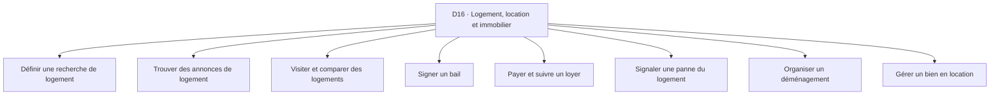

**Accès rapide aux activités :** [A01](#d16-a01) · [A02](#d16-a02) · [A03](#d16-a03) · [A04](#d16-a04) · [A05](#d16-a05) · [A06](#d16-a06) · [A07](#d16-a07) · [A08](#d16-a08)

<a id="d16-a01"></a>
### D16-A01 — Définir une recherche de logement
**Résultat recherché :** Savoir quel logement chercher.

| Réf. action | Action concrète (ordre indicatif) | Friction potentielle liée | Solution / contournement possible *(à vérifier)* | Amélioration à explorer *(hypothèse)* |
|---|---|---|---|---|
| `D16-A01-E01` | Fixer budget complet | Charges cachées | Calculatrice | Inclure frais récurrents |
| `D16-A01-E02` | Choisir zone | Temps de transport ignoré | Visite quartier | Comparer accès aux services |
| `D16-A01-E03` | Définir critères | Exigences contradictoires | Liste familiale | Prioriser les critères |
| `D16-A01-E04` | Préparer dossier | Pièces manquantes | Chemise | Structurer les justificatifs |

*Point de contrôle terrain D16-A01 : demander à une personne concernée de raconter sa dernière réalisation de cette activité ; identifier les étapes réellement suivies, les incidents concrets et le coût d’un incident, puis vérifier si les contournements et les améliorations de ce tableau ont du sens pour elle.*

<a id="d16-a02"></a>
### D16-A02 — Trouver des annonces de logement
**Résultat recherché :** Découvrir des offres crédibles.

| Réf. action | Action concrète (ordre indicatif) | Friction potentielle liée | Solution / contournement possible *(à vérifier)* | Amélioration à explorer *(hypothèse)* |
|---|---|---|---|---|
| `D16-A02-E01` | Choisir canaux | Dépendance à intermédiaires | Groupes et agences | Diversifier les sources |
| `D16-A02-E02` | Recueillir détails | Annonces incomplètes | Appels | Standardiser les informations |
| `D16-A02-E03` | Vérifier actualité | Annonce déjà prise | Contact propriétaire | Qualifier la disponibilité |
| `D16-A02-E04` | Éviter fausses offres | Demande d'avance risquée | Visite et recoupement | Introduire des vérifications |

*Point de contrôle terrain D16-A02 : demander à une personne concernée de raconter sa dernière réalisation de cette activité ; identifier les étapes réellement suivies, les incidents concrets et le coût d’un incident, puis vérifier si les contournements et les améliorations de ce tableau ont du sens pour elle.*

<a id="d16-a03"></a>
### D16-A03 — Visiter et comparer des logements
**Résultat recherché :** Évaluer un logement dans son contexte réel.

| Réf. action | Action concrète (ordre indicatif) | Friction potentielle liée | Solution / contournement possible *(à vérifier)* | Amélioration à explorer *(hypothèse)* |
|---|---|---|---|---|
| `D16-A03-E01` | Fixer rendez-vous | Déplacement sans accès | Appel | Confirmer la visite |
| `D16-A03-E02` | Inspecter état | Défaut masqué | Liste papier | Guider les points d'observation |
| `D16-A03-E03` | Évaluer voisinage | Bruit et accès mal appréciés | Visites à heures différentes | Consigner le contexte |
| `D16-A03-E04` | Comparer les options | Souvenir des visites confondu | Photos autorisées | Comparer sur mêmes critères |

*Point de contrôle terrain D16-A03 : demander à une personne concernée de raconter sa dernière réalisation de cette activité ; identifier les étapes réellement suivies, les incidents concrets et le coût d’un incident, puis vérifier si les contournements et les améliorations de ce tableau ont du sens pour elle.*

<a id="d16-a04"></a>
### D16-A04 — Signer un bail
**Résultat recherché :** Comprendre engagements et droits applicables.

| Réf. action | Action concrète (ordre indicatif) | Friction potentielle liée | Solution / contournement possible *(à vérifier)* | Amélioration à explorer *(hypothèse)* |
|---|---|---|---|---|
| `D16-A04-E01` | Lire les conditions | Clauses importantes ignorées | Conseil juridique | Préparer les questions |
| `D16-A04-E02` | Vérifier identité et qualité du bailleur | Interlocuteur sans mandat | Pièces justificatives | Recouper les droits |
| `D16-A04-E03` | Documenter état des lieux | Dégradations contestées | Photos et inventaire | Structurer la preuve |
| `D16-A04-E04` | Conserver exemplaires | Document introuvable | Dossier papier | Archiver de façon sûre |

*Point de contrôle terrain D16-A04 : demander à une personne concernée de raconter sa dernière réalisation de cette activité ; identifier les étapes réellement suivies, les incidents concrets et le coût d’un incident, puis vérifier si les contournements et les améliorations de ce tableau ont du sens pour elle.*

<a id="d16-a05"></a>
### D16-A05 — Payer et suivre un loyer
**Résultat recherché :** Respecter les échéances et justifier les versements.

| Réf. action | Action concrète (ordre indicatif) | Friction potentielle liée | Solution / contournement possible *(à vérifier)* | Amélioration à explorer *(hypothèse)* |
|---|---|---|---|---|
| `D16-A05-E01` | Connaître la date et montant | Accord évolué oralement | Bail et message | Rendre visibles les engagements |
| `D16-A05-E02` | Prévoir les fonds | Loyer oublié dans budget | Enveloppe | Rappeler en amont |
| `D16-A05-E03` | Effectuer paiement | Compte destinataire erroné | Vérification | Contrôler les données |
| `D16-A05-E04` | Conserver reçu | Paiement contesté | Reçu papier | Lier paiement et période |

*Point de contrôle terrain D16-A05 : demander à une personne concernée de raconter sa dernière réalisation de cette activité ; identifier les étapes réellement suivies, les incidents concrets et le coût d’un incident, puis vérifier si les contournements et les améliorations de ce tableau ont du sens pour elle.*

<a id="d16-a06"></a>
### D16-A06 — Signaler une panne du logement
**Résultat recherché :** Obtenir une réparation dans un délai approprié.

| Réf. action | Action concrète (ordre indicatif) | Friction potentielle liée | Solution / contournement possible *(à vérifier)* | Amélioration à explorer *(hypothèse)* |
|---|---|---|---|---|
| `D16-A06-E01` | Décrire le défaut | Gravité mal comprise | Photo et appel | Qualifier l'incident |
| `D16-A06-E02` | Identifier responsable | Bailleur et locataire se renvoient la tâche | Bail et discussion | Clarifier le point à vérifier |
| `D16-A06-E03` | Planifier intervention | Artisan absent | Appel | Confirmer le créneau |
| `D16-A06-E04` | Contrôler la résolution | Réparation partielle | Essai sur place | Documenter le résultat |

*Point de contrôle terrain D16-A06 : demander à une personne concernée de raconter sa dernière réalisation de cette activité ; identifier les étapes réellement suivies, les incidents concrets et le coût d’un incident, puis vérifier si les contournements et les améliorations de ce tableau ont du sens pour elle.*

<a id="d16-a07"></a>
### D16-A07 — Organiser un déménagement
**Résultat recherché :** Changer de logement en limitant pertes.

| Réf. action | Action concrète (ordre indicatif) | Friction potentielle liée | Solution / contournement possible *(à vérifier)* | Amélioration à explorer *(hypothèse)* |
|---|---|---|---|---|
| `D16-A07-E01` | Inventorier biens | Objets oubliés | Liste papier | Regrouper par pièce |
| `D16-A07-E02` | Choisir transport et aide | Volume mal estimé | Visite du transporteur | Préparer une estimation |
| `D16-A07-E03` | Coordonner dates et clés | Chevauchement coûteux | Agenda | Aligner les jalons |
| `D16-A07-E04` | Vérifier après installation | Casse et manquants | Photos et comptage | Clore les réserves |

*Point de contrôle terrain D16-A07 : demander à une personne concernée de raconter sa dernière réalisation de cette activité ; identifier les étapes réellement suivies, les incidents concrets et le coût d’un incident, puis vérifier si les contournements et les améliorations de ce tableau ont du sens pour elle.*

<a id="d16-a08"></a>
### D16-A08 — Gérer un bien en location
**Résultat recherché :** Suivre disponibilité et obligations du propriétaire.

| Réf. action | Action concrète (ordre indicatif) | Friction potentielle liée | Solution / contournement possible *(à vérifier)* | Amélioration à explorer *(hypothèse)* |
|---|---|---|---|---|
| `D16-A08-E01` | Publier l'offre | Conditions omises | Agence | Standardiser l'annonce |
| `D16-A08-E02` | Qualifier candidat | Documents dispersés | Dossier papier | Suivre les éléments obtenus |
| `D16-A08-E03` | Encaisser et entretenir | Règlements et demandes mêlés | Carnet du bailleur | Séparer flux et incidents |
| `D16-A08-E04` | Préparer renouvellement ou sortie | Échéance oubliée | Calendrier | Anticiper les démarches |

*Point de contrôle terrain D16-A08 : demander à une personne concernée de raconter sa dernière réalisation de cette activité ; identifier les étapes réellement suivies, les incidents concrets et le coût d’un incident, puis vérifier si les contournements et les améliorations de ce tableau ont du sens pour elle.*

**Transversalité :** rechercher les connexions avec les autres domaines à partir des mêmes actions (information, comparaison, confiance, paiement, coordination, déplacement, suivi) et non en fusionnant artificiellement des activités distinctes.

<a id="d17"></a>
## D17 — Construction, entretien, réparation et maintenance
**Personnes / organisations concernées :** Artisans, ménages, chefs de chantier, propriétaires, gestionnaires, techniciens.
**Inventaire :** 8 activités détaillées. Les personnes peuvent cumuler plusieurs rôles et les parcours ci-dessous ne sont pas exclusifs.

**Carte de navigation du domaine**
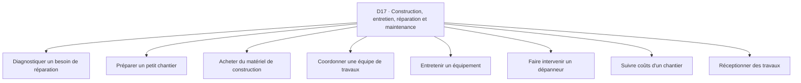

**Accès rapide aux activités :** [A01](#d17-a01) · [A02](#d17-a02) · [A03](#d17-a03) · [A04](#d17-a04) · [A05](#d17-a05) · [A06](#d17-a06) · [A07](#d17-a07) · [A08](#d17-a08)

<a id="d17-a01"></a>
### D17-A01 — Diagnostiquer un besoin de réparation
**Résultat recherché :** Comprendre la panne avant intervention.

| Réf. action | Action concrète (ordre indicatif) | Friction potentielle liée | Solution / contournement possible *(à vérifier)* | Amélioration à explorer *(hypothèse)* |
|---|---|---|---|---|
| `D17-A01-E01` | Recueillir symptômes | Description non technique | Appel et photo | Structurer les faits |
| `D17-A01-E02` | Inspecter sur place | Cause cachée | Visite du technicien | Documenter les observations |
| `D17-A01-E03` | Définir urgence | Problème de sécurité sous-estimé | Avis qualifié | Signaler les cas nécessitant intervention immédiate |
| `D17-A01-E04` | Proposer périmètre | Travaux inutiles | Devis écrit | Séparer diagnostic et proposition |

*Point de contrôle terrain D17-A01 : demander à une personne concernée de raconter sa dernière réalisation de cette activité ; identifier les étapes réellement suivies, les incidents concrets et le coût d’un incident, puis vérifier si les contournements et les améliorations de ce tableau ont du sens pour elle.*

<a id="d17-a02"></a>
### D17-A02 — Préparer un petit chantier
**Résultat recherché :** Anticiper étapes moyens et dépendances.

| Réf. action | Action concrète (ordre indicatif) | Friction potentielle liée | Solution / contournement possible *(à vérifier)* | Amélioration à explorer *(hypothèse)* |
|---|---|---|---|---|
| `D17-A02-E01` | Définir résultat | Attentes client floues | Croquis | Formaliser les critères |
| `D17-A02-E02` | Prendre mesures | Erreur de dimensions | Mètre et carnet | Contrôler les mesures |
| `D17-A02-E03` | Chiffrer matériaux | Quantités incorrectes | Devis fournisseurs | Rapprocher mesures et quantités |
| `D17-A02-E04` | Planifier les artisans | Conflits de disponibilité | Appels | Clarifier l'enchaînement |

*Point de contrôle terrain D17-A02 : demander à une personne concernée de raconter sa dernière réalisation de cette activité ; identifier les étapes réellement suivies, les incidents concrets et le coût d’un incident, puis vérifier si les contournements et les améliorations de ce tableau ont du sens pour elle.*

<a id="d17-a03"></a>
### D17-A03 — Acheter du matériel de construction
**Résultat recherché :** Obtenir bons produits et quantités.

| Réf. action | Action concrète (ordre indicatif) | Friction potentielle liée | Solution / contournement possible *(à vérifier)* | Amélioration à explorer *(hypothèse)* |
|---|---|---|---|---|
| `D17-A03-E01` | Choisir spécifications | Référence inadaptée | Conseil artisan | Valider le besoin |
| `D17-A03-E02` | Comparer les prix | Qualités non équivalentes | Visite des dépôts | Comparer mêmes caractéristiques |
| `D17-A03-E03` | Commander | Rupture ou livraison partielle | Appel fournisseur | Suivre les réservations |
| `D17-A03-E04` | Contrôler à réception | Mauvais calibre ou casse | Comptage | Faire une réception guidée |

*Point de contrôle terrain D17-A03 : demander à une personne concernée de raconter sa dernière réalisation de cette activité ; identifier les étapes réellement suivies, les incidents concrets et le coût d’un incident, puis vérifier si les contournements et les améliorations de ce tableau ont du sens pour elle.*

<a id="d17-a04"></a>
### D17-A04 — Coordonner une équipe de travaux
**Résultat recherché :** Exécuter les étapes dans le bon ordre.

| Réf. action | Action concrète (ordre indicatif) | Friction potentielle liée | Solution / contournement possible *(à vérifier)* | Amélioration à explorer *(hypothèse)* |
|---|---|---|---|---|
| `D17-A04-E01` | Lister les tâches | Interventions qui se gênent | Tableau de chantier | Visualiser les dépendances |
| `D17-A04-E02` | Affecter les personnes | Absence d'un métier | Appels | Confirmer les engagements |
| `D17-A04-E03` | Suivre l'avancement | Retard découvert tard | Visite du chef | Noter points bloquants |
| `D17-A04-E04` | Informer le client | Modification non comprise | Réunion rapide | Conserver les décisions |

*Point de contrôle terrain D17-A04 : demander à une personne concernée de raconter sa dernière réalisation de cette activité ; identifier les étapes réellement suivies, les incidents concrets et le coût d’un incident, puis vérifier si les contournements et les améliorations de ce tableau ont du sens pour elle.*

<a id="d17-a05"></a>
### D17-A05 — Entretenir un équipement
**Résultat recherché :** Prévenir une panne répétée.

| Réf. action | Action concrète (ordre indicatif) | Friction potentielle liée | Solution / contournement possible *(à vérifier)* | Amélioration à explorer *(hypothèse)* |
|---|---|---|---|---|
| `D17-A05-E01` | Identifier l'équipement | Référence inconnue | Étiquette et facture | Créer une fiche |
| `D17-A05-E02` | Connaître intervalles | Entretien oublié | Carnet de maintenance | Rappeler les échéances |
| `D17-A05-E03` | Réaliser contrôle | Étape sautée | Checklist technique | Tracer ce qui a été fait |
| `D17-A05-E04` | Consigner anomalie | Historique perdu | Fiche papier | Rassembler les incidents |

*Point de contrôle terrain D17-A05 : demander à une personne concernée de raconter sa dernière réalisation de cette activité ; identifier les étapes réellement suivies, les incidents concrets et le coût d’un incident, puis vérifier si les contournements et les améliorations de ce tableau ont du sens pour elle.*

<a id="d17-a06"></a>
### D17-A06 — Faire intervenir un dépanneur
**Résultat recherché :** Rétablir l'usage d'un objet ou installation.

| Réf. action | Action concrète (ordre indicatif) | Friction potentielle liée | Solution / contournement possible *(à vérifier)* | Amélioration à explorer *(hypothèse)* |
|---|---|---|---|---|
| `D17-A06-E01` | Décrire panne et modèle | Dépanneur vient sans pièce | Photo et message | Préparer le contexte |
| `D17-A06-E02` | Comparer conditions | Diagnostic facturé sans clarté | Appels | Clarifier frais |
| `D17-A06-E03` | Planifier l'accès | Client absent | Rendez-vous | Confirmer les présences |
| `D17-A06-E04` | Tester réparation | Panne revient aussitôt | Essai en présence | Enregistrer le résultat |

*Point de contrôle terrain D17-A06 : demander à une personne concernée de raconter sa dernière réalisation de cette activité ; identifier les étapes réellement suivies, les incidents concrets et le coût d’un incident, puis vérifier si les contournements et les améliorations de ce tableau ont du sens pour elle.*

<a id="d17-a07"></a>
### D17-A07 — Suivre coûts d'un chantier
**Résultat recherché :** Respecter les limites financières.

| Réf. action | Action concrète (ordre indicatif) | Friction potentielle liée | Solution / contournement possible *(à vérifier)* | Amélioration à explorer *(hypothèse)* |
|---|---|---|---|---|
| `D17-A07-E01` | Recenser devis et avances | Sommes réparties entre personnes | Cahier | Centraliser les engagements |
| `D17-A07-E02` | Enregistrer achats | Reçus égarés | Enveloppe de tickets | Relier dépense au poste |
| `D17-A07-E03` | Comparer au budget | Dépassement vu trop tard | Calculatrice | Signaler les écarts |
| `D17-A07-E04` | Valider modification | Travail supplémentaire sans accord | Message | Conserver les arbitrages |

*Point de contrôle terrain D17-A07 : demander à une personne concernée de raconter sa dernière réalisation de cette activité ; identifier les étapes réellement suivies, les incidents concrets et le coût d’un incident, puis vérifier si les contournements et les améliorations de ce tableau ont du sens pour elle.*

<a id="d17-a08"></a>
### D17-A08 — Réceptionner des travaux
**Résultat recherché :** Vérifier conformité à ce qui a été convenu.

| Réf. action | Action concrète (ordre indicatif) | Friction potentielle liée | Solution / contournement possible *(à vérifier)* | Amélioration à explorer *(hypothèse)* |
|---|---|---|---|---|
| `D17-A08-E01` | Relire périmètre | Attentes changées oralement | Devis | Réunir les versions |
| `D17-A08-E02` | Inspecter les points clés | Défaut non détecté | Liste de réception | Guider l'inspection |
| `D17-A08-E03` | Documenter réserves | Litige sans trace | Photos consenties | Associer défaut et échéance |
| `D17-A08-E04` | Clore et payer solde | Paiement avant correction | PV papier | Lier clôture et réserves |

*Point de contrôle terrain D17-A08 : demander à une personne concernée de raconter sa dernière réalisation de cette activité ; identifier les étapes réellement suivies, les incidents concrets et le coût d’un incident, puis vérifier si les contournements et les améliorations de ce tableau ont du sens pour elle.*

**Transversalité :** rechercher les connexions avec les autres domaines à partir des mêmes actions (information, comparaison, confiance, paiement, coordination, déplacement, suivi) et non en fusionnant artificiellement des activités distinctes.

<a id="d18"></a>
## D18 — Eau, électricité, énergie et assainissement
**Personnes / organisations concernées :** Ménages, exploitants de points d'eau, artisans, fournisseurs, collectivités, petites entreprises.
**Inventaire :** 8 activités détaillées. Les personnes peuvent cumuler plusieurs rôles et les parcours ci-dessous ne sont pas exclusifs.

**Carte de navigation du domaine**
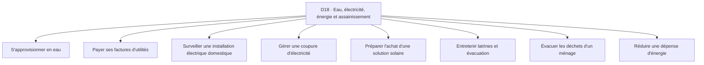

**Accès rapide aux activités :** [A01](#d18-a01) · [A02](#d18-a02) · [A03](#d18-a03) · [A04](#d18-a04) · [A05](#d18-a05) · [A06](#d18-a06) · [A07](#d18-a07) · [A08](#d18-a08)

<a id="d18-a01"></a>
### D18-A01 — S'approvisionner en eau
**Résultat recherché :** Disposer d'eau pour les usages prévus.

| Réf. action | Action concrète (ordre indicatif) | Friction potentielle liée | Solution / contournement possible *(à vérifier)* | Amélioration à explorer *(hypothèse)* |
|---|---|---|---|---|
| `D18-A01-E01` | Estimer les besoins | Réserve insuffisante | Bidons et routine | Anticiper les quantités |
| `D18-A01-E02` | Choisir une source appropriée | Qualité inconnue | Conseil local et services compétents | Faciliter les vérifications |
| `D18-A01-E03` | Organiser transport et stockage | Contenants mal adaptés | Charrette et réservoir | Planifier le réapprovisionnement |
| `D18-A01-E04` | Contrôler la réserve | Rupture tardive | Observation quotidienne | Signaler un seuil |

*Point de contrôle terrain D18-A01 : demander à une personne concernée de raconter sa dernière réalisation de cette activité ; identifier les étapes réellement suivies, les incidents concrets et le coût d’un incident, puis vérifier si les contournements et les améliorations de ce tableau ont du sens pour elle.*

<a id="d18-a02"></a>
### D18-A02 — Payer ses factures d'utilités
**Résultat recherché :** Maintenir ses services à jour.

| Réf. action | Action concrète (ordre indicatif) | Friction potentielle liée | Solution / contournement possible *(à vérifier)* | Amélioration à explorer *(hypothèse)* |
|---|---|---|---|---|
| `D18-A02-E01` | Relever échéances | Avis égarés | Facture papier | Regrouper les dates |
| `D18-A02-E02` | Vérifier consommation | Montant inattendu | Comparaison de compteurs | Visualiser les écarts |
| `D18-A02-E03` | Effectuer paiement | Référence erronée | Guichet ou Mobile Money | Sécuriser la saisie |
| `D18-A02-E04` | Archiver preuve | Paiement non reconnu | Reçu | Relier preuve et facture |

*Point de contrôle terrain D18-A02 : demander à une personne concernée de raconter sa dernière réalisation de cette activité ; identifier les étapes réellement suivies, les incidents concrets et le coût d’un incident, puis vérifier si les contournements et les améliorations de ce tableau ont du sens pour elle.*

<a id="d18-a03"></a>
### D18-A03 — Surveiller une installation électrique domestique
**Résultat recherché :** Repérer un défaut et appeler un professionnel adapté.

| Réf. action | Action concrète (ordre indicatif) | Friction potentielle liée | Solution / contournement possible *(à vérifier)* | Amélioration à explorer *(hypothèse)* |
|---|---|---|---|---|
| `D18-A03-E01` | Observer les signes | Risque ignoré ou minimisé | Appel électricien | Faire reconnaître les signes d'alerte |
| `D18-A03-E02` | Décrire le contexte | Informations insuffisantes | Photo depuis zone sûre | Préparer un signalement prudent |
| `D18-A03-E03` | Contacter un professionnel qualifié | Intervenant non adapté | Recommandation | Vérifier qualifications |
| `D18-A03-E04` | Suivre intervention | Travail incomplet | Contrôle par professionnel | Conserver le diagnostic |

*Point de contrôle terrain D18-A03 : demander à une personne concernée de raconter sa dernière réalisation de cette activité ; identifier les étapes réellement suivies, les incidents concrets et le coût d’un incident, puis vérifier si les contournements et les améliorations de ce tableau ont du sens pour elle.*

<a id="d18-a04"></a>
### D18-A04 — Gérer une coupure d'électricité
**Résultat recherché :** Assurer une continuité proportionnée.

| Réf. action | Action concrète (ordre indicatif) | Friction potentielle liée | Solution / contournement possible *(à vérifier)* | Amélioration à explorer *(hypothèse)* |
|---|---|---|---|---|
| `D18-A04-E01` | Identifier l'étendue | Panne privée confondue avec réseau | Question au voisinage | Structurer le signalement |
| `D18-A04-E02` | Protéger appareils | Dommages possibles | Débranchement prudent | Diffuser consignes appropriées |
| `D18-A04-E03` | Choisir secours | Batterie ou carburant insuffisant | Lampe et générateur | Planifier l'autonomie |
| `D18-A04-E04` | Suivre rétablissement | Reprise non annoncée | Service client | Rassembler les mises à jour |

*Point de contrôle terrain D18-A04 : demander à une personne concernée de raconter sa dernière réalisation de cette activité ; identifier les étapes réellement suivies, les incidents concrets et le coût d’un incident, puis vérifier si les contournements et les améliorations de ce tableau ont du sens pour elle.*

<a id="d18-a05"></a>
### D18-A05 — Préparer l'achat d'une solution solaire
**Résultat recherché :** Choisir un équipement compatible avec les usages.

| Réf. action | Action concrète (ordre indicatif) | Friction potentielle liée | Solution / contournement possible *(à vérifier)* | Amélioration à explorer *(hypothèse)* |
|---|---|---|---|---|
| `D18-A05-E01` | Lister les appareils | Puissance oubliée | Inventaire papier | Structurer les besoins |
| `D18-A05-E02` | Estimer consommation | Dimensionnement erroné | Conseil installateur | Comparer scénarios |
| `D18-A05-E03` | Examiner devis et garanties | Composants incomparables | Devis imprimé | Normaliser les caractéristiques |
| `D18-A05-E04` | Suivre installation | Usage non compris | Démonstration | Documenter la prise en main |

*Point de contrôle terrain D18-A05 : demander à une personne concernée de raconter sa dernière réalisation de cette activité ; identifier les étapes réellement suivies, les incidents concrets et le coût d’un incident, puis vérifier si les contournements et les améliorations de ce tableau ont du sens pour elle.*

<a id="d18-a06"></a>
### D18-A06 — Entretenir latrines et évacuation
**Résultat recherché :** Conserver des installations utilisables.

| Réf. action | Action concrète (ordre indicatif) | Friction potentielle liée | Solution / contournement possible *(à vérifier)* | Amélioration à explorer *(hypothèse)* |
|---|---|---|---|---|
| `D18-A06-E01` | Repérer symptômes | Obstruction identifiée tard | Observation | Noter les signes |
| `D18-A06-E02` | Choisir intervention qualifiée | Risque sanitaire sous-estimé | Professionnel recommandé | Orienter vers le bon service |
| `D18-A06-E03` | Planifier intervention | Débordement faute de créneau | Appels | Prioriser les urgences |
| `D18-A06-E04` | Vérifier le résultat | Problème récurrent | Inspection | Consigner l'historique |

*Point de contrôle terrain D18-A06 : demander à une personne concernée de raconter sa dernière réalisation de cette activité ; identifier les étapes réellement suivies, les incidents concrets et le coût d’un incident, puis vérifier si les contournements et les améliorations de ce tableau ont du sens pour elle.*

<a id="d18-a07"></a>
### D18-A07 — Évacuer les déchets d'un ménage
**Résultat recherché :** Maintenir un espace salubre.

| Réf. action | Action concrète (ordre indicatif) | Friction potentielle liée | Solution / contournement possible *(à vérifier)* | Amélioration à explorer *(hypothèse)* |
|---|---|---|---|---|
| `D18-A07-E01` | Trier selon règles locales | Mélange compliqué à récupérer | Bacs séparés | Clarifier les consignes locales |
| `D18-A07-E02` | Connaître calendrier | Passage manqué | Affiche et voisinage | Rappeler les jours |
| `D18-A07-E03` | Préparer la collecte | Sacs ouverts ou accès bloqué | Routine | Créer une checklist |
| `D18-A07-E04` | Signaler incident | Déchets accumulés sans réponse | Appel opérateur | Tracer le signalement |

*Point de contrôle terrain D18-A07 : demander à une personne concernée de raconter sa dernière réalisation de cette activité ; identifier les étapes réellement suivies, les incidents concrets et le coût d’un incident, puis vérifier si les contournements et les améliorations de ce tableau ont du sens pour elle.*

<a id="d18-a08"></a>
### D18-A08 — Réduire une dépense d'énergie
**Résultat recherché :** Économiser sans dégrader les besoins essentiels.

| Réf. action | Action concrète (ordre indicatif) | Friction potentielle liée | Solution / contournement possible *(à vérifier)* | Amélioration à explorer *(hypothèse)* |
|---|---|---|---|---|
| `D18-A08-E01` | Relever les appareils | Consommation méconnue | Tour de logement | Établir un inventaire |
| `D18-A08-E02` | Comparer usages | Estimation approximative | Observation compteurs | Voir les postes dominants |
| `D18-A08-E03` | Choisir une mesure | Achat d'équipement non rentable | Conseil qualifié | Comparer coût et gain plausible |
| `D18-A08-E04` | Vérifier après changement | Économie supposée non observée | Factures passées | Suivre sur durée adaptée |

*Point de contrôle terrain D18-A08 : demander à une personne concernée de raconter sa dernière réalisation de cette activité ; identifier les étapes réellement suivies, les incidents concrets et le coût d’un incident, puis vérifier si les contournements et les améliorations de ce tableau ont du sens pour elle.*

**Transversalité :** rechercher les connexions avec les autres domaines à partir des mêmes actions (information, comparaison, confiance, paiement, coordination, déplacement, suivi) et non en fusionnant artificiellement des activités distinctes.


# C — Éducation, compétences et organisation

<a id="d19"></a>
## D19 — Éducation scolaire et universitaire
**Personnes / organisations concernées :** Élèves, parents, étudiants, enseignants, établissements, répétiteurs.
**Inventaire :** 8 activités détaillées. Les personnes peuvent cumuler plusieurs rôles et les parcours ci-dessous ne sont pas exclusifs.

**Carte de navigation du domaine**
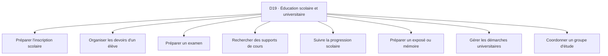

**Accès rapide aux activités :** [A01](#d19-a01) · [A02](#d19-a02) · [A03](#d19-a03) · [A04](#d19-a04) · [A05](#d19-a05) · [A06](#d19-a06) · [A07](#d19-a07) · [A08](#d19-a08)

<a id="d19-a01"></a>
### D19-A01 — Préparer l'inscription scolaire
**Résultat recherché :** Obtenir une place et un dossier recevable.

| Réf. action | Action concrète (ordre indicatif) | Friction potentielle liée | Solution / contournement possible *(à vérifier)* | Amélioration à explorer *(hypothèse)* |
|---|---|---|---|---|
| `D19-A01-E01` | Comprendre les conditions | Critères et dates mal compris | Appel à l'école | Clarifier les exigences |
| `D19-A01-E02` | Rassembler les pièces | Document manquant | Chemise papier | Créer une checklist |
| `D19-A01-E03` | Déposer le dossier | Aller-retour ou refus | Guichet | Vérifier avant déplacement |
| `D19-A01-E04` | Confirmer l'inscription | Statut incertain | Reçu | Tracer les étapes |

*Point de contrôle terrain D19-A01 : demander à une personne concernée de raconter sa dernière réalisation de cette activité ; identifier les étapes réellement suivies, les incidents concrets et le coût d’un incident, puis vérifier si les contournements et les améliorations de ce tableau ont du sens pour elle.*

<a id="d19-a02"></a>
### D19-A02 — Organiser les devoirs d'un élève
**Résultat recherché :** Réaliser les exercices avant les échéances.

| Réf. action | Action concrète (ordre indicatif) | Friction potentielle liée | Solution / contournement possible *(à vérifier)* | Amélioration à explorer *(hypothèse)* |
|---|---|---|---|---|
| `D19-A02-E01` | Recueillir les consignes | Devoir mal copié | Cahier scolaire | Récapituler la consigne |
| `D19-A02-E02` | Planifier le temps | Tâche reportée | Agenda parental | Découper les sessions |
| `D19-A02-E03` | Trouver les ressources | Manuel manquant | Camarade et bibliothèque | Repérer les supports |
| `D19-A02-E04` | Vérifier le rendu | Travail incomplet | Relecture familiale | Contrôler selon critères |

*Point de contrôle terrain D19-A02 : demander à une personne concernée de raconter sa dernière réalisation de cette activité ; identifier les étapes réellement suivies, les incidents concrets et le coût d’un incident, puis vérifier si les contournements et les améliorations de ce tableau ont du sens pour elle.*

<a id="d19-a03"></a>
### D19-A03 — Préparer un examen
**Résultat recherché :** Réviser les connaissances pertinentes.

| Réf. action | Action concrète (ordre indicatif) | Friction potentielle liée | Solution / contournement possible *(à vérifier)* | Amélioration à explorer *(hypothèse)* |
|---|---|---|---|---|
| `D19-A03-E01` | Recenser le programme | Chapitre oublié | Cours du professeur | Créer une carte des thèmes |
| `D19-A03-E02` | Évaluer les acquis | Fausse impression de maîtrise | Anciens sujets | Distinguer connu et fragile |
| `D19-A03-E03` | Planifier révision | Temps concentré la veille | Planning papier | Répartir les séances |
| `D19-A03-E04` | Corriger les erreurs | Même faute répétée | Cahier de correction | Garder les erreurs types |

*Point de contrôle terrain D19-A03 : demander à une personne concernée de raconter sa dernière réalisation de cette activité ; identifier les étapes réellement suivies, les incidents concrets et le coût d’un incident, puis vérifier si les contournements et les améliorations de ce tableau ont du sens pour elle.*

<a id="d19-a04"></a>
### D19-A04 — Rechercher des supports de cours
**Résultat recherché :** Accéder à des contenus corrects et utilisables.

| Réf. action | Action concrète (ordre indicatif) | Friction potentielle liée | Solution / contournement possible *(à vérifier)* | Amélioration à explorer *(hypothèse)* |
|---|---|---|---|---|
| `D19-A04-E01` | Identifier le chapitre | Recherche trop vague | Programme officiel | Clarifier l'objet |
| `D19-A04-E02` | Trouver la ressource | Lien mort ou document éparpillé | Groupes de classe | Regrouper les pistes |
| `D19-A04-E03` | Vérifier niveau et version | Ancien programme | Avis enseignant | Afficher les références |
| `D19-A04-E04` | Conserver hors ligne | Connexion limitée | Téléchargement | Organiser l'accès |

*Point de contrôle terrain D19-A04 : demander à une personne concernée de raconter sa dernière réalisation de cette activité ; identifier les étapes réellement suivies, les incidents concrets et le coût d’un incident, puis vérifier si les contournements et les améliorations de ce tableau ont du sens pour elle.*

<a id="d19-a05"></a>
### D19-A05 — Suivre la progression scolaire
**Résultat recherché :** Savoir où un soutien est nécessaire.

| Réf. action | Action concrète (ordre indicatif) | Friction potentielle liée | Solution / contournement possible *(à vérifier)* | Amélioration à explorer *(hypothèse)* |
|---|---|---|---|---|
| `D19-A05-E01` | Recueillir notes et observations | Résultats dispersés | Bulletin papier | Réunir les éléments |
| `D19-A05-E02` | Repérer une tendance | Une note isolée surinterprétée | Discussion enseignant | Contextualiser les résultats |
| `D19-A05-E03` | Choisir un soutien | Cours inutile ou hors budget | Répétiteur et famille | Cibler la difficulté |
| `D19-A05-E04` | Réévaluer | Progrès non constaté | Exercice témoin | Mesurer l'évolution |

*Point de contrôle terrain D19-A05 : demander à une personne concernée de raconter sa dernière réalisation de cette activité ; identifier les étapes réellement suivies, les incidents concrets et le coût d’un incident, puis vérifier si les contournements et les améliorations de ce tableau ont du sens pour elle.*

<a id="d19-a06"></a>
### D19-A06 — Préparer un exposé ou mémoire
**Résultat recherché :** Livrer un travail documenté et cohérent.

| Réf. action | Action concrète (ordre indicatif) | Friction potentielle liée | Solution / contournement possible *(à vérifier)* | Amélioration à explorer *(hypothèse)* |
|---|---|---|---|---|
| `D19-A06-E01` | Définir la question | Sujet trop large | Échange encadrant | Délimiter le thème |
| `D19-A06-E02` | Chercher les sources | Documents peu fiables | Bibliothèque et recherche | Tracer l'origine |
| `D19-A06-E03` | Organiser les idées | Plan incohérent | Fiches papier | Construire la structure |
| `D19-A06-E04` | Réviser citations et rendu | Plagiat ou erreurs de référence | Relecture | Contrôler références et conformité |

*Point de contrôle terrain D19-A06 : demander à une personne concernée de raconter sa dernière réalisation de cette activité ; identifier les étapes réellement suivies, les incidents concrets et le coût d’un incident, puis vérifier si les contournements et les améliorations de ce tableau ont du sens pour elle.*

<a id="d19-a07"></a>
### D19-A07 — Gérer les démarches universitaires
**Résultat recherché :** Respecter les formalités administratives.

| Réf. action | Action concrète (ordre indicatif) | Friction potentielle liée | Solution / contournement possible *(à vérifier)* | Amélioration à explorer *(hypothèse)* |
|---|---|---|---|---|
| `D19-A07-E01` | Repérer les calendriers | Date de réinscription manquée | Panneau étudiant | Centraliser les échéances |
| `D19-A07-E02` | Préparer les pièces | Attestation absente | Bureau scolarité | Créer une checklist |
| `D19-A07-E03` | Régler les frais | Référence non retrouvée | Guichet et reçu | Rapprocher paiement et démarche |
| `D19-A07-E04` | Suivre la validation | Étape bloquée sans visibilité | Visite du bureau | Afficher les statuts |

*Point de contrôle terrain D19-A07 : demander à une personne concernée de raconter sa dernière réalisation de cette activité ; identifier les étapes réellement suivies, les incidents concrets et le coût d’un incident, puis vérifier si les contournements et les améliorations de ce tableau ont du sens pour elle.*

<a id="d19-a08"></a>
### D19-A08 — Coordonner un groupe d'étude
**Résultat recherché :** Réviser ensemble efficacement.

| Réf. action | Action concrète (ordre indicatif) | Friction potentielle liée | Solution / contournement possible *(à vérifier)* | Amélioration à explorer *(hypothèse)* |
|---|---|---|---|---|
| `D19-A08-E01` | Constituer le groupe | Niveaux et objectifs incompatibles | Camarades | Clarifier la mission |
| `D19-A08-E02` | Planifier la séance | Disponibilités dispersées | Groupe de messagerie | Trouver un créneau |
| `D19-A08-E03` | Répartir les thèmes | Un membre fait tout | Liste partagée | Rendre les responsabilités visibles |
| `D19-A08-E04` | Évaluer la séance | Réunion sans apprentissage mesurable | Quiz | Prévoir un bilan |

*Point de contrôle terrain D19-A08 : demander à une personne concernée de raconter sa dernière réalisation de cette activité ; identifier les étapes réellement suivies, les incidents concrets et le coût d’un incident, puis vérifier si les contournements et les améliorations de ce tableau ont du sens pour elle.*

**Transversalité :** rechercher les connexions avec les autres domaines à partir des mêmes actions (information, comparaison, confiance, paiement, coordination, déplacement, suivi) et non en fusionnant artificiellement des activités distinctes.

<a id="d20"></a>
## D20 — Formation professionnelle, apprentissage et acquisition de compétences
**Personnes / organisations concernées :** Apprentis, adultes en reconversion, formateurs, artisans, centres de formation, employeurs.
**Inventaire :** 8 activités détaillées. Les personnes peuvent cumuler plusieurs rôles et les parcours ci-dessous ne sont pas exclusifs.

**Carte de navigation du domaine**
```mermaid
flowchart TB
 D20["D20 · Formation professionnelle, apprentissage et acquisition de compétences"]
 D20 --> D20A01["Choisir une compétence à apprendre"]
 D20 --> D20A02["Comparer des formations"]
 D20 --> D20A03["Suivre une formation en ligne"]
 D20 --> D20A04["Apprendre auprès d'un artisan"]
 D20 --> D20A05["Constituer un portfolio de compétences"]
 D20 --> D20A06["Préparer une certification"]
 D20 --> D20A07["Organiser une formation en présentiel"]
 D20 --> D20A08["Transformer une compétence en première mission"]
```

**Accès rapide aux activités :** [A01](#d20-a01) · [A02](#d20-a02) · [A03](#d20-a03) · [A04](#d20-a04) · [A05](#d20-a05) · [A06](#d20-a06) · [A07](#d20-a07) · [A08](#d20-a08)

<a id="d20-a01"></a>
### D20-A01 — Choisir une compétence à apprendre
**Résultat recherché :** Sélectionner une compétence utile à un projet.

| Réf. action | Action concrète (ordre indicatif) | Friction potentielle liée | Solution / contournement possible *(à vérifier)* | Amélioration à explorer *(hypothèse)* |
|---|---|---|---|---|
| `D20-A01-E01` | Définir l'objectif | Formation sans usage prévu | Conseil d'un pair | Relier compétence et tâche |
| `D20-A01-E02` | Examiner les débouchés | Promesses publicitaires trompeuses | Entretiens professionnels | Distinguer faits et attentes |
| `D20-A01-E03` | Évaluer prérequis | Niveau réel surestimé | Test d'entrée | Diagnostiquer les bases |
| `D20-A01-E04` | Choisir un premier palier | Projet trop ambitieux | Plan d'apprentissage | Fractionner l'objectif |

*Point de contrôle terrain D20-A01 : demander à une personne concernée de raconter sa dernière réalisation de cette activité ; identifier les étapes réellement suivies, les incidents concrets et le coût d’un incident, puis vérifier si les contournements et les améliorations de ce tableau ont du sens pour elle.*

<a id="d20-a02"></a>
### D20-A02 — Comparer des formations
**Résultat recherché :** Choisir une voie adaptée aux contraintes.

| Réf. action | Action concrète (ordre indicatif) | Friction potentielle liée | Solution / contournement possible *(à vérifier)* | Amélioration à explorer *(hypothèse)* |
|---|---|---|---|---|
| `D20-A02-E01` | Recenser organismes | Offres hors réseau social inconnues | Recommandations | Élargir les pistes |
| `D20-A02-E02` | Comparer programme | Intitulés non comparables | Brochures | Relier modules et résultats |
| `D20-A02-E03` | Estimer coûts complets | Transport et matériel oubliés | Budget papier | Comparer coût total |
| `D20-A02-E04` | Vérifier qualité | Certification ou promesse non vérifiée | Contact anciens élèves | Structurer les contrôles |

*Point de contrôle terrain D20-A02 : demander à une personne concernée de raconter sa dernière réalisation de cette activité ; identifier les étapes réellement suivies, les incidents concrets et le coût d’un incident, puis vérifier si les contournements et les améliorations de ce tableau ont du sens pour elle.*

<a id="d20-a03"></a>
### D20-A03 — Suivre une formation en ligne
**Résultat recherché :** Avancer malgré les contraintes de connexion.

| Réf. action | Action concrète (ordre indicatif) | Friction potentielle liée | Solution / contournement possible *(à vérifier)* | Amélioration à explorer *(hypothèse)* |
|---|---|---|---|---|
| `D20-A03-E01` | Préparer l'accès | Vidéo trop lourde | Téléchargement si permis | Prévoir l'hors ligne |
| `D20-A03-E02` | Planifier sessions | Abandon après quelques jours | Rappel de téléphone | Fixer de petits jalons |
| `D20-A03-E03` | Pratiquer l'exercice | Visionnage confondu avec compétence | Projet personnel | Relier leçon à pratique |
| `D20-A03-E04` | Demander du retour | Erreur persistante | Forum et mentor | Faciliter une question précise |

*Point de contrôle terrain D20-A03 : demander à une personne concernée de raconter sa dernière réalisation de cette activité ; identifier les étapes réellement suivies, les incidents concrets et le coût d’un incident, puis vérifier si les contournements et les améliorations de ce tableau ont du sens pour elle.*

<a id="d20-a04"></a>
### D20-A04 — Apprendre auprès d'un artisan
**Résultat recherché :** Acquérir un geste professionnel en situation.

| Réf. action | Action concrète (ordre indicatif) | Friction potentielle liée | Solution / contournement possible *(à vérifier)* | Amélioration à explorer *(hypothèse)* |
|---|---|---|---|---|
| `D20-A04-E01` | Définir ce qui sera appris | Apprentissage limité aux courses | Accord maître-apprenti | Expliciter les tâches |
| `D20-A04-E02` | Observer un geste | Détail technique manqué | Démonstration | Documenter les étapes |
| `D20-A04-E03` | Répéter sous supervision | Risque de mauvaise pratique | Correction du maître | Prévoir des paliers |
| `D20-A04-E04` | Évaluer l'autonomie | Progression peu visible | Essai pratique | Tracer les réalisations |

*Point de contrôle terrain D20-A04 : demander à une personne concernée de raconter sa dernière réalisation de cette activité ; identifier les étapes réellement suivies, les incidents concrets et le coût d’un incident, puis vérifier si les contournements et les améliorations de ce tableau ont du sens pour elle.*

<a id="d20-a05"></a>
### D20-A05 — Constituer un portfolio de compétences
**Résultat recherché :** Montrer des réalisations authentiques.

| Réf. action | Action concrète (ordre indicatif) | Friction potentielle liée | Solution / contournement possible *(à vérifier)* | Amélioration à explorer *(hypothèse)* |
|---|---|---|---|---|
| `D20-A05-E01` | Choisir les preuves | Résultat non représentatif | Photos de projets | Lier preuve et compétence |
| `D20-A05-E02` | Demander les autorisations | Données client exposées | Accord écrit | Vérifier les droits |
| `D20-A05-E03` | Expliquer sa contribution | Travail collectif attribué à soi | Description manuscrite | Clarifier le rôle |
| `D20-A05-E04` | Présenter le portfolio | Fichiers difficiles à ouvrir | Lien ou dossier | Faciliter la consultation |

*Point de contrôle terrain D20-A05 : demander à une personne concernée de raconter sa dernière réalisation de cette activité ; identifier les étapes réellement suivies, les incidents concrets et le coût d’un incident, puis vérifier si les contournements et les améliorations de ce tableau ont du sens pour elle.*

<a id="d20-a06"></a>
### D20-A06 — Préparer une certification
**Résultat recherché :** Répondre à des exigences définies.

| Réf. action | Action concrète (ordre indicatif) | Friction potentielle liée | Solution / contournement possible *(à vérifier)* | Amélioration à explorer *(hypothèse)* |
|---|---|---|---|---|
| `D20-A06-E01` | Lire référentiel | Compétences examinées mal comprises | Guide officiel | Cartographier les exigences |
| `D20-A06-E02` | Évaluer lacunes | Temps consacré aux points forts | Examen blanc | Prioriser les écarts |
| `D20-A06-E03` | Préparer dossier | Pièce ou format manquant | Liste du centre | Vérifier la complétude |
| `D20-A06-E04` | Passer l'épreuve | Matériel ou horaire oublié | Convocation imprimée | Préparer un contrôle final |

*Point de contrôle terrain D20-A06 : demander à une personne concernée de raconter sa dernière réalisation de cette activité ; identifier les étapes réellement suivies, les incidents concrets et le coût d’un incident, puis vérifier si les contournements et les améliorations de ce tableau ont du sens pour elle.*

<a id="d20-a07"></a>
### D20-A07 — Organiser une formation en présentiel
**Résultat recherché :** Faire progresser un groupe dans les délais.

| Réf. action | Action concrète (ordre indicatif) | Friction potentielle liée | Solution / contournement possible *(à vérifier)* | Amélioration à explorer *(hypothèse)* |
|---|---|---|---|---|
| `D20-A07-E01` | Diagnostiquer participants | Niveaux très différents | Questionnaire papier | Adapter le rythme |
| `D20-A07-E02` | Préparer matériels | Outil indisponible | Inventaire | Anticiper les besoins |
| `D20-A07-E03` | Animer exercices | Apprenants peu actifs | Démonstrations | Augmenter le temps de pratique |
| `D20-A07-E04` | Évaluer acquisition | Présence confondue avec maîtrise | Mise en situation | Mesurer des résultats |

*Point de contrôle terrain D20-A07 : demander à une personne concernée de raconter sa dernière réalisation de cette activité ; identifier les étapes réellement suivies, les incidents concrets et le coût d’un incident, puis vérifier si les contournements et les améliorations de ce tableau ont du sens pour elle.*

<a id="d20-a08"></a>
### D20-A08 — Transformer une compétence en première mission
**Résultat recherché :** Passer de l'apprentissage à une activité réelle.

| Réf. action | Action concrète (ordre indicatif) | Friction potentielle liée | Solution / contournement possible *(à vérifier)* | Amélioration à explorer *(hypothèse)* |
|---|---|---|---|---|
| `D20-A08-E01` | Choisir un petit cas d'usage | Projet trop risqué | Mission bénévole cadrée | Limiter le périmètre |
| `D20-A08-E02` | Estimer capacité | Délai mal évalué | Conseil mentor | Établir des conditions |
| `D20-A08-E03` | Réaliser et documenter | Résultat non vérifié | Feedback client | Recueillir des preuves |
| `D20-A08-E04` | Décider de la suite | Première réussite généralisée | Carnet de bilan | Capitaliser sans extrapoler |

*Point de contrôle terrain D20-A08 : demander à une personne concernée de raconter sa dernière réalisation de cette activité ; identifier les étapes réellement suivies, les incidents concrets et le coût d’un incident, puis vérifier si les contournements et les améliorations de ce tableau ont du sens pour elle.*

**Transversalité :** rechercher les connexions avec les autres domaines à partir des mêmes actions (information, comparaison, confiance, paiement, coordination, déplacement, suivi) et non en fusionnant artificiellement des activités distinctes.

<a id="d21"></a>
## D21 — Orientation académique, examens, bourses et opportunités de carrière
**Personnes / organisations concernées :** Lycéens, étudiants, parents, conseillers, candidats, anciens diplômés.
**Inventaire :** 8 activités détaillées. Les personnes peuvent cumuler plusieurs rôles et les parcours ci-dessous ne sont pas exclusifs.

**Carte de navigation du domaine**
```mermaid
flowchart TB
 D21["D21 · Orientation académique, examens, bourses et opportunités de carrière"]
 D21 --> D21A01["Explorer des filières d'études"]
 D21 --> D21A02["Choisir un établissement"]
 D21 --> D21A03["S'inscrire à un concours ou examen"]
 D21 --> D21A04["Rechercher des bourses"]
 D21 --> D21A05["Préparer une candidature de bourse"]
 D21 --> D21A06["Explorer un métier"]
 D21 --> D21A07["Préparer une mobilité d'études"]
 D21 --> D21A08["Gérer une réorientation"]
```

**Accès rapide aux activités :** [A01](#d21-a01) · [A02](#d21-a02) · [A03](#d21-a03) · [A04](#d21-a04) · [A05](#d21-a05) · [A06](#d21-a06) · [A07](#d21-a07) · [A08](#d21-a08)

<a id="d21-a01"></a>
### D21-A01 — Explorer des filières d'études
**Résultat recherché :** Comprendre les débouchés et exigences.

| Réf. action | Action concrète (ordre indicatif) | Friction potentielle liée | Solution / contournement possible *(à vérifier)* | Amélioration à explorer *(hypothèse)* |
|---|---|---|---|---|
| `D21-A01-E01` | Lister ses centres d'intérêt | Intérêts confondus avec métier | Discussion conseiller | Associer activités concrètes |
| `D21-A01-E02` | Rechercher programmes | Informations dispersées | Sites d'établissements | Comparer les programmes |
| `D21-A01-E03` | Vérifier les conditions | Diplôme ou niveau requis oublié | Avis officiel | Contrôler l'éligibilité |
| `D21-A01-E04` | Évaluer coût et accès | Frais de vie ignorés | Budget familial | Comparer scénarios |

*Point de contrôle terrain D21-A01 : demander à une personne concernée de raconter sa dernière réalisation de cette activité ; identifier les étapes réellement suivies, les incidents concrets et le coût d’un incident, puis vérifier si les contournements et les améliorations de ce tableau ont du sens pour elle.*

<a id="d21-a02"></a>
### D21-A02 — Choisir un établissement
**Résultat recherché :** Sélectionner une option réaliste.

| Réf. action | Action concrète (ordre indicatif) | Friction potentielle liée | Solution / contournement possible *(à vérifier)* | Amélioration à explorer *(hypothèse)* |
|---|---|---|---|---|
| `D21-A02-E01` | Recenser les établissements | Confusion entre noms proches | Annuaires et proches | Distinguer les structures |
| `D21-A02-E02` | Examiner reconnaissance | Statut non vérifié | Autorité compétente | Vérifier à la source |
| `D21-A02-E03` | Comparer frais et distance | Transport sous-estimé | Visites et brochures | Calculer le coût complet |
| `D21-A02-E04` | Préparer candidature | Échéance manquée | Agenda | Organiser les démarches |

*Point de contrôle terrain D21-A02 : demander à une personne concernée de raconter sa dernière réalisation de cette activité ; identifier les étapes réellement suivies, les incidents concrets et le coût d’un incident, puis vérifier si les contournements et les améliorations de ce tableau ont du sens pour elle.*

<a id="d21-a03"></a>
### D21-A03 — S'inscrire à un concours ou examen
**Résultat recherché :** Déposer une candidature recevable.

| Réf. action | Action concrète (ordre indicatif) | Friction potentielle liée | Solution / contournement possible *(à vérifier)* | Amélioration à explorer *(hypothèse)* |
|---|---|---|---|---|
| `D21-A03-E01` | Repérer annonce fiable | Ancienne session relayée | Publication officielle | Indiquer la date de source |
| `D21-A03-E02` | Lire critères et frais | Dépense pour une inscription impossible | Notice officielle | Vérifier avant paiement |
| `D21-A03-E03` | Rassembler et envoyer pièces | Format ou référence refusés | Cybercafé | Contrôler la soumission |
| `D21-A03-E04` | Conserver la convocation | Document introuvable | Capture et impression | Rassembler les preuves |

*Point de contrôle terrain D21-A03 : demander à une personne concernée de raconter sa dernière réalisation de cette activité ; identifier les étapes réellement suivies, les incidents concrets et le coût d’un incident, puis vérifier si les contournements et les améliorations de ce tableau ont du sens pour elle.*

<a id="d21-a04"></a>
### D21-A04 — Rechercher des bourses
**Résultat recherché :** Identifier une aide pertinente et authentique.

| Réf. action | Action concrète (ordre indicatif) | Friction potentielle liée | Solution / contournement possible *(à vérifier)* | Amélioration à explorer *(hypothèse)* |
|---|---|---|---|---|
| `D21-A04-E01` | Définir profil | Candidatures hors critères | Fiche personnelle | Filtrer exigences |
| `D21-A04-E02` | Trouver appels | Offres expirées ou frauduleuses | Portail d'organisme | Recouper l'annonce |
| `D21-A04-E03` | Préparer dossier | Justificatif absent | Dossier papier | Structurer les exigences |
| `D21-A04-E04` | Suivre résultats | Date ou contact oubliés | Agenda | Tracer les réponses |

*Point de contrôle terrain D21-A04 : demander à une personne concernée de raconter sa dernière réalisation de cette activité ; identifier les étapes réellement suivies, les incidents concrets et le coût d’un incident, puis vérifier si les contournements et les améliorations de ce tableau ont du sens pour elle.*

<a id="d21-a05"></a>
### D21-A05 — Préparer une candidature de bourse
**Résultat recherché :** Présenter son parcours honnêtement.

| Réf. action | Action concrète (ordre indicatif) | Friction potentielle liée | Solution / contournement possible *(à vérifier)* | Amélioration à explorer *(hypothèse)* |
|---|---|---|---|---|
| `D21-A05-E01` | Comprendre le projet du financeur | Lettre générique | Notice de programme | Relier objectifs et preuves |
| `D21-A05-E02` | Rassembler attestations | Émission longue | Demandes administratives anticipées | Planifier les délais |
| `D21-A05-E03` | Rédiger dossier | Contradictions entre documents | Relecture de conseiller | Contrôler la cohérence |
| `D21-A05-E04` | Soumettre avant clôture | Panne de connexion de dernière minute | Dépôt anticipé | Prévoir une marge |

*Point de contrôle terrain D21-A05 : demander à une personne concernée de raconter sa dernière réalisation de cette activité ; identifier les étapes réellement suivies, les incidents concrets et le coût d’un incident, puis vérifier si les contournements et les améliorations de ce tableau ont du sens pour elle.*

<a id="d21-a06"></a>
### D21-A06 — Explorer un métier
**Résultat recherché :** Comprendre le quotidien et les contraintes d'un rôle.

| Réf. action | Action concrète (ordre indicatif) | Friction potentielle liée | Solution / contournement possible *(à vérifier)* | Amélioration à explorer *(hypothèse)* |
|---|---|---|---|---|
| `D21-A06-E01` | Lire descriptions | Intitulé idéalisé | Fiches métiers | Lister les tâches réelles |
| `D21-A06-E02` | Parler à un professionnel | Échantillon limité | Réseau d'anciens | Varier les témoignages |
| `D21-A06-E03` | Observer en situation | Contraintes invisibles | Stage découverte | Documenter le contexte |
| `D21-A06-E04` | Comparer à ses objectifs | Décision sur salaire seul | Carnet | Examiner plusieurs dimensions |

*Point de contrôle terrain D21-A06 : demander à une personne concernée de raconter sa dernière réalisation de cette activité ; identifier les étapes réellement suivies, les incidents concrets et le coût d’un incident, puis vérifier si les contournements et les améliorations de ce tableau ont du sens pour elle.*

<a id="d21-a07"></a>
### D21-A07 — Préparer une mobilité d'études
**Résultat recherché :** Anticiper les démarches pour étudier ailleurs.

| Réf. action | Action concrète (ordre indicatif) | Friction potentielle liée | Solution / contournement possible *(à vérifier)* | Amélioration à explorer *(hypothèse)* |
|---|---|---|---|---|
| `D21-A07-E01` | Vérifier admission | Conditions changeantes | Portail officiel | Contrôler les exigences |
| `D21-A07-E02` | Estimer budget | Logement et couverture oubliés | Tableur | Simuler les dépenses |
| `D21-A07-E03` | Préparer documents | Légalisation ou traduction omise | Bureau compétent | Créer une checklist vérifiable |
| `D21-A07-E04` | Planifier calendrier | Délais administratifs incompatibles | Agenda | Identifier les dépendances |

*Point de contrôle terrain D21-A07 : demander à une personne concernée de raconter sa dernière réalisation de cette activité ; identifier les étapes réellement suivies, les incidents concrets et le coût d’un incident, puis vérifier si les contournements et les améliorations de ce tableau ont du sens pour elle.*

<a id="d21-a08"></a>
### D21-A08 — Gérer une réorientation
**Résultat recherché :** Changer de voie avec des conséquences maîtrisées.

| Réf. action | Action concrète (ordre indicatif) | Friction potentielle liée | Solution / contournement possible *(à vérifier)* | Amélioration à explorer *(hypothèse)* |
|---|---|---|---|---|
| `D21-A08-E01` | Identifier la cause | Difficulté ponctuelle prise pour mauvais choix | Entretien conseiller | Clarifier la situation |
| `D21-A08-E02` | Comparer alternatives | Information asymétrique | Visite des filières | Évaluer les options |
| `D21-A08-E03` | Vérifier équivalences | Crédits non transférables | Service académique | Vérifier par écrit |
| `D21-A08-E04` | Préparer transition | Perte de ressources inattendue | Budget et famille | Planifier des étapes |

*Point de contrôle terrain D21-A08 : demander à une personne concernée de raconter sa dernière réalisation de cette activité ; identifier les étapes réellement suivies, les incidents concrets et le coût d’un incident, puis vérifier si les contournements et les améliorations de ce tableau ont du sens pour elle.*

**Transversalité :** rechercher les connexions avec les autres domaines à partir des mêmes actions (information, comparaison, confiance, paiement, coordination, déplacement, suivi) et non en fusionnant artificiellement des activités distinctes.

<a id="d22"></a>
## D22 — Organisation personnelle, gestion du temps et responsabilités quotidiennes
**Personnes / organisations concernées :** Particuliers, familles, étudiants, salariés, indépendants, aidants.
**Inventaire :** 8 activités détaillées. Les personnes peuvent cumuler plusieurs rôles et les parcours ci-dessous ne sont pas exclusifs.

**Carte de navigation du domaine**
```mermaid
flowchart TB
 D22["D22 · Organisation personnelle, gestion du temps et responsabilités quotidiennes"]
 D22 --> D22A01["Recenser ses engagements"]
 D22 --> D22A02["Planifier une journée"]
 D22 --> D22A03["Suivre des échéances administratives"]
 D22 --> D22A04["Organiser un projet personnel"]
 D22 --> D22A05["Coordonner les tâches du foyer"]
 D22 --> D22A06["Gérer des documents personnels"]
 D22 --> D22A07["Préparer un événement familial"]
 D22 --> D22A08["Gérer une habitude ou un objectif"]
```

**Accès rapide aux activités :** [A01](#d22-a01) · [A02](#d22-a02) · [A03](#d22-a03) · [A04](#d22-a04) · [A05](#d22-a05) · [A06](#d22-a06) · [A07](#d22-a07) · [A08](#d22-a08)

<a id="d22-a01"></a>
### D22-A01 — Recenser ses engagements
**Résultat recherché :** Savoir tout ce qui doit être fait.

| Réf. action | Action concrète (ordre indicatif) | Friction potentielle liée | Solution / contournement possible *(à vérifier)* | Amélioration à explorer *(hypothèse)* |
|---|---|---|---|---|
| `D22-A01-E01` | Collecter les demandes | Tâches dispersées dans les messages | Carnet | Créer une boîte d'entrée |
| `D22-A01-E02` | Clarifier les résultats | Tâche trop vague | Discussion | Transformer en action concrète |
| `D22-A01-E03` | Identifier les échéances | Date oubliée | Agenda | Lier tâche et date |
| `D22-A01-E04` | Réviser la liste | Liste rapidement obsolète | Rituel hebdomadaire | Faciliter la mise à jour |

*Point de contrôle terrain D22-A01 : demander à une personne concernée de raconter sa dernière réalisation de cette activité ; identifier les étapes réellement suivies, les incidents concrets et le coût d’un incident, puis vérifier si les contournements et les améliorations de ce tableau ont du sens pour elle.*

<a id="d22-a02"></a>
### D22-A02 — Planifier une journée
**Résultat recherché :** Faire avancer les priorités réalistes.

| Réf. action | Action concrète (ordre indicatif) | Friction potentielle liée | Solution / contournement possible *(à vérifier)* | Amélioration à explorer *(hypothèse)* |
|---|---|---|---|---|
| `D22-A02-E01` | Estimer le temps | Sous-estimation systématique | Agenda | Prévoir des marges |
| `D22-A02-E02` | Classer les urgences | Tout paraît urgent | Liste classée | Expliciter les critères |
| `D22-A02-E03` | Choisir les créneaux | Conflit avec trajets et travail | Calendrier | Détecter les chevauchements |
| `D22-A02-E04` | Ajuster en cours de route | Plan figé malgré imprévu | Note manuelle | Reprioriser simplement |

*Point de contrôle terrain D22-A02 : demander à une personne concernée de raconter sa dernière réalisation de cette activité ; identifier les étapes réellement suivies, les incidents concrets et le coût d’un incident, puis vérifier si les contournements et les améliorations de ce tableau ont du sens pour elle.*

<a id="d22-a03"></a>
### D22-A03 — Suivre des échéances administratives
**Résultat recherché :** Éviter des retards évitables.

| Réf. action | Action concrète (ordre indicatif) | Friction potentielle liée | Solution / contournement possible *(à vérifier)* | Amélioration à explorer *(hypothèse)* |
|---|---|---|---|---|
| `D22-A03-E01` | Identifier obligations | Renouvellement oublié | Dossier papier | Rassembler les dates |
| `D22-A03-E02` | Vérifier durée de préparation | Pièce longue à obtenir | Conseil au guichet | Anticiper les dépendances |
| `D22-A03-E03` | Définir rappel | Notification trop tardive | Alarme | Choisir un délai utile |
| `D22-A03-E04` | Confirmer accomplissement | Tâche rappelée malgré achèvement | Carnet | Clore avec preuve |

*Point de contrôle terrain D22-A03 : demander à une personne concernée de raconter sa dernière réalisation de cette activité ; identifier les étapes réellement suivies, les incidents concrets et le coût d’un incident, puis vérifier si les contournements et les améliorations de ce tableau ont du sens pour elle.*

<a id="d22-a04"></a>
### D22-A04 — Organiser un projet personnel
**Résultat recherché :** Transformer un but en étapes faisables.

| Réf. action | Action concrète (ordre indicatif) | Friction potentielle liée | Solution / contournement possible *(à vérifier)* | Amélioration à explorer *(hypothèse)* |
|---|---|---|---|---|
| `D22-A04-E01` | Définir le résultat | But flou | Journal | Formuler un livrable |
| `D22-A04-E02` | Découper les phases | Blocage devant gros projet | Liste papier | Visualiser les sous-tâches |
| `D22-A04-E03` | Réserver les moyens | Ressources insuffisantes | Budget | Faire apparaître les dépendances |
| `D22-A04-E04` | Examiner les progrès | Découragement sans mesure | Rituel de bilan | Montrer les jalons atteints |

*Point de contrôle terrain D22-A04 : demander à une personne concernée de raconter sa dernière réalisation de cette activité ; identifier les étapes réellement suivies, les incidents concrets et le coût d’un incident, puis vérifier si les contournements et les améliorations de ce tableau ont du sens pour elle.*

<a id="d22-a05"></a>
### D22-A05 — Coordonner les tâches du foyer
**Résultat recherché :** Partager la charge domestique.

| Réf. action | Action concrète (ordre indicatif) | Friction potentielle liée | Solution / contournement possible *(à vérifier)* | Amélioration à explorer *(hypothèse)* |
|---|---|---|---|---|
| `D22-A05-E01` | Inventorier les tâches | Travail invisible | Réunion familiale | Rendre la charge visible |
| `D22-A05-E02` | Répartir les rôles | Responsabilité supposée | Tableau mural | Confirmer qui fait quoi |
| `D22-A05-E03` | Synchroniser horaires | Présences incompatibles | Messages de famille | Repérer les conflits |
| `D22-A05-E04` | Réviser la répartition | Déséquilibre durable | Discussion hebdomadaire | Comparer la charge réelle |

*Point de contrôle terrain D22-A05 : demander à une personne concernée de raconter sa dernière réalisation de cette activité ; identifier les étapes réellement suivies, les incidents concrets et le coût d’un incident, puis vérifier si les contournements et les améliorations de ce tableau ont du sens pour elle.*

<a id="d22-a06"></a>
### D22-A06 — Gérer des documents personnels
**Résultat recherché :** Retrouver une pièce rapidement.

| Réf. action | Action concrète (ordre indicatif) | Friction potentielle liée | Solution / contournement possible *(à vérifier)* | Amélioration à explorer *(hypothèse)* |
|---|---|---|---|---|
| `D22-A06-E01` | Identifier les documents | Ancienne et nouvelle version confondues | Chemises papier | Créer des catégories |
| `D22-A06-E02` | Numériser si utile | Photo illisible | Caméra du téléphone | Vérifier qualité |
| `D22-A06-E03` | Ranger et protéger | Fichier perdu ou exposé | Dossier sécurisé | Adapter l'accès |
| `D22-A06-E04` | Retrouver au besoin | Recherche longue | Recherche par nom | Faciliter le repérage |

*Point de contrôle terrain D22-A06 : demander à une personne concernée de raconter sa dernière réalisation de cette activité ; identifier les étapes réellement suivies, les incidents concrets et le coût d’un incident, puis vérifier si les contournements et les améliorations de ce tableau ont du sens pour elle.*

<a id="d22-a07"></a>
### D22-A07 — Préparer un événement familial
**Résultat recherché :** Faire coïncider personnes lieu et moyens.

| Réf. action | Action concrète (ordre indicatif) | Friction potentielle liée | Solution / contournement possible *(à vérifier)* | Amélioration à explorer *(hypothèse)* |
|---|---|---|---|---|
| `D22-A07-E01` | Recueillir les besoins | Désaccord implicite | Discussion familiale | Rendre les décisions visibles |
| `D22-A07-E02` | Établir budget | Petits postes oubliés | Carnet | Comparer au disponible |
| `D22-A07-E03` | Attribuer les tâches | Travaux non faits | Groupe de messagerie | Tracer les engagements |
| `D22-A07-E04` | Confirmer les prestataires | Annulation de dernière minute | Appel avant événement | Vérifier les points critiques |

*Point de contrôle terrain D22-A07 : demander à une personne concernée de raconter sa dernière réalisation de cette activité ; identifier les étapes réellement suivies, les incidents concrets et le coût d’un incident, puis vérifier si les contournements et les améliorations de ce tableau ont du sens pour elle.*

<a id="d22-a08"></a>
### D22-A08 — Gérer une habitude ou un objectif
**Résultat recherché :** Maintenir une pratique utile dans la durée.

| Réf. action | Action concrète (ordre indicatif) | Friction potentielle liée | Solution / contournement possible *(à vérifier)* | Amélioration à explorer *(hypothèse)* |
|---|---|---|---|---|
| `D22-A08-E01` | Choisir un comportement observable | Objectif trop général | Journal | Définir un petit geste |
| `D22-A08-E02` | Insérer dans la routine | Horaire mal choisi | Alarme | Adapter au rythme |
| `D22-A08-E03` | Noter la réalisation | Suivi trop lourd | Coche papier | Réduire la saisie |
| `D22-A08-E04` | Analyser les interruptions | Abandon après un écart | Bilan personnel | Prévoir une reprise sans jugement |

*Point de contrôle terrain D22-A08 : demander à une personne concernée de raconter sa dernière réalisation de cette activité ; identifier les étapes réellement suivies, les incidents concrets et le coût d’un incident, puis vérifier si les contournements et les améliorations de ce tableau ont du sens pour elle.*

**Transversalité :** rechercher les connexions avec les autres domaines à partir des mêmes actions (information, comparaison, confiance, paiement, coordination, déplacement, suivi) et non en fusionnant artificiellement des activités distinctes.


# D — Santé, famille et relations humaines

<a id="d23"></a>
## D23 — Santé, soins médicaux et accès aux professionnels de santé
**Personnes / organisations concernées :** Patients, proches aidants, soignants, établissements, pharmacies, communautés rurales et urbaines.
**Inventaire :** 8 activités détaillées. Les personnes peuvent cumuler plusieurs rôles et les parcours ci-dessous ne sont pas exclusifs.

**Carte de navigation du domaine**
```mermaid
flowchart TB
 D23["D23 · Santé, soins médicaux et accès aux professionnels de santé"]
 D23 --> D23A01["Choisir où consulter"]
 D23 --> D23A02["Prendre un rendez-vous médical"]
 D23 --> D23A03["Suivre un traitement prescrit"]
 D23 --> D23A04["Chercher un médicament prescrit"]
 D23 --> D23A05["Conserver un dossier de santé"]
 D23 --> D23A06["Accompagner une personne malade"]
 D23 --> D23A07["Se préparer à une intervention ou examen"]
 D23 --> D23A08["Gérer une dépense de santé"]
```

**Accès rapide aux activités :** [A01](#d23-a01) · [A02](#d23-a02) · [A03](#d23-a03) · [A04](#d23-a04) · [A05](#d23-a05) · [A06](#d23-a06) · [A07](#d23-a07) · [A08](#d23-a08)

<a id="d23-a01"></a>
### D23-A01 — Choisir où consulter
**Résultat recherché :** Accéder au niveau de soin adapté.

| Réf. action | Action concrète (ordre indicatif) | Friction potentielle liée | Solution / contournement possible *(à vérifier)* | Amélioration à explorer *(hypothèse)* |
|---|---|---|---|---|
| `D23-A01-E01` | Décrire les symptômes sans auto-diagnostic | Urgence potentielle minimisée | Appel à un professionnel | Signaler les signes qui exigent une aide urgente |
| `D23-A01-E02` | Identifier structure pertinente | Mauvais service ciblé | Centre local et orientation | Clarifier les canaux officiels |
| `D23-A01-E03` | Vérifier horaires et accès | Déplacement infructueux | Appel | Confirmer la disponibilité |
| `D23-A01-E04` | Préparer la consultation | Antécédents ou documents oubliés | Chemise santé | Rassembler les informations nécessaires |

*Point de contrôle terrain D23-A01 : demander à une personne concernée de raconter sa dernière réalisation de cette activité ; identifier les étapes réellement suivies, les incidents concrets et le coût d’un incident, puis vérifier si les contournements et les améliorations de ce tableau ont du sens pour elle.*

<a id="d23-a02"></a>
### D23-A02 — Prendre un rendez-vous médical
**Résultat recherché :** Obtenir un créneau confirmé.

| Réf. action | Action concrète (ordre indicatif) | Friction potentielle liée | Solution / contournement possible *(à vérifier)* | Amélioration à explorer *(hypothèse)* |
|---|---|---|---|---|
| `D23-A02-E01` | Identifier le professionnel | Spécialité confuse | Référence soignante | Clarifier le type de soin |
| `D23-A02-E02` | Contacter la structure | Lignes injoignables | Déplacement au guichet | Prévoir des canaux officiels |
| `D23-A02-E03` | Confirmer horaire et coût | Frais ou lieu non compris | Appel | Récapituler les détails |
| `D23-A02-E04` | Prévoir transport | Retard et attente | Accompagnant | Coordonner le trajet |

*Point de contrôle terrain D23-A02 : demander à une personne concernée de raconter sa dernière réalisation de cette activité ; identifier les étapes réellement suivies, les incidents concrets et le coût d’un incident, puis vérifier si les contournements et les améliorations de ce tableau ont du sens pour elle.*

<a id="d23-a03"></a>
### D23-A03 — Suivre un traitement prescrit
**Résultat recherché :** Respecter la prescription et repérer une difficulté.

| Réf. action | Action concrète (ordre indicatif) | Friction potentielle liée | Solution / contournement possible *(à vérifier)* | Amélioration à explorer *(hypothèse)* |
|---|---|---|---|---|
| `D23-A03-E01` | Comprendre les consignes | Dose ou durée mal comprise | Explication du pharmacien | Inviter à reclarifier la prescription |
| `D23-A03-E02` | Organiser les prises | Oubli ou confusion | Pilulier et alarme | Rappeler sans changer la posologie |
| `D23-A03-E03` | Observer un problème | Effet indésirable non signalé | Appel au soignant | Faciliter le signalement |
| `D23-A03-E04` | Préparer le suivi | Historique incomplet | Carnet | Relier questions et rendez-vous |

*Point de contrôle terrain D23-A03 : demander à une personne concernée de raconter sa dernière réalisation de cette activité ; identifier les étapes réellement suivies, les incidents concrets et le coût d’un incident, puis vérifier si les contournements et les améliorations de ce tableau ont du sens pour elle.*

<a id="d23-a04"></a>
### D23-A04 — Chercher un médicament prescrit
**Résultat recherché :** Obtenir le produit exact via un circuit approprié.

| Réf. action | Action concrète (ordre indicatif) | Friction potentielle liée | Solution / contournement possible *(à vérifier)* | Amélioration à explorer *(hypothèse)* |
|---|---|---|---|---|
| `D23-A04-E01` | Lire la prescription | Nom ou présentation confondus | Pharmacien | Contrôler la référence avec professionnel |
| `D23-A04-E02` | Contacter des pharmacies | Ruptures et trajets inutiles | Appels | Vérifier la disponibilité |
| `D23-A04-E03` | Comprendre prix et substitution | Substitution non validée | Conseil du pharmacien | Renvoyer au professionnel habilité |
| `D23-A04-E04` | Conserver les instructions | Notice perdue | Emballage et ordonnance | Faciliter la consultation |

*Point de contrôle terrain D23-A04 : demander à une personne concernée de raconter sa dernière réalisation de cette activité ; identifier les étapes réellement suivies, les incidents concrets et le coût d’un incident, puis vérifier si les contournements et les améliorations de ce tableau ont du sens pour elle.*

<a id="d23-a05"></a>
### D23-A05 — Conserver un dossier de santé
**Résultat recherché :** Rendre ses informations accessibles au bon professionnel.

| Réf. action | Action concrète (ordre indicatif) | Friction potentielle liée | Solution / contournement possible *(à vérifier)* | Amélioration à explorer *(hypothèse)* |
|---|---|---|---|---|
| `D23-A05-E01` | Rassembler pièces | Résultats dispersés | Pochette | Créer une chronologie |
| `D23-A05-E02` | Identifier dates et auteurs | Document attribué à mauvaise consultation | Étiquettes papier | Structurer les métadonnées |
| `D23-A05-E03` | Protéger la confidentialité | Données exposées | Armoire fermée | Contrôler les accès |
| `D23-A05-E04` | Partager au moment utile | Document oublié | Copie remise au soignant | Faciliter le partage consenti |

*Point de contrôle terrain D23-A05 : demander à une personne concernée de raconter sa dernière réalisation de cette activité ; identifier les étapes réellement suivies, les incidents concrets et le coût d’un incident, puis vérifier si les contournements et les améliorations de ce tableau ont du sens pour elle.*

<a id="d23-a06"></a>
### D23-A06 — Accompagner une personne malade
**Résultat recherché :** Coordonner soutien pratique et informations fiables.

| Réf. action | Action concrète (ordre indicatif) | Friction potentielle liée | Solution / contournement possible *(à vérifier)* | Amélioration à explorer *(hypothèse)* |
|---|---|---|---|---|
| `D23-A06-E01` | Clarifier les besoins | Proches font des suppositions | Dialogue avec patient | Recueillir le consentement |
| `D23-A06-E02` | Planifier les présences | Trous de garde | Groupe familial | Répartir les créneaux |
| `D23-A06-E03` | Suivre les consignes professionnelles | Informations orales déformées | Carnet de soins | Conserver la source de chaque consigne |
| `D23-A06-E04` | Prévoir une alerte | Incident non remonté | Numéro du soignant | Clarifier qui contacter |

*Point de contrôle terrain D23-A06 : demander à une personne concernée de raconter sa dernière réalisation de cette activité ; identifier les étapes réellement suivies, les incidents concrets et le coût d’un incident, puis vérifier si les contournements et les améliorations de ce tableau ont du sens pour elle.*

<a id="d23-a07"></a>
### D23-A07 — Se préparer à une intervention ou examen
**Résultat recherché :** Arriver avec les conditions requises.

| Réf. action | Action concrète (ordre indicatif) | Friction potentielle liée | Solution / contournement possible *(à vérifier)* | Amélioration à explorer *(hypothèse)* |
|---|---|---|---|---|
| `D23-A07-E01` | Lire préparation officielle | Consigne mal comprise | Feuille du centre | Reconfirmer avec le professionnel |
| `D23-A07-E02` | Réunir documents | Résultat ancien manquant | Chemise | Contrôler la liste |
| `D23-A07-E03` | Coordonner arrivée et accompagnant | Horaire incompatible | Appel familial | Prévoir les trajets |
| `D23-A07-E04` | Suivre les suites | Consignes de retour oubliées | Feuille de sortie | Mettre en évidence les questions |

*Point de contrôle terrain D23-A07 : demander à une personne concernée de raconter sa dernière réalisation de cette activité ; identifier les étapes réellement suivies, les incidents concrets et le coût d’un incident, puis vérifier si les contournements et les améliorations de ce tableau ont du sens pour elle.*

<a id="d23-a08"></a>
### D23-A08 — Gérer une dépense de santé
**Résultat recherché :** Prévoir le coût et conserver les justificatifs.

| Réf. action | Action concrète (ordre indicatif) | Friction potentielle liée | Solution / contournement possible *(à vérifier)* | Amélioration à explorer *(hypothèse)* |
|---|---|---|---|---|
| `D23-A08-E01` | Demander estimation | Coût imprévu | Guichet et devis | Rendre visibles les postes |
| `D23-A08-E02` | Vérifier prise en charge | Assurance mal comprise | Appel assureur | Clarifier les conditions |
| `D23-A08-E03` | Choisir un paiement | Fonds non disponibles immédiatement | Famille et Mobile Money | Prévoir les étapes |
| `D23-A08-E04` | Archiver reçus | Remboursement difficile | Dossier papier | Relier acte et preuve |

*Point de contrôle terrain D23-A08 : demander à une personne concernée de raconter sa dernière réalisation de cette activité ; identifier les étapes réellement suivies, les incidents concrets et le coût d’un incident, puis vérifier si les contournements et les améliorations de ce tableau ont du sens pour elle.*

**Transversalité :** rechercher les connexions avec les autres domaines à partir des mêmes actions (information, comparaison, confiance, paiement, coordination, déplacement, suivi) et non en fusionnant artificiellement des activités distinctes.

<a id="d24"></a>
## D24 — Sport, activité physique et bien-être
**Personnes / organisations concernées :** Sportifs amateurs, entraîneurs, familles, clubs, adultes reprenant une activité.
**Inventaire :** 8 activités détaillées. Les personnes peuvent cumuler plusieurs rôles et les parcours ci-dessous ne sont pas exclusifs.

**Carte de navigation du domaine**
```mermaid
flowchart TB
 D24["D24 · Sport, activité physique et bien-être"]
 D24 --> D24A01["Choisir une pratique physique"]
 D24 --> D24A02["Planifier des séances"]
 D24 --> D24A03["Suivre une progression sportive"]
 D24 --> D24A04["Trouver un terrain ou club"]
 D24 --> D24A05["Organiser un match amateur"]
 D24 --> D24A06["Préparer une compétition"]
 D24 --> D24A07["Gérer les frais d'un club"]
 D24 --> D24A08["Reprendre une routine de bien-être"]
```

**Accès rapide aux activités :** [A01](#d24-a01) · [A02](#d24-a02) · [A03](#d24-a03) · [A04](#d24-a04) · [A05](#d24-a05) · [A06](#d24-a06) · [A07](#d24-a07) · [A08](#d24-a08)

<a id="d24-a01"></a>
### D24-A01 — Choisir une pratique physique
**Résultat recherché :** Trouver une activité adaptée aux goûts et contraintes.

| Réf. action | Action concrète (ordre indicatif) | Friction potentielle liée | Solution / contournement possible *(à vérifier)* | Amélioration à explorer *(hypothèse)* |
|---|---|---|---|---|
| `D24-A01-E01` | Définir l'objectif | Motivation vague | Discussion avec coach | Rendre l'objectif concret |
| `D24-A01-E02` | Examiner les contraintes | Charge trop élevée pour l'emploi du temps | Agenda | Comparer les options |
| `D24-A01-E03` | Vérifier encadrement et sécurité | Conseil non qualifié | Club et professionnel de santé si nécessaire | Clarifier les qualifications |
| `D24-A01-E04` | Tester une séance | Engagement financier précipité | Séance d'essai | Favoriser un test limité |

*Point de contrôle terrain D24-A01 : demander à une personne concernée de raconter sa dernière réalisation de cette activité ; identifier les étapes réellement suivies, les incidents concrets et le coût d’un incident, puis vérifier si les contournements et les améliorations de ce tableau ont du sens pour elle.*

<a id="d24-a02"></a>
### D24-A02 — Planifier des séances
**Résultat recherché :** Pratiquer avec régularité.

| Réf. action | Action concrète (ordre indicatif) | Friction potentielle liée | Solution / contournement possible *(à vérifier)* | Amélioration à explorer *(hypothèse)* |
|---|---|---|---|---|
| `D24-A02-E01` | Choisir créneaux | Horaires irréalistes | Calendrier | Aligner avec routine |
| `D24-A02-E02` | Préparer matériel | Oubli | Sac dédié | Prévoir une checklist |
| `D24-A02-E03` | Anticiper déplacement | Salle trop loin | Trajet test | Évaluer coût de temps |
| `D24-A02-E04` | Gérer les imprévus | Une absence entraîne l'abandon | Séance alternative | Faciliter la reprise |

*Point de contrôle terrain D24-A02 : demander à une personne concernée de raconter sa dernière réalisation de cette activité ; identifier les étapes réellement suivies, les incidents concrets et le coût d’un incident, puis vérifier si les contournements et les améliorations de ce tableau ont du sens pour elle.*

<a id="d24-a03"></a>
### D24-A03 — Suivre une progression sportive
**Résultat recherché :** Observer l'évolution sans interprétation hâtive.

| Réf. action | Action concrète (ordre indicatif) | Friction potentielle liée | Solution / contournement possible *(à vérifier)* | Amélioration à explorer *(hypothèse)* |
|---|---|---|---|---|
| `D24-A03-E01` | Choisir indicateur pertinent | Mesure sans lien avec objectif | Carnet d'entraînement | Clarifier le sens |
| `D24-A03-E02` | Consigner les séances | Données perdues | Notes | Simplifier la saisie |
| `D24-A03-E03` | Comparer sur durée suffisante | Conclusion basée sur un jour | Historique | Visualiser le contexte |
| `D24-A03-E04` | Ajuster avec prudence | Charge augmentée brutalement | Avis entraîneur | Favoriser une progression encadrée |

*Point de contrôle terrain D24-A03 : demander à une personne concernée de raconter sa dernière réalisation de cette activité ; identifier les étapes réellement suivies, les incidents concrets et le coût d’un incident, puis vérifier si les contournements et les améliorations de ce tableau ont du sens pour elle.*

<a id="d24-a04"></a>
### D24-A04 — Trouver un terrain ou club
**Résultat recherché :** Accéder à un lieu disponible.

| Réf. action | Action concrète (ordre indicatif) | Friction potentielle liée | Solution / contournement possible *(à vérifier)* | Amélioration à explorer *(hypothèse)* |
|---|---|---|---|---|
| `D24-A04-E01` | Lister lieux | Options locales méconnues | Amis et annonces | Rassembler les lieux |
| `D24-A04-E02` | Vérifier conditions | Tarif ou horaire faux | Appel | Confirmer les modalités |
| `D24-A04-E03` | Organiser le groupe | Membres indisponibles | Groupe de messagerie | Trouver un créneau |
| `D24-A04-E04` | Réserver et se présenter | Terrain attribué deux fois | Confirmation écrite | Tracer la réservation |

*Point de contrôle terrain D24-A04 : demander à une personne concernée de raconter sa dernière réalisation de cette activité ; identifier les étapes réellement suivies, les incidents concrets et le coût d’un incident, puis vérifier si les contournements et les améliorations de ce tableau ont du sens pour elle.*

<a id="d24-a05"></a>
### D24-A05 — Organiser un match amateur
**Résultat recherché :** Permettre une rencontre fluide.

| Réf. action | Action concrète (ordre indicatif) | Friction potentielle liée | Solution / contournement possible *(à vérifier)* | Amélioration à explorer *(hypothèse)* |
|---|---|---|---|---|
| `D24-A05-E01` | Former équipes | Effectifs variables | Groupe sportif | Suivre les confirmations |
| `D24-A05-E02` | Définir lieu et règle | Désaccord de dernière minute | Message collectif | Récapituler l'accord |
| `D24-A05-E03` | Préparer équipement | Ballon ou arbitre manquant | Liste papier | Vérifier les indispensables |
| `D24-A05-E04` | Communiquer changements | Joueurs non informés | Appels | Centraliser l'annonce |

*Point de contrôle terrain D24-A05 : demander à une personne concernée de raconter sa dernière réalisation de cette activité ; identifier les étapes réellement suivies, les incidents concrets et le coût d’un incident, puis vérifier si les contournements et les améliorations de ce tableau ont du sens pour elle.*

<a id="d24-a06"></a>
### D24-A06 — Préparer une compétition
**Résultat recherché :** Arriver prêt le jour convenu.

| Réf. action | Action concrète (ordre indicatif) | Friction potentielle liée | Solution / contournement possible *(à vérifier)* | Amélioration à explorer *(hypothèse)* |
|---|---|---|---|---|
| `D24-A06-E01` | Connaître règlement | Catégorie ou pièce oubliée | Document organisateur | Structurer la checklist |
| `D24-A06-E02` | Prévoir entraînement | Séances incompatibles | Programme coach | Coordonner les jalons |
| `D24-A06-E03` | Organiser transport | Retard collectif | Véhicule partagé | Confirmer les départs |
| `D24-A06-E04` | Vérifier inscription | Participant non enregistré | Reçu | Tracer la confirmation |

*Point de contrôle terrain D24-A06 : demander à une personne concernée de raconter sa dernière réalisation de cette activité ; identifier les étapes réellement suivies, les incidents concrets et le coût d’un incident, puis vérifier si les contournements et les améliorations de ce tableau ont du sens pour elle.*

<a id="d24-a07"></a>
### D24-A07 — Gérer les frais d'un club
**Résultat recherché :** Financer des activités en transparence.

| Réf. action | Action concrète (ordre indicatif) | Friction potentielle liée | Solution / contournement possible *(à vérifier)* | Amélioration à explorer *(hypothèse)* |
|---|---|---|---|---|
| `D24-A07-E01` | Prévoir besoins | Dépense collective sous-estimée | Réunion | Lister les postes |
| `D24-A07-E02` | Collecter cotisations | Versements non attribués | Carnet du trésorier | Rapprocher membre et paiement |
| `D24-A07-E03` | Payer équipement | Choix contesté | Devis comparés | Documenter les arbitrages |
| `D24-A07-E04` | Rendre compte | Confiance fragilisée | Bilan de réunion | Partager un relevé lisible |

*Point de contrôle terrain D24-A07 : demander à une personne concernée de raconter sa dernière réalisation de cette activité ; identifier les étapes réellement suivies, les incidents concrets et le coût d’un incident, puis vérifier si les contournements et les améliorations de ce tableau ont du sens pour elle.*

<a id="d24-a08"></a>
### D24-A08 — Reprendre une routine de bien-être
**Résultat recherché :** Adopter des pratiques compatibles avec sa situation.

| Réf. action | Action concrète (ordre indicatif) | Friction potentielle liée | Solution / contournement possible *(à vérifier)* | Amélioration à explorer *(hypothèse)* |
|---|---|---|---|---|
| `D24-A08-E01` | Définir un geste soutenable | Plan trop ambitieux | Journal personnel | Réduire la première étape |
| `D24-A08-E02` | Choisir un moment | Rythme irrégulier | Alarme | Associer à une habitude |
| `D24-A08-E03` | Repérer les obstacles | Contraintes ignorées | Bilan hebdomadaire | Adapter l'environnement |
| `D24-A08-E04` | Demander de l'aide si besoin | Problème persistant non pris en charge | Professionnel compétent | Orienter vers le bon interlocuteur |

*Point de contrôle terrain D24-A08 : demander à une personne concernée de raconter sa dernière réalisation de cette activité ; identifier les étapes réellement suivies, les incidents concrets et le coût d’un incident, puis vérifier si les contournements et les améliorations de ce tableau ont du sens pour elle.*

**Transversalité :** rechercher les connexions avec les autres domaines à partir des mêmes actions (information, comparaison, confiance, paiement, coordination, déplacement, suivi) et non en fusionnant artificiellement des activités distinctes.

<a id="d25"></a>
## D25 — Famille, parentalité et accompagnement des personnes dépendantes
**Personnes / organisations concernées :** Parents, tuteurs, aidants, proches âgés, enfants, familles séparées géographiquement.
**Inventaire :** 8 activités détaillées. Les personnes peuvent cumuler plusieurs rôles et les parcours ci-dessous ne sont pas exclusifs.

**Carte de navigation du domaine**
```mermaid
flowchart TB
 D25["D25 · Famille, parentalité et accompagnement des personnes dépendantes"]
 D25 --> D25A01["Organiser la garde d'un enfant"]
 D25 --> D25A02["Suivre la scolarité d'un enfant"]
 D25 --> D25A03["Coordonner les soins d'un proche âgé"]
 D25 --> D25A04["Gérer un budget familial partagé"]
 D25 --> D25A05["Préparer la naissance d'un enfant"]
 D25 --> D25A06["Organiser un soutien à distance"]
 D25 --> D25A07["Répartir les tâches parentales"]
 D25 --> D25A08["Préparer une réunion familiale importante"]
```

**Accès rapide aux activités :** [A01](#d25-a01) · [A02](#d25-a02) · [A03](#d25-a03) · [A04](#d25-a04) · [A05](#d25-a05) · [A06](#d25-a06) · [A07](#d25-a07) · [A08](#d25-a08)

<a id="d25-a01"></a>
### D25-A01 — Organiser la garde d'un enfant
**Résultat recherché :** Assurer une prise en charge convenue et sécurisée.

| Réf. action | Action concrète (ordre indicatif) | Friction potentielle liée | Solution / contournement possible *(à vérifier)* | Amélioration à explorer *(hypothèse)* |
|---|---|---|---|---|
| `D25-A01-E01` | Définir les horaires | Changements de planning | Agenda familial | Centraliser les créneaux |
| `D25-A01-E02` | Choisir un aidant | Références peu claires | Recommandations | Structurer les vérifications |
| `D25-A01-E03` | Transmettre consignes | Allergie ou contact d'urgence oublié | Fiche papier | Créer une fiche minimale |
| `D25-A01-E04` | Confirmer la remise | Personne autorisée mal identifiée | Appel parental | Tracer les autorisations |

*Point de contrôle terrain D25-A01 : demander à une personne concernée de raconter sa dernière réalisation de cette activité ; identifier les étapes réellement suivies, les incidents concrets et le coût d’un incident, puis vérifier si les contournements et les améliorations de ce tableau ont du sens pour elle.*

<a id="d25-a02"></a>
### D25-A02 — Suivre la scolarité d'un enfant
**Résultat recherché :** Repérer les besoins d'accompagnement.

| Réf. action | Action concrète (ordre indicatif) | Friction potentielle liée | Solution / contournement possible *(à vérifier)* | Amélioration à explorer *(hypothèse)* |
|---|---|---|---|---|
| `D25-A02-E01` | Recevoir informations de l'école | Notes noyées dans les messages | Cahier de liaison | Regrouper les nouvelles |
| `D25-A02-E02` | Vérifier devoirs | Consigne incomplète | Échange parent-enseignant | Clarifier les attentes |
| `D25-A02-E03` | Organiser une aide | Réaction trop tardive | Répétiteur | Associer soutien et difficulté |
| `D25-A02-E04` | Faire le bilan | Amélioration supposée | Bulletins | Suivre les changements |

*Point de contrôle terrain D25-A02 : demander à une personne concernée de raconter sa dernière réalisation de cette activité ; identifier les étapes réellement suivies, les incidents concrets et le coût d’un incident, puis vérifier si les contournements et les améliorations de ce tableau ont du sens pour elle.*

<a id="d25-a03"></a>
### D25-A03 — Coordonner les soins d'un proche âgé
**Résultat recherché :** Éviter les ruptures de soutien.

| Réf. action | Action concrète (ordre indicatif) | Friction potentielle liée | Solution / contournement possible *(à vérifier)* | Amélioration à explorer *(hypothèse)* |
|---|---|---|---|---|
| `D25-A03-E01` | Recenser les rendez-vous | Dates dispersées | Calendrier mural | Partager les échéances |
| `D25-A03-E02` | Répartir accompagnants | Personne n'est disponible | Groupe familial | Clarifier qui intervient |
| `D25-A03-E03` | Conserver les consignes soignantes | Versions orales divergentes | Carnet de suivi | Garder la source |
| `D25-A03-E04` | Prévoir une alerte | Contact introuvable en urgence | Carte d'urgence | Rendre accessible le bon numéro |

*Point de contrôle terrain D25-A03 : demander à une personne concernée de raconter sa dernière réalisation de cette activité ; identifier les étapes réellement suivies, les incidents concrets et le coût d’un incident, puis vérifier si les contournements et les améliorations de ce tableau ont du sens pour elle.*

<a id="d25-a04"></a>
### D25-A04 — Gérer un budget familial partagé
**Résultat recherché :** Réduire les tensions sur les dépenses.

| Réf. action | Action concrète (ordre indicatif) | Friction potentielle liée | Solution / contournement possible *(à vérifier)* | Amélioration à explorer *(hypothèse)* |
|---|---|---|---|---|
| `D25-A04-E01` | Recenser contributions | Sommes promises et versées confondues | Carnet de ménage | Distinguer les statuts |
| `D25-A04-E02` | Définir priorités | Arbitrage peu transparent | Réunion familiale | Expliciter les besoins |
| `D25-A04-E03` | Payer les charges | Dépense payée deux fois ou oubliée | Enveloppes | Suivre les règlements |
| `D25-A04-E04` | Rendre compte | Soupçon faute d'information | Bilan oral | Rendre visibles les opérations |

*Point de contrôle terrain D25-A04 : demander à une personne concernée de raconter sa dernière réalisation de cette activité ; identifier les étapes réellement suivies, les incidents concrets et le coût d’un incident, puis vérifier si les contournements et les améliorations de ce tableau ont du sens pour elle.*

<a id="d25-a05"></a>
### D25-A05 — Préparer la naissance d'un enfant
**Résultat recherché :** Anticiper biens démarches et soutien.

| Réf. action | Action concrète (ordre indicatif) | Friction potentielle liée | Solution / contournement possible *(à vérifier)* | Amélioration à explorer *(hypothèse)* |
|---|---|---|---|---|
| `D25-A05-E01` | Identifier les besoins | Liste dictée par publicité | Conseil professionnel | Distinguer indispensable et optionnel |
| `D25-A05-E02` | Préparer transport et contacts | Improvisation de dernière minute | Plan familial | Conserver les numéros utiles |
| `D25-A05-E03` | Organiser les documents | Pièce introuvable | Dossier maternité | Préparer une chemise |
| `D25-A05-E04` | Répartir l'aide après naissance | Proche surchargé | Groupe familial | Établir un relais |

*Point de contrôle terrain D25-A05 : demander à une personne concernée de raconter sa dernière réalisation de cette activité ; identifier les étapes réellement suivies, les incidents concrets et le coût d’un incident, puis vérifier si les contournements et les améliorations de ce tableau ont du sens pour elle.*

<a id="d25-a06"></a>
### D25-A06 — Organiser un soutien à distance
**Résultat recherché :** Aider un proche sans présence physique.

| Réf. action | Action concrète (ordre indicatif) | Friction potentielle liée | Solution / contournement possible *(à vérifier)* | Amélioration à explorer *(hypothèse)* |
|---|---|---|---|---|
| `D25-A06-E01` | Clarifier la situation | Besoin mal interprété | Appel vidéo | Poser des questions concrètes |
| `D25-A06-E02` | Choisir un intervenant local | Confiance incertaine | Voisin ou parent | Vérifier le contact |
| `D25-A06-E03` | Envoyer ressources | Erreur de bénéficiaire | Mobile Money | Confirmer les données |
| `D25-A06-E04` | Contrôler le résultat | Aide promise non effectuée | Appel au proche | Tracer la réalisation sans surveillance excessive |

*Point de contrôle terrain D25-A06 : demander à une personne concernée de raconter sa dernière réalisation de cette activité ; identifier les étapes réellement suivies, les incidents concrets et le coût d’un incident, puis vérifier si les contournements et les améliorations de ce tableau ont du sens pour elle.*

<a id="d25-a07"></a>
### D25-A07 — Répartir les tâches parentales
**Résultat recherché :** Partager les responsabilités quotidiennes.

| Réf. action | Action concrète (ordre indicatif) | Friction potentielle liée | Solution / contournement possible *(à vérifier)* | Amélioration à explorer *(hypothèse)* |
|---|---|---|---|---|
| `D25-A07-E01` | Inventorier les besoins | Charge invisible | Discussion | Visualiser les tâches |
| `D25-A07-E02` | Définir responsables | Rôle implicite | Tableau de famille | Attribuer clairement |
| `D25-A07-E03` | Adapter aux horaires | Garde non couverte | Agenda partagé | Repérer les chevauchements |
| `D25-A07-E04` | Réviser la semaine | Déséquilibre récurrent | Réunion courte | Mettre à jour la répartition |

*Point de contrôle terrain D25-A07 : demander à une personne concernée de raconter sa dernière réalisation de cette activité ; identifier les étapes réellement suivies, les incidents concrets et le coût d’un incident, puis vérifier si les contournements et les améliorations de ce tableau ont du sens pour elle.*

<a id="d25-a08"></a>
### D25-A08 — Préparer une réunion familiale importante
**Résultat recherché :** Prendre une décision sur des faits partagés.

| Réf. action | Action concrète (ordre indicatif) | Friction potentielle liée | Solution / contournement possible *(à vérifier)* | Amélioration à explorer *(hypothèse)* |
|---|---|---|---|---|
| `D25-A08-E01` | Définir le sujet | Discussion qui dérive | Ordre du jour oral | Formuler la décision attendue |
| `D25-A08-E02` | Recueillir informations | Parties mal informées | Appels individuels | Réunir les éléments |
| `D25-A08-E03` | Documenter les accords | Souvenirs divergents | Compte rendu papier | Conserver les décisions |
| `D25-A08-E04` | Suivre les engagements | Décision non exécutée | Rappel personnel | Associer tâche et responsable |

*Point de contrôle terrain D25-A08 : demander à une personne concernée de raconter sa dernière réalisation de cette activité ; identifier les étapes réellement suivies, les incidents concrets et le coût d’un incident, puis vérifier si les contournements et les améliorations de ce tableau ont du sens pour elle.*

**Transversalité :** rechercher les connexions avec les autres domaines à partir des mêmes actions (information, comparaison, confiance, paiement, coordination, déplacement, suivi) et non en fusionnant artificiellement des activités distinctes.

<a id="d26"></a>
## D26 — Vie sociale, rencontres et organisation d'événements
**Personnes / organisations concernées :** Amis, associations, communautés, organisateurs, prestataires, invités.
**Inventaire :** 8 activités détaillées. Les personnes peuvent cumuler plusieurs rôles et les parcours ci-dessous ne sont pas exclusifs.

**Carte de navigation du domaine**
```mermaid
flowchart TB
 D26["D26 · Vie sociale, rencontres et organisation d'événements"]
 D26 --> D26A01["Organiser une rencontre entre proches"]
 D26 --> D26A02["Créer un groupe d'intérêt"]
 D26 --> D26A03["Préparer une cérémonie"]
 D26 --> D26A04["Trouver un événement local"]
 D26 --> D26A05["Gérer les inscriptions à un événement"]
 D26 --> D26A06["Choisir un prestataire événementiel"]
 D26 --> D26A07["Coordonner bénévoles et invités"]
 D26 --> D26A08["Entretenir des relations à distance"]
```

**Accès rapide aux activités :** [A01](#d26-a01) · [A02](#d26-a02) · [A03](#d26-a03) · [A04](#d26-a04) · [A05](#d26-a05) · [A06](#d26-a06) · [A07](#d26-a07) · [A08](#d26-a08)

<a id="d26-a01"></a>
### D26-A01 — Organiser une rencontre entre proches
**Résultat recherché :** Réunir des personnes au bon endroit.

| Réf. action | Action concrète (ordre indicatif) | Friction potentielle liée | Solution / contournement possible *(à vérifier)* | Amélioration à explorer *(hypothèse)* |
|---|---|---|---|---|
| `D26-A01-E01` | Proposer une date | Disponibilités dispersées | Sondage en messagerie | Comparer des créneaux |
| `D26-A01-E02` | Choisir lieu | Accès inégal | Suggestion de groupe | Rendre visibles les contraintes |
| `D26-A01-E03` | Confirmer participants | Réponses ambiguës | Liste manuelle | Distinguer confirmé et incertain |
| `D26-A01-E04` | Partager changements | Un invité manque une mise à jour | Messages multiples | Centraliser les infos finales |

*Point de contrôle terrain D26-A01 : demander à une personne concernée de raconter sa dernière réalisation de cette activité ; identifier les étapes réellement suivies, les incidents concrets et le coût d’un incident, puis vérifier si les contournements et les améliorations de ce tableau ont du sens pour elle.*

<a id="d26-a02"></a>
### D26-A02 — Créer un groupe d'intérêt
**Résultat recherché :** Rassembler des personnes autour d'une activité.

| Réf. action | Action concrète (ordre indicatif) | Friction potentielle liée | Solution / contournement possible *(à vérifier)* | Amélioration à explorer *(hypothèse)* |
|---|---|---|---|---|
| `D26-A02-E01` | Définir l'objectif | Attentes incompatibles | Description de groupe | Préciser ce qui est proposé |
| `D26-A02-E02` | Inviter participants | Personnes sollicitées sans intérêt | Bouche-à-oreille | Clarifier l'adhésion |
| `D26-A02-E03` | Établir les règles | Conflits de comportement | Charte courte | Rendre les règles accessibles |
| `D26-A02-E04` | Animer les échanges | Groupe inactif | Rencontres périodiques | Prévoir un rythme réaliste |

*Point de contrôle terrain D26-A02 : demander à une personne concernée de raconter sa dernière réalisation de cette activité ; identifier les étapes réellement suivies, les incidents concrets et le coût d’un incident, puis vérifier si les contournements et les améliorations de ce tableau ont du sens pour elle.*

<a id="d26-a03"></a>
### D26-A03 — Préparer une cérémonie
**Résultat recherché :** Coordonner une occasion collective.

| Réf. action | Action concrète (ordre indicatif) | Friction potentielle liée | Solution / contournement possible *(à vérifier)* | Amélioration à explorer *(hypothèse)* |
|---|---|---|---|---|
| `D26-A03-E01` | Définir format et budget | Dépenses non maîtrisées | Réunion familiale | Définir les limites |
| `D26-A03-E02` | Choisir prestataires | Disponibilité non garantie | Recommandations | Comparer et confirmer |
| `D26-A03-E03` | Gérer invitations | Doublons et omissions | Carnet des invités | Suivre les réponses |
| `D26-A03-E04` | Superviser le jour J | Personne ne sait qui décide | Comité d'organisation | Clarifier rôles et jalons |

*Point de contrôle terrain D26-A03 : demander à une personne concernée de raconter sa dernière réalisation de cette activité ; identifier les étapes réellement suivies, les incidents concrets et le coût d’un incident, puis vérifier si les contournements et les améliorations de ce tableau ont du sens pour elle.*

<a id="d26-a04"></a>
### D26-A04 — Trouver un événement local
**Résultat recherché :** Découvrir une activité correspondant à ses goûts.

| Réf. action | Action concrète (ordre indicatif) | Friction potentielle liée | Solution / contournement possible *(à vérifier)* | Amélioration à explorer *(hypothèse)* |
|---|---|---|---|---|
| `D26-A04-E01` | Repérer annonces | Informations limitées aux groupes suivis | Pages sociales | Rassembler les sources |
| `D26-A04-E02` | Vérifier date et lieu | Affiche obsolète | Appel organisateur | Afficher la fraîcheur |
| `D26-A04-E03` | Comprendre conditions | Entrée et transport cachés | Message aux organisateurs | Clarifier le coût complet |
| `D26-A04-E04` | Confirmer la participation | Billet ou réservation introuvable | Capture d'écran | Conserver la preuve |

*Point de contrôle terrain D26-A04 : demander à une personne concernée de raconter sa dernière réalisation de cette activité ; identifier les étapes réellement suivies, les incidents concrets et le coût d’un incident, puis vérifier si les contournements et les améliorations de ce tableau ont du sens pour elle.*

<a id="d26-a05"></a>
### D26-A05 — Gérer les inscriptions à un événement
**Résultat recherché :** Connaître les participants attendus.

| Réf. action | Action concrète (ordre indicatif) | Friction potentielle liée | Solution / contournement possible *(à vérifier)* | Amélioration à explorer *(hypothèse)* |
|---|---|---|---|---|
| `D26-A05-E01` | Décrire la participation | Formulaire ambigu | Invitation par message | Clarifier les informations |
| `D26-A05-E02` | Recevoir les réponses | Listes dispersées | Feuille papier | Regrouper les inscriptions |
| `D26-A05-E03` | Vérifier paiements si requis | Versements non attribués | Reçus | Rapprocher inscription et paiement |
| `D26-A05-E04` | Préparer l'accueil | File et confusion | Liste imprimée | Fluidifier le contrôle |

*Point de contrôle terrain D26-A05 : demander à une personne concernée de raconter sa dernière réalisation de cette activité ; identifier les étapes réellement suivies, les incidents concrets et le coût d’un incident, puis vérifier si les contournements et les améliorations de ce tableau ont du sens pour elle.*

<a id="d26-a06"></a>
### D26-A06 — Choisir un prestataire événementiel
**Résultat recherché :** Obtenir le service promis.

| Réf. action | Action concrète (ordre indicatif) | Friction potentielle liée | Solution / contournement possible *(à vérifier)* | Amélioration à explorer *(hypothèse)* |
|---|---|---|---|---|
| `D26-A06-E01` | Définir le besoin | Demande trop générale | Brief oral | Formaliser les attentes |
| `D26-A06-E02` | Comparer devis | Prestations non équivalentes | Appels et devis PDF | Comparer les inclusions |
| `D26-A06-E03` | Confirmer contrat | Acompte sans preuve | Reçu et message | Tracer les accords |
| `D26-A06-E04` | Contrôler exécution | Livrable différent de la promesse | Visite | Associer contrôle et contrat |

*Point de contrôle terrain D26-A06 : demander à une personne concernée de raconter sa dernière réalisation de cette activité ; identifier les étapes réellement suivies, les incidents concrets et le coût d’un incident, puis vérifier si les contournements et les améliorations de ce tableau ont du sens pour elle.*

<a id="d26-a07"></a>
### D26-A07 — Coordonner bénévoles et invités
**Résultat recherché :** Assurer une participation fluide.

| Réf. action | Action concrète (ordre indicatif) | Friction potentielle liée | Solution / contournement possible *(à vérifier)* | Amélioration à explorer *(hypothèse)* |
|---|---|---|---|---|
| `D26-A07-E01` | Lister missions | Fonction oubliée | Tableau mural | Cartographier les tâches |
| `D26-A07-E02` | Attribuer créneaux | Bénévole surchargé | Groupe de messages | Répartir la charge |
| `D26-A07-E03` | Donner les consignes | Information orale perdue | Brief collectif | Récapituler l'essentiel |
| `D26-A07-E04` | Gérer désistements | Poste non couvert | Appels de secours | Prévoir un remplaçant |

*Point de contrôle terrain D26-A07 : demander à une personne concernée de raconter sa dernière réalisation de cette activité ; identifier les étapes réellement suivies, les incidents concrets et le coût d’un incident, puis vérifier si les contournements et les améliorations de ce tableau ont du sens pour elle.*

<a id="d26-a08"></a>
### D26-A08 — Entretenir des relations à distance
**Résultat recherché :** Garder le lien sans surcharge.

| Réf. action | Action concrète (ordre indicatif) | Friction potentielle liée | Solution / contournement possible *(à vérifier)* | Amélioration à explorer *(hypothèse)* |
|---|---|---|---|---|
| `D26-A08-E01` | Choisir des moments | Décalage horaire oublié | Agenda | Comparer les disponibilités |
| `D26-A08-E02` | Préparer nouvelles à partager | Échanges superficiels | Notes personnelles | Rassembler les sujets importants |
| `D26-A08-E03` | Communiquer | Coût ou connexion | Appels vocaux | Prévoir des canaux légers |
| `D26-A08-E04` | Suivre un engagement | Promesse d'aide oubliée | Rappel | Rendre visibles les suites |

*Point de contrôle terrain D26-A08 : demander à une personne concernée de raconter sa dernière réalisation de cette activité ; identifier les étapes réellement suivies, les incidents concrets et le coût d’un incident, puis vérifier si les contournements et les améliorations de ce tableau ont du sens pour elle.*

**Transversalité :** rechercher les connexions avec les autres domaines à partir des mêmes actions (information, comparaison, confiance, paiement, coordination, déplacement, suivi) et non en fusionnant artificiellement des activités distinctes.

<a id="d27"></a>
## D27 — Vie religieuse, spirituelle, associative et communautaire
**Personnes / organisations concernées :** Communautés de foi, associations, groupes de quartier, bénévoles, responsables, membres et visiteurs.
**Inventaire :** 8 activités détaillées. Les personnes peuvent cumuler plusieurs rôles et les parcours ci-dessous ne sont pas exclusifs.

**Carte de navigation du domaine**
```mermaid
flowchart TB
 D27["D27 · Vie religieuse, spirituelle, associative et communautaire"]
 D27 --> D27A01["Organiser une rencontre communautaire"]
 D27 --> D27A02["Accueillir de nouveaux membres"]
 D27 --> D27A03["Coordonner des bénévoles"]
 D27 --> D27A04["Distribuer une ressource ou aide"]
 D27 --> D27A05["Gérer les contributions du groupe"]
 D27 --> D27A06["Organiser une visite d'accompagnement"]
 D27 --> D27A07["Suivre un projet associatif"]
 D27 --> D27A08["Mobiliser une communauté pour une cause"]
```

**Accès rapide aux activités :** [A01](#d27-a01) · [A02](#d27-a02) · [A03](#d27-a03) · [A04](#d27-a04) · [A05](#d27-a05) · [A06](#d27-a06) · [A07](#d27-a07) · [A08](#d27-a08)

<a id="d27-a01"></a>
### D27-A01 — Organiser une rencontre communautaire
**Résultat recherché :** Réunir les membres avec des informations fiables.

| Réf. action | Action concrète (ordre indicatif) | Friction potentielle liée | Solution / contournement possible *(à vérifier)* | Amélioration à explorer *(hypothèse)* |
|---|---|---|---|---|
| `D27-A01-E01` | Fixer le but et créneau | Objectif mal partagé | Réunion des responsables | Clarifier le résultat |
| `D27-A01-E02` | Préparer lieu et matériel | Ressource oubliée | Checklist papier | Suivre les préparatifs |
| `D27-A01-E03` | Informer les membres | Canaux incomplets | Annonces et messagerie | Adapter la diffusion |
| `D27-A01-E04` | Confirmer le déroulement | Changement non communiqué | Appels équipe | Centraliser la mise à jour |

*Point de contrôle terrain D27-A01 : demander à une personne concernée de raconter sa dernière réalisation de cette activité ; identifier les étapes réellement suivies, les incidents concrets et le coût d’un incident, puis vérifier si les contournements et les améliorations de ce tableau ont du sens pour elle.*

<a id="d27-a02"></a>
### D27-A02 — Accueillir de nouveaux membres
**Résultat recherché :** Orienter une personne qui souhaite participer.

| Réf. action | Action concrète (ordre indicatif) | Friction potentielle liée | Solution / contournement possible *(à vérifier)* | Amélioration à explorer *(hypothèse)* |
|---|---|---|---|---|
| `D27-A02-E01` | Recevoir la personne | Accueil absent ou impersonnel | Bénévole à l'entrée | Attribuer un point de contact |
| `D27-A02-E02` | Comprendre ses attentes avec consentement | Suppositions sur son besoin | Conversation libre | Structurer l'écoute |
| `D27-A02-E03` | Présenter les activités | Informations trop nombreuses | Brochure et message | Adapter les premières informations |
| `D27-A02-E04` | Proposer une prochaine étape | Personne perdue de vue | Invitation personnelle | Permettre un suivi consenti |

*Point de contrôle terrain D27-A02 : demander à une personne concernée de raconter sa dernière réalisation de cette activité ; identifier les étapes réellement suivies, les incidents concrets et le coût d’un incident, puis vérifier si les contournements et les améliorations de ce tableau ont du sens pour elle.*

<a id="d27-a03"></a>
### D27-A03 — Coordonner des bénévoles
**Résultat recherché :** Assurer les engagements sans épuisement.

| Réf. action | Action concrète (ordre indicatif) | Friction potentielle liée | Solution / contournement possible *(à vérifier)* | Amélioration à explorer *(hypothèse)* |
|---|---|---|---|---|
| `D27-A03-E01` | Recenser les besoins | Postes non identifiés | Réunion d'équipe | Lister les tâches |
| `D27-A03-E02` | Identifier disponibilités | Conflits d'horaires | Groupe de messagerie | Afficher les créneaux |
| `D27-A03-E03` | Attribuer responsabilités | Même personne sollicitée partout | Tableau papier | Répartir la charge |
| `D27-A03-E04` | Faire un retour | Effort peu reconnu | Réunion de bilan | Recueillir les difficultés |

*Point de contrôle terrain D27-A03 : demander à une personne concernée de raconter sa dernière réalisation de cette activité ; identifier les étapes réellement suivies, les incidents concrets et le coût d’un incident, puis vérifier si les contournements et les améliorations de ce tableau ont du sens pour elle.*

<a id="d27-a04"></a>
### D27-A04 — Distribuer une ressource ou aide
**Résultat recherché :** Faire parvenir l'aide selon des critères explicites.

| Réf. action | Action concrète (ordre indicatif) | Friction potentielle liée | Solution / contournement possible *(à vérifier)* | Amélioration à explorer *(hypothèse)* |
|---|---|---|---|---|
| `D27-A04-E01` | Identifier la demande | Personnes non visibles | Relais de quartier | Diversifier l'accès |
| `D27-A04-E02` | Définir règles | Favoritisme perçu | Comité | Rendre les critères transparents |
| `D27-A04-E03` | Organiser distribution | Double attribution ou longue file | Tickets papier | Améliorer la traçabilité |
| `D27-A04-E04` | Recueillir un retour | Besoins persistants non repérés | Visite | Documenter les écarts |

*Point de contrôle terrain D27-A04 : demander à une personne concernée de raconter sa dernière réalisation de cette activité ; identifier les étapes réellement suivies, les incidents concrets et le coût d’un incident, puis vérifier si les contournements et les améliorations de ce tableau ont du sens pour elle.*

<a id="d27-a05"></a>
### D27-A05 — Gérer les contributions du groupe
**Résultat recherché :** Utiliser des fonds selon l'objet annoncé.

| Réf. action | Action concrète (ordre indicatif) | Friction potentielle liée | Solution / contournement possible *(à vérifier)* | Amélioration à explorer *(hypothèse)* |
|---|---|---|---|---|
| `D27-A05-E01` | Expliquer la collecte | But et échéance flous | Annonce orale | Rendre l'objectif visible |
| `D27-A05-E02` | Recevoir contributions | Anonymat et confidentialité non respectés | Enveloppe et registre privé | Définir l'accès aux données |
| `D27-A05-E03` | Payer dépenses | Reçus manquants | Carnet de trésorier | Rapprocher postes |
| `D27-A05-E04` | Rendre compte | Méfiance faute d'information | Rapport de réunion | Afficher un bilan agrégé |

*Point de contrôle terrain D27-A05 : demander à une personne concernée de raconter sa dernière réalisation de cette activité ; identifier les étapes réellement suivies, les incidents concrets et le coût d’un incident, puis vérifier si les contournements et les améliorations de ce tableau ont du sens pour elle.*

<a id="d27-a06"></a>
### D27-A06 — Organiser une visite d'accompagnement
**Résultat recherché :** Apporter du soutien sans intrusion.

| Réf. action | Action concrète (ordre indicatif) | Friction potentielle liée | Solution / contournement possible *(à vérifier)* | Amélioration à explorer *(hypothèse)* |
|---|---|---|---|---|
| `D27-A06-E01` | Recueillir l'accord | Visite imposée | Appel préalable | Vérifier le consentement |
| `D27-A06-E02` | Comprendre la demande | Aide présumée inadaptée | Écoute directe | Clarifier les priorités |
| `D27-A06-E03` | Répartir intervenants | Promesses non tenues | Agenda d'équipe | Suivre les engagements |
| `D27-A06-E04` | Assurer confidentialité | Informations sensibles partagées | Règles internes | Limiter les données accessibles |

*Point de contrôle terrain D27-A06 : demander à une personne concernée de raconter sa dernière réalisation de cette activité ; identifier les étapes réellement suivies, les incidents concrets et le coût d’un incident, puis vérifier si les contournements et les améliorations de ce tableau ont du sens pour elle.*

<a id="d27-a07"></a>
### D27-A07 — Suivre un projet associatif
**Résultat recherché :** Réaliser une action collective jusqu'au bilan.

| Réf. action | Action concrète (ordre indicatif) | Friction potentielle liée | Solution / contournement possible *(à vérifier)* | Amélioration à explorer *(hypothèse)* |
|---|---|---|---|---|
| `D27-A07-E01` | Formuler l'objectif | Projet trop vaste | Assemblée | Définir des jalons |
| `D27-A07-E02` | Répartir les moyens | Responsabilités floues | Tableau de tâches | Associer moyens et rôle |
| `D27-A07-E03` | Consigner l'avancement | Travail invisible | Compte rendu | Rassembler les progrès |
| `D27-A07-E04` | Évaluer résultat | Succès déclaré sans preuves | Réunion retour | Comparer intention et réalisation |

*Point de contrôle terrain D27-A07 : demander à une personne concernée de raconter sa dernière réalisation de cette activité ; identifier les étapes réellement suivies, les incidents concrets et le coût d’un incident, puis vérifier si les contournements et les améliorations de ce tableau ont du sens pour elle.*

<a id="d27-a08"></a>
### D27-A08 — Mobiliser une communauté pour une cause
**Résultat recherché :** Permettre une participation informée et volontaire.

| Réf. action | Action concrète (ordre indicatif) | Friction potentielle liée | Solution / contournement possible *(à vérifier)* | Amélioration à explorer *(hypothèse)* |
|---|---|---|---|---|
| `D27-A08-E01` | Expliquer la cause | Message flou ou exagéré | Réunion publique | Clarifier les faits et l'objectif |
| `D27-A08-E02` | Choisir les canaux | Public concerné non touché | Affiche et relais locaux | Adapter langue et format |
| `D27-A08-E03` | Recueillir engagements | Volontaires non suivis | Liste avec accord | Coordonner les volontaires |
| `D27-A08-E04` | Communiquer le résultat | Personnes mobilisées sans nouvelles | Bilan public | Boucler le retour |

*Point de contrôle terrain D27-A08 : demander à une personne concernée de raconter sa dernière réalisation de cette activité ; identifier les étapes réellement suivies, les incidents concrets et le coût d’un incident, puis vérifier si les contournements et les améliorations de ce tableau ont du sens pour elle.*

**Transversalité :** rechercher les connexions avec les autres domaines à partir des mêmes actions (information, comparaison, confiance, paiement, coordination, déplacement, suivi) et non en fusionnant artificiellement des activités distinctes.

<a id="d28"></a>
## D28 — Inclusion, handicap, accessibilité et autonomie personnelle
**Personnes / organisations concernées :** Personnes en situation de handicap, aidants, enseignants, employeurs, prestataires, associations.
**Inventaire :** 8 activités détaillées. Les personnes peuvent cumuler plusieurs rôles et les parcours ci-dessous ne sont pas exclusifs.

**Carte de navigation du domaine**
```mermaid
flowchart TB
 D28["D28 · Inclusion, handicap, accessibilité et autonomie personnelle"]
 D28 --> D28A01["Se rendre dans un bâtiment"]
 D28 --> D28A02["Accéder à une information officielle"]
 D28 --> D28A03["Prendre rendez-vous pour un service adapté"]
 D28 --> D28A04["Utiliser un service numérique"]
 D28 --> D28A05["Étudier avec un besoin d'accessibilité"]
 D28 --> D28A06["Chercher un emploi accessible"]
 D28 --> D28A07["Coordonner une aide personnelle"]
 D28 --> D28A08["Signaler un obstacle d'accessibilité"]
```

**Accès rapide aux activités :** [A01](#d28-a01) · [A02](#d28-a02) · [A03](#d28-a03) · [A04](#d28-a04) · [A05](#d28-a05) · [A06](#d28-a06) · [A07](#d28-a07) · [A08](#d28-a08)

<a id="d28-a01"></a>
### D28-A01 — Se rendre dans un bâtiment
**Résultat recherché :** Accéder à une destination utilisable.

| Réf. action | Action concrète (ordre indicatif) | Friction potentielle liée | Solution / contournement possible *(à vérifier)* | Amélioration à explorer *(hypothèse)* |
|---|---|---|---|---|
| `D28-A01-E01` | Chercher une entrée accessible | Information d'accès absente | Appel au lieu | Décrire l'accès réel |
| `D28-A01-E02` | Planifier le trajet | Obstacle imprévu | Repérage par un proche | Documenter les contraintes |
| `D28-A01-E03` | Demander une adaptation | Interlocuteur introuvable | Accueil téléphonique | Clarifier le canal |
| `D28-A01-E04` | Vérifier sur place | Promesse d'accessibilité erronée | Visite test | Recueillir un signalement |

*Point de contrôle terrain D28-A01 : demander à une personne concernée de raconter sa dernière réalisation de cette activité ; identifier les étapes réellement suivies, les incidents concrets et le coût d’un incident, puis vérifier si les contournements et les améliorations de ce tableau ont du sens pour elle.*

<a id="d28-a02"></a>
### D28-A02 — Accéder à une information officielle
**Résultat recherché :** Comprendre un document ou une démarche.

| Réf. action | Action concrète (ordre indicatif) | Friction potentielle liée | Solution / contournement possible *(à vérifier)* | Amélioration à explorer *(hypothèse)* |
|---|---|---|---|---|
| `D28-A02-E01` | Trouver la ressource | Format exclusivement visuel | Aide d'un proche | Proposer des formats alternatifs |
| `D28-A02-E02` | Lire ou écouter | Document non compatible | Lecture accompagnée | Améliorer la compatibilité |
| `D28-A02-E03` | Clarifier termes | Jargon administratif | Agent | Produire une explication simple |
| `D28-A02-E04` | Agir sur l'information | Étape non réalisable seul | Accompagnement | Réduire les obstacles du parcours |

*Point de contrôle terrain D28-A02 : demander à une personne concernée de raconter sa dernière réalisation de cette activité ; identifier les étapes réellement suivies, les incidents concrets et le coût d’un incident, puis vérifier si les contournements et les améliorations de ce tableau ont du sens pour elle.*

<a id="d28-a03"></a>
### D28-A03 — Prendre rendez-vous pour un service adapté
**Résultat recherché :** Obtenir une prestation qui tient compte de besoins exprimés.

| Réf. action | Action concrète (ordre indicatif) | Friction potentielle liée | Solution / contournement possible *(à vérifier)* | Amélioration à explorer *(hypothèse)* |
|---|---|---|---|---|
| `D28-A03-E01` | Décrire besoins d'accès | Personne doit répéter son contexte | Appel préalable | Structurer les préférences consenties |
| `D28-A03-E02` | Vérifier capacités du lieu | Information incertaine | Question à l'accueil | Clarifier les équipements |
| `D28-A03-E03` | Choisir un créneau | Transport ou aide non disponibles | Agenda partagé | Coordonner les dépendances |
| `D28-A03-E04` | Confirmer l'accueil | Adaptation non préparée | Message | Prévoir une confirmation |

*Point de contrôle terrain D28-A03 : demander à une personne concernée de raconter sa dernière réalisation de cette activité ; identifier les étapes réellement suivies, les incidents concrets et le coût d’un incident, puis vérifier si les contournements et les améliorations de ce tableau ont du sens pour elle.*

<a id="d28-a04"></a>
### D28-A04 — Utiliser un service numérique
**Résultat recherché :** Accomplir une tâche sans barrières évitables.

| Réf. action | Action concrète (ordre indicatif) | Friction potentielle liée | Solution / contournement possible *(à vérifier)* | Amélioration à explorer *(hypothèse)* |
|---|---|---|---|---|
| `D28-A04-E01` | Ouvrir interface | Contraste ou lecteur d'écran insuffisant | Paramètres du téléphone | Tester la compatibilité |
| `D28-A04-E02` | Saisir informations | Formulaires difficiles à naviguer | Aide extérieure | Simplifier les champs |
| `D28-A04-E03` | Comprendre les erreurs | Message inaccessible | Appel support | Rendre l'erreur compréhensible |
| `D28-A04-E04` | Finaliser l'action | Validation uniquement par geste inaccessible | Autre appareil | Prévoir des alternatives |

*Point de contrôle terrain D28-A04 : demander à une personne concernée de raconter sa dernière réalisation de cette activité ; identifier les étapes réellement suivies, les incidents concrets et le coût d’un incident, puis vérifier si les contournements et les améliorations de ce tableau ont du sens pour elle.*

<a id="d28-a05"></a>
### D28-A05 — Étudier avec un besoin d'accessibilité
**Résultat recherché :** Accéder aux cours et évaluations.

| Réf. action | Action concrète (ordre indicatif) | Friction potentielle liée | Solution / contournement possible *(à vérifier)* | Amélioration à explorer *(hypothèse)* |
|---|---|---|---|---|
| `D28-A05-E01` | Recevoir supports | Format non adapté | Transcription manuelle | Préparer les ressources |
| `D28-A05-E02` | Organiser l'aide | Assistance irrégulière | Camarade et enseignant | Clarifier les engagements |
| `D28-A05-E03` | Participer en classe | Équipement indisponible | Aménagement discuté | Anticiper les besoins |
| `D28-A05-E04` | Passer évaluation | Modalités non connues | Service scolaire | Confirmer les conditions |

*Point de contrôle terrain D28-A05 : demander à une personne concernée de raconter sa dernière réalisation de cette activité ; identifier les étapes réellement suivies, les incidents concrets et le coût d’un incident, puis vérifier si les contournements et les améliorations de ce tableau ont du sens pour elle.*

<a id="d28-a06"></a>
### D28-A06 — Chercher un emploi accessible
**Résultat recherché :** Évaluer une opportunité sans exclusion inutile.

| Réf. action | Action concrète (ordre indicatif) | Friction potentielle liée | Solution / contournement possible *(à vérifier)* | Amélioration à explorer *(hypothèse)* |
|---|---|---|---|---|
| `D28-A06-E01` | Comprendre les tâches | Annonce ne décrit pas contraintes réelles | Échange recruteur | Clarifier les fonctions |
| `D28-A06-E02` | Vérifier accessibilité | Bâtiment ou outil inadapté | Visite et appel | Documenter les adaptations possibles |
| `D28-A06-E03` | Présenter ses compétences | Jugement fondé sur des suppositions | Portfolio | Mettre en valeur les preuves |
| `D28-A06-E04` | Préparer entrée en poste | Adaptation décidée tard | Entretien organisation | Planifier l'intégration |

*Point de contrôle terrain D28-A06 : demander à une personne concernée de raconter sa dernière réalisation de cette activité ; identifier les étapes réellement suivies, les incidents concrets et le coût d’un incident, puis vérifier si les contournements et les améliorations de ce tableau ont du sens pour elle.*

<a id="d28-a07"></a>
### D28-A07 — Coordonner une aide personnelle
**Résultat recherché :** Recevoir l'accompagnement prévu.

| Réf. action | Action concrète (ordre indicatif) | Friction potentielle liée | Solution / contournement possible *(à vérifier)* | Amélioration à explorer *(hypothèse)* |
|---|---|---|---|---|
| `D28-A07-E01` | Définir tâches et limites | Autonomie non respectée | Conversation directe | Formaliser les préférences |
| `D28-A07-E02` | Planifier intervenants | Créneau non couvert | Agenda | Prévoir un relais |
| `D28-A07-E03` | Communiquer changements | Aide non informée | Appel | Centraliser les avis |
| `D28-A07-E04` | Recueillir le retour | Personne aidée peu consultée | Discussion privée | Rendre son avis central |

*Point de contrôle terrain D28-A07 : demander à une personne concernée de raconter sa dernière réalisation de cette activité ; identifier les étapes réellement suivies, les incidents concrets et le coût d’un incident, puis vérifier si les contournements et les améliorations de ce tableau ont du sens pour elle.*

<a id="d28-a08"></a>
### D28-A08 — Signaler un obstacle d'accessibilité
**Résultat recherché :** Permettre une correction documentée.

| Réf. action | Action concrète (ordre indicatif) | Friction potentielle liée | Solution / contournement possible *(à vérifier)* | Amélioration à explorer *(hypothèse)* |
|---|---|---|---|---|
| `D28-A08-E01` | Décrire l'obstacle | Signalement trop vague | Photo consentie | Collecter le contexte utile |
| `D28-A08-E02` | Trouver responsable | Service compétent inconnu | Accueil du lieu | Clarifier le destinataire |
| `D28-A08-E03` | Soumettre demande | Retour absent | Courriel et courrier | Conserver une référence |
| `D28-A08-E04` | Suivre la réponse | Correction annoncée non réalisée | Visite ultérieure | Tracer l'état |

*Point de contrôle terrain D28-A08 : demander à une personne concernée de raconter sa dernière réalisation de cette activité ; identifier les étapes réellement suivies, les incidents concrets et le coût d’un incident, puis vérifier si les contournements et les améliorations de ce tableau ont du sens pour elle.*

**Transversalité :** rechercher les connexions avec les autres domaines à partir des mêmes actions (information, comparaison, confiance, paiement, coordination, déplacement, suivi) et non en fusionnant artificiellement des activités distinctes.


# E — Institutions, sécurité et environnement numérique

<a id="d29"></a>
## D29 — Administration publique, documents officiels et démarches administratives
**Personnes / organisations concernées :** Citoyens, résidents, entreprises, agents d'accueil, personnes à distance, usagers ruraux.
**Inventaire :** 8 activités détaillées. Les personnes peuvent cumuler plusieurs rôles et les parcours ci-dessous ne sont pas exclusifs.

**Carte de navigation du domaine**
```mermaid
flowchart TB
 D29["D29 · Administration publique, documents officiels et démarches administratives"]
 D29 --> D29A01["Identifier une démarche officielle"]
 D29 --> D29A02["Demander une pièce d'identité ou état civil"]
 D29 --> D29A03["Renouveler un document"]
 D29 --> D29A04["Payer une taxe ou redevance"]
 D29 --> D29A05["Obtenir une autorisation professionnelle"]
 D29 --> D29A06["Corriger une erreur dans un document"]
 D29 --> D29A07["Suivre un dossier en attente"]
 D29 --> D29A08["Accompagner une personne dans une démarche"]
```

**Accès rapide aux activités :** [A01](#d29-a01) · [A02](#d29-a02) · [A03](#d29-a03) · [A04](#d29-a04) · [A05](#d29-a05) · [A06](#d29-a06) · [A07](#d29-a07) · [A08](#d29-a08)

<a id="d29-a01"></a>
### D29-A01 — Identifier une démarche officielle
**Résultat recherché :** Savoir quelle procédure s'applique.

| Réf. action | Action concrète (ordre indicatif) | Friction potentielle liée | Solution / contournement possible *(à vérifier)* | Amélioration à explorer *(hypothèse)* |
|---|---|---|---|---|
| `D29-A01-E01` | Définir l'objectif | Démarche mal nommée | Agent d'accueil | Clarifier la demande |
| `D29-A01-E02` | Trouver l'autorité compétente | Renvoi entre guichets | Sources officielles | Orienter vers l'instance exacte |
| `D29-A01-E03` | Vérifier les conditions | Ancienne règle relayée | Notice récente | Afficher la date de vérification |
| `D29-A01-E04` | Préparer le parcours | Étapes et frais incompris | Conseil du guichet | Rendre le chemin lisible |

*Point de contrôle terrain D29-A01 : demander à une personne concernée de raconter sa dernière réalisation de cette activité ; identifier les étapes réellement suivies, les incidents concrets et le coût d’un incident, puis vérifier si les contournements et les améliorations de ce tableau ont du sens pour elle.*

<a id="d29-a02"></a>
### D29-A02 — Demander une pièce d'identité ou état civil
**Résultat recherché :** Obtenir le document selon la procédure applicable.

| Réf. action | Action concrète (ordre indicatif) | Friction potentielle liée | Solution / contournement possible *(à vérifier)* | Amélioration à explorer *(hypothèse)* |
|---|---|---|---|---|
| `D29-A02-E01` | Lire les exigences | Pièce de base oubliée | Notice officielle | Créer une liste exacte |
| `D29-A02-E02` | Rassembler justificatifs | Nom ou date divergent | Dossier papier | Contrôler les cohérences |
| `D29-A02-E03` | Déposer demande | File ou rendez-vous manqué | Guichet | Anticiper le passage |
| `D29-A02-E04` | Suivre et récupérer | Référence perdue | Reçu et appel | Relier dossier et statut |

*Point de contrôle terrain D29-A02 : demander à une personne concernée de raconter sa dernière réalisation de cette activité ; identifier les étapes réellement suivies, les incidents concrets et le coût d’un incident, puis vérifier si les contournements et les améliorations de ce tableau ont du sens pour elle.*

<a id="d29-a03"></a>
### D29-A03 — Renouveler un document
**Résultat recherché :** Éviter une période sans document valide.

| Réf. action | Action concrète (ordre indicatif) | Friction potentielle liée | Solution / contournement possible *(à vérifier)* | Amélioration à explorer *(hypothèse)* |
|---|---|---|---|---|
| `D29-A03-E01` | Repérer expiration | Date non mémorisée | Calendrier | Rappeler à temps |
| `D29-A03-E02` | Vérifier conditions actuelles | Ancienne checklist réutilisée | Site officiel | Vérifier les nouveautés |
| `D29-A03-E03` | Prendre rendez-vous | Créneaux rares | Appel ou portail | Anticiper les marges |
| `D29-A03-E04` | Retirer et archiver | Ancienne et nouvelle version confondues | Chemise | Garder le document valide identifiable |

*Point de contrôle terrain D29-A03 : demander à une personne concernée de raconter sa dernière réalisation de cette activité ; identifier les étapes réellement suivies, les incidents concrets et le coût d’un incident, puis vérifier si les contournements et les améliorations de ce tableau ont du sens pour elle.*

<a id="d29-a04"></a>
### D29-A04 — Payer une taxe ou redevance
**Résultat recherché :** Régler le montant dû au bon organisme.

| Réf. action | Action concrète (ordre indicatif) | Friction potentielle liée | Solution / contournement possible *(à vérifier)* | Amélioration à explorer *(hypothèse)* |
|---|---|---|---|---|
| `D29-A04-E01` | Identifier l'obligation | Faux avis ou mauvaise catégorie | Source officielle | Vérifier l'origine |
| `D29-A04-E02` | Calculer le montant applicable | Barème mal lu | Guichet | Renvoyer au calcul autorisé |
| `D29-A04-E03` | Payer par canal reconnu | Fraude par faux compte | Guichet ou portail officiel | Clarifier le canal |
| `D29-A04-E04` | Obtenir quittance | Preuve non retrouvée | Reçu papier | Relier règlement et obligation |

*Point de contrôle terrain D29-A04 : demander à une personne concernée de raconter sa dernière réalisation de cette activité ; identifier les étapes réellement suivies, les incidents concrets et le coût d’un incident, puis vérifier si les contournements et les améliorations de ce tableau ont du sens pour elle.*

<a id="d29-a05"></a>
### D29-A05 — Obtenir une autorisation professionnelle
**Résultat recherché :** Exercer une activité conformément aux règles applicables.

| Réf. action | Action concrète (ordre indicatif) | Friction potentielle liée | Solution / contournement possible *(à vérifier)* | Amélioration à explorer *(hypothèse)* |
|---|---|---|---|---|
| `D29-A05-E01` | Identifier les autorisations | Autorité ou niveau territorial mal identifié | Conseil compétent | Lister les vérifications |
| `D29-A05-E02` | Constituer le dossier | Document technique manquant | Agent ou consultant | Contrôler les pièces |
| `D29-A05-E03` | Suivre instruction | Demande bloquée sans visibilité | Numéro de dossier | Tracer les étapes |
| `D29-A05-E04` | Respecter renouvellement | Validité oubliée | Agenda | Préparer les échéances |

*Point de contrôle terrain D29-A05 : demander à une personne concernée de raconter sa dernière réalisation de cette activité ; identifier les étapes réellement suivies, les incidents concrets et le coût d’un incident, puis vérifier si les contournements et les améliorations de ce tableau ont du sens pour elle.*

<a id="d29-a06"></a>
### D29-A06 — Corriger une erreur dans un document
**Résultat recherché :** Obtenir une rectification vérifiable.

| Réf. action | Action concrète (ordre indicatif) | Friction potentielle liée | Solution / contournement possible *(à vérifier)* | Amélioration à explorer *(hypothèse)* |
|---|---|---|---|---|
| `D29-A06-E01` | Repérer la divergence | Erreur constatée tard | Comparaison pièces | Détecter les incohérences |
| `D29-A06-E02` | Identifier procédure | Mauvais guichet | Service officiel | Orienter correctement |
| `D29-A06-E03` | Fournir preuves | Justificatif non recevable | Copie certifiée selon exigence | Vérifier le dossier |
| `D29-A06-E04` | Contrôler résultat | Erreur reproduite | Lecture du document délivré | Confirmer les champs |

*Point de contrôle terrain D29-A06 : demander à une personne concernée de raconter sa dernière réalisation de cette activité ; identifier les étapes réellement suivies, les incidents concrets et le coût d’un incident, puis vérifier si les contournements et les améliorations de ce tableau ont du sens pour elle.*

<a id="d29-a07"></a>
### D29-A07 — Suivre un dossier en attente
**Résultat recherché :** Comprendre la prochaine action utile.

| Réf. action | Action concrète (ordre indicatif) | Friction potentielle liée | Solution / contournement possible *(à vérifier)* | Amélioration à explorer *(hypothèse)* |
|---|---|---|---|---|
| `D29-A07-E01` | Conserver référence | Numéro perdu | Reçu | Regrouper les références |
| `D29-A07-E02` | Identifier statut | Informations contradictoires | Appel ou portail | Distinguer statut vérifié et rumeur |
| `D29-A07-E03` | Répondre à une demande | Pièce complémentaire oubliée | Message de l'agent | Clarifier les actions |
| `D29-A07-E04` | Clore la démarche | Document prêt non retiré | Alerte du guichet | Suivre jusqu'à récupération |

*Point de contrôle terrain D29-A07 : demander à une personne concernée de raconter sa dernière réalisation de cette activité ; identifier les étapes réellement suivies, les incidents concrets et le coût d’un incident, puis vérifier si les contournements et les améliorations de ce tableau ont du sens pour elle.*

<a id="d29-a08"></a>
### D29-A08 — Accompagner une personne dans une démarche
**Résultat recherché :** Aider sans prendre indûment le contrôle de ses données.

| Réf. action | Action concrète (ordre indicatif) | Friction potentielle liée | Solution / contournement possible *(à vérifier)* | Amélioration à explorer *(hypothèse)* |
|---|---|---|---|---|
| `D29-A08-E01` | Comprendre le besoin | Mandat supposé | Entretien avec usager | Obtenir l'accord |
| `D29-A08-E02` | Préparer pièces | Copies trop largement partagées | Chemise dédiée | Limiter les informations |
| `D29-A08-E03` | Effectuer les étapes | Usager exclu de la décision | Accompagnement en présentiel | Maintenir la participation |
| `D29-A08-E04` | Restituer pièces et preuves | Document gardé par l'intermédiaire | Remise en main propre | Tracer la restitution |

*Point de contrôle terrain D29-A08 : demander à une personne concernée de raconter sa dernière réalisation de cette activité ; identifier les étapes réellement suivies, les incidents concrets et le coût d’un incident, puis vérifier si les contournements et les améliorations de ce tableau ont du sens pour elle.*

**Transversalité :** rechercher les connexions avec les autres domaines à partir des mêmes actions (information, comparaison, confiance, paiement, coordination, déplacement, suivi) et non en fusionnant artificiellement des activités distinctes.

<a id="d30"></a>
## D30 — Justice, droits, contrats et protection des consommateurs
**Personnes / organisations concernées :** Consommateurs, locataires, travailleurs, entrepreneurs, médiateurs, juristes, associations.
**Inventaire :** 8 activités détaillées. Les personnes peuvent cumuler plusieurs rôles et les parcours ci-dessous ne sont pas exclusifs.

**Carte de navigation du domaine**
```mermaid
flowchart TB
 D30["D30 · Justice, droits, contrats et protection des consommateurs"]
 D30 --> D30A01["Lire un contrat de prestation"]
 D30 --> D30A02["Documenter un litige commercial"]
 D30 --> D30A03["Demander un remboursement"]
 D30 --> D30A04["Faire une médiation de voisinage"]
 D30 --> D30A05["Protéger un achat à distance"]
 D30 --> D30A06["Comprendre une obligation locative"]
 D30 --> D30A07["Signaler une fraude présumée"]
 D30 --> D30A08["Obtenir un conseil juridique adapté"]
```

**Accès rapide aux activités :** [A01](#d30-a01) · [A02](#d30-a02) · [A03](#d30-a03) · [A04](#d30-a04) · [A05](#d30-a05) · [A06](#d30-a06) · [A07](#d30-a07) · [A08](#d30-a08)

<a id="d30-a01"></a>
### D30-A01 — Lire un contrat de prestation
**Résultat recherché :** Comprendre les engagements avant signature.

| Réf. action | Action concrète (ordre indicatif) | Friction potentielle liée | Solution / contournement possible *(à vérifier)* | Amélioration à explorer *(hypothèse)* |
|---|---|---|---|---|
| `D30-A01-E01` | Identifier les parties | Nom ou qualité flous | Pièce d'identité et registre si applicable | Vérifier l'interlocuteur |
| `D30-A01-E02` | Lire le périmètre | Obligations interprétées différemment | Conseil juridique | Isoler les clauses à éclaircir |
| `D30-A01-E03` | Vérifier paiement et sortie | Pénalité méconnue | Question au cocontractant | Résumer les conséquences |
| `D30-A01-E04` | Conserver version signée | Copies divergentes | Dossier papier | Garder la bonne version |

*Point de contrôle terrain D30-A01 : demander à une personne concernée de raconter sa dernière réalisation de cette activité ; identifier les étapes réellement suivies, les incidents concrets et le coût d’un incident, puis vérifier si les contournements et les améliorations de ce tableau ont du sens pour elle.*

<a id="d30-a02"></a>
### D30-A02 — Documenter un litige commercial
**Résultat recherché :** Rassembler des faits vérifiables.

| Réf. action | Action concrète (ordre indicatif) | Friction potentielle liée | Solution / contournement possible *(à vérifier)* | Amélioration à explorer *(hypothèse)* |
|---|---|---|---|---|
| `D30-A02-E01` | Établir chronologie | Dates confondues | Notes personnelles | Structurer les événements |
| `D30-A02-E02` | Rassembler preuves | Messages ou reçus perdus | Captures et factures | Organiser les pièces |
| `D30-A02-E03` | Décrire la demande | Réclamation vague | Lettre simple | Formuler le résultat recherché |
| `D30-A02-E04` | Choisir l'interlocuteur | Plainte envoyée au mauvais service | Conseil professionnel | Orienter vers le canal compétent |

*Point de contrôle terrain D30-A02 : demander à une personne concernée de raconter sa dernière réalisation de cette activité ; identifier les étapes réellement suivies, les incidents concrets et le coût d’un incident, puis vérifier si les contournements et les améliorations de ce tableau ont du sens pour elle.*

<a id="d30-a03"></a>
### D30-A03 — Demander un remboursement
**Résultat recherché :** Faire traiter une réclamation selon les conditions applicables.

| Réf. action | Action concrète (ordre indicatif) | Friction potentielle liée | Solution / contournement possible *(à vérifier)* | Amélioration à explorer *(hypothèse)* |
|---|---|---|---|---|
| `D30-A03-E01` | Vérifier les termes de vente | Droit supposé sans contexte | Reçu et conditions | Clarifier ce qui est écrit |
| `D30-A03-E02` | Contacter vendeur | Échanges dispersés | Messages | Rassembler la demande |
| `D30-A03-E03` | Fournir preuves | Commande difficile à identifier | Facture et photo | Relier pièces et achat |
| `D30-A03-E04` | Suivre réponse | Délai et promesse oubliés | Agenda | Conserver les engagements |

*Point de contrôle terrain D30-A03 : demander à une personne concernée de raconter sa dernière réalisation de cette activité ; identifier les étapes réellement suivies, les incidents concrets et le coût d’un incident, puis vérifier si les contournements et les améliorations de ce tableau ont du sens pour elle.*

<a id="d30-a04"></a>
### D30-A04 — Faire une médiation de voisinage
**Résultat recherché :** Rechercher une issue compréhensible entre parties.

| Réf. action | Action concrète (ordre indicatif) | Friction potentielle liée | Solution / contournement possible *(à vérifier)* | Amélioration à explorer *(hypothèse)* |
|---|---|---|---|---|
| `D30-A04-E01` | Recueillir versions | Récit unilatéral | Entretien séparé | Prévoir l'écoute |
| `D30-A04-E02` | Identifier points concrets | Accusations générales | Compte rendu | Distinguer fait et interprétation |
| `D30-A04-E03` | Explorer solutions | Accord irréalisable | Médiateur | Vérifier la faisabilité |
| `D30-A04-E04` | Documenter accord volontaire | Souvenir divergent | Note signée | Conserver les termes |

*Point de contrôle terrain D30-A04 : demander à une personne concernée de raconter sa dernière réalisation de cette activité ; identifier les étapes réellement suivies, les incidents concrets et le coût d’un incident, puis vérifier si les contournements et les améliorations de ce tableau ont du sens pour elle.*

<a id="d30-a05"></a>
### D30-A05 — Protéger un achat à distance
**Résultat recherché :** Réduire le risque de transaction contestée.

| Réf. action | Action concrète (ordre indicatif) | Friction potentielle liée | Solution / contournement possible *(à vérifier)* | Amélioration à explorer *(hypothèse)* |
|---|---|---|---|---|
| `D30-A05-E01` | Vérifier identité commerciale | Profil usurpé | Appel et source indépendante | Structurer les contrôles |
| `D30-A05-E02` | Lire conditions | Retour ou garantie absents | Capture d'annonce | Clarifier les obligations |
| `D30-A05-E03` | Choisir paiement | Acompte non récupérable | Paiement à réception si possible | Comparer les risques |
| `D30-A05-E04` | Conserver transaction | Preuve incomplète | Reçu et messages | Relier pièces et événement |

*Point de contrôle terrain D30-A05 : demander à une personne concernée de raconter sa dernière réalisation de cette activité ; identifier les étapes réellement suivies, les incidents concrets et le coût d’un incident, puis vérifier si les contournements et les améliorations de ce tableau ont du sens pour elle.*

<a id="d30-a06"></a>
### D30-A06 — Comprendre une obligation locative
**Résultat recherché :** Clarifier les responsabilités d'un bail.

| Réf. action | Action concrète (ordre indicatif) | Friction potentielle liée | Solution / contournement possible *(à vérifier)* | Amélioration à explorer *(hypothèse)* |
|---|---|---|---|---|
| `D30-A06-E01` | Identifier la question | Conflit formulé comme impression | Bail écrit | Décrire le cas |
| `D30-A06-E02` | Consulter règles applicables | Conseil non adapté au pays | Service juridique local | Renvoyer aux sources appropriées |
| `D30-A06-E03` | Documenter état du logement | Absence de preuve | Photos datées | Organiser le dossier |
| `D30-A06-E04` | Chercher résolution | Escalade inutile | Discussion et médiation | Préparer une démarche graduée |

*Point de contrôle terrain D30-A06 : demander à une personne concernée de raconter sa dernière réalisation de cette activité ; identifier les étapes réellement suivies, les incidents concrets et le coût d’un incident, puis vérifier si les contournements et les améliorations de ce tableau ont du sens pour elle.*

<a id="d30-a07"></a>
### D30-A07 — Signaler une fraude présumée
**Résultat recherché :** Faire examiner un incident par l'autorité compétente.

| Réf. action | Action concrète (ordre indicatif) | Friction potentielle liée | Solution / contournement possible *(à vérifier)* | Amélioration à explorer *(hypothèse)* |
|---|---|---|---|---|
| `D30-A07-E01` | Sécuriser sa situation | Nouveau paiement sous pression | Contact officiel | Rappeler de ne pas aggraver l'exposition |
| `D30-A07-E02` | Rassembler traces | Messages effacés | Copies conservées | Créer une chronologie |
| `D30-A07-E03` | Identifier canal de signalement | Faux service de récupération | Autorité compétente | Pointer vers le service officiel |
| `D30-A07-E04` | Suivre les démarches | Références perdues | Reçu du dépôt | Conserver les numéros de dossier |

*Point de contrôle terrain D30-A07 : demander à une personne concernée de raconter sa dernière réalisation de cette activité ; identifier les étapes réellement suivies, les incidents concrets et le coût d’un incident, puis vérifier si les contournements et les améliorations de ce tableau ont du sens pour elle.*

<a id="d30-a08"></a>
### D30-A08 — Obtenir un conseil juridique adapté
**Résultat recherché :** Comprendre les options sans généralisation.

| Réf. action | Action concrète (ordre indicatif) | Friction potentielle liée | Solution / contournement possible *(à vérifier)* | Amélioration à explorer *(hypothèse)* |
|---|---|---|---|---|
| `D30-A08-E01` | Formuler les faits | Question trop abstraite | Note chronologique | Préparer le récit |
| `D30-A08-E02` | Trouver professionnel habilité | Compétence locale incertaine | Ordre professionnel ou recommandation | Vérifier la qualification |
| `D30-A08-E03` | Préparer documents | Temps de consultation perdu | Dossier | Prioriser les pièces |
| `D30-A08-E04` | Clarifier prochaines étapes | Conseil mal retenu | Compte rendu autorisé | Conserver les questions et suites |

*Point de contrôle terrain D30-A08 : demander à une personne concernée de raconter sa dernière réalisation de cette activité ; identifier les étapes réellement suivies, les incidents concrets et le coût d’un incident, puis vérifier si les contournements et les améliorations de ce tableau ont du sens pour elle.*

**Transversalité :** rechercher les connexions avec les autres domaines à partir des mêmes actions (information, comparaison, confiance, paiement, coordination, déplacement, suivi) et non en fusionnant artificiellement des activités distinctes.

<a id="d31"></a>
## D31 — Sécurité personnelle, prévention des risques et situations d'urgence
**Personnes / organisations concernées :** Habitants, familles, commerçants, travailleurs isolés, collectivités, associations de secours.
**Inventaire :** 8 activités détaillées. Les personnes peuvent cumuler plusieurs rôles et les parcours ci-dessous ne sont pas exclusifs.

**Carte de navigation du domaine**
```mermaid
flowchart TB
 D31["D31 · Sécurité personnelle, prévention des risques et situations d'urgence"]
 D31 --> D31A01["Préparer un plan familial d'urgence"]
 D31 --> D31A02["Sécuriser un déplacement nocturne"]
 D31 --> D31A03["Sécuriser un petit commerce"]
 D31 --> D31A04["Prévenir une escroquerie par message"]
 D31 --> D31A05["Réagir à un accident local"]
 D31 --> D31A06["Préparer une saison de fortes pluies"]
 D31 --> D31A07["Gérer un incident de paiement frauduleux"]
 D31 --> D31A08["Organiser la sécurité d'un événement"]
```

**Accès rapide aux activités :** [A01](#d31-a01) · [A02](#d31-a02) · [A03](#d31-a03) · [A04](#d31-a04) · [A05](#d31-a05) · [A06](#d31-a06) · [A07](#d31-a07) · [A08](#d31-a08)

<a id="d31-a01"></a>
### D31-A01 — Préparer un plan familial d'urgence
**Résultat recherché :** Savoir quoi faire et qui contacter.

| Réf. action | Action concrète (ordre indicatif) | Friction potentielle liée | Solution / contournement possible *(à vérifier)* | Amélioration à explorer *(hypothèse)* |
|---|---|---|---|---|
| `D31-A01-E01` | Identifier risques pertinents | Risques locaux méconnus | Échanges de quartier | Adapter au contexte |
| `D31-A01-E02` | Choisir lieux et contacts | Coordonnées périmées | Carte papier | Vérifier régulièrement |
| `D31-A01-E03` | Répartir les rôles | Personne ne sait qui aide qui | Discussion familiale | Clarifier les responsabilités |
| `D31-A01-E04` | Tester le plan | Consignes oubliées en stress | Exercice convenu | Rendre les gestes mémorisables |

*Point de contrôle terrain D31-A01 : demander à une personne concernée de raconter sa dernière réalisation de cette activité ; identifier les étapes réellement suivies, les incidents concrets et le coût d’un incident, puis vérifier si les contournements et les améliorations de ce tableau ont du sens pour elle.*

<a id="d31-a02"></a>
### D31-A02 — Sécuriser un déplacement nocturne
**Résultat recherché :** Réduire des risques prévisibles.

| Réf. action | Action concrète (ordre indicatif) | Friction potentielle liée | Solution / contournement possible *(à vérifier)* | Amélioration à explorer *(hypothèse)* |
|---|---|---|---|---|
| `D31-A02-E01` | Préparer trajet | Zone ou horaire mal anticipés | Conseil local | Comparer des options |
| `D31-A02-E02` | Informer une personne de confiance | Destination inconnue | Message | Simplifier le partage volontaire |
| `D31-A02-E03` | Vérifier transport | Conducteur ou véhicule non attendu | Contact direct | Établir des points de contrôle |
| `D31-A02-E04` | Signaler arrivée | Inquiétude prolongée | Message bref | Prévoir une confirmation |

*Point de contrôle terrain D31-A02 : demander à une personne concernée de raconter sa dernière réalisation de cette activité ; identifier les étapes réellement suivies, les incidents concrets et le coût d’un incident, puis vérifier si les contournements et les améliorations de ce tableau ont du sens pour elle.*

<a id="d31-a03"></a>
### D31-A03 — Sécuriser un petit commerce
**Résultat recherché :** Limiter pertes et incidents.

| Réf. action | Action concrète (ordre indicatif) | Friction potentielle liée | Solution / contournement possible *(à vérifier)* | Amélioration à explorer *(hypothèse)* |
|---|---|---|---|---|
| `D31-A03-E01` | Observer les accès | Point vulnérable oublié | Visite du responsable | Documenter les risques |
| `D31-A03-E02` | Organiser fermeture | Étape oubliée | Checklist papier | Standardiser les contrôles |
| `D31-A03-E03` | Gérer les clés et codes | Partage excessif | Registre de remise | Limiter les accès |
| `D31-A03-E04` | Consigner incident | Absence de chronologie | Carnet | Faciliter un rapport factuel |

*Point de contrôle terrain D31-A03 : demander à une personne concernée de raconter sa dernière réalisation de cette activité ; identifier les étapes réellement suivies, les incidents concrets et le coût d’un incident, puis vérifier si les contournements et les améliorations de ce tableau ont du sens pour elle.*

<a id="d31-a04"></a>
### D31-A04 — Prévenir une escroquerie par message
**Résultat recherché :** Vérifier une sollicitation suspecte.

| Réf. action | Action concrète (ordre indicatif) | Friction potentielle liée | Solution / contournement possible *(à vérifier)* | Amélioration à explorer *(hypothèse)* |
|---|---|---|---|---|
| `D31-A04-E01` | Repérer la demande | Urgence fabriquée | Discussion avec un proche | Faire reconnaître les signaux |
| `D31-A04-E02` | Contrôler l'identité | Compte usurpé | Appel via numéro connu | Encourager un canal indépendant |
| `D31-A04-E03` | Vérifier lien ou paiement | Faux portail | Site officiel saisi directement | Rendre explicites les vérifications |
| `D31-A04-E04` | Signaler ou bloquer | Victime ne sait à qui s'adresser | Fonction de signalement | Clarifier les canaux |

*Point de contrôle terrain D31-A04 : demander à une personne concernée de raconter sa dernière réalisation de cette activité ; identifier les étapes réellement suivies, les incidents concrets et le coût d’un incident, puis vérifier si les contournements et les améliorations de ce tableau ont du sens pour elle.*

<a id="d31-a05"></a>
### D31-A05 — Réagir à un accident local
**Résultat recherché :** Obtenir une aide appropriée sans aggraver le danger.

| Réf. action | Action concrète (ordre indicatif) | Friction potentielle liée | Solution / contournement possible *(à vérifier)* | Amélioration à explorer *(hypothèse)* |
|---|---|---|---|---|
| `D31-A05-E01` | Évaluer sa propre sécurité | Exposition au danger | Alerte aux secours | Mettre en avant les priorités sûres |
| `D31-A05-E02` | Décrire lieu et situation | Repère insuffisant | Appel aux services compétents | Structurer les informations |
| `D31-A05-E03` | Contacter aide adaptée | Mauvais numéro | Liste de contacts officiels | Faciliter l'accès aux numéros |
| `D31-A05-E04` | Informer les proches si approprié | Rumeurs et panique | Appel bref | Partager seulement les faits établis |

*Point de contrôle terrain D31-A05 : demander à une personne concernée de raconter sa dernière réalisation de cette activité ; identifier les étapes réellement suivies, les incidents concrets et le coût d’un incident, puis vérifier si les contournements et les améliorations de ce tableau ont du sens pour elle.*

<a id="d31-a06"></a>
### D31-A06 — Préparer une saison de fortes pluies
**Résultat recherché :** Réduire les dommages prévisibles.

| Réf. action | Action concrète (ordre indicatif) | Friction potentielle liée | Solution / contournement possible *(à vérifier)* | Amélioration à explorer *(hypothèse)* |
|---|---|---|---|---|
| `D31-A06-E01` | Inspecter les points sensibles | Caniveau bloqué ignoré | Visite du logement | Organiser l'inspection |
| `D31-A06-E02` | Préparer documents et biens essentiels | Pièces endommagées | Pochette étanche | Établir une checklist |
| `D31-A06-E03` | Connaître les alertes officielles | Alerte non reçue | Radio et mairie | Regrouper les canaux fiables |
| `D31-A06-E04` | Prévoir évacuation si nécessaire | Trajet improvisé | Plan familial | Clarifier les étapes sans remplacer les secours |

*Point de contrôle terrain D31-A06 : demander à une personne concernée de raconter sa dernière réalisation de cette activité ; identifier les étapes réellement suivies, les incidents concrets et le coût d’un incident, puis vérifier si les contournements et les améliorations de ce tableau ont du sens pour elle.*

<a id="d31-a07"></a>
### D31-A07 — Gérer un incident de paiement frauduleux
**Résultat recherché :** Limiter les suites et conserver des preuves.

| Réf. action | Action concrète (ordre indicatif) | Friction potentielle liée | Solution / contournement possible *(à vérifier)* | Amélioration à explorer *(hypothèse)* |
|---|---|---|---|---|
| `D31-A07-E01` | Constater l'opération | Transaction mal identifiée | Historique compte | Rassembler l'information |
| `D31-A07-E02` | Contacter service officiel | Faux agent en ligne | Numéro officiel | Éviter de livrer des secrets |
| `D31-A07-E03` | Conserver les traces | Preuves supprimées | Capture et reçu | Créer une chronologie |
| `D31-A07-E04` | Suivre le dossier | Réclamation perdue | Référence support | Conserver les statuts |

*Point de contrôle terrain D31-A07 : demander à une personne concernée de raconter sa dernière réalisation de cette activité ; identifier les étapes réellement suivies, les incidents concrets et le coût d’un incident, puis vérifier si les contournements et les améliorations de ce tableau ont du sens pour elle.*

<a id="d31-a08"></a>
### D31-A08 — Organiser la sécurité d'un événement
**Résultat recherché :** Prévenir les problèmes de foule et accès.

| Réf. action | Action concrète (ordre indicatif) | Friction potentielle liée | Solution / contournement possible *(à vérifier)* | Amélioration à explorer *(hypothèse)* |
|---|---|---|---|---|
| `D31-A08-E01` | Évaluer les conditions du lieu | Issue bloquée | Visite et avis compétent | Documenter les points critiques |
| `D31-A08-E02` | Prévoir responsables | Rôles flous | Réunion organisateur | Attribuer des tâches |
| `D31-A08-E03` | Communiquer les règles | Participants mal informés | Annonce sur place | Rendre les consignes accessibles |
| `D31-A08-E04` | Coordonner un incident | Signalement mal transmis | Contact des secours | Clarifier la chaîne d'alerte |

*Point de contrôle terrain D31-A08 : demander à une personne concernée de raconter sa dernière réalisation de cette activité ; identifier les étapes réellement suivies, les incidents concrets et le coût d’un incident, puis vérifier si les contournements et les améliorations de ce tableau ont du sens pour elle.*

**Transversalité :** rechercher les connexions avec les autres domaines à partir des mêmes actions (information, comparaison, confiance, paiement, coordination, déplacement, suivi) et non en fusionnant artificiellement des activités distinctes.

<a id="d32"></a>
## D32 — Télécommunications, connectivité, outils numériques et cybersécurité
**Personnes / organisations concernées :** Usagers de smartphones, familles, commerçants, entreprises, techniciens, personnes peu connectées.
**Inventaire :** 8 activités détaillées. Les personnes peuvent cumuler plusieurs rôles et les parcours ci-dessous ne sont pas exclusifs.

**Carte de navigation du domaine**
```mermaid
flowchart TB
 D32["D32 · Télécommunications, connectivité, outils numériques et cybersécurité"]
 D32 --> D32A01["Choisir une offre de données mobiles"]
 D32 --> D32A02["Résoudre un problème de connexion"]
 D32 --> D32A03["Installer et utiliser une application"]
 D32 --> D32A04["Protéger ses comptes"]
 D32 --> D32A05["Sauvegarder des fichiers importants"]
 D32 --> D32A06["Partager des fichiers en équipe"]
 D32 --> D32A07["Payer un service numérique"]
 D32 --> D32A08["Aider un proche peu à l'aise avec le numérique"]
```

**Accès rapide aux activités :** [A01](#d32-a01) · [A02](#d32-a02) · [A03](#d32-a03) · [A04](#d32-a04) · [A05](#d32-a05) · [A06](#d32-a06) · [A07](#d32-a07) · [A08](#d32-a08)

<a id="d32-a01"></a>
### D32-A01 — Choisir une offre de données mobiles
**Résultat recherché :** Accéder à Internet à coût et qualité compatibles.

| Réf. action | Action concrète (ordre indicatif) | Friction potentielle liée | Solution / contournement possible *(à vérifier)* | Amélioration à explorer *(hypothèse)* |
|---|---|---|---|---|
| `D32-A01-E01` | Définir usages | Volume sous-estimé | Historique téléphone | Estimer les besoins |
| `D32-A01-E02` | Comparer formules | Validité et restrictions confondues | Menu opérateur | Rendre les conditions visibles |
| `D32-A01-E03` | Acheter l'offre | Mauvais forfait activé | Code USSD | Prévisualiser le choix |
| `D32-A01-E04` | Contrôler la consommation | Crédit épuisé sans anticipation | Compteur système | Signaler les seuils |

*Point de contrôle terrain D32-A01 : demander à une personne concernée de raconter sa dernière réalisation de cette activité ; identifier les étapes réellement suivies, les incidents concrets et le coût d’un incident, puis vérifier si les contournements et les améliorations de ce tableau ont du sens pour elle.*

<a id="d32-a02"></a>
### D32-A02 — Résoudre un problème de connexion
**Résultat recherché :** Rétablir l'usage du service.

| Réf. action | Action concrète (ordre indicatif) | Friction potentielle liée | Solution / contournement possible *(à vérifier)* | Amélioration à explorer *(hypothèse)* |
|---|---|---|---|---|
| `D32-A02-E01` | Décrire symptômes | Panne locale confondue avec abonnement | Essais simples | Guider le diagnostic prudent |
| `D32-A02-E02` | Vérifier état de l'offre | Solde ou validité inconnus | Menu opérateur | Regrouper les informations |
| `D32-A02-E03` | Contacter support | Questions répétées | Appel service client | Préparer les détails |
| `D32-A02-E04` | Confirmer rétablissement | Incident récurrent oublié | Test de connexion | Conserver l'historique |

*Point de contrôle terrain D32-A02 : demander à une personne concernée de raconter sa dernière réalisation de cette activité ; identifier les étapes réellement suivies, les incidents concrets et le coût d’un incident, puis vérifier si les contournements et les améliorations de ce tableau ont du sens pour elle.*

<a id="d32-a03"></a>
### D32-A03 — Installer et utiliser une application
**Résultat recherché :** Accéder à un service numérique de façon sûre.

| Réf. action | Action concrète (ordre indicatif) | Friction potentielle liée | Solution / contournement possible *(à vérifier)* | Amélioration à explorer *(hypothèse)* |
|---|---|---|---|---|
| `D32-A03-E01` | Trouver la source officielle | Faux fichier d'installation | Boutique d'applications | Aider à identifier la source |
| `D32-A03-E02` | Vérifier compatibilité | Stockage ou OS insuffisant | Paramètres téléphone | Clarifier les prérequis |
| `D32-A03-E03` | Examiner permissions | Accès excessif ignoré | Lecture de l'écran | Expliquer les demandes |
| `D32-A03-E04` | Activer le compte | SMS ou courriel non reçu | Assistance officielle | Prévoir les cas d'échec |

*Point de contrôle terrain D32-A03 : demander à une personne concernée de raconter sa dernière réalisation de cette activité ; identifier les étapes réellement suivies, les incidents concrets et le coût d’un incident, puis vérifier si les contournements et les améliorations de ce tableau ont du sens pour elle.*

<a id="d32-a04"></a>
### D32-A04 — Protéger ses comptes
**Résultat recherché :** Réduire l'usurpation et la perte d'accès.

| Réf. action | Action concrète (ordre indicatif) | Friction potentielle liée | Solution / contournement possible *(à vérifier)* | Amélioration à explorer *(hypothèse)* |
|---|---|---|---|---|
| `D32-A04-E01` | Recenser comptes critiques | Compte oublié sans récupération | Liste personnelle sécurisée | Prioriser les accès |
| `D32-A04-E02` | Choisir authentification | Code faible réutilisé | Gestionnaire de mots de passe | Favoriser des secrets uniques |
| `D32-A04-E03` | Vérifier récupération | Ancien numéro utilisé | Paramètres de compte | Maintenir les coordonnées |
| `D32-A04-E04` | Réagir à une alerte | Message frauduleux imitant la plateforme | Accès direct à l'application | Encourager la vérification indépendante |

*Point de contrôle terrain D32-A04 : demander à une personne concernée de raconter sa dernière réalisation de cette activité ; identifier les étapes réellement suivies, les incidents concrets et le coût d’un incident, puis vérifier si les contournements et les améliorations de ce tableau ont du sens pour elle.*

<a id="d32-a05"></a>
### D32-A05 — Sauvegarder des fichiers importants
**Résultat recherché :** Pouvoir récupérer documents et créations.

| Réf. action | Action concrète (ordre indicatif) | Friction potentielle liée | Solution / contournement possible *(à vérifier)* | Amélioration à explorer *(hypothèse)* |
|---|---|---|---|---|
| `D32-A05-E01` | Identifier les fichiers | Photos importantes oubliées | Dossiers locaux | Créer un inventaire |
| `D32-A05-E02` | Choisir la destination | Support non fiable | Disque ou stockage cloud | Comparer les risques |
| `D32-A05-E03` | Exécuter sauvegarde | Connexion interrompue | Copie manuelle | Vérifier la complétude |
| `D32-A05-E04` | Tester la restauration | Fichier inutilisable au besoin | Ouverture d'un exemplaire | Contrôler régulièrement |

*Point de contrôle terrain D32-A05 : demander à une personne concernée de raconter sa dernière réalisation de cette activité ; identifier les étapes réellement suivies, les incidents concrets et le coût d’un incident, puis vérifier si les contournements et les améliorations de ce tableau ont du sens pour elle.*

<a id="d32-a06"></a>
### D32-A06 — Partager des fichiers en équipe
**Résultat recherché :** Fournir la bonne version aux bonnes personnes.

| Réf. action | Action concrète (ordre indicatif) | Friction potentielle liée | Solution / contournement possible *(à vérifier)* | Amélioration à explorer *(hypothèse)* |
|---|---|---|---|---|
| `D32-A06-E01` | Choisir le document | Brouillon envoyé par erreur | Noms de fichiers | Distinguer les versions |
| `D32-A06-E02` | Définir les destinataires | Information confidentielle exposée | Groupe fermé | Contrôler l'accès |
| `D32-A06-E03` | Transférer | Fichier trop lourd | Lien partagé | Adapter au réseau |
| `D32-A06-E04` | Confirmer lecture | Consigne non reçue | Message d'accusé | Tracer l'accès utile |

*Point de contrôle terrain D32-A06 : demander à une personne concernée de raconter sa dernière réalisation de cette activité ; identifier les étapes réellement suivies, les incidents concrets et le coût d’un incident, puis vérifier si les contournements et les améliorations de ce tableau ont du sens pour elle.*

<a id="d32-a07"></a>
### D32-A07 — Payer un service numérique
**Résultat recherché :** Obtenir un accès conforme aux conditions.

| Réf. action | Action concrète (ordre indicatif) | Friction potentielle liée | Solution / contournement possible *(à vérifier)* | Amélioration à explorer *(hypothèse)* |
|---|---|---|---|---|
| `D32-A07-E01` | Vérifier offre et vendeur | Fausse promotion | Site officiel | Recouper le domaine |
| `D32-A07-E02` | Comprendre renouvellement | Prélèvement récurrent oublié | Lecture des conditions | Rendre visible l'échéance |
| `D32-A07-E03` | Payer avec prudence | Frais ou échec | Moyen autorisé | Clarifier le statut |
| `D32-A07-E04` | Conserver preuve et accès | Licence ou reçu perdus | Courriel de confirmation | Organiser les références |

*Point de contrôle terrain D32-A07 : demander à une personne concernée de raconter sa dernière réalisation de cette activité ; identifier les étapes réellement suivies, les incidents concrets et le coût d’un incident, puis vérifier si les contournements et les améliorations de ce tableau ont du sens pour elle.*

<a id="d32-a08"></a>
### D32-A08 — Aider un proche peu à l'aise avec le numérique
**Résultat recherché :** Permettre l'autonomie sans divulguer de secrets.

| Réf. action | Action concrète (ordre indicatif) | Friction potentielle liée | Solution / contournement possible *(à vérifier)* | Amélioration à explorer *(hypothèse)* |
|---|---|---|---|---|
| `D32-A08-E01` | Comprendre la tâche | Aidant réalise tout sans expliquer | Démonstration | Décomposer les gestes |
| `D32-A08-E02` | Adapter langue et rythme | Consignes trop techniques | Explication orale | Employer les mots familiers |
| `D32-A08-E03` | Faire pratiquer | Erreur répétée | Essai accompagné | Prévoir un exercice |
| `D32-A08-E04` | Vérifier autonomie et confidentialité | Code partagé avec l'aidant | Rappel des règles | Maintenir le contrôle chez l'usager |

*Point de contrôle terrain D32-A08 : demander à une personne concernée de raconter sa dernière réalisation de cette activité ; identifier les étapes réellement suivies, les incidents concrets et le coût d’un incident, puis vérifier si les contournements et les améliorations de ce tableau ont du sens pour elle.*

**Transversalité :** rechercher les connexions avec les autres domaines à partir des mêmes actions (information, comparaison, confiance, paiement, coordination, déplacement, suivi) et non en fusionnant artificiellement des activités distinctes.


# F — Loisirs, mobilité internationale et environnement

<a id="d33"></a>
## D33 — Divertissement, culture, musique, jeux et loisirs
**Personnes / organisations concernées :** Publics, artistes, salles, organisateurs, studios, joueurs, familles.
**Inventaire :** 8 activités détaillées. Les personnes peuvent cumuler plusieurs rôles et les parcours ci-dessous ne sont pas exclusifs.

**Carte de navigation du domaine**
```mermaid
flowchart TB
 D33["D33 · Divertissement, culture, musique, jeux et loisirs"]
 D33 --> D33A01["Découvrir une activité de loisir"]
 D33 --> D33A02["Acheter un billet pour un spectacle"]
 D33 --> D33A03["Créer une chanson"]
 D33 --> D33A04["Distribuer une œuvre musicale"]
 D33 --> D33A05["Organiser une activité culturelle locale"]
 D33 --> D33A06["Jouer à un jeu collectif"]
 D33 --> D33A07["Apprendre une pratique artistique"]
 D33 --> D33A08["Participer à un festival ou concours"]
```

**Accès rapide aux activités :** [A01](#d33-a01) · [A02](#d33-a02) · [A03](#d33-a03) · [A04](#d33-a04) · [A05](#d33-a05) · [A06](#d33-a06) · [A07](#d33-a07) · [A08](#d33-a08)

<a id="d33-a01"></a>
### D33-A01 — Découvrir une activité de loisir
**Résultat recherché :** Trouver une option adaptée au moment.

| Réf. action | Action concrète (ordre indicatif) | Friction potentielle liée | Solution / contournement possible *(à vérifier)* | Amélioration à explorer *(hypothèse)* |
|---|---|---|---|---|
| `D33-A01-E01` | Définir envies et contraintes | Choix vague | Discussion avec proches | Clarifier critères |
| `D33-A01-E02` | Rechercher les offres | Événements mal référencés | Réseaux sociaux | Regrouper les pistes |
| `D33-A01-E03` | Vérifier coût et accès | Prix incomplet | Appel organisateur | Comparer coût total |
| `D33-A01-E04` | Planifier la sortie | Places ou transport indisponibles | Agenda | Anticiper les dépendances |

*Point de contrôle terrain D33-A01 : demander à une personne concernée de raconter sa dernière réalisation de cette activité ; identifier les étapes réellement suivies, les incidents concrets et le coût d’un incident, puis vérifier si les contournements et les améliorations de ce tableau ont du sens pour elle.*

<a id="d33-a02"></a>
### D33-A02 — Acheter un billet pour un spectacle
**Résultat recherché :** Accéder à un événement avec une réservation valide.

| Réf. action | Action concrète (ordre indicatif) | Friction potentielle liée | Solution / contournement possible *(à vérifier)* | Amélioration à explorer *(hypothèse)* |
|---|---|---|---|---|
| `D33-A02-E01` | Trouver le canal officiel | Faux revendeur | Page organisateur | Recouper l'origine |
| `D33-A02-E02` | Choisir catégorie | Places et conditions ambiguës | Plan de salle | Clarifier l'offre |
| `D33-A02-E03` | Payer | Paiement non confirmé | Reçu | Vérifier le statut |
| `D33-A02-E04` | Présenter le billet | Code introuvable | Capture hors ligne | Préparer l'accès |

*Point de contrôle terrain D33-A02 : demander à une personne concernée de raconter sa dernière réalisation de cette activité ; identifier les étapes réellement suivies, les incidents concrets et le coût d’un incident, puis vérifier si les contournements et les améliorations de ce tableau ont du sens pour elle.*

<a id="d33-a03"></a>
### D33-A03 — Créer une chanson
**Résultat recherché :** Transformer une idée en morceau finalisé.

| Réf. action | Action concrète (ordre indicatif) | Friction potentielle liée | Solution / contournement possible *(à vérifier)* | Amélioration à explorer *(hypothèse)* |
|---|---|---|---|---|
| `D33-A03-E01` | Définir style et intention | Direction artistique imprécise | Notes vocales | Structurer un brief |
| `D33-A03-E02` | Écrire et composer | Versions dispersées | Carnet et maquette | Garder les variantes |
| `D33-A03-E03` | Enregistrer et arranger | Coûts et révisions imprévus | Studio ou logiciel | Planifier les jalons |
| `D33-A03-E04` | Vérifier les droits et livrer | Crédits ou licences flous | Accord écrit | Tracer les contributions |

*Point de contrôle terrain D33-A03 : demander à une personne concernée de raconter sa dernière réalisation de cette activité ; identifier les étapes réellement suivies, les incidents concrets et le coût d’un incident, puis vérifier si les contournements et les améliorations de ce tableau ont du sens pour elle.*

<a id="d33-a04"></a>
### D33-A04 — Distribuer une œuvre musicale
**Résultat recherché :** Rendre une œuvre disponible selon les droits détenus.

| Réf. action | Action concrète (ordre indicatif) | Friction potentielle liée | Solution / contournement possible *(à vérifier)* | Amélioration à explorer *(hypothèse)* |
|---|---|---|---|---|
| `D33-A04-E01` | Préparer fichier et métadonnées | Crédits erronés | Fiche artiste | Vérifier les données |
| `D33-A04-E02` | Examiner droits | Échantillon non autorisé | Contrat ou conseil spécialisé | Clarifier les permissions |
| `D33-A04-E03` | Choisir distributeur | Conditions de paiement mal comprises | Comparaison de contrats | Comparer les frais |
| `D33-A04-E04` | Contrôler sortie | Titre ou couverture incorrects | Vérification des plateformes | Tracer les corrections |

*Point de contrôle terrain D33-A04 : demander à une personne concernée de raconter sa dernière réalisation de cette activité ; identifier les étapes réellement suivies, les incidents concrets et le coût d’un incident, puis vérifier si les contournements et les améliorations de ce tableau ont du sens pour elle.*

<a id="d33-a05"></a>
### D33-A05 — Organiser une activité culturelle locale
**Résultat recherché :** Réunir artistes et public.

| Réf. action | Action concrète (ordre indicatif) | Friction potentielle liée | Solution / contournement possible *(à vérifier)* | Amélioration à explorer *(hypothèse)* |
|---|---|---|---|---|
| `D33-A05-E01` | Définir programme | Objectif artistique flou | Réunion organisateurs | Clarifier la proposition |
| `D33-A05-E02` | Trouver lieu et matériel | Acoustique ou capacité inadaptées | Visite préalable | Vérifier les contraintes |
| `D33-A05-E03` | Communiquer | Public informé trop tard | Affiche et radio | Planifier les canaux |
| `D33-A05-E04` | Gérer jour J | Modification non transmise | Équipe sur place | Centraliser le déroulement |

*Point de contrôle terrain D33-A05 : demander à une personne concernée de raconter sa dernière réalisation de cette activité ; identifier les étapes réellement suivies, les incidents concrets et le coût d’un incident, puis vérifier si les contournements et les améliorations de ce tableau ont du sens pour elle.*

<a id="d33-a06"></a>
### D33-A06 — Jouer à un jeu collectif
**Résultat recherché :** Organiser une partie agréable.

| Réf. action | Action concrète (ordre indicatif) | Friction potentielle liée | Solution / contournement possible *(à vérifier)* | Amélioration à explorer *(hypothèse)* |
|---|---|---|---|---|
| `D33-A06-E01` | Recruter participants | Effectif insuffisant | Groupe d'amis | Suivre les réponses |
| `D33-A06-E02` | Choisir règles et plateforme | Versions incompatibles | Message collectif | Clarifier les paramètres |
| `D33-A06-E03` | Fixer créneau | Décalage et retard | Agenda | Proposer des créneaux |
| `D33-A06-E04` | Gérer incident | Conflit sur le résultat | Règles convenues | Tracer l'accord |

*Point de contrôle terrain D33-A06 : demander à une personne concernée de raconter sa dernière réalisation de cette activité ; identifier les étapes réellement suivies, les incidents concrets et le coût d’un incident, puis vérifier si les contournements et les améliorations de ce tableau ont du sens pour elle.*

<a id="d33-a07"></a>
### D33-A07 — Apprendre une pratique artistique
**Résultat recherché :** Progresser dans un art précis.

| Réf. action | Action concrète (ordre indicatif) | Friction potentielle liée | Solution / contournement possible *(à vérifier)* | Amélioration à explorer *(hypothèse)* |
|---|---|---|---|---|
| `D33-A07-E01` | Choisir objectif | Trop de disciplines commencées | Conseil artiste | Définir un premier projet |
| `D33-A07-E02` | Trouver supports | Qualité variable | Atelier et vidéo | Repérer une progression |
| `D33-A07-E03` | Pratiquer | Régularité faible | Exercice court | Prévoir des étapes |
| `D33-A07-E04` | Recevoir retour | Blocage non identifié | Mentor ou pairs | Formuler des demandes ciblées |

*Point de contrôle terrain D33-A07 : demander à une personne concernée de raconter sa dernière réalisation de cette activité ; identifier les étapes réellement suivies, les incidents concrets et le coût d’un incident, puis vérifier si les contournements et les améliorations de ce tableau ont du sens pour elle.*

<a id="d33-a08"></a>
### D33-A08 — Participer à un festival ou concours
**Résultat recherché :** S'inscrire et présenter une œuvre correctement.

| Réf. action | Action concrète (ordre indicatif) | Friction potentielle liée | Solution / contournement possible *(à vérifier)* | Amélioration à explorer *(hypothèse)* |
|---|---|---|---|---|
| `D33-A08-E01` | Lire conditions | Éligibilité mal comprise | Règlement officiel | Extraire les critères |
| `D33-A08-E02` | Préparer candidature | Mauvais format | Dossier numérique | Vérifier les pièces |
| `D33-A08-E03` | Organiser transport ou envoi | Délai dépassé | Agenda | Anticiper la logistique |
| `D33-A08-E04` | Suivre les résultats | Information dispersée | Page organisateur | Conserver la source |

*Point de contrôle terrain D33-A08 : demander à une personne concernée de raconter sa dernière réalisation de cette activité ; identifier les étapes réellement suivies, les incidents concrets et le coût d’un incident, puis vérifier si les contournements et les améliorations de ce tableau ont du sens pour elle.*

**Transversalité :** rechercher les connexions avec les autres domaines à partir des mêmes actions (information, comparaison, confiance, paiement, coordination, déplacement, suivi) et non en fusionnant artificiellement des activités distinctes.

<a id="d34"></a>
## D34 — Voyage, tourisme, hébergement et hospitalité
**Personnes / organisations concernées :** Voyageurs locaux, visiteurs, hôtels, guides, restaurateurs, agences, familles d'accueil.
**Inventaire :** 8 activités détaillées. Les personnes peuvent cumuler plusieurs rôles et les parcours ci-dessous ne sont pas exclusifs.

**Carte de navigation du domaine**
```mermaid
flowchart TB
 D34["D34 · Voyage, tourisme, hébergement et hospitalité"]
 D34 --> D34A01["Préparer un séjour local"]
 D34 --> D34A02["Rechercher un hébergement"]
 D34 --> D34A03["Organiser une visite touristique"]
 D34 --> D34A04["Réserver un déplacement de voyage"]
 D34 --> D34A05["Accueillir un client en hébergement"]
 D34 --> D34A06["Gérer entretien d'un hébergement"]
 D34 --> D34A07["Construire une offre de guide local"]
 D34 --> D34A08["Traiter un incident de séjour"]
```

**Accès rapide aux activités :** [A01](#d34-a01) · [A02](#d34-a02) · [A03](#d34-a03) · [A04](#d34-a04) · [A05](#d34-a05) · [A06](#d34-a06) · [A07](#d34-a07) · [A08](#d34-a08)

<a id="d34-a01"></a>
### D34-A01 — Préparer un séjour local
**Résultat recherché :** Passer un séjour compatible avec budget et temps.

| Réf. action | Action concrète (ordre indicatif) | Friction potentielle liée | Solution / contournement possible *(à vérifier)* | Amélioration à explorer *(hypothèse)* |
|---|---|---|---|---|
| `D34-A01-E01` | Choisir objectif | Itinéraire surchargé | Conseil de proches | Clarifier les priorités |
| `D34-A01-E02` | Estimer coûts | Frais secondaires omis | Carnet budget | Prévoir le coût global |
| `D34-A01-E03` | Vérifier accès | Route et horaires inconnus | Appels locaux | Anticiper les trajets |
| `D34-A01-E04` | Planifier étapes | Activités fermées | Contact organisateur | Vérifier la disponibilité |

*Point de contrôle terrain D34-A01 : demander à une personne concernée de raconter sa dernière réalisation de cette activité ; identifier les étapes réellement suivies, les incidents concrets et le coût d’un incident, puis vérifier si les contournements et les améliorations de ce tableau ont du sens pour elle.*

<a id="d34-a02"></a>
### D34-A02 — Rechercher un hébergement
**Résultat recherché :** Trouver un lieu adapté et réel.

| Réf. action | Action concrète (ordre indicatif) | Friction potentielle liée | Solution / contournement possible *(à vérifier)* | Amélioration à explorer *(hypothèse)* |
|---|---|---|---|---|
| `D34-A02-E01` | Définir critères | Accessibilité ou sécurité oubliées | Liste personnelle | Prioriser les besoins |
| `D34-A02-E02` | Comparer annonces | Photos peu représentatives | Appels et avis | Demander des preuves pertinentes |
| `D34-A02-E03` | Vérifier conditions | Frais et heure d'arrivée cachés | Message au lieu | Clarifier le séjour |
| `D34-A02-E04` | Choisir et réserver | Disponibilité non confirmée | Acompte avec reçu | Tracer l'accord |

*Point de contrôle terrain D34-A02 : demander à une personne concernée de raconter sa dernière réalisation de cette activité ; identifier les étapes réellement suivies, les incidents concrets et le coût d’un incident, puis vérifier si les contournements et les améliorations de ce tableau ont du sens pour elle.*

<a id="d34-a03"></a>
### D34-A03 — Organiser une visite touristique
**Résultat recherché :** Découvrir un site sans mauvaises surprises.

| Réf. action | Action concrète (ordre indicatif) | Friction potentielle liée | Solution / contournement possible *(à vérifier)* | Amélioration à explorer *(hypothèse)* |
|---|---|---|---|---|
| `D34-A03-E01` | Choisir le site | Information d'ouverture ancienne | Bouche-à-oreille | Vérifier à la source |
| `D34-A03-E02` | Comprendre règles et prix | Restrictions ignorées | Appel au site | Récapituler les conditions |
| `D34-A03-E03` | Préparer déplacement | Transport indisponible | Guide local | Aligner les horaires |
| `D34-A03-E04` | Effectuer la visite | Informations historiques contradictoires | Guide qualifié | Présenter des sources claires |

*Point de contrôle terrain D34-A03 : demander à une personne concernée de raconter sa dernière réalisation de cette activité ; identifier les étapes réellement suivies, les incidents concrets et le coût d’un incident, puis vérifier si les contournements et les améliorations de ce tableau ont du sens pour elle.*

<a id="d34-a04"></a>
### D34-A04 — Réserver un déplacement de voyage
**Résultat recherché :** Obtenir la place et le trajet attendus.

| Réf. action | Action concrète (ordre indicatif) | Friction potentielle liée | Solution / contournement possible *(à vérifier)* | Amélioration à explorer *(hypothèse)* |
|---|---|---|---|---|
| `D34-A04-E01` | Comparer départs | Horaires non fiables | Appels compagnies | Indiquer la source |
| `D34-A04-E02` | Vérifier bagages | Frais découverts tard | Conditions du transporteur | Mettre en avant les limites |
| `D34-A04-E03` | Acheter billet | Mauvais nom ou date | Contrôle avant paiement | Ajouter une vérification |
| `D34-A04-E04` | Gérer changement | Conditions de modification méconnues | Service client | Clarifier les options |

*Point de contrôle terrain D34-A04 : demander à une personne concernée de raconter sa dernière réalisation de cette activité ; identifier les étapes réellement suivies, les incidents concrets et le coût d’un incident, puis vérifier si les contournements et les améliorations de ce tableau ont du sens pour elle.*

<a id="d34-a05"></a>
### D34-A05 — Accueillir un client en hébergement
**Résultat recherché :** Rendre l'arrivée simple.

| Réf. action | Action concrète (ordre indicatif) | Friction potentielle liée | Solution / contournement possible *(à vérifier)* | Amélioration à explorer *(hypothèse)* |
|---|---|---|---|---|
| `D34-A05-E01` | Confirmer réservation | Deux réservations concurrentes | Registre | Rapprocher disponibilité |
| `D34-A05-E02` | Indiquer accès | Client perdu | Message avec repères | Personnaliser l'arrivée |
| `D34-A05-E03` | Vérifier identité selon règles | Dossier incomplet | Guichet | Clarifier la procédure |
| `D34-A05-E04` | Présenter les services | Attentes mal comprises | Fiche d'accueil | Rendre les informations accessibles |

*Point de contrôle terrain D34-A05 : demander à une personne concernée de raconter sa dernière réalisation de cette activité ; identifier les étapes réellement suivies, les incidents concrets et le coût d’un incident, puis vérifier si les contournements et les améliorations de ce tableau ont du sens pour elle.*

<a id="d34-a06"></a>
### D34-A06 — Gérer entretien d'un hébergement
**Résultat recherché :** Maintenir chambres prêtes.

| Réf. action | Action concrète (ordre indicatif) | Friction potentielle liée | Solution / contournement possible *(à vérifier)* | Amélioration à explorer *(hypothèse)* |
|---|---|---|---|---|
| `D34-A06-E01` | Lister départs et arrivées | Temps de ménage insuffisant | Tableau réception | Voir les contraintes |
| `D34-A06-E02` | Répartir tâches | Chambre oubliée | Brief équipe | Clarifier les affectations |
| `D34-A06-E03` | Contrôler équipements | Défaut signalé par le client | Inspection | Structurer le contrôle |
| `D34-A06-E04` | Confirmer disponibilité | Chambre annoncée prête trop tôt | Message interne | Synchroniser les statuts |

*Point de contrôle terrain D34-A06 : demander à une personne concernée de raconter sa dernière réalisation de cette activité ; identifier les étapes réellement suivies, les incidents concrets et le coût d’un incident, puis vérifier si les contournements et les améliorations de ce tableau ont du sens pour elle.*

<a id="d34-a07"></a>
### D34-A07 — Construire une offre de guide local
**Résultat recherché :** Proposer un parcours réalisable et compréhensible.

| Réf. action | Action concrète (ordre indicatif) | Friction potentielle liée | Solution / contournement possible *(à vérifier)* | Amélioration à explorer *(hypothèse)* |
|---|---|---|---|---|
| `D34-A07-E01` | Identifier intérêts | Visite trop générique | Conversation client | Adapter l'objectif |
| `D34-A07-E02` | Choisir étapes | Durées sous-estimées | Repérage terrain | Tester la séquence |
| `D34-A07-E03` | Fixer prix et inclusions | Litige sur transport ou repas | Devis | Clarifier les composantes |
| `D34-A07-E04` | Préparer aléas | Site fermé ou mauvais temps | Plan alternatif | Prévoir les adaptations |

*Point de contrôle terrain D34-A07 : demander à une personne concernée de raconter sa dernière réalisation de cette activité ; identifier les étapes réellement suivies, les incidents concrets et le coût d’un incident, puis vérifier si les contournements et les améliorations de ce tableau ont du sens pour elle.*

<a id="d34-a08"></a>
### D34-A08 — Traiter un incident de séjour
**Résultat recherché :** Résoudre un problème rencontré en voyage.

| Réf. action | Action concrète (ordre indicatif) | Friction potentielle liée | Solution / contournement possible *(à vérifier)* | Amélioration à explorer *(hypothèse)* |
|---|---|---|---|---|
| `D34-A08-E01` | Recevoir le signalement | Client doit se répéter | Accueil de l'hôtel | Créer un dossier court |
| `D34-A08-E02` | Vérifier l'incident | Faits incomplets | Inspection et photos autorisées | Documenter les éléments |
| `D34-A08-E03` | Proposer une solution | Délai ou responsabilité flous | Discussion responsable | Clarifier les engagements |
| `D34-A08-E04` | Confirmer clôture | Réclamation réouverte | Message récapitulatif | Conserver la suite |

*Point de contrôle terrain D34-A08 : demander à une personne concernée de raconter sa dernière réalisation de cette activité ; identifier les étapes réellement suivies, les incidents concrets et le coût d’un incident, puis vérifier si les contournements et les améliorations de ce tableau ont du sens pour elle.*

**Transversalité :** rechercher les connexions avec les autres domaines à partir des mêmes actions (information, comparaison, confiance, paiement, coordination, déplacement, suivi) et non en fusionnant artificiellement des activités distinctes.

<a id="d35"></a>
## D35 — Diaspora, mobilité internationale et relations transfrontalières
**Personnes / organisations concernées :** Diasporas, étudiants et travailleurs mobiles, familles, importateurs, migrants, associations.
**Inventaire :** 8 activités détaillées. Les personnes peuvent cumuler plusieurs rôles et les parcours ci-dessous ne sont pas exclusifs.

**Carte de navigation du domaine**
```mermaid
flowchart TB
 D35["D35 · Diaspora, mobilité internationale et relations transfrontalières"]
 D35 --> D35A01["Envoyer des fonds à des proches"]
 D35 --> D35A02["Soutenir un projet familial à distance"]
 D35 --> D35A03["Préparer un retour temporaire au pays"]
 D35 --> D35A04["Rechercher une information consulaire"]
 D35 --> D35A05["Organiser un envoi de colis transfrontalier"]
 D35 --> D35A06["Soutenir un étudiant à l'étranger"]
 D35 --> D35A07["Maintenir des relations familiales transfrontalières"]
 D35 --> D35A08["Préparer un projet de mobilité"]
```

**Accès rapide aux activités :** [A01](#d35-a01) · [A02](#d35-a02) · [A03](#d35-a03) · [A04](#d35-a04) · [A05](#d35-a05) · [A06](#d35-a06) · [A07](#d35-a07) · [A08](#d35-a08)

<a id="d35-a01"></a>
### D35-A01 — Envoyer des fonds à des proches
**Résultat recherché :** Faire parvenir une somme utile en limitant pertes.

| Réf. action | Action concrète (ordre indicatif) | Friction potentielle liée | Solution / contournement possible *(à vérifier)* | Amélioration à explorer *(hypothèse)* |
|---|---|---|---|---|
| `D35-A01-E01` | Confirmer destinataire | Coordonnées obsolètes | Appel familial | Rendre la vérification explicite |
| `D35-A01-E02` | Comparer les canaux | Change et frais difficiles à comparer | Transfert habituel | Afficher coût reçu |
| `D35-A01-E03` | Effectuer le transfert | Limites ou blocage inattendus | Agence et service de paiement | Anticiper les justificatifs |
| `D35-A01-E04` | Confirmer réception | Message de confirmation manquant | Appel | Rapprocher montant émis et reçu |

*Point de contrôle terrain D35-A01 : demander à une personne concernée de raconter sa dernière réalisation de cette activité ; identifier les étapes réellement suivies, les incidents concrets et le coût d’un incident, puis vérifier si les contournements et les améliorations de ce tableau ont du sens pour elle.*

<a id="d35-a02"></a>
### D35-A02 — Soutenir un projet familial à distance
**Résultat recherché :** Suivre une contribution sans contrôler abusivement.

| Réf. action | Action concrète (ordre indicatif) | Friction potentielle liée | Solution / contournement possible *(à vérifier)* | Amélioration à explorer *(hypothèse)* |
|---|---|---|---|---|
| `D35-A02-E01` | Définir résultat | Objectifs différents entre proches | Appel collectif | Formaliser les attentes |
| `D35-A02-E02` | Estimer moyens | Budget irréaliste | Devis locaux | Vérifier les postes |
| `D35-A02-E03` | Envoyer ressources par étapes | Décalage entre paiement et besoin | Transferts | Associer fonds aux jalons |
| `D35-A02-E04` | Recevoir bilan consenti | Informations vagues | Photos et échanges | Clarifier le niveau de suivi |

*Point de contrôle terrain D35-A02 : demander à une personne concernée de raconter sa dernière réalisation de cette activité ; identifier les étapes réellement suivies, les incidents concrets et le coût d’un incident, puis vérifier si les contournements et les améliorations de ce tableau ont du sens pour elle.*

<a id="d35-a03"></a>
### D35-A03 — Préparer un retour temporaire au pays
**Résultat recherché :** Organiser séjour et obligations.

| Réf. action | Action concrète (ordre indicatif) | Friction potentielle liée | Solution / contournement possible *(à vérifier)* | Amélioration à explorer *(hypothèse)* |
|---|---|---|---|---|
| `D35-A03-E01` | Fixer les dates | Voyage en conflit avec événements familiaux | Agenda partagé | Comparer les contraintes |
| `D35-A03-E02` | Vérifier documents | Validité ou condition oubliée | Sources officielles | Créer une checklist à jour |
| `D35-A03-E03` | Prévoir transport et hébergement | Disponibilités saisonnières incertaines | Réservation directe | Anticiper les jalons |
| `D35-A03-E04` | Préparer dépenses | Demandes familiales non budgétées | Enveloppes | Rendre visibles les limites |

*Point de contrôle terrain D35-A03 : demander à une personne concernée de raconter sa dernière réalisation de cette activité ; identifier les étapes réellement suivies, les incidents concrets et le coût d’un incident, puis vérifier si les contournements et les améliorations de ce tableau ont du sens pour elle.*

<a id="d35-a04"></a>
### D35-A04 — Rechercher une information consulaire
**Résultat recherché :** Obtenir une consigne actuelle et applicable.

| Réf. action | Action concrète (ordre indicatif) | Friction potentielle liée | Solution / contournement possible *(à vérifier)* | Amélioration à explorer *(hypothèse)* |
|---|---|---|---|---|
| `D35-A04-E01` | Identifier la procédure | Informations de pays différents mélangées | Site du consulat | Préciser la juridiction |
| `D35-A04-E02` | Lire conditions | Cas personnel différent de l'exemple | Notice officielle | Marquer les points à confirmer |
| `D35-A04-E03` | Réunir les documents | Format ou légalisation oubliés | Guichet officiel | Organiser la checklist |
| `D35-A04-E04` | Suivre les changements | Règle modifiée | Consultation périodique | Tracer la date de vérification |

*Point de contrôle terrain D35-A04 : demander à une personne concernée de raconter sa dernière réalisation de cette activité ; identifier les étapes réellement suivies, les incidents concrets et le coût d’un incident, puis vérifier si les contournements et les améliorations de ce tableau ont du sens pour elle.*

<a id="d35-a05"></a>
### D35-A05 — Organiser un envoi de colis transfrontalier
**Résultat recherché :** Faire parvenir des biens selon les règles.

| Réf. action | Action concrète (ordre indicatif) | Friction potentielle liée | Solution / contournement possible *(à vérifier)* | Amélioration à explorer *(hypothèse)* |
|---|---|---|---|---|
| `D35-A05-E01` | Décrire les biens | Produit restreint ignoré | Question transporteur | Vérifier la catégorie |
| `D35-A05-E02` | Comparer transporteurs | Prix incomplets | Devis | Comparer les inclusions |
| `D35-A05-E03` | Préparer documents | Déclaration incohérente | Formulaire | Contrôler les champs |
| `D35-A05-E04` | Suivre et réceptionner | Colis bloqué sans information | Référence de suivi | Regrouper les jalons |

*Point de contrôle terrain D35-A05 : demander à une personne concernée de raconter sa dernière réalisation de cette activité ; identifier les étapes réellement suivies, les incidents concrets et le coût d’un incident, puis vérifier si les contournements et les améliorations de ce tableau ont du sens pour elle.*

<a id="d35-a06"></a>
### D35-A06 — Soutenir un étudiant à l'étranger
**Résultat recherché :** Coordonner information et aide pratique.

| Réf. action | Action concrète (ordre indicatif) | Friction potentielle liée | Solution / contournement possible *(à vérifier)* | Amélioration à explorer *(hypothèse)* |
|---|---|---|---|---|
| `D35-A06-E01` | Clarifier frais et calendrier | Demande urgente récurrente | Budget partagé | Anticiper les échéances |
| `D35-A06-E02` | Vérifier canaux de paiement | Frais ou devise inattendus | Banque et transfert | Calculer le montant reçu |
| `D35-A06-E03` | Préparer justificatifs | Preuve de ressources manquante | Dossier famille | Organiser les documents |
| `D35-A06-E04` | Gérer un imprévu | Décision prise avec informations partielles | Appel et établissement | Rassembler des faits vérifiés |

*Point de contrôle terrain D35-A06 : demander à une personne concernée de raconter sa dernière réalisation de cette activité ; identifier les étapes réellement suivies, les incidents concrets et le coût d’un incident, puis vérifier si les contournements et les améliorations de ce tableau ont du sens pour elle.*

<a id="d35-a07"></a>
### D35-A07 — Maintenir des relations familiales transfrontalières
**Résultat recherché :** Conserver des liens réguliers et respectueux.

| Réf. action | Action concrète (ordre indicatif) | Friction potentielle liée | Solution / contournement possible *(à vérifier)* | Amélioration à explorer *(hypothèse)* |
|---|---|---|---|---|
| `D35-A07-E01` | Choisir horaires | Décalage de fuseau | Calendrier | Trouver des créneaux |
| `D35-A07-E02` | Choisir canal | Coût ou connexion | Appel audio | Adapter au réseau |
| `D35-A07-E03` | Partager nouvelles et décisions | Informations inégales entre proches | Groupe familial | Clarifier les accords |
| `D35-A07-E04` | Gérer les attentes | Demandes financières implicites | Conversation directe | Rendre visibles les limites |

*Point de contrôle terrain D35-A07 : demander à une personne concernée de raconter sa dernière réalisation de cette activité ; identifier les étapes réellement suivies, les incidents concrets et le coût d’un incident, puis vérifier si les contournements et les améliorations de ce tableau ont du sens pour elle.*

<a id="d35-a08"></a>
### D35-A08 — Préparer un projet de mobilité
**Résultat recherché :** Comprendre les exigences avant dépense.

| Réf. action | Action concrète (ordre indicatif) | Friction potentielle liée | Solution / contournement possible *(à vérifier)* | Amélioration à explorer *(hypothèse)* |
|---|---|---|---|---|
| `D35-A08-E01` | Définir but et destination | Projet présenté comme garanti | Conseil qualifié | Clarifier le parcours |
| `D35-A08-E02` | Rechercher voie officielle | Faux intermédiaire | Portail d'autorité | Identifier les sources |
| `D35-A08-E03` | Comparer budget et délai | Coût sous-estimé | Tableur | Tester les scénarios |
| `D35-A08-E04` | Valider ses justificatifs | Document ou statut inadapté | Service compétent | Vérifier avant dépôt |

*Point de contrôle terrain D35-A08 : demander à une personne concernée de raconter sa dernière réalisation de cette activité ; identifier les étapes réellement suivies, les incidents concrets et le coût d’un incident, puis vérifier si les contournements et les améliorations de ce tableau ont du sens pour elle.*

**Transversalité :** rechercher les connexions avec les autres domaines à partir des mêmes actions (information, comparaison, confiance, paiement, coordination, déplacement, suivi) et non en fusionnant artificiellement des activités distinctes.

<a id="d36"></a>
## D36 — Environnement, gestion des déchets, climat et protection des ressources
**Personnes / organisations concernées :** Ménages, collecteurs, recycleurs, agriculteurs, communes, associations, entreprises.
**Inventaire :** 8 activités détaillées. Les personnes peuvent cumuler plusieurs rôles et les parcours ci-dessous ne sont pas exclusifs.

**Carte de navigation du domaine**
```mermaid
flowchart TB
 D36["D36 · Environnement, gestion des déchets, climat et protection des ressources"]
 D36 --> D36A01["Trier des déchets ménagers"]
 D36 --> D36A02["Organiser une collecte de quartier"]
 D36 --> D36A03["Valoriser des matières recyclables"]
 D36 --> D36A04["Réduire le gaspillage alimentaire"]
 D36 --> D36A05["Préparer une période de chaleur ou pluie"]
 D36 --> D36A06["Suivre une consommation d'eau"]
 D36 --> D36A07["Organiser une action de nettoyage collectif"]
 D36 --> D36A08["Suivre un petit projet environnemental"]
```

**Accès rapide aux activités :** [A01](#d36-a01) · [A02](#d36-a02) · [A03](#d36-a03) · [A04](#d36-a04) · [A05](#d36-a05) · [A06](#d36-a06) · [A07](#d36-a07) · [A08](#d36-a08)

<a id="d36-a01"></a>
### D36-A01 — Trier des déchets ménagers
**Résultat recherché :** Séparer des matières selon les filières disponibles.

| Réf. action | Action concrète (ordre indicatif) | Friction potentielle liée | Solution / contournement possible *(à vérifier)* | Amélioration à explorer *(hypothèse)* |
|---|---|---|---|---|
| `D36-A01-E01` | Identifier catégories locales | Consignes générales inapplicables | Information du collecteur | Adapter au territoire |
| `D36-A01-E02` | Préparer contenants | Manque de place | Sacs distincts | Simplifier l'organisation |
| `D36-A01-E03` | Déposer correctement | Point de collecte saturé | Appel opérateur | Vérifier disponibilité |
| `D36-A01-E04` | Suivre la régularité | Tri abandonné faute d'issue | Routine familiale | Relier geste et collecte réelle |

*Point de contrôle terrain D36-A01 : demander à une personne concernée de raconter sa dernière réalisation de cette activité ; identifier les étapes réellement suivies, les incidents concrets et le coût d’un incident, puis vérifier si les contournements et les améliorations de ce tableau ont du sens pour elle.*

<a id="d36-a02"></a>
### D36-A02 — Organiser une collecte de quartier
**Résultat recherché :** Évacuer les déchets aux dates convenues.

| Réf. action | Action concrète (ordre indicatif) | Friction potentielle liée | Solution / contournement possible *(à vérifier)* | Amélioration à explorer *(hypothèse)* |
|---|---|---|---|---|
| `D36-A02-E01` | Recenser points de dépôt | Rue oubliée | Repérage terrain | Cartographier les arrêts |
| `D36-A02-E02` | Choisir itinéraire | Déplacements inutiles | Connaissance du chauffeur | Regrouper les zones |
| `D36-A02-E03` | Informer habitants | Sacs sortis après passage | Annonce locale | Clarifier horaires |
| `D36-A02-E04` | Traiter les manqués | Réclamation sans suivi | Appel au responsable | Consigner les anomalies |

*Point de contrôle terrain D36-A02 : demander à une personne concernée de raconter sa dernière réalisation de cette activité ; identifier les étapes réellement suivies, les incidents concrets et le coût d’un incident, puis vérifier si les contournements et les améliorations de ce tableau ont du sens pour elle.*

<a id="d36-a03"></a>
### D36-A03 — Valoriser des matières recyclables
**Résultat recherché :** Acheminer des matières réutilisables vers une filière.

| Réf. action | Action concrète (ordre indicatif) | Friction potentielle liée | Solution / contournement possible *(à vérifier)* | Amélioration à explorer *(hypothèse)* |
|---|---|---|---|---|
| `D36-A03-E01` | Identifier acheteurs | Prix et exigences variables | Réseau collecteurs | Normaliser les conditions |
| `D36-A03-E02` | Trier et peser | Mélange dévalorise le lot | Balance et sacs | Contrôler la qualité |
| `D36-A03-E03` | Organiser transport | Petits volumes non rentables | Mutualisation avec pairs | Regrouper les lots |
| `D36-A03-E04` | Suivre le règlement | Poids ou prix contestés | Reçu | Tracer pesée et paiement |

*Point de contrôle terrain D36-A03 : demander à une personne concernée de raconter sa dernière réalisation de cette activité ; identifier les étapes réellement suivies, les incidents concrets et le coût d’un incident, puis vérifier si les contournements et les améliorations de ce tableau ont du sens pour elle.*

<a id="d36-a04"></a>
### D36-A04 — Réduire le gaspillage alimentaire
**Résultat recherché :** Éviter une perte de nourriture utilisable.

| Réf. action | Action concrète (ordre indicatif) | Friction potentielle liée | Solution / contournement possible *(à vérifier)* | Amélioration à explorer *(hypothèse)* |
|---|---|---|---|---|
| `D36-A04-E01` | Inventorier les denrées | Produits oubliés au fond | Inspection réfrigérateur | Rendre visibles les lots |
| `D36-A04-E02` | Planifier usage | Menus déconnectés des stocks | Carnet de recettes | Prioriser les produits |
| `D36-A04-E03` | Conserver correctement | Dégradation précoce | Conseil de conservation | Rendre les consignes accessibles |
| `D36-A04-E04` | Gérer excédent | Partage organisé trop tard | Voisins et dons selon sécurité | Prévoir les options appropriées |

*Point de contrôle terrain D36-A04 : demander à une personne concernée de raconter sa dernière réalisation de cette activité ; identifier les étapes réellement suivies, les incidents concrets et le coût d’un incident, puis vérifier si les contournements et les améliorations de ce tableau ont du sens pour elle.*

<a id="d36-a05"></a>
### D36-A05 — Préparer une période de chaleur ou pluie
**Résultat recherché :** Adapter les activités à des conditions prévisibles.

| Réf. action | Action concrète (ordre indicatif) | Friction potentielle liée | Solution / contournement possible *(à vérifier)* | Amélioration à explorer *(hypothèse)* |
|---|---|---|---|---|
| `D36-A05-E01` | Consulter informations officielles | Prévision locale mal interprétée | Radio et météorologie | Présenter l'incertitude |
| `D36-A05-E02` | Identifier les personnes exposées | Vulnérabilités ignorées | Réseau familial | Clarifier les besoins |
| `D36-A05-E03` | Adapter travail ou trajet | Décision tardive | Réunion d'équipe | Prévoir des alternatives |
| `D36-A05-E04` | Vérifier après épisode | Dommage non signalé | Visite terrain | Consigner les impacts |

*Point de contrôle terrain D36-A05 : demander à une personne concernée de raconter sa dernière réalisation de cette activité ; identifier les étapes réellement suivies, les incidents concrets et le coût d’un incident, puis vérifier si les contournements et les améliorations de ce tableau ont du sens pour elle.*

<a id="d36-a06"></a>
### D36-A06 — Suivre une consommation d'eau
**Résultat recherché :** Identifier des gaspillages évitables.

| Réf. action | Action concrète (ordre indicatif) | Friction potentielle liée | Solution / contournement possible *(à vérifier)* | Amélioration à explorer *(hypothèse)* |
|---|---|---|---|---|
| `D36-A06-E01` | Relever compteur ou quantité | Mesure irrégulière | Carnet | Créer une routine |
| `D36-A06-E02` | Comparer les périodes | Variation normale prise pour fuite | Factures | Contextualiser l'écart |
| `D36-A06-E03` | Chercher une cause | Fuite cachée | Inspection ou plombier | Guider vers un professionnel |
| `D36-A06-E04` | Vérifier la correction | Économie annoncée sans preuve | Nouveau relevé | Comparer avant et après |

*Point de contrôle terrain D36-A06 : demander à une personne concernée de raconter sa dernière réalisation de cette activité ; identifier les étapes réellement suivies, les incidents concrets et le coût d’un incident, puis vérifier si les contournements et les améliorations de ce tableau ont du sens pour elle.*

<a id="d36-a07"></a>
### D36-A07 — Organiser une action de nettoyage collectif
**Résultat recherché :** Améliorer un lieu dans des conditions sûres.

| Réf. action | Action concrète (ordre indicatif) | Friction potentielle liée | Solution / contournement possible *(à vérifier)* | Amélioration à explorer *(hypothèse)* |
|---|---|---|---|---|
| `D36-A07-E01` | Choisir zone et accord | Propriété ou risque mal évalué | Échange autorités locales | Vérifier les autorisations |
| `D36-A07-E02` | Mobiliser volontaires | Participants non équipés | Association | Préparer matériel adapté |
| `D36-A07-E03` | Coordonner le tri et ramassage | Déchets dangereux mal gérés | Consignes du service compétent | Prévoir la prise en charge correcte |
| `D36-A07-E04` | Assurer l'enlèvement | Sacs laissés sur place | Contact collecteur | Boucler le circuit |

*Point de contrôle terrain D36-A07 : demander à une personne concernée de raconter sa dernière réalisation de cette activité ; identifier les étapes réellement suivies, les incidents concrets et le coût d’un incident, puis vérifier si les contournements et les améliorations de ce tableau ont du sens pour elle.*

<a id="d36-a08"></a>
### D36-A08 — Suivre un petit projet environnemental
**Résultat recherché :** Évaluer une intervention locale.

| Réf. action | Action concrète (ordre indicatif) | Friction potentielle liée | Solution / contournement possible *(à vérifier)* | Amélioration à explorer *(hypothèse)* |
|---|---|---|---|---|
| `D36-A08-E01` | Définir le changement recherché | Objectif symbolique | Réunion de quartier | Formuler un résultat observable |
| `D36-A08-E02` | Établir état initial | Absence de point de comparaison | Photos autorisées et relevés | Documenter le départ |
| `D36-A08-E03` | Réaliser l'action | Responsable ou moyen manquant | Comité local | Suivre les jalons |
| `D36-A08-E04` | Mesurer et partager les suites | Succès non vérifiable | Bilan collectif | Comparer les observations |

*Point de contrôle terrain D36-A08 : demander à une personne concernée de raconter sa dernière réalisation de cette activité ; identifier les étapes réellement suivies, les incidents concrets et le coût d’un incident, puis vérifier si les contournements et les améliorations de ce tableau ont du sens pour elle.*

**Transversalité :** rechercher les connexions avec les autres domaines à partir des mêmes actions (information, comparaison, confiance, paiement, coordination, déplacement, suivi) et non en fusionnant artificiellement des activités distinctes.

---
## Registre transversal des motifs à rechercher
Ces motifs aident à repérer des frictions répétées **sans prétendre mesurer leur fréquence**. Ils servent de tags conceptuels possibles pour une prochaine version : `information`, `découverte`, `confiance`, `coordination`, `paiement`, `preuve`, `accessibilité`, `temps`, `coût`, `qualité`, `risque`, `suivi`, `conformité`. Une même friction peut relever de plusieurs motifs ; la classification ne remplace pas le retour des utilisateurs.

## Protocole de validation après la cartographie
1. Sélectionner quelques lignes référencées (ex. `D01-A03-E02`) sans encore choisir une application.
2. Reconstituer le parcours récent de 5 à 8 personnes concernées par la piste ; préférer « raconte la dernière fois » à « aurais-tu ce problème ? ». Ce nombre est un **premier échantillon exploratoire**, pas une preuve de représentativité.
3. Noter pour chaque cas ce qui s’est passé, la fréquence déclarée et la conséquence observable ; distinguer désagrément et perte réelle.
4. Vérifier les pratiques et solutions existantes, puis approfondir les concurrents et le contexte légal/technique si le sujet le nécessite, en citant les sources.
5. Formuler l’écart restant à combler, l’utilisateur précis, son alternative actuelle et le résultat mesurable espéré.
6. Générer ensuite plusieurs concepts, prototyper et tester ; seulement après, déterminer si une application Android et l’IA sont pertinentes.

## Tableau de couverture et prochaine reprise
| Domaine | Activités détaillées | Actions-frictions reliées | Statut |
|---|---:|---:|---|
| [D01](#d01) | 10 | 40 | Cartographié — à valider |
| [D02](#d02) | 8 | 32 | Cartographié — à valider |
| [D03](#d03) | 8 | 32 | Cartographié — à valider |
| [D04](#d04) | 8 | 32 | Cartographié — à valider |
| [D05](#d05) | 8 | 32 | Cartographié — à valider |
| [D06](#d06) | 8 | 32 | Cartographié — à valider |
| [D07](#d07) | 8 | 32 | Cartographié — à valider |
| [D08](#d08) | 8 | 32 | Cartographié — à valider |
| [D09](#d09) | 8 | 32 | Cartographié — à valider |
| [D10](#d10) | 8 | 32 | Cartographié — à valider |
| [D11](#d11) | 8 | 32 | Cartographié — à valider |
| [D12](#d12) | 8 | 32 | Cartographié — à valider |
| [D13](#d13) | 8 | 32 | Cartographié — à valider |
| [D14](#d14) | 8 | 32 | Cartographié — à valider |
| [D15](#d15) | 8 | 32 | Cartographié — à valider |
| [D16](#d16) | 8 | 32 | Cartographié — à valider |
| [D17](#d17) | 8 | 32 | Cartographié — à valider |
| [D18](#d18) | 8 | 32 | Cartographié — à valider |
| [D19](#d19) | 8 | 32 | Cartographié — à valider |
| [D20](#d20) | 8 | 32 | Cartographié — à valider |
| [D21](#d21) | 8 | 32 | Cartographié — à valider |
| [D22](#d22) | 8 | 32 | Cartographié — à valider |
| [D23](#d23) | 8 | 32 | Cartographié — à valider |
| [D24](#d24) | 8 | 32 | Cartographié — à valider |
| [D25](#d25) | 8 | 32 | Cartographié — à valider |
| [D26](#d26) | 8 | 32 | Cartographié — à valider |
| [D27](#d27) | 8 | 32 | Cartographié — à valider |
| [D28](#d28) | 8 | 32 | Cartographié — à valider |
| [D29](#d29) | 8 | 32 | Cartographié — à valider |
| [D30](#d30) | 8 | 32 | Cartographié — à valider |
| [D31](#d31) | 8 | 32 | Cartographié — à valider |
| [D32](#d32) | 8 | 32 | Cartographié — à valider |
| [D33](#d33) | 8 | 32 | Cartographié — à valider |
| [D34](#d34) | 8 | 32 | Cartographié — à valider |
| [D35](#d35) | 8 | 32 | Cartographié — à valider |
| [D36](#d36) | 8 | 32 | Cartographié — à valider |

**Total : 36 domaines, 290 activités, 1160 actions chacune reliée à une friction, un contournement et une piste d’amélioration.**

**Prochaine reprise :** validation humaine de pistes précisément référencées et consolidation du fichier ; ne pas présenter cette cartographie d’hypothèses comme une étude de terrain achevée.
