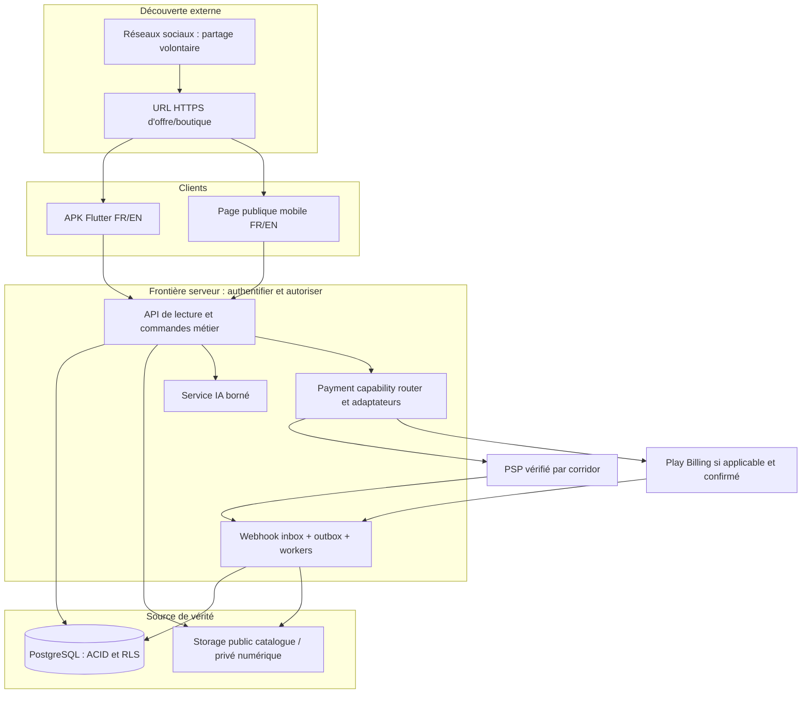
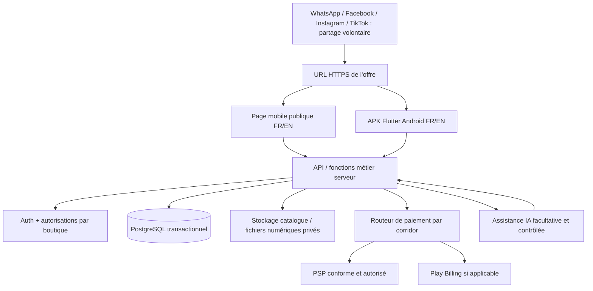

# ARCHITECTURE TECHNIQUE DE RÉFÉRENCE — D01 + D02

**Version : 0.3 — dossier de construction consolidé, incluant la v0.2 et la correction IDE**  
**Date : 25 septembre 2026**  
**Support produit confirmé : vrai APK Android ; fonctionnement intégral FR/EN ; produits physiques ET numériques ; portée internationale du modèle.**  
**Source :** `02_PRD/PRD_Construction_V0_5.md` (FR-01…FR-70, annexes A–C), analyse commerciale v0.9, architecture v0.1 reproduite intégralement en **annexe historique H** à la fin de ce fichier.  
**Statut :** solution de conception retenue pour préparer le développement et les POC ; **aucun APK, base déployée, webhook financier, PSP sous contrat ou test terrain n'a été exécuté par la seule rédaction de ce document**. Les décisions portant sur la vente réelle, l'activation des corridors, les taxes et la répartition d'argent restent sous portes de faisabilité/validation.  
**Mise à jour handoff 0.3 :** l’IDE Cursor est explicitement écarté comme contrainte ; les occurrences présentes dans l’annexe H reproduisent uniquement un document ancien. Le fonctionnement clair/sombre/système, le design system premium et FR/EN s’appliquent à la totalité des modules Android et pages publiques. Les 12 POC sont à exécuter, pas présumés réussis. Toute mention historique d’un prochain UX Blueprint est supplantée par l’UX final et le backlog du pack.

**Règle de préséance :** les sections 1–17 de cette v0.2 précisent la v0.1 ; en cas de contradiction, elles priment. Les orientations explicites du fondateur et les exclusions du PRD demeurent prioritaires.

---

## 0. Résultat de l'étape 4 — ce que l'équipe peut et ne peut pas démarrer

L'équipe peut **immédiatement** préparer le monorepo, le shell APK bilingue, les migrations, les rôles, le catalogue, les demandes, les propositions, les écrans de parcours, les commandes et l'inventaire sur jeu de test ; elle peut construire des **adaptateurs de paiement simulés exclusivement dans l'environnement de développement**. Elle ne doit **pas** utiliser une fausse réussite de paiement comme preuve d'une vente encaissée, rendre un corridor réel actif sans conformité, ni attribuer à Google Play un modèle de reversement multivendeur que nous n'avons pas vérifié.

### Décisions d'ingénierie retenues comme référence de construction

| ID | Décision | Justification et garde-fou | Repli si POC échoue |
|---|---|---|---|
| ADR-01 | Flutter/Dart pour un **APK Android réel**, IDE ou agent de développement au choix du fondateur ; architecture modulaire par domaine | Un seul client vendeur/acheteur, FR/EN et expérience Android ; ce n'est pas un wrapper web | Examiner React Native/Expo ou Kotlin **seulement si** la preuve sur téléphone révèle un blocage concret, en conservant les contrats métier |
| ADR-02 | Supabase : PostgreSQL transactionnel, Auth, Storage ; migrations SQL versionnées | Stock, réservations, états, cohérence et RLS | PostgreSQL géré ailleurs ; ne pas modifier les invariants métier |
| ADR-03 | Fonctions serveur / API HTTPS comme **façade des écritures sensibles** ; fonctions SQL atomiques pour une mutation locale | Ne pas laisser le client écrire directement prix acceptés, stock réservé, paiement confirmé ou droits numériques | Service applicatif dédié si les fonctions hébergées échouent aux tests de latence, limites ou fiabilité |
| ADR-04 | Petite surface web publique HTTPS, rendue côté serveur, pour les **offres et boutiques** | Visiteur sans APK voit la bonne offre ; partage social sans API sociales | Hébergement web différent, mêmes URL et règles |
| ADR-05 | Routeur de capacité + adaptateurs financiers, **désactivés tant qu'ils ne sont pas vérifiés** | Pas de « PSP universel », pas de confusion Play/physique | Mode demande/réservation sans collecte en ligne, clairement indiqué ; pas de contournement Play |
| ADR-06 | Moteur de correspondance déterministe d'abord, IA isolée en enrichissement **non décisionnaire** | Résultats justifiables, FR/EN, coût maîtrisable, fallback | Parcours manuel et filtres métier restent utilisables |
| ADR-07 | Un compte / plusieurs rôles ; boutique distincte ; droits server-side par boutique | Empêcher lecture et action inter-boutiques | Pas de permissions calculées uniquement côté UI |
| ADR-08 | Journal événementiel d'audit + grand livre financier append-only et états courants contrôlés | Prouver les engagements, doublons, remboursements et conflits | Corriger le modèle avant de traiter de l'argent réel |

**Précision sur « natif » :** le livrable est une application Android installable sous forme d'APK, avec fonctionnalités mobiles et non une simple page web emballée. Flutter est un framework multiplateforme compilant l'application Android ; ne pas prétendre que l'ensemble du code est Kotlin/Java natif.

---

## 1. Diagramme des composants et frontières de confiance



**Interdits :** secret de PSP/IA ou clé privilégiée dans APK ; prix ou stock « confirmés » par le client ; écriture d'un statut `paid` depuis une requête utilisateur ; lecture de pièces KYC, preuves de litige et fichiers numériques depuis URL publiques ; appel LLM à la place d'une transaction SQL.

**Règle d'accès aux données :** la RLS protège les tables exposées au SDK client, mais ne remplace pas l'authentification, les GRANT SQL ni les contrôles dans les fonctions privilégiées. Restreindre les GRANT sur les objets sensibles ; fonctions privées, `search_path` fixé et permissions explicitement auditées. La clé privilégiée doit rester sur serveur et ses utilisations doivent être minimales.

---

## 2. Organisation de dépôt, conventions et environnements

```text
commerce-platform/
  apps/
    android/                   # Flutter, APK, l10n/app_en.arb + app_fr.arb
    offer-web/                 # Pages publiques HTTPS : offers/shops, FR/EN
  backend/
    functions/                 # API orchestration et webhooks : TypeScript/Deno si Edge Functions
      offers/ requests/ proposals/ reservations/ orders/
      inventory/ external-sales/ suppliers/ payments/ entitlements/
      incidents/ ai/ share-links/ provider-webhooks/
    db/
      migrations/              # Schéma, contraintes, RLS, RPC, triggers
      seeds/                   # Test et démonstration : jamais des ventes réelles
      tests/                   # Concurrence, permissions, montants, états
    policies/                 # Pays, catégorie, conformité, langues, reçus
  packages/
    contracts/                 # Schémas API, statuts et erreurs versionnés
    domain-docs/               # Diagrammes, décisions et matrice PRD
    i18n/                      # Messages web/mail/push FR/EN
  tests/
    e2e/ security/ concurrency/ payments-sandbox/ localization/
  docs/
    ADR/ RUNBOOKS/ PROVIDER_MATRIX/ QA/ UX_HANDOFF/
```

**Architecture Flutter :** `core/{auth,network,i18n,errors,design_system,analytics}` ; `features/{discover,requests,proposals,shop,catalog,inventory,checkout,orders,supplier,digital,incidents,settings}` avec UI → état/application → repository/API → DTO. Les objets financiers sont en entier minor-unit + devise ; les identifiants sont opaques. Une feature ne touche pas les tables d'une autre feature via une écriture arbitraire.

**Environnements :** local, staging et production séparés (base, buckets, secrets, signatures, app IDs, webhooks, jeux de données) ; CI exécute lint/test Flutter, test migration SQL, tests RLS, traduction manquante, contrat API et compilation APK. Aucune donnée utilisateur réelle dans les seeds ni dans les prompts IA de test.

**Déploiement :** domaine canonique d'offre à choisir ultérieurement ; TLS ; suivi des versions mobiles/API ; migrations rétrocompatibles avec anciens APK ; feature flags côté serveur pour paiements/corridors et catégories. Sauvegardes + restauration répétée en staging avant lancement. Logs et alertes ne contiennent pas de tokens d'achat ni de données sensibles brutes.

---

## 3. Données : noyau relationnel précis (proposition de schéma, non migration exécutée)

### 3.1. Identité et séparation des responsabilités

| Table | Colonnes centrales proposées | Contraintes utiles |
|---|---|---|
| `profiles` | `user_id`, `preferred_locale`, `home_country?`, timestamps | `user_id` lié à Auth ; FR/EN indépendants du pays |
| `shops` | `id`, `owner_user_id`, `status`, `country`, `default_currency`, données publiques | Ne pas utiliser l'utilisateur comme identifiant de boutique |
| `shop_memberships` | `shop_id`, `user_id`, `role`, `status` | UNIQUE `(shop_id,user_id)` ; permission vérifiée serveur |
| `shop_policies` | `shop_id`, `policy_type`, `language`, `version`, `content`, `effective_at` | Conditions acceptées référencées par version/langue |
| `seller_verifications` | `shop_id`, `scope`, `status`, `provider_ref`, private_evidence_ref | « identité vérifiée » n'atteste pas tous les articles |

### 3.2. Offre, stock et demandes

| Table | Colonnes centrales proposées | Invariant |
|---|---|---|
| `product_references` | `id`, `product_type`, catégorie, attributs normalisés | Description commune ≠ prix ni vendeur |
| `shop_offers` | `id`, `shop_id`, `product_ref_id`, `status`, pays éligibles | L'offre appartient à un vendeur précis |
| `offer_variants` | `id`, `offer_id`, `sku`, attributs, suivi stock | Un SKU = variante exacte de cette offre |
| `offer_versions` | `offer_id`, `version`, `price_minor`, `currency`, `terms_ref`, `valid_from`, `valid_until?` | UNIQUE `(offer_id,version)` ; commande garde sa version |
| `inventory_balances` | `shop_id`, `variant_id`, `location_id`, `on_hand`, `reserved`, `updated_at` | `on_hand >= 0`, `reserved >= 0`, `reserved <= on_hand` pour stock géré et synchronisé ; disponibilité=`on_hand-reserved` |
| `stock_movements` | `id`, `variant_id`, `quantity_delta`, `type`, `source_ref`, `actor_id`, `created_at` | Append-only, correction par mouvement inverse explicite |
| `reservations` | `id`, `variant_id`, `quantity`, `status`, `expires_at`, `order_id?`, `idempotency_key`, `payment_hold_state` | Pas de double allocation ; expiration conciliée avec paiements en cours |
| `purchase_requests` | `id`, `buyer_id`, critères, `quantity_target`, `quantity_fulfilled`, budget, zone, visibilité, consentement, `status` | Un besoin ne vaut ni offre, ni consentement à acheter |
| `seller_proposals` | `id`, `request_id`, `shop_id`, `status`, `expires_at` | Plusieurs propositions indépendantes |
| `proposal_versions` | `proposal_id`, `version`, `line_snapshot`, `price_minor`, conditions, devise | Acceptation d'une version exacte, pas du « dernier texte » |

**Stock multi-emplacements :** `inventory_balances` porte l'état actuel ; `stock_movements` explique son histoire. Pas de « stock global » reconstruit depuis le client lors du checkout. Offres `ON_ORDER` ne doivent pas créer un stock fictif ; les offres `TO_CONFIRM` ne doivent pas recevoir de réservation garantie.

### 3.3. Engagement, argent, fourniture, numérique

| Table | Colonnes centrales proposées | Invariant |
|---|---|---|
| `orders` | `id`, `buyer_id`, `seller_shop_id`, `origin`, `status`, `accepted_terms_version`, `created_at` | **Une commande opérationnelle par vendeur contractuel** ; panier multi-vendeur ventilé en commandes |
| `order_lines` | `id`, `order_id`, `variant_id`, `offer_version`, qty, `unit_price_minor`, `currency` | Instantané immuable des lignes acceptées ; modifications = avenant versionné |
| `fulfillment_obligations` | `id`, `order_line_id`, `kind`, `status`, `due_at`, `responsible_party` | Obligations physique/numérique indépendantes même si vente mixte |
| `payment_intents` | `id`, `order_id`, `amount_minor`, `currency`, `channel`, `status`, `provider`, `idempotency_key` | Une intention n'est pas un paiement confirmé |
| `payment_attempts` | `id`, `intent_id`, `provider_ref`, `status`, attempt_number | Tentatives et reprises ne créent pas commande doublon |
| `provider_events` | `provider`, `external_event_id`, `signature_verdict`, `payload_ref`, `processed_at` | UNIQUE `(provider,external_event_id)` quand ID fiable disponible ; relecture possible |
| `money_ledger_entries` | `id`, `source`, `entry_type`, `amount_minor`, `currency`, `order_id?`, `external_ref?` | Append-only, correction par contre-écriture ; distinguer cash déclaré, PSP, revenu plateforme, reversement, remboursement |
| `refund_cases` | `id`, `order_id`, `amount_minor`, `currency`, `responsible_party`, `status`, `provider_ref?` | Remboursement demandé ≠ confirmé |
| `supplier_orders` | `id`, `buyer_shop_id`, `supplier_shop_id`, `status`, coûts et conditions | Contrat B2B distinct, marges non visibles client final |
| `digital_assets` | `id`, `seller_shop_id`, `current_version`, `private_storage_key`, mime, size, checksum | Binaire privé ; pas de URL publique durable |
| `digital_entitlements` | `id`, `order_line_id`, `buyer_id`, `asset_id`, `license_version`, `status`, `granted_at` | UNIQUE logique par achat/droit ; le lien signé n'est pas le droit |
| `incidents` + `incident_events` | commande, motif, éléments privés, statut, auteur, dates | Archivage/audit ; pas de suppression silencieuse des réclamations |
| `commercial_events` + `outbox_events` | action métier, idempotency, payload minimisé, état delivery | Notification, statistiques et synchronisation **après commit** |

**Important :** un « grand livre » opérationnel ne signifie pas que la plateforme est un établissement financier ni qu'elle conserve de l'argent. Représenter les montants dans les unités monétaires officielles exactes de chaque devise ; conversion seulement avec taux, source et horodatage tracés. Jamais de flottants binaires pour les montants.

### 3.4. Index, intégrité et évolutivité

- Index de recherche initial : `(offer.status, category, country)`, `GIN` sur texte contrôlé, `(shop_id, variant_id)` pour stock ; affiner après mesures plutôt qu'ajouter d'emblée un moteur externe.
- Contraintes uniques : SKU par boutique/variante selon règle, `provider_event_id`, `idempotency_key` par acteur/opération, version offre/proposition, accès numérique par achat.
- `created_at`, `updated_at`, actor_id, version de ligne lorsqu'applicable ; UTC pour stockage temporel, fuseau local dans UI ; timestamps signés/identifiants serveur pour preuves.
- Soft-delete des entités commerciales lorsqu'il existe une obligation de conservation ; retrait public ≠ destruction des engagements déjà acceptés.
- Les identifiants URL publics n'autorisent pas une lecture de ligne privée.

---

## 4. Contrats API : conventions communes et commandes critiques

### 4.1. Convention de requête/réponse

- API versionnée `/v1/…`, TLS ; session Auth pour actions privées ; visiteurs limités aux fiches publiques publiées et explicitement visibles.
- Mutation critique = `Idempotency-Key` stable par tentative logique, identité et permission serveur, vérification `expected_version` quand accord/offre susceptible de changer, journal/audit ; une réponse rejouée indique le même résultat.
- Montant calculé sur serveur depuis version d'offre acceptée ; jamais à partir de `client_price` ; erreurs structurées avec `code`, `message_key`, `retryable`, `details` limités, `request_id` ; textes FR/EN côté UI.
- Pagination et limite de consultation sur endpoints de demandes ; délais/TTL produits côté serveur ; rate limits contre propositions et demandes abusives ; logs de création de commandes et incidents consultables selon rôle.

```json
{
  "error": {
    "code": "OFFER_VERSION_CHANGED",
    "message_key": "checkout.offerChanged",
    "retryable": false,
    "details": {"current_offer_version": 9},
    "request_id": "trace-redacted"
  }
}
```

### 4.2. Contrats minimum pour développement

| Commande | Entrée minimale (exemple) | Sortie / règle |
|---|---|---|
| `POST /v1/requests` | critères confirmés FR/EN, visibilité, consentement | demande active ; texte IA jamais publié sans confirmation |
| `POST /v1/requests/{id}/proposals` | vendeur, version, lignes, prix/devise, délai, échéance | proposition structurée, pas commande automatique |
| `POST /v1/proposals/{id}/accept` | version exacte, quantité acceptée, `Idempotency-Key` | si active : accord figé + commande par vendeur ; quantités restantes correctes |
| `POST /v1/reservations` | offer_variant, qty, offer_version, clé | succès confirmé ou stock indisponible ; transaction DB atomique |
| `POST /v1/orders` | références versions, mode de remise et acceptation | revalidation prix/stock et commande ; ne fusionne pas plusieurs vendeurs |
| `POST /v1/external-sales` | shop, SKU, qty, prix cash déclaré, origin | mouvement stock après synchronisation, rapport externe séparé |
| `POST /v1/supplier-orders` | commerçant acheteur, fournisseur, conditions | commande B2B ; réception ultérieure seule alimente `on_hand` |
| `POST /v1/payments/options` | commande, pays, canal, catégorie, devise | liste vérifiée ou indisponibilité précise, **sans créer de prélèvement** |
| `POST /v1/payments/intents` | order_id, route choisie, clé | montant serveur, tentative liée, jamais `paid` sur requête client |
| `POST /v1/providers/{name}/webhook` | signature et événement externe | validation cryptographique, dédoublonnage, réponse appropriée aux retries |
| `POST /v1/digital-entitlements/{id}/access` | session acheteur | contrôle du droit puis lien temporaire ; pas droit fondé sur simple URL |
| `POST /v1/incidents` | order_id, catégorie, éléments utiles | dossier lié, notifications éventuelles après commit |
| `POST /v1/ai/parse-need` | langue, texte, consentement | **draft** typé + inconnues + questions ; aucun changement de commande |
| `POST /v1/ai/draft-offer` | texte/photo seller autorisés | **draft** soumis au vendeur ; prix/stock ne sont jamais inventés |

**Exemples contractuels à générer ensuite en OpenAPI + JSON Schema :** cette matrice est la source initiale ; les schémas exacts seront versionnés dans `packages/contracts` pendant le premier lot de développement. Ne pas laisser plusieurs agents inventer des champs incompatibles en parallèle.

---

## 5. Algorithmes obligatoires — invariants testables

### 5.1. Réserver le dernier exemplaire

```text
reserve_stock(actor, variant, qty, offer_version, key):
  BEGIN DB TRANSACTION
    verify_authorization_and_offer_version()
    if idempotency_key_already_processed(): return_original_result()
    lock inventory_balance row FOR UPDATE
    reject if offer not tracked/available or qty <= 0
    reject if on_hand - reserved < qty
    insert reservation(status=ACTIVE, qty, expires_at=server_time+policy_TTL)
    update inventory_balance set reserved=reserved+qty
    append audit/outbox events and idempotent result
  COMMIT
```

**Contraintes :** ne pas tenir le verrou DB pendant appel PSP/réseau ; expiration dans transaction séparée ; si paiement `PENDING/UNKNOWN`, ne pas libérer mécaniquement sans politique d'attente/réconciliation ; si deux demandes pour 1 unité, exactement une doit être confirmée. Politique TTL chiffrée à fixer par parcours, pas un « 15 minutes » inventé.

### 5.2. Commande, accord et propositions multiples

1. Une demande `quantity_target` peut recevoir plusieurs propositions indépendantes ; accepter une proposition exige `expected_proposal_version` et quantité ≤ quantité restante.
2. Si achat partiel : `quantity_fulfilled` reflète les quantités **effectivement contractualisées** selon règle, et `quantity_remaining` est dérivé, pas manipulé par l'UI. L'acheteur peut choisir de fermer la demande ; les autres vendeurs reçoivent une notification proportionnée sans divulguer d'informations privées.
3. `accept_proposal` crée une commande d'un vendeur, fige lignes, devise, conditions/langue/version, crée obligations selon nature et reservation si stock suivi ; sur commande = obligation conditionnelle claire, sans stock inventé.
4. Acceptation simultanée ou répétée : idempotence + contrôle transactionnel de quantité et statut de demande ; pas de deux achats involontaires.
5. Changement substantiel après acceptation = proposition d'avenant à accepter, conserver ancienne version et historique ; pas d'UPDATE silencieux sur prix contractuel.

### 5.3. Vente extérieure, approvisionnement et conflits hors connexion

- `EXTERNAL_SALE` confirmée côté serveur applique mouvements sur le SKU ; source `seller_declared_cash`/autre distincte de `platform_psp_confirmed`. Si appareil offline : brouillon local `LOCAL_PENDING_SYNC`, non affiché comme stock global garanti ; détection conflit si quantité devenue insuffisante ; résolution manuelle autorisée et auditée.
- `SUPPLIER_PURCHASE` ne réduit pas/augmente pas automatiquement stock retail au moment de la commande fournisseur ; `goods_receipt` vérifiée augmente le stock. Si fournisseur échoue après engagement client, ticket visible côté vendeur et acheteur selon confidentialité, avenant ou résolution ; ne pas supprimer la commande client.
- Trois relations ne partagent **pas** le même `payment_intent` ni les mêmes obligations par simple présence du même produit.

### 5.4. Paiement et livraison numérique

```text
provider_webhook(event):
  verify_provider_signature_and_reference()
  persist_raw_event_securely_and_dedupe()
  match expected intent amount/currency/beneficiary/corridor
  reconcile with provider if event ambiguous
  BEGIN DB TRANSACTION
    append verified event + financial ledger entries exactly once
    transition payment state only if transition allowed
    if purchase fully eligible and confirmed: grant entitlement idempotently
    append outbox notification and audit
  COMMIT
  acknowledge event / support retry, then process outbox
```

- Événement « success » non signé, capture acheteur ou retour navigateur n'active jamais `paid` ; montant différent = `REVIEW_REQUIRED`, pas achat forcé.
- Google Play si applicable : valider achat côté backend ; état `PENDING` ne donne pas accès ; `PURCHASED` authentifié peut donner accès puis acknowledgment/consumption conformément à la catégorie ; prendre en charge révocation/voided purchase et rapprochement. Le **purchase token**, pas uniquement l'orderId, doit assurer l'unicité de l'achat Play.
- Annulation/chargeback/remboursement : événements additionnels et règles propres au droit numérique déjà livré ; ne pas prétendre pouvoir effacer un fichier déjà téléchargé.
- Paiement tardif alors que réservation expirée/stock attribué : `PAID_EXCEPTION`, aucune survente ni livraison fictive ; traitement par résolution ou remboursement selon capacités réellement validées.

---

## 6. Machines à états — transitions gardées par le serveur

| Agrégat | États candidats | Transition refusée impérativement |
|---|---|---|
| Offre | DRAFT, PUBLISHED, PAUSED, OUT_OF_STOCK, ARCHIVED | ARCHIVED → commande sur ancienne condition sans revalidation |
| Demande | DRAFT, ACTIVE, PARTIALLY_SATISFIED, SATISFIED, WITHDRAWN, EXPIRED | WITHDRAWN → nouvelle proposition sans réactivation |
| Proposition | DRAFT, SENT, ACCEPTED, DECLINED, EXPIRED, WITHDRAWN | EXPIRED/withdrawn → acceptée sans nouveau consentement |
| Réservation | ACTIVE, PAYMENT_REVIEW, CONVERTED, RELEASED, EXPIRED | Ré-attribution de quantité lors de vérification de paiement non résolue |
| Commande | CREATED, ACCEPTED, IN_PROGRESS, FULFILLED, CANCELLED, DISPUTED | `FULFILLED` uniquement parce que paiement confirmé |
| Paiement | NOT_STARTED, PENDING, CONFIRMED, FAILED, UNKNOWN, REVIEW_REQUIRED ; remboursement séparé | `CONFIRMED` depuis simple client/screenshot |
| Obligation physique | TO_PREPARE, READY, HANDED_OVER, DELIVERED_DECLARED, RECEIVED_CONFIRMED, INCIDENT | HANDED_OVER = réception confirmée sans preuve |
| Obligation numérique | AWAITING_ELIGIBLE_PAYMENT, ENTITLED, ACCESS_DELIVERED, ACCESS_ISSUE, REVOKED_AFTER_REVIEW | lien expiré = achat effacé |
| Incident | OPEN, NEEDS_REPLY, UNDER_REVIEW, RESOLUTION_OFFERED, RESOLVED, DISPUTED | effacement silencieux par le vendeur |

**Statuts orthographiés ici sont une proposition de contrat, pas des ENUM SQL déployés.** Séparer état objet et journal transition ; transition = `from`, `to`, `actor`, `reason`, `time`, `source_ref`, `policy_version`. Vérifier permissions et préconditions à chaque transition.

---

## 7. Paiements et marchés — modèle d'habilitation opérationnelle

### 7.1. Matrice de capacité

`payment_capabilities`: `(seller_country, buyer_country/zone, seller_eligibility, category, android_distribution, checkout_channel, currency, provider, seller_of_record, payout_country, refund_mode, tax_model, evidence_ref, status)`.

Valeurs de `status` : `UNREVIEWED`, `IN_TEST`, `VERIFIED_FOR_PILOT`, `ACTIVE`, `SUSPENDED`. **Par défaut : aucune capacité monétaire active.** Les tests peuvent utiliser un faux PSP *staging* marqué visiblement simulation.

Le routeur doit répondre : `eligible routes[]`, `ineligibility_reason`, `required_next_step` et identifiant/version de règle. Il n'autorise que les capacités ayant franchi les vérifications pour **le flux exact** ; si aucune route, permettre exploration et demande lorsque approprié, sans faux bouton « Pay now ».

### 7.2. Comportements distincts

- **Article physique** : paiement partenaire réellement disponible, éventuellement accord vendeur/acheteur pour remise et paiement en personne déclaré, politique d'annulation claire.
- **Fichier ou contenu numérique dans APK Play** : analyser catégorie, règles de facturation, modèle marchand/reversement et régions ; Play Billing si requis et possible, exception/programme seulement après preuve ; pas de détournement automatique vers checkout web.
- **Fonctionnalités premium vendeur intégrées à l'APK** : classification indépendante ; ne pas brancher la simple infrastructure de paiement physique.
- **Prestation numérique personnalisée** : nature exacte de service, jalons, preuves de livraison, classification de paiement et remboursement distincts.
- **Panier mixte / multivendeur** : grouper à l'affichage si UX le demande, mais créer commandes par vendeur et obligations/paiements séparés si requis. Pas de split-payout improvisé.

**Preuves pour activer une route réelle :** pays clients/marchands explicitement supportés ; dossier KYC/KYB ; contrat PSP ; mode reversement ; tests sandbox signés/idempotents ; responsabilités de facture et taxes ; politique retour/remboursement opérable ; classification Play documentée ; mode de livraison réel ; journal de réconciliation et runbook incident.

---

## 8. IA commerciale : protocole sûr et utile en FR/EN

| Tâche IA | Entrée autorisée | Sortie exigée | Validation et fallback |
|---|---|---|---|
| `parse_need` | texte utilisateur, locale, champs consentis | JSON validé : `category_candidate`, `attributes[]`, `missing_questions[]`, `confidence_notes` | aucune valeur budgétaire/lieu/taille si absente ; formulaire éditable sans IA |
| `draft_offer` | notes vendeur, photos fournies, champs prouvés | brouillon titre/description/attributs + incertitudes | publication exclusivement après action vendeur ; pas de prix/authenticité inventés |
| `candidate_matches` | critères structurés + catalogue autorisé | IDs d'offres et raisons correspondance ; incompatibilités filtrées avant ranking | filtre déterministe toujours possible, score IA jamais preuve de disponibilité |
| `next_action` | données métier minimales et autorisées | actions fondées sur règle avec `reason_code` et lien vers objet | pas de dépenses automatiques, promotions non demandées, relances spam |

- **Langues :** schémas identiques FR/EN, labels plateforme traduits humainement ; originaux libres conservés. Ne pas rendre une traduction machine invisible : identifier langue et version traduite si elle est proposée ; messages privés/contrats non traduits par défaut.
- **Coût :** budget par utilisateur/boutique/tâche, taille d'image, quotas, latence mesurée, prix modèle versionné ; refus doux et formulaire manuel si quota ou fournisseur en panne.
- **Protection :** ne pas envoyer pièces KYC, preuve de paiement, client final ni clés privées au modèle pour rédiger une annonce ; modération de contenu et validation du JSON côté serveur ; résistance aux instructions malveillantes présentes dans une description fournie.
- **Critères d'essai :** jeu FR/EN incluant besoin vague, besoin contradictoire, marque non prouvée, article hors stock, photos floues, prix absent, panne modèle et donnée interdite. Mesurer extraction correcte, omissions, hallucinations, coût et nombre de corrections avant publication.

---

## 9. Web d'offre, Android App Links et retour après connexion

1. URL canonique stable de type `https://<domaine-a-choisir>/offers/<public_id>` ; ne pas afficher un domaine inventé comme acquis ; aucune coordonnée personnelle dans URL. Les locales sont des préférences de présentation, pas deux offres distinctes ; sélecteur FR/EN, URL éventuellement paramétrée par langue sans casser le partage.
2. Page publique rendue côté serveur : offre, vendeur autorisé à afficher, prix/devise actuels, variante, disponibilité nuancée, conditions et action permise. Métadonnées pour aperçu social possibles mais **aperçus partagés restent potentiellement en cache**, la fiche fait foi.
3. APK installé : App Link mène à la fiche exacte ; si session requise, conserver `return_to` validé vers route interne sûre, authentifier puis revenir à la même offre/variante ; empêcher les redirect ouverts.
4. APK absent : page légère accessible ; consulter d'abord, puis proposer action de continuation réelle (installer/ouvrir, demander, éventuellement checkout web **uniquement si autorisé**). Ne pas bloquer d'emblée toute consultation par inscription.
5. `assetlinks.json` HTTPS au chemin `/.well-known/assetlinks.json`, JSON accessible sans redirection, package name et SHA-256 du certificat de **signature de publication** ; variantes de debug distinctes. Tester installation et absence d'installation sur téléphone, pas seulement émulateur.
6. Offres supprimées/expirées : conserver page d'état sans checkout mensonger ; alternative ou demande d'achat quand la politique l'autorise.

---

## 10. Sécurité, confidentialité et continuité de service

**Données personnelles :** minimisation des coordonnées de demande, consentement de visibilité, contact vendeur sans exposition générale, documents sensibles privés ; journaliser qui accède à une preuve. Règles de conservation/suppression à qualifier selon pays et obligations avant production.

**Multi-tenant :** tester chaque table/action en utilisateur A, collaborateur A, propriétaire B, visiteur, opérateur ; défaut DENY. RLS + GRANT + fonctions privées sécurisées ; un compte pouvant gérer plusieurs boutiques doit sélectionner explicitement le contexte de commande vendeur.

**Paiements :** signature, anti-rejeu, rapprochement différé, outbox durable, alertes en cas d'événement non rapproché, ledger append-only ; jamais loguer secret ou corps de paiement complet non nécessaire. Les callbacks sont des entrées non fiables jusqu'à validation.

**Stocks :** verrou DB bref, audit, réconciliation ; pas de réservation autoritative en mode offline. Les tâches expirations sont idempotentes et rejouables ; worker en panne ne doit pas produire de statut « inventé ».

**Numérique :** contrôle droit à chaque demande d'accès, liens temporaires, buckets privés, version et empreinte fichier, scans de fichiers et limites taille/type à définir ; acheteur autorisé garde son entitlement en cas d'erreur technique de téléchargement.

**Exploitation :** backups, restauration vérifiée, migration avec rollback ou correction testée, logs corrélés `request_id`, alertes pour callbacks bloqués, droits non accordés et surventes évitées. Aucun support promesse de « remboursement immédiat » sans prestataire et procédure prouvés.

**Fonctions hébergées :** ne pas compter sur une fonction serveur courte comme worker permanent ou moteur de traitement d'image lourd ; distinguer requête interactive, tâches durables en base/outbox et workers/retries. Tester les limites du fournisseur avant de figer le déploiement.

---

## 11. Contrats de qualité : conditions d'acceptation et preuves techniques

| POC | Travail vérifiable sur projet | Preuve attendue | Blocage de passage |
|---|---|---|---|
| T01 APK FR/EN | Flutter sur téléphone Android ; acheteur + vendeur ; permutation de langue | APK signé debug testable ; vidéo ou logs FR/EN écran, erreur, notification factice | Pas de passage UX final si client mobile pas viable |
| T02 URL publique | app link + page sans APK + offre modifiée + retour après connexion | Même identifiant/variante sur app et web ; test du `assetlinks.json` réel | Pas d'acquisition par partage sans accès fiable |
| T03 Stock | 100 tentatives parallèles de réservation sur SKU quantité 1 (seuil d'essai, non charge finale) | exactement 1 confirmation ; jamais bilan négatif ; répétition idempotente | Interdit de lancer réservation réelle sans réussite |
| T04 RLS | tests automatiques A/B/visiteur/opérateur sur tables sensibles | 0 fuite et 0 écriture illégitime sur jeu de tests | Bloque toute donnée réelle |
| T05 Paiement fictif | provider fake staging, webhooks répétés, événement tardif, montant faux | ledger exact, aucun double accès, erreurs en examen | Ne signifie pas paiement réel validé |
| T06 PSP réel/sandbox | provider éligible, signatures, remboursements, pays et bénéficiaire vérifiés | preuve sandbox, documents contractuels et chemin de retour | Bloque cette route de paiement en production |
| T07 Play numérique | classement exact, démonstration achat sandbox selon circuit réellement autorisé | token vérifié serveur, droit, acknowledgement et révocation | Bloque numérique concerné en APK public |
| T08 IA FR/EN | cas vagues, ambiguïtés, photos floues, panne/quota, prompt injection | sortie typée, inconnues explicites, coût, formulaire manuel disponible | Pas d'assistance IA présentée comme fiable |
| T09 Offline | enregistrer vente externe sans réseau puis sync concurrente | conflit détecté sans faux stock serveur | Pas d'engagement de stock garanti offline |
| T10 Résolution | paiement confirmé, livraison absente ; droit numérique inaccessible | incident visible, preuves, retour/réessai sans faux remboursement | Bloque promesse de gestion incidents |
| T11 Bilinguisme intégral | exécuter E2E-01…07 en FR/EN, cas d'erreur inclus | grille écran/locale/état sans message essentiel manquant | Bloque clôture UX d'un parcours incomplet |
| T12 Reprise | tuer client/worker pendant mutation et relancer | zéro double vente/paiement logique, outbox rattrapable | Bloque toute mutation critique concernée |

**Tous les POC ci-dessus sont actuellement « À EXÉCUTER ».** Aucun verdict PASS inventé. T05 utilise *fake PSP exclusivement staging* ; T06/T07 sont des preuves différentes.

---

## 12. Traçabilité PRD → domaine → APIs → tests → intentions UX

| Exigences PRD | Domaine / données | Commande dominante | Tests prioritaires | UX à produire étape 5 |
|---|---|---|---|---|
| FR-01…05 | Auth, shop, membership | session, create shop, memberships | T04/T11 | démarrer, identité, boutique, collaborateurs |
| FR-06…11 | Product, offer, version, asset | publish/update offer | T02/T11 | créer offre, fiche publique, variante, version |
| FR-12…17 | Stock, reservation, supplier | reserve, external sale, supplier receipt | T03/T09 | stock, réservation, caisse extérieure, fournisseur |
| FR-18…24 | Search, purchase request, proposal | search, parse need, publish request | T08/T11 | découverte, recherche vide, demande, comparaison |
| FR-25…28 | Conversation context, proposal | propose, accept/revise | T03/T11 | questions, proposition, conditions et acceptation |
| FR-29…37 | Order, payment, ledger, refund | checkout, payment route, webhook | T05/T06/T07 | récapitulatif, moyen de paiement, statut, reçu |
| FR-38…41 | Physical fulfillment | update milestone, incident | T10/T11 | préparation, remise, suivi, incident |
| FR-42…47 | Digital asset, entitlement | grant access, renew link | T07/T10 | fiche numérique, bibliothèque, téléchargement |
| FR-48…51 | Share link, web offer | GET offer URL, share | T02/T11 | partager, visiteur, app link, offre expirée |
| FR-52…55 | Support/moderation | open/resolve incident | T10/T04 | litige, pièces, issue, signalement |
| FR-56…60 | Recommendations, notifications, admin | next actions, notify | T08/T04 | À faire, alertes, modération |
| FR-61…65 | Repeat purchases, budgets, margins, CRM | save lists, aggregate metrics | T04/T11 | liste récurrente, budget, marge, clients |
| FR-66…70 | Localization, policies | locale, translated receipt | T01/T11 | sélecteur langue, parcours complets FR/EN |

**Validation terrain (indépendante des POC techniques) :** vendeurs réels, acheteurs et créateurs numériques n'ont pas encore prouvé usage et disposition à payer. Ne pas rebaptiser un test automatisé « validation du marché ».

---

## 13. Ordre de développement et parallélisme — sans rétrécir la vision

| Lot | Dépendance et livrable montrable | Peut progresser en parallèle |
|---|---|---|
| L0 Fondation | monorepo, Flutter FR/EN, auth, migrations, contrats, staging, CI, page web vide, accès ; tests T01/T04 | recherche PSP/Play, UX sitemap |
| L1 Offre vivante | boutique, produit, variante, offre/version, partage, lien app/web, recherche, pages FR/EN ; T02 | design catalogue, tests terrain |
| L2 Demande vers commande | demande, IA brouillon, propositions multiples, comparaison, acceptation/version, commande par vendeur ; T08 | UX acheteur et vendeur |
| L3 Stock et commerce vendeur | balances/mouvements, réservation atomique, vente externe, approvisionnement B2B, offline brouillon ; T03/T09 | analyse corridors |
| L4 Exécution et argent | obligations, paiement fake staging + ledger + incidents, numérique privé/droits ; T05/T10 | sandbox PSP, qualification Play |
| L5 Paiement effectif conditionnel | routes PSP/Play **uniquement vérifiées**, reconcile, refund selon capacité ; T06/T07 | design final et tests utilisateurs |
| L6 Récurrence et intelligence commerciale | achats récurrents, budgets, marges, clients consentis, À faire, analytics, notifications FR/EN | optimisation et pilote |
| L7 Qualité/intégration | E2E-01…07 × FR/EN + erreur, T01…T12, performance, sécurité, démonstration APK, documentation | support et exploitation pilote |

Les lots expriment un **ordre de dépendances techniques**, pas une déclaration que les fonctionnalités des derniers lots sont retirées. L'exécution peut utiliser des équipes/agentes parallèles dès lors que contrats et migrations sont intégrés sur une branche coordonnée. Un cycle de 4 semaines AI Foundry impose d'arbitrer le **périmètre effectivement démontrable**, sans falsifier un paiement ou renommer une version incomplète « plateforme mondiale finie ».

---

## 14. Décisions réellement encore externes — assignation claire

| Dossier | Qui apporte la preuve | Impact si non résolu | Ce qu'on construit malgré tout |
|---|---|---|---|
| Pays/corridor initial et support marchand | Fondateur + PSP + retour terrain | route paiement désactivée pour corridor | modèle global + catalogue/demandes |
| Vendeur légal, contrat, taxes, remboursement | Conseil compétent + PSP + fondateur | pas de checkout public concerné | contrat et états abstraits, incident |
| Google Play / multivendeur numérique exact | Analyse Play et prestataire, éventuellement conseil | achat numérique APK public désactivé | catalogue numérique, licence, bibliothèque et sandbox si autorisé |
| Modèle tarifaire | tests coûts + usage + décision fondateur | aucune facturation vendeur mise en production | instrumentation et plan configurable |
| Transport/politiques locales | vendeurs/partenaires, conditions vérifiées | zones/modes non annoncés | retrait/remise déclarés et suivi |
| Nom/domaine/signature finale | fondateur, disponibilité, certificats | app links de **production** non activables | routes fictives staging et structure identique |

**Ce ne sont pas de nouvelles questions d'idéation.** Elles correspondent à des preuves contractuelles, réglementaires, techniques et commerciales qu'aucun assistant ne doit inventer. L'UX/UI et la construction peuvent avancer sur le reste.

---

## 15. Handoff immédiat vers l'étape 5 UX/UI

Créer un dossier UX distinct dont chaque écran comporte : `screen_id`, utilisateur/permission, intention, source des données, condition d'entrée, action primaire/secondaire, états `loading/empty/ready/error/offline`, texte FR/EN, règles de confidentialité, résultat du clic, erreurs et lien FR/POC. **Démarrer par un plan de navigation et les parcours**, puis composants visuels, pas par une galerie de dashboards sans mécanique métier.

Parcours prototypes obligatoires :

1. visiteur ouvre offre WhatsApp sans APK → comprend et retrouve cette offre après installation ;
2. acheteur exprime besoin libre → IA propose brouillon → édition → vendeurs répondent → comparaison → commande ;
3. vendeur crée boutique/produit, enregistre vente externe, vérifie stock → prépare proposition ;
4. fournisseur confirme ou échoue → client reçoit le bon suivi sans connaître les marges B2B ;
5. achat numérique admissible, droit et erreur de téléchargement ;
6. paiement `PENDING` puis `CONFIRMED` ou `REVIEW_REQUIRED` ; incident physique et résolution ;
7. utilisateur change FR↔EN sans altérer prix, accord, SKU, commande ou devise.

**Prochaine livraison attendue :** `UX_UI_Blueprint_V0_1.md` (arborescence, inventaire des écrans et composants, 7 flux, wireframes textuels, matrice screen↔FR↔data↔test, exigences FR/EN) puis backlog neutre à l’IDE. Ne pas revenir demander au fondateur comment doit se comporter un simple bouton déjà déterminé par les contrats métier.

---

## 16. Sources techniques officielles contrôlées (25 septembre 2026)

- Flutter, internationalisation et fichiers ARB : https://docs.flutter.dev/ui/internationalization
- Supabase, RLS, GRANT et secret admin côté serveur : https://supabase.com/docs/guides/database/postgres/row-level-security
- Supabase, limites des Edge Functions : https://supabase.com/docs/guides/functions/limits
- Supabase, tâches en arrière-plan : https://supabase.com/docs/guides/functions/background-tasks
- Android, lien vérifié et fichier `assetlinks.json` : https://developer.android.com/training/app-links/about et https://developer.android.com/training/app-links/configure-assetlinks
- Google Play, achat backend, notification et fraude : https://developer.android.com/google/play/billing/backend et https://developer.android.com/google/play/billing/security
- Règles de paiement Play à vérifier pour le modèle exact : https://support.google.com/googleplay/android-developer/answer/9858738?hl=fr

Les sources officielles établissent les capacités **génériques** des technologies, non la validité contractuelle de **notre** marketplace particulière.

---

## 17. Historique et conclusion de passage

**v0.1 → v0.2 :** spécification de dépôt et composants, schéma relationnel, invariants/transactions, conventions API, machines à états, politique capacités paiement, IA contrôlée, App Links, sécurité/exploitation, 12 POC, matrice PRD 70 FR, ordre de développement et handoff UX. **Aucune preuve POC faussement ajoutée.**

**Étape 4 : conception architecturale documentée ; exécution des preuves techniques à effectuer au démarrage du build. Étape 5 : UX/UI et plan de construction à engager maintenant, en parallèle des POC.**

---

# ANNEXE H — ARCHIVE INTÉGRALE DE L'ARCHITECTURE V0.1 (HISTORIQUE, NE PAS SUIVRE SES ANCIENS JALONS COMME POINTS DE REPRISE ACTUELS)

# Architecture technique de référence — Plateforme de commerce actif D01 + D02

**Version :** 0.1 — première proposition d'architecture (étape 4)  
**Date :** 25 septembre 2026  
**Traçabilité :** PRD `AI_Foundry_D01_D02_PRD_V0_4_4_Points_Securises.md`, annexe C ; dossier d'idéation v0.9.  
**Statut :** architecture candidate exploitable. Les spécifications techniques ordinaires sont recommandées par l'assistant ; aucun prestataire de paiement, tarif, pays de vente ni montage juridique n'est présenté comme déjà approuvé. Le prototype technique reste à exécuter.

## 1. Architecture proposée en une phrase

**Une application Flutter Android FR/EN, une base commerciale transactionnelle PostgreSQL sécurisée, des services métier côté serveur, une petite surface web publique pour les liens d'offres, des adaptateurs de paiement par corridor et un service IA optionnel qui prépare des informations mais n'autorise jamais une vente à la place de l'utilisateur.**

Choix technique candidat pour la phase 4 : **Flutter/Dart + Supabase (PostgreSQL/Auth/Storage) + fonctions serveur dédiées + pages d'offres HTTPS rendues côté serveur**. Flutter est retenu provisoirement comme proposition d'ingénierie pour une vraie application Android et une internationalisation FR/EN générée ; Cursor est utilisé comme environnement de développement. Ce choix est réversible tant que la preuve APK + app links + paiement et localisation n'est pas passée ; ne pas réécrire le PRD comme s'il imposait déjà ce framework.



## 2. Frontières de confiance et responsabilités

| Couche | Responsabilité | Ne doit jamais faire |
|---|---|---|
| APK Flutter | Interfaces acheteur/vendeur, saisie, brouillons, lecture, navigation, FR/EN, partage natif | Déclarer paiement confirmé, prendre le dernier stock sans serveur, contenir des clés PSP/IA |
| Page mobile HTTPS | Présenter offre publique actuelle et lien vers app ; éventuelle poursuite web autorisée | Révéler données privées, simuler une prise en charge du paiement numérique Play |
| API / fonctions serveur | Auth, règles métier, validation, transactions, autorisations, orchestration paiements/IA | Faire confiance au prix/role/statut payé transmis par téléphone |
| PostgreSQL | Source de vérité stock, accords, commandes, obligations, journaux, idempotence | Laisser une lecture inter-boutiques ou un stock négatif silencieux |
| Stockage | Images publiques validées, fichiers numériques privés, accès temporaires | Confondre lien public et droit permanent de l'acheteur |
| PSP / Play | Confirmation externe authentifiée | Être supposé universel ou gérer des remboursements non documentés |

### Politique d'accès
- `auth_user` distinct de `shop`; `shop_membership(shop_id, user_id, role)` avec permissions granulaires. RLS et privilèges minimaux pour toute table exposée ; commandes financières via fonctions backend/SQL contrôlées ; clés de service strictement serveur.
- Audit inaltérable au niveau applicatif pour changements prix, stock, permissions, paiements, incidents et licences ; stockage privé des preuves sensibles.
- Multi-boutiques : acheteur personnel et vendeur boutique ne partagent pas automatiquement les données ; fournisseur ne voit ni marge du revendeur ni coordonnées du client final non nécessaires.

## 3. Modèle de données de référence

**Identité / boutique :** `users`, `shops`, `shop_memberships`, `shop_verifications`, `shop_policies`.  
**Catalogue :** `product_references`, `shop_offers`, `offer_variants`, `offer_versions`, `media_assets`, `offer_visibility`.  
**Inventaire :** `inventory_locations`, `inventory_balances`, `stock_movements`, `reservations`.  
**Demande :** `purchase_requests`, `request_criteria`, `seller_proposals`, `proposal_versions`, `proposal_items`.  
**Vente :** `orders`, `order_lines`, `fulfillment_obligations`, `fulfillment_events`, `incidents`, `incident_events`.  
**Approvisionnement :** `supplier_orders`, `supplier_order_lines`, `goods_receipts`.  
**Paiement / droits :** `payment_intents`, `payment_attempts`, `payment_events`, `payment_ledger_entries`, `refund_requests`, `refund_events`, `digital_entitlements`, `digital_asset_versions`, `provider_capabilities`.  
**Expérience :** `share_links`, `user_preferences`, `notifications`, `ai_job_runs`, `audit_events`.

Tout montant est représenté en entier dans l'unité mineure de sa devise quand celle-ci l'admet, avec règles explicites pour les devises sans décimales ; aucune conversion implicite, taux et date attachés aux conversions réelles. La référence produit n'est pas le stock ; l'offre n'est pas la commande ; le paiement n'est pas la livraison. Les achats mixtes et multivendeurs possèdent des obligations et répartitions séparées.

## 4. Trois flux, stock unique par variante et source de vérité serveur

- `MARKETPLACE_SALE` : commande acheteur/vendeur ; lieu de découverte éventuellement social ; acceptation et prix figés, PSP si autorisé.
- `EXTERNAL_SALE` : opération déclarée par vendeur (boutique/téléphone/autre) ; même SKU et mouvement de stock ; provenance externe ; aucune commission marketplace automatique et aucune fausse attestation PSP.
- `SUPPLIER_PURCHASE` : relation indépendante entre commerçant et fournisseur, coût et confidentialité B2B, réception qui augmente le stock après contrôle ; lien optionnel vers une commande client, sans fusionner les deux contrats.

**Réservation concurrente :** fonction SQL transactionnelle `reserve_stock(sku, quantity, expected_offer_version, idempotency_key)` avec verrouillage de lignes ou UPDATE conditionnel et vérification de quantité, émission d'un seul résultat confirmé ; TTL et paiements en attente réconciliés côté serveur. Ventes offline : brouillons locaux synchronisables, mais aucune promesse de stock confirmé tant que serveur non synchronisé.

**Pannes à tester :** double tap et deux mobiles sur dernière unité, paiement après expiration, webhook répété, vente physique hors ligne synchronisée après commande marketplace, annulation puis ré-attribution.

## 5. Contrats métier et états

| Domaine | Événement d'entrée autorisé | Sortie métier | Garantie |
|---|---|---|---|
| Besoin | confirmation acheteur | demande versionnée | un besoin non satisfait n'est pas commande |
| Proposition | réponse vendeur + conditions complètes | proposition expirante | acceptation vérifiée au serveur |
| Commande | accord accepté et stock/contexte revalidés | engagements figés | chaque vendeur identifiable ; obligations séparées |
| Paiement | validation prestataire ou caisse déclarée | journal financier de source explicite | capture ≠ paiement PSP, webhooks idempotents |
| Exécution | vendeur/service fourniture après préconditions | jalons physiques ou droit numérique | payé ≠ livré, droit ≠ lien temporaire |
| Incident | acteur autorisé + commande | dossier suivi | remboursement demandé ≠ confirmé |

**Référence d'API fonctionnelle (pas schéma JSON définitif)** : `GET /offers/{id}`, `POST /requests`, `POST /requests/{id}/proposals`, `POST /proposals/{id}/accept`, `POST /reservations`, `POST /orders`, `POST /external-sales`, `POST /supplier-orders`, `POST /payment-intents`, `POST /provider-webhooks/{provider}`, `POST /incidents`, `POST /ai/parse-request`, `POST /ai/draft-listing`. Écritures à risque exigent auth + rôle + jeton d'idempotence + contrôle serveur ; ne pas exposer directement des updates financières depuis le client.

## 6. IA : deux parcours utiles, pas un chatbot décoratif

1. Acheteur : entrée libre français/anglais → extraction structurée avec inconnues → formulaire prérempli → validation → recherche/demande ; aucune donnée inventée.
2. Commerçant : notes/photos → brouillon de fiche FR/EN selon les données déclarées → vérification des attributs/conditions → publication volontaire.
3. Appariement : filtres déterministes d'abord ; classement sémantique optionnel avec explication et rejet des incompatibilités certaines.
4. Moteur d'actions suivant des règles explicites (commande en attente, stock faible, demande compatible, incident) : utilisable sans modèle IA. Traductions de champs libres optionnelles, identifiées et contrôlées ; les libellés plateforme sont bilingues **sans dépendre de l’IA**.
5. Service isolé + schémas de sortie, limites et métriques par tâche ; fournisseur/ modèle non verrouillé. Évaluer sur données d'essai FR/EN et ne pas traiter des documents personnels non nécessaires.

## 7. Ouverture sociale sans intégration sociale

- Une seule URL publique canonique par offre/boutique ; partager via feuille Android. App Links vérifiés et fichier `/.well-known/assetlinks.json` contrôlé par notre domaine.
- Avec APK : ouvrir offre exacte. Sans APK : landing mobile FR/EN indexable si pertinent ; voir prix et disponibilité courants, variante, conditions, moyens de poursuite honnêtes.
- Offre expirée ou retirée : état visible, produits alternatifs ou dépôt de demande autorisé. La publication externe et son aperçu peuvent rester anciens. Pas de code d’affiliation, commissions, lecture des conversations ou publication automatique vers réseaux sociaux.
- Pour l'accès web au paiement : ouvrir uniquement les flux effectivement admissibles ; ne pas détourner l’APK vers le web pour esquiver la politique de facturation numérique.

## 8. Paiements, distribution internationale et services numériques

**Routeur serveur :** `(seller_country, buyer_country, channel, product_type, fulfillment_type, currency, provider_capability, seller_of_record)` → canaux disponibles ou refus explicite. Pays et paiement configurables indépendamment des langues FR/EN et de la visibilité des catalogues.

- Biens physiques : PSP adapté aux pays et méthodes disponibles, ou encaissement en personne **déclaré** lorsque autorisé et correctement signalé. PSP multi-vendeurs et reversement ne sont pas supposés acquis.
- Achats numériques et fonctions premium via APK Play : classification Play avant activation, Play Billing par défaut lorsque requis, exceptions/programmes uniquement après éligibilité vérifiée ; modèle multivendeur et payee à éprouver avec solution choisie. Les produits numériques sont maintenus dans le modèle, même si certains corridors restent sous porte de production.
- Produits mixtes : sous-obligations et, lorsque requis, paiements/commandes scindés selon type ; ne pas assembler une transaction juridique impossible en un clic.
- Adaptateurs isolés : `PaymentsPort` avec `createAttempt`, `verifyEvent`, `queryStatus`, `requestRefund`, `queryRefund`, `payoutCapability`; état de disponibilité/limites contrôlé ; reconnaissance idempotente et journal de rapprochement.
- Entitlements numériques : après paiement autorisé et confirmé, droit persistant `order_id + buyer_id + license_version`, lien technique temporaire régénérable ; pas de libération sur simple callback local.

**Aucune déclaration prématurée :** pas de devise mondiale, escrow, garantie de remboursement, transaction internationale générale ou stratégie fiscale tranchée avant validation. Les règles de Google Play et les contrats PSP sont des portes de lancement et doivent être revalidés sur le flux réel.

## 9. FR/EN : exigence d'architecture, pas traduction finale

- `app_en.arb` et `app_fr.arb` (Flutter l10n) couvrent l'app ; pages publiques, emails, notifications, statuts et erreurs ont leurs ressources FR/EN ; préférence de langue distincte de devise/pays.
- Identifiants et états communs en base ; noms des catégories et statuts localisables ; original des textes libres conservé. Traduction assistée éventuellement proposée, non supposée pour messages privés ou contrats.
- Prix et devise d'offre inchangés lors de changement de langue. Version/langue des conditions acceptées conservées avec l'ordre.
- Tests E2E FR, EN et session où acheteur FR achète à vendeur EN ; longueurs UI, format de date, erreurs et lecteur d'écran.

## 10. Preuves techniques à exécuter avant gel de l'architecture

| Test | Démonstration indispensable | État actuel |
|---|---|---|
| POC-01 APK + FR/EN | APK Flutter lancé sur Android milieu de gamme ; passage FR↔EN écran achat/vente | NON EXÉCUTÉ |
| POC-02 App Links | Même URL ouvre offre exacte APK ou page publique ; ancienne annonce affiche prix courant | NON EXÉCUTÉ |
| POC-03 Stock | Deux appels simultanés dernier SKU → un seul gagnant ; expiration/paiement tardif contrôlé | NON EXÉCUTÉ |
| POC-04 Sécurité boutique | vendeur A ne peut lire/modifier stock, client, paiement de B ; service keys absentes APK | NON EXÉCUTÉ |
| POC-05 Contrat paiement | sandbox PSP envisagé, webhook vérifié, double webhook sans doublon ; pays/canal validé | PARTENAIRE NON CHOISI |
| POC-06 Numérique | classification Play et modèle multivendeur vérifiés ; achat sandbox + droit persistant | RÈGLES À CONFIRMER POUR CAS EXACT |
| POC-07 IA | demande vague FR/EN → champs + questions, aucune fausse donnée ; sortie en panne → saisie manuelle | NON EXÉCUTÉ |
| POC-08 Expérience web | fiche publique sur réseau mobile et connexion lente ; aucun checkout interdit | NON EXÉCUTÉ |

**Dépendances restantes qui ne relèvent pas d’une « opinion technique » :** pays et profils marchands autorisés par PSP, identité du vendeur légal, taxes/reversements/retours, classification Play du cas précis, logistique, preuves terrain d'intérêt et de paiement. Préparer les modèles et contrats sans déclarer ces portes levées.

## 11. Passage à l'étape UX/UI

Concevoir écrans autour des intentions : `Acheter`, `Mes demandes`, `Mes achats`, `Ma boutique`, `Opportunités`, `Commandes/Stock`, `À faire`, plutôt que pages techniques. Pour chaque écran : données autorisées, états vide/chargement/erreur, FR/EN, action, lien au FR et scénario E2E. Préparer navigation vendeur/acheteur dans le même compte et retour au produit après connexion. Prototyper FR/EN et états d'erreur avant verrouillage visuel.

### Sources techniques officielles consultées le 25 septembre 2026
- Flutter, internationalisation : https://docs.flutter.dev/ui/internationalization
- Android, App Links : https://developer.android.com/training/app-links/about ; https://developer.android.com/training/app-links/verify-applinks
- Supabase PostgreSQL : https://supabase.com/docs/guides/database/overview ; RLS : https://supabase.com/docs/guides/database/postgres/row-level-security
- Supabase, fonctions DB : https://supabase.com/docs/guides/database/functions
- Google Play Payments : https://support.google.com/googleplay/android-developer/answer/9858738?hl=fr
- Google Play Billing côté serveur : https://developer.android.com/google/play/billing/backend


---

# ADDENDUM FINAL V0.3 — PORTES TECHNIQUES ET HANDOFF

**Décision outillage :** l’application peut être construite dans un éditeur/agent autorisé par le fondateur ; aucune dépendance à Cursor. Flutter + PostgreSQL/Supabase restent architecture candidate documentée, soumise au POC Android/permissions/concurrence.

**Design :** utiliser les tokens du design system final ; conserver thèmes système/clair/sombre et FR/EN pour les champs, reçus, emails transactionnels, messages d’erreur et pages web. L’app présente des contenus marchands saisis dans leur langue originale, sauf traduction distincte explicitement acceptée.

**État exécutable :** spécifications et plans de tests prêts. Migrations exécutées : NON. APK testé : NON. App Links sur domaine effectif : NON. RLS sur serveur déployé : NON. PSP/Play qualifiés : NON. Validation terrain : NON. Les tests et preuves demeurent tickets bloquants pour les capacités concernées, non un blocage pour commencer à coder en staging.

**Preséance :** cet addendum > sections 1–17 de l'architecture 0.2 > annexe H de l'architecture 0.1 historique. La conception commerciale appartient au PRD final ; la direction visuelle au design system final ; les preuves d’exécution au plan de tests.
