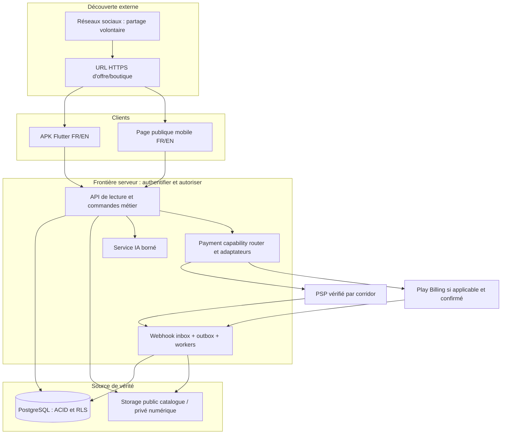
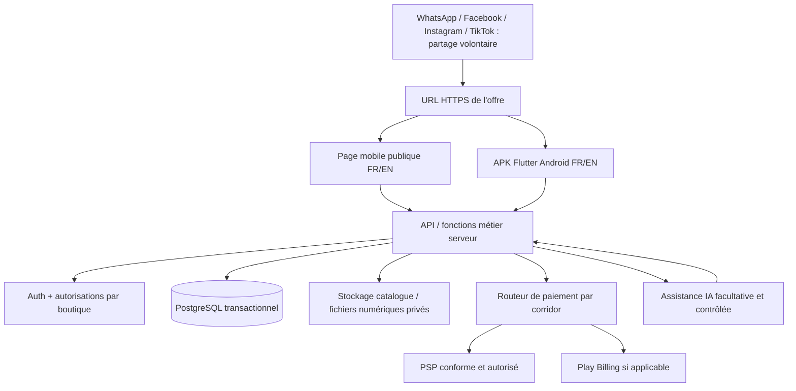

# SPÉCIFICATION MAÎTRE COMPLÈTE — D01 + D02 AVEC PANEL ADMIN CENTRAL

**Édition 1.1 corrigée — 25 septembre 2026**. Compilation à partir des fichiers normatifs courants ci-dessous. Le pack antérieur était sous-spécifié pour l'administration ; le présent texte comprend **ADMIN-FR-001–050** en plus des **FR-01–70**, ainsi que 18 vues admin et les contrôles associés. Les anciennes versions contenues dans les annexes historiques ne priment jamais. Aucune technologie n'est déclarée testée par compilation.

**Démarrer par `00_LIRE_EN_PREMIER.md`.** Le propriétaire contrôle les capacités de la plateforme à travers une console sécurisée, mais ne peut créer une permission juridique/PSP/Play par simple interrupteur. Prototype admin et images = simulations.


---

# PARTIE — 01 IDÉATION — ARCHIVE COMPLÈTE

**Fichier source :** `01_IDEATION/Analyse_D01_D02_V0_9_Archive_Complete.md`


# AI FOUNDRY — ANALYSE COMBINÉE DES DOMAINES D01 + D02
## Commerce, vente et distribution de produits × Achats, consommation et recherche de bonnes affaires

**Version documentaire :** 0.9 — document de référence évolutif  
**Date de création :** 24 septembre 2026  
**Statut :** analyse initiale conservée ; hypothèse de produit à approfondir, non validée commercialement  
**Référentiel :** `Atlas_AI_Foundry_V4_48_Domaines_Premium.html`, domaines D01 et D02 ; consultation croisée de `Cartographie_36_domaines_activites_actions_frictions.md` pour les intitulés et frictions.  
**Contexte :** recherche d'une application Android native pour AI Foundry, avec ambition de bâtir un produit utile, différenciant, durable et commercialisable.  
**Nature du document :** analyse structurée et registre de suivi, accompagnés en ANNEXE A de la première réponse de conversation demandée par Abraham et en ANNEXE B de la nouvelle évaluation détaillée sur la différenciation, et en ANNEXE C de l’évaluation suivante portant sur les huit dimensions, les propositions de mécanismes et la synthèse en trois systèmes. L’ANNEXE D conserve l’évaluation corrigée de l’ouverture de la marketplace aux réseaux sociaux, sans affiliation rémunérée ni connexions API sociales à ce stade. Les ANNEXES E, F et G consignent respectivement la progression annoncée, les cinq parcours commerciaux examinés et les mécanismes de continuité entre opérations ; l’ANNEXE H audite leur cohérence à la v0.6. L'ANNEXE I prolonge l'analyse par cinq cas difficiles, l'ANNEXE J consigne la feuille de route resserrée jusqu'à la construction, l'ANNEXE K clarifie les statuts à la v0.7, l'ANNEXE L consolide le concept produit, l'ANNEXE M commence l'évaluation commerciale et économique et l'ANNEXE N finalise le cadrage économique pré-PRD sans inventer des preuves de marché ou d'accord contractuel. Ce n'est ni un PRD approuvé, ni une étude de marché terminée, ni une liste figée de fonctionnalités.

> **Mise à jour prioritaire v0.5 :** le fondateur a corrigé le périmètre de la réflexion sur les réseaux sociaux : reconnaître leur rôle et faciliter le passage d’une offre partagée vers le commerce, **sans programme d’affiliation à codes/commissions et sans connexion API aux réseaux sociaux pour le moment**. Voir annexe D ; ses corrections explicites priment sur les hypothèses antérieures ou les propositions orales incompatibles.

> **Mise à jour prioritaire v0.6 (25 septembre 2026) :** intégration groupée des trois développements depuis la v0.5, à la demande du fondateur : feuille de progression (annexe E), épreuve de cinq parcours (F), mécanismes de continuité métier (G), contrôle de cohérence (H). **L'état le plus récent et le prochain travail figurent en H.4 ; les anciens « points de reprise » sont conservés comme jalons historiques et ne doivent pas être suivis à la place de H.4.** Aucune intégration API sociale, affiliation rémunérée ou découpe artificielle de V1 n'est réintroduite.

> **Mise à jour prioritaire v0.7 (25 septembre 2026) :** ajout des règles proposées pour cinq échecs ou conflits de parcours (annexe I), de la feuille de route en cinq étapes vers le développement (annexe J) et d'un contrôle de statut et de cohérence (annexe K). **Le point de reprise en vigueur figure en K.4**, qui remplace H.4 comme jalon courant sans supprimer l'historique. L'analyse des incidents est conceptuelle ; les règles financières, juridiques et techniques restent à établir et à tester.

> **Mise à jour prioritaire v0.8 (25 septembre 2026) :** l’ANNEXE L consolide la définition conceptuelle après la v0.7 ; l’ANNEXE M commence immédiatement l’étape 2 (validation commerciale et économique) par des éléments documentaires vérifiés, des hypothèses de clientèle, une stratégie d’amorçage, les modèles de revenus à tester, les dépendances de paiement et un protocole terrain exécutable. **Le point de reprise en vigueur est M.9** ; K.4 est conservé comme jalon historique, pas comme prochaine étape à répéter. La consolidation de l’idéation ne vaut pas validation commerciale ; les hypothèses nouvelles de M ne sont pas des décisions produit du fondateur.

> **Mise à jour prioritaire v0.9 (25 septembre 2026) :** l'ANNEXE N audite le volet économique avant PRD et ajoute les coûts unitaires, revenus réellement gagnés, responsabilités financières, détails publics de FedaPay et leurs limites, règles Google Play pour les produits numériques, fiscalité internationale et protocole de validation. **Le point de reprise en vigueur est N.10 : étape 3 — PRD**, sans prétendre que des clients ont été interrogés, que la tarification est approuvée ou qu'un prestataire de paiement s'est engagé. Les points de reprise de M et antérieurs sont conservés comme jalons historiques.

> **Principe de conservation :** lors de chaque évolution, préserver les observations antérieures, distinguer les décisions confirmées des propositions et des hypothèses, dater les ajouts et expliquer les corrections. Ne pas réécrire rétroactivement une hypothèse comme si elle avait déjà été validée.

---

# 1. L'intuition de départ : une seule application, deux côtés d'une même économie

L'idée initiale du fondateur est de rapprocher deux domaines qui constituent des parties complémentaires de l'activité commerciale :

- **D01 — Commerce, vente et distribution de produits :** tout ce qui permet au commerçant de préparer, organiser, vendre, encaisser, livrer et entretenir son activité.
- **D02 — Achats, consommation et recherche de bonnes affaires :** tout ce qui permet au consommateur d'exprimer un besoin, de trouver une offre, de comparer, d'acheter et de recevoir un produit.

Le domaine 1 ressemble à l'espace de gestion du vendeur dans une application de commerce, mais il couvre davantage qu'un simple « back-office » : il constitue le moteur opérationnel du commerce. Le domaine 2 ressemble à l'expérience visible par l'acheteur, mais il couvre davantage qu'un catalogue : c'est le parcours complet qui mène d'un besoin réel à un achat satisfaisant.

**Question centrale :** pourquoi ne pas concevoir une seule application dans laquelle les besoins des acheteurs et le fonctionnement réel des vendeurs se répondent, jusqu'à former un système commercial cohérent ?

### Hypothèse de produit à approfondir

**Une plateforme de commerce qui fait fonctionner ensemble l'achat et la vente.**

- **Pour le vendeur :** gérer son activité commerciale et accéder à des clients.
- **Pour l'acheteur :** trouver ce dont il a besoin, choisir une offre adaptée et acheter dans de bonnes conditions.
- **Pour les deux :** disposer d'un parcours commun, depuis la recherche ou la publication d'un produit jusqu'à la transaction, la remise et le suivi.

**Statut :** proposition conceptuelle issue de l'analyse D01 + D02 ; elle ne constitue pas encore une décision de construire cette application, ni une validation de son marché.

---

# 2. Ce que représente réellement le domaine D01

## D01 — Commerce, vente et distribution de produits

Le vendeur ne cherche pas seulement à poster une annonce. Il cherche à **faire fonctionner et développer un commerce**.

Le référentiel décrit dix activités :

| Référence | Activité exacte de l'Atlas |
|---|---|
| D01-A01 | Choisir une gamme de produits |
| D01-A02 | Rechercher et sélectionner des fournisseurs |
| D01-A03 | Commander et recevoir du stock |
| D01-A04 | Fixer et réviser les prix |
| D01-A05 | Présenter et publier un produit |
| D01-A06 | Répondre et conseiller les clients |
| D01-A07 | Enregistrer et exécuter une commande |
| D01-A08 | Encaisser et rapprocher les ventes |
| D01-A09 | Organiser une livraison ou remise |
| D01-A10 | Gérer retours réclamations et fidélisation |

### Traduction possible en expérience commerçant

Un commerçant pourrait, dans un même espace :

1. Créer sa boutique et son catalogue.
2. Organiser ses produits, variantes, quantités et prix.
3. Gérer ses fournisseurs et réapprovisionnements.
4. Recevoir les demandes et conseiller les acheteurs.
5. Négocier, réserver et confirmer une commande.
6. Suivre les paiements, remises et livraisons.
7. Traiter les retours et retrouver ses clients.
8. Comprendre quels articles se vendent, lesquels manquent et lesquels intéressent les acheteurs.

### Ce que révèlent les frictions du domaine vendeur

Parmi les difficultés possibles répertoriées, on trouve notamment : un produit encore publié après sa vente ; une demande commerciale perdue dans les messages ; un même article réservé ou vendu deux fois ; un paiement difficile à rapprocher de la vente correspondante ; des erreurs de variante ; des informations contradictoires ; des difficultés à gérer livraison et réclamation.

**Interprétation de travail :** ces difficultés touchent le fonctionnement du commerce, pas uniquement la visibilité des articles. Une application réduite à « créer une boutique et publier un produit » ne représenterait donc pas toute la logique du D01.

> Les frictions de l'Atlas sont des hypothèses à confronter à la réalité de différents profils de commerçants. Elles ne démontrent pas encore leur fréquence, leur gravité ou leur coût.

---

# 3. Ce que représente réellement le domaine D02

## D02 — Achats, consommation et recherche de bonnes affaires

De son côté, l'acheteur ne veut pas, en premier lieu, « utiliser une marketplace ». Il cherche à obtenir un produit dont il a besoin, à un coût et dans des conditions qui lui conviennent.

Le référentiel décrit huit activités :

| Référence | Activité exacte de l'Atlas |
|---|---|
| D02-A01 | Définir un besoin d'achat |
| D02-A02 | Rechercher des produits et vendeurs |
| D02-A03 | Comparer prix et valeur réelle |
| D02-A04 | Vérifier un vendeur avant paiement |
| D02-A05 | Négocier et réserver un article |
| D02-A06 | Payer un achat |
| D02-A07 | Recevoir et contrôler un achat |
| D02-A08 | Gérer budget d'achat récurrent |

### Traduction possible en expérience acheteur

L'acheteur pourrait, dans le même produit numérique :

1. Rechercher un produit ou exprimer précisément ce qu'il cherche.
2. Découvrir des vendeurs et des boutiques accessibles.
3. Connaître le prix, les caractéristiques et la disponibilité.
4. Comparer le coût total, y compris le transport et les frais pertinents.
5. Vérifier les informations du vendeur et les conditions d'achat.
6. Poser des questions, négocier ou réserver.
7. Payer, retirer ou se faire livrer.
8. Suivre ses achats, ses éventuelles réclamations et ses besoins réguliers.

### Ce que révèlent les frictions du domaine acheteur

L'Atlas attire l'attention sur les offres invisibles hors d'un réseau personnel, les informations dispersées, l'incertitude sur le stock, les produits difficilement comparables, l'authenticité incertaine, l'identité ou la fiabilité du vendeur, les frais ajoutés tardivement, les réservations contestées, les problèmes de paiement, de remise et de réclamation.

**Interprétation de travail :** la découverte du produit n'est qu'un moment du parcours. Le résultat attendu est l'obtention du bon produit, selon un accord compréhensible, avec un suivi suffisant jusqu'à la réception et la résolution d'éventuels incidents.

---

# 4. Le point central : les activités des deux domaines se répondent

L'application envisagée n'est pas la juxtaposition d'un produit pour vendeurs et d'un produit pour acheteurs. Elle peut être **un système commercial partagé** dans lequel une même offre, une même demande ou une même transaction est comprise par les deux parties, chacune depuis son espace.

| Côté vendeur — D01 | Côté acheteur — D02 | Ce que l'application pourrait relier |
|---|---|---|
| Choisir les produits à vendre | Exprimer ses besoins | Les demandes des acheteurs et les décisions d'approvisionnement |
| Gérer le stock | Rechercher un produit disponible | Les quantités réellement déclarées et les offres visibles |
| Fixer les prix | Comparer les prix et coûts | Le prix du produit, les frais et les conditions |
| Présenter et publier | Rechercher et vérifier | Les informations du vendeur et du produit |
| Répondre et conseiller | Poser des questions et négocier | Une conversation liée à une offre précise |
| Enregistrer une commande | Réserver et acheter | Un accord commun sur l'article, le prix et le délai |
| Encaisser | Payer | Un paiement associé à une commande identifiable |
| Organiser la remise | Recevoir et contrôler | Le suivi de la même transaction des deux côtés |
| Gérer les réclamations | Signaler un problème | Un dossier commun avec les faits et les échanges |

### Lecture de ce tableau

Chaque ligne représente une connexion possible entre des activités qui existent déjà dans les deux domaines. Ce n'est pas une obligation de construire immédiatement neuf modules distincts. C'est une manière d'identifier les **relations de données et de travail** qu'une application pourrait rendre plus fluides.

L'information ne devrait pas être ressaisie de façon incohérente par le vendeur, l'acheteur et éventuellement le livreur. Les acteurs peuvent conserver leurs interfaces propres, mais partager une référence commune pour le produit, la commande, le paiement et la remise lorsque ces opérations sont prises en charge.

---

# 5. Ce qui pourrait rendre le produit plus intéressant qu'une simple application de petites annonces

### Situation illustrative

Une personne à Cotonou cherche un appareil précis. Elle ne sait pas quelle boutique le possède. Plutôt que de dépendre uniquement des annonces déjà vues et de contacts isolés, voici le parcours possible dans l'application envisagée.

1. **L'acheteur décrit le produit recherché.** Il peut préciser son budget, son quartier et ses exigences.
2. **L'application recherche les offres correspondantes.** Elle présente les vendeurs qui déclarent proposer ce produit, avec les informations disponibles ; ne pas confondre « déclaré disponible » et « stock confirmé ».
3. **Si aucune offre ne convient, la demande peut rester ouverte.** Des commerçants concernés pourraient recevoir cette demande et y répondre seulement s'ils sont capables de la satisfaire.
4. **Le vendeur répond depuis son espace commercial.** Il confirme le produit, la variante, le prix, la disponibilité et les possibilités de remise.
5. **L'acheteur compare et décide.** Il pose des questions, choisit une proposition, réserve ou achète.
6. **Les deux suivent la transaction.** Commande, paiement et remise sont reliés au lieu de dépendre uniquement d'une succession de messages sans suivi commun.
7. **Le commerçant apprend quelque chose de la demande.** Même une recherche non satisfaite pourrait donner une indication sur les produits recherchés qui manquent à son catalogue.

### La double circulation de l'information

**Offre → Demande :** un vendeur publie un article et trouve des acheteurs.  
**Demande → Offre :** un acheteur exprime un besoin et les vendeurs concernés peuvent y répondre.  
**Transactions → Amélioration :** achats, demandes non satisfaites et ruptures de stock peuvent aider les commerçants à mieux organiser leur activité.

Cette dernière connexion rapproche directement l'activité **D01-A01 — Choisir une gamme de produits** de l'activité **D02-A01 — Définir un besoin d'achat**.

**Hypothèse d'innovation :** la plateforme ne servirait pas uniquement à vendre ce qui est déjà affiché ; elle pourrait aussi rendre visibles les besoins auxquels les commerçants ne répondent pas encore et les aider à agir sur cette information.

**Statut :** idée à comparer aux plateformes existantes et à tester auprès de vendeurs et acheteurs. Aucune exclusivité technologique ni différenciation concurrentielle n'est démontrée à ce stade.

---

# 6. Reconnaître les solutions qui existent déjà

La combinaison « espace vendeur + espace acheteur » correspond à une forme connue de **marketplace / place de marché**. En soi, la présence des deux rôles n'est pas une innovation démontrée.

Des exemples examinés dans la discussion :

| Plateforme | Description publique utile à notre comparaison | Source | Réserve |
|---|---|---|---|
| GoMarket | Se présente comme un marché local au Bénin pour acheter, vendre et échanger, notamment par petites annonces. | https://www.gomarket.bj/ | Fonctionnalités et niveau d'adoption à éprouver dans l'application réelle ; ne pas reprendre sans contrôle les statistiques affichées par l'éditeur. |
| Zafara | Annonce des espaces acheteur, vendeur et livreur, ainsi que catalogue, commandes, paiement Mobile Money et livraison. | https://zafarabenin.fr/ | Description de l'éditeur, pas une vérification indépendante de chaque parcours en production. |
| CoinAfrique | Plateforme africaine de petites annonces ayant une présence indiquée au Bénin. | https://www.coinafrique.com/contactez-nous/ | Examiner les parcours locaux, fonctionnalités effectives et pratiques des utilisateurs avant d'affirmer une lacune. |

**Conséquence pour notre analyse :** réunir des vendeurs et des acheteurs ne suffit pas à constituer notre différence. Le travail d'innovation doit porter sur des écarts précis et vérifiables.

### Écarts à rechercher, sans les présenter encore comme acquis

- Disponibilité réelle et mise à jour soutenable des offres.
- Découverte et traitement des demandes non satisfaites.
- Passage entre boutiques physiques et commerce numérique.
- Suivi des accords, réservations, paiements et transactions.
- Utilisation des informations d'achat pour améliorer l'approvisionnement et les décisions commerciales.

Nous ne devons pas affirmer qu'aucun concurrent ne couvre ces besoins sans tests comparatifs réels.

---

# 7. Une application commune, des expériences adaptées

## Espace « Acheter »

Recherche, comparaison, demandes d'achat, réservations, commandes, paiements et suivi.

## Espace « Vendre »

Boutique, produits, stock, clients, demandes, commandes, encaissements et suivi commercial.

Ces deux espaces pourraient fonctionner dans **la même application Android**, sur un système de données relié. Un même compte pourrait avoir les deux rôles : un commerçant est aussi parfois acheteur, notamment lorsqu'il cherche des fournisseurs pour son réapprovisionnement.

La logique n'est pas d'obliger un commerçant à abandonner sa boutique physique ou ses habitudes pour utiliser le produit. L'application pourrait l'aider à faire fonctionner un commerce existant tout en lui ouvrant un canal d'achat et de vente numérique.

**Conclusion de cette section :** c'est plus large qu'une simple vitrine en ligne ; c'est une proposition de continuité entre activités commerciales physiques et numériques.

---

# 8. Les quatre questions décisives avant de conclure à une véritable opportunité

### 8.1 Disponibilité

Comment s'assurer que les offres présentées correspondent aux stocks réels, sans imposer au commerçant une charge de mise à jour qu'il abandonnera ? Une déclaration de stock ne constitue pas à elle seule une preuve ; prévoir la différence entre information fournie, information confirmée et information périmée.

### 8.2 Confiance et exécution

Comment vérifier les informations pertinentes, organiser les paiements et traiter les incidents sans faire de promesses que la plateforme ne peut pas tenir ? La responsabilité réelle de chaque acteur et les moyens de preuve devront être définis.

### 8.3 Adoption

Pourquoi un vendeur et un acheteur utiliseraient-ils cette application plutôt que de continuer seulement avec leurs contacts, Facebook ou leurs boutiques habituelles ? Quelle amélioration concrète justifie l'effort d'inscription, de publication, de suivi et de changement d'habitude ?

### 8.4 Viabilité commerciale

Quelle valeur les vendeurs retireraient-ils du système ? Quels revenus pourraient financer durablement l'exploitation, les paiements éventuels, le support et la croissance ? Ne pas confondre volonté déclarée d'utiliser l'application et volonté réelle de payer.

### La difficulté des deux populations

Une plateforme qui relie deux populations doit réunir des offres suffisamment utiles pour attirer les acheteurs **et** une demande suffisamment réelle pour attirer les vendeurs. Son démarrage est donc un problème produit et commercial à étudier autant que ses fonctionnalités.

---

# 9. Synthèse du concept D01 + D02

## Une application qui connecte les besoins d'achat au fonctionnement réel des commerces

**Promesse côté acheteur :**

> « Trouve ce dont tu as besoin, découvre des offres adaptées et va jusqu'à l'achat avec des informations claires. »

**Promesse côté vendeur :**

> « Fais fonctionner ton commerce, découvre ce que les clients recherchent et transforme les demandes en ventes que tu peux suivre. »

**Vision commune :**

> Faire circuler l'information entre les besoins, les produits, les commerçants et les transactions, au lieu de laisser chacun chercher, publier, négocier et s'organiser séparément.

Il existe une cohérence dans l'association de ces deux domaines, car elle ouvre la voie à un produit commercial complet avec une proposition de valeur identifiable pour les deux parties. **Cette cohérence n'est pas une garantie d'innovation, d'adoption ni de viabilité : ce sont des hypothèses à vérifier.**

Le domaine **D03 — Marketing, publicité, prospection et acquisition de clients** reste volontairement de côté pour l'instant. Sa relation avec ce concept, notamment l'acquisition de clients, est évidente ; toutefois, le fondateur a demandé de comprendre pleinement ce que peuvent produire D01 et D02 ensemble avant de décider d'un rapprochement supplémentaire.

---

# 10. Registre initial des décisions, observations et hypothèses

Ce registre permet de ne pas confondre ce que le fondateur a confirmé, ce que l'analyse propose et ce qu'il reste à prouver.

| ID | Élément | Statut au 24/09/2026 | Origine / commentaire |
|---|---|---|---|
| DEC-001 | Étudier **D01 + D02 comme un ensemble**, plutôt que sélectionner une seule activité pour générer une application. | **CONFIRMÉ — orientation de recherche** | Demande explicite du fondateur. |
| DEC-002 | Mettre l'analyse du **D03 en pause** pour approfondir D01 + D02. | **CONFIRMÉ — ordre de travail** | Demande explicite du fondateur. |
| DEC-003 | Conserver cette analyse dans un **document Markdown évolutif** à mettre à jour au fil des observations et décisions acceptées. | **CONFIRMÉ — méthode documentaire** | Demande explicite du fondateur. |
| DEC-004 | Ne pas utiliser « V1 » comme prétexte pour livrer une coquille vide ou retrancher arbitrairement les activités du système envisagé. | **CONFIRMÉ — principe de discussion** | Correction explicite du fondateur ; n'implique pas que toutes les fonctionnalités soient déjà approuvées. |
| DEC-005 | Ne pas borner a priori la portée commerciale à l'Afrique de l'Ouest ; inclure l'hypothèse des produits physiques et numériques et des utilisateurs internationaux dans les investigations. | **CONFIRMÉ — cadrage de recherche** | Demande explicite du fondateur ; les modalités de paiements, de fiscalité et de desserte restent à vérifier. |
| DEC-006 | Préserver intégralement la nouvelle évaluation concurrentielle et les neuf axes avant de lancer l'étape de vérification. | **CONFIRMÉ — méthode documentaire** | Demande explicite du fondateur. Les neuf axes ne sont PAS acceptés comme décisions de produit. |
| DEC-007 | Reconnaître les réseaux sociaux comme espaces de découverte sans isoler la marketplace. | **CONFIRMÉ — intention de conception** | Correction du fondateur ; détails à évaluer dans l’annexe D. |
| DEC-008 | Pas de programme d’affiliation rémunérée à codes/commissions pour le moment. | **CONFIRMÉ — exclusion actuelle** | Le partage ordinaire d’un produit n’implique pas d’affiliation. |
| DEC-009 | Pas de connexions API aux réseaux sociaux pour le moment. | **CONFIRMÉ — exclusion actuelle** | Ne pas rendre l’application dépendante de l’automatisation de WhatsApp, Facebook, Instagram ou TikTok. |
| DEC-010 | Ne pas déduire de la métaphore des « mondes » l’obligation de créer un réseau social interne ou une régie publicitaire. | **CONFIRMÉ — clarification d’intention** | Voir annexe D. |
| HYP-001 | Construire une plateforme commerciale commune avec espaces acheteur et vendeur. | **PROPOSITION À APPROFONDIR** | Résulte du rapprochement de D01 et D02. |
| HYP-002 | Mettre en relation non seulement les offres existantes mais aussi les besoins d'achat non encore satisfaits. | **HYPOTHÈSE PRODUIT** | Parcours illustratif à comparer aux solutions existantes. |
| HYP-003 | Lier les demandes, le stock, les commandes, les paiements et les remises pour les deux parties. | **HYPOTHÈSE PRODUIT / TECHNIQUE** | Cohérence métier à vérifier et à définir. |
| HYP-004 | Les données de recherche et de vente aideraient les commerçants à ajuster leur catalogue et leurs approvisionnements. | **HYPOTHÈSE DE VALEUR** | Ne pas promettre des prévisions exactes sans données ni validation. |
| HYP-005 | Différencier la plateforme par la continuité du parcours « besoin → recherche → offre → accord → transaction → exécution → connaissance → décision » et les neuf axes de l'annexe B. | **HYPOTHÈSE STRATÉGIQUE NON ADOPTÉE** | Nouvelle évaluation conservée pour examen ; aucune capacité de l'annexe B ne devient automatiquement une exigence approuvée. |
| VAL-001 | Différence réelle avec GoMarket, Zafara, CoinAfrique et autres pratiques locales. | **À VÉRIFIER** | Comparaison fonctionnelle et tests d'usage nécessaires. |
| VAL-002 | Fréquence, gravité et coût des frictions D01/D02 chez divers types d'utilisateurs. | **À VÉRIFIER** | La cartographie décrit des frictions potentielles, non une enquête achevée. |
| VAL-003 | Modèle d'adoption, de lancement et de revenus soutenable. | **À VÉRIFIER** | Les deux côtés de la plateforme doivent trouver leur intérêt. |

**Aucune décision de développer cette plateforme n'est présumée du seul fait que son évaluation a été bien accueillie.**

---

# 11. Annexe — Inventaire intégral des frictions initiales D01 et D02

Cette annexe ne modifie pas l'évaluation : elle garde sous les yeux les **72 frictions potentielles** (40 côté D01, 32 côté D02) que nous devons rapprocher, tester ou écarter au fur et à mesure. Les titres et libellés ci-dessous reproduisent le référentiel ; ils ne sont pas des constats de terrain confirmés.

## D01 — 10 activités × 4 frictions

| Activité | Action | Friction potentielle du référentiel |
|---|---|---|
| D01-A01 Choisir une gamme de produits | Observer les demandes | Avis dispersés et biaisés |
| D01-A01 | Comparer les articles | Confusion entre popularité et marge |
| D01-A01 | Tester de petites quantités | Risque d'invendus |
| D01-A01 | Décider du renouvellement | Décision fondée sur la mémoire |
| D01-A02 Rechercher et sélectionner des fournisseurs | Recenser des sources | Contacts incomplets |
| D01-A02 | Demander les conditions | Prix et minimums peu comparables |
| D01-A02 | Évaluer la fiabilité | Qualité incertaine et fraude possible |
| D01-A02 | Choisir un fournisseur | Arbitrages opaques entre prix et délai |
| D01-A03 Commander et recevoir du stock | Évaluer les besoins | Ruptures ou surstock |
| D01-A03 | Passer commande | Variantes et quantités mal transmises |
| D01-A03 | Suivre l'acheminement | Retards non signalés |
| D01-A03 | Contrôler la réception | Manquants ou défauts détectés tard |
| D01-A04 Fixer et réviser les prix | Calculer le coût complet | Transport et pertes oubliés |
| D01-A04 | Observer les prix alternatifs | Références peu comparables |
| D01-A04 | Choisir un prix | Marge ou demande mal anticipée |
| D01-A04 | Réviser le tarif | Étiquettes et annonces incohérentes |
| D01-A05 Présenter et publier un produit | Préparer le produit | État ou variante mal précisé |
| D01-A05 | Créer photos et description | Photos floues et détails manquants |
| D01-A05 | Diffuser l'offre | Publications éparpillées ou oubliées |
| D01-A05 | Actualiser disponibilité | Article vendu toujours affiché |
| D01-A06 Répondre et conseiller les clients | Recevoir une demande | Messages noyés parmi d'autres |
| D01-A06 | Comprendre le besoin | Mauvaise variante recommandée |
| D01-A06 | Expliquer conditions et usage | Réponses répétitives ou contradictoires |
| D01-A06 | Relancer sans insister | Intéressés perdus de vue |
| D01-A07 Enregistrer et exécuter une commande | Confirmer produit et quantité | Malentendus sur la variante |
| D01-A07 | Relever coordonnées | Adresse imprécise |
| D01-A07 | Réserver l'article | Double vente d'un même stock |
| D01-A07 | Confirmer le délai | Promesses incompatibles avec la logistique |
| D01-A08 Encaisser et rapprocher les ventes | Annoncer le montant | Remises et frais contestés |
| D01-A08 | Accepter le moyen de paiement | Canal indisponible ou frais inattendus |
| D01-A08 | Vérifier réception | Fausse preuve ou paiement en attente |
| D01-A08 | Reporter la vente | Entrées oubliées ou dupliquées |
| D01-A09 Organiser une livraison ou remise | Choisir le mode de remise | Coût ou distance mal évalués |
| D01-A09 | Préparer le colis | Erreur de produit ou emballage insuffisant |
| D01-A09 | Coordonner l'itinéraire | Destinataire absent ou introuvable |
| D01-A09 | Confirmer la remise | Litige sans preuve claire |
| D01-A10 Gérer retours réclamations et fidélisation | Recevoir la réclamation | Client renvoyé d'un interlocuteur à l'autre |
| D01-A10 | Vérifier les faits | Preuves dispersées |
| D01-A10 | Proposer une issue | Règles imprécises ou perçues comme injustes |
| D01-A10 | Recontacter après résolution | Client oublié ou sollicité abusivement |

## D02 — 8 activités × 4 frictions

| Activité | Action | Friction potentielle du référentiel |
|---|---|---|
| D02-A01 Définir un besoin d'achat | Constater le besoin | Achat impulsif ou besoin mal formulé |
| D02-A01 | Évaluer l'urgence | Achat reporté malgré nécessité |
| D02-A01 | Fixer les contraintes | Budget et caractéristiques flous |
| D02-A01 | Établir les priorités | Choix concurrents désorganisés |
| D02-A02 Rechercher des produits et vendeurs | Choisir des sources | Offres non visibles hors réseau personnel |
| D02-A02 | Formuler la recherche | Termes et catégories variables |
| D02-A02 | Contacter des vendeurs | Absence de réponse ou disponibilité fictive |
| D02-A02 | Rassembler les offres | Informations réparties entre conversations |
| D02-A03 Comparer prix et valeur réelle | Relever les prix | Tailles et qualités non équivalentes |
| D02-A03 | Ajouter transport et frais | Prix affiché trompeur sur coût final |
| D02-A03 | Évaluer la qualité | Difficulté à vérifier l'authenticité |
| D02-A03 | Arbitrer | Choix précipité ou paralysie |
| D02-A04 Vérifier un vendeur avant paiement | Identifier l'interlocuteur | Usurpation ou identité peu claire |
| D02-A04 | Contrôler l'offre | Promesse irréaliste |
| D02-A04 | Examiner les conditions | Garantie et retour absents |
| D02-A04 | Choisir la remise | Paiement anticipé risqué |
| D02-A05 Négocier et réserver un article | Exposer ses contraintes | Malentendu sur le budget |
| D02-A05 | Discuter prix et accessoires | Frais ajoutés tardivement |
| D02-A05 | Fixer le lieu et l'heure | Rendez-vous manqués |
| D02-A05 | Confirmer la réservation | Article revendu ou acompte contesté |
| D02-A06 Payer un achat | Choisir le canal | Frais ou plafond inattendu |
| D02-A06 | Vérifier le bénéficiaire | Erreur de numéro ou fraude |
| D02-A06 | Exécuter le paiement | Connexion ou service interrompu |
| D02-A06 | Conserver la preuve | Reçu perdu ou peu lisible |
| D02-A07 Recevoir et contrôler un achat | Suivre l'arrivée | Manque de visibilité |
| D02-A07 | Vérifier identité du colis | Remise à un tiers imprévu |
| D02-A07 | Inspecter qualité et quantité | Défaut constaté après départ |
| D02-A07 | Signaler un écart | Litige tardif ou non documenté |
| D02-A08 Gérer budget d'achat récurrent | Lister les achats réguliers | Postes oubliés |
| D02-A08 | Estimer la dépense | Prix variables |
| D02-A08 | Planifier les achats | Dépenses concentrées un mauvais jour |
| D02-A08 | Contrôler le réalisé | Dépassement invisible |

---

# 12. Historique des mises à jour

| Version | Date | Nature | Décision ou changement conservé |
|---|---|---|---|
| 0.1 | 2026-09-24 | Création | Analyse structurée D01 + D02 ; ajout des sources, des 72 frictions et du registre des états. |
| 0.2 | 2026-09-24 | Ajout sans suppression | Annexe A : reproduction intégrale de la réponse D01 + D02 explicitement citée par Abraham, y compris les neuf correspondances vendeur/acheteur, l’exemple de Cotonou, le parcours bidirectionnel, les concurrents, les questions et la synthèse. |
| 0.3 | 2026-09-24 | Ajout sans suppression | Annexe B : évaluation complète de la différenciation, neuf axes, concurrents internationaux, produits physiques et numériques, portée mondiale, huit questions de vérification et point de reprise. Hypothèse stratégique expressément NON adoptée comme décision produit. |
| 0.4 | 2026-09-24 | Ajout sans suppression | Annexe C : nouvelle évaluation des huit dimensions, propositions d’exécution, résultats attendus pour acheteur/vendeur, synthèse des trois systèmes et quatre parcours à examiner. Analyse conservée, sans validation implicite des mécanismes proposés. |
| 0.5 | 2026-09-24 | Ajout et clarification, sans suppression des analyses antérieures | Annexe D : évaluation complète de la convergence avec la découverte sociale, corrigée selon les instructions du fondateur ; refus à ce stade du programme d’affiliation rémunérée et des API sociales ; partage libre d’offres et continuité vers l’achat ; registre de corrections et prochaines vérifications. |
| 0.6 | 2026-09-25 | Ajout groupé des trois développements et audit, sans supprimer les versions antérieures | Annexe E : progression des six évaluations ; annexe F : cinq parcours de bout en bout ; annexe G : six objets métier, assistance en trois niveaux, transactions distinctes et actions contextuelles ; annexe H : vérification de cohérence, clarification des statuts, point de reprise après v0.6. |
| 0.7 | 2026-09-25 | Prolongement documenté, sans suppression | Annexe I : cinq cas difficiles et mécanismes de traitement envisagés ; annexe J : feuille de route en cinq étapes jusqu’à la construction ; annexe K : contrôle de cohérence, décisions réellement confirmées, points non résolus et reprise à la consolidation du concept produit. |

| 0.8 | 2026-09-25 | Consolidation conceptuelle + lancement du cadrage économique | Annexes L et M : produit, clientèle à tester, revenus hypothétiques, stratégie d’amorçage et protocole terrain ; marché non validé. |
| 0.9 | 2026-09-25 | Audit économique pré-PRD sans effacer les annexes précédentes | Annexe N : segmentation des payeurs, économie unitaire, frais et remboursements, rôle du prestataire, règlement Play pour produits numériques, fiscalité transfrontalière, risques et matrice des preuves ; passage au PRD avec dépendances ouvertes. |

## Modèle pour une future mise à jour

**Version / date :**  
**Nouvelle observation ou preuve :**  
**Source de l'information :**  
**Ce qui change dans l'analyse :**  
**Décision explicitement acceptée par le fondateur :**  
**Hypothèses qui restent ouvertes :**  
**Sections affectées :**  
**Prochaine question ou vérification utile :**

---

# Sources et règles de preuve

1. **Référence principale de l'Atlas :** `Atlas_AI_Foundry_V4_48_Domaines_Premium.html`, D01 et D02, document de travail partagé par le fondateur.
2. **Référence de contrôle des libellés :** `Cartographie_36_domaines_activites_actions_frictions.md`, sections D01 et D02. Cette source décrit des *frictions potentielles*, non des faits validés.
3. **GoMarket :** https://www.gomarket.bj/ — description éditoriale de la plateforme, consultation du 24 septembre 2026.
4. **Zafara Bénin :** https://zafarabenin.fr/ — description éditoriale de la plateforme, consultation du 24 septembre 2026.
5. **CoinAfrique :** https://www.coinafrique.com/contactez-nous/ — présence du Bénin indiquée sur le site, consultation du 24 septembre 2026.

**Règle de fond :** ne jamais convertir silencieusement une annonce d'un concurrent, une supposition de l'Atlas, une observation individuelle ou une proposition de l'assistant en fait commercial validé. Les décisions appartiennent au fondateur et seront inscrites comme confirmées seulement après son accord explicite.

---

# ANNEXE A — TRANSCRIPTION INTÉGRALE DE LA RÉPONSE D01 + D02 DEMANDÉE PAR ABRAHAM

**Nature :** reproduction de la réponse de conversation fournie par Abraham, conservée dans son déroulement et sans remplacer les analyses et annexes précédentes. La présentation des encadrés de la conversation a été transposée en titres et citations Markdown pour permettre sa lecture dans un fichier `.md`.

Abraham, oui. Et je comprends mieux ce que tu cherches à construire.

Tu ne veux pas que nous découvrions une petite difficulté, puis que nous nous contentions de créer un outil qui la résout. Tu veux que nous examinions tout le fonctionnement du commerce, du côté de celui qui vend comme du côté de celui qui achète, pour imaginer une application dans laquelle les deux peuvent réellement accomplir leurs activités.

Je laisse donc de côté le débat sur ce qu'il faudrait retirer ou conserver dans une « V1 ». Ce n'est pas la question que tu me poses.

Après avoir repris les deux domaines dans notre Atlas, voici ce que je vois.

## D01 + D02 : une seule application, deux côtés d'une même économie

**Hypothèse de produit à approfondir**

### Une plateforme de commerce qui fait fonctionner ensemble l'achat et la vente

**Pour le vendeur :** gérer son activité commerciale et accéder à des clients.

**Pour l'acheteur :** trouver ce dont il a besoin, choisir une offre adaptée et acheter dans de bonnes conditions.

**Pour les deux :** disposer d'un parcours commun, depuis la recherche ou la publication d'un produit jusqu'à la transaction, la remise et le suivi.

### 1. Ce que représente réellement le domaine 1

Tu as décrit le domaine 1 comme le côté « admin » d'une application de commerce. Cette image est pertinente, avec une précision : il ne s'agit pas seulement d'un tableau de bord administratif. C'est le moteur qui permet au vendeur d'exercer son commerce.

Notre Atlas y recense dix activités : choisir ses produits, rechercher des fournisseurs, gérer le stock, fixer les prix, publier les produits, conseiller les clients, traiter les commandes, encaisser les ventes, organiser les livraisons et gérer les réclamations ainsi que la fidélisation.

**D01 — Espace commerçant**

### « Je veux faire fonctionner et développer mon commerce. »

Le commerçant pourrait notamment :

- créer sa boutique et son catalogue ;
- organiser ses produits, variantes, quantités et prix ;
- gérer ses fournisseurs et réapprovisionnements ;
- recevoir les demandes et conseiller les acheteurs ;
- négocier, réserver et confirmer une commande ;
- suivre les paiements, remises et livraisons ;
- traiter les retours et retrouver ses clients ;
- comprendre quels articles se vendent, lesquels manquent et lesquels intéressent les acheteurs.

Cette représentation regroupe les dix activités du domaine en une expérience commerciale cohérente.

Une chose m'intéresse particulièrement dans l'Atlas : le vendeur peut publier un produit qui a déjà été vendu, perdre une demande dans ses messages, réserver deux fois le même article ou avoir du mal à rapprocher un paiement d'une vente.

Ces frictions concernent le fonctionnement du commerce, pas simplement la visibilité du produit.

### 2. Ce que représente le domaine 2

De l'autre côté, l'acheteur ne veut pas « utiliser une marketplace ». Il veut obtenir quelque chose dont il a besoin, à un prix et dans des conditions qui lui conviennent.

Notre Atlas décrit huit activités : définir son besoin, chercher des produits et vendeurs, comparer les offres, vérifier un vendeur, négocier et réserver, payer, recevoir et contrôler l'achat, puis gérer ses achats récurrents.

**D02 — Espace acheteur**

### « Je veux trouver et obtenir le bon produit. »

L'acheteur pourrait notamment :

- rechercher un produit ou exprimer précisément ce qu'il cherche ;
- découvrir des vendeurs et boutiques accessibles ;
- connaître le prix, les caractéristiques et la disponibilité ;
- comparer le coût total, y compris le transport ;
- vérifier les informations du vendeur et les conditions d'achat ;
- poser des questions, négocier ou réserver ;
- payer, retirer ou se faire livrer ;
- suivre ses achats, ses éventuelles réclamations et ses besoins réguliers.

Cette représentation regroupe les huit activités du domaine autour du résultat que recherche l'acheteur.

Et c'est ici que les deux domaines commencent à devenir intéressants ensemble.

### 3. Le point important : les activités du vendeur et celles de l'acheteur se répondent

Regarde cette correspondance :

| Côté vendeur — D01 | Côté acheteur — D02 | Ce que l'application pourrait relier |
| --- | --- | --- |
| Choisir les produits à vendre | Exprimer ses besoins | Les demandes des acheteurs et les décisions d'approvisionnement |
| Gérer le stock | Rechercher un produit disponible | Les quantités réellement déclarées et les offres visibles |
| Fixer les prix | Comparer les prix et coûts | Le prix du produit, les frais et les conditions |
| Présenter et publier | Rechercher et vérifier | Les informations du vendeur et du produit |
| Répondre et conseiller | Poser des questions et négocier | Une conversation liée à une offre précise |
| Enregistrer une commande | Réserver et acheter | Un accord commun sur l'article, le prix et le délai |
| Encaisser | Payer | Un paiement associé à une commande identifiable |
| Organiser la remise | Recevoir et contrôler | Le suivi de la même transaction des deux côtés |
| Gérer les réclamations | Signaler un problème | Un dossier commun avec les faits et les échanges |

Ces rapprochements découlent des parcours détaillés dans les deux domaines de l'Atlas.

Ce tableau est probablement le cœur de ce que tu cherchais à m'expliquer.

Nous ne sommes plus en train d'imaginer une application pour les vendeurs à côté d'une autre application pour les acheteurs.

Nous commençons à imaginer un système commercial partagé : une même transaction est visible et compréhensible pour les deux parties, chacune à travers l'interface adaptée à son rôle.

### 4. Maintenant, comment ce produit pourrait-il devenir plus intéressant qu'une simple application de petites annonces ?

Prenons une situation.

Une personne à Cotonou recherche un appareil précis. Elle ne sait pas quelle boutique le possède.

**Exemple de fonctionnement envisagé**

### L'acheteur exprime son besoin. Le commerce peut y répondre.

- **L'acheteur décrit le produit recherché.**

  Il précise éventuellement son budget, son quartier et ses exigences.

- **L'application recherche les offres correspondantes.**

  Elle présente les vendeurs qui déclarent proposer ce produit, avec les informations disponibles.

- **Si aucune offre ne convient, la demande peut rester ouverte.**

  Des commerçants concernés peuvent alors recevoir cette demande et proposer une offre s'ils sont réellement capables d'y répondre.

- **Le vendeur répond depuis son espace commercial.**

  Il confirme le produit, la variante, le prix, la disponibilité et les possibilités de remise.

- **L'acheteur compare et décide.**

  Il peut poser des questions, choisir une proposition, réserver ou acheter.

- **Les deux suivent la transaction.**

  La commande, le paiement et la remise sont reliés, au lieu de dépendre uniquement d'une succession de messages sans suivi commun.

- **Le commerçant apprend quelque chose de la demande.**

  Même les recherches qui n'aboutissent pas pourraient lui indiquer quels produits sont recherchés mais absents de son catalogue.

Ce dernier point m'intéresse particulièrement : l'application ne servirait pas uniquement à vendre ce qui est déjà affiché. Elle pourrait aussi rendre visibles les besoins auxquels les commerçants ne répondent pas encore.

Cela relie directement l'activité « Choisir une gamme de produits » du domaine 1 à l'activité « Définir un besoin d'achat » du domaine 2.

La possibilité existe donc d'un fonctionnement dans les deux sens :

**Offre → Demande :** un vendeur publie un article et trouve des acheteurs.

**Demande → Offre :** un acheteur exprime un besoin et les vendeurs concernés peuvent y répondre.

**Transactions → Amélioration :** les achats, les demandes non satisfaites et les ruptures de stock peuvent aider les commerçants à mieux organiser leur activité.

Ce n'est pas encore une innovation prouvée. C'est une hypothèse de fonctionnement à comparer sérieusement aux solutions existantes.

### 5. Il faut néanmoins reconnaître ce qui existe déjà

La combinaison « espace vendeur + espace acheteur » porte un nom connu : une marketplace, ou place de marché.

Et au Bénin, nous trouvons déjà des propositions de ce type. Par exemple, GoMarket présente une application permettant d'acheter et vendre localement. Zafara annonce des espaces pour les acheteurs, vendeurs et livreurs, avec paiement Mobile Money et livraison. CoinAfrique permet notamment de découvrir des annonces au Bénin et de contacter les vendeurs.

Cela signifie que réunir des vendeurs et des acheteurs ne suffit pas, en soi, à constituer notre différence.

La recherche devra porter sur ce que nous voulons faire fonctionner de manière plus complète : la disponibilité réelle, les demandes non satisfaites, le passage entre boutique physique et commerce numérique, le suivi des accords et transactions, ou l'utilisation des informations d'achat pour aider les commerçants à prendre de meilleures décisions.

Nous devons vérifier ces écarts au lieu de supposer qu'aucun concurrent ne les couvre.

### 6. Une seule application, mais pas une seule expérience identique

Sur le plan du produit, je vois bien ton idée ainsi :

### Une plateforme commerciale commune

Même application Android, données reliées, espaces adaptés aux utilisateurs.

**Acheter**

Recherche, comparaison, demandes, réservations, commandes, paiements et suivi.

**Vendre**

Boutique, produits, stock, clients, demandes, commandes, encaissements et suivi commercial.

Un même compte pourrait avoir les deux rôles. Un commerçant est aussi parfois acheteur, notamment lorsqu'il cherche des fournisseurs pour se réapprovisionner.

Et il y a une distinction importante : le commerçant ne devrait pas nécessairement devoir abandonner sa boutique physique ou ses habitudes pour utiliser le produit.

L'application pourrait l'aider à faire fonctionner un commerce qui existe déjà, tout en lui ouvrant un canal d'achat et de vente numérique.

C'est plus large qu'une simple vitrine.

### 7. Les questions qui détermineront si cette idée peut réellement devenir une entreprise

Je vois quatre questions décisives à investiguer, sans limiter arbitrairement le produit :

- **La disponibilité :** comment garantir que les offres présentées correspondent aux stocks réels, sans imposer au commerçant une charge de mise à jour qu'il abandonnera ?

- **La confiance et l'exécution :** comment vérifier les informations pertinentes, organiser les paiements et traiter les incidents sans faire de promesses que la plateforme ne peut pas tenir ?

- **L'adoption :** pourquoi un vendeur et un acheteur utiliseraient-ils cette application plutôt que de continuer uniquement avec leurs contacts, Facebook ou leurs boutiques habituelles ?

- **La viabilité commerciale :** quelle valeur les vendeurs retireraient-ils du système, et quels revenus pourraient financer durablement son exploitation, ses paiements éventuels, son support et sa croissance ?

La difficulté particulière d'une plateforme qui relie deux populations est qu'il faut des offres utiles pour attirer les acheteurs et une demande réelle pour attirer les vendeurs. Il faudra donc penser à son démarrage autant qu'à ses fonctionnalités.

### Ma synthèse pour notre travail AI Foundry

**Concept issu de la combinaison D01 + D02**

### Une application qui connecte les besoins d'achat au fonctionnement réel des commerces

**La promesse côté acheteur :**

« Trouve ce dont tu as besoin, découvre des offres adaptées et va jusqu'à l'achat avec des informations claires. »

**La promesse côté vendeur :**

« Fais fonctionner ton commerce, découvre ce que les clients recherchent et transforme les demandes en ventes que tu peux suivre. »

**La vision commune :**

Faire circuler l'information entre les besoins, les produits, les commerçants et les transactions, au lieu de laisser chacun chercher, publier, négocier et s'organiser séparément.

Oui, Abraham, je vois une cohérence réelle dans l'association de ces deux domaines. Pas parce qu'elle garantit une application extraordinaire, mais parce qu'elle nous donne une base pour concevoir un produit commercial complet, avec une valeur identifiable pour les deux côtés.

Et je garde le domaine 3 de côté, comme tu l'as demandé. Sa relation avec ce concept est évidente — notamment l'acquisition de clients — mais nous n'avons pas besoin de mélanger les trois domaines avant d'avoir pleinement compris ce que peuvent produire D01 et D02 ensemble.

---

# ANNEXE B — ÉVALUATION COMPLÈTE SUR LA DIFFÉRENCIATION DE D01 + D02

**Nature de cette annexe :** conservation détaillée de la réponse de conversation qui suit l'analyse initiale D01 + D02. L'organisation en encadrés de la conversation a été transposée en titres, citations et tableaux Markdown. Les références aux plateformes correspondent aux exemples évoqués pendant cette évaluation : elles ne constituent pas ici une nouvelle étude concurrentielle exhaustive.

**Statut :** **HYPOTHÈSES STRATÉGIQUES À INVESTIGUER — NON VALIDÉES COMME DÉCISION PRODUIT.** Le fondateur a explicitement demandé de conserver l'évaluation avant de poursuivre la vérification. L'ajout au document ne signifie ni approbation des neuf axes comme fonctionnalités finales, ni adoption du concept, ni limitation à un pays, ni réduction du périmètre sous prétexte d'une « V1 ».

Abraham, oui. Et maintenant, nous arrivons à une étape beaucoup plus intéressante de notre réflexion.

Nous avons déjà conçu la base : une plateforme où le commerçant peut exercer son activité et où l'acheteur peut trouver, comparer et acheter des produits. Nous avons également compris que les deux espaces doivent fonctionner ensemble.

**Mais avoir toutes les fonctionnalités d'une marketplace ne suffit pas à expliquer pourquoi les gens devraient choisir la nôtre plutôt qu'une autre.**

Ce que nous cherchons maintenant, c'est une proposition de valeur qui transforme réellement l'expérience du commerce.

J'ai confronté notre concept à plusieurs plateformes existantes, y compris des acteurs africains et internationaux. Voici ce que cette comparaison nous apprend et, surtout, ce que nous pouvons en tirer pour notre projet AI Foundry.

## 1. D'abord, ce que nous ne devons pas confondre avec notre innovation

Il existe déjà des systèmes commerciaux très complets.

### Ce que les plateformes savent déjà faire

**Amazon**

Son espace vendeur permet notamment de gérer les produits, les prix, les commandes, les stocks, les retours et les performances commerciales.

**Shopify**

Shopify permet aux commerçants de vendre sur plusieurs canaux et de synchroniser catalogues, stocks et commandes avec des marketplaces compatibles.

**Square et Odoo**

Ces solutions rapprochent déjà le commerce physique, les stocks, les achats fournisseurs, les commandes, les paiements et la vente en ligne.

**Jumia**

Jumia associe marketplace, vendeurs, logistique et paiements dans plusieurs marchés africains. Son rapport annuel 2025 décrit également des services d'accompagnement des vendeurs et des capacités commerciales au-delà du simple catalogue.

Cela nous donne une leçon importante : **ni un espace commerçant complet, ni la synchronisation des stocks, ni même l'association de la vente physique et numérique ne constituent automatiquement une innovation nouvelle.**

Ces capacités peuvent faire partie de notre application. Mais il faut aller plus loin dans la valeur que nous apportons.

## 2. Le véritable changement de perspective que je propose

Regarde la différence entre ces deux visions.

### Vision classique

> « Voici les produits disponibles. Cherchez et achetez. »

Le vendeur publie.

L'acheteur consulte.

La plateforme facilite la transaction.

### Notre hypothèse de vision

> **« Dites-nous ce que vous cherchez à obtenir ou à vendre ; le système vous aide à atteindre ce résultat. »**

L'acheteur peut rechercher un produit, mais aussi exprimer un besoin auquel aucune offre ne répond encore.

Le vendeur peut publier des produits, mais aussi découvrir des besoins, adapter son offre et organiser son activité.

La plateforme relie la demande, l'offre, l'exécution et les enseignements tirés des transactions.

Ce ne serait donc pas uniquement un lieu où les produits sont exposés.

Ce serait un **système commercial orienté vers les résultats**, dans lequel l'information circule dans les deux sens.

Et c'est à partir de cette vision que je vois plusieurs axes à approfondir.

## 3. Les neuf axes sur lesquels nous pouvons capitaliser

Ce sont des pistes de différenciation, pas encore des affirmations selon lesquelles aucun concurrent ne les possède.

### Axe 1 — Le commerce déclenché par les besoins, pas seulement par les annonces

C'est une extension directe de notre première analyse.

Imaginons qu'une personne recherche un produit introuvable dans le catalogue.

Une marketplace classique peut lui afficher une page sans résultat ou lui proposer des produits voisins.

Notre système pourrait conserver sa demande, identifier les commerçants susceptibles d'y répondre et leur permettre de soumettre une proposition.

Mais allons plus loin.

Le commerçant pourrait également découvrir que plusieurs personnes recherchent des produits qu'il ne vend pas encore.

Il disposerait alors de signaux lui permettant d'envisager un approvisionnement, plutôt que de choisir uniquement ses produits à partir de ses intuitions.

**La valeur recherchée :**

> Transformer des besoins non satisfaits en opportunités d'achat pour les consommateurs et en opportunités commerciales pour les vendeurs.

Attention : Alibaba.com propose déjà un mécanisme de demandes de devis, ou RFQ, dans lequel des acheteurs décrivent leur besoin et reçoivent des propositions de fournisseurs. Ce principe n'est donc pas inédit.

Notre différenciation éventuelle devra venir de la manière dont nous l'intégrons à l'expérience globale, notamment entre particuliers, petits commerces, boutiques physiques et fournisseurs.

### Axe 2 — Une disponibilité qui reflète réellement l'activité du commerçant

C'est un problème que nous avions déjà identifié dans l'Atlas.

Une chose est de voir un produit annoncé.

Une autre est de pouvoir l'acheter réellement.

L'intérêt serait de relier les ventes effectuées en boutique physique, les commandes numériques, les réservations et les modifications de stock.

Par exemple, lorsqu'un commerçant vend le dernier exemplaire dans sa boutique, l'offre numérique devrait pouvoir être actualisée.

Inversement, si un acheteur réserve un article, le vendeur devrait voir immédiatement que cette quantité n'est plus librement disponible.

La synchronisation des stocks existe déjà chez Square, Shopify et d'autres solutions.

**La question à résoudre n'est donc pas simplement de développer une fonction de stock.**

C'est de permettre à des commerçants de différentes tailles d'utiliser cette fonction sans qu'elle devienne une charge supplémentaire.

Je vois ici une possibilité intéressante : distinguer clairement un stock suivi automatiquement, une disponibilité récemment confirmée par le vendeur et une disponibilité qui doit encore être vérifiée.

Ainsi, nous ne présenterions pas une simple déclaration ancienne comme une garantie.

### Axe 3 — Une recherche qui comprend réellement ce que l'acheteur veut

Aujourd'hui, imaginons un acheteur qui recherche une pièce informatique, un produit de beauté, un appareil ménager ou un vêtement particulier.

Il peut connaître le nom exact du produit, mais aussi ne disposer que d'une description, d'une image ou d'un usage recherché.

Notre application pourrait lui permettre de rechercher de plusieurs manières.

#### Exemple : chercher un produit sans connaître son nom exact

L'acheteur pourrait dire :

> « Je cherche un chargeur pour cet ordinateur. »

Il ajoute une photo de l'appareil ou de son ancien chargeur.

Le système aide à identifier les caractéristiques à confirmer, trouve les offres correspondantes et distingue celles dont la compatibilité reste incertaine.

**Résultat recherché :** moins de recherches infructueuses et moins d'achats inadaptés.

L'IA pourrait être utile ici pour interpréter les descriptions, reconnaître certaines caractéristiques visibles, rapprocher des termes locaux et aider à comparer les offres.

Mais elle ne devrait pas inventer une compatibilité technique ni certifier l'authenticité d'un produit sur une simple photo.

L'innovation serait dans l'amélioration de la décision d'achat, pas dans le fait d'ajouter un chatbot.

### Axe 4 — La comparaison des offres selon leur valeur réelle

Le prix affiché ne suffit pas toujours à déterminer si une offre convient.

Un acheteur peut trouver un article moins cher, mais devoir payer davantage pour le transport.

Une autre offre pourrait être plus chère tout en comprenant une garantie ou une remise immédiate.

Je verrais donc un système de comparaison qui aide à comprendre :

| Information | Ce que l'acheteur cherche à savoir |
|---|---|
| Prix du produit | Combien coûte exactement l'article ? |
| Frais supplémentaires | Quel sera le montant total ? |
| Disponibilité | Puis-je réellement l'obtenir ? |
| Localisation | Où se trouve le vendeur ? |
| Livraison ou retrait | Comment recevrai-je le produit ? |
| Délai | Quand puis-je l'obtenir ? |
| État et caractéristiques | Est-ce bien le produit recherché ? |
| Conditions commerciales | Quels recours sont prévus en cas de problème ? |

Le véritable résultat serait de réduire le travail nécessaire pour passer de plusieurs offres dispersées à une décision éclairée.

### Axe 5 — Une confiance fondée sur les faits et les transactions

C'est un axe que je considère comme particulièrement important à étudier.

Un badge « vendeur vérifié » ne devrait pas signifier que tous ses produits sont authentiques ou que toutes ses transactions réussiront.

Nous pourrions distinguer plusieurs informations :

- l'identité ou l'existence commerciale vérifiée ;
- les produits et caractéristiques effectivement confirmés ;
- la fiabilité des informations de stock ;
- les commandes exécutées ;
- les délais réellement respectés ;
- la manière dont les réclamations ont été traitées.

Le but serait que l'acheteur sache **ce qui a été vérifié, ce qui est simplement déclaré et ce qui demeure inconnu**.

Cela pourrait aussi profiter aux commerçants sérieux qui ne disposent pas encore d'une grande réputation numérique.

### Axe 6 — Une application réellement adaptée aux produits physiques ET numériques

Tu as raison d'insister là-dessus. C'est un élément important de la portée que nous envisageons.

Il ne faudrait pas construire toute l'architecture autour des colis et découvrir plus tard que nous voulons aussi permettre de vendre des livres numériques, formations, modèles, fichiers graphiques, logiciels ou autres produits téléchargeables.

Cependant, vendre des fichiers numériques n'est pas, en soi, une innovation : Etsy prend en charge les téléchargements immédiats et les créations numériques sur commande ; Shopify et Gumroad proposent également des mécanismes de vente et de livraison numérique.

Ce que nous pouvons capitaliser, c'est une architecture commerciale commune qui sait gérer correctement plusieurs natures de produits.

#### Une même plateforme, deux modes d'exécution

| Produit physique | Produit numérique |
|---|---|
| Stock, variante, adresse, retrait, expédition, livraison, retour. | Fichier, version, licence, accès, téléchargement, mise à jour, droits d'utilisation. |

**Leur point commun :** une offre, un acheteur, des conditions, une transaction et une obligation de livraison ou de fourniture.

Cela permettrait à une personne au Bénin de vendre un produit numérique à un acheteur en Europe, sous réserve que les moyens de paiement, les règles de vente et les modalités fiscales concernés soient effectivement pris en charge.

Et un même commerçant pourrait proposer, par exemple, un appareil physique accompagné d'un guide numérique.

### Axe 7 — Un véritable outil commercial pour le vendeur, même en dehors de la marketplace

Voici une distinction qui mérite beaucoup d'attention.

Pourquoi un commerçant adopterait-il notre système alors qu'il n'y a pas encore beaucoup d'acheteurs inscrits ?

Une possibilité serait que l'application lui soit déjà utile pour exercer son activité habituelle.

Il pourrait gérer ses produits, ses prix, ses stocks, ses commandes et ses ventes physiques, même si ces ventes ne proviennent pas de notre marketplace.

Ainsi, son intérêt ne dépendrait pas entièrement des clients que nous lui apportons.

La marketplace deviendrait un canal commercial supplémentaire **intégré à son fonctionnement quotidien**.

Des solutions telles que Square et Odoo proposent déjà des approches de gestion commerciale intégrée.

Nous devons donc rechercher la différence dans l'expérience concrète proposée à nos commerçants cibles, notamment la simplicité, le temps de prise en main, les coûts et l'intérêt de relier cette gestion à une demande commerciale visible.

### Axe 8 — Une intelligence commerciale alimentée par l'offre ET la demande

C'est peut-être l'un des rapprochements les plus intéressants entre D01 et D02.

Imagine que la plateforme puisse aider un vendeur à examiner les questions suivantes :

« Quels articles me demande-t-on souvent alors que je ne les vends pas ? »

« Quels produits sont consultés, mais rarement achetés ? »

« Quels articles se vendent régulièrement, mais sont souvent en rupture ? »

« Quelles demandes ai-je perdues parce que mon prix, mon délai ou ma disponibilité ne convenaient pas ? »

« Quels produits devrais-je examiner avant mon prochain réapprovisionnement ? »

Il ne s'agit pas simplement de produire des graphiques de ventes.

Il s'agit de transformer les observations en **possibilités de décisions commerciales**, sans présenter les recommandations comme des certitudes.

Et l'acheteur pourrait bénéficier indirectement de cette intelligence lorsque les commerçants adaptent leurs offres à des besoins réellement exprimés.

### Axe 9 — Une plateforme internationale dans sa conception, locale dans son fonctionnement

Je retiens entièrement ta correction : nous ne concevons pas une application réservée au Bénin ou à l'Afrique de l'Ouest.

La vision peut être mondiale.

Mais une application accessible mondialement ne signifie pas automatiquement que chaque vendeur peut encaisser et être payé dans tous les pays. À titre d'exemple, Stripe distingue les pays dans lesquels les entreprises peuvent ouvrir un compte de paiement et les pays des clients auprès desquels elles peuvent accepter des paiements.

Je verrais donc deux couches :

**Une couche commerciale commune :** identité, catalogue, offres, demandes, commandes, produits numériques, conversations et suivi des transactions.

**Une couche adaptée au pays et au contexte :** langues, devises, moyens de paiement, règles fiscales, livraison, identité commerciale et conditions de vente.

Ce découpage permettrait d'envisager une croissance internationale sans supposer que toutes les transactions fonctionnent partout de manière identique.

---

## 4. Mais alors, quelle serait réellement notre différence ?

Je voudrais rassembler tout cela en une seule idée, sans la déclarer validée prématurément.

### Hypothèse stratégique D01 + D02 — Du catalogue commercial au système qui relie les besoins aux résultats

**Une marketplace classique :**

Elle aide les vendeurs à présenter des offres et les acheteurs à effectuer des transactions.

**Notre direction possible :**

Une plateforme dans laquelle les besoins des acheteurs, les offres des vendeurs, les activités commerciales et les résultats des transactions sont reliés pour aider chacun à mieux acheter, mieux vendre et mieux décider.

**La différence recherchée ne serait pas une fonctionnalité isolée.**

Elle résiderait dans la continuité entre :

> **Besoin → Recherche → Offre → Accord → Transaction → Exécution → Connaissance → Nouvelle décision.**

Cette continuité permettrait à l'application de devenir utile avant, pendant et après une transaction.

Et surtout, elle pourrait produire de la valeur même lorsqu'une première recherche n'aboutit pas immédiatement à un achat.

## 5. Ce qu'il nous reste à vérifier pour savoir si cette direction est réellement différenciante

Je ne voudrais pas que nous répétions une erreur fréquente en idéation : imaginer une fonctionnalité séduisante et affirmer aussitôt qu'aucune autre application ne la possède.

Nous avons désormais assez de matière pour mener une investigation concurrentielle précise.

| Ce que nous devons confronter | Ce que nous cherchons à établir |
|---|---|
| Les demandes d'achat non satisfaites | Comment les plateformes existantes permettent-elles aux vendeurs d'y répondre ? |
| Le commerce physique et numérique | Quelle expérience proposent-elles aux petits commerçants qui vendent déjà hors ligne ? |
| Les stocks et réservations | Comment les plateformes gèrent-elles la fiabilité des disponibilités ? |
| La confiance | Quelles vérifications et protections existent réellement ? |
| Les produits numériques | Quelles catégories, licences, modes de livraison et possibilités internationales sont couverts ? |
| L'intelligence commerciale | Les données de recherche et de demande servent-elles à améliorer les décisions des vendeurs ? |
| L'expérience internationale | Quels pays, paiements, langues et modes de livraison sont pris en charge ? |
| L'adoption et les revenus | Quelle valeur justifierait de quitter ou de compléter les outils déjà utilisés ? |

C'est la recherche que je considère maintenant nécessaire pour passer de notre **hypothèse de produit** à une **proposition de différenciation documentée**.

---

## Ce que je voudrais retenir de notre échange

Abraham, nous ne cherchons plus simplement à créer une marketplace avec un bon espace commerçant et un bon espace acheteur.

Nous envisageons une plateforme commerciale qui aide les deux parties à obtenir leurs résultats, qui rapproche l'offre et la demande dans les deux sens, et qui transforme les activités commerciales en informations utiles pour les décisions suivantes.

**La question décisive n'est donc plus : « Quelles fonctionnalités pouvons-nous ajouter ? »**

Elle devient :

> **Qu'est-ce que notre application permettra réellement à un acheteur ou à un vendeur d'accomplir avec moins d'incertitude, moins d'effort ou de meilleurs résultats que ses solutions actuelles ?**
>
> Et comment les différentes capacités de l'application travailleront-elles ensemble pour produire cette valeur ?

Voilà la direction que je propose d'approfondir pour D01 + D02.

Je ne la considère pas encore comme une décision produit définitivement acceptée : **c'est notre nouvelle hypothèse stratégique à examiner ensemble avant de l'intégrer comme décision confirmée dans le document Markdown.**

---

# POINT DE REPRISE — PROCHAINE ÉVALUATION À MENER

**Statut de l'évaluation conservée :** la présente annexe B sert de matériau de travail pour investigation ; elle n'est pas un cahier des charges approuvé ni une liste de fonctions garanties.

**Prochaine étape demandée par le fondateur :** confronter précisément les huit dimensions du tableau de la section 5 aux solutions existantes, en distinguant à chaque fois : (a) capacité déjà disponible chez un concurrent ; (b) écart éventuel documenté ; (c) hypothèse restant à tester chez les utilisateurs ; (d) valeur potentielle pour l'acheteur et le vendeur. Tenir compte des biens physiques, des produits numériques, du commerce local et de la portée internationale. Ne pas présumer une décision de développement à partir de la seule conservation de cette évaluation.

---

# ANNEXE C — NOUVELLE ÉVALUATION D01 + D02 : DES HUIT DIMENSIONS À UN SYSTÈME COMMERCIAL COHÉRENT

**Date de l'échange :** 24 septembre 2026.  
**Version d'ajout :** 0.4.  
**Nature :** conservation détaillée de la réponse suivant l'annexe B. Les encadrés ont été transformés en titres, listes et tableaux Markdown, tout en préservant l'ensemble des idées, exemples, nuances et conclusions.  
**État de validation :** **ÉVALUATION ET HYPOTHÈSES DE CONCEPTION — AUCUNE APPROBATION AUTOMATIQUE D'UN CONCEPT, D'UNE ARCHITECTURE, D'UN FOURNISSEUR OU D'UNE LISTE DE FONCTIONNALITÉS.** Le fondateur a demandé de documenter l'étape avant de passer à la suivante. La base de travail D01 + D02 et le domaine D03 maintenu de côté ne sont pas remis en question.

**Note sur les références concurrentielles :** les descriptions de services et rapports cités ci-dessous correspondent aux éléments discutés dans la réponse d'origine. Elles constituent la trace de l'analyse, non une nouvelle vérification indépendante réalisée pour cette annexe. Pour prendre une décision technique ou commerciale, confirmer les disponibilités, les pays et les conditions directement dans les documentations à jour des plateformes.

Abraham, nous allons maintenant entrer dans une nouvelle phase de notre idéation : **la recherche de notre véritable avantage commercial et fonctionnel**.

Et je retiens ta correction : nous n'avons pas besoin d'inventer une fonctionnalité que personne au monde n'a jamais créée. Nous pouvons réunir des capacités qui existent séparément, les faire travailler ensemble et concevoir une expérience qui apporte davantage de valeur.

Mais nous devons aller plus loin que simplement additionner les fonctionnalités de plusieurs plateformes.

**Une application peut être très complète sans être suffisamment convaincante. Ce qui nous intéresse, c'est la manière dont toutes ses capacités vont permettre aux utilisateurs d'obtenir des résultats qu'ils ont encore du mal à obtenir aujourd'hui.**

Je vais donc répondre aux huit points que nous avions laissés ouverts.

# Évaluation D01 + D02 — Phase suivante

> **Nouvelle phase d'idéation : De la marketplace complète à un système commercial capable d'agir sur l'offre et la demande**
>
> **Notre base acquise :** un espace commerçant complet, un espace acheteur complet et un parcours commercial commun.
>
> **Notre travail actuel :** découvrir les mécanismes qui feront de cet ensemble un produit réellement utile, attractif, durable et commercialisable.
>
> **Statut :** analyse stratégique à examiner ensemble, non décision produit définitive.

## 1. Les demandes d'achat non satisfaites

### Ce que j'ai vérifié lors de l'analyse

Alibaba.com dispose déjà de son système *Request for Quotation* : un acheteur décrit un produit recherché, puis les fournisseurs peuvent lui faire des propositions. Le mécanisme concerne notamment les besoins d'approvisionnement et les produits personnalisés.

De son côté, Shopify permet aux commerçants d'identifier les recherches effectuées dans leur boutique qui n'ont produit aucun résultat.

Donc, deux choses existent déjà : recevoir une demande d'achat et analyser les recherches infructueuses.

### Ce que nous pouvons construire au-delà

Je voudrais que nous examinions un mécanisme plus complet :

#### La demande d'achat devient une opportunité commerciale exploitable

1. L'acheteur exprime ce qu'il souhaite obtenir, avec ses exigences.
2. Le système recherche d'abord parmi les offres réellement disponibles.
3. Si aucune offre ne convient, l'acheteur peut publier une demande active.
4. Les commerçants capables d'y répondre peuvent présenter une proposition.
5. Le commerçant qui ne possède pas le produit peut éventuellement consulter ses fournisseurs avant de répondre.
6. L'acheteur peut comparer les propositions et conclure une transaction.
7. Les demandes restées sans réponse peuvent alimenter une analyse commerciale agrégée, sans exposer inutilement les informations personnelles des acheteurs.

Le point particulièrement intéressant est que **le produit recherché n'a pas nécessairement besoin d'être déjà publié pour qu'une opportunité de transaction existe**.

Ce mécanisme peut aussi fonctionner pour les produits numériques personnalisés : logo, document, modèle graphique, livre personnalisé ou autre création conforme aux catégories autorisées par la plateforme.

Notre hypothèse de différenciation serait donc la continuité entre une demande, les propositions reçues, l'éventuel approvisionnement et la transaction finale.

---

## 2. Le commerce physique et le commerce numérique

### Ce qui existe déjà

Shopify POS relie les ventes en magasin, les commandes en ligne, les produits, les clients et les stocks.

Il serait donc incorrect de présenter la vente physique et numérique réunies comme une invention de notre projet.

### Ce que nous devons chercher à améliorer

Notre question est plus intéressante :

**Comment un commerçant peut-il utiliser notre application pour exercer son commerce quotidien tout en participant à une place de marché commune ?**

Imaginons trois situations.

#### Trois situations, un même espace commercial

**Situation A — Boutique physique**

Le commerçant vend un produit à un client qui se présente sur place. Il enregistre la vente, et la disponibilité publiée sur la marketplace est mise à jour.

**Situation B — Client de la marketplace**

Un acheteur découvre le produit en ligne, le réserve et choisit de venir le retirer dans la boutique.

**Situation C — Vente extérieure à la marketplace**

Le commerçant reçoit une commande par téléphone ou par un canal externe. Il peut l'enregistrer dans son système commercial sans prétendre que la vente provient de notre plateforme.

Ces situations permettent d'imaginer une application qui reste utile au commerçant même lorsque tous ses clients ne passent pas par notre marketplace.

**L'avantage recherché : l'utilisateur ne gère plus deux commerces séparés, l'un physique et l'autre numérique.**

---

## 3. La disponibilité réelle et la réservation

C'est ici que je vois une condition fondamentale de notre proposition de valeur.

Un acheteur n'a pas seulement besoin de découvrir un produit. Il doit pouvoir comprendre s'il peut réellement l'obtenir.

Shopify suit déjà plusieurs états de stock, notamment les quantités disponibles, engagées dans des commandes, indisponibles ou en cours d'acheminement.

La nouveauté de notre projet ne peut donc pas être simplement d'afficher une quantité.

### Mon hypothèse : introduire une disponibilité commercialement exploitable

#### Ce que l'acheteur pourrait voir

| État affiché | Signification proposée |
|---|---|
| **Disponible** | Le stock est suivi et la quantité permet l'achat. |
| **À confirmer** | Le vendeur doit confirmer la disponibilité actuelle. |
| **Sur commande** | Le vendeur peut rechercher ou préparer le produit dans un délai annoncé. |
| **Indisponible** | L'acheteur peut demander une notification ou déposer une demande d'achat. |

Nous pourrions relier cela aux réservations, aux ventes physiques et aux commandes.

Le véritable défi sera de produire une information fiable **sans obliger chaque vendeur à effectuer des dizaines de manipulations quotidiennes**.

Une disponibilité confirmée manuellement ne devra jamais être présentée comme un stock automatiquement vérifié.

---

# 4. La confiance : passer de la réputation à une transaction documentée

Je voudrais être particulièrement attentif à cette dimension.

Sur les marketplaces, la confiance dépend souvent de la réputation du vendeur, des avis, des informations commerciales et des protections de paiement.

Alibaba distingue déjà plusieurs formes de vérification des fournisseurs et propose notamment Trade Assurance pour certaines transactions éligibles.

Nous ne devons donc pas promettre une sécurité extraordinaire simplement parce que nous avons ajouté des badges.

Je vois une autre direction : **chaque transaction importante devrait produire un dossier commercial compréhensible par les deux parties.**

### Le dossier de transaction commun

Imaginons qu'un acheteur négocie un ordinateur avec un vendeur.

Au lieu que toutes les informations restent dispersées entre messages et captures d'écran, le système peut réunir :

- le produit et sa variante ;
- les caractéristiques convenues ;
- le prix final et les frais ;
- les conditions de garantie ou de retour annoncées ;
- la réservation et son expiration ;
- le paiement et son état vérifié ;
- les conditions de livraison ou de retrait ;
- la confirmation de réception ;
- les éventuels incidents et leur résolution.

Ce dossier servirait au vendeur, à l'acheteur et, dans la mesure des responsabilités effectivement assumées par la plateforme, au service d'assistance.

**La valeur ne serait pas de supprimer tous les litiges. Elle serait de rendre les engagements plus explicites et les incidents plus faciles à comprendre et à traiter.**

Pour les produits numériques, le dossier devrait également préciser la nature du fichier, la licence accordée, les éventuelles restrictions et les modalités d'accès.

---

# 5. Les produits numériques et la portée internationale

Tu as insisté sur une chose que nous devons conserver : **le produit ne doit pas être limité géographiquement par son concept**.

Prenons la vente de fichiers numériques.

Etsy prend déjà en charge les fichiers disponibles immédiatement et les créations numériques réalisées sur commande. Ses instructions indiquent toutefois que le téléchargement ne s'effectue pas directement dans l'application mobile Etsy : l'acheteur passe par son navigateur ou son ordinateur.

Shopify propose également une application permettant de vendre des fichiers et des liens d'accès à des contenus numériques.

Nous pouvons donc aller plus loin dans la conception d'une expérience commune aux deux catégories de produits.

### Un produit physique et un produit numérique ne se livrent pas de la même manière

| Produit physique | Produit numérique |
|---|---|
| Stock, emballage, destination, transport, retrait, remise et retour. | Fichier, droits d'accès, téléchargement, licence, version et éventuelle livraison personnalisée. |

Mais nous pouvons conserver une structure commune : produit, offre, accord, paiement, exécution et assistance.

Cela ouvre aussi des possibilités commerciales intéressantes : un vendeur peut proposer un produit physique, un produit numérique ou une combinaison des deux.

Pour l'international, nous devons cependant distinguer trois choses : être accessible depuis un pays, accepter le paiement d'un acheteur dans ce pays et pouvoir reverser légalement les fonds au vendeur concerné. Stripe Connect, par exemple, prend en charge des paiements et reversements internationaux, mais les possibilités exactes dépendent des pays, des types de comptes et des fonctionnalités disponibles.

Notre architecture peut être mondiale sans que nous annoncions prématurément toutes les transactions comme disponibles partout.

---

# 6. L'intelligence commerciale : une observation importante issue de la recherche

Abraham, sur ce point, notre investigation nous oblige à être plus précis que dans l'analyse précédente.

Nous avions envisagé que les recherches sans résultat puissent aider les commerçants à savoir quels produits proposer.

**Or Shopify dispose déjà d'un rapport montrant les recherches qui n'ont donné aucun résultat**, précisément pour aider le marchand à examiner les produits recherchés par ses visiteurs.

Cela ne détruit pas notre idée. Cela nous indique où nous devons aller au-delà.

La différence potentielle serait de ne pas nous arrêter à un rapport d'analyse.

### De l'observation à une action commerciale

**Observation :** plusieurs acheteurs recherchent un produit qui n'est pas disponible.

↓

**Compréhension :** quels modèles, quantités, budgets, lieux et délais sont réellement demandés ?

↓

**Possibilité d'action :** le commerçant examine ses fournisseurs ou propose une alternative.

↓

**Nouvelle offre :** il peut publier le produit ou répondre aux demandes concernées.

↓

**Résultat :** le système distingue les demandes satisfaites, non satisfaites et les ventes effectivement conclues.

↓

**Apprentissage :** le commerçant peut réexaminer ses décisions à partir de résultats observés.

La différence que nous cherchons n'est pas « l'application possède des données ».

C'est : **l'application aide les utilisateurs à transformer des informations commercialement utiles en actions, puis à comprendre les résultats de ces actions.**

---

# 7. La question de l'adoption : pourquoi un vendeur viendrait-il chez nous ?

C'est une question économique autant que fonctionnelle.

Une marketplace a besoin de vendeurs pour attirer les acheteurs et d'acheteurs pour intéresser les vendeurs.

Je ne veux pas que nous supposions que de belles interfaces suffiront à résoudre cette difficulté.

Voici une piste de raisonnement.

### Le commerçant reçoit une valeur avant même sa première vente sur notre marketplace

Il peut utiliser son espace pour organiser son commerce habituel.

Il peut présenter une boutique numérique et partager ses offres.

Il peut enregistrer des commandes issues de ses propres clients.

Il peut suivre ses ventes, stocks et réservations.

Ensuite, la marketplace lui apporte potentiellement une valeur supplémentaire : l'accès à des acheteurs et à des demandes qu'il n'aurait pas découverts seul.

Ce modèle présente une logique d'adoption intéressante, même s'il faudra en vérifier l'attrait réel.

Mais je souhaite ajouter une deuxième possibilité : **un commerçant pourrait être simultanément vendeur, acheteur professionnel et distributeur.**

Shopify Collective relie déjà des détaillants et fournisseurs, et permet à une entreprise de jouer les deux rôles sous certaines conditions d'éligibilité et de pays.

Pour notre système, cette relation pourrait éventuellement permettre à un vendeur qui ne possède pas un article recherché de consulter un fournisseur partenaire et de répondre à la demande de l'acheteur, sans prétendre posséder physiquement ce qu'il n'a pas.

Cela ouvre une dimension supplémentaire : **les commerçants pourraient également participer à la résolution des besoins des autres commerçants**.

---

# 8. La viabilité commerciale : qu'est-ce qui justifierait réellement un paiement ?

Abraham, nous devons identifier ce que les utilisateurs seraient prêts à rémunérer, au lieu d'imaginer des abonnements simplement parce que nous développons une application.

J'entrevois plusieurs sources de valeur à tester :

| Valeur produite | Bénéficiaire | Modèle économique à examiner |
|---|---|---|
| Gestion quotidienne du commerce | Vendeur | Abonnement ou offre de gestion |
| Accès à de nouveaux acheteurs | Vendeur | Commission sur transaction conclue |
| Accès à des demandes pertinentes | Vendeur | Offre commerciale adaptée, sans facturer des contacts inutiles |
| Services de transaction | Acheteur et vendeur | Frais transparents associés à un service réel |
| Gestion avancée de plusieurs boutiques | Entreprise | Abonnement professionnel |
| Vente de produits numériques | Créateur et commerçant | Commission ou formule commerciale |
| Analyse et assistance commerciale | Vendeur | Fonctionnalités professionnelles, si leur valeur est démontrée |

Ce tableau présente des modèles à étudier, pas des tarifs ou des revenus déjà validés.

Je serais attentif à une question particulière : **un vendeur acceptera-t-il de payer notre plateforme pour une valeur qu'il estime déjà pouvoir obtenir gratuitement avec ses outils actuels ?**

La réponse dépendra de la valeur réellement apportée, de l'effort économisé et des ventes ou décisions que le système l'aide à réaliser.

---

# 9. Maintenant, ce que cette évaluation fait apparaître

Nous avons répondu aux huit dimensions précédentes. Et je vois émerger une structure de produit beaucoup plus précise.

## Nouvelle hypothèse architecturale et commerciale : trois systèmes qui travaillent ensemble

### 1. Le moteur commercial

Il permet aux commerçants de gérer leurs produits, leurs approvisionnements, leur stock, leurs commandes, leurs ventes et leurs relations clients.

**Valeur :** faire fonctionner le commerce.

### 2. Le réseau d'offre et de demande

Il permet de découvrir des produits, publier des besoins, recevoir des propositions, comparer des offres et mettre en relation acheteurs, commerçants et éventuellement fournisseurs.

**Valeur :** créer de nouvelles possibilités commerciales.

### 3. Le moteur de transaction et d'amélioration

Il relie les accords, les paiements, les livraisons, les accès numériques, les incidents et les résultats commerciaux.

Il peut ensuite aider les utilisateurs à comprendre ce qui s'est passé et à prendre de meilleures décisions.

**Valeur :** transformer les possibilités en résultats et apprendre de l'expérience.

Ces trois ensembles forment une proposition plus cohérente qu'une succession de modules indépendants.

Et c'est là que nous pouvons commencer à formuler notre différence potentielle :

> **Une plateforme qui ne se contente pas de présenter le commerce : elle aide à le faire fonctionner.**
>
> Elle relie les besoins aux offres. Les offres aux accords. Les accords aux transactions. Les transactions aux résultats. Et les résultats aux prochaines décisions commerciales.

# 10. Pour nous assurer que ce produit dépasse réellement l'effet « belle idée »

Je voudrais maintenant traduire notre vision en résultats observables.

| Pour l'acheteur | Pour le vendeur |
|---|---|
| Trouver davantage d'offres pertinentes | Recevoir davantage de demandes pertinentes |
| Réduire les recherches sans issue | Repérer des besoins auxquels il pourrait répondre |
| Éviter les déplacements inutiles | Réduire les annonces et informations périmées |
| Comparer des propositions complètes | Mieux choisir ce qu'il propose et approvisionne |
| Comprendre les engagements avant paiement | Suivre ses accords, réservations et commandes |
| Suivre l'exécution de son achat | Suivre ventes, remises et incidents |
| Retrouver ses achats physiques et numériques | Comprendre les résultats de son activité |

Je ne présente pas ces bénéfices comme déjà démontrés. **Ce sont les résultats que nous voulons rendre possibles et que nous devrons mesurer pendant les tests.**

---

## Mon point de synthèse pour cette nouvelle phase

Abraham, notre réflexion a progressé.

Au départ, nous avions deux domaines complémentaires et l'idée d'une marketplace avec un espace vendeur et un espace acheteur.

Nous avons ensuite examiné neuf axes de différenciation.

La présente évaluation permet de les rapprocher dans une même logique commerciale : **un moteur commercial, un réseau d'offre et de demande, et un moteur de transaction et d'amélioration.**

Je retiens surtout une possibilité importante : notre produit pourrait devenir utile non seulement lorsque quelqu'un achète un article déjà publié, mais aussi lorsqu'un besoin apparaît, lorsqu'un commerçant cherche à y répondre, lorsqu'il doit s'approvisionner et lorsqu'il cherche à comprendre pourquoi une vente a réussi ou échoué.

C'est cette continuité que je voudrais que nous approfondissions maintenant.

**La prochaine étape de notre Design Thinking sera de construire et d'évaluer plusieurs parcours complets dans ce système : achat d'un produit déjà disponible, recherche infructueuse suivie d'une demande, approvisionnement d'un commerçant et achat international d'un produit numérique.**

Ces parcours nous permettront de vérifier si les trois systèmes envisagés fonctionnent réellement ensemble et si l'utilisateur obtient une valeur que la simple juxtaposition de fonctionnalités ne lui apporterait pas.

---

# REGISTRE DE REPRISE — APRÈS L'ANNEXE C

| Élément | État conservé |
|---|---|
| Association des domaines D01 + D02 pour la réflexion | **Cadre de travail confirmé par le fondateur.** |
| Domaine D03 | **Mis de côté pour le moment ; non intégré par défaut.** |
| Vision de produit international, physique et numérique | **Contrainte de réflexion formulée par le fondateur ; détails opérationnels à étudier.** |
| Les huit dimensions examinées ci-dessus | **Évaluation consignée ; ne vaut pas preuve de besoin ni décision de développement.** |
| Moteur commercial + réseau d'offre/demande + moteur transaction/amélioration | **Hypothèse de structuration du produit — à évaluer, pas une architecture approuvée.** |
| Modèles économiques du tableau | **Possibilités à tester ; aucun tarif, revenu ou modèle final décidé.** |
| Quatre parcours complets pour la prochaine phase | **Proposition de point de reprise, dans l'attente du feu vert du fondateur.** |

**Instruction de continuité :** ne pas réouvrir inutilement la discussion sur la base D01/D02 ou sur une prétendue nécessité de réduire le concept à une coquille vide. Conserver les analyses précédentes sans les transformer en décisions non consenties. Lors de la prochaine étape, produire une évaluation concrète des parcours, en distinguant fonctionnalités proposées, contraintes techniques, inconnues, bénéfices attendus et preuves encore nécessaires.

---

# ANNEXE D — ÉVALUATION CORRIGÉE : UNE MARKETPLACE OUVERTE SUR LA DÉCOUVERTE SOCIALE

**Date de l'échange :** 24 septembre 2026.  
**Version d'ajout :** 0.5.  
**Périmètre :** D01 + D02 ; le D03 reste mis de côté en tant que domaine d'étude indépendant. L'observation des réseaux sociaux comme lieux de découverte commerciale ne vaut pas décision de fusionner le D03.  
**État :** analyse détaillée conservée pour approfondissement ; **les deux corrections de périmètre formulées par le fondateur sont confirmées**, tandis que les fonctionnalités envisagées restent des hypothèses tant qu'elles ne sont pas approuvées individuellement.

> **PRIORITÉ DE LECTURE — CORRECTIONS DE PÉRIMÈTRE.** Cette annexe reprend et corrige la dernière évaluation orale. Les suggestions initiales d'un programme d'affiliation (codes individuels, commissions pour chaque partageur, promoteurs rémunérés et tableau de rémunération) et de connexions API aux réseaux sociaux (publication pilotée, récupération de conversations ou synchronisations automatiques) **ne sont pas retenues au stade actuel**. Elles ne doivent pas devenir des exigences implicites, même si elles avaient été longuement décrites au cours du brainstorming. Le contenu de l'annexe D prévaut sur ces passages de l'évaluation orale pour la suite du projet. La réflexion D01 + D02 des annexes A à C reste conservée.

## D.1. L'intention réelle du fondateur : que la marketplace ne soit pas une planète isolée

La plateforme D01 + D02 possède déjà une base : les vendeurs peuvent exercer leur commerce ; les acheteurs peuvent rechercher, comparer, acheter et suivre leurs commandes ; la demande et l'offre sont reliées à des transactions et à des améliorations futures. Le fondateur attire maintenant l'attention sur un élément de réalité commerciale : **les produits ne se font pas connaître seuls**. Les clients découvrent souvent des articles et recommandations là où ils passent du temps, notamment sur WhatsApp, Facebook, Instagram, TikTok, dans des communautés, au travers de conversations personnelles, de publications, de vidéos et de publicités.

Cette observation **n'est pas une commande de construire un réseau social**, **ni d'automatiser les réseaux externes** et **ni de rémunérer chaque partage**. Elle demande de concevoir notre marketplace pour qu'elle ne coupe pas le commerce des lieux où naissent l'attention, le besoin et la confiance.

La question à évaluer est : **comment rendre naturel le passage d'une découverte sociale vers une offre commerciale claire et un achat suivi, puis rendre cette offre facilement partageable à nouveau ?**

### Ce qui demeure acquis, sans nouvelle discussion de base

- Une seule plateforme pensée à partir des deux domaines D01 « commerce, vente et distribution de produits » et D02 « achats, consommation et recherche de bonnes affaires ».
- Un espace commerçant et un espace acheteur qui se répondent, sans transformer la vision complète en une « V1 » arbitrairement évidée.
- Une capacité conceptuelle à traiter des produits physiques et numériques, avec une ambition au-delà d'une seule région ; les modalités de paiement et de vente restent propres aux marchés effectivement pris en charge.
- La continuité entre besoins, offres, accords, transactions, exécution et informations permettant de meilleures décisions commerciales.
- Le D03 est toujours mis de côté comme domaine à examiner séparément plus tard.

## D.2. Le problème du commerce isolé et le rôle de la découverte sociale

Une boutique numérique peut avoir un catalogue excellent et rester peu visitée. L'acheteur peut voir un produit dans un statut WhatsApp ou une vidéo TikTok sans savoir où trouver l'offre exacte, si elle est encore disponible, à quelles conditions l'acheter et comment suivre la commande. Le vendeur peut partager ses articles dans plusieurs conversations puis devoir reprendre les mêmes informations à chaque nouvel intéressé.

Nous pouvons donc distinguer trois moments :

1. **Faire découvrir** : une personne rencontre le produit, le besoin ou la recommandation dans un contexte social, personnel ou publicitaire.
2. **Permettre de décider** : elle accède à l'offre pertinente, à jour autant que possible, et aux informations nécessaires pour comparer et poser des questions.
3. **Faire fonctionner l'achat** : la proposition, la réservation éventuelle, la commande, le paiement disponible et la livraison physique ou numérique entrent dans notre système commercial.

Une marketplace doit accueillir les personnes qui la visitent directement **et** celles qui arrivent depuis un produit partagé à l'extérieur. Le réseau social reste un lieu de découverte ; la plateforme est le lieu où l'offre et la transaction peuvent être organisées.

## D.3. Ce qui existe déjà, et ce que nous recherchons sans prétendre tout inventer

Le partage de produits, les boutiques en ligne, les liens directs et le social commerce existent déjà. Des services tels que TikTok Shop ou des outils pour commerçants illustrent différents modes de rapprochement entre contenu, offre et achat. **Nous ne présentons donc pas un simple bouton « partager » comme une innovation inédite.**

La proposition à examiner est la réunion cohérente, dans notre D01 + D02, de ces parcours : gestion quotidienne du commerce ; offre consultable ; découverte extérieure ; accès direct au bon produit ; achat suivi ; satisfaction et possibilité de nouvelle recommandation. Il ne s'agit pas d'imposer une fonctionnalité artificielle parce qu'elle existe ailleurs, mais de mesurer ce qu'apporte leur continuité à l'acheteur et au vendeur.

## D.4. Les acteurs à considérer, sans créer artificiellement un programme d'affiliation

Au stade actuel, trois rôles suffisent au modèle conceptuel :

| Rôle | Contribution à l'écosystème | Ce qu'il n'implique PAS |
|---|---|---|
| **Vendeur / commerçant** | Propose et gère les produits, donne des informations, exécute les commandes, partage éventuellement ses offres. | Obligation de payer des commissions d'affiliation ou de piloter les réseaux sociaux par API. |
| **Acheteur** | Découvre, recherche, compare, achète, contrôle la réception et peut recommander librement un article. | Compte affilié, code personnel, rémunération ou inscription pour partager un produit. |
| **Plateforme** | Rend les offres accessibles, partageables et liées au parcours commercial commun D01 + D02. | Contrôle des plateformes tierces, récupération automatique de leurs conversations ou garantie de ventes issues d'un partage. |

Un créateur, un proche, un client satisfait ou une communauté peut faire découvrir une offre **sans devenir un quatrième rôle technique ni intégrer un programme de rémunération**. Un vendeur peut être aussi acheteur et inversement ; les rôles sont des usages, non des comptes mutuellement exclusifs.

## D.5. Mécanisme 1 — Une offre qui peut sortir de la marketplace et revenir au bon endroit

L'offre publiée par le commerçant devrait pouvoir être partagée facilement, depuis les surfaces que notre application contrôle et par les mécanismes ordinaires du téléphone.

**Parcours conceptuel :**

1. Le vendeur publie une offre avec ses informations utiles : produit, variante, prix, disponibilité déclarée ou confirmée selon le cas, conditions.
2. Il choisit de partager l'offre : lien copiable, fonction de partage du téléphone, ou support préparé avec les informations essentielles.
3. Il décide lui-même où et comment la publier : statut WhatsApp, conversation consentie, groupe où le partage est permis, Facebook, Instagram, TikTok, courriel ou autre canal.
4. La personne intéressée ouvre **la fiche exacte de l'offre**, non la page d'accueil générique de notre marketplace.
5. Si l'application est installée et que le dispositif le permet, le lien peut l'ouvrir au bon écran ; sinon, une page web mobile légère peut montrer le produit et proposer une suite adaptée.
6. Le client retrouve les informations actuellement détenues par notre système, choisit sa variante, pose ses questions et passe éventuellement commande.

**La valeur n'est pas le lien lui-même, mais la suppression d'une rupture de parcours entre découverte sociale et décision d'achat.**

**Précision :** un lien produit ordinaire n'est pas un lien affilié rémunéré. Aucun code individuel de partageur, aucune commission par défaut et aucun suivi de personnes à travers des plateformes tierces n'est requis par cette proposition.

## D.6. Mécanisme 2 — Le produit partagé reste relié à sa réalité commerciale

Le lien doit pointer vers l'offre actuelle dans notre système. Il doit éviter de reconduire aveuglément des prix, variations ou quantités anciens. Si l'article a été vendu, le visiteur ne devrait pas recevoir une assurance trompeuse de disponibilité ; il peut voir son état, contacter le vendeur, choisir une variante encore disponible ou, si notre hypothèse d'offre/demande est retenue, exprimer son besoin.

Ce que nous pouvons maintenir dans notre propre système : prix du catalogue, variantes, réservations, stock suivi, informations de commande et conditions actuelles.

Ce que nous ne devons pas promettre : modifier rétroactivement le texte, la vidéo ou l'image déjà publiés sur des plateformes externes. Un visuel exporté est une photographie commerciale à un instant donné ; la fiche accessible par le lien reste le point de consultation de l'offre que nous contrôlons.

## D.7. Mécanisme 3 — Une présentation commerciale facile à réutiliser, sans usine à publicité

Le catalogue peut servir à préparer des informations et supports de présentation : photo déjà disponible, titre, courte description, prix, conditions utiles et lien direct. Le vendeur reste libre de les copier, partager, adapter et publier à la main où il le souhaite.

Une assistance rédactionnelle ou des formats visuels pourront être étudiés si cela apporte une utilité avérée ; ils ne sont pas retenus comme obligation de génération vidéo, d'achat d'API coûteuses ou de gestionnaire de campagnes publicitaires. La production d'un support, sa diffusion sociale et une publicité payante sont des opérations distinctes.

**Résultat recherché :** un vendeur ne ressaisit pas toutes les informations chaque fois qu'il parle d'un produit et l'acheteur voit une offre compréhensible lorsqu'il arrive sur notre plateforme.

## D.8. Mécanisme 4 — Du message reçu ailleurs à une commande organisée ici

Le vendeur peut recevoir une demande dans une conversation WhatsApp, sur Facebook, par téléphone ou en personne. Il peut ensuite, volontairement, créer ou sélectionner l'offre concernée dans notre application et transmettre au client le lien d'une fiche, d'une proposition ou d'une commande, selon les parcours qui seront retenus.

**Exemple :** « Est-ce que ce modèle est disponible ? » → le vendeur consulte son espace commercial → il confirme la bonne variante et le prix → il envoie le lien exact → l'acheteur voit les conditions → si les deux parties sont d'accord, la transaction est enregistrée dans le suivi commun.

La conservation d'un dossier commercial doit reposer sur les données réellement fournies et les consentements pertinents. **Nous ne postulons aucune lecture automatique des messageries privées, aucune synchronisation des comptes personnels et aucune connexion officielle obligatoire à WhatsApp, Facebook, Instagram ou TikTok.**

## D.9. Mécanisme 5 — Le monde social complète les deux sens « offre → demande » et « demande → offre »

L'observation du fondateur renforce un principe déjà présent dans notre analyse :

- **Offre → demande :** le vendeur publie une offre, la partage librement dans son environnement social et accueille les acheteurs intéressés.
- **Demande → offre :** l'acheteur exprime un besoin que le catalogue ne satisfait pas encore ; si ce mécanisme est retenu, un vendeur susceptible d'y répondre peut formuler une proposition.
- **Transaction → amélioration :** les demandes, ventes et ruptures observables dans notre système éclairent de futures décisions commerciales.
- **Satisfaction → recommandation libre :** un acheteur peut parler du produit à d'autres, sans programme d'affiliation ni rémunération automatique.

L'environnement social est donc **un pont d'accès et de diffusion**, pas un substitut aux activités D01/D02, ni une infrastructure que nous devons reconstituer.

## D.10. La publicité dans cette vision : la reconnaître sans construire une régie publicitaire

Le fondateur a employé l'image de « l'aimant de la publicité ». Il désigne le rôle de la visibilité, des contenus et de la recommandation pour faire rencontrer les commerçants et les acheteurs. Cela ne constitue pas une instruction de développer immédiatement une plateforme d'achat média.

Notre système peut être conçu de manière à fonctionner lorsqu'une personne découvre l'offre par une publicité diffusée **hors de notre application**, comme lorsqu'elle la découvre par un ami. La suite commerciale est la même : ouverture de la fiche précise, consultation, question, choix, commande, exécution.

Un suivi simple des commandes issues d'un canal peut éventuellement être envisagé **à partir des informations que la plateforme collecte légitimement** (p. ex. lien d'entrée déclaré, question volontaire sur la provenance), mais les tableaux d'attribution publicitaire avancée, les campagnes Meta/TikTok automatisées et l'optimisation des dépenses publicitaires ne sont pas inclus par défaut.

Il faut distinguer : visite, intérêt, commande, paiement confirmé, exécution et satisfaction. Nous n'affirmerons pas connaître toutes les expositions ni les résultats d'une campagne diffusée ailleurs.

## D.11. Produits physiques et numériques, circulation locale et internationale

Le principe « offre partageable → fiche exacte → achat suivi » concerne aussi bien une paire de chaussures qu'un modèle numérique ou un livre électronique. L'exécution diffère : transport, retrait et retour pour le physique ; fichier, licence, accès et éventuelle mise à jour pour le numérique. Ces différences restent gouvernées par notre réflexion D01 + D02.

Le partage social ne doit pas se limiter au Bénin ou à l'Afrique de l'Ouest. Un acheteur situé dans un autre pays peut découvrir un produit numérique, à condition que le vendeur, l'acheteur, la catégorie de produit, les modalités de paiement et les autres obligations concernées soient pris en charge. Une vision géographique large ne signifie pas une couverture opérationnelle universelle déjà acquise.

## D.12. La boucle de valeur corrigée

```text
Un commerçant crée ou actualise une offre
                    ↓
L'offre circule dans la marketplace et peut être partagée librement
                    ↓
Une personne découvre le produit ou reconnaît un besoin
                    ↓
Elle accède directement à l'offre exacte et actuelle
                    ↓
Elle compare, questionne, réserve ou achète selon le cas
                    ↓
La commande et son exécution sont suivies dans notre système
                    ↓
Le commerçant et l'acheteur obtiennent un résultat et des informations utiles
                    ↓
Le commerce s'améliore ; un client satisfait peut recommander librement
```

**Ce cycle ne contient aucune étape obligatoire d'affiliation, de commission, d'API sociale ou d'automatisation publicitaire.**

## D.13. Ce que cette convergence apporte réellement à D01 + D02

| Pour le vendeur | Pour l'acheteur | Ce qui doit être testé |
|---|---|---|
| Partager sa boutique et une offre identifiable sans recréer un catalogue ailleurs. | Retrouver exactement le produit aperçu dans une publication. | Le lien et l'information disponible réduisent-ils les demandes répétées ? |
| Utiliser son commerce habituel et des canaux sociaux librement choisis. | Acheter sans devoir rechercher à nouveau l'article partagé. | Le passage social → fiche produit → achat est-il fluide sur Android et navigateur mobile ? |
| Réduire les contradictions entre une offre commerciale consultable et d'anciens messages. | Comprendre si le produit est disponible et sous quelles conditions. | Comment l'utilisateur comprend-il la fraîcheur des informations ? |
| Convertir volontairement une conversation extérieure en une proposition ou commande organisée. | Avoir un récapitulatif de ce qui a été convenu. | Le parcours reste-t-il rapide sans imposer trop d'étapes ? |
| Bénéficier de nouvelles visites lorsqu'une offre est librement recommandée. | Partager une bonne trouvaille sans procédure d'affiliation. | Le partage libre apporte-t-il des visiteurs réellement intéressés ? |
| S'appuyer sur une fiche produit physique ou numérique commune. | Acheter selon un mode d'exécution approprié au produit. | Quelles frictions varient selon les pays et les catégories ? |

Les bénéfices du tableau sont **des résultats visés**, pas des gains déjà mesurés ni des engagements de performance.

## D.14. Risques et garde-fous à ne pas oublier

1. **Trafic sans achat :** le partage peut générer de la curiosité sans demande pertinente ni vente. Ne pas confondre audience et transaction.
2. **Information périmée hors plateforme :** ne pas promettre l'actualisation rétroactive des publications externes ; la fiche de destination doit signaler son état connu.
3. **Rupture de parcours :** ne pas envoyer l'utilisateur vers une page d'accueil sans rapport avec le produit découvert.
4. **Partage abusif :** aucun système ne doit inciter au spam, à l'accès non autorisé à des groupes ou à l'envoi de messages non sollicités.
5. **Dépendance aux canaux extérieurs :** une modification d'interface ou des règles d'un réseau social ne doit pas empêcher le commerce de fonctionner dans notre application.
6. **Promesse de suivi trompeuse :** ne pas revendiquer l'origine exacte de toutes les ventes, la lecture des conversations ou une connaissance exhaustive de l'audience extérieure.
7. **Accès international réel :** ne pas présenter les paiements, taxes, livraisons et règlements comme identiques pour tous les pays.
8. **Simplicité d'usage :** garder la transition entre découverte, offre et achat compréhensible pour les utilisateurs qui ne souhaitent pas gérer des outils marketing.

## D.15. Synthèse stratégique corrigée

> **Une marketplace complète, non isolée :** les vendeurs y font fonctionner leur commerce ; les acheteurs y trouvent et obtiennent des produits ; les offres, boutiques et besoins peuvent circuler naturellement en dehors de l'application et ramener les personnes vers le bon parcours commercial.
>
> **La valeur ne réside pas dans la possession des réseaux sociaux, mais dans la continuité entre la découverte extérieure et le commerce organisé chez nous.**

Cette synthèse complète les trois systèmes précédemment envisagés :

1. **Moteur commercial :** boutiques, produits, stocks, fournisseurs, prix, commandes, clients.
2. **Réseau d'offre et de demande :** recherche, catalogue, besoins exprimés, propositions et comparaisons.
3. **Transaction et amélioration :** accords, paiements pris en charge, livraison physique ou accès numérique, incidents, résultats.

**L'ouverture sociale est une qualité transversale de ces trois systèmes**, non un quatrième monde technique qui impose automatiquement des API, une régie publicitaire ou un programme d'affiliation.

### Décisions de périmètre explicitement confirmées dans cet échange

| Réf. | Décision / correction | Statut |
|---|---|---|
| DEC-007 | Tenir compte du rôle essentiel des réseaux sociaux comme lieux de découverte et de circulation des offres pour ne pas isoler la marketplace. | **CONFIRMÉ — intention de conception** |
| DEC-008 | Ne pas retenir à ce stade un programme d'affiliation fondé sur le partage rémunéré, les codes individuels, les commissions et la gestion d'affiliés. | **CONFIRMÉ — exclusion du périmètre actuel ; éventuellement réexaminable plus tard** |
| DEC-009 | Ne pas retenir à ce stade les connexions API à WhatsApp, Facebook, Instagram ou TikTok comme condition ou module du produit. | **CONFIRMÉ — exclusion du périmètre actuel ; éventuellement réexaminable plus tard** |
| DEC-010 | Ne pas traduire la métaphore du « mariage des mondes » en obligation de bâtir un réseau social interne ou une régie publicitaire. | **CONFIRMÉ — clarification d'intention** |

### Hypothèses ouvertes, non validées automatiquement

| Réf. | Proposition | Statut |
|---|---|---|
| HYP-006 | Fiches et boutiques facilement partageables, avec liens ouvrant directement l'offre précise. | **À ÉVALUER** |
| HYP-007 | Page d'accueil mobile du produit partagé pour une personne n'ayant pas encore l'application. | **À ÉVALUER TECHNIQUEMENT ET EN USAGE** |
| HYP-008 | Transformation volontaire d'une demande reçue ailleurs en proposition/commande suivie. | **À ÉVALUER** |
| HYP-009 | Préparation de supports commerciaux simples à partir des données déjà saisies dans le catalogue. | **À ÉVALUER ; PAS DE GÉNÉRATION VIDÉO OU D'API SOCIALE IMPOSÉE** |
| HYP-010 | Une information commerciale actuelle et compréhensible lors de l'ouverture d'un ancien lien partagé. | **À ÉVALUER AVEC LA LOGIQUE DE STOCK ET DE RÉSERVATION** |

### Point de reprise recommandé pour la prochaine évaluation

Tester sur le papier puis auprès d'utilisateurs des parcours concrets, sans remettre en question les bases D01 + D02 :

1. Une boutique publie un article physique, le partage manuellement dans un statut WhatsApp et un acheteur arrive directement à la bonne fiche, commande et suit la remise.
2. Un commerçant reçoit une question depuis Facebook ou par téléphone, prépare volontairement une proposition commerciale et envoie son lien ; aucune conversation privée n'est aspirée.
3. Un acheteur découvre un produit numérique partagé par un ami situé dans un autre pays, consulte les conditions et accède au fichier après une transaction réellement prise en charge.
4. Une offre partagée devient indisponible : le visiteur comprend son état et, si le mécanisme est retenu, peut exprimer son besoin ou examiner une autre proposition.

Pour chaque parcours : relever le résultat concret, l'effort pour l'acheteur et le vendeur, les informations réellement maîtrisées par notre plateforme, les dépendances extérieures et les problèmes encore non résolus.

**Statut final de l'annexe D :** corrections du fondateur confirmées ; vision de convergence sociale documentée ; fonctionnalités proposées et gains attendus non encore validés ; prochaine investigation à conduire après son accord.
---

# ANNEXE E — FEUILLE DE PROGRESSION APRÈS LA VERSION 0.5 : CE QU'IL RESTE À ÉVALUER

**Origine :** réponse à « Il nous reste quoi ? » après la version 0.5.  
**Statut :** feuille de route de réflexion, **pas** un plan de découpage de V1 ni une preuve de faisabilité.  
**Consigne ultérieure du fondateur :** ne pas consigner cette feuille de route isolément ; attendre de l'avoir approfondie avec les évaluations suivantes. L'annexe E est donc ajoutée avec les annexes F et G dans la même version 0.6.

## E.1. Où nous en étions

Le travail déjà établi et documenté au moment de cette réponse :

- **D01 + D02 :** une même plateforme pour les commerçants et les acheteurs.
- **Base commerciale :** produits, besoins, offres, commandes, paiements, livraisons, produits numériques et suivi.
- **Direction d'innovation envisagée :** relier les besoins, les offres, l'activité commerciale et les résultats.
- **Ouverture sociale :** permettre aux produits et boutiques de circuler naturellement sur les réseaux sociaux, sans programme d'affiliation ni intégrations API sociales complexes à ce stade.
- **Document de référence :** version 0.5, qui a été conservée en totalité avant les présents ajouts.

L'objectif restant : passer de la vision à la démonstration que le système peut fonctionner, se différencier et devenir une entreprise viable, sans recommencer l'idéation depuis le début.

## E.2. Les six évaluations annoncées

### 1. Mettre la vision à l'épreuve des parcours commerciaux réels

Examiner ce que vit chaque acteur, du début jusqu'au résultat, notamment :

1. Un acheteur trouve un produit existant, le paie et le reçoit.
2. Un acheteur ne trouve rien, exprime un besoin et reçoit des offres.
3. Un commerçant s'approvisionne pour répondre à une demande.
4. Une personne découvre un produit sur WhatsApp ou TikTok puis rejoint la plateforme pour l'acheter.
5. Un vendeur propose un produit numérique à une personne située dans un autre pays.

**Objectif :** vérifier que les idées coopèrent en un produit cohérent et ne se réduisent pas à des fonctionnalités indépendantes.

### 2. Identifier les mécanismes de la différence recherchée

Examiner la recherche orientée besoins, les demandes sans offre existante, la continuité physique/numérique, la circulation sociale des produits, la transaction documentée et l'intelligence commerciale.

**Objectif :** formuler la valeur propre de leur combinaison sans revendiquer artificiellement l'invention de chaque fonction.

### 3. Résoudre les obstacles de fonctionnement

Travailler la disponibilité, la confiance, la fraude, les paiements, les litiges, les livraisons, la qualité des offres et l'accès aux produits numériques ; clarifier les responsabilités du vendeur, de l'acheteur et de la plateforme.

**Objectif :** des mécanismes de solution concrets, et non un simple catalogue de problèmes.

### 4. Établir une stratégie d'adoption et de croissance

Comment attirer les premiers vendeurs, pourquoi viendraient-ils avant une grande audience, comment attirer les acheteurs et comment exploiter le partage social sans dépendre d'intégrations imposées ?

**Objectif :** savoir comment la plateforme commence à vivre et comment sa valeur peut augmenter avec l'utilisation.

### 5. Construire et vérifier le modèle économique

Évaluer ce que les vendeurs pourraient rémunérer, à quel moment et pour quelle valeur, puis confronter les revenus possibles aux coûts des paiements, du stockage numérique, de l'IA éventuelle, de l'assistance et de l'exploitation.

**Objectif :** viser un produit commercialisable, sans inventer des revenus validés.

### 6. Consolider la vision avant la conception détaillée

Synthétiser proposition de valeur, parcours, mécanismes différenciants, règles, modèle économique, architecture générale de l'application Android et documentation exploitable pour le développement.

**Objectif :** un concept assez cohérent pour concevoir sans réinventer constamment le produit. Cette étape ne supprime pas la nécessité d'une validation auprès de personnes réelles.

## E.3. Les quatre questions communes à chaque parcours

1. Que veut réellement accomplir l'utilisateur ?
2. Comment l'application lui permet-elle d'y parvenir concrètement ?
3. Quelles difficultés apparaissent et quelles solutions concevons-nous ?
4. Quel résultat rend l'application intéressante plutôt que de continuer avec les moyens habituels ?

**Attention au statut :** cette feuille de route est une méthode de travail acceptée comme suite de la discussion. Elle ne transforme pas les mécanismes mentionnés en exigences finales.

---

# ANNEXE F — ÉVALUATION 1 : ÉPROUVER LE CONCEPT PAR CINQ PARCOURS COMMERCIAUX

**Origine :** réponse suivant la demande « Il faut commencer », après la feuille de route.  
**Statut :** scénarios conceptuels détaillés et solutions proposées à examiner ; aucun test utilisateur ni paiement réel n'a été effectué dans cet échange.  
**Méthode :** ne pas rediscuter la base D01 + D02, mais forcer l'ensemble à résoudre des situations concrètes, du début à la fin.

## F.1. Du concept à l'expérience commerciale réelle

L'application envisagée associe vendeurs, acheteurs, besoins, offres, transactions et circulation sociale des produits. L'épreuve consiste à vérifier comment ces composantes coopèrent dans l'usage réel.

L'acheteur ne doit pas devoir connaître le moteur de recherche, le stock, les commandes ou les paiements : il veut acheter son produit. Le commerçant ne veut pas traverser dix modules sans lien pour satisfaire un client : il veut réaliser sa vente correctement.

**Hypothèse : l'innovation doit se manifester dans la continuité de l'expérience, pas seulement dans la quantité de fonctionnalités.**

## F.2. Parcours A — Un produit découvert sur un réseau social

**Situation :** un commerçant vend des chaussures, organise son catalogue dans notre application, puis présente un nouveau modèle sur WhatsApp, Facebook ou TikTok. Aucun programme d'affiliation ni intégration API sociale n'est requis.

### De la découverte à la réception

1. Le vendeur enregistre la chaussure : photographies, tailles, couleurs, prix et quantités disponibles.
2. Il prépare une publication commerciale avec les informations et photos de son catalogue.
3. Il partage librement son offre sur les canaux de son choix ; un lien mène au produit exact.
4. Une acheteuse découvre la publication sur WhatsApp et ouvre le lien.
5. Elle retrouve la chaussure, choisit sa taille et sa couleur et consulte l'état de disponibilité et les conditions.
6. Elle réserve ou commande ; le vendeur reçoit une demande identifiable liée à la variante précise.
7. Paiement et remise sont organisés selon les modes effectivement pris en charge.
8. L'acheteuse retrouve son achat et le vendeur retrouve la vente dans son activité.

### Difficulté A1 — Le visiteur n'a pas installé notre APK

**Mécanisme envisagé :** un lien peut ouvrir une page mobile accessible dans le navigateur sans application installée. Cette page pourrait permettre de consulter l'offre et les étapes nécessaires pour poursuivre l'achat selon le dispositif retenu. **Il s'agit d'une hypothèse de porte d'entrée web complémentaire, pas d'une décision de remplacer l'application Android par une web app.** La portée exacte du parcours sans installation reste à définir.

### Difficulté A2 — La variante souhaitée n'est plus disponible

Exemple : chaussure noire, pointure 42, indisponible. Le système peut présenter les autres variantes, les offres d'autres vendeurs ou proposer à l'acheteuse d'exprimer une demande pour cette variante. Le commerçant peut observer que son stock ne répond pas à ce besoin.

**Connexion démontrée conceptuellement :** découverte sociale → catalogue → variante/stock → demande d'achat → possibilité d'approvisionnement. Une publication ne produit pas uniquement une vente : elle peut aussi produire une information sur une demande insatisfaite.

## F.3. Parcours B — Un acheteur ne trouve pas ce qu'il recherche

**Situation :** un étudiant à Porto-Novo recherche un ordinateur aux caractéristiques précises et à budget limité. Aucune offre ne convient. L'exemple géographique illustre le parcours et ne limite pas le marché envisagé.

### De la recherche infructueuse à une proposition

1. L'acheteur décrit le produit recherché.
2. Il précise budget, caractéristiques et contraintes.
3. La plateforme recherche les offres correspondantes.
4. Aucune offre ne répond suffisamment au besoin.
5. L'acheteur peut convertir sa recherche en demande d'achat.
6. Des vendeurs concernés consultent la demande et peuvent formuler une proposition.
7. L'acheteur compare les réponses et décide d'accepter ou de refuser.

**Hypothèse de valeur :** une recherche infructueuse peut devenir une occasion pour un vendeur de faire apparaître une offre adaptée, au lieu de se terminer sur une impasse.

### Difficulté B1 — Demande insuffisamment précise

Exemple : « un bon ordinateur pas trop cher ». Le système peut poser des questions utiles sur l'usage, le budget, l'état neuf/occasion, les caractéristiques indispensables et le lieu souhaité. L'IA peut éventuellement aider à interpréter et structurer la description, sans inventer de préférence au nom de l'acheteur.

### Difficulté B2 — Réponses non pertinentes de vendeurs

Ne pas diffuser automatiquement toute demande à tous les commerçants. Rapprocher la demande des catégories, des produits et des capacités déclarées ; éviter un système de notifications invasif.

### Difficulté B3 — Promesses de disponibilité non fondées

Distinguer **disponible maintenant**, **disponible sur commande** et **proposition à confirmer auprès d'un fournisseur**. Ne pas confondre ces états lors de la comparaison et de la décision d'achat.

## F.4. Parcours C — Le commerçant achète lui-même pour répondre à son client

**Situation :** un commerçant reçoit une demande d'ordinateur, ne possède pas le modèle et contacte ou recherche un fournisseur.

### Chaîne commerciale envisagée

1. Le client exprime un besoin.
2. Le commerçant vérifie qu'il n'a pas le produit en stock.
3. Il consulte des fournisseurs présents sur la plateforme ou organise la recherche auprès de ses sources habituelles.
4. Après vérification, il formule une proposition précisant prix, disponibilité, délai et conditions.
5. Le client accepte ou refuse ; une commande peut naître de l'accord.
6. Le commerçant s'approvisionne et fournit le produit si les engagements sont effectivement confirmés.

**Chaîne : acheteur final → commerçant → fournisseur.** Le fournisseur est aussi vendeur ; le commerçant est aussi acheteur. La plateforme pourrait accueillir achat de consommation et certaines relations d'approvisionnement professionnel sans créer deux univers incompatibles.

**Précaution :** prix de fournisseur, conditions professionnelles, informations personnelles et responsabilités commerciales ne sont pas automatiquement partagés entre tous. Le vendeur ne doit pas annoncer comme « en stock » ce qu'il espère seulement acquérir.

**Question stratégique nouvelle :** « Qu'est-ce que mes clients veulent acheter et que je pourrais être capable de leur fournir ? », au-delà de « Qu'est-ce que je peux vendre aujourd'hui ? ».

## F.5. Parcours D — Produit numérique vendu dans un autre pays

**Situation :** une créatrice au Bénin publie un modèle de document professionnel ; un acheteur en France le découvre grâce à une publication sociale. La localisation sert d'illustration, non de limitation du produit.

### Du partage à l'accès numérique

1. La créatrice publie le produit : description, aperçu, contenu fourni et conditions d'utilisation.
2. Elle partage l'offre et l'acheteur y accède depuis son pays.
3. L'acheteur examine formats, contenu et droits de la licence.
4. Un moyen de paiement réellement disponible est utilisé ; une tentative ou une capture d'écran ne vaut pas confirmation.
5. L'accès au fichier ou au contenu est accordé selon les modalités prévues.
6. L'achat et ses droits d'accès restent consultables.

### Difficultés à résoudre

- Téléchargement interrompu ou indisponible après paiement.
- Mise à jour du fichier par le vendeur.
- Licence individuelle et éventuelles tentatives de revente non autorisée.
- Paiement confirmé sans délivrance effective de l'accès.
- Produit personnalisé qui doit encore être créé après la commande.
- Capacités réelles de paiement et de reversement selon les pays concernés.

**Trois modes d'exécution distincts :**

| Nature de l'offre | Obligation principale à organiser |
|---|---|
| Produit physique | Remise matérielle / expédition / retrait selon le cas. |
| Produit numérique disponible immédiatement | Droit d'accès ou téléchargement conforme à la vente. |
| Produit numérique personnalisé | Réalisation et fourniture du résultat convenu. |

Le numérique ne se résume pas à un produit physique sans frais de transport : ses états d'exécution, licences et incidents sont particuliers.

## F.6. Parcours E — Incident après l'achat

**Situation :** l'acheteuse reçoit un appareil d'une variante différente de celle convenue.

1. Elle ouvre la commande pour retrouver le produit et l'accord.
2. Elle signale la différence, avec les éléments pertinents.
3. Le vendeur consulte le même dossier et répond.
4. Une issue est envisagée selon les obligations et conditions applicables : correction, échange, remboursement, etc.
5. L'incident conserve un état compréhensible : ouvert, en examen, solution proposée, résolu ou contesté, par exemple.

**Hypothèse de valeur :** le paiement ne doit pas faire disparaître le contexte de la transaction ; le dossier permet de comprendre les faits et de traiter l'incident selon les responsabilités réelles des parties. Il ne constitue pas une promesse de résolution automatique de tous les litiges.

## F.7. Tableau de confrontation des cinq parcours

| Parcours | Capacités qui doivent coopérer | Résultat recherché |
|---|---|---|
| A. Produit découvert sur WhatsApp | Catalogue, partage manuel, accès direct, disponibilité et commande. | Transformer une découverte extérieure en achat. |
| B. Produit introuvable | Recherche, demande active, propositions et comparaison. | Donner une suite utile à une recherche infructueuse. |
| C. Réapprovisionnement déclenché par un client | Demande client, fournisseurs et offre sur commande. | Relier demande finale et capacité d'approvisionnement. |
| D. Produit numérique international | Offre numérique, paiement compatible et droits d'accès. | Réaliser une vente sans frontière physique, sous réserve des services réellement disponibles. |
| E. Incident après achat | Accord documenté, commande, réclamation et suivi. | Maintenir la relation commerciale après paiement. |

## F.8. Hypothèse du mécanisme central : une chaîne commerciale reliée

**Besoin → offre → accord → commande → exécution → résultat.**

- **Besoin :** ce qu'une personne cherche à obtenir.
- **Offre :** ce qu'un commerçant propose réellement.
- **Accord :** produit, variante, prix, quantité et conditions acceptées.
- **Commande :** engagement commercial à exécuter.
- **Exécution :** paiement, approvisionnement le cas échéant, livraison physique ou accès numérique.
- **Résultat :** achat satisfait, incident, annulation ou besoin toujours non satisfait.

Cette représentation est **logique, pas une succession obligatoire d'écrans**. Un acheteur peut commander une offre existante sans publier de besoin ; une vente physique peut avoir lieu sans recherche dans la marketplace ; une publication sociale peut ne produire aucune vente ; une demande peut rester ouverte.

### Des situations qui ouvrent des actions pertinentes

| Événement constaté | Action que l'application pourrait proposer ou préparer |
|---|---|
| Recherche sans résultat | Exprimer une demande d'achat. |
| Plusieurs demandes pour un produit absent | Examiner l'opportunité d'approvisionnement. |
| Vendeur incapable de livrer immédiatement | Consulter des fournisseurs ou proposer « sur commande ». |
| Produit publié | Préparer un support et le partager librement sur ses réseaux. |
| Commande acceptée | Mettre à jour réservation, engagement et quantité suivant les règles applicables. |
| Incident après achat | Ouvrir le dossier et suivre la recherche d'une solution. |

**Nom de travail conceptuel :** un commerce guidé par les événements et les besoins. Ce n'est pas un nom de produit ni une revendication de technologie inédite. L'application propose et prépare les prochaines actions ; elle ne commande pas du stock et ne dépense pas l'argent du commerçant sans autorisation.

## F.9. Conclusion provisoire de la première évaluation

> L'application devrait organiser le commerce autour des résultats, et pas uniquement autour des fonctionnalités : permettre à l'acheteur de progresser d'un besoin vers une solution ; au vendeur de progresser d'une demande vers une vente réalisable ; aux produits de circuler librement hors de l'application ; aux transactions de préserver les engagements jusqu'à leur exécution et à leur suivi ; et aux résultats d'éclairer de nouvelles décisions.

**Prochain approfondissement annoncé puis effectivement réalisé dans l'annexe G :** expliquer comment le système relie ces opérations sans obliger l'utilisateur à en assurer manuellement les raccordements.

---

# ANNEXE G — ÉVALUATION 2 : LE MÉCANISME QUI RELIE LES OPÉRATIONS COMMERCIALES

**Origine :** réponse à « Où est la suite ? », directement après les cinq parcours de l'annexe F.  
**Statut :** approfondissement de la conception fonctionnelle ; les exemples d'interface ne sont pas des maquettes approuvées.  
**Question directrice :** comment l'ensemble fonctionne-t-il sans obliger l'acheteur ou le commerçant à faire lui-même les raccordements entre chaque fonctionnalité ?

## G.1. Le problème d'une plateforme pourtant riche en fonctionnalités

Une excellente page produit, une excellente messagerie, un bon inventaire et de bonnes commandes ne suffisent pas si l'utilisateur recopie la même information dans chacune de ces sections.

Exemple détaillé : un acheteur demande une chaussure noire en pointure 42 ; le vendeur répond ; ils conviennent d'un prix ; le vendeur recherche ensuite manuellement la chaussure dans son catalogue, vérifie la quantité, retourne dans les messages, ressaisit le prix dans une commande et note la livraison à effectuer. L'application a beaucoup de fonctions, mais exige de l'utilisateur qu'il fasse fonctionner leur liaison.

**Principe à approfondir : le système conserve le contexte commercial d'une opération à la suivante, tandis que l'utilisateur conserve le contrôle de ses décisions.** Une même donnée ne devrait pas être ressaisie inutilement ou contradictoirement.

## G.2. Une information enrichit la suivante

| Événement | Information déjà connue | Prochaine opération préparée |
|---|---|---|
| L'acheteur sélectionne la pointure 42 | Produit, variante, vendeur. | Demande relative à la bonne variante. |
| Le vendeur confirme la disponibilité | Produit et quantité disponible déclarée/suivie. | Proposition commerciale. |
| Le vendeur accorde une remise | Prix final et conditions convenues. | Récapitulatif de l'accord. |
| L'acheteur accepte | Parties et offre acceptée. | Commande. |
| Le paiement est confirmé | Montant reçu et commande concernée. | Suite de l'exécution. |
| Le produit est remis | Commande, destinataire et mode de remise. | Confirmation de réception. |

La continuité devient particulièrement utile pour les nombreuses demandes, les variantes, réservations, ventes physiques et commandes numériques.

## G.3. Les six objets commerciaux conceptuels

**Il s'agit de concepts métier, non d'un schéma imposé de base de données.**

1. **Le besoin :** ce que l'acheteur cherche à obtenir, sous certaines contraintes.
2. **Le produit et son offre :** ce que le vendeur peut fournir, à quelles conditions et dans quel délai.
3. **La proposition commerciale :** réponse précise du vendeur à une demande ou à une négociation.
4. **La commande :** ce que les parties ont convenu d'acheter et de vendre.
5. **L'exécution :** paiement, réservation, éventuel approvisionnement, livraison physique ou accès numérique.
6. **Le résultat :** vente réalisée, achat satisfait, incident, annulation ou besoin encore non satisfait.

Une transaction directe peut passer de l'offre à la commande sans demande explicite. Une demande infructueuse peut susciter plusieurs propositions. Un commerçant peut devenir acheteur professionnel. Un produit numérique sur mesure peut nécessiter une création après commande. Les parcours diffèrent, les concepts de relation restent cohérents.

**Clarification logique importante :** le « produit et son offre » est regroupé dans cette liste de six objets de haut niveau, tandis que le stock, le paiement, la livraison, les licences et les incidents auront vraisemblablement des sous-objets propres si la conception technique est confirmée. Ne pas interpréter « six » comme une limite de six tables ou de six modules.

## G.4. Trois niveaux d'assistance du système

### Niveau 1 — Conséquences techniques suffisamment déterminées

Le système pourrait, selon des règles explicites : associer demande et produit, reprendre un prix accepté dans la commande, relier commande et parties, ajuster les quantités réservables lorsque l'événement fiable le justifie, enregistrer les étapes et signaler l'indisponibilité d'une offre.

**Précaution :** « automatiquement » ne signifie pas inventer une réception de paiement ou un stock réel ; il faut que les événements d'origine soient vérifiés au niveau pertinent. Les changements de stock doivent tenir compte des ventes physiques, des réservations simultanées et des annulations.

### Niveau 2 — Suggestions contextuelles, acceptées ou refusées par l'utilisateur

Exemples :

- « Ce produit n'est pas disponible : souhaitez-vous publier une demande ? »
- « Le client recherche une variante absente : voulez-vous consulter vos fournisseurs ? »
- « Plusieurs demandes concernent cet article : consulter leur récapitulatif ? »
- « Le stock est faible : examiner un réapprovisionnement ? »
- « Cette commande attend votre confirmation de remise. »

### Niveau 3 — Actions qui engagent la personne et exigent son autorisation

Ne pas commander du stock, modifier un prix, accepter une proposition, confirmer un paiement non vérifié, déclencher un remboursement, publier une promotion ou communiquer des informations privées sans la validation/autorisation requise et les règles de sécurité appropriées.

**Synthèse :** le système aide à agir, mais ne retire pas le contrôle commercial aux acteurs.

## G.5. Deux transactions dans une chaîne d'approvisionnement

Exemple : un client demande un ordinateur que le commerçant n'a pas ; celui-ci se tourne vers un fournisseur.

- **Transaction A : commerçant ↔ fournisseur**, pour un approvisionnement, avec son prix, ses quantités, son délai et ses conditions propres.
- **Transaction B : client final ↔ commerçant**, pour l'achat au détail, avec son propre accord et ses obligations distinctes.

La relation entre ces transactions est utile, mais elles ne doivent jamais être confondues.

**Règles à examiner :** le prix fournisseur n'est pas nécessairement visible du client ; le fournisseur n'a pas automatiquement droit aux données personnelles du client ; le commerçant n'annonce pas comme en stock un produit qu'il espère acquérir ; l'acceptation du client et la commande fournisseur restent deux opérations différentes.

**Hypothèse de valeur :** intégrer achat professionnel et achat de consommation dans un même réseau de commerce, tout en respectant leurs responsabilités et leurs conditions distinctes.

## G.6. Deux expériences principales dans une application commune

**Principe UX proposé :** montrer le travail à accomplir et laisser le système gérer les relations entre opérations, plutôt que faire naviguer l'utilisateur à travers vingt modules.

### Expérience acheteur — « Qu'est-ce que je veux obtenir ? »

- **Explorer et rechercher :** produits, boutiques, catégories, offres.
- **Mes demandes :** besoins exprimés, propositions reçues, décisions en attente.
- **Mes achats :** commandes, paiements, livraisons et produits numériques acquis.

### Expérience commerçant — « Que se passe-t-il dans mon commerce ? »

- **Ma boutique :** catalogue, produits, offres et présentation commerciale.
- **Mes opportunités :** demandes pertinentes, questions, propositions.
- **Mes opérations :** ventes, commandes, réservations, livraisons.
- **Mon activité :** stocks, fournisseurs, réapprovisionnements, résultats commerciaux.

**Statut :** regroupements conceptuels pour réfléchir à l'expérience ; ni navigation, ni maquette, ni liste figée d'écrans approuvés.

## G.7. Les « prochaines actions commerciales »

Proposition : lorsqu'un commerçant ouvre son application, il peut retrouver une vue des opérations nécessitant son attention au lieu de devoir consulter successivement tous ses espaces.

**Exemple fictif d'un matin dans le commerce :**

| Signal | Contexte / action disponible |
|---|---|
| Trois commandes attendent confirmation. | Ouvrir les commandes réellement concernées et décider si elles peuvent être exécutées. |
| Cinq demandes correspondent à sa catégorie. | Examiner les besoins et répondre aux demandes qu'il peut satisfaire. |
| Deux produits atteignent un seuil de réapprovisionnement. | Vérifier la situation et ses possibilités d'achat fournisseur. |
| Une réclamation attend une réponse. | Accéder directement au dossier de commande correspondant. |

Cette vue pourrait transformer un ensemble d'outils en environnement qui accompagne le déroulement quotidien du commerce, sous réserve d'une conception simple.

### Éviter que l'assistance devienne envahissante

| Nature de l'information | Traitement à examiner |
|---|---|
| Commande à exécuter | Action prioritaire. |
| Paiement confirmé par une source fiable | Information liée à la commande. |
| Produit presque épuisé | Signal d'attention. |
| Demande pertinente | Opportunité à examiner. |
| Idée de réapprovisionnement | Suggestion, non obligation. |
| Tendance commerciale encore incertaine | Observation contextualisée. |

La recommandation devrait expliquer sa raison d'être. Préférer « plusieurs demandes récentes portent sur cet article et votre stock déclaré est faible ; souhaitez-vous examiner un réapprovisionnement ? » à « achetez vingt exemplaires », qui est une consigne excessive et insuffisamment fondée.

## G.8. Où résiderait la différenciation à approfondir ?

Pas uniquement dans la présence de la marketplace, de la boutique, de la messagerie, du stock, de la commande, des liens de partage et des graphiques ; de nombreux outils réunissent déjà tout ou partie de ces éléments.

La valeur envisagée réside dans **leur continuité orientée vers les besoins et les résultats** :

1. Un produit est recherché ; s'il est disponible, l'acheteur peut l'obtenir.
2. S'il n'existe pas ou ne convient pas, le besoin peut devenir une demande.
3. Si un commerçant peut y répondre, il formule une proposition.
4. S'il doit s'approvisionner, cette opération peut être organisée sans confondre ses engagements.
5. Si l'accord est conclu, une commande suivie est créée.
6. Si un problème survient, le dossier commercial subsiste.
7. Si plusieurs besoins similaires apparaissent, ils peuvent éclairer les décisions commerciales suivantes.

Ce n'est pas encore une preuve d'avantage concurrentiel ou de préférence des utilisateurs ; c'est une hypothèse produit suffisamment précise pour tester son intérêt.

## G.9. Bilan de l'évaluation 2 et prochaine épreuve

Les parcours de l'annexe F sont **cohérents sur le papier** avec les objets et mécanismes envisagés dans l'annexe G. La continuité proposée peut être examinée sur un ensemble commercial commun ; les utilisateurs ne devraient pas devoir refaire les mêmes opérations à chaque transition. Aucune validation terrain ni démonstration d'intégration technique n'en découle automatiquement.

### Conclusion provisoire

> Une marketplace qui accompagne l'action commerciale, plutôt qu'une marketplace où les utilisateurs exécutent seuls une succession de tâches isolées. L'acheteur exprime un besoin ou choisit une offre. Le vendeur reçoit une opportunité, organise sa réponse et exécute une vente réalisable. Le système relie le contexte, prépare des actions pertinentes et conserve les résultats. Les décisions commerciales engageantes restent entre les mains des utilisateurs.

### Prochaine épreuve déjà annoncée, non encore menée

Traiter les cas difficiles, notamment :

- plusieurs vendeurs répondent à une même demande ;
- plusieurs acheteurs réservent simultanément le dernier exemplaire ;
- un commerçant annonce un approvisionnement qui échoue ;
- un paiement est confirmé mais la livraison échoue ;
- un fichier numérique payé devient inaccessible ;
- les rôles et responsabilités s'opposent lors d'une réclamation.

**But :** définir les règles de cohérence, les états, les protections et les recours qui rendent l'expérience fiable en pratique, et non seulement persuasive dans un scénario.

---

# ANNEXE H — AUDIT DE COHÉRENCE ENTRE LES ANALYSES 0.1 À 0.6

**Périmètre :** contrôle documentaire effectué lors de l'intégration des réponses E, F et G. Cet audit porte sur la cohérence des idées dans la conversation et le document ; il **ne remplace pas** la validation de marché, la vérification réglementaire, les preuves techniques ou les tests utilisateurs.

## H.1. Ce qui se complète sans contradiction

| Thème | Analyse précédente | Nouvel approfondissement | Lecture unifiée |
|---|---|---|---|
| Vision | D01 + D02 constituent une plateforme pour acheteurs et vendeurs. | Cinq parcours éprouvent les relations concrètes entre leurs activités. | La base est maintenue et devient une hypothèse de fonctionnement observable. |
| Trois systèmes | Moteur commercial ; réseau offre/demande ; transaction/amélioration. | Six objets conceptuels et prochaines actions contextuelles. | Trois ensembles expriment les capacités ; les six objets expriment le contexte métier commun. Ce ne sont pas deux architectures rivales. |
| Social | Offres partageables vers WhatsApp/Facebook/TikTok, sans API ni affiliation rémunérée. | Parcours A avec partage libre et retour vers la bonne offre. | L'ouverture sociale reste transversale ; aucun nouveau module d'affiliation ou d'API n'est réintroduit. |
| International | Vision mondiale, moyens de paiement variables selon pays. | Parcours D avec fichier numérique et accès après paiement confirmé. | L'ambition mondiale est maintenue, sans promesse de paiements et reversements partout. |
| Approvisionnement | Le vendeur peut lui-même devenir acheteur. | Deux transactions distinctes client/commerçant et commerçant/fournisseur. | La relation est approfondie ; confidentialité et engagements restent séparés. |
| Confiance | Dossier de transaction partagé et suivi des incidents. | Parcours E de réclamation après paiement. | Les engagements doivent subsister après la vente ; il ne s'agit pas d'une garantie automatique de résolution. |
| Différenciation | Continuité besoin → résultat et apprentissage. | Conservation du contexte et suggestions d'action. | Les nouveaux mécanismes expliquent *comment* créer la continuité envisagée. |
| Ambition complète | Ne pas retrancher arbitrairement la vision sous prétexte de « V1 ». | Feuille de route et scénarios de conception. | Les six évaluations sont une progression de recherche, non un plan de suppression de fonctionnalités. |

## H.2. Nuances explicites nécessaires pour éviter de futures contradictions

1. **« Le système fonctionne » désigne actuellement une cohérence conceptuelle**, pas un prototype opérationnel, un fonctionnement prouvé ni une promesse commerciale.
2. **Le « moteur d'amélioration » et les recommandations** sont des capacités candidates ; le système ne doit pas prendre des décisions financières engageantes sans l'autorisation requise.
3. **« Stock disponible » doit rester distinct de « stock déclaré », « à confirmer » et « sur commande »** ; aucune actualisation automatique ne garantit à elle seule le stock d'un vendeur qui opère hors ligne.
4. **La page mobile ouverte depuis un lien social est une piste** pour ne pas imposer immédiatement une installation ; elle ne remplace pas la contrainte de produit Android APK et ne constitue pas une seconde application officiellement adoptée.
5. **Une commande fournisseur et une commande du client final sont deux accords différents**, même lorsqu'une demande les relie.
6. **Un paiement doit être confirmé par une source fiable** ; une capture d'écran, une intention ou une opération en attente ne valent pas réception des fonds.
7. **Produit physique, numérique immédiat et numérique personnalisé** partagent une logique commerciale commune, mais leurs obligations d'exécution restent différentes.
8. **Les suggestions contextuelles n'imposent pas une intégration directe avec les réseaux sociaux** ; l'offre peut être partagée manuellement et les demandes reçues ailleurs peuvent être saisies volontairement.
9. **« Six objets » est un langage de conception, non une limitation technique**. Il n'interdit pas des modèles de données, états ou composants additionnels.
10. **Les exemples Cotonou, Porto-Novo, Bénin et France ne bornent pas le marché**. Les modalités réelles de desserte, de fiscalité, de paiement et de reversement devront être validées pays par pays.
11. **Le domaine D03 reste en pause** : la prise en compte naturelle de la découverte sociale n'introduit pas une décision de fusionner formellement D03 à D01 + D02.

## H.3. Registre des ajouts 0.6

| Réf. | Élément | Statut précis |
|---|---|---|
| DEC-011 | Attendre plusieurs approfondissements avant de remettre à jour le Markdown, puis les consigner ensemble. | **CONFIRMÉ — méthode documentaire**, demande explicite du fondateur. |
| DEC-012 | Poursuivre l'analyse concrète de D01 + D02 et ne pas réouvrir les bases déjà établies. | **CONFIRMÉ — ordre de travail**, pas validation de tous les mécanismes proposés. |
| HYP-011 | Cinq parcours A à E comme épreuves du système. | **SCÉNARIOS CONCEPTUELS**, non tests terrain. |
| HYP-012 | Conservation du contexte et six objets commerciaux de haut niveau. | **HYPOTHÈSE DE CONCEPTION**. |
| HYP-013 | Trois niveaux d'assistance : conséquence technique / suggestion / action autorisée. | **HYPOTHÈSE DE RÈGLES FONCTIONNELLES** ; détail à définir. |
| HYP-014 | Vue « prochaines actions commerciales ». | **HYPOTHÈSE UX**, pas écran approuvé. |
| HYP-015 | Lien web mobile ouvrant une offre sans APK préinstallé. | **HYPOTHÈSE TECHNIQUE ET D'ADOPTION**, complément possible de l'Android. |
| VAL-004 | Règles des réservations concurrentes, promesses sur commande, paiement/livraison et accès numérique défaillant. | **PROCHAINE ÉPREUVE FONCTIONNELLE**. |
| VAL-005 | Facilité d'usage, adoption, coûts et avantages réels des parcours. | **VALIDATION UTILISATEUR ET ÉCONOMIQUE NON ENCORE EFFECTUÉE**. |

## H.4. Point exact de reprise après la version 0.6

**Ne pas recommencer les huit dimensions de l'annexe C, la convergence sociale de l'annexe D, ni les cinq parcours de l'annexe F comme s'ils n'avaient jamais été étudiés.** Les utiliser comme socle.

L'étape suivante consiste à examiner en profondeur les **cas limites et les événements contradictoires de l'annexe G.9**, à leur apporter des règles de fonctionnement concrètes, à identifier les responsabilités et à éprouver les conséquences pour les vendeurs, acheteurs et la plateforme. Ensuite seulement poursuivre la feuille de route E sur adoption, modèle économique, validation et consolidation.

**État documentaire après 0.6 :** analyses précédentes intégralement conservées ; nouvelles réponses organisées en E, F, G ; cohérence vérifiée avec les corrections du fondateur ; hypothèses non transformées en décisions produit sans approbation explicite.
---

# ANNEXE I — ÉVALUATION DES CAS DIFFICILES : FIABILITÉ DU PARCOURS COMMERCIAL

**Date :** 25 septembre 2026.  
**Origine :** approfondissement immédiatement postérieur à la version 0.6, à la demande du fondateur d’avancer sans répéter l’idéation initiale.  
**Statut :** règles *proposées* de conception et hypothèses d’exécution à préciser en spécifications, valider techniquement et confronter aux situations réelles. Elles ne sont pas présentées comme des services déjà développés, une garantie de paiement, un engagement d’indemnisation ou des décisions produit approuvées.

## I.1. Pourquoi examiner les incidents

Les annexes F et G ont montré la continuité possible des parcours normaux : découverte sociale, offre disponible ou demande non satisfaite, approvisionnement, achat numérique transfrontalier et réclamation. Cette annexe examine ce qui se passe lorsqu’un état commercial entre en conflit avec un autre. Une belle interface ne suffit pas : le système doit savoir différencier les engagements et préserver les possibilités de réponse.

### Cas A — Deux acheteurs veulent le dernier exemplaire

**Situation :** une boutique déclare une chaussure en pointure 42 en un seul exemplaire ; deux personnes tentent de la réserver presque au même moment.

**Mécanisme proposé :**

1. Une réservation **effectivement validée** rend la quantité réservée non librement disponible pendant sa validité.
2. Une réservation non payée peut porter une expiration clairement communiquée ; une annulation ou expiration libère la quantité selon la règle retenue.
3. Les ventes physiques enregistrées par le commerçant et les ventes provenant de la marketplace utilisent la même information de stock.
4. Lorsque le stock n’est pas fiablement suivi, afficher une **disponibilité à confirmer** plutôt qu’une garantie fictive.
5. La validation de réservation doit être atomique côté serveur : vérifier et réserver le dernier article en une opération cohérente. Deux téléphones affichant « un disponible » ne doivent pas pouvoir chacun confirmer le dernier exemplaire.

**Résultat recherché :** réduire les engagements sur des articles que le vendeur ne peut plus fournir. **À prouver :** comportement effectif en concurrence, réservation expirée, vente hors ligne non enregistrée, reprise réseau et arbitrage lorsqu'une déclaration manuelle est obsolète.

### Cas B — Approvisionnement annoncé, fournisseur défaillant

**Situation :** le commerçant propose de fournir un ordinateur sous cinq jours alors qu’il ne l’a pas encore en stock ; le fournisseur ne peut finalement pas livrer.

**Deux opérations à distinguer :** (a) l’accord vendeur–acheteur final ; (b) la commande ou la promesse fournisseur–commerçant. L'échec de (b) n'efface pas silencieusement (a).

**Mécanisme proposé :**

1. Indiquer explicitement que le produit est **sur commande** et non en stock.
2. Présenter les conditions et les délais d'approvisionnement avant l'acceptation.
3. En cas d'échec, faire passer la commande dans un état demandant l'intervention du vendeur.
4. Prévoir une proposition de nouveau délai, d'alternative ou d'annulation, **suivant les engagements et règles applicables**.
5. Faire approuver à l'acheteur toute modification substantielle de l'accord.

**Résultat recherché :** permettre les ventes sur commande sans confondre intention d'achat fournisseur et stock vérifié. **À préciser :** acomptes, remboursement, délai de réaction, coûts déjà engagés, information de l'acheteur et responsabilité du vendeur.

### Cas C — Paiement confirmé, produit non livré

**Situation :** le montant a été reçu mais la livraison n’a pas eu lieu.

**États à distinguer :**

| Information | Signification |
|---|---|
| Commande acceptée | Accord commercial conclu. |
| Paiement confirmé | Réception des fonds vérifiée selon un canal fiable. |
| En préparation | Exécution en cours chez le vendeur. |
| Expédié ou prêt pour retrait | Étape déclarée, distincte de la réception. |
| Réception confirmée | Remise documentée selon le mécanisme disponible. |
| Incident ouvert | Écart encore à traiter. |

**Mécanisme proposé :** conserver séparément l’état de commande, l’état du paiement et l’état de livraison. Une commande payée mais non livrée dans le délai annoncé doit rester visible comme engagement non satisfait et pouvoir ouvrir un dossier d'incident.

**Limite impérative :** ne **pas** promettre que l’application immobilise automatiquement les fonds, garantit un remboursement ou arbitre juridiquement tous les litiges. Ces capacités exigent un montage de paiement, des partenaires, des responsabilités et un examen réglementaire spécifiques.

**Résultat recherché :** suivi explicite et preuves utiles lorsqu'un paiement et une exécution divergent.

### Cas D — Achat numérique payé, fichier inaccessible

**Situation :** un acheteur règle un contenu numérique mais l'accès ou le téléchargement échoue.

**Éléments séparés :** paiement confirmé ; droit d’accès ou licence acquise ; livraison effective du fichier ; incident d’accès éventuel.

**Mécanisme proposé :** conserver le droit acquis indépendamment d'une tentative de téléchargement ; permettre une nouvelle tentative ou un traitement d'assistance selon les conditions du produit. Distinguer contenu immédiatement fourni et contenu numérique personnalisé à produire après commande.

**Résultat recherché :** éviter qu’un simple échec technique efface l’achat. **À préciser :** version des fichiers, disponibilité du stockage, expiration des liens, licence, abus de téléchargement, remboursements, service après-vente et restrictions territoriales applicables.

### Cas E — Ancien contenu partagé sur un réseau social

**Situation :** un lien vers une promotion ou un article partagé deux semaines plus tôt circule encore ; prix, stock ou promotion ont changé.

**Distinction opérationnelle :** une publication déjà diffusée sur WhatsApp, Facebook, Instagram ou TikTok n’est pas nécessairement modifiable par notre plateforme. En revanche, la fiche d’offre **hébergée chez nous** peut présenter l’état commercial courant.

**Mécanisme proposé :** maintenir le lien vers l’offre exacte ; afficher le prix, les conditions et la disponibilité actuels ; signaler une promotion expirée ; proposer éventuellement une alternative ou une demande d’achat en cas d’indisponibilité. Ne pas prétendre que la publication extérieure est synchronisée ou modifiée sans connexion officielle.

**Résultat recherché :** maintenir la circulation sociale des offres tout en ramenant l’acheteur vers des conditions commerciales vérifiables au moment de l’achat.

## I.2. Principe transversal dégagé

> **Chaque engagement commercial doit avoir un état réel, un responsable identifié et une suite possible.**

Un article peut être disponible, réservé, épuisé, à confirmer ou sur commande ; une proposition peut être attendue, acceptée, refusée ou expirée ; une commande peut être acceptée et non payée ; un paiement peut être confirmé alors que la remise ou l’accès n'a pas été exécuté ; une transaction peut être exécutée tout en restant contestée. Ces distinctions sont des **exigences de cohérence à formaliser**, non un diagramme d'états complet déjà approuvé.

## I.3. Ce que cette évaluation ne prétend pas avoir résolu

- Le cas de **plusieurs vendeurs répondant simultanément à une même demande** n’a pas été détaillé ici : ordre des propositions, expiration, retrait, acceptation et confidentialité restent à formaliser.
- Les règles de paiement, remboursement, conservation éventuelle des fonds, preuves et arbitrage de litige exigent une analyse juridique, financière et opérationnelle par pays et partenaire ; aucune garantie n'est acquise.
- Les stockages, permissions, téléchargements et paiements internationaux ne sont pas encore validés techniquement.
- Ces cas sont des épreuves conceptuelles ; ils ne démontrent ni la fréquence des problèmes ni l’efficacité réelle des solutions.

---

# ANNEXE J — FEUILLE DE ROUTE RESSERRÉE : DE L'IDÉATION AU DÉVELOPPEMENT

**Date :** 25 septembre 2026.  
**Instruction du fondateur :** avancer rapidement, dans un ordre clair, sans prolonger artificiellement le brainstorming. Les livrables doivent servir de jalons opérationnels ; certaines vérifications peuvent se dérouler en parallèle.  
**Statut :** méthode de progression proposée à la suite de l’analyse ; elle n’est ni un PRD approuvé, ni un planning daté de développement, ni une décision implicite de réduire le produit à une coquille vide.

## J.1. Étape 1 — Clôture structurée de l'idéation et du Design Thinking

**Acquis :** D01 + D02, vision de plateforme partagée, hypothèses de différenciation, découverte sociale sans affiliation ni API sociales, cinq parcours de bout en bout, continuité métier, premiers cas difficiles et états commerciaux distincts.

**À produire :**

1. Une **définition consolidée unique** de l’application et de sa raison d’être.
2. Les acteurs, rôles et résultats recherchés.
3. La carte des capacités et des interactions entre besoins, offres, vendeurs, fournisseurs, transactions, exécution, résultats et circulation sociale.
4. Les mécanismes distinctifs explicitement présentés comme hypothèses lorsque non confirmés.
5. Les règles fondamentales et les limites de responsabilité à étudier.
6. Le registre des décisions confirmées, hypothèses et validations encore nécessaires.

**Livrable :** dossier de concept produit consolidé.  
**Critère de sortie :** expliquer précisément *quoi* construire, *pour qui*, *pour quel résultat* et *sur la base de quelles hypothèses*, sans redéfinir le projet à chaque échange. Ce critère de sortie n’est pas une validation commerciale.

## J.2. Étape 2 — Validation commerciale et économique

**Travail :** confronter le concept aux pratiques et incidents réellement vécus par des vendeurs, acheteurs et, selon les parcours, fournisseurs ou créateurs de contenus numériques ; vérifier leur intérêt pour les mécanismes et le changement d’habitudes ; examiner comment réunir les premières offres et les premiers acheteurs ; définir des hypothèses de tarification et de coûts.

**Livrable :** dossier de validation marché et modèle économique, distinguant observation, témoignage, test d’usage, intention déclarée et comportement constaté.  
**Critère de sortie :** des éléments suffisamment concrets pour soutenir ou réviser les hypothèses commerciales majeures. Ne pas prétendre qu’une enquête non effectuée est validée.

## J.3. Étape 3 — Définition formelle du produit : PRD

**Travail :** transformer la vision en exigences observables : parcours et états acheteur/vendeur, produits physiques et numériques, demandes et propositions, stock et approvisionnement, commandes et paiement, remise et accès numérique, ouverture sociale, assistance et résultats, rôles et permissions, erreurs et litiges.

**Livrable :** PRD complet avec règles fonctionnelles et critères d’acceptation.  
**Critère de sortie :** un constructeur peut comprendre les comportements attendus et démontrer qu’ils sont respectés, sans combler les lacunes par ses propres suppositions.

## J.4. Étape 4 — Architecture technique et faisabilité

**Travail :** décider et éprouver architecture de l'APK Android natif, backend, données, stock concurrent, stockage des fichiers, authentification et permissions, sécurité, paiements et reversements pertinents, liens de partage, notifications, éventuelles fonctions IA, coûts et limites géographiques/partenaires.

**Livrable :** architecture, modèle de données, intégrations réellement vérifiées, décisions techniques et plan de tests.  
**Critère de sortie :** savoir *comment* construire chaque capacité retenue et quelles dépendances restent conditionnelles. L’absence de connexion API sociale à ce stade reste une orientation confirmée.

## J.5. Étape 5 — UX/UI et préparation de la construction

**Travail :** concevoir navigation et écrans, interactions, états vides et incidents, parcours bout en bout, design adapté aux rôles, puis organiser le développement selon les dépendances et les validations fonctionnelles.

**Livrable :** design produit exploitable et feuille de route de construction/test de l'application.  
**Critère de sortie :** capacité de démarrer le développement de l'APK en disposant d'une définition, d'une architecture et de parcours suffisamment précis, tout en maintenant les inconnues explicites.

## J.6. Ordre de travail et parallélisation

La feuille de route est une séquence de **décisions et de livrables**, pas cinq délais artificiels. Pendant la consolidation du concept, il est possible de préparer les tests de terrain et de vérifier les partenaires de paiement ou les contraintes techniques déterminantes. Un PRD, une architecture et l'UX peuvent ensuite progresser par aller-retour contrôlé. La construction n'exige pas de prétendre que toute incertitude commerciale a disparu ; elle exige que les risques qui conditionnent la promesse du produit soient identifiés, testés ou traités comme dépendances explicites.

---

# ANNEXE K — CONTRÔLE DE COHÉRENCE ET POINT DE REPRISE APRÈS LA VERSION 0.7

**Nature de cette annexe :** consolidation des conséquences des annexes I et J. Elle ne modifie pas rétroactivement les réponses précédentes et n'interprète pas une hypothèse bien accueillie comme une approbation automatique de fonctionnalité.

## K.1. Ce qui est déjà confirmé par les instructions du fondateur

| Orientation | Statut |
|---|---|
| Étudier ensemble D01 et D02 dans une plateforme commune pour le commerce et l'achat. | **Orientation de recherche confirmée.** |
| Conserver les travaux détaillés dans un Markdown évolutif. | **Méthode confirmée.** |
| Ne pas confondre produit complet et « V1 » artificiellement appauvrie. | **Principe confirmé.** |
| Penser au-delà de l'Afrique de l'Ouest et prendre en compte les produits physiques et numériques. | **Cadrage de recherche confirmé ; exploitation internationale non garantie.** |
| Permettre aux offres de circuler naturellement sur les réseaux sociaux. | **Intention confirmée.** |
| Ne pas prévoir maintenant de rémunération à l'affiliation par codes/commissions ni de connexion API aux réseaux sociaux. | **Exclusions actuelles confirmées.** |
| Avancer sans recommencer l'idéation et mettre à jour le MD à des jalons utiles. | **Méthode confirmée.** |

## K.2. Cohérence entre la version 0.6 et les approfondissements récents

| Sujet | Lien avec les acquis | Précision apportée |
|---|---|---|
| Réservations concurrentes | Stock et commandes communs, annexe G. | Validation atomique de l'exemplaire réservé proposée ; le stock manuel reste déclaratif. |
| Approvisionnement défaillant | Commerçant également acheteur professionnel, annexes C/F/G. | Séparation et suivi de l'engagement fournisseur et de l'engagement envers le client final. |
| Paiement sans livraison | Dossier commercial et suivi des incidents, annexes C/F. | États de paiement, commande et livraison séparés ; pas de promesse implicite de séquestre/remboursement garanti. |
| Fichier numérique inaccessible | Vente numérique internationale, annexe F. | Séparation entre paiement, droit d'accès et fourniture du contenu. |
| Promotion sociale périmée | Partage libre, sans API sociales, annexe D. | La fiche commerciale hébergée sur notre système porte les conditions actuelles ; le contenu extérieur n'est pas prétendument synchronisé. |
| Feuille de route | Progression initiale en six évaluations, annexe E. | Les cinq étapes J sont une reformulation plus opérationnelle du chemin restant, **pas cinq nouvelles boucles de brainstorming**. |

**Bilan :** pas de contradiction de fond relevée entre les nouveaux cas, les décisions explicites du fondateur et les annexes antérieures, sous réserve des nuances ci-dessus. Ce contrôle documentaire n'est pas une preuve de faisabilité ni de marché.

## K.3. Registre des ajouts 0.7

| Référence | Élément | Statut exact |
|---|---|---|
| DEC-013 | Accélérer vers des livrables opérationnels, ne pas prolonger artificiellement l'idéation. | **CONFIRMÉ — méthode de progression.** |
| DEC-014 | Mettre à jour le Markdown maintenant, puis attendre l'instruction du fondateur pour continuer. | **CONFIRMÉ — consigne documentaire.** |
| HYP-016 | Réservation liée à un stock vérifié de manière atomique. | **MÉCANISME PROPOSÉ — à spécifier et tester.** |
| HYP-017 | Statuts et traitement d'une vente sur commande dont l'approvisionnement échoue. | **MÉCANISME PROPOSÉ — engagements à définir.** |
| HYP-018 | Séparer commande, paiement et exécution, avec dossier d'incident. | **MÉCANISME PROPOSÉ — pas de garantie financière automatique.** |
| HYP-019 | Droit numérique persistant malgré un téléchargement échoué. | **MÉCANISME PROPOSÉ — stockage/licences à vérifier.** |
| HYP-020 | Fiche d'offre actuelle accessible depuis des partages sociaux plus anciens. | **MÉCANISME PROPOSÉ — sans API de réseaux sociaux.** |
| PLAN-001 | Cinq étapes : consolidation, validation, PRD, architecture, UX et préparation du développement. | **FEUILLE DE ROUTE DE TRAVAIL**, non dates, coûts ou décisions techniques approuvés. |
| VAL-006 | Multiples propositions de vendeurs à la même demande, arbitrages et règles d'expiration. | **NON RÉSOLU EN DÉTAIL.** |
| VAL-007 | Partenaires/pays de paiement, remboursement, responsabilité, livraison et produits numériques. | **VÉRIFICATIONS TECHNIQUES, COMMERCIALES ET RÉGLEMENTAIRES À MENER.** |

## K.4. Point exact de reprise après la version 0.7

**Ne pas rouvrir D01 + D02, les neuf axes, la convergence sociale corrigée, les cinq parcours de F, la continuité de G ou les cinq cas I comme s'ils n'avaient jamais été étudiés.** Le prochain travail annoncé est la **consolidation du concept produit en un dossier unique de clôture de l'idéation structurée** (J.1) : raison d'être, acteurs, promesse, capacités reliées, parcours, mécanismes distinctifs, règles importantes, exclusions explicites et hypothèses en attente de validation. La portée des décisions confirmées doit rester séparée des propositions conceptuelles.

Après ce dossier, poursuivre la validation commerciale/économique et la formalisation produit/technique selon J ; ne pas décréter automatiquement l'idée prête à construire simplement parce que le dossier de concept est rédigé. **Le fondateur a demandé la mise à jour documentaire puis indiquera quand continuer.**

---

# ANNEXE L — CLÔTURE STRUCTURÉE DE L'IDÉATION : CONCEPT PRODUIT CONSOLIDÉ

**Date :** 25 septembre 2026.  
**Origine :** réponse de consolidation immédiatement postérieure à la version 0.7.  
**Portée :** mettre en forme le concept élaboré durant D01 + D02 pour passer à la validation. Cette clôture de l'exploration conceptuelle ne vaut ni approbation du PRD ni preuve d'adoption ou de rentabilité. Les orientations déjà explicitement confirmées par le fondateur demeurent celles du registre K.1.

## L.1. Définition unifiée

**Nature :** plateforme de commerce connectée, réunissant une marketplace et un environnement de gestion commerciale, avec une application Android native comme produit principal et des points d'accès commerciaux partageables.

**Acteurs :** acheteurs, commerçants, fournisseurs et créateurs de produits numériques. Une même personne ou organisation peut exercer plusieurs rôles. Le fournisseur est un vendeur dans une relation d'approvisionnement ; le commerçant peut lui-même être acheteur.

**Ambition :** permettre de trouver, proposer, acheter, vendre et fournir des produits physiques ou numériques, tout en reliant besoins, offres, transactions, exécution et fonctionnement du commerce.

**Principe directeur :** l'application ne doit pas seulement réunir des outils ; elle doit aider les utilisateurs à faire progresser leurs opérations jusqu'à un résultat, en conservant le contexte entre les étapes et le contrôle humain des décisions engageantes.

L'expression « plateforme de commerce actif » a été proposée uniquement comme **description de travail**, sans choix de nom de marque.

## L.2. Proposition de valeur consolidée

> Une application qui permet aux acheteurs de trouver ou de faire émerger des offres correspondant à leurs besoins, et aux commerçants de gérer leurs activités, découvrir des opportunités de vente et exécuter leurs transactions dans un environnement commercial commun. Elle associe gestion du commerce, découverte des produits, expression des besoins, propositions commerciales, achats, ventes et suivi des résultats.

- **Acheteur :** passer d'un besoin à une offre adaptée, ou publier une demande si rien ne convient, puis connaître les conditions et suivre l'achat.
- **Commerçant :** exploiter son commerce habituel, publier ses produits, accéder à une demande pertinente, préparer ses offres, vendre, exécuter et apprendre de ses résultats.
- **Fournisseur :** répondre à des besoins d'approvisionnement dans le cadre de relations commerciales explicitement distinctes de la vente au client final.
- **Créateur de produits numériques :** vendre et fournir des fichiers/contenus, avec conditions d'accès, de licence et de livraison adaptées.

La réussite de cette promesse est encore **à éprouver auprès de personnes réelles**, et ne peut être déduite de sa cohérence conceptuelle.

## L.3. Cinq capacités structurantes — architecture fonctionnelle du concept, non applications séparées

| Capacité | Contenu envisagé | Résultat recherché |
|---|---|---|
| 1. Faire fonctionner le commerce | Boutique, catalogue, variantes, stocks, fournisseurs, prix, clients, commandes, ventes, y compris ventes extérieures à la marketplace. | Un outil utile au fonctionnement quotidien, pas seulement une vitrine. |
| 2. Faire rencontrer offre et demande dans les deux sens | Recherche d'offres, expression d'un besoin non satisfait, propositions pertinentes de commerçants, vente sur commande clairement signalée. | Une recherche infructueuse peut donner lieu à une nouvelle proposition commerciale. |
| 3. Transformer les accords en transactions suivies | Propositions, réservations, commandes, paiements, remises physiques, droits d'accès numériques, incidents. | Établir ce qui est convenu, fait, restant et contesté. |
| 4. Faire circuler les offres au-delà de la marketplace | Fiches et boutiques partageables, liens vers l'offre précise, accès mobile sans confusion, informations actuelles sur la fiche. | Bénéficier de la circulation sociale des produits sans contrôler les réseaux sociaux. |
| 5. Aider à prendre des décisions commerciales | Demandes, ventes, ruptures, réservations et résultats utilisés comme observations ou suggestions contextuelles. | Transformer l'activité en prochaines actions commerciales pertinentes, sans commande ni dépense automatique non autorisée. |

**Corrections du fondateur toujours applicables :** aucun programme d'affiliation rémunérée à codes/commissions et aucune connexion API aux réseaux sociaux pour le moment. Ne pas transformer la vision en « V1 coquille vide ». L'ambition n'est pas cantonnée au Bénin ; la commercialisation et les paiements effectifs seront néanmoins dépendants des pays et partenaires réellement couverts.

## L.4. Quatre mécanismes de valeur à démontrer, plutôt qu'une liste de fonctionnalités

1. **Le besoin peut déclencher une offre.** L'acheteur n'est pas prisonnier des articles déjà publiés.
2. **Le commerce existe au-delà de la marketplace.** La gestion quotidienne et les ventes extérieures sont prises en compte dans l'espace vendeur.
3. **Les opérations conservent leur contexte.** Une demande peut devenir proposition puis commande sans ressaisies inutiles ni perte des engagements.
4. **Les résultats alimentent des actions suivantes.** Les ventes, demandes sans réponse et incidents peuvent éclairer les décisions du vendeur.

L'ouverture sociale renforce ces mécanismes grâce à des points d'entrée directs depuis des publications partagées. Il ne faut pas prétendre que chaque mécanisme, isolément, est inédit : **c'est la valeur du parcours intégré qui doit être mesurée.**

## L.5. Principes de fonctionnement transversaux

| Principe | Conséquence pour le produit |
|---|---|
| Un même compte peut acheter et vendre. | Rôles et permissions compatibles. |
| Produit ≠ offre. | Une référence peut avoir plusieurs vendeurs, variantes, prix et conditions. |
| Disponibilité déclarée ≠ vérifiée. | Présenter le niveau d'assurance réel ; distinguer stock, réservation, rupture et commande fournisseur. |
| Commande ≠ paiement ≠ livraison. | Statuts, preuves et suites distincts. |
| Vente fournisseur ≠ vente au client final. | Préserver accords, prix et données propres à chaque relation. |
| Produit numérique ≠ colis physique. | Accès, livraison, licence, éventuelle prestation personnalisée. |
| Suggestion ≠ décision humaine. | Autorisation explicite pour dépenses, modification d'accord et partage de données. |
| Publication extérieure ≠ offre actuelle. | Le lien aboutit à la fiche courante ; aucune promesse de modification de contenus déjà publiés ailleurs. |

Les mécanismes de paiement, remboursement, litiges, conservation éventuelle de fonds, fiscalité et disponibilité de services selon les pays devront être établis avec les partenaires et conseils appropriés avant tout engagement public. Ils ne sont pas validés par cette annexe.

## L.6. Démonstration conceptuelle cohérente

**Un besoin devient une vente :** recherche sans offre adéquate → formulation d'une demande → réponse d'un commerçant pertinent → examen éventuel des fournisseurs → proposition vérifiée → acceptation → commande distincte des états de paiement/exécution → résultat consigné.

Démonstrations complémentaires : achat d'une offre depuis un partage WhatsApp ; vente en boutique enregistrée dans le même stock ; transaction sur un produit numérique avec droit d'accès et livraison propres.

**Conclusion L :** l'exploration conceptuelle générale est suffisamment structurée pour passer à la validation commerciale et économique. Cette conclusion **ne signifie pas** que le marché, les coûts, les comportements ou la faisabilité des paiements ont déjà été démontrés.

---

# ANNEXE M — ÉTAPE 2 : PREMIÈRE ÉVALUATION COMMERCIALE ET ÉCONOMIQUE

**Date :** 25 septembre 2026.  
**Statut :** analyse documentaire et plan d'expérimentation ; **aucun entretien utilisateur, aucune commande et aucun engagement de paiement n'ont été réalisés par l'assistant**. Les observations sectorielles ne démontrent pas encore l'adoption de notre produit spécifique.  
**Objectif :** choisir une logique d'entrée sur le marché et une trajectoire de revenus à tester, sans réduire la vision internationale ni supposer que tous les pays ont les mêmes rails commerciaux.

## M.1. Éléments externes vérifiés — implications et limites

| Fait vérifié | Ce que cela permet de déduire prudemment | Ce que cela ne démontre pas |
|---|---|---|
| La GSMA rapporte plus de 2 000 milliards USD de transactions mobile money en 2025 et environ 155 milliards USD de paiements marchands. [S1] | Les paiements mobiles aux commerçants constituent une pratique économique substantielle à considérer. | Que notre plateforme peut déjà encaisser ou reverser dans n'importe quel pays, ni que sa commission sera acceptée. |
| La Banque africaine de développement décrit des commerçantes en Côte d'Ivoire recevant des commandes par messages et commentaires sociaux ; cette source présente un exemple contextualisé. [S2] | Examiner le passage de conversations existantes vers des commandes structurées, sans changer de force les pratiques de découverte. | Que tous les vendeurs d'Afrique de l'Ouest se comportent de cette façon, ni que le besoin est déjà prouvé pour nos segments. |
| Dans son rapport 2025, Jumia décrit marketplace, paiement, logistique et services aux vendeurs ; son exploitation comprend des coûts importants d'exécution et d'acquisition. [S3] | Éviter de traiter la livraison, la confiance et l'acquisition comme de simples écrans logiciels. | Que notre structure de coûts, nos catégories et notre stratégie d'entrée doivent reproduire celles de Jumia. |
| Shopify Payments n'est accessible qu'aux entreprises situées dans les pays éligibles et exige des vérifications ; dans les autres pays, il faut un prestataire tiers. [S4] | Séparer ambition mondiale, pays du vendeur, pays de l'acheteur, encaissement et reversement. | Qu'un seul fournisseur de paiement résoudra toutes les transactions internationales. |
| FedaPay annonce notamment le Bénin et plusieurs pays UEMOA, la possibilité de sous-comptes marketplace et une couverture carte internationale soumise à examen du dossier. [S5] | Il existe au moins une piste concrète de faisabilité à investiguer pour une exploitation depuis le Bénin. | Une approbation contractuelle, un split validé pour notre modèle ou des reversements mondiaux garantis. |

**Sources consultées le 25 septembre 2026 :**

- [S1] GSMA, *State of the Industry Report on Mobile Money 2026* : https://www.gsma.com/solutions-and-impact/connectivity-for-good/mobile-for-development/gsma_resources/the-state-of-the-industry-report-on-mobile-money-2026/
- [S2] Groupe Banque africaine de développement, *How E-Commerce is Transforming Women's Entrepreneurship in Côte d’Ivoire* (9 mars 2026) : https://www.afdb.org/en/news-and-events/gender-focus-how-e-commerce-transforming-womens-entrepreneurship-cote-divoire-91447
- [S3] Jumia, rapport annuel 2025 déposé auprès de la SEC : https://www.sec.gov/Archives/edgar/data/1756708/000175670826000015/jmia-20251231.htm
- [S4] Shopify, *Supported countries for Shopify Payments* : https://help.shopify.com/en/manual/payments/shopify-payments/supported-countries
- [S5] FedaPay, *Pays couverts, conditions et moyens de paiement acceptés* : https://support.fedapay.com/portal/fr/kb/articles/fedapay-fonctionne-t-il-dans-mon-pays-20-3-2025

## M.2. Premier acheteur du produit : distinguer utilisateur, vendeur payeur et consommateur final

**Hypothèse de clientèle d'entrée à tester, non segment définitivement choisi :** vendeurs de produits physiques qui réalisent déjà des ventes via leur boutique et/ou réseaux sociaux, avec plusieurs références/variantes, des questions clients récurrentes et au moins quelques commandes par semaine. Ce profil peut révéler rapidement la valeur ou l'échec du lien catalogue ↔ stock ↔ partage ↔ demande ↔ commande. Il bénéficie du système même lorsque la marketplace n'a pas encore une forte audience.

**Deuxième segment à tester en parallèle :** vendeurs/créateurs de produits numériques qui partagent déjà leurs offres et doivent livrer des fichiers ou des droits d'accès, éventuellement à des clients étrangers ; profils, modalités de licences et besoins de service sont différents.

**Acheteurs à étudier :** personnes ayant vécu récemment une recherche sans résultat, une disponibilité erronée, une négociation fragmentée ou un achat déclenché par un lien social. Il faut chercher à comprendre leurs choix réels, pas seulement récolter des compliments sur une maquette.

**Fournisseurs :** acteurs de la chaîne d'approvisionnement à interroger pour tester si un commerçant pourrait répondre à une demande hors stock sans mentir sur la disponibilité ni immobiliser imprudemment son argent.

## M.3. Proposition de positionnement commercial de travail

> « Votre commerce et votre marketplace dans le même espace : organisez vos produits et commandes, partagez des offres toujours consultables, recevez des besoins auxquels vous pouvez répondre et suivez vos ventes. »

Côté acheteur : « Cherchez des offres ; si rien ne convient, exprimez votre besoin et comparez les réponses que des vendeurs peuvent réellement fournir. »

À tester : les formulations sont explicatives, non claims publicitaires validés. Ne pas promettre « toujours disponible », « meilleur prix », « vendeur garanti » ou « ventes garanties ».

## M.4. Hypothèses à tester, preuves cherchées et réfutations utiles

| Hypothèse | Preuve comportementale à chercher | Signal qui remettrait en cause l'hypothèse |
|---|---|---|
| H1 — Un vendeur gagne à lier son commerce existant à une marketplace. | Il montre ses processus actuels, entre dans un test de création de catalogue/commande et y retourne pour gérer de vraies opérations. | Double saisie, faible usage après démonstration, préférence persistante pour un outil déjà payé. |
| H2 — Les recherches sans résultat sont suffisamment fréquentes et coûteuses. | Exemples récents datés, temps/perte/déplacement, usage réel de l'option « publier mon besoin ». | Les acheteurs trouvent presque toujours l'article par leurs canaux actuels, sans coût notable. |
| H3 — Les vendeurs répondent utilement à des demandes explicites. | Réponses contextualisées, délais tenus, propositions réellement acceptables et commandes possibles. | Notifications ignorées, réponses génériques, disponibilité fictive, coûts de réponse excessifs. |
| H4 — Les partages sociaux peuvent générer une découverte qui se convertit sur notre offre. | Liens partagés volontairement, visites de fiches, demandes/commandes attribuables avec consentement adéquat. | Faible clic, rupture entre consultation et commande, réticence forte à quitter le canal social. |
| H5 — Les produits numériques justifient un parcours distinct mais intégré. | Achats tests, accès réellement récupéré, demandes de licence et service après-vente observés. | Segment sans offre, sans paiement utilisable ou sans disposition à utiliser la plateforme. |
| H6 — Une valeur monétisable existe pour un payeur identifiable. | Choix d'un tarif/offre réelle, essai conditionné à un prix connu, engagement d'utilisation ou paiement pilote lorsque le service est opérationnel. | Intérêt verbal seul ; réticence à toute commission/abonnement ; contournement systématique hors plateforme. |

## M.5. Acquisition : résoudre l'asymétrie vendeur/acheteur sans exiger une audience initiale gigantesque

**Hypothèse de séquence d'entrée :**

1. Recruter un groupe de vendeurs capables de décrire/tenir leurs offres et d'utiliser l'espace commercial pour leurs propres ventes, même extérieures à la marketplace.
2. Les aider à publier un catalogue réellement consultable et à partager volontairement des liens directs via leurs canaux existants ; ne pas compter sur une API sociale.
3. Faire arriver des acheteurs sur des **offres précises**, non sur une page d'accueil vide. Mesurer consultation, demande, commande, abandon et cause déclarée.
4. Lorsque les acheteurs ne trouvent pas leur variante ou produit, leur proposer une demande structurée ; mettre les vendeurs pertinents en mesure d'y répondre.
5. Observer les transactions effectivement complétées et les retours des deux parties ; renforcer progressivement la couverture des catégories et relations fournisseurs.

Cette séquence est une **stratégie d'amorçage à tester**, pas une obligation de restreindre le produit à une catégorie ou un pays à long terme. Une première densité commerciale et des mécanismes de paiement opérationnels comptent davantage qu'une liste de pays théoriquement « ouverts ».

## M.6. Modèle de revenus — options, pas décision de tarification

| Option | Valeur facturable possible | Risque / condition |
|---|---|---|
| Abonnement vendeur pour gestion avancée | Utilité quotidienne du catalogue, stocks, ventes multicanales, équipes/analyses. | Il faut une raison vérifiée de payer avant ou sans ventes provenant de la marketplace. |
| Commission sur commande conclue *sur la plateforme* | Apport de demande, orchestration et suivi commercial. | Règles de paiement, remboursement, frais fournisseurs, contournement et attribution réelle. |
| Formule adaptée aux créateurs numériques | Accès/stockage/livraison et historique des ventes numériques. | Coût du stockage et trafic, licences, remboursements et pays d'encaissement. |
| Services optionnels additionnels | Amélioration de présentation ou outils professionnels si les vendeurs les utilisent. | Ne pas vendre des statistiques non fiables ni rendre invisibles les offres non payantes. |

**Recommandation d'expérimentation (pas décision finale) :** confronter deux offres payantes compréhensibles — abonnement pour un outil utile hors marketplace et frais de transaction pour une commande réellement traitée — auprès de vendeurs distincts. Ne pas facturer automatiquement l'utilisation d'un lien partagé ou une vente hors plateforme sans valeur et règles convenues.

**Économie unitaire à mesurer :** revenu net encaissé de la plateforme par vendeur et/ou commande **moins** frais de paiement non refacturés, support, stockage/transfert des fichiers, pertes liées aux incidents/fraude, acquisition et éventuel coût logistique réellement assumé. Le GMV (valeur des ventes des marchands) n'est pas le revenu de la plateforme. Une marge affichée sans ces coûts ne prouve pas la viabilité.

## M.7. Marché mondial et paiements : verrou de faisabilité à lever

Une application peut être consultable depuis l'Europe sans pouvoir, le même jour, encaisser un acheteur français, rembourser ce client et reverser légalement le vendeur dans tous les pays. Pour chaque corridor concret, vérifier : domicile du vendeur / de la plateforme, origine du client, type de produit, monnaie d'encaissement, moyen de paiement, reversement, frais, KYC, incidents et règles fiscales applicables.

**Piste prioritaire de vérification pour une opération depuis le Bénin :** obtenir des conditions commerciales écrites d'un prestataire prenant explicitement en charge la marketplace et les sous-comptes ; confirmer les reversements, la couverture internationale par carte selon dossier, les frais et le traitement des remboursements. FedaPay indique une offre potentiellement pertinente [S5], sans validation de notre cas d'usage. D'autres prestataires peuvent être comparés après établissement de ces critères.

## M.8. Protocole terrain prêt à exécuter — sans fabriquer les résultats

**Échantillonnage qualitatif initial, adaptable :** 8 à 12 vendeurs physiques, 8 à 12 acheteurs, 3 à 5 créateurs/vendeurs de produits numériques, 3 à 5 fournisseurs ou intermédiaires. Diversifier les niveaux de digitalisation et les catégories ; ne pas présenter cet échantillon comme statistiquement représentatif.

**Entretien vendeur (20–30 min) :** raconter les trois dernières commandes ; montrer où résidaient prix, variantes et disponibilité ; montrer une vente perdue ou annulée ; expliquer un partage de produit récent ; montrer ce qu'il utilise déjà ; demander quel coût en temps/argent aurait été évité ; présenter brièvement deux parcours puis proposer un essai réel et une offre de prix explicite.

**Entretien acheteur (15–20 min) :** dernier article cherché sans succès ; sources consultées, temps et déplacement ; exemple de publication sociale devenue achat ou abandon ; informations indispensables avant paiement ; réaction à l'option « publier un besoin », puis essai sur un besoin actuel.

**Entretien créateur numérique :** dernière vente internationale ou tentative, paiement, preuve de réception, livraison, fichier perdu, licence, réclamation, coûts. Ne pas déduire sa situation de celle d'un magasin physique.

**Essais de comportement :**

1. Demander à un vendeur volontaire de saisir quelques vrais produits et de partager une fiche à une audience dont il dispose déjà.
2. Observer des visiteurs qui ouvrent le lien, les informations qu'ils cherchent et les éventuelles commandes ; respecter leur consentement et la confidentialité.
3. Proposer à un acheteur une demande réelle restée non satisfaite ; mesurer si les vendeurs répondent avec des offres pertinentes et dans les délais.
4. Tester une fourniture numérique avec accès et support — seulement si un paiement autorisé et effectivement vérifiable est en place, sinon prototype sans argent réel.
5. Proposer un choix réel de modalité de paiement marchand et noter la décision, pas seulement « seriez-vous prêt à payer ? ».

**Mesures suivies :** vendeurs activés réellement, produits à jour, liens volontairement partagés, visites d'offres, demandes pertinentes, propositions exploitables, commandes confirmées, commandes achevées, incidents, temps/effort économisés observés, revenu net de plateforme et taux de retour à l'outil.

**Décision de fin d'étape 2 :** produire une matrice « hypothèse / preuve / réfutation / décision », une cible d'entrée argumentée, un scénario d'acquisition, une hypothèse de tarification avec coût net, et une liste des dépendances de paiement/logistique prioritaires. **En absence d'essais/entretiens, la phase reste préparée et partiellement instruite : elle n'est pas validée par une synthèse de sources.**

## M.9. Passage ordonné aux étapes 3 à 5

- **Étape 3 — PRD :** rédiger des exigences testables et scénarios d'acceptation à partir de L et des résultats effectivement constatés en M, pas de toutes les hypothèses comme si elles étaient des décisions.
- **Étape 4 — Architecture/faisabilité :** lancer tôt un test de faisabilité paiement et de réservation concurrente ; choisir la structure Android/backend/stockage en fonction des exigences et de la couverture des prestataires.
- **Étape 5 — UX/UI et préparation de la construction :** prototype des parcours observés, états d'erreur, tests utilisateurs, plan de réalisation et contrôle de qualité.

**Point de reprise en vigueur (v0.8) :** la définition conceptuelle est consolidée ; la première investigation documentaire de l'étape 2 est rédigée. Les preuves directes d'adoption, d'acceptation de tarifs et de faisabilité contractuelle restent à collecter avant de déclarer la validation commerciale achevée. On peut néanmoins préparer le PRD et les tests techniques sur les exigences déjà stables, en marquant explicitement les dépendances ouvertes.

---

# ANNEXE N — CLÔTURE DU CADRAGE ÉCONOMIQUE AVANT PRD : MODÈLE, RISQUES ET PREUVES MANQUANTES

**Date :** 25 septembre 2026.  
**Fondement :** approfondissement demandé après l'annexe M : « sommes-nous vraiment prêts à quitter le côté économique ? »  
**Statut :** cadrage économique renforcé et suffisamment explicite pour alimenter un PRD conditionnel ; **validation du marché, tarification, prestataires, conformité et rentabilité NON acquises**. Ne pas transformer les recommandations ci-dessous en décisions tacites du fondateur.

## N.1. Conclusion de l'audit : ce qui manquait à M

M identifiait les publics, une stratégie d'amorçage, des pistes de revenus et des entretiens. Il manquait une séparation opérationnelle entre : (1) revenus effectivement encaissés par **notre plateforme** et chiffre d'affaires du commerçant ; (2) marge par commande et marge par vendeur ; (3) commerce physique et vente de contenu numérique sur Android ; (4) flux de paiement, reversement, remboursement et leurs responsabilités ; (5) coûts d'assistance, litiges, acquisition et conformité ; (6) preuve d'usage et preuve de paiement. La présente annexe traite ces lacunes ; elle ne répète pas l'idéation D01/D02.

## N.2. Les clients, bénéficiaires et payeurs ne sont pas interchangeables

| Groupe | Résultat attendu | Valeur susceptible d'être monétisable | Ce qu'il faut prouver |
|---|---|---|---|
| Vendeur ayant déjà un commerce | Réduire les opérations dispersées, garder ses stocks/offres/commandes cohérents, mieux servir ses clients et recevoir de la demande additionnelle | Fonctionnalités professionnelles et/ou commandes réalisées *sur* la plateforme | Usage répété sur de vraies opérations, acceptation d'un prix explicite, gain mesuré ou commandes abouties |
| Acheteur final | Offre pertinente, prix total compréhensible, achat et suivi | Valeur d'usage ; frais éventuels uniquement s'ils sont compréhensibles et justifiés par un service réel | Recherche, achat et retour spontané ; pas seulement intérêt verbal |
| Fournisseur / vendeur professionnel | Recevoir des besoins et vendre aux commerçants | Offre B2B éventuelle à étudier séparément | Qualité des propositions, sérieux des conditions, coût de traitement des demandes |
| Créateur / marchand numérique | Publier, vendre, délivrer les droits et gérer les incidents | Tarification adaptée aux coûts de fichier, bande passante, livraison et paiement | Ventes et délivrances réalisables dans les corridors ciblés ; acceptation de la rémunération réelle |

**Orientation d'amorçage proposée, et non restriction définitive :** étudier d'abord des commerçants ayant déjà des ventes hors plateforme. Leur espace de gestion et leurs liens partageables peuvent leur procurer une utilité avant que la place de marché bénéficie d'un fort trafic organique. Les acheteurs se présentent d'abord sur des offres concrètes partagées par ces vendeurs. Ensuite, les recherches insatisfaites et les demandes structurées créent des occasions de réponse pour d'autres commerçants. Ne pas confondre « premier segment testé » avec « produit limité à une région, une catégorie ou un format ».

## N.3. Architecture des recettes : distinguer la valeur et son fait générateur

| Source de recette à tester | Déclencheur commercial | Règle de prudence |
|---|---|---|
| Abonnement professionnel vendeur | Accès à des bénéfices de gestion convenus | Ne pas facturer le vendeur seulement pour lui permettre de corriger son stock ou exécuter normalement un achat sans examiner l'impact sur la fiabilité du réseau ; grille et contenu à tester |
| Commission marketplace | Transaction éligible effectivement traitée dans le flux défini | Distinguer commande, paiement, remboursement, commission gagnée, commission annulée et reversement vendeur |
| Services optionnels réellement utiles | Service utilisé et prix accepté | Pas de vente forcée de statistiques douteuses ni de promesse de chiffre d'affaires |
| Produit numérique | Transaction et/ou service d'hébergement et d'accès | **Dépend fortement du canal Android, des règles de paiement et du statut juridique de la plateforme** ; aucun tarif ni architecture d'encaissement confirmés |

**À ne pas réintroduire :** programme d'affiliation rémunérée, codes/commissions pour les personnes partageant des produits, connexions API sociales. Les liens partageables restent une capacité de découverte ; leur usage ne crée pas automatiquement une commission due à notre plateforme sur les ventes réalisées hors de son flux transactionnel.

La tarification **hybride** (abonnement + commission) n'est pas adoptée d'office : comparer indépendamment et conjointement les deux propositions, l'effet d'une double facturation, les remises et la perception de valeur. La place de marché ne doit pas dépendre uniquement des frais d'inscription de vendeurs qui n'ont encore rien gagné.

## N.4. Unité économique : la formule que devra porter le futur modèle financier

**GMV / volume d'affaires marchand ≠ revenu de la plateforme ≠ argent disponible pour financer le produit.**

- Recette transactionnelle de plateforme = commissions *effectivement conservées* + frais de service réellement gagnés (à l'exclusion de la part du vendeur, des impôts collectés pour autrui et des sommes remboursées).
- Contribution par commande = recette transactionnelle nette − frais de paiement supportés − coûts de reversement − coûts variables d'assistance − stockage/transfert/IA consommés − coût attendu des remboursements, litiges et pertes − logistique réellement supportée par la plateforme.
- Contribution par vendeur = contribution de ses commandes + revenu d'abonnement effectivement reconnu − coût de service, assistance et activation attribuable à ce vendeur.
- Résultat d'exploitation projeté = somme des contributions − dépenses communes (infrastructure, personnel, maintenance, sécurité, comptabilité, conformité, marketing et administration).
- Acquisition : comparer coût d'acquisition vendeur activé, coût d'acquisition acheteur ayant acheté, marge après première commande, réachat, rétention et délai estimé de récupération du coût d'acquisition ; les visites et inscriptions seules ne suffisent pas.

**Scénarios à chiffrer avec de vrais devis, sans créer de faux chiffres :** petit panier physique avec frais Mobile Money ; panier carte internationale ; vente numérique peu chère et gourmande en téléchargement ; vente avec retour/remboursement ; vente sur commande ; vente hors plateforme enregistrée dans le logiciel de gestion. Pour chacun : qui encaisse ? qui paie les frais ? quand le vendeur reçoit-il l'argent ? qui assume le litige ? la plateforme a-t-elle réellement gagné une commission ?

### Illustration de risque fondée sur un tarif public, pas devis contractualisé

À la consultation du 25 septembre 2026, FedaPay affiche pour le Bénin **1,80 %** de collecte MTN/MOOV/Celtiis et **3,60 %** pour Visa/Mastercard ; certains autres moyens affichent **4,00 %**. Les envois à plusieurs destinataires et certains retraits peuvent présenter des coûts ou conditions distincts. Ces taux ne sont ni un coût final de notre modèle marketplace, ni une promesse de couverture universelle. Ils montrent qu'une commission basse peut être partiellement ou totalement absorbée par les frais de collecte, avant le support, le risque et les autres coûts. **Ne pas annoncer « commission X % » sans faire cet exercice par moyen de paiement.** [N-S1]

## N.5. Paiements de marketplace : flux économique et responsabilité

**Question structurante à résoudre avant d'implémenter le checkout :** la plateforme facture-t-elle l'acheteur en son nom, facilite-t-elle un paiement directement au vendeur, ou opère-t-elle une répartition via un prestataire autorisé ? Les trois situations n'impliquent pas les mêmes obligations, documents fiscaux, frais, risques ni possibilité de remboursement. Ne pas concevoir notre propre séquestre ni conserver des fonds « en attente » sans autorisation et mécanisme contractuel.

FedaPay documente les **sous-comptes** et la répartition d'une transaction, à condition de posséder un **compte principal Marketplace validé** et les sous-comptes requis. Sa documentation de compte décrit des justificatifs d'entreprise (dont IFU/TVA et RCCM) pour l'ouverture marketplace. C'est une piste, pas une approbation de notre dossier ni la confirmation de chaque fonctionnalité ou pays. [N-S2] [N-S3]

**Limite critique à ne pas escamoter :** l'aide FedaPay précise à ce jour que le remboursement opéré directement dans son tableau de bord est limité à **MTN Mobile Money** et dépend de conditions (paiement approuvé, solde disponible). Cette même aide mentionne ailleurs des délais carte bancaire, ce qui appelle **une clarification écrite du prestataire** sur les mécanismes effectivement utilisables par canal, notamment carte et autres mobile money. Ne promettre ni remboursement instantané universel, ni automatisation API d'un remboursement non documentée. [N-S4]

**Liste à demander par écrit au prestataire :** droit d'exploiter une marketplace depuis notre entité ; catégories admises ; KYC vendeur et création sous-compte ; pays du vendeur et de l'acheteur ; devises ; moyens de collecte ; tarification complète (collecte, répartition, transferts, remboursements, chargebacks, change) ; réserves/retards ; preuves de paiement ; disponibilité d'une sandbox ; conditions de désactivation et de support ; gestion des annulations avant/après reversement. L'architecture prévoit de pouvoir changer de prestataire sans refaire tout le produit.

## N.6. Point critique découvert : Google Play et produits numériques

Notre ambition d'une application Android et d'un catalogue **physique + numérique** est conservée. Mais le même parcours de paiement ne peut pas être présumé compatible avec toutes les catégories.

La règle générale Google Play pour les applications **distribuées sur Play** exige son système de facturation pour les achats de contenus, biens et fonctionnalités numériques *dans l'application*, hors exceptions et programmes régionaux applicables. Les achats dont l'objet principal est un **bien physique** n'utilisent pas ce système. Les abonnements donnant accès à certaines fonctionnalités logicielles intégrées peuvent eux aussi être concernés. Des régimes alternatifs existent dans des régions éligibles, avec conditions ; **un lien vers un checkout web n'est pas une échappatoire générale pour les biens numériques**. Les frais de service Google Play varient selon région, type de transaction, programme, installation et mode de facturation, et ne doivent pas être remplacés dans nos hypothèses par un taux unique universel. [N-S5] [N-S6]

**Implication PRD obligatoire :** identifier distinctement au minimum (a) produit physique, (b) contenu/fichier numérique accessible dans l'application, (c) prestation numérique personnalisée, (d) abonnement vendeur à des fonctions logicielles, (e) achat initié depuis la page web de découverte. Définir canal, moyen de paiement autorisé, droits d'accès, commission, bénéficiaire et conditions applicables **après** examen du cas précis de notre marketplace multi-vendeurs. Le fait qu'un APK puisse techniquement être distribué hors Play n'autorise pas à supposer que les mêmes règles s'appliquent à une version publiée sur Play. Ne pas choisir une architecture de paiement numérique définitive tant que ce point n'est pas clarifié.

## N.7. Dimension internationale et fiscalité : garder l'ambition, circonscrire chaque lancement concret

L'accessibilité mondiale du catalogue est un choix de conception possible ; la **capacité de vendre** exige une matrice par corridor : pays/entité de la plateforme, pays du vendeur, pays de l'acheteur, résidence fiscale des parties, produit physique/numérique, devise, moyen de collecte, reversement, frais de change, transport ou livraison numérique, garantie/retour, conformité et impôts.

À titre d'exemple documenté, le régime européen OSS permet sous certaines conditions aux entreprises non établies dans l'UE de déclarer la TVA sur des services vendus à des consommateurs situés dans l'UE ; les taux et responsabilités varient selon l'opération. Une marketplace peut dans certaines circonstances être traitée comme fournisseur présumé pour la TVA. **Il faut déterminer qui est légalement le vendeur/fournisseur et qui collecte/déclare la taxe**, au lieu de déduire cette réponse de notre interface. [N-S7]

Cette exigence n'impose pas de limiter la vision commerciale à l'Afrique de l'Ouest. Elle évite de faire des promesses de paiement, livraison et fiscalité « partout » non appuyées par des accords et procédures vérifiés.

## N.8. Responsabilités, catégories et coûts souvent oubliés

| Poste | Question commerciale et opérationnelle à trancher | Conséquence pour le PRD |
|---|---|---|
| Nature du vendeur légal | Le commerçant ou la plateforme vend-il à l'acheteur, selon le flux ? | CGV, facture/reçu, vendeur affiché, responsabilité de retour et taxe |
| Conformité vendeur et catalogue | Quels justificatifs, droits sur les fichiers, produits interdits/contrefaits, modération et recours ? | Onboarding, vérifications proportionnées, signalement et suspension motivée |
| Expédition | Vente à retirer, livreur du vendeur ou service organisé par la plateforme ? | Délais, preuve de remise, coûts et obligations distincts, sans promesse de livraison globale implicite |
| Paiement à la remise / hors plateforme | Comment distinguer vente enregistrée et chiffre d'affaires encaissé par la plateforme ? | Statuts de caisse et paiement, aucune commission présumée, prévention des faux indicateurs |
| Support et réclamation | Qui répond, rembourse et assume frais et pertes ? | Dossier d'incident, voies d'escalade, coûts de support par commande |
| Produits numériques | Licence, accès récurrent, diffusion illicite, révocation/refus ou mise à jour ? | Droit d'accès, règles de fourniture, preuves et coûts d'hébergement |
| IA et infrastructure | Combien coûte réellement une assistance par recherche, visuel, description ou vendeur ? | Quotas transparents/gestion des coûts si une fonction payante est retenue, sans dépendance obligatoire à la vidéo IA |
| Croissance | Quels coûts pour acquérir et activer un vendeur et un premier acheteur ? | Instrumentation de conversion et de rétention, budget d'amorçage |

## N.9. Étude terrain : protocole bref, décisions franchissables

Conserver l'échantillonnage exploratoire de M.8, mais recueillir **des actes**, et non uniquement des opinions. Pour chaque entretien : reconstruire une transaction récente ; observer les outils utilisés ; faire exécuter une tâche simple sur maquette ou prototype ; présenter une offre de prix réelle ; noter refus, temps, erreurs, contournements, intérêt spontané et volonté de revenir. Avec un vendeur numérique, examiner un paiement et une délivrance de droit. Avec un fournisseur, examiner une offre « sur commande » et son risque. Protéger les données des personnes et ne pas prétexter une vente réelle si le système de paiement n'est pas opérationnel.

### Tableau de décision à remplir après preuves (non rempli artificiellement)

| Point à décider | Preuve minimale recherchée | Si non démontré |
|---|---|---|
| Segment commercial d'amorçage | Vendeurs qui accomplissent réellement des tâches et reviennent | Modifier l'onboarding, le bénéfice initial ou les profils à tester |
| Demandes d'achat | Acheteurs qui soumettent des besoins réels + vendeurs qui répondent utilement | Revoir les critères de correspondance et les incitations de réponse |
| Entrée sociale | Partages volontaires + acheteurs qui accèdent à l'offre précise puis agissent | Corriger le contenu/lien/la friction de sortie du réseau |
| Tarification | Prix explicite accepté par des vendeurs distincts et coût de service estimé | Ne pas figer abonnement ni commission dans le PRD comme modèle validé |
| Viabilité unitaire | Scénarios de commandes après frais, support, incident et acquisition | Ajuster prix, coût, responsabilité ou flux commercial |
| Paiement | Accord du fournisseur, sandbox démontrée, remboursement/versement clarifiés | PRD modulaire avec statut « dépendance bloquante pour mise en production » |
| Produits numériques sur Play | Analyse des transactions/canaux et du règlement par type d'achat | Interdire les promesses de checkout numérique universel ; marquer flux à valider |

**Une règle de progression :** l'absence d'entretiens ne doit pas bloquer la **rédaction** du PRD sur les éléments stables ; elle doit empêcher de marquer comme *validés* les tarifs, la demande, l'acceptation de paiement et le lancement réel. L'absence d'un prestataire ayant approuvé le flux empêche la **mise en production de ce flux**, pas la conception des interfaces et états correspondants. Mettre ces points dans le registre des risques et des critères de sortie, et non les oublier en passant à l'étape 3.

## N.10. Bilan de cohérence et passage au PRD

**Acquis conceptuels conservés :** une application Android native et une vision internationale ; les deux faces D01/D02 ; les produits physiques et numériques ; la gestion commerciale utile hors marketplace ; recherche et demande non satisfaite ; propositions et transactions suivies ; circulation sociale par partage de liens sans API sociales ; pas d'affiliation rémunérée actuellement ; assistance contextuelle sous le contrôle de l'utilisateur.

**Choix commerciaux non encore approuvés ou démontrés :** segment initial précis, pays de commercialisation opérationnelle, abonnement versus commission versus formule hybride, taux et prix, opérateur de paiement, rôle légal de la plateforme, modèle de retour et remboursement, régime d'achat numérique Play, coût d'acquisition et rentabilité.

**Conclusion de l'audit économique :** nous avons terminé le **cadrage analytique exploitable avant PRD**. Nous n'avons **pas validé économiquement le marché**. Passer au PRD est raisonnable si ce dernier explicite les décisions ouvertes et décrit les exigences et tests nécessaires, plutôt que d'implémenter une hypothèse comme une certitude.

**Point de reprise en vigueur (v0.9) : ÉTAPE 3 — PRD.** Transformer les annexes L/M/N et les décisions explicites de l'utilisateur en spécification fonctionnelle cohérente et testable ; inclure dès l'origine la matrice de paiements physique/numérique, les vendeurs et achats hors plateforme, les états de paiement distincts, les flux d'erreur, la frontière du rôle juridique et les hypothèses nécessitant preuve. L'étape 2 reste « **cadrage documentaire terminé ; validation terrain/contractuelle ouverte** ». Ne pas relancer une troisième idéation générale.

### Sources officielles ajoutées le 25 septembre 2026

- **[N-S1]** FedaPay, *Tarifs* (prix affichés pour le Bénin, sous réserve du contrat applicable) : https://www.fedapay.com/pricing
- **[N-S2]** FedaPay, documentation, *Sous-comptes* (compte Marketplace validé, répartition de transactions ; vérifier l'état actuel avec le fournisseur) : https://docs-v1.fedapay.com/sous-comptes
- **[N-S3]** FedaPay, documentation, *Votre compte* (justificatifs Marketplace ; documentation v1 à reconfirmer) : https://docs-v1.fedapay.com/compte/votre-compte
- **[N-S4]** FedaPay, support, *Comment effectuer un remboursement sur FedaPay* : https://support.fedapay.com/portal/fr/kb/articles/comment-effectuer-un-remboursement-sur-fedapay-20-3-2025
- **[N-S5]** Google Play Console, *Paiements* : https://support.google.com/googleplay/android-developer/answer/9858738?hl=fr
- **[N-S6]** Google Play Console, *Frais de service* : https://support.google.com/googleplay/android-developer/answer/112622?hl=fr
- **[N-S7]** Commission européenne, *One Stop Shop / VAT e-commerce* : https://vat-one-stop-shop.ec.europa.eu/one-stop-shop_en
- **[N-S8]** Commission européenne, *EU VAT One Stop Shop — Your Europe* : https://europa.eu/youreurope/business/finance-and-tax/vat/one-stop-shop/index_en.htm


---

# PARTIE — 02 PRD CONSTRUCTION V0.6

**Fichier source :** `02_PRD/PRD_Construction_V0_6.md`


> **CORRECTION CRITIQUE DU HANDOFF — ADMINISTRATION (25 septembre 2026)** : à la demande explicite du fondateur, l’administration de la plateforme est un **domaine central** et non trois vues génériques. Lire **`03B_ADMINISTRATION/ADMIN_PANEL_PRD_ARCHITECTURE_UX_V1_0.md`** avant toute conception des permissions, des paiements, des rôles, des modules ou de la mise en production. Cette extension comprend **50 exigences ADMIN-FR, 18 vues admin, 17 tickets et 20 tests**. Elle est normative pour la construction, avec portes financières/contractuelles toujours ouvertes. Les références anciennes à O01–O03 sont conservées comme couverture historique *insuffisante*, non comme limite du panel. Le prototype admin est une **simulation navigateur**, pas un service déployé.

# PRD — Plateforme de commerce actif D01 + D02

**Product Requirements Document — dossier de spécification fonctionnelle initiale**  
**Version :** 0.6 — ajout normatif du domaine admin complet (PRD v0.5 conservé) ; handoff de construction : PRD v0.4 préservé + annexe D (thèmes, premium, politique IDE et traçabilité UX) ; dépendances externes maintenues ouvertes  
**Date :** 25 septembre 2026  
**Produit :** nom de marque non décidé ; « plateforme de commerce actif » = expression de travail, non identité finale  
**Support principal :** application Android native / véritable APK, avec éventuels points d'entrée web mobile vers des offres partageables  
**Source de vérité conceptuelle :** `AI_Foundry_D01_D02_Analyse_Commerce_Achat_Vente_V0_9.md` (annexes L, M, N ; corrections des annexes D et K)  
**Statut :** PRD de référence pour la construction, sous réserve des portes explicitement bloquantes. Annexes A (revue), B (FR/EN confirmé) et C (quatre arbitrages conçus par l’assistant à la demande du fondateur). Les solutions de C sont des **options de conception retenues pour préparer l’architecture**, pas des contrats de prestataires ni des décisions commerciales attribuées sans preuve au fondateur.

> **Décision fondateur du 25 septembre 2026 — FR/EN obligatoire :** l’application doit fonctionner en **français et en anglais** pour les parcours essentiels acheteur, vendeur et plateforme ; les deux langues sont requises dès le fonctionnement du produit, indépendamment du premier marché de commercialisation. Cette décision remplace les mentions anciennes « candidats à validation » / « ordre à confirmer ». Voir l’**annexe B** ; tous les autres arbitrages du PRD gardent leur statut.

> **Mise à jour de travail v0.4 — 25 septembre 2026 :** l’assistant prend en charge les quatre sujets qui restaient à concevoir (IA utile, porte d’entrée web, séparation des flux, paiement international/numérique), conformément à la demande d’avancer sans attendre des micro-validations. L’**annexe C fait autorité pour ces quatre points** ; les options anciennes qui semblent contraires sont des historiques. Les garanties de pays/PSP/Play ne sont pas déclarées acquises.

> **Mise à jour finale documentaire v0.5 — approuvé après le PRD v0.4 :** FR/EN obligatoires ; modes système/clair/sombre obligatoires ; direction premium approuvée ; Cursor n’est pas l’IDE choisi ni une dépendance. Les anciennes options dans les annexes historiques n’ont aucune préséance sur l’annexe D, le design system et l’architecture finale du présent pack. Le modèle économique, le PSP, les pays actifs et les preuves terrain restent non validés.

> **Mode de lecture :** **C** = orientation explicitement confirmée par le fondateur ; **S** = spécification proposée sur la base du concept consolidé, à accepter/corriger ; **X** = exclusion actuelle explicitement confirmée ; **B** = décision, faisabilité ou conformité bloquante pour *l'activation en production du flux concerné* ; **T** = hypothèse commerciale à tester avec de vrais utilisateurs. « Bloquant pour un flux » ne signifie pas « abandonner le produit ». Les exemples, seuils, délais, rôles juridiques, tarifs et fournisseurs non explicitement acceptés restent des propositions ou des paramètres.

---

## 0. Résumé exécutable

### 0.1. Définition du produit

Une plateforme commerciale commune où :

- l'acheteur cherche une offre existante **ou exprime un besoin** qui peut recevoir des propositions ;
- le commerçant gère sa boutique et ses ventes, y compris les opérations réalisées hors marketplace, et répond aux demandes pertinentes ;
- un même compte peut acheter, vendre et s'approvisionner ; un fournisseur est un vendeur dans une relation commerciale distincte ;
- les produits physiques et numériques disposent d'exigences d'exécution adaptées ;
- la fiche commerciale peut circuler sur les réseaux sociaux par **partage volontaire et lien direct**, sans connexion aux API sociales ;
- besoins, offres, propositions, commandes, paiements et résultats sont reliés, sans fusionner leurs états ni déposséder l'utilisateur des décisions engageantes.

**Promesse fonctionnelle proposée [S] :** permettre à une situation commerciale de progresser du besoin à son résultat, en limitant les ressaisies, l'incertitude et les opérations perdues entre les outils.

### 0.2. Ce qui est acquis / ce qui ne l'est pas

| Sujet | Statut | Règle pour le PRD |
|---|---|---|
| Étudier D01 et D02 ensemble ; D03 reste de côté | C | Ne pas réintroduire le programme de marketing D03 comme obligation cachée. |
| Vision complète, pas une « V1 coquille vide » | C | Décrire le système entier ; les lots de développement seront des **séquences de dépendances**, non une réduction silencieuse de la vision. |
| Android natif comme produit principal | C | Ne pas remplacer l'APK par une application web. |
| **Fonctionnement bilingue FR + EN** | **C** | Deux langues effectives et complètes dans les parcours essentiels, pas un simple modèle i18n préparatoire. |
| Produits physiques **et** numériques ; ambition internationale | C | Les deux sont modélisés dès le départ ; couverture transactionnelle à ouvrir selon vérifications pays/produit. |
| Marketplace ouverte à la découverte via réseaux sociaux | C | Partages et destinations claires. |
| Affiliation rémunérée à liens/codes/commissions | X | Ne pas créer de rôle « affilié », rémunération, ledger de commissions ou dashboard promoteur. |
| Connexions API sociales WhatsApp/Facebook/Instagram/TikTok | X | Aucun accès aux comptes/messages/publications des réseaux tiers ; partage OS volontaire seulement. |
| Réseau social généraliste ou régie publicitaire intégrée | X | Ne pas inférer ces fonctionnalités de la métaphore des « mondes ». |
| Prix, commissions, abonnements, pays de vente, prestataires de paiement | B/T | Prévoir la configuration ; ne rien présenter comme fixé/validé. |
| Architecture détaillée, framework, prestataires d'IA | Étape 4 | Le PRD énonce les contraintes et contrats fonctionnels, pas une stack arbitrairement imposée. |

### 0.3. Critères de réussite produits, à mesurer, non encore démontrés

1. Un vendeur publie une offre exploitable et peut enregistrer une vente extérieure sans double gestion contradictoire du stock.
2. Un acheteur découvre une offre partagée et retrouve **l'offre précise et à jour**, pas la page d'accueil générique.
3. Une recherche sans correspondance peut devenir une demande ; une réponse pertinente peut devenir une proposition, puis une commande sans perte des conditions acceptées.
4. Une réservation concurrente ne permet pas de promettre deux fois une quantité unique.
5. Paiement, exécution et résolution d'incident sont distincts et vérifiables ; un vendeur ne peut pas « prouver » le paiement par une capture seule.
6. Un produit numérique acheté conformément au canal autorisé donne lieu à un droit d'accès identifiable ; un échec de téléchargement ne supprime pas le droit.
7. Un vendeur comprend quelles actions exigent son attention et pourquoi, sans achats, promotions ou modifications de prix automatiques non autorisées.

---

## 1. Problèmes, publics et emplois à accomplir

### 1.1. Problèmes investigués — hypothèses à confronter au terrain

- Les informations de produit, stock, conversation, commande et caisse peuvent être dispersées ; leur rapprochement demande des ressaisies.
- Le catalogue seul ne répond pas aux besoins pour lesquels aucun vendeur n'a publié d'offre correspondante.
- Une disponibilité affichée peut être périmée, notamment si le vendeur traite aussi des ventes physiques.
- Une transaction engagée peut mal se poursuivre en cas de fournisseur défaillant, réservation concurrente, preuve de paiement insuffisante, colis non livré ou fichier numérique inaccessible.
- Un vendeur peut partager une offre dans ses réseaux existants, mais le destinataire doit ensuite pouvoir retrouver les conditions commerciales actuelles.

**Important :** l'Atlas qualifie les frictions comme potentielles. Ni leur fréquence, ni la volonté de payer, ni la rentabilité ne sont déjà prouvées.

### 1.2. Acteurs et rôles

| Rôle métier | Travaux attendus | Visibilité et responsabilités proposées |
|---|---|---|
| Visiteur | Découvrir une offre partagée, rechercher et comprendre les conditions | Contenu public seulement ; actes engageants selon authentification requise. |
| Acheteur | Chercher, demander, comparer, accepter, payer si disponible, recevoir, signaler | Accès à ses demandes/achats ; contrôle de ses coordonnées et préférences. |
| Commerçant/vendeur | Boutique, produits, prix, stock, ventes physiques et marketplace, commandes, fournisseurs, SAV | Accès uniquement à ses données commerciales et transactions autorisées. |
| Fournisseur | Répondre à un commerçant dans une relation d'approvisionnement | Les prix B2B et informations du client final ne sont pas publics par défaut. |
| Créateur numérique | Mettre en vente fichiers ou contenus, fournir accès/licence selon conditions | Déclare les droits sur ses produits ; gère l'exécution numérique autorisée. |
| Collaborateur vendeur [S] | Contribuer à une boutique selon permissions | Rôles granulaires : catalogue, caisse, commande, stock, support. |
| Opérateur plateforme [S] | Vérification proportionnée, catégories, litiges, modération, paramètres pays, support | Accès traçable et minimal ; ne pas agir comme vendeur réel par simple effet de l'interface. |

Un seul compte peut exercer les rôles acheteur, vendeur et acheteur professionnel ; la boutique est une entité commerciale distincte du compte individuel. **Un promoteur affilié rémunéré n'est pas un rôle actuel.**

### 1.3. Portée géographique

Vision internationale dès le modèle de données : devise, langues, pays, adresse, catégories, droits numériques, moyens de remise et prestataires configurables. **Ne pas confondre visibilité internationale et paiement/reversement/livraison disponibles dans tous les pays.** Chaque corridor commercial sera activé après vérification des conditions pertinentes.

---

## 2. Principes produits non négociables dans l'expérience proposée

**PR-01 [S] — Continuité.** Une demande/une offre/une proposition/une commande partagent des références vérifiables ; les informations acceptées suivent le parcours sans ressaisie inutile.

**PR-02 [S] — États séparés.** Catalogue, disponibilité, proposition, commande, paiement, exécution, droit numérique et incident n'utilisent pas un seul booléen « terminé ».

**PR-03 [S] — Information actuelle.** Une publication sociale ancienne peut rester visible ailleurs ; la fiche ouverte depuis son lien montre les conditions *actuelles* et signale les changements.

**PR-04 [S] — Transparence.** Déclaré ≠ vérifié ; sur commande ≠ en stock ; paiement initié ≠ reçu ; commande payée ≠ livrée.

**PR-05 [S] — Contrôle humain.** Toute dépense, acceptation d'un accord, révision de prix, promotion, restitution financière ou transmission non nécessaire de données exige une action/autorisaton adéquate.

**PR-06 [S] — Une même activité peut avoir plusieurs origines.** Vente née sur la marketplace, vente physique, téléphone, lien social ou relation fournisseur ; conserver la provenance connue sans inventer d'attribution.

**PR-07 [S] — Physique et numérique.** Un socle commun de commande avec des obligations de fourniture distinctes ; les produits mixtes doivent pouvoir exister sans masquer leurs règles différentes.

**PR-08 [C/X] — Ouverture sociale simple.** Partage par mécanisme du téléphone et liens profonds/landing mobile envisagés ; aucune collecte de messages sociaux, publication automatique universelle ni rémunération de partage.

---

## 3. Périmètre fonctionnel et exigences testables

**Conventions :** chaque `FR-XX` est un identifiant stable. Statut `S` = proposition fonctionnelle en cours d'examen. `B` = flux à ne pas activer publiquement tant que ses dépendances ne sont pas levées. Les critères ci-dessous peuvent être raffinés lors de l'étape UX / technique sans changer l'intention métier.

### 3.1. Comptes, identité, boutique et permissions

**FR-01 [S] — Compte multi-rôle.** L'utilisateur peut être acheteur et devenir vendeur sans créer nécessairement une identité de connexion séparée. **Acceptation :** ses achats personnels et les ventes de sa boutique sont visibles dans les bons contextes et ne se mélangent pas dans les rapports de chiffre d'affaires.

**FR-02 [S] — Profil boutique.** Nom commercial, description, moyens de contact choisis, localisation générale lorsque utile, politiques de vente, devises/territoires servis selon configuration. **Acceptation :** un visiteur voit les informations publiques et le vendeur édite les informations permises.

**FR-03 [S] — Vérifications différenciées.** Le système indique ce qui est déclaré, ce qui a été vérifié et le périmètre de la vérification. **Acceptation :** un badge d'identité ne peut être interprété comme preuve automatique d'authenticité de tous les articles.

**FR-04 [S] — Collaborateurs et audit.** Une boutique peut attribuer des permissions adaptées ; les modifications critiques sont traçables. **Acceptation :** un employé non autorisé ne peut ni changer les coordonnées de paiement ni rembourser.

**FR-05 [B] — Conformité vendeur.** Les pièces, identifiants et autorisations demandés dépendent du pays, du partenaire de paiement et de la nature des ventes ; ne pas créer de procédure KYC factice ou universelle.

### 3.2. Catalogue, offres, prix et variantes

**FR-06 [S] — Produit distinct de l'offre.** Le produit décrit l'article ; l'offre décrit vendeur, état, variante, prix, stock, territoire, conditions et durée de validité. **Acceptation :** deux vendeurs d'une même référence gardent leurs prix et stocks propres.

**FR-07 [S] — Variantes.** Taille, couleur, capacité, format, licence ou autres dimensions applicables. **Acceptation :** une commande capture la variante exacte ; le stock n'est pas décrémenté sur une variante différente.

**FR-08 [S] — Catégories physiques, numériques et mixtes.** Chaque type demande ses attributs et obligations propres. **Acceptation :** un fichier numérique ne demande pas obligatoirement une adresse de livraison physique ; un article physique nécessite un mode de remise.

**FR-09 [S] — Offre complète et contrôlée.** Photos, description, prix, devise, quantité/état, frais connus, conditions, présence ou non de garantie et délais. **Acceptation :** l'utilisateur voit les restrictions ou informations manquantes avant l'engagement.

**FR-10 [S] — Version des conditions.** Une offre peut changer, mais une commande existante conserve un instantané de ce qui a été accepté. **Acceptation :** modifier aujourd'hui le prix public ne modifie pas rétroactivement le prix convenu hier.

**FR-11 [S] — État publication.** Brouillon, publiée, suspendue, expirée/archivée ; capacité d'afficher « plus disponible ». **Acceptation :** un ancien lien résout vers la fiche et indique correctement son état.

### 3.3. Stocks, réservations et ventes extérieures

**FR-12 [S] — Stock par article/variante/emplacement si pertinent.** Le vendeur peut recevoir, ajuster et compter son stock avec motif traçable. **Acceptation :** l'historique distingue réception, vente, annulation, perte et correction manuelle.

**FR-13 [S] — Disponibilité honnête.** Au moins : disponible selon stock suivi, à confirmer, sur commande, indisponible. **Acceptation :** « sur commande » ne se présente jamais comme « en stock ».

**FR-14 [S/B technique] — Réservation concurrente atomique.** Une réservation confirmée porte sur une quantité disponible réelle et bloque les consommations concurrentes incompatibles. **Acceptation :** deux acheteurs ne réservent pas simultanément le dernier exemplaire ; l'un reçoit une suite claire.

**FR-15 [S] — Expiration de réservation.** Durée et conditions explicites, paramétrables selon contexte ; libération après expiration/annulation selon les états de paiement. **Acceptation :** une réservation expirée ne bloque plus indéfiniment le stock.

**FR-16 [S] — Vente extérieure.** Le vendeur peut enregistrer une vente en boutique ou via un canal externe ; celle-ci met à jour la bonne quantité, mais n'est pas comptée à tort comme vente générée par la marketplace. **Acceptation :** les rapports séparent ventes internes, externes et provenance inconnue.

**FR-17 [S] — Réapprovisionnement.** Fiches fournisseurs, conditions/devis, commandes fournisseur et réceptions documentées ; achat fournisseur indépendant de la commande du client final. **Acceptation :** l'échec fournisseur n'efface pas l'obligation du commerçant envers son client.

### 3.4. Découverte, recherche, comparaison, demandes

**FR-18 [S] — Recherche multicritère.** Texte, catégorie, caractéristiques, localisation pertinente, prix et disponibilité. **Acceptation :** le résultat précise les critères correspondants et n'invente pas les données absentes.

**FR-19 [S] — Comparaison exploitable.** Prix et frais connus, variante, état, mode de remise, délai, vendeur et conditions. **Acceptation :** le coût final est affiché lorsqu'il est calculable et signalé « à confirmer » sinon.

**FR-20 [S] — Recherche sans offre adéquate.** L'acheteur peut créer une demande avec catégorie, caractéristiques, quantité, budget indicatif, délai, lieu de fourniture et visibilité/consentement. **Acceptation :** une recherche vide propose une suite sans imposer la publication publique du besoin.

**FR-21 [S] — Cycle de vie de la demande.** Brouillon, active, réponses reçues, satisfaite, expirée, retirée. **Acceptation :** une demande retirée n'accepte plus de nouvelles propositions sans réactivation.

**FR-22 [S] — Correspondance pertinente.** Les vendeurs voient les besoins relevant des catégories/zones/conditions qu'ils déclarent, selon consentement. **Acceptation :** les coordonnées privées ne sont pas rendues publiques pour « faire matcher » la demande.

**FR-23 [S] — Plusieurs propositions.** Une demande peut recevoir plusieurs réponses distinctes ; chaque réponse indique quantité, variante, prix, frais, disponibilité, validité et conditions. **Acceptation :** l'acceptation d'une offre n'altère pas silencieusement les offres concurrentes ; la demande et les autres propositions passent à l'état applicable selon les règles retenues.

**FR-24 [S] — Clarification du besoin.** Questions guidées et éventuelle assistance IA facultative, sans remplacer les préférences déclarées. **Acceptation :** l'utilisateur valide le besoin final avant publication.

### 3.5. Questions, négociation, proposition et accord

**FR-25 [S] — Conversation liée au contexte.** Les échanges dans la plateforme peuvent être rattachés à produit, demande, proposition ou commande. **Acceptation :** ouvrir une demande permet de retrouver son échange pertinent sans chercher dans un fil générique.

**FR-26 [S] — Proposition structurée.** Le vendeur transforme une réponse en offre explicite avec conditions et échéance. **Acceptation :** la proposition acceptée est identifiable et non réécrite unilatéralement.

**FR-27 [S] — Modification substantielle.** Changement de prix, produit, délai essentiel ou quantité après acceptation requiert accord des parties ou solution prévue aux conditions. **Acceptation :** un vendeur ne remplace pas silencieusement un ordinateur convenu par un autre.

**FR-28 [S] — Vente sur commande.** Le vendeur distingue état de stock, délai annoncé, preuve de confirmation fournisseur et incertitudes ; le client voit les conditions avant acceptation. **Acceptation :** une simple intention d'achat fournisseur n'est pas affichée comme une disponibilité immédiate.

### 3.6. Panier, commande, paiements et comptabilité opérationnelle

**FR-29 [S] — Récapitulatif avant engagement.** Produit, variante, prix, quantité, frais, adresse ou accès numérique, devise, vendeur et conditions. **Acceptation :** l'acheteur valide explicitement les conditions pertinentes avant confirmation.

**FR-30 [S] — Commande immuable sur les engagements essentiels.** La commande reçoit référence, vendeur, acheteur, instantané de l'accord, montant et flux d'exécution. **Acceptation :** modification d'une fiche produit n'altère pas l'historique de commande.

**FR-31 [S] — États indépendants.** Commande, paiement et livraison/droit numérique sont chacun suivis séparément. **Acceptation :** la réception d'un paiement ne marque pas automatiquement le colis « livré ».

**FR-32 [B] — Paiement par corridor et nature d'achat.** Les modes autorisés sont configurés selon pays vendeur/acheteur, produit, canal Android/web, partenaire et règles applicables. **Acceptation :** une option non prise en charge n'est pas affichée comme disponible.

**FR-33 [S/B fournisseur] — Vérification serveur.** L'état payé dépend du prestataire, d'une preuve de caisse validée dans le flux concerné ou de la réconciliation autorisée, jamais d'une capture de l'acheteur seule. **Acceptation :** un faux screenshot n'active ni livraison numérique ni versement comme paiement confirmé.

**FR-34 [S] — Retries et idempotence.** Rechargement, double tap, webhook répété ou callback tardif ne doivent pas produire un deuxième débit logique ni deux commandes contradictoires. **Acceptation :** répéter un événement déjà traité n'incrémente pas deux fois les montants.

**FR-35 [S/B] — Remboursement et reversement.** Responsable, éligibilité, canal et statut explicites ; traitement manuel supervisé lorsque l'automatisation n'est pas validée. **Acceptation :** aucun bouton « remboursé » ne certifie un remboursement effectivement non confirmé.

**FR-36 [S] — Vente externe et revenu plateforme.** Séparer chiffre d'affaires commerçant, montant encaissé par PSP, chiffre d'affaires plateforme, commissions hypothétiques, frais et remboursements. **Acceptation :** enregistrer une vente cash en boutique n'augmente pas artificiellement les encaissements de la plateforme.

**FR-37 [B] — Abonnements et commissions.** Modèles tarifaires configurables dans la conception ; activation commerciale et checkout seulement après validation du modèle et des règles de facturation applicables, notamment les fonctionnalités numériques Android. **Acceptation :** aucune tarification fictive n'est affichée comme approuvée.

### 3.7. Exécution physique

**FR-38 [S] — Modalités.** Retrait, remise directe ou livraison assurée selon modèle effectivement disponible et déclaré. **Acceptation :** le système ne garantit pas un réseau de livreurs universel.

**FR-39 [S] — Informations de remise.** Repères, contact nécessaire, délai et frais communiqués avec permissions adaptées. **Acceptation :** un livreur ou un vendeur n'accède qu'aux informations nécessaires à la remise prévue.

**FR-40 [S] — Jalons et preuve.** À préparer, prête, remise au transporteur le cas échéant, remise déclarée, réception confirmée ou incident. **Acceptation :** « expédié » n'est pas synonyme de « reçu ».

**FR-41 [S] — Échec de livraison.** Colis perdu, destinataire absent, délai dépassé, erreur de variante : ouvrir un suivi rattaché à la commande. **Acceptation :** l'achat reste consultable pendant la résolution.

### 3.8. Produits numériques

**FR-42 [S] — Types numériques.** Téléchargement immédiat, accès à un contenu ou création personnalisée ; format, taille, version, licence et obligations affichés. **Acceptation :** le flux personnalisé prévoit un délai de réalisation, pas une promesse de téléchargement instantané.

**FR-43 [B] — Canal de paiement numérique Android.** Pour chaque catégorie et canal, validation préalable du régime Google Play et des éventuels régimes alternatifs légalement/contractuellement applicables. **Acceptation :** pas de simple lien web utilisé comme contournement présumé des règles des achats numériques intégrés.

**FR-44 [S/B paiement] — Droit d'accès.** Après paiement authentiquement confirmé selon canal autorisé, créer un droit associé à l'acheteur, à la commande, à la licence et à la version. **Acceptation :** un téléchargement raté n'efface pas le droit acquis.

**FR-45 [S] — Livraison sécurisée et nouvelle tentative.** URL ou mécanisme d'accès contrôlé, expiration des liens techniques sans disparition du droit, limites anti-abus proportionnées. **Acceptation :** acheteur autorisé peut réessayer dans les limites des conditions.

**FR-46 [S] — Mise à jour / révocation / litige.** Définir ce que la licence inclut et les cas où un accès peut être suspendu ; tracer les motifs. **Acceptation :** le vendeur ne peut supprimer sans trace l'accès déjà promis.

**FR-47 [S/B] — Vente physique + numérique.** Une commande mixte peut conserver des sous-obligations de fourniture différentes. **Acceptation :** le droit numérique n'attend pas un faux statut « livraison de colis » ; une annulation partielle ne confond pas tous les montants.

### 3.9. Partage social volontaire et points d'entrée

**FR-48 [C/S] — Fiche partageable.** Depuis produit/offre/boutique, utiliser la feuille de partage Android et fournir lien/titre/extrait autorisés. **Acceptation :** partage possible sans connecter WhatsApp, Instagram ou un autre compte social.

**FR-49 [S] — Accès direct.** Un lien ouvre le bon produit et sa variante/contexte si possible : APK installé → lien profond ; sinon page mobile de découverte envisagée. **Acceptation :** le visiteur n'atterrit pas par défaut sur la page d'accueil générale.

**FR-50 [S] — Informations actuelles.** Si prix/stock/promotion ont changé depuis la publication, la fiche affiche l'état courant et, si nécessaire, indique que les conditions partagées ont expiré. **Acceptation :** le produit vendu n'est pas présenté comme immédiatement achetable via un ancien lien.

**FR-51 [C/X] — Interdictions.** Pas de scraping social, lecture des messages personnels, publication automatique via API, profils de promoteurs rémunérés, liens d'affiliation commissionnés ou publicité payante intégrée présumée.

### 3.10. Après-vente, incidents, support

**FR-52 [S] — Dossier d'incident.** Une commande peut recevoir un incident documenté : catégorie, description, preuves pertinentes, parties autorisées, historique, statut, résolution. **Acceptation :** preuves et engagements restent retrouvables par les acteurs autorisés.

**FR-53 [S/B] — Issues.** Échange, correction, fourniture manquante, remboursement ou autre issue selon politique/loi/prestataire applicable. **Acceptation :** une promesse de remboursement financier n'est jamais affichée sans capacité effective.

**FR-54 [S] — État et délais.** Ouvert, en examen, réponse demandée, solution proposée, résolu, contesté ; rappels selon contexte. **Acceptation :** incident ouvert n'est pas caché parce que paiement est terminé.

**FR-55 [S] — Signalement catalogue/vendeur.** Avis et signalements modérés ; ne pas garantir l'authenticité par une note moyenne. **Acceptation :** le vendeur a un mécanisme de contestation et l'acheteur peut signaler une annonce problématique.

### 3.11. Intelligence contextuelle, analyse et opérations plateforme

**FR-56 [S] — Vue des prochaines actions.** Éléments explicitement liés à une opération : commande à confirmer, stock faible, demande pertinente, incident ouvert. **Acceptation :** chaque carte permet d'ouvrir le dossier correspondant.

**FR-57 [S] — Observations commerciales honnêtes.** Afficher ventes réelles, demandes satisfaites/non satisfaites, ruptures et origine connue/inconnue ; indiquer insuffisance de données. **Acceptation :** un clic social n'est pas présenté comme vente attribuée certaine.

**FR-58 [S] — Assistance par règles avant IA obligatoire.** Suggestions explicables, validées par l'utilisateur avant action engageante ; toute IA éventuelle doit avoir coût, consentement, garde-fous et solution de repli définis. **Acceptation :** désactiver l'IA n'empêche pas de consulter/commander un produit normalement.

**FR-59 [S/B] — Opérations plateforme.** Gestion catégories, signalements, périmètres pays, politiques, accès support, traces d'audit et restrictions d'offres. **Acceptation :** un opérateur ne peut modifier une transaction sans trace et permission.

**FR-60 [S] — Notifications proportionnées.** Commandes/échéances/incidents/demandes pertinentes ; préférences et limites anti-spam. **Acceptation :** l'acheteur n'est pas sollicité arbitrairement pour des produits qu'il n'a pas demandés.

### 3.12. Compléments de couverture D01/D02 : récurrence, marge et fidélisation

**FR-61 [S] — Besoins d'achat récurrents.** L'acheteur peut conserver une liste de besoins récurrents, leurs priorités, fréquences indicatives et achats réalisés, sans prélèvement automatique implicite. **Acceptation :** retrouver ses produits récurrents et leurs anciennes conditions ne crée pas de commande involontaire.

**FR-62 [S] — Budget d'achat indicatif.** L'acheteur peut préciser budget, périodes, devises et dépenses connues pour comparer prévision et achats enregistrés ; les paiements hors plateforme sont distingués. **Acceptation :** une dépense non enregistrée ou un taux de conversion absent n'est pas inventé comme montant exact.

**FR-63 [S] — Prix de revient et marge observée côté vendeur.** Coût d'approvisionnement déclaré, transport, frais pertinents, remises et ventes peuvent alimenter une estimation expliquée de marge par offre/commande. **Acceptation :** la marge s'affiche « incomplète » lorsqu'un coût essentiel n'est pas renseigné ; ne pas confondre marge et solde disponible.

**FR-64 [S] — Suivi client et fidélisation consentie.** Après achat, le commerçant peut retrouver l'historique autorisé, gérer une réclamation et proposer un suivi sans relances intrusives. **Acceptation :** préférence de contact respectée et aucun import/scraping automatique des conversations des réseaux sociaux.

**FR-65 [S] — Renouvellement de gamme éclairé.** Les observations de demandes répétées, offres expirées, ruptures et ventes peuvent être consultées pour examiner quoi réapprovisionner ou tester ; décision de commande laissée au vendeur. **Acceptation :** le système expose les données qui sous-tendent une suggestion plutôt que déclarer qu'un produit « va se vendre » avec certitude.

---

## 4. Objets métier et relations obligatoires

| Objet | Champs/relations minimales au niveau PRD | Invariant métier |
|---|---|---|
| Compte | identifiant, rôle(s), moyens de contact autorisés, pays/langue | L'utilisateur n'hérite pas des privilèges de toutes les boutiques. |
| Boutique | propriétaire, collaborateurs, pays/devises, conditions, statut | Une boutique peut continuer à enregistrer une vente externe. |
| Référence produit | catégorie, attributs communs, type physique/numérique | La référence n'est pas une offre d'un vendeur précis. |
| Offre / SKU | boutique, variante, prix, devise, conditions, pays, version, disponibilité | Les offres de vendeurs différents restent indépendantes. |
| Stock / mouvement | SKU, emplacement, quantité, motif, horodatage, auteur | Disponible et réservé ne doivent pas être consommés deux fois. |
| Besoin / demande | acheteur, critères, budget, zone, consentement, statut | La demande peut exister sans offre préalable. |
| Proposition | besoin/offre source, vendeur, conditions, validité, état | L'accord accepté est conservé en version. |
| Commande | parties, instantané, lignes, prix/frais, références d'accord | L'état paiement n'efface pas l'état exécution. |
| Paiement | commande, fournisseur/canal, référence externe, montant, devise, statut | Confirmé seulement selon preuve autorisée. |
| Exécution | type physique/numérique, obligation, jalons, preuve | Les modes de livraison sont distincts. |
| Droit numérique | commande, acheteur, fichier/version, licence, état | Un téléchargement raté ne supprime pas l'achat. |
| Commande fournisseur | commerçant acheteur, fournisseur, coût, délai, état | Distincte de la commande du client final. |
| Incident | transaction, motif, preuves, état, décisions, historique | Impossible de supprimer sans trace un incident pour « terminer » une vente. |
| Partage / origine | URL ciblée, offre, source connue si consentie, timestamps | Pas d'attribution inventée ni de profilage social implicite. |

**Règle de confidentialité :** une relation de données entre deux commandes ne rend pas publics les prix d'achat fournisseurs ou les données personnelles du client final.

---

## 5. Automates d'état — proposition de base

Ces transitions sont à préciser lors de l'étape architecture et de l'analyse réglementaire ; elles sont **distinctes**.

| Entité | États utiles proposés | Transitions / garde-fous |
|---|---|---|
| Offre | brouillon → publiée → suspendue/épuisée/archivée | Modifier une offre publiée crée une version de conditions, non une réécriture des commandes. |
| Demande | brouillon → active → propositions reçues → satisfaite/expirée/retirée | Une demande retirée n'accepte pas de propositions actives sans réactivation. |
| Proposition | brouillon → envoyée → acceptée/refusée/expirée/retirée | Expiration et acceptation concurrente vérifiées côté serveur. |
| Réservation | envisagée → active → convertie/annulée/expirée | Allocation atomique ; TTL paramétré ; éviter la libération abusive en présence d'un paiement en vérification. |
| Commande | créée → acceptée → en exécution → complétée/annulée/contestée | « Complétée » dépend de l'obligation, pas du seul paiement. |
| Paiement | non initié → en attente → confirmé/échoué/annulé/à examiner ; remboursement demandé → confirmé/refusé/échoué | Webhook/contrôle de référence par backend ; idempotence. |
| Physique | à préparer → prêt → remis au transporteur/retiré → réception déclarée/confirmée ou incident | Colis expédié ≠ reçu. |
| Numérique | en attente du paiement → droit accordé → délivré ; échec d'accès/incident | droit ≠ nombre de clics de téléchargement. |
| Incident | ouvert → en cours → solution proposée → résolu/contesté | Historique conservé et parties notifiées selon règles. |

**Cas hors séquence à préserver :** paiement tardif après expiration, remboursement partiel, livraison après réclamation, vente physique enregistrée hors ligne puis synchronisée, modification de variante à demande, commande fournisseur qui échoue. Aucune de ces situations ne doit produire silencieusement deux obligations contradictoires.

---

## 6. Parcours bout en bout et scénarios d'acceptation

### E2E-01 — Découverte sur réseau social → achat physique

1. Vendeur publie une offre avec stock et conditions ; partage son lien depuis le téléphone.
2. Acheteur sans APK ouvre le lien et retrouve l'offre précise ; l'app peut s'ouvrir directement si installée.
3. Il sélectionne variante ; le système réévalue prix/stock actuels.
4. Il accepte conditions, crée une commande, utilise un moyen de paiement réellement autorisé ou une modalité hors ligne déclarée.
5. Vendeur prépare ; acheteur reçoit et peut retrouver sa commande.

**Échec obligatoire :** lien ancien, prix changé, taille épuisée, abandon sans installation, paiement en attente.

### E2E-02 — Recherche infructueuse → proposition → achat

1. Recherche sans offre adéquate ; acheteur formule demande explicite.
2. Vendeurs concernés y répondent, éventuellement plusieurs.
3. Acheteur compare coût complet et validité ; accepte une proposition.
4. L'accord accepté est figé dans la commande ; les autres propositions reçoivent le traitement prévu sans créer d'autres achats.
5. La transaction continue vers paiement et exécution.

**Échec obligatoire :** demande expirée, réponses non pertinentes, proposition retirée juste avant acceptation, offre sur commande incertaine.

### E2E-03 — Commerçant achète chez un fournisseur pour servir son client

1. Client adresse sa demande au commerçant.
2. Commerçant indique que le produit doit être recherché/commandé ; consulte un fournisseur.
3. Il accepte ou non l'accord fournisseur **séparément** de son engagement client.
4. Après vérification des capacités, il fait une proposition au client ; l'acheteur accepte ou refuse.
5. Les deux commandes conservent leurs montants/parties/confidentialité distincts.

**Échec obligatoire :** fournisseur en rupture après acceptation client ; négociation de délai exige nouveau consentement.

### E2E-04 — Vente extérieure enregistrée

1. Vendeur réalise une vente physique ou issue d'un canal extérieur ; la saisit dans l'application.
2. SKU et stock correspondant sont mis à jour ; revenu vendeur est consigné avec origine distincte.
3. Les rapports n'en font pas une vente payée/attribuée par notre PSP ou notre marketplace.

**Échec obligatoire :** deux appareils déconnectés enregistrent simultanément le dernier stock → conflit détectable et résolution explicite, sans écrasement silencieux.

### E2E-05 — Produit numérique acheté depuis un autre pays

1. Créateur publie format, aperçu, licence, pays/canal éligible.
2. Acheteur voit l'offre et le flux de paiement autorisé pour sa configuration réelle.
3. Après confirmation authentique, un droit d'accès est généré ; le contenu est accessible.
4. Si l'accès échoue, le droit persiste et le support peut examiner le problème.

**Blocage :** aucune transaction numérique publique dans un corridor non vérifié ; ne pas confondre téléchargement du navigateur avec exemption de facturation Play.

### E2E-06 — Paiement confirmé, livraison manquante

Commande et paiement confirmés ; retard ou échec de remise ; incident lié ; historique des engagements ; résolution et remboursement éventuel **selon capacités effectives**.

### E2E-07 — Dernier exemplaire réservé par deux acheteurs

Deux demandes concurrentes → une réservation confirmée au maximum sur le même dernier SKU disponible ; le perdant voit « indisponible » ou une alternative ; aucun double prélèvement logique en retries.

---

## 7. Politique économique et matrice paiement / territoire

### 7.1. Une matrice de vente, pas un « paiement universel »

À construire pour chaque couple **pays de la boutique / pays de l'acheteur**, canal **APK Play / web mobile / autre distribution légalement pertinente**, catégorie **physique / téléchargement numérique / contenu personnalisé / abonnement fonctionnalités vendeur**, devise, moyen de collecte, reversement, frais, responsable fiscal, conditions de remboursement et mode d'exécution.

| Achat | Besoin fonctionnel | Dépendance à lever avant activation |
|---|---|---|
| Produit matériel | Montant final, frais de remise, confirmation PSP/alternative autorisée | Prestataire/corridor/reversement/remboursement/CGV. |
| Fichier numérique accessible dans APK Play | Licence, droit d'accès, authentification achat | Analyse précise des règles Google Play pour achats numériques, exceptions/programmes et modèle multi-vendeur ; politique PSP compatible. |
| Production numérique personnalisée | Devis, étapes de réalisation, droit livré, litiges | Nature juridique exacte de la prestation, règles de facturation du canal, responsabilité. |
| Abonnement vendeur à fonctionnalités du logiciel Android | Accès et droits du plan | Règles de facturation de fonctionnalités numériques intégrées et conditions du marché. |
| Vente extérieure enregistrée | Tracer revenu vendeur et état de paiement déclaré/contrôlé | Ne pas classer comme revenu collecté par la plateforme. |

**Sources officielles à revalider lors de l'architecture :** Google Play Payments Policy `https://support.google.com/googleplay/android-developer/answer/9858738?hl=fr` ; FedaPay tarifs `https://www.fedapay.com/pricing` ; documentation historique des sous-comptes `https://docs-v1.fedapay.com/sous-comptes`. Aucune de ces sources ne vaut acceptation contractuelle de notre modèle particulier.

### 7.2. Abonnement, commission, formule hybride

Le PRD permet d'enregistrer un tarif et une source de revenu **si et seulement si** le fondateur retient ultérieurement le modèle et son implémentation est conforme au canal. Aucun pourcentage ni montant n'est approuvé dans ce document.

Indicateurs économiques à relever par flux : prix client, revenu vendeur, revenu plateforme, frais PSP, remboursements, coût de livraison ou de fourniture, support, stockage, IA le cas échéant, fiscalité selon responsabilités, acquisition vendeur/acheteur. **Revenu brut marchand ≠ bénéfice plateforme.**

---

## 8. Contraintes non fonctionnelles — cibles candidates, à confirmer avec les tests et le terrain

**NFR-01 — Android réel.** APK installable, gestes/safe areas/clavier testés sur téléphone ; aucune dépendance obligatoire à un navigateur de bureau pour les opérations métier de l'app.

**NFR-02 — Réseau variable.** États de chargement explicites, reprise après coupure, sauvegarde prudente des brouillons, formats d'images adaptés, consommation de données limitée. Aucune vente « hors ligne » ne doit promettre un stock serveur non synchronisé comme confirmé.

**NFR-03 — Sécurité.** Contrôles d'accès côté serveur, secrets prestataires hors APK, chiffrement transport/stockage adapté, journaux des actions sensibles, liens numériques temporisés, sauvegardes et procédure de reprise.

**NFR-04 — Intégrité monétaire.** Montants représentés sans flottants binaires ; devise attachée à toute somme ; rapprochement des callbacks prestataire ; idempotence et contrôle anti-rejeu.

**NFR-05 — Cohérence de stock.** Contrôle concurrent serveur, réservation atomique, reconciliation des ventes externes et gestion des conflits de synchronisation.

**NFR-06 [C] — Accessibilité et bilinguisme effectif FR/EN.** Les parcours acheteur, vendeur et opérateur, pages d’offres partageables, validations, erreurs, états de transaction, notifications transactionnelles, reçus et supports rédigés par la plateforme doivent fonctionner en **français et en anglais**, avec choix explicite de langue et préférence mémorisée. Libellés simples, navigation clavier/lecteur d’écran là où applicable, formats localisés de devise/date/numéro ; aucune langue ou devise unique codée en dur. Les textes libres de vendeurs et acheteurs ne sont pas réputés automatiquement traduits. Voir FR-66 à FR-70 et annexe B.

**NFR-07 — Vie privée.** Consentement et limitation des champs de demande, permissions explicites pour partager données, séparation informations B2B/B2C, durée de conservation définie selon obligations ; pas de scraping social.

**NFR-08 — Performance.** Mesurer sur Android milieu de gamme et réseau mobile dégradé : temps de première fiche, recherche, confirmation commande, reprise après erreur, poids d'écran. Fixer les seuils chiffrés après benchmark ; ne pas inventer un SLA.

**NFR-09 — Traçabilité.** Les preuves techniques rendent observables qui a changé prix, stock, état de paiement et commande, à quelle heure, selon quelle référence externe.

**NFR-10 — Qualité d'exploitation.** Supervision des paiements en anomalie, droits numériques non délivrés, transactions incohérentes, incidents ouverts et limites des PSP. Un signal d'erreur doit mener à une action opérateur, pas à un échec silencieux.

---

## 9. Instrumentation et validation produit

| Résultat recherché | Événement ou mesure à prévoir | Prudence d'interprétation |
|---|---|---|
| Activation vendeur | boutique créée ; premier produit ; première vente réelle enregistrée | Compte créé seul ne vaut pas adoption. |
| Utilité gestion | vendeurs revenant saisir stock, ventes, commandes | Distinguer activité forcée de valeur volontaire. |
| Entrée sociale | offre partagée volontairement ; arrivée sur lien ; action sur produit | Pas d'attribution universelle des vues sur réseaux. |
| Besoins non satisfaits | recherche sans résultat, demande réellement publiée, réponses exploitables | Demande publiée ne vaut pas intention certaine d'achat. |
| Conversion commerciale | proposition reçue/acceptée, commande, paiement confirmé, remise | Garder chaque étape distincte. |
| Fiabilité | double réservation empêchée, litige, remboursement, accès numérique échoué | Les incidents peuvent augmenter quand la plateforme améliore leur visibilité. |
| Viabilité | revenu plateforme par vendeur et transaction moins coûts imputables | Ne pas utiliser GMV comme bénéfice. |

**Étude terrain non réalisée à date :** entretiens acheteurs/vendeurs/créateurs, observation de transactions récentes, prototypes exécutés par les personnes concernées, vérification de prix explicites et tests de réutilisation. Le PRD prévoit leur traçage ; il n'invente pas leurs résultats.

---

## 10. Critères de sortie / tests de bout en bout avant démonstration et avant mise en production

### 10.1. Dossier fonctionnel et démonstration

- [ ] E2E-01 : lien social ouvre l'offre à jour ; APK installé/non installé gérés comme spécifié.
- [ ] E2E-02 : demande sans offre → propositions de plusieurs vendeurs → accord figé → commande.
- [ ] E2E-03 : achat fournisseur et vente client demeurent séparés.
- [ ] E2E-04 : vente physique met à jour le bon stock sans fausse attribution ni faux encaissement plateforme.
- [ ] E2E-05 : droits numériques et erreurs d'accès couverts par un flux de paiement réellement autorisé.
- [ ] E2E-06 : payé ≠ livré ; l'incident ne disparaît pas.
- [ ] E2E-07 : dernier exemplaire ne peut être réservé deux fois.
- [ ] Permissions : vendeur, acheteur et opérateur ne voient que leurs données nécessaires.
- [ ] Aucune affiliation rémunérée ou connexion API sociale ajoutée implicitement.

### 10.2. Portes de production conditionnelles — impossibles à déclarer « PASS » par rédaction seule

- [ ] Modèle juridique : qui vend, facture, reçoit, rembourse, assume litiges et fiscalité par flux ?
- [ ] PSP : pays, devises, sandbox, sous-comptes, reversions, frais, remboursements, annulations et gestion des paiements tardifs démontrés.
- [ ] Produits numériques : classification et règles Google Play vérifiées **pour l'expérience exacte**, canal et pays ; licences/droit d'accès opérationnels.
- [ ] Transport/remise : modes réellement proposés, coûts, délais, responsabilité et preuves.
- [ ] Vendeurs réels : vérifications, catégories admissibles, modération, sécurité et support prêts.
- [ ] Étude commerciale : intérêt et tarification confrontés à des actes réels, pas à l'enthousiasme du fondateur.
- [ ] Tests Android réels : sécurité, mauvaise connexion, paiement double, stock concurrent et récupération après panne.

**Important :** on peut produire la maquette et développer des flux simulés bien identifiés pour démonstration avant de satisfaire toutes les portes de production, mais aucun paiement fictif ne peut être présenté comme transaction réellement encaissée.

---

## 11. Décisions ouvertes à arbitrer — registre PRD initial (voir revue détaillée en annexe A)

| ID | Sujet | Proposition / éventail d'options | Statut et impact |
|---|---|---|---|
| O-01 | Nom et identité de marque | À définir lors du design produit | Ouvert ; non bloquant pour la spécification. |
| O-02 | Premier marché opérationnel et corridors | Sélection selon prestataires, logistique, règles, demande testée | B pour lancement par corridor ; vision mondiale intacte. |
| O-03 | Mode de commercialisation | Abonnement vendeur, commission, hybride, autre | T/B ; tarifs non décidés. |
| O-04 | Vendeur légal / marketplace | Intermédiaire, distributeur, autre selon flux | B juridique, fiscal et support. |
| O-05 | Paiements physiques | PSP(s), modalités et pays réellement admissibles | B pour encaisser en production. |
| O-06 | Paiements numériques Android | Classification article/service, programmes régionaux, canal, taxes | B avant activation vente numérique. |
| O-07 | Réservations | Durée, conditions, arrhes, expiration en paiement différé | S à tester ; mécanisme atomique exigé si confirmé. |
| O-08 | Retours et remboursements | Responsabilités et délais par pays/catégorie | B pour promesse/activation de remboursement. |
| O-09 | Page web mobile d'offre | Degré d'autonomie, visiteur/compte/checkout | S à arbitrer ; APK produit principal. |
| O-10 | Langues et devises initiales | **FR et EN obligatoires** ; devises et territoires configurables par marché/flux | **Langues : décision confirmée (C)** ; devises, paiement et pays d’activation restent ouverts. |
| O-11 | Intelligence IA | Cas d'usage précis, coût, consentement et fallback | S ; ne pas construire « chatbot » décoratif. |
| O-12 | Collaborateurs et rôles professionnels | Capacité et permissions souhaitées | S, dépend des vendeurs réels. |
| O-13 | Catégories commerciales admissibles | Physique, numérique, mixtes, droits d'auteur, signalements | B catalogue/modération. |
| O-14 | Livraison | Vendeur, retrait, partenaires, responsabilités par zone | B avant promesse de livraison spécifique. |

**Règle de gestion :** lorsqu'une décision est prise, renseigner *qui l'a acceptée, quand, la preuve et quelles exigences elle modifie*. Une hypothèse ne devient pas « confirmée » simplement parce qu'elle figure ici.

---

## 12. Traçabilité vers l'Atlas et le dossier d'idéation

| Source Atlas | Activités couvertes par le PRD | Modules / FR |
|---|---|---|
| D01-A01 choisir gamme ; D01-A02 fournisseurs ; D01-A03 commander/recevoir stock | Offre, approvisionnement, décision commerciale | FR-06 à 17 ; FR-56 à 58 |
| D01-A04 prix ; D01-A05 publication | Prix, variante, fiche et partage | FR-06 à 11 ; FR-48 à 50 |
| D01-A06 réponse/conseil ; D01-A07 commande | Contexte, proposition, accord, réservation | FR-23 à 31 |
| D01-A08 encaisser ; D01-A09 livraison | États paiement/exécution | FR-31 à 41 |
| D01-A10 retours/fidélisation | Dossier d'incident, suite commerciale | FR-52 à 58 |
| D02-A01 besoin ; D02-A02 recherche | Recherche, demande, critères | FR-18 à 24 |
| D02-A03 comparer ; D02-A04 vérifier | Coût total, informations vérifiables, conditions | FR-03, 09, 18, 19, 29 |
| D02-A05 négocier ; D02-A06 payer | Proposition, réservation, paiement | FR-23 à 37 |
| D02-A07 réception ; D02-A08 achats récurrents | Exécution, historique, listes et budgets d'achats récurrents | FR-38 à 47, FR-52 à 54, FR-61 à 62 |

**Signal de couverture honnête :** D02-A08 est désormais couvert fonctionnellement par FR-61/62 sans inventer une application bancaire séparée ; D01-A01/A04/A10 sont complétés par FR-63 à 65. Le détail de la planification, de la marge et du suivi consentant doit être ajusté aux usages terrain. La totalité des 72 frictions potentielles n'est pas « validée » du seul fait que le PRD couvre les 18 activités.

---

## 13. Suite de la feuille de route

1. **Revue et correction du présent PRD** : examiner les points O-01 à O-14, les règles structurantes et la couverture Atlas ; ne pas rediscuter l'idéation entière.
2. **Étape 4 — architecture/faisabilité** : décisions Android/backend/stockage, états et concurrence, preuves de paiement physiques/numériques, sécurité et droits numériques ; prototypage ciblé des dépendances bloquantes.
3. **Étape 5 — UX/UI et plan de construction** : arborescence, écrans, maquettes, états normaux/erreurs, tests utilisateur, plan de développement et qualité.
4. **Validation terrain en parallèle** : ne pas afficher « marché validé » ni « prix acceptés » avant des observations et paiements/engagements réels.

**Point de reprise exact :** réviser ce PRD candidat, puis produire ses diagrammes de flux et la matrice de décision FR ↔ écran ↔ entité ↔ test avant l'architecture. Le dossier d'idéation v0.9 reste inchangé comme archive de raisonnement et de décisions ; le présent document est le livrable de l'étape 3, non une annexe cachée.

---

## Sources documentaires et notes de conformité

- Source interne : `AI_Foundry_D01_D02_Analyse_Commerce_Achat_Vente_V0_9.md`, annexes D, K, L, M, N. Les affirmations marquées **C** correspondent à ses décisions explicites ; les mécanismes précédemment hypothétiques restent **S** dans le présent PRD.
- Atlas : `Atlas_AI_Foundry_V4_48_Domaines_Premium.html`, D01, D02 ; contrôle des 18 intitulés d'activités par `Cartographie_36_domaines_activites_actions_frictions.md`.
- Google Play, « Paiements », https://support.google.com/googleplay/android-developer/answer/9858738?hl=fr — règles et exceptions évolutives à vérifier pour chaque flux.
- FedaPay, « Tarifs », https://www.fedapay.com/pricing — tarifs publics, non contrat ni couverture garantie de notre modèle.
- FedaPay, « Sous-comptes », https://docs-v1.fedapay.com/sous-comptes — documentation historique, modalités actuelles à confirmer contractuellement.
- Commission européenne, OSS / TVA e-commerce, https://vat-one-stop-shop.ec.europa.eu/one-stop-shop_en — exemple de cadre fiscal pouvant être pertinent selon les transactions ; ne constitue pas un avis juridique.

---

# ANNEXE A — REVUE CIBLÉE DU PRD 0.1 : 14 ARBITRAGES, CORRECTIONS ET PORTES DE FAISABILITÉ

**Date :** 25 septembre 2026.  
**Statut :** revue de l'assistant, **propositions de spécification** à confirmer par le fondateur ; elle ne remplace aucune décision explicitement prise dans le dossier d'idéation.  
**Sources internes :** PRD 0.1, sections 0–13 ; dossier D01+D02 v0.9, annexes D, I, K, L, M, N.  
**Objectif :** faire avancer l'étape 3 sans inventer de validation de marché, de contrat PSP, de couverture pays ni de conformité Play.

## A.1. Conclusion de la revue

Le PRD décrit correctement le cœur du produit : commerce physique et numérique ; acheteur et commerçant dans une même plateforme Android ; besoin → offre/proposition → commande → paiement distinct de l'exécution ; vente externe et approvisionnement ; partage social **sans affiliation rémunérée ni API sociales** ; possibilité internationale sans faux paiement universel. Les 65 exigences sont une bonne base, mais leur présence n'équivaut pas à leur approbation par le fondateur, ni à un résultat de tests.

**Correction de méthode :** classer les 14 points ouverts dans trois groupes :

- **A — Règle de conception à adopter éventuellement dans le PRD :** nous pouvons proposer une option par défaut testable, sans en faire une décision confirmée.
- **F — Porte de faisabilité / conformité :** une exigence existe, mais un flux financier, contractuel, juridique ou opérationnel ne doit pas être activé sans preuve.
- **M — Hypothèse marché / produit :** conserver plusieurs options jusqu'à observations, essais et arbitrage du fondateur.

Les options de test ne sont **pas** des suppressions de modules pour fabriquer une « coquille vide ». Les pays où un flux sera *commercialement activable* peuvent différer de la portée internationale des comptes, catalogues et produits.

## A.2. Revue individualisée des décisions O-01 à O-14

| Réf. | Règle recommandée pour poursuivre la conception | Statut | Preuve / arbitrage encore requis |
|---|---|---|---|
| **O-01 Marque** | Garder « Plateforme de commerce actif » comme **nom de travail**, sans engager architecture, domaine ou design final. | A | Choix du nom, disponibilité et identité lors de l'étape UX/UI ; le PRD peut avancer. |
| **O-02 Marché opérationnel** | Modèle **international**, mais activation par **couples pays vendeur/acheteur + moyen de paiement + catégorie + mode de fourniture**. Le Bénin peut être un **terrain de recherche candidat**, pas un plafond géographique ni un corridor déclaré actif. | F/M | Marché de démarrage retenu par fondateur après premiers entretiens et PSP/logistique/conformité confirmés. |
| **O-03 Monétisation** | Préserver deux sources de valeur distinctes : **outil vendeur** (abonnement professionnel à tester) et **transaction marketplace** (commission à tester). Ne jamais prélever implicitement une commission de marketplace sur les ventes externes seulement enregistrées. Le modèle hybride est une **hypothèse**, pas un tarif adopté. | M/F | Prix, seuils, coûts unitaires, modalités Play pour abonnement vendeur, tests de disposition à payer. |
| **O-04 Vendeur légal / responsabilité** | Décrire chaque vente avec **identité du vendeur contractuel** et responsabilités déclarées ; la plateforme assure l'intermédiation et les outils selon son rôle effectivement adopté, sans se proclamer dépositaire des fonds ni garant universel. | F | Validation locale juridique, fiscale, CGV, procédure litiges et relation PSP par corridor. |
| **O-05 Paiement physique** | Séparer **paiement en ligne authentifié par PSP**, **espèces/collecte vendeur déclarées** et **paiement en attente** ; conserver des libellés distincts. Aucun screenshot acheteur ne confirme un paiement PSP. | A/F | Prestataires, collecte, reversements, refunds, sandbox et termes contractuels confirmés. |
| **O-06 Paiement numérique Android** | Modéliser produit physique, fichier, prestation numérique personnalisée, produit mixte et abonnement vendeur comme flux classés séparément. Aucun lien web présumé contourner les conditions Play. Ne montrer un checkout que si canal/pays/catégorie réellement autorisé. | F | Examen du parcours **exact** pour l'app distribuée sur Play, régime de facturation admissible, prestataire, taxes et reversements multi-vendeurs. |
| **O-07 Réservation** | Réservation serveur **atomique par SKU**, avec durée **configurable**, expiration et effet du paiement en attente. Aucun délai fixe inventé ni réservation garantie si stock hors ligne non synchronisé. | A/F technique | Prototype concurrence et cas paiement tardif ; décider paramètres selon catégories et paiements. |
| **O-08 Retours / remboursements** | Afficher politique et vendeur responsable de chaque offre ; dossier de réclamation ; remboursement seulement « confirmé » après preuve PSP/registre approprié, sinon « demandé/en cours/à examiner ». | A/F | Règles de protection consommateur, modalités PSP, consentement et coûts, responsabilités support. |
| **O-09 Page web de l'offre** | **Page mobile légère de découverte** avec produit, variante si possible, prix et état actuels ; application Android ouvre le contenu exact via lien vérifié ; parcours sans APK ne doit pas être une impasse. Ne pas décider un web app complet ou checkout navigateur par défaut. | A/M/F | Décider jusqu'où un visiteur peut demander/acheter sans installation et selon canaux de paiement autorisés. |
| **O-10 Langues / devises** | **Décision confirmée : fonctionnement complet de l’app en français ET en anglais** ; préférence de langue indépendante du pays et de la devise, autres langues extensibles ; montant dans **devise de l’offre**, conversion seulement si source et date explicites. | **C pour FR/EN** ; A/M pour devises et autres langues | Traductions FR/EN, scénarios bilingues et terminologie commerciale à tester ; devises/corridors et éventuelles langues supplémentaires demeurent à vérifier. |
| **O-11 IA** | Pas de chatbot décoratif imposé. Première assistance **par règles fiables** : besoin incomplet, stock faible, demande pertinente, commande en attente ; IA candidate pour reformuler recherches/descriptions, jamais certifier stock, compatibilité ou paiement. | A/M | Cas utile observé, coût par tâche, consentement, évaluation qualité et voie sans IA. |
| **O-12 Collaborateurs** | Boutique distincte du compte ; modèle de permissions compatible plusieurs collaborateurs. Actions financières, modification prix/stock et données personnelles sont autorisées par rôle et auditées. | A/M | Profils de permissions précis à confronter aux vendeurs seuls/équipes ; tests accès croisés. |
| **O-13 Catégories** | Catégories physiques/numériques/mixtes paramétrables ; exiger propriété/licence des contenus, signalement et modération ; ne pas présumer qu'une catégorie est légale, assurable ou encaissable dans tous les pays. | A/F | Catalogue admissible + règles PSP/Play/droit local, signalement et preuve de droits numériques. |
| **O-14 Livraison** | Proposer **retrait vendeur / remise vendeur / livraison assurée par vendeur ou partenaire déclaré** selon offre ; ne pas promettre une flotte appartenant à la plateforme. États et preuves distincts « expédié » / « reçu ». | A/F | Couverture, frais, assurance, zones, responsabilité perte et délai avant promesse publique. |

**Conséquence immédiate :** le fondateur peut valider ou corriger les règles A, tandis que les flux F restent sous portes de production et que les paramètres M sont testés. Aucune catégorie ne doit être rebaptisée « approuvée » sans son accord explicite.

## A.3. Huit corrections fonctionnelles issues de la revue croisée

Ces points complètent FR-01 à FR-65 et ne les remplacent pas :

**C-01 — Paiements déclarés et paiements attestés.** La vente cash enregistrée par le commerçant a un état « encaissé déclaré par vendeur » : ce n'est **pas** un encaissement vérifié par le PSP de la plateforme. Une capture d'écran acheteur ne confirme pas un paiement numérique. Un remboursement « demandé » n'est pas « exécuté ».

**C-02 — Séparer les montants par vendeur et par obligation.** Si un panier regroupe plusieurs vendeurs ou des biens physiques et numériques, conserver sous-commandes, lignes, obligations, frais, bénéficiaires et règles de remboursement distincts. L'acceptation d'un paiement multi-vendeur dépend du prestataire et du statut juridique ; pas de « pot commun » implicite.

**C-03 — Demandes avec plusieurs réponses.** Les propositions concurrentes restent indépendantes. Si l'acheteur accepte une proposition pour toute la quantité demandée, notifier le nouveau statut aux autres selon les règles ; si besoin partiellement satisfait, conserver explicitement la quantité restante. Ne pas accepter automatiquement un deuxième achat pour le même besoin.

**C-04 — Paiement tardif après expiration de réservation.** Ne pas libérer sans examen un article si le prestataire indique paiement en cours ; ne pas rétablir le stock au prix d'un double engagement. Si paiement arrive trop tard et stock attribué ailleurs, ouvrir un cas de correction/remboursement selon règles réelles ; ne jamais marquer un colis expédié fictivement.

**C-05 — Vente externe et mode hors connexion.** Autoriser brouillons/enregistrements locaux prudents si retenu ; jamais présenter une vente hors ligne sur plusieurs appareils comme stock serveur garanti tant que la synchronisation et les conflits ne sont pas résolus. Prévoir ajustement avec motif et audit.

**C-06 — Produit numérique : droits distincts des liens et des fichiers.** L'achat confirmé donne un droit selon licence ; le lien temporaire peut expirer sans effacer le droit. Prévoir retrait d'un produit pour violation de droits, chargeback ou litige avec examen des conséquences contractuelles sur les acheteurs existants.

**C-07 — Promesses limitées à ce qui est vérifié.** « identité vérifiée » ≠ « produit authentique » ; « disponible selon vendeur » ≠ « stock certifié » ; « remis au transporteur » ≠ « reçu » ; une recherche d'image ou une IA ne certifie pas une compatibilité sans preuve suffisante.

**C-08 — Protection contre abus de demandes et promotions.** Limites raisonnables, signalement, traitement des faux vendeurs/offres, confidentialité des demandes, opt-in de contact ; pas de scraping/import automatique de messages ni de collecte de listes personnelles sur réseaux sociaux.

## A.4. Contrats de flux pour les trois risques structurants

### Flux 1 — Offre partagée depuis un réseau social

**Entrée :** une URL de notre propre domaine associée à l'offre et éventuellement à sa variante. **Action :** ouvrir l'application Android si lien vérifié et app installée, sinon ouvrir la fiche web légère à jour. **Contrôles :** produit/variante, disponibilité, prix, frais et conditions revalidés à l'engagement ; offre retirée ≠ page d'accueil générique ; aucune API sociale. **Test :** ancien message dont prix et stock ont changé, ouverture avec/sans APK.

### Flux 2 — Recherche infructueuse → demande → propositions → commande

**Entrée :** critères de recherche et choix explicite de demander. **Action :** publier avec visibilité/consentement choisis ; vendeur concerné répond ; acheteur compare et accepte. **Contrôles :** proposition valable et quantité restante, instantané de l'accord, autres propositions non transformées en commandes, annulation/expiration traçable. **Test :** deux propositions acceptées presque simultanément, retrait de demande et satisfaction partielle.

### Flux 3 — Commande → paiement → exécution ou incident

**Entrée :** accord accepté, panier/lignes/parties fixés. **Action :** tentative de paiement compatible avec le flux réel ; état PSP ou collecte vendeur ; fourniture physique ou droit numérique distinct ; suivi et incident. **Contrôles :** idempotence, paiement tardif, quantité atomique, droits numériques persistants, responsabilité remboursement connue. **Test :** double tap + webhook répété ; paiement payé sans livraison ; fichier payé dont le lien expire ; remboursement échoué.

## A.5. Ce qu'il faut encore recevoir comme preuve sans immobiliser tout le projet

| Preuve recherchée | Travail possible immédiatement | Ce qui ne peut pas être déclaré approuvé avant preuve |
|---|---|---|
| Besoin et adoption | Prototype UX et entretiens sur ventes/achats réels ; parcours de demandes et vendeurs | Rétention, volonté de payer, taux de conversion et « marché validé ». |
| Choix du marché d'amorçage | Comparaison de corridors, moyens de remise et catégorie | Activation internationale universelle ; premier pays arrêté sans fondateur. |
| Monétisation | Calcul coûts par vente/vendeur, simulation abonnement/commission | Tarif approuvé, marge positive ou prêt à payer observé. |
| Paiements et rôle contractuel | Diagramme flux de fonds et questions écrites aux PSP/juriste | Paiement, reversement, remboursement automatique en production. |
| Play pour numérique | Matrice précise « item × lieu d'usage × canal × territoire × rôle vendeur » | Checkout numérique Android et abonnement vendeur activés avant conformité. |
| Fiabilité technique | Tests réservation atomique, reprise de paiement, entitlement numérique | Statut « fiable » sans tests sur vraie stack et vrais appareils. |

## A.6. Passage à l'étape 4 : livrables qui doivent sortir de l'architecture

Sans sélectionner ici arbitrairement un framework ou un PSP, l'architecture doit livrer : (1) diagramme des composants et responsabilité Android/web/serveur ; (2) modèle de données et frontières boutique/compte/commande fournisseur ; (3) automates d'états et événements avec concurrence/idempotence ; (4) matrice paiement et justificatifs de conformité ; (5) architecture stockage et droits numériques ; (6) modèle permissions/support/journaux ; (7) design de liens profonds vérifiés et page web d'offre ; (8) scénarios de reprise hors connexion ; (9) estimation des coûts opérationnels ; (10) tests de faisabilité des flux bloquants.

**Sortie de revue PRD :** le document est désormais **prêt pour la préparation de l'architecture sous réserve des arbitrages fondateur sur les options A/M et des portes F de production**, pas « PRD définitif approuvé », « rentabilité démontrée » ou « intégrations de paiements opérationnelles ».

### Références publiques à revérifier au moment d'implémenter

- Google Play, Politique de paiements : https://support.google.com/googleplay/android-developer/answer/9858738?hl=fr (achat physique et achats numériques, exemptions/programmes selon cas exact).
- Android Developers, About App Links : https://developer.android.com/training/app-links/about ; Verify App Links : https://developer.android.com/training/app-links/verify-applinks (lien vérifié et page web du même domaine).


---

# ANNEXE B — DÉCISION CONFIRMÉE : FONCTIONNEMENT BILINGUE FRANÇAIS / ANGLAIS

**Date :** 25 septembre 2026.  
**Source :** instruction explicite du fondateur : « l’app devra être fonctionnel en français et anglais. Forcément les deux langues sont nos ouvertures sur plusieurs monde. Donc ça doit être vraiment appuyer ».  
**Statut :** **C — décision produit confirmée.** Cette annexe prévaut sur les anciennes mentions de FR/EN comme « candidats », sans modifier les autres arbitrages ouverts. **Français et anglais : obligation fonctionnelle ; autres langues : possibilité future, non exigence confirmée.**

## B.1. Portée réelle de l’obligation

1. L’application Android dispose d’interfaces acheteur et commerçant utilisables en français et en anglais, y compris création de compte, boutique, publication, stock, recherche, demande, négociation structurée, proposition, commande, paiement, livraison/remise, produits numériques, incident et support proposé par la plateforme.
2. Les points d’entrée web mobiles envisagés (fiche produit/boutique, états d’offre et erreurs) respectent la langue choisie lorsqu’elle est connue et proposent un moyen clair de la changer ; le fonctionnement sans APK n’est pas artificiellement uniquement francophone.
3. Notifications, confirmations, états de paiement, reçus produits par notre système, messages transactionnels et contenus éditoriaux obligatoires de la plateforme disposent des deux versions lorsqu’ils existent. Aucun parcours critique ne comporte de texte système non traduit ; ne jamais masquer une information contractuelle faute de traduction.
4. Le choix de langue dépend de la préférence de l’utilisateur, **pas du pays, de la monnaie ou de la langue du téléphone**. La langue détectée du téléphone peut proposer un défaut ; l’utilisateur peut basculer FR ↔ EN depuis les deux espaces, à tout moment, sans perdre son travail ni changer ses montants.
5. Les objets métier sont indépendants de la langue : références de produits, identifiants, prix, quantité, devise, états, horodatages et conditions acceptées ne changent pas lors d’une bascule d’interface. Les montants ne sont pas convertis parce que l’utilisateur passe de FR à EN.
6. **Frontière à ne pas masquer :** la disponibilité de l’interface en deux langues ne constitue ni traduction automatique de chaque description libre publiée par un vendeur ni garantie qu’une conversation entre deux personnes parlant des langues différentes sera traduite. La traduction facultative des contenus utilisateurs peut être évaluée séparément, avec indication claire de l’original et des limites d’une traduction. L’interface bilingue demeure obligatoire même si aucun service de traduction IA n’est installé.
7. Pour favoriser la découverte entre langues, prévoir des champs structurés de catégories, caractéristiques, variantes et états avec identifiants indépendants de la langue et libellés localisés. La recherche FR↔EN sur texte libre est une capacité candidate à spécifier/tester, non une promesse de traduction parfaite de toutes les annonces.
8. Conditions de vente, licences numériques, consignes de sécurité, retour et remboursement : l’utilisateur doit comprendre **la version effectivement présentée et acceptée**. Conserver la langue et la version du texte contractuel accepté ; toute traduction juridiquement déterminante nécessite une revue adaptée aux marchés opérés.

## B.2. Exigences fonctionnelles ajoutées au PRD v0.3

| ID | Exigence | Critère d’acceptation |
|---|---|---|
| **FR-66 [C]** | Sélecteur FR / EN disponible dans les espaces acheteur, vendeur et paramètres ; préférence liée au compte lorsque connecté et choix utilisable en visiteur lorsque pertinent. | Un utilisateur peut changer la langue sans devoir changer de compte, de pays ou de devise ; préférence conservée après reconnexion selon le mode d’authentification. |
| **FR-67 [C]** | Localisation complète des textes appartenant à la plateforme pour les flux essentiels : formulaires, erreurs, confirmations, statuts et notifications, contenus de support intégrés, fiches web de partage. | Les scénarios E2E-01 à E2E-07 peuvent être exécutés intégralement en FR puis en EN, y compris chacun de leurs cas d’échec, sans retour involontaire à une autre langue. |
| **FR-68 [C]** | Structure de données localisable : clés pour catégories, caractéristiques et états ; champs localisés pour contenus éditoriaux du système ; texte utilisateur conservé dans sa langue d’origine. | Une offre et sa commande conservent même identifiant, prix, variante et engagement après changement d’interface ; les contenus libres ne sont pas présentés comme automatiquement traduits. |
| **FR-69 [C]** | Affichage des documents/conditions contractuelles ou licences selon langue proposée, avec traçabilité de la version et de la langue acceptées. | Une contestation permet de retrouver exactement les conditions présentées lors de l’acceptation, sans remplacement rétroactif par une traduction éditée ultérieurement. |
| **FR-70 [C]** | Parcours de partage et d’entrée mobile bilingues : page d’offre actuelle, disponibilité, conditions et chemin de poursuite dans la langue choisie. | Depuis le même lien partagé, un visiteur FR et un visiteur EN accèdent à la même offre en voyant l’interface dans leur langue et les mêmes prix/états métier. |

**NFR-06, O-10 et la matrice des orientations du §0.2 sont mis à jour dans le corps du PRD.** Les exigences FR-01 à FR-65 et les corrections de l’annexe A restent conservées.

## B.3. Vérification qualité à prévoir avant validation d’un lot fonctionnel

- Établir une couverture FR/EN par écran et par état : normal, vide, chargement, erreur, paiement en attente, stock épuisé, remboursement en traitement et droit numérique inaccessible.
- Tester les deux langues sur Android réel, y compris longueur des libellés, retours à la ligne, boutons, lecteurs d’écran et claviers ; vérifier également les fiches ouvertes dans un navigateur mobile.
- Tester une session dans laquelle vendeur et acheteur utilisent **des langues d’interface différentes** : même offre/commande et mêmes engagements, sans supposer que leurs messages libres sont traduits.
- Relire par des locuteurs compétents la terminologie métier (réservation, acompte, commande, livraison, licence, remboursement) et les informations contractuelles applicables.
- Bloquer la clôture fonctionnelle d’un parcours dont une information système critique manque dans l’une des deux langues ; ne pas bloquer le fonctionnement de base sur une traduction IA non retenue.

## B.4. Journal des changements v0.3 et reprise

| Élément | État avant | État après |
|---|---|---|
| FR/EN | Candidats à validation dans NFR-06 et O-10 | **Obligatoires et confirmés par le fondateur** |
| Devises, pays de paiement | À vérifier | **Toujours à vérifier**, sans confusion avec le choix de langue |
| Traduction de textes libres | Non définie | **Non présumée**, extension distincte à spécifier si souhaitée |
| PRD complet | Candidat, 65 FR + revue de 14 arbitrages | Candidat, **70 FR**, dont FR-66 à 70 reflètent une instruction explicitement confirmée |

**Point de reprise :** poursuivre l’architecture et la faisabilité technique en intégrant l’internationalisation FR/EN dès la structure applicative et les écrans. Le PRD reste candidat dans son ensemble : la décision linguistique ne transforme pas les autres règles proposées en décisions approuvées et ne valide ni PSP, ni prix, ni corridors commerciaux.


---

# ANNEXE C — QUATRE POINTS DE CONCEPTION SÉCURISÉS AVANT L'ARCHITECTURE

**Date :** 25 septembre 2026  
**Déclencheur :** le fondateur demande à l’assistant d’apporter des solutions de conception complètes et de cesser de lui renvoyer les arbitrages techniques ordinaires.  
**Nature du document :** propositions de référence pour concevoir et tester l’application, sans prétendre qu’un contrat PSP, une interprétation Play spécifique à notre modèle multivendeur ou une validation terrain ont été obtenus. **La décision confirmée FR/EN, l’APK, la portée internationale, les produits physiques/numériques et le refus actuel de l’affiliation rémunérée et des API sociales restent inchangés.**

## C.1. Point 1 — IA : valeur de métier, contrôle et coût

**Solution : IA de compréhension et de préparation, avec moteur transactionnel déterministe.** Ne pas confondre « application AI Foundry » avec un chatbot générique.

| Assistance ciblée | Entrée | Résultat structuré | Action utilisateur | Interdiction métier |
|---|---|---|---|---|
| Achat : expression d'un besoin | Texte libre FR/EN + champs facultatifs | Catégorie candidate, attributs, budget, lieu, délai, questions manquantes | Éditer puis confirmer demande/recherche | Inventer budget, taille, lieu, disponibilité, compatibilité ou intention |
| Vendeur : préparer une fiche | Texte/photos fournis et champs déclarés | Titre, description claire, caractéristiques candidates, questions de vérification | Vérifier et publier manuellement | Affirmer marque/authenticité, prix, stock ou licence non prouvés |
| Rapprochement besoin/offre | Besoin validé + catalogues autorisés | Candidats classés avec raisons, champs incompatibles et inconnus | Comparer, demander confirmation ou proposer | Garantir match ou conclure une vente sur score sémantique seul |
| Information en deux langues [option candidate] | Fiche utilisateur et langue de l'interface | Traduction étiquetée « traduction assistée », original accessible | Vendeur approuve avant diffusion de descriptifs sensibles | Présumer que textes libres/contrats/licences sont automatiquement et juridiquement traduits |

**Implémentation de référence :** (a) extraction IA vers schéma JSON strict ; (b) validation côté serveur des types, unités, enums et autorisations ; (c) comparaison **déterministe** des critères non négociables (catégorie, prix maximal, variante et disponibilité déclarée) ; (d) IA utilisée pour synonymes, reformulation et classement explicable ; (e) aucune modification de données engageantes sans confirmation. Le catalogue et la recherche restent utilisables si l’IA est désactivée ou en panne.

**Coût contrôlé :** appel explicite par tâche, limites de longueur/images, cache sûr pour résultats non personnels lorsque valable, quotas par compte, compteur de coût par opération, fournisseur substituable ; prévoir coût de secours sans génération et journal de qualité. Aucune API d’IA ni prix n'est contractuellement choisie. Données de clients minimisées, pas d'entraînement externe supposé, consentement et clauses fournisseurs à examiner.

**Critères d'acceptation IA :** une demande vague reçoit des questions et non un achat inventé ; une photo ambiguë ne déclenche pas une affirmation de compatibilité ; FR/EN fonctionnent avec règles métier identiques ; panne du modèle laisse possibles catalogue, commandes et demandes manuelles ; un coût IA est attribuable à sa tâche.

## C.2. Point 2 — Lien social : porte d'entrée commerciale légère et autonome

**Solution : une URL HTTPS canonique et partageable par offre/boutique, reliée aux Android App Links vérifiés.** Aucune API WhatsApp, Instagram, TikTok ou Facebook ; le partage est initié volontairement par la personne dans le menu natif du téléphone.

**Sans APK :** la page web mobile légère permet de découvrir l'offre précise, les variantes, les conditions, l'état actuel et des propositions voisines pertinentes ; elle présente le français/l’anglais et une suite claire. La consultation ne requiert pas de création de compte. La demande d'achat ou la poursuite d'une commande peuvent être prévues sur une page web transactionnelle **seulement si** auth, protection anti-abus, canal de paiement, obligations légales et tests concernés sont réellement opérationnels. Sinon, invitation claire à ouvrir/installer l’APK et conservation du lien de l’offre, sans promettre qu'un « deferred deep link » universel fonctionne spontanément.

**Avec APK :** le même lien ouvre l'offre exacte, variante et contexte autorisé conservés ; si une ancienne publication contient un prix périmé, l'offre courante affiche le changement et demande un nouvel accord. Une photo de publication ou son aperçu en cache sur un réseau tiers n'est pas synchronisable par notre application.

**Contrat minimal URL :** identifiant opaque d'offre et éventuellement variante publique, paramètres de campagne *facultatifs* ne révélant aucune donnée privée. Pas de montant signé dans l'URL comme vérité de paiement ; prix/stock sont revalidés au serveur au moment de s'engager. SEO/Open Graph adaptés, sans supposer que tous les réseaux rafraîchissent leur aperçu. Ne jamais utiliser une redirection web comme contournement présumé des règles de paiement numérique Android.

**Critères d'acceptation :** lien ouvert depuis WhatsApp avec/sans APK → même produit ; page non authentifiée ne révèle ni fournisseur privé ni coordonnées client ; prix modifié visible ; contenu FR/EN ; produit retiré donne un état honnête ; installation ne mène pas à une page d'accueil sans moyen de retrouver l'offre.

## C.3. Point 3 — Trois flux commerciaux, une infrastructure de stock et un modèle de revenu non confondu

**Solution : toutes les opérations ont des références métier et une origine explicite, mais ne deviennent pas fictivement le même événement financier.**

| Flux | Qui contracte avec qui ? | Stock et dossier | Revenu plateforme / paiement |
|---|---|---|---|
| `MARKETPLACE_SALE` | Acheteur final ↔ vendeur contractuel déclaré | Commande marché, réservation, exécution et incident ; stock réel affecté | Commission **seulement si** modèle adopté et transaction éligible ; PSP réel si activé |
| `EXTERNAL_SALE` | Client extérieur ↔ commerçant | Vente de caisse ou issue d'un canal externe ; même SKU et stock ; provenance « externe/ inconnue » | **Aucune commission de marketplace automatique** ; paiement caisse déclaré par vendeur ≠ vérification PSP |
| `SUPPLIER_PURCHASE` | Commerçant-acheteur ↔ fournisseur-vendeur | Commande d'approvisionnement avec coûts/prix B2B et réception propres ; relier par référence à besoin client si consenti | Jamais assimiler au chiffre d'affaires de la vente finale ; des frais éventuels exigeraient un modèle adopté |

**Invariants :** un article/variante peut alimenter plusieurs canaux sans être vendu deux fois ; commandes fournisseur et client ne fusionnent pas ; plusieurs vendeurs dans un panier exigent sous-commandes, vendeurs contractuels, montants, remboursements et permissions séparés ; accord accepté = instantané versionné. Les montants de chaque opération conservent `currency`, `origin`, `payment_evidence_source`, `seller_of_record`, `fulfillment_type`, `tax_and_fee_breakdown` lorsque applicable.

**Critères d'acceptation :** une vente cash externe baisse le stock et augmente le CA commerçant *déclaré*, mais n'augmente pas le montant PSP ni la commission marketplace ; échec d'approvisionnement n'efface pas la commande client ; autre boutique ne voit pas le prix fournisseur privé ; répétition d'événement n'engendre pas double mouvement.

## C.4. Point 4 — Paiements internationaux et numériques : routeur de conformité, adaptateurs et séparation des obligations

**Solution : ne pas coder « payer » comme un appel universel à un seul PSP.** Chaque tentative est déterminée par `(pays_vendeur, pays_acheteur, canal, produit, vendeur_contractuel, devise, montant, mode_exécution)`. Un routeur serveur retourne les options **vérifiées** et interdit celles sans capacité ou fondement applicable.

**Canaux et produits :**

1. Biens physiques : utiliser un PSP/paiement externe autorisé pour le corridor considéré ; les biens physiques ne passent pas par Google Play Billing.
2. Biens ou contenus numériques achetés dans l’APK distribué sur Play et fonctionnalités/abonnements premium de l'APK : considérer Play Billing comme règle de référence sauf exception ou programme applicable **vérifié pour le parcours exact** ; la marketplace multivendeur nécessite aussi une vérification concrète du destinataire des fonds et du modèle de reversement. Pas d'astuce « bouton web » pour éviter cette règle.
3. Prestations personnalisées et offres mixtes : classifier chaque composante et le panier avant de proposer le canal ; des obligations et paiements séparés peuvent être nécessaires. Ne pas vendre de panier multi-vendeur ou physique+numérique via un checkout unique avant test des règles et capacités effectives.
4. Vente externe : enregistrer le paiement déclaré ou attesté selon source, sans le réétiqueter « encaissé par notre PSP ».

**Architecture de paiement :** `PaymentIntent` interne → `PaymentProviderAdapter` (PSP régional / Play Billing / autre canal approuvé) → identifiant transaction externe → événement signé/vérifié serveur → `PaymentLedgerEntry` idempotent → effets métier autorisés → rapprochement → remboursement/reversement distinct. Pas de clés privées dans APK. Captures acheteurs ne valent pas confirmation. Un paiement tardif et un webhook répété ne créent pas double accès numérique ou double réservation.

**Déploiement international :** visibilité/catalogue multi-pays indépendante de l'autorisation d'encaisser et reverser. Matrice des corridors tenue par mode d'exécution, frais, taxe, remboursement, chargeback, vendeur légal et conditions de support. Aucune couverture globale n'est affirmée ; aucun PSP n'est retenu sur sa seule documentation promotionnelle.

**Critères d'acceptation :** flux physique et numérique n'empruntent pas aveuglément le même paiement ; variante pays non admissible affiche indisponibilité honnête sans prélèvement ; paiement pending ne libère pas accès numérique ; PSP envoie événement deux fois → une seule écriture logique ; remboursement demandé ≠ confirmé ; abonnement vendeur compatible avec les règles du canal avant monétisation.

## C.5. Exigences d'architecture induites et ordre de démonstration

- **EX-01 :** identité unique / plusieurs boutiques et rôles avec accès limités.
- **EX-02 :** référence produit séparée de l'offre vendeur, SKU, disponibilité et réservation atomiques.
- **EX-03 :** besoin, proposition, accord et commande versionnés ; événements audités.
- **EX-04 :** séparation physique/numérique, droits numériques indépendants du lien temporaire.
- **EX-05 :** grand livre paiement indépendant du stock, de l'exécution et du chiffre d'affaires vendeur déclaré.
- **EX-06 :** routeur de canal/produit/pays et PSP substituables ; modes non prouvés désactivés.
- **EX-07 :** domaine de lien public vérifié, landing légère, app links et i18n FR/EN.
- **EX-08 :** IA isolée derrière service optionnel avec schémas, validation, coût, fallback.
- **EX-09 :** tests sûreté : deux réservations, paiement tardif, double webhook, sortie/retour réseau, livraison ratée, accès numérique inaccessible, permissions inter-boutiques, FR/EN end-to-end.

**Ce qui demeure réellement ouvert :** contractualisation et conformité PSP/Play, pays opérationnels, fiscalité/CGV, modèles de revenus/tarifs, couverture logistique, disposition à payer et validation terrain. Ce sont des **portes de production ou preuves marché**, pas des questions de conception à remettre indéfiniment au fondateur.

**Point de reprise après PRD 0.4 :** étape 4 — architecture de référence, carte des entités, frontières backend/client, transitions, sécurité, intégrations, preuve de faisabilité et plan de construction. L’étape 5 UX/UI suit cette architecture, sans sacrifier la vision à une « coquille vide ».

### Références officielles vérifiées pour l'annexe C (consultation 25 septembre 2026)
- Google Play, Payments policy : https://support.google.com/googleplay/android-developer/answer/9858738?hl=fr
- Google Play, Understanding Payments : https://support.google.com/googleplay/android-developer/answer/10281818?hl=fr
- Android App Links : https://developer.android.com/training/app-links/about
- Vérification des liens : https://developer.android.com/training/app-links/verify-applinks
- Intégration Google Play Billing + backend : https://developer.android.com/google/play/billing/integrate?hl=fr ; https://developer.android.com/google/play/billing/backend


---

# ANNEXE D — DÉCISIONS DE DESIGN ET RÈGLES DE PASSAGE À LA CONSTRUCTION (HANDOFF V0.5)

**Statut :** orientations expressément confirmées par le fondateur au cours des échanges de septembre 2026 ; exceptions de faisabilité externes inchangées.

## D.1. Décisions confirmées

- Le produit principal est une **véritable application Android installable au format APK**, et non une simple web app ; Flutter est une référence d'ingénierie à éprouver, non une obligation d'utiliser un IDE spécifique.
- **Français et anglais** disponibles dès les flux essentiels acheteur, vendeur, visiteur et opérateur, sans juxtaposer les deux langues sur chaque libellé.
- **Thème système / clair / sombre** avec contrôle utilisateur, persistance et équivalence fonctionnelle pour acheteur et vendeur ; aucun écran métier ne reste figé en clair ou en sombre.
- **Direction visuelle premium approuvée** : ivoire/pierre, nuit/ardoise, vert émeraude d'action, champagne décoratif discret ; typographies éditoriale et d'interface différenciées. Les couleurs numériques sont les tokens de référence du design system, à ajuster seulement si test de contraste/accessibilité révèle un problème.
- **L'outil Cursor n'est pas retenu comme contrainte de travail.** Aucun ticket ou instruction ne doit imposer cet IDE.
- Fiches publiques et liens de partage sociaux **sans API sociales ni programme d'affiliation rémunérée** ; même compte acheteur/vendeur ; produits physiques/numériques ; logique internationale à activation par corridor.

## D.2. Couverture et preuve UX

La spécification UX finale couvre chaque Screen ID du blueprint avec objectifs, structure, action, cas d'échec et rattachement métier. La démo premium navigable couvre **quatre écrans de référence** S01, S03, S07, S20. Le prototype plus large est un parcours simulé pour les autres écrans, pas autant de maquettes hautes fidélités exhaustives. Les écrans de checkout réglementé sont conditionnés aux routes effectivement autorisées. Une image de référence de produit de luxe ne vaut ni badge vendeur vérifié, ni garantie d'authenticité, ni catégorie exclusive du produit.

## D.3. Critères obligatoires de construction et de sortie

- Implémenter les tokens des deux modes et la locale FR/EN avant de coder les écrans de production.
- Conserver le même identifiant de transaction, montant, devise, version des conditions et état lors d'un changement de langue ou de thème.
- Chaque écran a au minimum ses états normal, vide, attente, erreur récupérable, hors ligne si pertinent et action bloquée par règle métier.
- Démonstration fictive ≠ validation paiement/stock/identité. POC Android, App Links, concurrence stock et isolation boutique sont encore à exécuter.
- Les décisions externes (tarification, PSP, contrats, Google Play exact, pays, fiscalité, livraison et preuve de marché) ne sont pas implicitement approuvées par ce PRD.

**Document(s) faisant autorité pour l'implémentation visuelle :** `04_UX_UI/Design_System_Premium_V1_1.md` et `04_UX_UI/UX_UI_Specification_Finale_V1_0.md`. **Document de construction :** `05_CONSTRUCTION/Backlog_Final_V1_0.md`.


---
# ANNEXE E — DOMAINE ADMINISTRATION COMPLÉMENTAIRE ET OBLIGATOIRE

**Constat :** `FR-59` et les trois vues opérateur historiques ne spécifiaient pas suffisamment le propriétaire et son équipe, la gouvernance des permissions, le contrôle pays/PSP, le support, le ledger, les feature flags, les opérations et la supervision. La clôture documentaire antérieure était incomplète sur ce domaine.

**Source normative détaillée :** `03B_ADMINISTRATION/ADMIN_PANEL_PRD_ARCHITECTURE_UX_V1_0.md`, sections 0 à 10 : **ADMIN-FR-001 à ADMIN-FR-050**, 18 vues, RBAC et approbations, contrôles pour chaque moyen de paiement, revue vendeurs/utilisateurs et tests ADMIN-T01 à ADMIN-T20. Ces exigences **s'ajoutent** à FR-01–70, sans les renuméroter.

**Instruction :** mettre en place auth/MFA/admin RBAC, audit append-only, default OFF par corridor et coupe-circuit AVANT la première opération financière réelle ; les vues plus avancées peuvent suivre par lots. Voir le backlog v1.1. Le contrôle de plateforme s'exerce dans les limites contractuelles, techniques et réglementaires de chaque PSP/canal ; aucune validation de prestataire n'est inventée.


---

# PARTIE — 03 ADMINISTRATION — DOMAINE CENTRAL

**Fichier source :** `03B_ADMINISTRATION/ADMIN_PANEL_PRD_ARCHITECTURE_UX_V1_0.md`


# DOMAINE CENTRAL — ADMINISTRATION & OPERATIONS DE PLATEFORME D01 + D02

**Version :** 1.0 — 25 septembre 2026  
**Statut :** spécification de référence pour construction, à intégrer au PRD, architecture, UX, backlog et tests. Fonctionnalités proposées en réponse à la demande explicite du fondateur d'un **panel admin sophistiqué**, de contrôle des permissions, utilisateurs, commerçants, produits, transactions et moyens de paiement. Les conditions réelles des prestataires/pays restent des portes d'activation externes.  
**Sources internes :** dossier d'idéation v0.9, PRD construction v0.5, architecture construction v0.3, UX finale v1.0, et correction du fondateur du 25 septembre 2026.  
**Règle de préséance :** ce module complète et précise les mentions sommaires de `FR-59`, O01–O03 et `UX-021` ; il ne retire aucune exigence acheteur/vendeur. Les numéros ADMIN-FR n'altèrent pas FR-01–FR-70.

## 0. Diagnostic de la lacune et positionnement

Le pack initial couvrait la gestion de la plateforme par **trois vues opérateur seulement**, sans spécification transverse suffisante des réglages, des permissions administratives, de la monétisation, des corridors de paiement et de la supervision globale. Il était donc **prêt comme base de construction acheteur/vendeur**, mais **pas complet au niveau de l'exploitation**. Ce module ferme la lacune *documentaire*. Aucun écran admin déployé, contrôle réellement exécuté ou contrat PSP signé n'en résulte automatiquement.

**Promesse :** depuis une console interne premium FR/EN et clair/sombre/système, le propriétaire de la plateforme et son équipe autorisée peuvent *observer*, *configurer*, *autoriser*, *restreindre*, *assister* et *auditer* tout ce qui relève effectivement de la plateforme, sans accès illimité secret aux comptes, sans prétendre modifier un paiement chez un PSP par simple clic et sans contournement de la loi ou des règles de distribution.

Trois univers liés, aux frontières fermes : `app client` (achat et vente), `plateforme back-end` (vérité métier et exécution), `console admin` (commandes autorisées et supervision). **Une console admin ne remplace pas la sécurité serveur** et ne doit pas être une section publique de l'APK acheteur/vendeur. Surface proposée : application web privée responsive sur domaine/sous-domaine dédié, avec backend autorisé ; interface adaptée mobile pour consultation/urgences, bureau recommandé pour opérations financières et audits complexes. L'APK Android public demeure le produit principal.

## 1. Principes de gouvernance incontournables

1. **Contrôle configurable ≠ omnipotence bancaire.** L'admin choisit les moyens *affichés et autorisés par notre plateforme* seulement lorsqu'un contrat, un corridor, les droits requis et une intégration le permettent. Il ne peut ni forcer un PSP à accepter un paiement, ni transformer `pending` en `confirmed` sans preuve, ni ignorer une règle Play.
2. **Deny by default.** Absence de configuration/éligibilité/proof = OFF pour vente réelle ; le mode catalogue/consultation peut rester actif quand il est sans risque.
3. **Deux types de OFF :** `stop_new` interdit les nouvelles opérations, mais conserve le traitement des commandes/payments existants ; `incident_freeze` stoppe les actes engageants du périmètre tout en conservant réconciliation, accès aux dossiers et procédures d'urgence. Aucun OFF ne supprime la preuve d'une opération antérieure.
4. **Une valeur opérateur n'est pas vérité financière.** L'interface n'affiche jamais « remboursé » sans confirmation autorisée du prestataire ou preuve de règlement dans le flux admis.
5. **Moindre privilège.** Le fondateur définit qui peut voir, proposer, approuver et exécuter. Même le propriétaire reçoit des avertissements et confirmations pour les actions graves ; les administrateurs n'héritent pas des données privées de tous les clients par défaut.
6. **Traçabilité non effaçable par UI.** Chaque mutation sensible écrit un événement append-only avec auteur, session, motif, version, valeurs expurgées avant/après, corrélation et résultat. Conservation paramétrée selon besoin légal ; secrets et documents intimes exclus des traces ordinaires.
7. **Évolution contrôlée.** Brouillon → validation → éventuellement seconde approbation → activation prévue/immédiate → observation → rollback vers une configuration antérieure *si compatible*, avec journal. Aucune publication sauvage de règles globales.
8. **Priorité des obligations existantes.** Suspendre vendeur/produit/pays/paiement n'efface pas automatiquement commande payée, remboursement, licence délivrée, preuve ou réclamation. Une file de résolution doit rester accessible.
9. **Un environnement n'est pas un autre.** Dev/staging/production isolés ; simulation PSP réservée à dev/staging ; les acteurs admin ne peuvent confondre la bascule d'environnement avec un bouton de production.
10. **Bilingue intégral et thème.** FR/EN ; système/clair/sombre ; aucune couleur unique pour indiquer suspension, risque ou paiement.

## 2. Organisation et rôles — RBAC + périmètre + approbation

**Rôles de départ recommandés (configurables ensuite) :**

| Rôle | Lecture / actions autorisées | Restrictions |
|---|---|---|
| `platform_owner` | Politique de gouvernance, membres admin, activation des modules et rapports consolidés, approbation des changements critiques | Pas de contournement silencieux des préconditions financières/contractuelles ; toutes actions sensibles auditées. |
| `operations_admin` | Comptes/boutiques, files opérationnelles, activation des fonctions non financières selon délégation | Ne gère ni ses propres droits élevés ni seul un PSP/clé/payout. |
| `merchant_reviewer` | Dossiers de vendeurs, documents nécessaires, états de vérification, suspension limitée | Ne voit pas les détails financiers non requis ; ne s'auto-approuve pas. |
| `content_moderator` | Produits, avis, demandes signalées, preuves pertinentes, mesures temporaires et appels | Ne confirme aucun paiement ni ne change les frais. |
| `finance_operator` | Transactions, remboursements, reversements, rapprochement, cas bloqués ; initie une intervention | Pas d'édition directe du ledger ; seuils et actes sensibles sous double contrôle. |
| `finance_approver` | Examine/autorise un acte financier selon périmètre/seuils | Ne valide pas sa propre demande, pas de clé PSP en lecture. |
| `support_agent` | Incidents attribués, réponse aux parties, consultation minimale nécessaire | Pas d'export global de PII, pas de changement de statut payé. |
| `growth_analyst` | Rapports agrégés, campagnes et métriques autorisées | PII masquées ; pas de changements opérationnels. |
| `tech_operator` | Santé services, files, feature flags techniques, incidents et retour arrière autorisé | Pas de lecture de secrets en clair ni de montant financier arbitraire. |
| `auditor_readonly` | Historique immuable, décisions et preuves expurgées | Aucune modification ni export non autorisé. |

**Matrice d'action, pas simple rôle de façade :** `resource`, `verb`, `scope` (global/pays/boutique/case), `field_mask`, `risk_level`, `requires_mfa`, `requires_second_approval`, `limit_amount`, `environment`, `expires_at`. En cas de cumul de rôles, refuser les incompatibilités de séparation des fonctions ; test d'auto-approbation négatif. Les droits de vendeurs (`shop_membership`) et droits admin (`admin_membership`) restent dans des domaines différents.

**Sécurité admin :** MFA renforcée obligatoire ; session courte/reauth pour fonds, privilèges, activation PSP ; notifications changement droits ; gestion des appareils/session ; révocation immédiate ; réponse aux incidents d'accès ; compte de secours limité et contrôlé avec justification, alerte et revue après usage. Pas d'identifiants admin partagés.

## 3. Modules du centre de commande — périmètre complet

### ADM-01 — Vue de supervision : « état du monde »

Tuiles actionnables et explicables : utilisateurs actifs, vendeurs en attente de contrôle, offres actives/suspendues, demandes en attente, commandes par état, encaissements PSP confirmés, reversements en attente, remboursements, incidents non résolus, droits numériques en échec, statut des corridors, taux d'erreur/intégrations, consommation IA, coûts et revenu *propre à la plateforme*. Dates, source et fraîcheur affichées. Toute métrique renvoie à une liste filtrée ; pas de faux revenu basé sur ventes externes déclarées. Alertes `critical/high/normal` avec propriétaire, accusé de prise en charge et historique.

### ADM-02 — Utilisateurs acheteurs et comptes

Recherche, filtres pays/état/role/date, fiche compte, activité et transactions visibles selon rôle, vérification des coordonnées si fournie, dossiers de support et consentements pertinents. États : `active`, `restricted`, `suspended`, `closed_pending_obligations`, `closed`. Actions avec motif : restreindre achats/annonces/messages, suspendre, réactiver, fermer selon obligations, aide récupération compte ; processus d'appel, export/rectification/suppression des données quand applicable ; jamais lire mots de passe, conversations privées sans justification/permission, ou usurper un compte silencieusement. Une suspension préserve commandes/éventuels droits et obligations légitimes.

### ADM-03 — Vendeurs, boutiques, vérifications et collaborateurs

Répertoire boutiques, propriétaires, rôles, catégorie, pays, statut de vente, performances et incidents factuels, documents KYC/KYB uniquement via accès nécessaire et sécurisé, horodatage de revue, périmètre de badge. Workflow `application → additional_info → verified_for_scope / rejected` avec expiration/revue. Commandes admin `pause_publication`, `pause_new_orders`, `freeze_payout_if_contract_allows`, `suspend_shop`, `restore` ; chacune a effets explicités sur annonces, commandes existantes, remboursement/accès numérique et vente extérieure enregistrée. Pas de « identité vérifiée = produits authentiques ».

### ADM-04 — Produits, catégories, offres, numérique et modération

Taxonomie FR/EN et attributs, catégories pays/canal, interdictions selon politique validée, règles publication, file signalements, détection doublons/abus, politiques de preuves, retraits temporaires/permanents, appel vendeur. Produits physiques, numériques et mixtes contrôlés séparément ; preuves droits numériques et politique licence ; retrait ne révoque pas automatiquement des droits acquis. Traçabilité de l'auteur et de la raison ; dépublication d'une offre ne falsifie pas l'historique des commandes.

### ADM-05 — Centre commandes et exécutions

Recherche par order ID, seller, buyer, corridor, statut paiement, obligation, date et incident ; chronologie non confondue `order/payment/fulfillment/incident`; plusieurs vendeurs = sous-commandes ; fournisseur B2B jamais exposé à l'acheteur retail. Opérations limitées : demande d'informations, marquage d'examen, médiation, escalade, annulation selon politique et état réel. Aucun bouton admin « terminé » qui efface une livraison non réalisée. Montant / devise / vendeur contractuel figés et visibles.

### ADM-06 — Centre de configuration des paiements (**central**)

Inventaire PSP + Play Billing lorsque applicable, adaptateur, état `not_configured`, `sandbox_only`, `verification_pending`, `eligible_disabled`, `enabled`, `degraded`, `paused`, `retired` ; méthode (`MTN MoMo`, autre wallet, carte, Play selon intégration), **sens de flux** (collecte / remboursement / reversement / abonnement), pays acheteur/vendeur, devise, catégorie physique/numérique/service, canal APK Play/web, profil vendeur, limites, frais et taxes paramétrées selon accord, capacité webhook/réconciliation et preuve contractuelle. Un moyen peut être actif pour collecte mais indisponible en remboursement ; afficher ces capacités distinctement. Le nom d'un PSP dans le catalogue ne vaut pas éligibilité effective.

**Activation = règle calculée, pas `payment_enabled = true`.** `eligible = contract_verified && provider_live_ready && seller_approved && buyer_country_allowed && seller_country_allowed && currency_supported && category_allowed && distribution_policy_satisfied && compliance_current && operational_health_ok && admin_switch_enabled`. Les composantes non applicables doivent être explicitement justifiées, pas automatiquement vraies. Une règle peut être restreinte pays/corridor/boutique et date de début/fin. Pas de code secret PSP en clair ; secrets stockés dans service sécurisé, saisie/rotation contrôlée sans restitution. Tester sandbox/routage avant GO LIVE. Double approbation pour activer prod, changer destination de fonds, commission sensible, clés/routage et gros remboursements.

**Désactivation d'urgence :** stop `new_payment_intents` dans le périmètre ; ne pas effacer transactions initiées ; callbacks, rapprochement et demandes de remboursement persistent ; l'UI annonce l'indisponibilité honnêtement. PSP dégradé : notifier, cesser proposition si risque réel, alternative **seulement éligible**, jamais redirection interdite d'achat numérique. L'admin peut configurer Play et ses catégories, **pas contourner sa politique**. Toute activation et tout refus de routage sont traçables.

### ADM-07 — Finance plateforme / Ledger / reversements / remboursements

Écrans distincts `transactions`, `reconciliation`, `payouts`, `refunds`, `chargebacks`, `platform_revenue`, `fees_and_costs`. Chiffre d'affaires vendeur, encaissement PSP, revenu commission/abonnement plateforme et fonds à reverser ≠ synonymes. Pas de solde fictif déduit des captures. Écritures compensatoires plutôt que modifier l'historique ; rapprochement par référence externe, devise et période ; événements PSP dupliqués idempotents ; anomalie triable et assignable. Remboursement `requested/approved/submitted/confirmed/failed/rejected` et reversement distinct. Autorisation conforme à la véritable capacité du PSP ; si remboursement manuel admis, exiger pièce et confirmation indépendante. Deux paires d'yeux sur changements monétaires sensibles ; aucun opérateur ne valide sa demande.

### ADM-08 — Plans, prix, commission, limites et économie

Configurer **après arbitrage commercial** plans vendeur, essais, fonctionnalités, tarifs par devise, commissions par catégorie/corridor, seuils, coupons éventuels, limites de stockage/IA, taxes et dates d'effet ; afficher impact en simulation avant activation ; conserver version tarifaire sur vente déjà acceptée. Pas de commission automatique sur ventes externes seulement enregistrées sauf modèle accepté expressément. Ne pas activer checkout d'abonnement numérique dans APK Play tant que règles exactes vérifiées. Résultats : marge plateforme après frais réels, coûts support/IA/fichiers, pertes, cohortes ; toute donnée incomplète signalée.

### ADM-09 — Pays, corridors, devises, livraison et disponibilité commerciale

Registre des pays de comptes/découverte, pays d'achats réels, relations transfrontalières, mode remise, transporteur/partenaire déclaré, frais, support, langue, devise et catégorie. Statuts `discoverable`, `seller_onboarding`, `transactions_disabled`, `physical_enabled`, `digital_enabled` et variantes ciblées. FR/EN partout, jamais conditionnés à un pays. Changer un corridor ne modifie pas rétroactivement les commandes conclues ; commandes en cours restent visibles et gérables. Politique locale/retrait/livraison/numérique et contrats enregistrés avec preuves et échéances.

### ADM-10 — Modules, feature flags et kill switches

Console de capacités par `global → pays/corridor → type de compte → boutique → cohorte`, avec prévalence restrictive des interdictions contractuelles et de sécurité. Flag d'expérience séparé du droit de commercialiser. Exemples : publication produit, création demande, IA d'aide, numériques, recherche, avis, promotions, ventes extérieures, fournisseurs, notifications, checkout physique, checkout numérique, nouveaux vendeurs. **Un flag OFF n'enlève pas silencieusement une fonction essentielle promise à un achat déjà confirmé.** Rollout ciblé, prévisualisation FR/EN, échéance, auteur, raison, état précédent, dernière modification et retour arrière. Aucune activation d'une capacité bloquée par une porte externe via simple flag.

### ADM-11 — Centre IA, fournisseurs, modèles et coûts

Cas d'usage autorisés, fournisseur/modèle actif par langue et usage, budget mensuel / par boutique / tâche, limite de volume, latence/erreurs, mode repli manuel ; prompt/version, règles sur PII, journaux expurgés, revue qualité, arrêt d'urgence IA sans arrêter achat/vente. L'IA propose des brouillons, pas des décisions d'argent, de légalité, de stock ou de vérification de vendeurs ; absence de résultat est affichée.

### ADM-12 — Service client, litiges, appels et arbitrage

Boîte unifiée dossiers acheteur/vendeur/catégorie/sevérité/statut, propriétaire d'incident, SLA internes candidats réglables après mesure, pièces autorisées, chronologie, message bilingue de plateforme, version des CGV, pièces expurgées ; procédures de recours pour suspension/remboursement/modération ; décisions motivées et notification ; escalade finance/juridique/sécurité. Aucun agent support ne doit agir sur une transaction par l'édition d'un statut de base.

### ADM-13 — Messages, notifications, éditorial FR/EN et contenu plateforme

Modèles de notifications transactionnelles, emails, aide, politique, pages statiques, messages de maintenance, FAQ, bannières, version FR et EN, version acceptée, possibilité d'aperçu clair/sombre/Android/web ; ciblage conforme au consentement. Pas de diffusion marketing confondue avec notification transactionnelle ; pas d'envoi à tous sans prévisualisation, autorisation et limite anti-spam.

### ADM-14 — Rapports, insights et exports

Volumes et qualité utilisateurs, boutiques actives, offre/demande, propositions acceptées, conversion par étape, incidents, temps de réponse, GMV **distinct** revenu plateforme, paiements confirmés, reversements, chargebacks, stockage, IA, coûts/transaction ; filtres et export limité au rôle, masquage de données personnelles, événements de téléchargement audités ; chiffres datés, sourcés et pas de certitude causale fictive.

### ADM-15 — Santé système, logs, jobs, incidents et maintenance

PSP webhook age/failures, queue retry, base/storage/error rates, réconciliation due, entitlements manquants, jobs bloqués, latence, appels IA, disponibilité pages, lien Android, sauvegardes et restauration testées. Files d'alertes, responsable, accusé et escalade ; `read_only_maintenance`, `pause_new_orders`, `pause_provider`, `pause_digital_checkout`, `pause_AI` séparés ; exécution sans double traitement. Journal des déploiements/config versions et feuille d'incident. Ne pas afficher secrètement un service en panne comme disponible.

### ADM-16 — Centre de gouvernance, rôles et journal

Invitations/suppression admin, rôles, sessions/MFA, autorisations, changement de portée, approbations croisées, journal append-only, comparaison diff config, date d'expiration des preuves PSP, contrôle accès exports, inventaire des secrets par *référence* non valeur, politiques conservation/privacy, opérations de sauvegarde/reprise. L'admin ne peut effacer son propre audit ni désactiver toute traçabilité via UI ; journaux protégés hors de sa surface de modification ordinaire.

## 4. Navigation UX haute classe — console dédiée

**Identité visuelle :** reprendre le Design System Premium v1.1 ; surfaces bureau et tablette adaptées, hiérarchie forte, typographie sans-serif pour données/tabulaires, fond ivoire/nuit/émeraude avec champagne parcimonieux, focus et contrastes vérifiés ; apparence `system/light/dark`, FR/EN intégral. La console n'est pas un clone mobile acheteur ni un empilement de dashboards ; tâches et exception avant décoration. Aucune iconographie « paiement sûr » sans preuve.

**Navigation proposée :**

```text
Vue d'ensemble                   A01 Dashboard / Santé / Alertes
Personnes                        A02 Utilisateurs / Acheteurs
Commerces                        A03 Vendeurs / Boutiques / KYB
Catalogue & contenu              A04 Catégories / Offres / Modération
Commerce                         A05 Commandes / Fourniture / Incidents
Finance                          A06 Transactions & Réconciliation
                                 A07 Reversements & Remboursements
                                 A08 Revenus / Abonnements / Commissions
Paiements & Couverture           A09 PSP / Moyens / Éligibilité / Couloirs
                                 A10 Pays / Devises / Livraisons
Configuration produit            A11 Modules / Feature Flags
                                 A12 IA / Modèles / Budgets
                                 A13 Notifications / Traductions / Politiques
Support                          A14 Litiges / Appels / Centre de réponses
Analyses                         A15 Rapports / Exports
Sécurité & exploitation          A16 Santé / Files / Maintenance
                                 A17 Équipe admin / Rôles / Approbations
                                 A18 Audit / Versions / Accès
```

**Fiche écran obligatoire** (pour A01–A18) : intention, permission, objet(s), filtres, données, actions, confirmation, statut, état vide/chargement/échec, texte FR/EN, thème clair/sombre, accessibilité, journal, lien ADMIN-FR/test. Nav cachée pour un rôle = confort UX ; le serveur refuse également l'opération.

### Parcours admin majeurs

**P-ADMIN-01 Activer un nouveau moyen de paiement :** découvrir adaptateur → config non secrète et secret côté coffre → preuve contrat/corridor/canal/produit/remboursement/reversement → sandbox → rapport vérifié → proposition de config versionnée → approbation séparée → activation limitée → surveillance → généralisation ou rollback ; échec à n'importe quelle porte = OFF sans option de paiement mensongère à l'acheteur.

**P-ADMIN-02 PSP en panne :** alerte → pause des **nouvelles** transactions du périmètre → le client voit le moyen indisponible → commandes en cours et callbacks toujours enregistrés → autre route éligible si disponible → rapprochement → levée par acteur autorisé après contrôle.

**P-ADMIN-03 Vendeur problématique :** signalement → revue des éléments nécessaires → mesure proportionnée (annonces/new orders/payout selon contrat) → notification et recours → stock historique, commandes payées et litiges toujours suivis → levée si conditions réunies.

**P-ADMIN-04 Demande de remboursement :** dossier + identité/transaction → politique + capacité PSP → finance initie → autre acteur approuve au besoin → PSP confirme ou traitement manuel documenté → ledger compensatoire → acheteur/vendeur informés ; jamais `pending → refunded` par seule action UI.

**P-ADMIN-05 Bascule global numérique :** catalogue numérique peut rester consultable selon politique ; nouveau checkout Play suspendu si conformité/capacité en défaut ; commandes payées, licences existantes et support restent gérables ; retour conditionné aux portes de production.

**P-ADMIN-06 Changement plan ou commission :** brouillon avec simulation revenus/vendeurs touchés → version + date d'effet → approbation + notification selon termes applicables → nouvelles opérations seulement → historique des commandes et prix acceptés préservés.

**P-ADMIN-07 Incident de sécurité :** alerte → limitation ciblée → révocation sessions/secrets depuis systèmes appropriés → audit préservé → obligations existantes accessibles pour gestion → restauration vérifiée → compte rendu.

**P-ADMIN-08 Réclamation acheteur en FR, vendeur en EN :** réponse plateforme traduite via modèles validés, texte libre original conservé, version accord consultable, décisions identiques dans les deux langues.

## 5. Modèle de données et API — extensions de l'architecture

**Entités nouvelles ou explicitées** (champs minimum, à adapter avec migrations) :

| Entité | Champs/relations essentiels | Invariant |
|---|---|---|
| `admin_membership` | user_id, role_id, scope, state, granted_by, expiry | indépendant de shop membership ; révocable |
| `admin_role_permission` | role/action/resource/scope/limit/approval | deny-by-default et séparation des fonctions |
| `admin_session_security` | actor_id, MFA state, last_step_up, session_revoked | contrôle serveur, aucune confiance dans local storage |
| `admin_action_request` | actor, type, target, policy/config version, reason, evidence_ref, status | procédure avant effet externe |
| `admin_approval` | request, approver, decision, time, independence_check | initiateur ≠ approbateur si exigé |
| `admin_audit_event` | event_id, actor, request_id, action, target, redacted_diff, result, occurred_at | append-only; admin UI ne le supprime pas |
| `platform_config_version` | scope, config_type, schema_version, before_hash, after_hash, status, effective_at | historique/rollback conditionnel |
| `feature_policy` | feature, scope, state, start/end, dependencies, version | aucune fail-open de compliance |
| `payment_capability` | provider, flow, countries, category, channel, currency, limits, proof refs, state | collecte/remboursement/payout séparés |
| `provider_health` | provider, method, observed_at, failures, incident, health | santé ne remplace contrat |
| `country_corridor_policy` | buyer/seller country, product/channel, logistics, tax/refund reference, state | route default off |
| `merchant_review_case` | shop, reviewer, scope, evidence, decision, expiry, appeal | badge précis, pas garantie d'articles |
| `moderation_case` | target, reporter, evidence, reason, decision, appeal | décision motivée, preuves protégées |
| `support_case` | order/shop/user, assigned_role, priority, events, resolution | historique non effacé |
| `operations_incident` | severity, impact_scope, owner, ack, actions, closure | traçabilité de crise |
| `platform_finance_entry` | ref paiement externe, devise, type, amount_minor, status, source | append-only ou compensations |
| `admin_export_job` | actor, scope, fields, file_expiry, purpose | export limité, trace, durée |
| `localised_policy` | policy_id, revision, FR/EN, effective_at, historical | la version acceptée persiste |

**Commandes d'API exemples (HTTPS admin exclusivement, validation côté serveur) :**

```text
GET    /admin/v1/overview
GET    /admin/v1/users?status=&country=
POST   /admin/v1/users/{id}/restrictions:propose
GET    /admin/v1/shops?review_state=
POST   /admin/v1/shops/{id}/review:decide
GET    /admin/v1/orders/{id}/timeline
GET    /admin/v1/payment-capabilities
POST   /admin/v1/payment-capabilities/config:propose
POST   /admin/v1/actions/{requestId}:approve
POST   /admin/v1/actions/{requestId}:execute
POST   /admin/v1/payment-capabilities/{id}:pause-new
GET    /admin/v1/finance/reconciliation
POST   /admin/v1/refunds/{id}:request
GET    /admin/v1/feature-policies
POST   /admin/v1/feature-policies:propose
GET    /admin/v1/incidents
POST   /admin/v1/incidents/{id}:acknowledge
GET    /admin/v1/audit?request_id=
```

**Contrat mutation sensible :** `request_id`, `idempotency_key`, authenticated actor, MFA/step-up, permission+scope, expected_config_version / optimistic lock, reason, source evidence, dry-run impact where applicable, approval state, server-side validation, audit atomic/outbox, response deterministic, monitoring. A stale config update gets `409 conflict`, not a silent overwrite. For refunds, asynchronous PSP confirmation controls `confirmed`; retries reuse an idempotency key. Exports privileged require justification, controlled expiry and optional approval.

**Séparation technique :** serveur privé admin isolé ou groupe de routes spécialisé ; jamais clé de service dans navigateur/Flutter ; RLS+GRANT pour toutes tables exposées, et permissions métier explicitement contrôlées *avant* toute opération avec clé élevée. Ne pas exposer `admin_membership` en écriture aux comptes. Une table de logs seule n'est pas une garantie de non-altération : permissions DB restreintes + export/tamper evidence/rétention appropriés.

## 6. Exigences fonctionnelles testables — ADMIN-FR-001 à ADMIN-FR-050

| ID | Exigence | Critère d'acceptation |
|---|---|---|
| ADMIN-FR-001 | Connexion admin distincte, MFA forte | compte client normal → 403 ; admin sans MFA → refus des actes administratifs |
| ADMIN-FR-002 | Rôles et périmètres | support ne peut modifier PSP, vendeur ne voit pas console |
| ADMIN-FR-003 | Créer/révoquer membres admin | révocation effective avant prochaine action |
| ADMIN-FR-004 | Séparation initiateur/approbateur | auto-approbation d'un acte financier risqué refusée |
| ADMIN-FR-005 | Journal de toute action sensible | qui/quoi/quand/pourquoi/issue/version traçables |
| ADMIN-FR-006 | Tableau santé et alertes | chaque alerte possède source/fraîcheur/propriétaire |
| ADMIN-FR-007 | Répertoire acheteurs/utilisateurs | filtres et masquage champs selon permissions |
| ADMIN-FR-008 | Restriction et suspension compte | les commandes et preuves historiques restent consultables |
| ADMIN-FR-009 | Demande de correction/export/effacement | état explicite et obligations de conservation documentées |
| ADMIN-FR-010 | Appel contre sanction compte | décision et communications historisées |
| ADMIN-FR-011 | Dossiers de boutiques | identité vendeur et entité boutique distinctes |
| ADMIN-FR-012 | Vérification vendeur ciblée | badge dit exactement ce qui a été vérifié et quand |
| ADMIN-FR-013 | Pause publication/nouvelles commandes/payout | scopes distincts et effets sur existants expliqués |
| ADMIN-FR-014 | Permissions collaborateurs et multi-boutiques | aucune permission admin héritée d'un rôle boutique |
| ADMIN-FR-015 | Modération annonces/demandes/avis | mesures motivées, recours possible |
| ADMIN-FR-016 | Taxonomie et règles de catégorie FR/EN | catégorie bloquée uniquement dans le périmètre configuré |
| ADMIN-FR-017 | Droits numériques et licences | suppression annonce ne détruit pas automatiquement droits acquis |
| ADMIN-FR-018 | Recherche/chronologie commande | paiement, exécution et incident sont distincts |
| ADMIN-FR-019 | Supervision commandes en anomalie | paiement confirmé mais non livré visible et assignable |
| ADMIN-FR-020 | Liste PSP et adaptateurs | state sandbox/production et capacités visibles séparément |
| ADMIN-FR-021 | Configuration méthodes/pays/devises/canaux | une option non éligible n'apparaît pas au checkout |
| ADMIN-FR-022 | Collecte/remboursement/reversement distincts | collecte active n'implique pas remboursement actif |
| ADMIN-FR-023 | Porte d'activation preuve/corridor | sans contrat ou Play admissible → impossible activer prod |
| ADMIN-FR-024 | Validation + version du changement PSP | auteur, approbateur et config avant/après traçables |
| ADMIN-FR-025 | Coupure d'urgence PSP ciblée | nouveaux paiements arrêtés, callbacks/anciens dossiers continuent |
| ADMIN-FR-026 | Alternative de paiement éligible | fallback n'affiche jamais PSP/canal interdit |
| ADMIN-FR-027 | Consultation paiements et preuve PSP | capture acheteur ne marque pas paid |
| ADMIN-FR-028 | Idempotence reconciliation/webhooks | double événement n'inscrit pas deux revenus |
| ADMIN-FR-029 | Workflow remboursement | demandé/accepté/soumis/confirmé/échoué distincts |
| ADMIN-FR-030 | Reversement et chargeback | soldes vendeur/plateforme séparés, traces consultables |
| ADMIN-FR-031 | Ledger à écriture compensatoire | audit ne modifie pas silencieusement le passé |
| ADMIN-FR-032 | Config plans/commissions versionnés | prix ancien de commande déjà acceptée conservé |
| ADMIN-FR-033 | Frais/coûts et marge plateforme | GMV ≠ revenu plateforme ; champs incomplets signalés |
| ADMIN-FR-034 | Corridor pays/boutique/canal/catégorie | visibilité catalogue possible sans checkout illégal |
| ADMIN-FR-035 | Livraison/retrait par zone | pas de garantie logistique non validée |
| ADMIN-FR-036 | Feature flags ciblés et auditables | globale OFF prime sur ciblage boutique ON si restrictive |
| ADMIN-FR-037 | Retour arrière configuration | version antérieure restaurée si compatible, journal conservé |
| ADMIN-FR-038 | Préservation obligations sous coupure | droit numérique et commande déjà payée restent gérables |
| ADMIN-FR-039 | Gouvernance IA / modèles / budgets | dépassement coupe IA, pas la saisie manuelle |
| ADMIN-FR-040 | Support et litiges assignables | cas ouvert persiste après suspension vendeur |
| ADMIN-FR-041 | Notifications et templates FR/EN | message critique traduit en langue choisie |
| ADMIN-FR-042 | Politiques légales versionnées | conditions d'achat acceptées retrouvables langue/version |
| ADMIN-FR-043 | Rapports contrôlés et export | chaque export affiche portée et journalise extraction |
| ADMIN-FR-044 | Santé jobs, PSP, stockage et IA | alerte déclenche responsabilité et action documentée |
| ADMIN-FR-045 | Mode maintenance / kill switches | OFF nouvelles actions sans supprimer traitement historique |
| ADMIN-FR-046 | Historique approbations admin | acteur ne s'attribue pas seul l'accès superadmin |
| ADMIN-FR-047 | Séparation dev/staging/prod | simulation PSP n'apparaît pas sur domaine prod |
| ADMIN-FR-048 | UX premium FR/EN clair/sombre | tâches sensibles accessibles et lisibles sur deux langues/thèmes |
| ADMIN-FR-049 | PII / secrets à accès minimal | compte sans permission ne voit ni données non nécessaires ni secrets |
| ADMIN-FR-050 | Rapport gouvernance de production | portes non levées = module concerné OFF avec cause et responsable |

## 7. Tickets de backlog — le panel commence dès la fondation, pas après le lancement

| Lot / ticket | Travail | Dépendances | Preuve de sortie |
|---|---|---|---|
| ADMIN-L0-01 | Modèle rôles admin, MFA, sessions, restrictions API | auth, schéma privé | non-admin 403, MFA, révocation |
| ADMIN-L0-02 | Audit append-only et request ID/approbations | commandes sensibles et outbox | refus auto-approbation + log complet |
| ADMIN-L0-03 | Registre pays/capacités PSP et feature policies default OFF | modèle pays/paiement | aucune route non prouvée active |
| ADMIN-L1-01 | Console shell premium FR/EN thème, menu selon rôle | Design System + auth admin | navigation A01–A18 maquette/test |
| ADMIN-L1-02 | Overview santé, alertes, assignation | métriques + logs | aucun KPI sans provenance |
| ADMIN-L2-01 | Utilisateurs, restrictions, recours | comptes + cas support | états historique conservés |
| ADMIN-L2-02 | Boutiques, KYB/KYC, vérification et sanctions | shop + documents privés | vendeur suspendu n'efface pas obligations |
| ADMIN-L2-03 | Modération/taxonomie/propriété numérique | offre/demandes/entitlements | retrait avec trace et recours |
| ADMIN-L3-01 | Centre commandes et litiges | order/payment/fulfillment | payé ≠ livré, multi-vendeur isolé |
| ADMIN-L3-02 | Centre PSP config/corridor et activation contrôlée | adaptateurs + preuves + approbations | méthode OFF si porte manquante |
| ADMIN-L3-03 | Finance ledger/reconcile/refunds/payouts | PSP + ledger | double webhook unique, double validation |
| ADMIN-L3-04 | Tarification/commission/plans | modèle économique validé + Play | changements non rétroactifs |
| ADMIN-L4-01 | Feature flags/kill switches | policy engine | disable new, previous obligations persist |
| ADMIN-L4-02 | IA et coût, modèles/fallback | IA provider + policy | IA coupée, saisie manuelle marche |
| ADMIN-L4-03 | Notifications/conditions FR EN | l10n + policy versions | bonne version au bon destinataire |
| ADMIN-L4-04 | Rapports, exports, sécurité et maintenance | instrumentation/permissions | données masquées + audit export |
| ADMIN-L5-01 | QA complète admin + audit indépendant | A01–A18 | tous ADMIN-T PASS, preuves |

**Ordre critique :** ADMIN-L0 (permissions/config/audit) démarre *avant ou en parallèle* des commandes sensibles ; la console visuelle détaillée peut suivre progressivement mais la possibilité de couper les nouvelles ventes et d'inspecter les dossiers doit exister avant la première transaction réelle. Aucun grand panneau facultatif « après lancement » pour gouvernance paiement.

## 8. Matrice de preuves et tests ADMIN-T01…ADMIN-T20

| Test | Manipulation | PASS |
|---|---|---|
| ADMIN-T01 | Acheteur accède console/API admin | 403 / aucun champ privé |
| ADMIN-T02 | Admin support lance activation PSP | 403 / refus côté serveur |
| ADMIN-T03 | Admin sans MFA tente action sensible | refus + événement |
| ADMIN-T04 | Finance initiateur approuve sa propre opération | refus séparation fonctions |
| ADMIN-T05 | Compte admin révoqué utilise token/session ancien | refus / session invalidée |
| ADMIN-T06 | Pays/méthode hors contrat activé via UI et API | impossible, raison précise |
| ADMIN-T07 | Collecte active mais refunds absents | aucun remboursement automatique promis |
| ADMIN-T08 | PSP coupé pendant `pending` | nouveaux paiements stoppés, callbacks anciens traités |
| ADMIN-T09 | Réception webhook dupliqué | unique transaction logique |
| ADMIN-T10 | Admin essaie confirmer paiement sans preuve PSP | refus, aucune écriture paid |
| ADMIN-T11 | Coupure catégorie numérique | checkout suspendu, droits achetés conservés |
| ADMIN-T12 | Vendeur suspendu ayant commandes payées | achat/historique/litige restent suivables |
| ADMIN-T13 | Double update config même version | second obtient conflit, pas écrasement |
| ADMIN-T14 | Off global + boutique on | refus nouvelle action dans périmètre |
| ADMIN-T15 | Modification commission après accord | commandes anciennes intouchées |
| ADMIN-T16 | Support exporte tout le fichier client | refus / masquage + audit |
| ADMIN-T17 | A/B vendeurs et admin périmètre pays limité | aucun accès excessif inter-boutiques/pays |
| ADMIN-T18 | FR/EN × light/dark/système A01…A18 + erreur | lisible, cohérent, pas données changées |
| ADMIN-T19 | Panne IA puis action utilisateur | mode manuel complet, logs/coûts imputables |
| ADMIN-T20 | Simulation prod/rollback/incident | version et conséquences explicites, audit et rapport |

**QA non réalisée à la rédaction** : les scénarios sont des exigences, pas des tests PASS. Conserver vidéos/captures, logs expurgés, IDs de test, rapports signés et anomalies. Tests PSP/Play en sandbox selon flux exact ; preuves partenaires, droit/fiscalité et traitement des données selon marchés envisagés.

## 9. Instructions au futur agent / ordre de lecture

1. Lire `00_LIRE_EN_PREMIER.md`, puis ce document avant de coder le modèle utilisateur/paiement/feature flags.
2. Étendre le PRD avec ADMIN-FR-001–050 et l'architecture avec les entités, contrôles et commandes ci-dessus ; ne jamais considérer trois vues O01–03 comme couverture suffisante.
3. Étendre l'UX aux A01–A18 sans copier d'identité premium de banque/luxe ou promesses factices. Le fondateur n'a pas encore validé des maquettes admin haute fidélité.
4. Construire les fondations ADMIN-L0, puis l'exploitation par domaines en parallèle du client, conformément aux dépendances.
5. Tester ADMIN-T01–20 et enregistrer les portes avant la première mise en service publique ; aucun PSP mis en production via un toggle seul.
6. Reporter explicitement : `documented`, `implemented`, `tested`, `production-eligible`, `enabled` comme statuts **différents**.

## 10. Références officielles à vérifier lors de la construction

- Google Play Payments Policy (les flux numériques et physiques n'ont pas les mêmes régimes) : https://support.google.com/googleplay/android-developer/answer/9858738?hl=fr
- Supabase Row Level Security (politiques, GRANT et clés privilégiées strictement serveur) : https://supabase.com/docs/guides/database/postgres/row-level-security
- Supabase API keys et risques de clé privilégiée : https://supabase.com/docs/guides/getting-started/api-keys

**Ces références justifient des contraintes générales ; aucune ne constitue l'approbation contractuelle de notre configuration exacte ni un avis juridique.**


---

# PARTIE — 04 ARCHITECTURE TECHNIQUE V0.4

**Fichier source :** `03_ARCHITECTURE/Architecture_Construction_V0_4.md`


> **CORRECTION CRITIQUE DU HANDOFF — ADMINISTRATION (25 septembre 2026)** : à la demande explicite du fondateur, l’administration de la plateforme est un **domaine central** et non trois vues génériques. Lire **`03B_ADMINISTRATION/ADMIN_PANEL_PRD_ARCHITECTURE_UX_V1_0.md`** avant toute conception des permissions, des paiements, des rôles, des modules ou de la mise en production. Cette extension comprend **50 exigences ADMIN-FR, 18 vues admin, 17 tickets et 20 tests**. Elle est normative pour la construction, avec portes financières/contractuelles toujours ouvertes. Les références anciennes à O01–O03 sont conservées comme couverture historique *insuffisante*, non comme limite du panel. Le prototype admin est une **simulation navigateur**, pas un service déployé.

# ARCHITECTURE TECHNIQUE DE RÉFÉRENCE — D01 + D02

**Version : 0.4 — dossier de construction consolidé, incluant la v0.2 et la correction IDE**  
**Date : 25 septembre 2026**  
**Support produit confirmé : vrai APK Android ; fonctionnement intégral FR/EN ; produits physiques ET numériques ; portée internationale du modèle.**  
**Source :** `02_PRD/PRD_Construction_V0_6.md` (FR-01…FR-70, annexes A–C), analyse commerciale v0.9, architecture v0.1 reproduite intégralement en **annexe historique H** à la fin de ce fichier.  
**Statut :** solution de conception retenue pour préparer le développement et les POC ; **aucun APK, base déployée, webhook financier, PSP sous contrat ou test terrain n'a été exécuté par la seule rédaction de ce document**. Les décisions portant sur la vente réelle, l'activation des corridors, les taxes et la répartition d'argent restent sous portes de faisabilité/validation.  
**Mise à jour handoff 0.3 :** l’IDE Cursor est explicitement écarté comme contrainte ; les occurrences présentes dans l’annexe H reproduisent uniquement un document ancien. Le fonctionnement clair/sombre/système, le design system premium et FR/EN s’appliquent à la totalité des modules Android et pages publiques. Les 12 POC sont à exécuter, pas présumés réussis. Toute mention historique d’un prochain UX Blueprint est supplantée par l’UX final et le backlog du pack.

**Règle de préséance :** les sections 1–17 de cette v0.2 précisent la v0.1 ; en cas de contradiction, elles priment. Les orientations explicites du fondateur et les exclusions du PRD demeurent prioritaires.

---

## 0. Résultat de l'étape 4 — ce que l'équipe peut et ne peut pas démarrer

L'équipe peut **immédiatement** préparer le monorepo, le shell APK bilingue, les migrations, les rôles, le catalogue, les demandes, les propositions, les écrans de parcours, les commandes et l'inventaire sur jeu de test ; elle peut construire des **adaptateurs de paiement simulés exclusivement dans l'environnement de développement**. Elle ne doit **pas** utiliser une fausse réussite de paiement comme preuve d'une vente encaissée, rendre un corridor réel actif sans conformité, ni attribuer à Google Play un modèle de reversement multivendeur que nous n'avons pas vérifié.

### Décisions d'ingénierie retenues comme référence de construction

| ID | Décision | Justification et garde-fou | Repli si POC échoue |
|---|---|---|---|
| ADR-01 | Flutter/Dart pour un **APK Android réel**, IDE ou agent de développement au choix du fondateur ; architecture modulaire par domaine | Un seul client vendeur/acheteur, FR/EN et expérience Android ; ce n'est pas un wrapper web | Examiner React Native/Expo ou Kotlin **seulement si** la preuve sur téléphone révèle un blocage concret, en conservant les contrats métier |
| ADR-02 | Supabase : PostgreSQL transactionnel, Auth, Storage ; migrations SQL versionnées | Stock, réservations, états, cohérence et RLS | PostgreSQL géré ailleurs ; ne pas modifier les invariants métier |
| ADR-03 | Fonctions serveur / API HTTPS comme **façade des écritures sensibles** ; fonctions SQL atomiques pour une mutation locale | Ne pas laisser le client écrire directement prix acceptés, stock réservé, paiement confirmé ou droits numériques | Service applicatif dédié si les fonctions hébergées échouent aux tests de latence, limites ou fiabilité |
| ADR-04 | Petite surface web publique HTTPS, rendue côté serveur, pour les **offres et boutiques** | Visiteur sans APK voit la bonne offre ; partage social sans API sociales | Hébergement web différent, mêmes URL et règles |
| ADR-05 | Routeur de capacité + adaptateurs financiers, **désactivés tant qu'ils ne sont pas vérifiés** | Pas de « PSP universel », pas de confusion Play/physique | Mode demande/réservation sans collecte en ligne, clairement indiqué ; pas de contournement Play |
| ADR-06 | Moteur de correspondance déterministe d'abord, IA isolée en enrichissement **non décisionnaire** | Résultats justifiables, FR/EN, coût maîtrisable, fallback | Parcours manuel et filtres métier restent utilisables |
| ADR-07 | Un compte / plusieurs rôles ; boutique distincte ; droits server-side par boutique | Empêcher lecture et action inter-boutiques | Pas de permissions calculées uniquement côté UI |
| ADR-08 | Journal événementiel d'audit + grand livre financier append-only et états courants contrôlés | Prouver les engagements, doublons, remboursements et conflits | Corriger le modèle avant de traiter de l'argent réel |

**Précision sur « natif » :** le livrable est une application Android installable sous forme d'APK, avec fonctionnalités mobiles et non une simple page web emballée. Flutter est un framework multiplateforme compilant l'application Android ; ne pas prétendre que l'ensemble du code est Kotlin/Java natif.

---

## 1. Diagramme des composants et frontières de confiance



**Interdits :** secret de PSP/IA ou clé privilégiée dans APK ; prix ou stock « confirmés » par le client ; écriture d'un statut `paid` depuis une requête utilisateur ; lecture de pièces KYC, preuves de litige et fichiers numériques depuis URL publiques ; appel LLM à la place d'une transaction SQL.

**Règle d'accès aux données :** la RLS protège les tables exposées au SDK client, mais ne remplace pas l'authentification, les GRANT SQL ni les contrôles dans les fonctions privilégiées. Restreindre les GRANT sur les objets sensibles ; fonctions privées, `search_path` fixé et permissions explicitement auditées. La clé privilégiée doit rester sur serveur et ses utilisations doivent être minimales.

---

## 2. Organisation de dépôt, conventions et environnements

```text
commerce-platform/
  apps/
    android/                   # Flutter, APK, l10n/app_en.arb + app_fr.arb
    offer-web/                 # Pages publiques HTTPS : offers/shops, FR/EN
  backend/
    functions/                 # API orchestration et webhooks : TypeScript/Deno si Edge Functions
      offers/ requests/ proposals/ reservations/ orders/
      inventory/ external-sales/ suppliers/ payments/ entitlements/
      incidents/ ai/ share-links/ provider-webhooks/
    db/
      migrations/              # Schéma, contraintes, RLS, RPC, triggers
      seeds/                   # Test et démonstration : jamais des ventes réelles
      tests/                   # Concurrence, permissions, montants, états
    policies/                 # Pays, catégorie, conformité, langues, reçus
  packages/
    contracts/                 # Schémas API, statuts et erreurs versionnés
    domain-docs/               # Diagrammes, décisions et matrice PRD
    i18n/                      # Messages web/mail/push FR/EN
  tests/
    e2e/ security/ concurrency/ payments-sandbox/ localization/
  docs/
    ADR/ RUNBOOKS/ PROVIDER_MATRIX/ QA/ UX_HANDOFF/
```

**Architecture Flutter :** `core/{auth,network,i18n,errors,design_system,analytics}` ; `features/{discover,requests,proposals,shop,catalog,inventory,checkout,orders,supplier,digital,incidents,settings}` avec UI → état/application → repository/API → DTO. Les objets financiers sont en entier minor-unit + devise ; les identifiants sont opaques. Une feature ne touche pas les tables d'une autre feature via une écriture arbitraire.

**Environnements :** local, staging et production séparés (base, buckets, secrets, signatures, app IDs, webhooks, jeux de données) ; CI exécute lint/test Flutter, test migration SQL, tests RLS, traduction manquante, contrat API et compilation APK. Aucune donnée utilisateur réelle dans les seeds ni dans les prompts IA de test.

**Déploiement :** domaine canonique d'offre à choisir ultérieurement ; TLS ; suivi des versions mobiles/API ; migrations rétrocompatibles avec anciens APK ; feature flags côté serveur pour paiements/corridors et catégories. Sauvegardes + restauration répétée en staging avant lancement. Logs et alertes ne contiennent pas de tokens d'achat ni de données sensibles brutes.

---

## 3. Données : noyau relationnel précis (proposition de schéma, non migration exécutée)

### 3.1. Identité et séparation des responsabilités

| Table | Colonnes centrales proposées | Contraintes utiles |
|---|---|---|
| `profiles` | `user_id`, `preferred_locale`, `home_country?`, timestamps | `user_id` lié à Auth ; FR/EN indépendants du pays |
| `shops` | `id`, `owner_user_id`, `status`, `country`, `default_currency`, données publiques | Ne pas utiliser l'utilisateur comme identifiant de boutique |
| `shop_memberships` | `shop_id`, `user_id`, `role`, `status` | UNIQUE `(shop_id,user_id)` ; permission vérifiée serveur |
| `shop_policies` | `shop_id`, `policy_type`, `language`, `version`, `content`, `effective_at` | Conditions acceptées référencées par version/langue |
| `seller_verifications` | `shop_id`, `scope`, `status`, `provider_ref`, private_evidence_ref | « identité vérifiée » n'atteste pas tous les articles |

### 3.2. Offre, stock et demandes

| Table | Colonnes centrales proposées | Invariant |
|---|---|---|
| `product_references` | `id`, `product_type`, catégorie, attributs normalisés | Description commune ≠ prix ni vendeur |
| `shop_offers` | `id`, `shop_id`, `product_ref_id`, `status`, pays éligibles | L'offre appartient à un vendeur précis |
| `offer_variants` | `id`, `offer_id`, `sku`, attributs, suivi stock | Un SKU = variante exacte de cette offre |
| `offer_versions` | `offer_id`, `version`, `price_minor`, `currency`, `terms_ref`, `valid_from`, `valid_until?` | UNIQUE `(offer_id,version)` ; commande garde sa version |
| `inventory_balances` | `shop_id`, `variant_id`, `location_id`, `on_hand`, `reserved`, `updated_at` | `on_hand >= 0`, `reserved >= 0`, `reserved <= on_hand` pour stock géré et synchronisé ; disponibilité=`on_hand-reserved` |
| `stock_movements` | `id`, `variant_id`, `quantity_delta`, `type`, `source_ref`, `actor_id`, `created_at` | Append-only, correction par mouvement inverse explicite |
| `reservations` | `id`, `variant_id`, `quantity`, `status`, `expires_at`, `order_id?`, `idempotency_key`, `payment_hold_state` | Pas de double allocation ; expiration conciliée avec paiements en cours |
| `purchase_requests` | `id`, `buyer_id`, critères, `quantity_target`, `quantity_fulfilled`, budget, zone, visibilité, consentement, `status` | Un besoin ne vaut ni offre, ni consentement à acheter |
| `seller_proposals` | `id`, `request_id`, `shop_id`, `status`, `expires_at` | Plusieurs propositions indépendantes |
| `proposal_versions` | `proposal_id`, `version`, `line_snapshot`, `price_minor`, conditions, devise | Acceptation d'une version exacte, pas du « dernier texte » |

**Stock multi-emplacements :** `inventory_balances` porte l'état actuel ; `stock_movements` explique son histoire. Pas de « stock global » reconstruit depuis le client lors du checkout. Offres `ON_ORDER` ne doivent pas créer un stock fictif ; les offres `TO_CONFIRM` ne doivent pas recevoir de réservation garantie.

### 3.3. Engagement, argent, fourniture, numérique

| Table | Colonnes centrales proposées | Invariant |
|---|---|---|
| `orders` | `id`, `buyer_id`, `seller_shop_id`, `origin`, `status`, `accepted_terms_version`, `created_at` | **Une commande opérationnelle par vendeur contractuel** ; panier multi-vendeur ventilé en commandes |
| `order_lines` | `id`, `order_id`, `variant_id`, `offer_version`, qty, `unit_price_minor`, `currency` | Instantané immuable des lignes acceptées ; modifications = avenant versionné |
| `fulfillment_obligations` | `id`, `order_line_id`, `kind`, `status`, `due_at`, `responsible_party` | Obligations physique/numérique indépendantes même si vente mixte |
| `payment_intents` | `id`, `order_id`, `amount_minor`, `currency`, `channel`, `status`, `provider`, `idempotency_key` | Une intention n'est pas un paiement confirmé |
| `payment_attempts` | `id`, `intent_id`, `provider_ref`, `status`, attempt_number | Tentatives et reprises ne créent pas commande doublon |
| `provider_events` | `provider`, `external_event_id`, `signature_verdict`, `payload_ref`, `processed_at` | UNIQUE `(provider,external_event_id)` quand ID fiable disponible ; relecture possible |
| `money_ledger_entries` | `id`, `source`, `entry_type`, `amount_minor`, `currency`, `order_id?`, `external_ref?` | Append-only, correction par contre-écriture ; distinguer cash déclaré, PSP, revenu plateforme, reversement, remboursement |
| `refund_cases` | `id`, `order_id`, `amount_minor`, `currency`, `responsible_party`, `status`, `provider_ref?` | Remboursement demandé ≠ confirmé |
| `supplier_orders` | `id`, `buyer_shop_id`, `supplier_shop_id`, `status`, coûts et conditions | Contrat B2B distinct, marges non visibles client final |
| `digital_assets` | `id`, `seller_shop_id`, `current_version`, `private_storage_key`, mime, size, checksum | Binaire privé ; pas de URL publique durable |
| `digital_entitlements` | `id`, `order_line_id`, `buyer_id`, `asset_id`, `license_version`, `status`, `granted_at` | UNIQUE logique par achat/droit ; le lien signé n'est pas le droit |
| `incidents` + `incident_events` | commande, motif, éléments privés, statut, auteur, dates | Archivage/audit ; pas de suppression silencieuse des réclamations |
| `commercial_events` + `outbox_events` | action métier, idempotency, payload minimisé, état delivery | Notification, statistiques et synchronisation **après commit** |

**Important :** un « grand livre » opérationnel ne signifie pas que la plateforme est un établissement financier ni qu'elle conserve de l'argent. Représenter les montants dans les unités monétaires officielles exactes de chaque devise ; conversion seulement avec taux, source et horodatage tracés. Jamais de flottants binaires pour les montants.

### 3.4. Index, intégrité et évolutivité

- Index de recherche initial : `(offer.status, category, country)`, `GIN` sur texte contrôlé, `(shop_id, variant_id)` pour stock ; affiner après mesures plutôt qu'ajouter d'emblée un moteur externe.
- Contraintes uniques : SKU par boutique/variante selon règle, `provider_event_id`, `idempotency_key` par acteur/opération, version offre/proposition, accès numérique par achat.
- `created_at`, `updated_at`, actor_id, version de ligne lorsqu'applicable ; UTC pour stockage temporel, fuseau local dans UI ; timestamps signés/identifiants serveur pour preuves.
- Soft-delete des entités commerciales lorsqu'il existe une obligation de conservation ; retrait public ≠ destruction des engagements déjà acceptés.
- Les identifiants URL publics n'autorisent pas une lecture de ligne privée.

---

## 4. Contrats API : conventions communes et commandes critiques

### 4.1. Convention de requête/réponse

- API versionnée `/v1/…`, TLS ; session Auth pour actions privées ; visiteurs limités aux fiches publiques publiées et explicitement visibles.
- Mutation critique = `Idempotency-Key` stable par tentative logique, identité et permission serveur, vérification `expected_version` quand accord/offre susceptible de changer, journal/audit ; une réponse rejouée indique le même résultat.
- Montant calculé sur serveur depuis version d'offre acceptée ; jamais à partir de `client_price` ; erreurs structurées avec `code`, `message_key`, `retryable`, `details` limités, `request_id` ; textes FR/EN côté UI.
- Pagination et limite de consultation sur endpoints de demandes ; délais/TTL produits côté serveur ; rate limits contre propositions et demandes abusives ; logs de création de commandes et incidents consultables selon rôle.

```json
{
  "error": {
    "code": "OFFER_VERSION_CHANGED",
    "message_key": "checkout.offerChanged",
    "retryable": false,
    "details": {"current_offer_version": 9},
    "request_id": "trace-redacted"
  }
}
```

### 4.2. Contrats minimum pour développement

| Commande | Entrée minimale (exemple) | Sortie / règle |
|---|---|---|
| `POST /v1/requests` | critères confirmés FR/EN, visibilité, consentement | demande active ; texte IA jamais publié sans confirmation |
| `POST /v1/requests/{id}/proposals` | vendeur, version, lignes, prix/devise, délai, échéance | proposition structurée, pas commande automatique |
| `POST /v1/proposals/{id}/accept` | version exacte, quantité acceptée, `Idempotency-Key` | si active : accord figé + commande par vendeur ; quantités restantes correctes |
| `POST /v1/reservations` | offer_variant, qty, offer_version, clé | succès confirmé ou stock indisponible ; transaction DB atomique |
| `POST /v1/orders` | références versions, mode de remise et acceptation | revalidation prix/stock et commande ; ne fusionne pas plusieurs vendeurs |
| `POST /v1/external-sales` | shop, SKU, qty, prix cash déclaré, origin | mouvement stock après synchronisation, rapport externe séparé |
| `POST /v1/supplier-orders` | commerçant acheteur, fournisseur, conditions | commande B2B ; réception ultérieure seule alimente `on_hand` |
| `POST /v1/payments/options` | commande, pays, canal, catégorie, devise | liste vérifiée ou indisponibilité précise, **sans créer de prélèvement** |
| `POST /v1/payments/intents` | order_id, route choisie, clé | montant serveur, tentative liée, jamais `paid` sur requête client |
| `POST /v1/providers/{name}/webhook` | signature et événement externe | validation cryptographique, dédoublonnage, réponse appropriée aux retries |
| `POST /v1/digital-entitlements/{id}/access` | session acheteur | contrôle du droit puis lien temporaire ; pas droit fondé sur simple URL |
| `POST /v1/incidents` | order_id, catégorie, éléments utiles | dossier lié, notifications éventuelles après commit |
| `POST /v1/ai/parse-need` | langue, texte, consentement | **draft** typé + inconnues + questions ; aucun changement de commande |
| `POST /v1/ai/draft-offer` | texte/photo seller autorisés | **draft** soumis au vendeur ; prix/stock ne sont jamais inventés |

**Exemples contractuels à générer ensuite en OpenAPI + JSON Schema :** cette matrice est la source initiale ; les schémas exacts seront versionnés dans `packages/contracts` pendant le premier lot de développement. Ne pas laisser plusieurs agents inventer des champs incompatibles en parallèle.

---

## 5. Algorithmes obligatoires — invariants testables

### 5.1. Réserver le dernier exemplaire

```text
reserve_stock(actor, variant, qty, offer_version, key):
  BEGIN DB TRANSACTION
    verify_authorization_and_offer_version()
    if idempotency_key_already_processed(): return_original_result()
    lock inventory_balance row FOR UPDATE
    reject if offer not tracked/available or qty <= 0
    reject if on_hand - reserved < qty
    insert reservation(status=ACTIVE, qty, expires_at=server_time+policy_TTL)
    update inventory_balance set reserved=reserved+qty
    append audit/outbox events and idempotent result
  COMMIT
```

**Contraintes :** ne pas tenir le verrou DB pendant appel PSP/réseau ; expiration dans transaction séparée ; si paiement `PENDING/UNKNOWN`, ne pas libérer mécaniquement sans politique d'attente/réconciliation ; si deux demandes pour 1 unité, exactement une doit être confirmée. Politique TTL chiffrée à fixer par parcours, pas un « 15 minutes » inventé.

### 5.2. Commande, accord et propositions multiples

1. Une demande `quantity_target` peut recevoir plusieurs propositions indépendantes ; accepter une proposition exige `expected_proposal_version` et quantité ≤ quantité restante.
2. Si achat partiel : `quantity_fulfilled` reflète les quantités **effectivement contractualisées** selon règle, et `quantity_remaining` est dérivé, pas manipulé par l'UI. L'acheteur peut choisir de fermer la demande ; les autres vendeurs reçoivent une notification proportionnée sans divulguer d'informations privées.
3. `accept_proposal` crée une commande d'un vendeur, fige lignes, devise, conditions/langue/version, crée obligations selon nature et reservation si stock suivi ; sur commande = obligation conditionnelle claire, sans stock inventé.
4. Acceptation simultanée ou répétée : idempotence + contrôle transactionnel de quantité et statut de demande ; pas de deux achats involontaires.
5. Changement substantiel après acceptation = proposition d'avenant à accepter, conserver ancienne version et historique ; pas d'UPDATE silencieux sur prix contractuel.

### 5.3. Vente extérieure, approvisionnement et conflits hors connexion

- `EXTERNAL_SALE` confirmée côté serveur applique mouvements sur le SKU ; source `seller_declared_cash`/autre distincte de `platform_psp_confirmed`. Si appareil offline : brouillon local `LOCAL_PENDING_SYNC`, non affiché comme stock global garanti ; détection conflit si quantité devenue insuffisante ; résolution manuelle autorisée et auditée.
- `SUPPLIER_PURCHASE` ne réduit pas/augmente pas automatiquement stock retail au moment de la commande fournisseur ; `goods_receipt` vérifiée augmente le stock. Si fournisseur échoue après engagement client, ticket visible côté vendeur et acheteur selon confidentialité, avenant ou résolution ; ne pas supprimer la commande client.
- Trois relations ne partagent **pas** le même `payment_intent` ni les mêmes obligations par simple présence du même produit.

### 5.4. Paiement et livraison numérique

```text
provider_webhook(event):
  verify_provider_signature_and_reference()
  persist_raw_event_securely_and_dedupe()
  match expected intent amount/currency/beneficiary/corridor
  reconcile with provider if event ambiguous
  BEGIN DB TRANSACTION
    append verified event + financial ledger entries exactly once
    transition payment state only if transition allowed
    if purchase fully eligible and confirmed: grant entitlement idempotently
    append outbox notification and audit
  COMMIT
  acknowledge event / support retry, then process outbox
```

- Événement « success » non signé, capture acheteur ou retour navigateur n'active jamais `paid` ; montant différent = `REVIEW_REQUIRED`, pas achat forcé.
- Google Play si applicable : valider achat côté backend ; état `PENDING` ne donne pas accès ; `PURCHASED` authentifié peut donner accès puis acknowledgment/consumption conformément à la catégorie ; prendre en charge révocation/voided purchase et rapprochement. Le **purchase token**, pas uniquement l'orderId, doit assurer l'unicité de l'achat Play.
- Annulation/chargeback/remboursement : événements additionnels et règles propres au droit numérique déjà livré ; ne pas prétendre pouvoir effacer un fichier déjà téléchargé.
- Paiement tardif alors que réservation expirée/stock attribué : `PAID_EXCEPTION`, aucune survente ni livraison fictive ; traitement par résolution ou remboursement selon capacités réellement validées.

---

## 6. Machines à états — transitions gardées par le serveur

| Agrégat | États candidats | Transition refusée impérativement |
|---|---|---|
| Offre | DRAFT, PUBLISHED, PAUSED, OUT_OF_STOCK, ARCHIVED | ARCHIVED → commande sur ancienne condition sans revalidation |
| Demande | DRAFT, ACTIVE, PARTIALLY_SATISFIED, SATISFIED, WITHDRAWN, EXPIRED | WITHDRAWN → nouvelle proposition sans réactivation |
| Proposition | DRAFT, SENT, ACCEPTED, DECLINED, EXPIRED, WITHDRAWN | EXPIRED/withdrawn → acceptée sans nouveau consentement |
| Réservation | ACTIVE, PAYMENT_REVIEW, CONVERTED, RELEASED, EXPIRED | Ré-attribution de quantité lors de vérification de paiement non résolue |
| Commande | CREATED, ACCEPTED, IN_PROGRESS, FULFILLED, CANCELLED, DISPUTED | `FULFILLED` uniquement parce que paiement confirmé |
| Paiement | NOT_STARTED, PENDING, CONFIRMED, FAILED, UNKNOWN, REVIEW_REQUIRED ; remboursement séparé | `CONFIRMED` depuis simple client/screenshot |
| Obligation physique | TO_PREPARE, READY, HANDED_OVER, DELIVERED_DECLARED, RECEIVED_CONFIRMED, INCIDENT | HANDED_OVER = réception confirmée sans preuve |
| Obligation numérique | AWAITING_ELIGIBLE_PAYMENT, ENTITLED, ACCESS_DELIVERED, ACCESS_ISSUE, REVOKED_AFTER_REVIEW | lien expiré = achat effacé |
| Incident | OPEN, NEEDS_REPLY, UNDER_REVIEW, RESOLUTION_OFFERED, RESOLVED, DISPUTED | effacement silencieux par le vendeur |

**Statuts orthographiés ici sont une proposition de contrat, pas des ENUM SQL déployés.** Séparer état objet et journal transition ; transition = `from`, `to`, `actor`, `reason`, `time`, `source_ref`, `policy_version`. Vérifier permissions et préconditions à chaque transition.

---

## 7. Paiements et marchés — modèle d'habilitation opérationnelle

### 7.1. Matrice de capacité

`payment_capabilities`: `(seller_country, buyer_country/zone, seller_eligibility, category, android_distribution, checkout_channel, currency, provider, seller_of_record, payout_country, refund_mode, tax_model, evidence_ref, status)`.

Valeurs de `status` : `UNREVIEWED`, `IN_TEST`, `VERIFIED_FOR_PILOT`, `ACTIVE`, `SUSPENDED`. **Par défaut : aucune capacité monétaire active.** Les tests peuvent utiliser un faux PSP *staging* marqué visiblement simulation.

Le routeur doit répondre : `eligible routes[]`, `ineligibility_reason`, `required_next_step` et identifiant/version de règle. Il n'autorise que les capacités ayant franchi les vérifications pour **le flux exact** ; si aucune route, permettre exploration et demande lorsque approprié, sans faux bouton « Pay now ».

### 7.2. Comportements distincts

- **Article physique** : paiement partenaire réellement disponible, éventuellement accord vendeur/acheteur pour remise et paiement en personne déclaré, politique d'annulation claire.
- **Fichier ou contenu numérique dans APK Play** : analyser catégorie, règles de facturation, modèle marchand/reversement et régions ; Play Billing si requis et possible, exception/programme seulement après preuve ; pas de détournement automatique vers checkout web.
- **Fonctionnalités premium vendeur intégrées à l'APK** : classification indépendante ; ne pas brancher la simple infrastructure de paiement physique.
- **Prestation numérique personnalisée** : nature exacte de service, jalons, preuves de livraison, classification de paiement et remboursement distincts.
- **Panier mixte / multivendeur** : grouper à l'affichage si UX le demande, mais créer commandes par vendeur et obligations/paiements séparés si requis. Pas de split-payout improvisé.

**Preuves pour activer une route réelle :** pays clients/marchands explicitement supportés ; dossier KYC/KYB ; contrat PSP ; mode reversement ; tests sandbox signés/idempotents ; responsabilités de facture et taxes ; politique retour/remboursement opérable ; classification Play documentée ; mode de livraison réel ; journal de réconciliation et runbook incident.

---

## 8. IA commerciale : protocole sûr et utile en FR/EN

| Tâche IA | Entrée autorisée | Sortie exigée | Validation et fallback |
|---|---|---|---|
| `parse_need` | texte utilisateur, locale, champs consentis | JSON validé : `category_candidate`, `attributes[]`, `missing_questions[]`, `confidence_notes` | aucune valeur budgétaire/lieu/taille si absente ; formulaire éditable sans IA |
| `draft_offer` | notes vendeur, photos fournies, champs prouvés | brouillon titre/description/attributs + incertitudes | publication exclusivement après action vendeur ; pas de prix/authenticité inventés |
| `candidate_matches` | critères structurés + catalogue autorisé | IDs d'offres et raisons correspondance ; incompatibilités filtrées avant ranking | filtre déterministe toujours possible, score IA jamais preuve de disponibilité |
| `next_action` | données métier minimales et autorisées | actions fondées sur règle avec `reason_code` et lien vers objet | pas de dépenses automatiques, promotions non demandées, relances spam |

- **Langues :** schémas identiques FR/EN, labels plateforme traduits humainement ; originaux libres conservés. Ne pas rendre une traduction machine invisible : identifier langue et version traduite si elle est proposée ; messages privés/contrats non traduits par défaut.
- **Coût :** budget par utilisateur/boutique/tâche, taille d'image, quotas, latence mesurée, prix modèle versionné ; refus doux et formulaire manuel si quota ou fournisseur en panne.
- **Protection :** ne pas envoyer pièces KYC, preuve de paiement, client final ni clés privées au modèle pour rédiger une annonce ; modération de contenu et validation du JSON côté serveur ; résistance aux instructions malveillantes présentes dans une description fournie.
- **Critères d'essai :** jeu FR/EN incluant besoin vague, besoin contradictoire, marque non prouvée, article hors stock, photos floues, prix absent, panne modèle et donnée interdite. Mesurer extraction correcte, omissions, hallucinations, coût et nombre de corrections avant publication.

---

## 9. Web d'offre, Android App Links et retour après connexion

1. URL canonique stable de type `https://<domaine-a-choisir>/offers/<public_id>` ; ne pas afficher un domaine inventé comme acquis ; aucune coordonnée personnelle dans URL. Les locales sont des préférences de présentation, pas deux offres distinctes ; sélecteur FR/EN, URL éventuellement paramétrée par langue sans casser le partage.
2. Page publique rendue côté serveur : offre, vendeur autorisé à afficher, prix/devise actuels, variante, disponibilité nuancée, conditions et action permise. Métadonnées pour aperçu social possibles mais **aperçus partagés restent potentiellement en cache**, la fiche fait foi.
3. APK installé : App Link mène à la fiche exacte ; si session requise, conserver `return_to` validé vers route interne sûre, authentifier puis revenir à la même offre/variante ; empêcher les redirect ouverts.
4. APK absent : page légère accessible ; consulter d'abord, puis proposer action de continuation réelle (installer/ouvrir, demander, éventuellement checkout web **uniquement si autorisé**). Ne pas bloquer d'emblée toute consultation par inscription.
5. `assetlinks.json` HTTPS au chemin `/.well-known/assetlinks.json`, JSON accessible sans redirection, package name et SHA-256 du certificat de **signature de publication** ; variantes de debug distinctes. Tester installation et absence d'installation sur téléphone, pas seulement émulateur.
6. Offres supprimées/expirées : conserver page d'état sans checkout mensonger ; alternative ou demande d'achat quand la politique l'autorise.

---

## 10. Sécurité, confidentialité et continuité de service

**Données personnelles :** minimisation des coordonnées de demande, consentement de visibilité, contact vendeur sans exposition générale, documents sensibles privés ; journaliser qui accède à une preuve. Règles de conservation/suppression à qualifier selon pays et obligations avant production.

**Multi-tenant :** tester chaque table/action en utilisateur A, collaborateur A, propriétaire B, visiteur, opérateur ; défaut DENY. RLS + GRANT + fonctions privées sécurisées ; un compte pouvant gérer plusieurs boutiques doit sélectionner explicitement le contexte de commande vendeur.

**Paiements :** signature, anti-rejeu, rapprochement différé, outbox durable, alertes en cas d'événement non rapproché, ledger append-only ; jamais loguer secret ou corps de paiement complet non nécessaire. Les callbacks sont des entrées non fiables jusqu'à validation.

**Stocks :** verrou DB bref, audit, réconciliation ; pas de réservation autoritative en mode offline. Les tâches expirations sont idempotentes et rejouables ; worker en panne ne doit pas produire de statut « inventé ».

**Numérique :** contrôle droit à chaque demande d'accès, liens temporaires, buckets privés, version et empreinte fichier, scans de fichiers et limites taille/type à définir ; acheteur autorisé garde son entitlement en cas d'erreur technique de téléchargement.

**Exploitation :** backups, restauration vérifiée, migration avec rollback ou correction testée, logs corrélés `request_id`, alertes pour callbacks bloqués, droits non accordés et surventes évitées. Aucun support promesse de « remboursement immédiat » sans prestataire et procédure prouvés.

**Fonctions hébergées :** ne pas compter sur une fonction serveur courte comme worker permanent ou moteur de traitement d'image lourd ; distinguer requête interactive, tâches durables en base/outbox et workers/retries. Tester les limites du fournisseur avant de figer le déploiement.

---

## 11. Contrats de qualité : conditions d'acceptation et preuves techniques

| POC | Travail vérifiable sur projet | Preuve attendue | Blocage de passage |
|---|---|---|---|
| T01 APK FR/EN | Flutter sur téléphone Android ; acheteur + vendeur ; permutation de langue | APK signé debug testable ; vidéo ou logs FR/EN écran, erreur, notification factice | Pas de passage UX final si client mobile pas viable |
| T02 URL publique | app link + page sans APK + offre modifiée + retour après connexion | Même identifiant/variante sur app et web ; test du `assetlinks.json` réel | Pas d'acquisition par partage sans accès fiable |
| T03 Stock | 100 tentatives parallèles de réservation sur SKU quantité 1 (seuil d'essai, non charge finale) | exactement 1 confirmation ; jamais bilan négatif ; répétition idempotente | Interdit de lancer réservation réelle sans réussite |
| T04 RLS | tests automatiques A/B/visiteur/opérateur sur tables sensibles | 0 fuite et 0 écriture illégitime sur jeu de tests | Bloque toute donnée réelle |
| T05 Paiement fictif | provider fake staging, webhooks répétés, événement tardif, montant faux | ledger exact, aucun double accès, erreurs en examen | Ne signifie pas paiement réel validé |
| T06 PSP réel/sandbox | provider éligible, signatures, remboursements, pays et bénéficiaire vérifiés | preuve sandbox, documents contractuels et chemin de retour | Bloque cette route de paiement en production |
| T07 Play numérique | classement exact, démonstration achat sandbox selon circuit réellement autorisé | token vérifié serveur, droit, acknowledgement et révocation | Bloque numérique concerné en APK public |
| T08 IA FR/EN | cas vagues, ambiguïtés, photos floues, panne/quota, prompt injection | sortie typée, inconnues explicites, coût, formulaire manuel disponible | Pas d'assistance IA présentée comme fiable |
| T09 Offline | enregistrer vente externe sans réseau puis sync concurrente | conflit détecté sans faux stock serveur | Pas d'engagement de stock garanti offline |
| T10 Résolution | paiement confirmé, livraison absente ; droit numérique inaccessible | incident visible, preuves, retour/réessai sans faux remboursement | Bloque promesse de gestion incidents |
| T11 Bilinguisme intégral | exécuter E2E-01…07 en FR/EN, cas d'erreur inclus | grille écran/locale/état sans message essentiel manquant | Bloque clôture UX d'un parcours incomplet |
| T12 Reprise | tuer client/worker pendant mutation et relancer | zéro double vente/paiement logique, outbox rattrapable | Bloque toute mutation critique concernée |

**Tous les POC ci-dessus sont actuellement « À EXÉCUTER ».** Aucun verdict PASS inventé. T05 utilise *fake PSP exclusivement staging* ; T06/T07 sont des preuves différentes.

---

## 12. Traçabilité PRD → domaine → APIs → tests → intentions UX

| Exigences PRD | Domaine / données | Commande dominante | Tests prioritaires | UX à produire étape 5 |
|---|---|---|---|---|
| FR-01…05 | Auth, shop, membership | session, create shop, memberships | T04/T11 | démarrer, identité, boutique, collaborateurs |
| FR-06…11 | Product, offer, version, asset | publish/update offer | T02/T11 | créer offre, fiche publique, variante, version |
| FR-12…17 | Stock, reservation, supplier | reserve, external sale, supplier receipt | T03/T09 | stock, réservation, caisse extérieure, fournisseur |
| FR-18…24 | Search, purchase request, proposal | search, parse need, publish request | T08/T11 | découverte, recherche vide, demande, comparaison |
| FR-25…28 | Conversation context, proposal | propose, accept/revise | T03/T11 | questions, proposition, conditions et acceptation |
| FR-29…37 | Order, payment, ledger, refund | checkout, payment route, webhook | T05/T06/T07 | récapitulatif, moyen de paiement, statut, reçu |
| FR-38…41 | Physical fulfillment | update milestone, incident | T10/T11 | préparation, remise, suivi, incident |
| FR-42…47 | Digital asset, entitlement | grant access, renew link | T07/T10 | fiche numérique, bibliothèque, téléchargement |
| FR-48…51 | Share link, web offer | GET offer URL, share | T02/T11 | partager, visiteur, app link, offre expirée |
| FR-52…55 | Support/moderation | open/resolve incident | T10/T04 | litige, pièces, issue, signalement |
| FR-56…60 | Recommendations, notifications, admin | next actions, notify | T08/T04 | À faire, alertes, modération |
| FR-61…65 | Repeat purchases, budgets, margins, CRM | save lists, aggregate metrics | T04/T11 | liste récurrente, budget, marge, clients |
| FR-66…70 | Localization, policies | locale, translated receipt | T01/T11 | sélecteur langue, parcours complets FR/EN |

**Validation terrain (indépendante des POC techniques) :** vendeurs réels, acheteurs et créateurs numériques n'ont pas encore prouvé usage et disposition à payer. Ne pas rebaptiser un test automatisé « validation du marché ».

---

## 13. Ordre de développement et parallélisme — sans rétrécir la vision

| Lot | Dépendance et livrable montrable | Peut progresser en parallèle |
|---|---|---|
| L0 Fondation | monorepo, Flutter FR/EN, auth, migrations, contrats, staging, CI, page web vide, accès ; tests T01/T04 | recherche PSP/Play, UX sitemap |
| L1 Offre vivante | boutique, produit, variante, offre/version, partage, lien app/web, recherche, pages FR/EN ; T02 | design catalogue, tests terrain |
| L2 Demande vers commande | demande, IA brouillon, propositions multiples, comparaison, acceptation/version, commande par vendeur ; T08 | UX acheteur et vendeur |
| L3 Stock et commerce vendeur | balances/mouvements, réservation atomique, vente externe, approvisionnement B2B, offline brouillon ; T03/T09 | analyse corridors |
| L4 Exécution et argent | obligations, paiement fake staging + ledger + incidents, numérique privé/droits ; T05/T10 | sandbox PSP, qualification Play |
| L5 Paiement effectif conditionnel | routes PSP/Play **uniquement vérifiées**, reconcile, refund selon capacité ; T06/T07 | design final et tests utilisateurs |
| L6 Récurrence et intelligence commerciale | achats récurrents, budgets, marges, clients consentis, À faire, analytics, notifications FR/EN | optimisation et pilote |
| L7 Qualité/intégration | E2E-01…07 × FR/EN + erreur, T01…T12, performance, sécurité, démonstration APK, documentation | support et exploitation pilote |

Les lots expriment un **ordre de dépendances techniques**, pas une déclaration que les fonctionnalités des derniers lots sont retirées. L'exécution peut utiliser des équipes/agentes parallèles dès lors que contrats et migrations sont intégrés sur une branche coordonnée. Un cycle de 4 semaines AI Foundry impose d'arbitrer le **périmètre effectivement démontrable**, sans falsifier un paiement ou renommer une version incomplète « plateforme mondiale finie ».

---

## 14. Décisions réellement encore externes — assignation claire

| Dossier | Qui apporte la preuve | Impact si non résolu | Ce qu'on construit malgré tout |
|---|---|---|---|
| Pays/corridor initial et support marchand | Fondateur + PSP + retour terrain | route paiement désactivée pour corridor | modèle global + catalogue/demandes |
| Vendeur légal, contrat, taxes, remboursement | Conseil compétent + PSP + fondateur | pas de checkout public concerné | contrat et états abstraits, incident |
| Google Play / multivendeur numérique exact | Analyse Play et prestataire, éventuellement conseil | achat numérique APK public désactivé | catalogue numérique, licence, bibliothèque et sandbox si autorisé |
| Modèle tarifaire | tests coûts + usage + décision fondateur | aucune facturation vendeur mise en production | instrumentation et plan configurable |
| Transport/politiques locales | vendeurs/partenaires, conditions vérifiées | zones/modes non annoncés | retrait/remise déclarés et suivi |
| Nom/domaine/signature finale | fondateur, disponibilité, certificats | app links de **production** non activables | routes fictives staging et structure identique |

**Ce ne sont pas de nouvelles questions d'idéation.** Elles correspondent à des preuves contractuelles, réglementaires, techniques et commerciales qu'aucun assistant ne doit inventer. L'UX/UI et la construction peuvent avancer sur le reste.

---

## 15. Handoff immédiat vers l'étape 5 UX/UI

Créer un dossier UX distinct dont chaque écran comporte : `screen_id`, utilisateur/permission, intention, source des données, condition d'entrée, action primaire/secondaire, états `loading/empty/ready/error/offline`, texte FR/EN, règles de confidentialité, résultat du clic, erreurs et lien FR/POC. **Démarrer par un plan de navigation et les parcours**, puis composants visuels, pas par une galerie de dashboards sans mécanique métier.

Parcours prototypes obligatoires :

1. visiteur ouvre offre WhatsApp sans APK → comprend et retrouve cette offre après installation ;
2. acheteur exprime besoin libre → IA propose brouillon → édition → vendeurs répondent → comparaison → commande ;
3. vendeur crée boutique/produit, enregistre vente externe, vérifie stock → prépare proposition ;
4. fournisseur confirme ou échoue → client reçoit le bon suivi sans connaître les marges B2B ;
5. achat numérique admissible, droit et erreur de téléchargement ;
6. paiement `PENDING` puis `CONFIRMED` ou `REVIEW_REQUIRED` ; incident physique et résolution ;
7. utilisateur change FR↔EN sans altérer prix, accord, SKU, commande ou devise.

**Prochaine livraison attendue :** `UX_UI_Blueprint_V0_1.md` (arborescence, inventaire des écrans et composants, 7 flux, wireframes textuels, matrice screen↔FR↔data↔test, exigences FR/EN) puis backlog neutre à l’IDE. Ne pas revenir demander au fondateur comment doit se comporter un simple bouton déjà déterminé par les contrats métier.

---

## 16. Sources techniques officielles contrôlées (25 septembre 2026)

- Flutter, internationalisation et fichiers ARB : https://docs.flutter.dev/ui/internationalization
- Supabase, RLS, GRANT et secret admin côté serveur : https://supabase.com/docs/guides/database/postgres/row-level-security
- Supabase, limites des Edge Functions : https://supabase.com/docs/guides/functions/limits
- Supabase, tâches en arrière-plan : https://supabase.com/docs/guides/functions/background-tasks
- Android, lien vérifié et fichier `assetlinks.json` : https://developer.android.com/training/app-links/about et https://developer.android.com/training/app-links/configure-assetlinks
- Google Play, achat backend, notification et fraude : https://developer.android.com/google/play/billing/backend et https://developer.android.com/google/play/billing/security
- Règles de paiement Play à vérifier pour le modèle exact : https://support.google.com/googleplay/android-developer/answer/9858738?hl=fr

Les sources officielles établissent les capacités **génériques** des technologies, non la validité contractuelle de **notre** marketplace particulière.

---

## 17. Historique et conclusion de passage

**v0.1 → v0.2 :** spécification de dépôt et composants, schéma relationnel, invariants/transactions, conventions API, machines à états, politique capacités paiement, IA contrôlée, App Links, sécurité/exploitation, 12 POC, matrice PRD 70 FR, ordre de développement et handoff UX. **Aucune preuve POC faussement ajoutée.**

**Étape 4 : conception architecturale documentée ; exécution des preuves techniques à effectuer au démarrage du build. Étape 5 : UX/UI et plan de construction à engager maintenant, en parallèle des POC.**

---

# ANNEXE H — ARCHIVE INTÉGRALE DE L'ARCHITECTURE V0.1 (HISTORIQUE, NE PAS SUIVRE SES ANCIENS JALONS COMME POINTS DE REPRISE ACTUELS)

# Architecture technique de référence — Plateforme de commerce actif D01 + D02

**Version :** 0.1 — première proposition d'architecture (étape 4)  
**Date :** 25 septembre 2026  
**Traçabilité :** PRD `AI_Foundry_D01_D02_PRD_V0_4_4_Points_Securises.md`, annexe C ; dossier d'idéation v0.9.  
**Statut :** architecture candidate exploitable. Les spécifications techniques ordinaires sont recommandées par l'assistant ; aucun prestataire de paiement, tarif, pays de vente ni montage juridique n'est présenté comme déjà approuvé. Le prototype technique reste à exécuter.

## 1. Architecture proposée en une phrase

**Une application Flutter Android FR/EN, une base commerciale transactionnelle PostgreSQL sécurisée, des services métier côté serveur, une petite surface web publique pour les liens d'offres, des adaptateurs de paiement par corridor et un service IA optionnel qui prépare des informations mais n'autorise jamais une vente à la place de l'utilisateur.**

Choix technique candidat pour la phase 4 : **Flutter/Dart + Supabase (PostgreSQL/Auth/Storage) + fonctions serveur dédiées + pages d'offres HTTPS rendues côté serveur**. Flutter est retenu provisoirement comme proposition d'ingénierie pour une vraie application Android et une internationalisation FR/EN générée ; Cursor est utilisé comme environnement de développement. Ce choix est réversible tant que la preuve APK + app links + paiement et localisation n'est pas passée ; ne pas réécrire le PRD comme s'il imposait déjà ce framework.



## 2. Frontières de confiance et responsabilités

| Couche | Responsabilité | Ne doit jamais faire |
|---|---|---|
| APK Flutter | Interfaces acheteur/vendeur, saisie, brouillons, lecture, navigation, FR/EN, partage natif | Déclarer paiement confirmé, prendre le dernier stock sans serveur, contenir des clés PSP/IA |
| Page mobile HTTPS | Présenter offre publique actuelle et lien vers app ; éventuelle poursuite web autorisée | Révéler données privées, simuler une prise en charge du paiement numérique Play |
| API / fonctions serveur | Auth, règles métier, validation, transactions, autorisations, orchestration paiements/IA | Faire confiance au prix/role/statut payé transmis par téléphone |
| PostgreSQL | Source de vérité stock, accords, commandes, obligations, journaux, idempotence | Laisser une lecture inter-boutiques ou un stock négatif silencieux |
| Stockage | Images publiques validées, fichiers numériques privés, accès temporaires | Confondre lien public et droit permanent de l'acheteur |
| PSP / Play | Confirmation externe authentifiée | Être supposé universel ou gérer des remboursements non documentés |

### Politique d'accès
- `auth_user` distinct de `shop`; `shop_membership(shop_id, user_id, role)` avec permissions granulaires. RLS et privilèges minimaux pour toute table exposée ; commandes financières via fonctions backend/SQL contrôlées ; clés de service strictement serveur.
- Audit inaltérable au niveau applicatif pour changements prix, stock, permissions, paiements, incidents et licences ; stockage privé des preuves sensibles.
- Multi-boutiques : acheteur personnel et vendeur boutique ne partagent pas automatiquement les données ; fournisseur ne voit ni marge du revendeur ni coordonnées du client final non nécessaires.

## 3. Modèle de données de référence

**Identité / boutique :** `users`, `shops`, `shop_memberships`, `shop_verifications`, `shop_policies`.  
**Catalogue :** `product_references`, `shop_offers`, `offer_variants`, `offer_versions`, `media_assets`, `offer_visibility`.  
**Inventaire :** `inventory_locations`, `inventory_balances`, `stock_movements`, `reservations`.  
**Demande :** `purchase_requests`, `request_criteria`, `seller_proposals`, `proposal_versions`, `proposal_items`.  
**Vente :** `orders`, `order_lines`, `fulfillment_obligations`, `fulfillment_events`, `incidents`, `incident_events`.  
**Approvisionnement :** `supplier_orders`, `supplier_order_lines`, `goods_receipts`.  
**Paiement / droits :** `payment_intents`, `payment_attempts`, `payment_events`, `payment_ledger_entries`, `refund_requests`, `refund_events`, `digital_entitlements`, `digital_asset_versions`, `provider_capabilities`.  
**Expérience :** `share_links`, `user_preferences`, `notifications`, `ai_job_runs`, `audit_events`.

Tout montant est représenté en entier dans l'unité mineure de sa devise quand celle-ci l'admet, avec règles explicites pour les devises sans décimales ; aucune conversion implicite, taux et date attachés aux conversions réelles. La référence produit n'est pas le stock ; l'offre n'est pas la commande ; le paiement n'est pas la livraison. Les achats mixtes et multivendeurs possèdent des obligations et répartitions séparées.

## 4. Trois flux, stock unique par variante et source de vérité serveur

- `MARKETPLACE_SALE` : commande acheteur/vendeur ; lieu de découverte éventuellement social ; acceptation et prix figés, PSP si autorisé.
- `EXTERNAL_SALE` : opération déclarée par vendeur (boutique/téléphone/autre) ; même SKU et mouvement de stock ; provenance externe ; aucune commission marketplace automatique et aucune fausse attestation PSP.
- `SUPPLIER_PURCHASE` : relation indépendante entre commerçant et fournisseur, coût et confidentialité B2B, réception qui augmente le stock après contrôle ; lien optionnel vers une commande client, sans fusionner les deux contrats.

**Réservation concurrente :** fonction SQL transactionnelle `reserve_stock(sku, quantity, expected_offer_version, idempotency_key)` avec verrouillage de lignes ou UPDATE conditionnel et vérification de quantité, émission d'un seul résultat confirmé ; TTL et paiements en attente réconciliés côté serveur. Ventes offline : brouillons locaux synchronisables, mais aucune promesse de stock confirmé tant que serveur non synchronisé.

**Pannes à tester :** double tap et deux mobiles sur dernière unité, paiement après expiration, webhook répété, vente physique hors ligne synchronisée après commande marketplace, annulation puis ré-attribution.

## 5. Contrats métier et états

| Domaine | Événement d'entrée autorisé | Sortie métier | Garantie |
|---|---|---|---|
| Besoin | confirmation acheteur | demande versionnée | un besoin non satisfait n'est pas commande |
| Proposition | réponse vendeur + conditions complètes | proposition expirante | acceptation vérifiée au serveur |
| Commande | accord accepté et stock/contexte revalidés | engagements figés | chaque vendeur identifiable ; obligations séparées |
| Paiement | validation prestataire ou caisse déclarée | journal financier de source explicite | capture ≠ paiement PSP, webhooks idempotents |
| Exécution | vendeur/service fourniture après préconditions | jalons physiques ou droit numérique | payé ≠ livré, droit ≠ lien temporaire |
| Incident | acteur autorisé + commande | dossier suivi | remboursement demandé ≠ confirmé |

**Référence d'API fonctionnelle (pas schéma JSON définitif)** : `GET /offers/{id}`, `POST /requests`, `POST /requests/{id}/proposals`, `POST /proposals/{id}/accept`, `POST /reservations`, `POST /orders`, `POST /external-sales`, `POST /supplier-orders`, `POST /payment-intents`, `POST /provider-webhooks/{provider}`, `POST /incidents`, `POST /ai/parse-request`, `POST /ai/draft-listing`. Écritures à risque exigent auth + rôle + jeton d'idempotence + contrôle serveur ; ne pas exposer directement des updates financières depuis le client.

## 6. IA : deux parcours utiles, pas un chatbot décoratif

1. Acheteur : entrée libre français/anglais → extraction structurée avec inconnues → formulaire prérempli → validation → recherche/demande ; aucune donnée inventée.
2. Commerçant : notes/photos → brouillon de fiche FR/EN selon les données déclarées → vérification des attributs/conditions → publication volontaire.
3. Appariement : filtres déterministes d'abord ; classement sémantique optionnel avec explication et rejet des incompatibilités certaines.
4. Moteur d'actions suivant des règles explicites (commande en attente, stock faible, demande compatible, incident) : utilisable sans modèle IA. Traductions de champs libres optionnelles, identifiées et contrôlées ; les libellés plateforme sont bilingues **sans dépendre de l’IA**.
5. Service isolé + schémas de sortie, limites et métriques par tâche ; fournisseur/ modèle non verrouillé. Évaluer sur données d'essai FR/EN et ne pas traiter des documents personnels non nécessaires.

## 7. Ouverture sociale sans intégration sociale

- Une seule URL publique canonique par offre/boutique ; partager via feuille Android. App Links vérifiés et fichier `/.well-known/assetlinks.json` contrôlé par notre domaine.
- Avec APK : ouvrir offre exacte. Sans APK : landing mobile FR/EN indexable si pertinent ; voir prix et disponibilité courants, variante, conditions, moyens de poursuite honnêtes.
- Offre expirée ou retirée : état visible, produits alternatifs ou dépôt de demande autorisé. La publication externe et son aperçu peuvent rester anciens. Pas de code d’affiliation, commissions, lecture des conversations ou publication automatique vers réseaux sociaux.
- Pour l'accès web au paiement : ouvrir uniquement les flux effectivement admissibles ; ne pas détourner l’APK vers le web pour esquiver la politique de facturation numérique.

## 8. Paiements, distribution internationale et services numériques

**Routeur serveur :** `(seller_country, buyer_country, channel, product_type, fulfillment_type, currency, provider_capability, seller_of_record)` → canaux disponibles ou refus explicite. Pays et paiement configurables indépendamment des langues FR/EN et de la visibilité des catalogues.

- Biens physiques : PSP adapté aux pays et méthodes disponibles, ou encaissement en personne **déclaré** lorsque autorisé et correctement signalé. PSP multi-vendeurs et reversement ne sont pas supposés acquis.
- Achats numériques et fonctions premium via APK Play : classification Play avant activation, Play Billing par défaut lorsque requis, exceptions/programmes uniquement après éligibilité vérifiée ; modèle multivendeur et payee à éprouver avec solution choisie. Les produits numériques sont maintenus dans le modèle, même si certains corridors restent sous porte de production.
- Produits mixtes : sous-obligations et, lorsque requis, paiements/commandes scindés selon type ; ne pas assembler une transaction juridique impossible en un clic.
- Adaptateurs isolés : `PaymentsPort` avec `createAttempt`, `verifyEvent`, `queryStatus`, `requestRefund`, `queryRefund`, `payoutCapability`; état de disponibilité/limites contrôlé ; reconnaissance idempotente et journal de rapprochement.
- Entitlements numériques : après paiement autorisé et confirmé, droit persistant `order_id + buyer_id + license_version`, lien technique temporaire régénérable ; pas de libération sur simple callback local.

**Aucune déclaration prématurée :** pas de devise mondiale, escrow, garantie de remboursement, transaction internationale générale ou stratégie fiscale tranchée avant validation. Les règles de Google Play et les contrats PSP sont des portes de lancement et doivent être revalidés sur le flux réel.

## 9. FR/EN : exigence d'architecture, pas traduction finale

- `app_en.arb` et `app_fr.arb` (Flutter l10n) couvrent l'app ; pages publiques, emails, notifications, statuts et erreurs ont leurs ressources FR/EN ; préférence de langue distincte de devise/pays.
- Identifiants et états communs en base ; noms des catégories et statuts localisables ; original des textes libres conservé. Traduction assistée éventuellement proposée, non supposée pour messages privés ou contrats.
- Prix et devise d'offre inchangés lors de changement de langue. Version/langue des conditions acceptées conservées avec l'ordre.
- Tests E2E FR, EN et session où acheteur FR achète à vendeur EN ; longueurs UI, format de date, erreurs et lecteur d'écran.

## 10. Preuves techniques à exécuter avant gel de l'architecture

| Test | Démonstration indispensable | État actuel |
|---|---|---|
| POC-01 APK + FR/EN | APK Flutter lancé sur Android milieu de gamme ; passage FR↔EN écran achat/vente | NON EXÉCUTÉ |
| POC-02 App Links | Même URL ouvre offre exacte APK ou page publique ; ancienne annonce affiche prix courant | NON EXÉCUTÉ |
| POC-03 Stock | Deux appels simultanés dernier SKU → un seul gagnant ; expiration/paiement tardif contrôlé | NON EXÉCUTÉ |
| POC-04 Sécurité boutique | vendeur A ne peut lire/modifier stock, client, paiement de B ; service keys absentes APK | NON EXÉCUTÉ |
| POC-05 Contrat paiement | sandbox PSP envisagé, webhook vérifié, double webhook sans doublon ; pays/canal validé | PARTENAIRE NON CHOISI |
| POC-06 Numérique | classification Play et modèle multivendeur vérifiés ; achat sandbox + droit persistant | RÈGLES À CONFIRMER POUR CAS EXACT |
| POC-07 IA | demande vague FR/EN → champs + questions, aucune fausse donnée ; sortie en panne → saisie manuelle | NON EXÉCUTÉ |
| POC-08 Expérience web | fiche publique sur réseau mobile et connexion lente ; aucun checkout interdit | NON EXÉCUTÉ |

**Dépendances restantes qui ne relèvent pas d’une « opinion technique » :** pays et profils marchands autorisés par PSP, identité du vendeur légal, taxes/reversements/retours, classification Play du cas précis, logistique, preuves terrain d'intérêt et de paiement. Préparer les modèles et contrats sans déclarer ces portes levées.

## 11. Passage à l'étape UX/UI

Concevoir écrans autour des intentions : `Acheter`, `Mes demandes`, `Mes achats`, `Ma boutique`, `Opportunités`, `Commandes/Stock`, `À faire`, plutôt que pages techniques. Pour chaque écran : données autorisées, états vide/chargement/erreur, FR/EN, action, lien au FR et scénario E2E. Préparer navigation vendeur/acheteur dans le même compte et retour au produit après connexion. Prototyper FR/EN et états d'erreur avant verrouillage visuel.

### Sources techniques officielles consultées le 25 septembre 2026
- Flutter, internationalisation : https://docs.flutter.dev/ui/internationalization
- Android, App Links : https://developer.android.com/training/app-links/about ; https://developer.android.com/training/app-links/verify-applinks
- Supabase PostgreSQL : https://supabase.com/docs/guides/database/overview ; RLS : https://supabase.com/docs/guides/database/postgres/row-level-security
- Supabase, fonctions DB : https://supabase.com/docs/guides/database/functions
- Google Play Payments : https://support.google.com/googleplay/android-developer/answer/9858738?hl=fr
- Google Play Billing côté serveur : https://developer.android.com/google/play/billing/backend


---

# ADDENDUM FINAL V0.3 — PORTES TECHNIQUES ET HANDOFF

**Décision outillage :** l’application peut être construite dans un éditeur/agent autorisé par le fondateur ; aucune dépendance à Cursor. Flutter + PostgreSQL/Supabase restent architecture candidate documentée, soumise au POC Android/permissions/concurrence.

**Design :** utiliser les tokens du design system final ; conserver thèmes système/clair/sombre et FR/EN pour les champs, reçus, emails transactionnels, messages d’erreur et pages web. L’app présente des contenus marchands saisis dans leur langue originale, sauf traduction distincte explicitement acceptée.

**État exécutable :** spécifications et plans de tests prêts. Migrations exécutées : NON. APK testé : NON. App Links sur domaine effectif : NON. RLS sur serveur déployé : NON. PSP/Play qualifiés : NON. Validation terrain : NON. Les tests et preuves demeurent tickets bloquants pour les capacités concernées, non un blocage pour commencer à coder en staging.

**Preséance :** cet addendum > sections 1–17 de l'architecture 0.2 > annexe H de l'architecture 0.1 historique. La conception commerciale appartient au PRD final ; la direction visuelle au design system final ; les preuves d’exécution au plan de tests.


---
# ADDENDUM NORMATIF ADMIN — ARCHITECTURE v0.4

Voir `03B_ADMINISTRATION/ADMIN_PANEL_PRD_ARCHITECTURE_UX_V1_0.md` §2, §5, §7, §8. Ajouter `admin_membership`, `role_permission`, `admin_action_request`, `admin_approval`, `admin_audit_event`, `feature_policy`, `payment_capability`, `provider_health`, `country_corridor_policy`, `operations_incident` et ledger de plateforme à l'architecture. La console est **interne, distincte de l'APK client** et desservie par API admin sécurisée.

**Invariant :** UI/flag admin ne remplace jamais les préconditions PSP/Play/contrat ; l'API valide acteur, périmètre, MFA, approbation, version configuration et preuves ; audit et effet métier sont corrélés et reprenables. Panne PSP → pause nouvelles transactions, sans effacer callbacks/commandes en cours. Les mentions antérieures « trois vues opérateur » sont des résumés incomplets supplantés par A01–A18.


---

# PARTIE — 05 DESIGN SYSTEM PREMIUM

**Fichier source :** `04_UX_UI/Design_System_Premium_V1_1.md`


# DESIGN SYSTEM PREMIUM — D01 + D02

**Version :** 1.1 — direction artistique approuvée ; handoff des tokens et composants  
**Date :** 25 septembre 2026  
**Référence normative :** PRD de construction v0.5 (FR-01…FR-70), architecture 0.3, UX finale 1.0. Anciennes versions préservées dans les sources historiques.  
**Décision du fondateur :** direction visuelle premium approuvée ; thème clair + sombre ; français + anglais ; APK Android comme produit principal.  
**Nom et logo :** non déterminés. « Commerce Studio / Commerce » affiché dans les démonstrations est un **placeholder**, pas une marque validée.

## 1. Signature visuelle

**Premium contemporain, éditorial et accessible à un commerce ordinaire.** Photographies d'offres dominantes et composition respirante pour l'acheteur ; tableau opérationnel plus dense mais hiérarchisé pour le vendeur. Même langage de marque, densités d'information distinctes. Ne pas imiter une boutique réservée aux bijoux/montres, ni une interface SaaS saturée de cartes, ni un style « IA générique » à dégradés gratuits.

**Direction approuvée :** ivoire et pierre en mode clair ; nuit ardoise en mode sombre ; vert émeraude comme couleur d'action ; champagne réservé aux accents éditoriaux. Le doré ne communique jamais « payé », « vérifié », « garanti » ou « succès ».

## 2. Design tokens sémantiques — référence d'implémentation

| Token | Clair | Sombre | Usage |
|---|---|---|---|
| `bg.canvas` | `#FAF9F6` | `#0B141A` | fond application |
| `bg.surface` | `#FFFFFF` | `#132129` | cartes, modales |
| `bg.subtle` | `#F2F0EA` | `#1B2D34` | champs, encarts |
| `bg.elevated` | `#FFFFFF` | `#22343B` | menus, overlays |
| `text.primary` | `#151E1C` | `#F5F7F3` | texte essentiel |
| `text.secondary` | `#5B6661` | `#BBC9C3` | description / aide |
| `border.default` | `#DFE4DE` | `#34464C` | séparateurs |
| `action.primary` | `#075D49` | `#63DBB6` | bouton principal |
| `action.onPrimary` | `#FFFFFF` | `#0B141A` | texte bouton |
| `accent.champagne` | `#AD8455` | `#D3B98E` | décoration non critique |
| `focus.ring` | `#075D49` | `#63DBB6` | focus visible + contour |
| `status.success.bg` | `#E6F4EE` | `#163D33` | fond succès |
| `status.success.fg` | `#185F46` | `#9BE9C5` | texte succès |
| `status.pending.bg` | `#FFF3DF` | `#42311D` | fond attente |
| `status.pending.fg` | `#7A4A12` | `#F0D3A4` | texte attente |
| `status.error.bg` | `#FFF1F2` | `#46242B` | fond erreur |
| `status.error.fg` | `#B42C3E` | `#FFB7C3` | texte erreur |

**Valeurs contrôlées** (ratio WCAG calculé, texte normal cible >= 4,5:1) : `text.primary` sur `bg.canvas` clair ≈ 16,16 ; `text.secondary` sur `bg.canvas` clair ≈ 5,67 ; `text.primary` sur `bg.canvas` sombre ≈ 17,25 ; `text.secondary` sombre ≈ 10,85 ; `action.onPrimary` sur `action.primary` clair ≈ 7,86 et sombre ≈ 10,93. `accent.champagne` clair sur surface blanche ≈ 3,38 : **interdit en texte normal informatif sur blanc** ; utiliser le champagne en accent ou avec fond/texte vérifiés. Ces calculs ne remplacent pas un audit sur appareil et états réels.

### Convention de nommage pour Flutter/CSS

Ne jamais écrire `if dark: text = white` dans un écran métier. Utiliser des noms sémantiques `AppColors.of(context).textPrimary`, `primaryAction`, `surface`, `onPrimary` et des variantes de statut. Les couleurs du produit/photo ne remplacent pas les tokens de texte. Les thèmes suivent « système » par défaut ; choisir clair/sombre manuellement prend priorité ; préférence sauvegardée et réutilisable indépendamment de FR/EN, pays et devise.

## 3. Typographie

- **Titres éditoriaux :** Playfair Display (ou police serif de substitution licenciée et testée), uniquement accueil, introduction de catégorie, grandes accroches. Ne pas l'employer pour les montants ou formulaires. Aucune police n'est distribuée dans ce dossier.
- **UI courante :** Inter (ou police sans-serif système testée). Statuts et nombres avec chiffres tabulaires lorsqu'alignés.
- Échelle mobile candidate : display `36/40`, H1 `28/34`, H2 `23/29`, H3 `19/25`, corps `16/24`, secondaire `14/21`, annotation `12/17`. Boutons `15/20` medium/semibold ; montants `23/28` semibold, pas italique.
- Les polices doivent être intégrées dans l'application selon leurs licences et sans fichiers de police envoyés à l'utilisateur par ChatGPT. Taille de police Android agrandie : croissance des cartes, aucun prix/CTA coupé.

## 4. Grille et rythme

- Mobile cible conceptuelle `360–430dp` ; marges `20dp` (petit écran 16), grille 4dp ; intervalles `4, 8, 12, 16, 20, 24, 32, 40`.
- Zones tactiles >= `48×48dp`. Rayon : champs `14dp`, cartes `18dp`, grandes sections `24dp`, pilules `999dp`. Rayons modérés pour conserver une apparence professionnelle.
- Les images produits réelles doivent être de bonne qualité mais jamais surexposées par des ombres/effets. Ratio image listing recommandé `4:5` ou carré selon catégorie ; fiches 1:1/4:5 et zoom.
- Ombres discrètes en clair, séparation par luminance/bordure en sombre. Pas de « verre flou » systématique.

## 5. Composants et variantes obligatoires

| Composant | États/variants minimum | Règle métier |
|---|---|---|
| `PrimaryButton` | ready, loading, disabled, danger, focus | bouton double tap n'ouvre pas deux commandes |
| `SecondaryButton` | normal, focus, disabled | CTA de secours lisible |
| `TextField` | vide, saisi, erreur, assistant IA indisponible | conserver la saisie après erreur |
| `ProductCard` | disponible, à confirmer, sur commande, épuisé, numérique | statut honnête et devise de l'offre |
| `RequestCard` | active, réponses, partielle, expirée | coût « à confirmer » si manquant |
| `ProposalCard` | envoyée, acceptée, expirée, retirée | acceptation fixe conditions/version |
| `OrderRow` | commande / paiement / exécution séparés | « en attente » ≠ payé |
| `StatusBadge` | success, pending, error, neutral | texte + forme et éventuellement icône, jamais couleur seule |
| `ProductGallery` | zoom, variante, vide, chargement | réserve la place pour éviter saut d'interface |
| `MerchantKPI` | valeur réelle, données insuffisantes, source externe | pas de marge inventée ni de faux GMV |
| `LocaleSwitch` | FR, EN | modifie langue sans changer devises et engagements |
| `ThemeSwitch` | système, clair, sombre | respecte préférence app et changements OS |
| `BottomNav` | acheteur/vendeur contextuel | une identité, espaces séparés ; nav limitée |
| `FeedbackPanel` | offline, conflict, pending payment, policy blocked | prochaine action réelle et message FR/EN |

## 6. Quatre écrans de référence haute fidélité

1. `S01` — Accueil acheteur : recherche en haut, catégories sobres, collection/présentation éditoriale, offres de catégories diverses, point d'entrée vers « Exprimer un besoin ». Aucun classement payant ou recommandation prétendument personnalisée sans données.
2. `S07` — Fiche offre : image dominante, variante, montant/devise, disponibilité déclarée, vendeur, frais connus/à confirmer, conditions, action admissible. Ancien lien ouvre état actuel.
3. `S03` — Exprimer un besoin : saisie manuelle prioritaire, aide IA explicite avec confirmation, budget indicatif, territoire, caractéristiques, consentement, publication ; ne pas inventer le budget.
4. `S20` — Tableau vendeur : « À faire » avant statistiques décoratives, ventes internes/externes distinguées, commandes, demandes pertinentes, stocks, boutique active visible, actions rapides ; valeurs de la démo uniquement fictives.

**Portée exacte du lot :** les autres écrans du blueprint sont désormais **spécifiés écran par écran** dans `UX_UI_Specification_Finale_V1_0.md`, mais ils ne sont pas tous dessinés en haute fidélité. Le prototype de parcours complet est une simulation ; la démo premium HTML couvre les quatre écrans maîtres. La déclinaison Flutter définitive, les preuves Android et la QA visuelle restent des tâches de construction.

## 7. Règles FR/EN

Traduire les messages de la plateforme dans la locale sélectionnée, pas afficher les deux langues dans le même bouton. Données créées par acheteurs/vendeurs conservées dans leur langue ; aucune traduction IA silencieuse. Les prix, devises et engagements restent identiques après bascule FR/EN. Même `offer_id` et même version des conditions. Versionner langue du contrat accepté. Systématiquement tester libellés longs EN, termes métier FR et taille de police Android à 200 %.

## 8. QA visuelle et fonctionnelle / conditions de passage

- [ ] 4 écrans validés visuellement FR clair, FR sombre, EN clair, EN sombre (16 configurations) ; téléphone étroit 360dp et écrans 430dp.
- [ ] Mode système suit OS ; mode manuel ne se perd pas à la navigation.
- [ ] Visibilité texte, boutons, focus et statuts vérifiée sur mobile réel et outils de contraste ; ne jamais se baser uniquement sur la planche générée.
- [ ] `S03` sans IA reste complet ; l'utilisateur corrige le résultat IA avant publication.
- [ ] `S07` prix et stock actuels ; paiement absent si corridor inactif ; démo n'invente aucune transaction.
- [ ] `S20` une vente extérieure n'est pas un encaissement PSP ; une marge incomplète est étiquetée.
- [ ] Aucun logo de marchand réel, avis réel, badge « vérifié », revenu authentique ou promesse contractuelle copiés d'un exemple visuel.
- [ ] Écrans de support, erreurs, numérique et vendeur à décliner avec mêmes tokens avant production.

## 9. Registre final de décision et exécution

| Sujet | État |
|---|---|
| Direction éditoriale premium vert/ivoire/nuit/champagne | **Approuvée par le fondateur sur les images de référence** |
| Palette HEX et métriques ci-dessus | **Spécification proposée pour implémentation ; réajustements accessibles si QA l'exige** |
| Thèmes clair/sombre + système | **Obligatoires** |
| Français/anglais complet de l'UI | **Obligatoires** |
| Outil IDE Cursor | **Non imposé / exclu comme choix de travail du fondateur** |
| Nom commercial, logo, contrat PSP, pays activés, tarification | **Non fixés** |
| Application Android ou POC exécutés | **Non encore** |

**Point de reprise final :** démarrer les POC et le backlog du pack ; utiliser `UX_UI_Specification_Finale_V1_0.md` pour toutes les variantes de chaque Screen ID. Ne pas refaire l’idéation ou rediscuter la palette hors anomalie QA.


## 10. Convention de design finale complémentaire

- Nomenclature sémantique obligatoire : aucune couleur HEX directement dans un écran métier ; maps de tokens clair/sombre.
- États d'action : primaire (une par section), secondaire, destructif avec confirmation, désactivé motivé, en cours avec prévention double action.
- Typographie : sérif pour accroche éditoriale uniquement, sans-sérif pour prix, formulaires, transactions, badges, tableaux et montants.
- Photos de produits de toutes catégories : privilégier les biens ordinaires et le numérique, en plus des références esthétiques premium ; ne jamais copier logos, allégations de confiance, taux de croissance ou offres d’exemple dans le produit réel.
- Livrables visuels de référence : `Demo_Premium_4_Ecrans.html`, `Prototype_Parcours_Complets_Premium.html` (simulations), images d'inspiration du sous-dossier `References_visuelles/`.
- Un contraste annoncé sur quelques couples de tokens ne valide PAS les 4×2 combinaisons de tous les écrans ; test visuel sur Android et vérification automatisée restent nécessaires.


---

# PARTIE — 06 UX/UI V1.1

**Fichier source :** `04_UX_UI/UX_UI_Specification_Finale_V1_1.md`


> **CORRECTION CRITIQUE DU HANDOFF — ADMINISTRATION (25 septembre 2026)** : à la demande explicite du fondateur, l’administration de la plateforme est un **domaine central** et non trois vues génériques. Lire **`03B_ADMINISTRATION/ADMIN_PANEL_PRD_ARCHITECTURE_UX_V1_0.md`** avant toute conception des permissions, des paiements, des rôles, des modules ou de la mise en production. Cette extension comprend **50 exigences ADMIN-FR, 18 vues admin, 17 tickets et 20 tests**. Elle est normative pour la construction, avec portes financières/contractuelles toujours ouvertes. Les références anciennes à O01–O03 sont conservées comme couverture historique *insuffisante*, non comme limite du panel. Le prototype admin est une **simulation navigateur**, pas un service déployé.

# SPÉCIFICATION UX/UI FINALE POUR LA CONSTRUCTION — D01 + D02

**Version :** 1.1 — 2026-09-25  
**Statut :** dossier UX de référence pour construction ; spécification de chaque écran, NON trente-six maquettes pixels exécutées.  
**Priorité :** PRD v0.6 + architecture v0.4 + Design System Premium v1.1 ; palette premium approuvée, textes FR/EN et système/clair/sombre confirmés.

## 0. Critère de clôture

Tous les Screen IDs du blueprint (S01…S42, avec numérotation discontinue) sont spécifiés ici, ainsi que trois écrans opérateur proposés O01–O03. Les quatre écrans maîtres haute fidélité réellement développés en démonstration navigateur sont S01, S03, S07 et S20. Le prototype navigable élargi contient 31 écrans acheteur/vendeur ; les pages S41/S42 et les vues O01–O03 restent spécifiées ici mais non simulées individuellement dans le HTML. Ce prototype est une simulation premium légère, pas une preuve de design haute fidélité final écran par écran, ni du backend. **La déclinaison de chaque écran en Flutter, les tests FR/EN et clair/sombre, et les états d’erreur restent dans le backlog de construction.**

## 1. Règles de design communes

- Expérience acheteur : photographie/visuel offert prioritaire, hiérarchie éditoriale, un CTA majeur ; vendeur : activités à faire, densité organisée, une action explicite par ligne.
- Même compte peut être acheteur et vendeur ; boutique active toujours visible côté vendeur, accès distinct selon permissions.
- Thèmes système / clair / sombre ; même structure et éléments critiques. Fond ivoire/pierre en clair, nuit/ardoise en sombre ; émeraude=action et champagne=accent jamais statut financier.
- FR et EN complets ; pas de double langue dans un bouton. Texte vendeur original éventuellement non traduit ; version et langue des conditions acceptées conservées.
- 360–430dp conceptuellement, échelle de police agrandie, barre système/clavier et safe areas ; état vide, loading, offline, erreur, action interdite et reprise à tester.
- Pas d’obligation de payer/installer pour consulter une offre publique ; tout CTA d’achat dépend de la capacité effective de la route pays/canal/produit.
- Les images de luxe constituent une direction de présentation, PAS une catégorie unique ni preuve de produits authentiques ; inclure biens courants, B2B et fichiers numériques lors de la construction.

## 2. Arborescence de navigation

```text
Visiteur web HTTPS -> S40 offre / S41 boutique -> S42 authentification si nécessaire -> même objet dans APK
Acheteur -> S01 Découvrir -> S02 Recherche -> S07 Offre -> S09 Accord -> S10 Paiement -> S11 Mes achats -> S13 incident
Acheteur -> S02 sans résultat -> S03 Besoin -> S04/S05 Réponses -> S06 Comparer -> S09 Accord
Acheteur -> S12 Bibliothèque numérique / S15 achats récurrents / S14 Profil (langue & apparence)
Vendeur -> S20 Aujourd’hui -> S22/S23 Catalogue -> S24/S25 Stock & vente extérieure
Vendeur -> S26/S27 Opportunités -> S28/S29 Commandes & exécution -> S30 fournisseurs
Vendeur -> S31 numérique / S32 résultats / S33 SAV / S34 membres / S21 création boutique
Opérateur autorisé -> O01 politiques/corridors -> O02 modération -> O03 litiges et rapprochement
```

## 3. Contrat transversal par composant

| Composant | Informations indispensables | États non négociables |
|---|---|---|
| Produit | image, prix/devises, variante, vendeur, disponibilité, coûts connus | publié, à confirmer, sur commande, indisponible |
| Demande | auteur selon consentement, critères, quantité, date, zone | active, partielle, satisfaite, retirée, expirée |
| Proposition | vendeur, montant, livraison, validité, source de disponibilité | envoyée, acceptée, expirée, retirée |
| Commande | instantané accord, vendeur, paiement, exécution | ne jamais fusionner payé/livré |
| Transaction financière | moyen admissible, état PSP/référence, remboursement distinct | pending ≠ confirmed, requested ≠ refunded |
| Stock | disponible, réservé, physique, source de mise à jour | synchronisation offline non confirmée |
| Numérique | licence, fichier, version, droit, lien technique | lien expiré ≠ droit perdu |
| IA assistive | source, inconnues, brouillon modifiable, accord explicite | panne/quota ⇒ saisie manuelle |

## 4. Fiches écrans exhaustives

### S01 — Découvrir / Discover

**Composition :** Recherche en tête ; catégories illustrées ; sélection éditoriale multi-catégories ; cartes produit ; entrée « Exprimer un besoin ».

**Action principale et suite :** Ouvrir recherche, offre ou demande.

**Cas particuliers et interdictions :** Aucune offre admissible, région sans checkout, contenu de vendeur non traduit : afficher vérité et suite.

**Références :** PRD `FR-18/19/48` ; tests `T02/T11`. **Apparence et langue :** mêmes informations, droits et actions en clair/sombre, FR/EN ; libellés localisés sans modifier devise, conditions ni objets.

### S02 — Recherche / Search

**Composition :** Barre recherche persistante ; filtres prix/devise, catégorie, variante, état, lieu ; résultats avec disponibilité et coût connu.

**Action principale et suite :** Ouvrir offre ou exprimer un besoin.

**Cas particuliers et interdictions :** 0 résultat ⇒ demande ; filtre incompatible ⇒ effacer ; frais inconnus ⇒ à confirmer.

**Références :** PRD `FR-18/19/20` ; tests `T08/T11`. **Apparence et langue :** mêmes informations, droits et actions en clair/sombre, FR/EN ; libellés localisés sans modifier devise, conditions ni objets.

### S03 — Exprimer un besoin / Post a request

**Composition :** Texte libre d’abord ; aide IA facultative ; critères éditables ; budget/devise ; lieu ; délai ; consentement ; aperçu avant publier.

**Action principale et suite :** Vérifier puis publier, ou sauvegarder brouillon.

**Cas particuliers et interdictions :** IA lente/indisponible, refus partage, budget omis ; ne jamais inventer champs.

**Références :** PRD `FR-20/24/58` ; tests `T08/T11`. **Apparence et langue :** mêmes informations, droits et actions en clair/sombre, FR/EN ; libellés localisés sans modifier devise, conditions ni objets.

### S04 — Mes demandes / My requests

**Composition :** Liste par état et quantité restante, compteur de propositions, date/validité ; CTA reprendre/retirer.

**Action principale et suite :** Ouvrir détail, modifier brouillon.

**Cas particuliers et interdictions :** Demande expirée, retirée, partiellement remplie ; pas de réponse active après retrait.

**Références :** PRD `FR-20/21/23` ; tests `T11`. **Apparence et langue :** mêmes informations, droits et actions en clair/sombre, FR/EN ; libellés localisés sans modifier devise, conditions ni objets.

### S05 — Détail de demande / Request details

**Composition :** Résumé des critères, visibilité, timeline ; liste propositions individuelles, questions et historique.

**Action principale et suite :** Comparer, clarifier, fermer demande.

**Cas particuliers et interdictions :** Offre retirée, expiration proche, vendeur indisponible ; ne pas accepter en douce.

**Références :** PRD `FR-21/23/25` ; tests `T11`. **Apparence et langue :** mêmes informations, droits et actions en clair/sombre, FR/EN ; libellés localisés sans modifier devise, conditions ni objets.

### S06 — Comparer les propositions / Compare proposals

**Composition :** Colonnes/cartes comparables : prix+devise, frais connus, total, délai, état, variante, vendeur et date limite.

**Action principale et suite :** Choisir une proposition précise.

**Cas particuliers et interdictions :** Frais inconnus à confirmer ; quantité partielle ; proposition périmée ; aucune notion de « gagnant » IA.

**Références :** PRD `FR-19/23/26` ; tests `T11`. **Apparence et langue :** mêmes informations, droits et actions en clair/sombre, FR/EN ; libellés localisés sans modifier devise, conditions ni objets.

### S07 — Fiche offre / Offer details

**Composition :** Galerie photo dominante, titre, prix+devise, disponibilité vérifiable, variante, vendeur, modalités, livraison/licence, version conditions.

**Action principale et suite :** Réserver/acheter si autorisé, partager, poser question.

**Cas particuliers et interdictions :** Lien périmé, rupture, sur commande, corridor inactif ; aucun faux bouton paiement.

**Références :** PRD `FR-06…11/48…50` ; tests `T02/T11`. **Apparence et langue :** mêmes informations, droits et actions en clair/sombre, FR/EN ; libellés localisés sans modifier devise, conditions ni objets.

### S08 — Boutique publique / Public shop

**Composition :** Couverture sobre, identité déclarée/vérifiée selon périmètre, politique, offre filtrable.

**Action principale et suite :** Ouvrir offre et contacter via canal consentant.

**Cas particuliers et interdictions :** Vendeur suspendu, aucune annonce, information non prouvée.

**Références :** PRD `FR-02/03/09` ; tests `T04/T11`. **Apparence et langue :** mêmes informations, droits et actions en clair/sombre, FR/EN ; libellés localisés sans modifier devise, conditions ni objets.

### S09 — Récapitulatif / Order review

**Composition :** Vendeur contractuel, ligne et variante, quantité, devise, frais connus, délai, canal, version/langue de conditions.

**Action principale et suite :** Confirmer accord explicitement.

**Cas particuliers et interdictions :** Changement prix/stock avant accord ⇒ nouveau consentement ; coûts inconnus ⇒ ne pas les masquer.

**Références :** PRD `FR-27/29/30/69` ; tests `T03/T11`. **Apparence et langue :** mêmes informations, droits et actions en clair/sombre, FR/EN ; libellés localisés sans modifier devise, conditions ni objets.

### S10 — Réservation et paiement / Reserve and pay

**Composition :** État stock, durée paramétrée si applicable, moyens réellement éligibles, référence, reprise.

**Action principale et suite :** Choisir route autorisée puis poursuivre.

**Cas particuliers et interdictions :** Paiement pending, refus corridor, double tap, paiement tardif, indisponibilité.

**Références :** PRD `FR-14/15/31…37` ; tests `T03/T05/T06/T07`. **Apparence et langue :** mêmes informations, droits et actions en clair/sombre, FR/EN ; libellés localisés sans modifier devise, conditions ni objets.

### S11 — Mes achats et suivi / Purchases and tracking

**Composition :** Résumé commande ; trois lignes séparées accord/paiement/exécution ; jalons physiques et numérique ; aide.

**Action principale et suite :** Voir preuve, demander aide, confirmer remise lorsque pertinent.

**Cas particuliers et interdictions :** Payé non livré, callback ambigu, livraison partielle, incident actif.

**Références :** PRD `FR-29…41` ; tests `T10/T11`. **Apparence et langue :** mêmes informations, droits et actions en clair/sombre, FR/EN ; libellés localisés sans modifier devise, conditions ni objets.

### S12 — Bibliothèque numérique / Digital library

**Composition :** Droit d’accès lié à commande/licence/version ; contenu et action de téléchargement contrôlée.

**Action principale et suite :** Ouvrir / régénérer accès selon droit.

**Cas particuliers et interdictions :** Lien expiré ≠ achat perdu, fichier inaccessible, accès pas encore payé.

**Références :** PRD `FR-42…47` ; tests `T07/T10`. **Apparence et langue :** mêmes informations, droits et actions en clair/sombre, FR/EN ; libellés localisés sans modifier devise, conditions ni objets.

### S13 — Incident et support / Issue and support

**Composition :** Raison, résumé accord, preuves pertinentes, étapes, solution proposée, historique accessible aux parties autorisées.

**Action principale et suite :** Ouvrir et suivre une réclamation.

**Cas particuliers et interdictions :** Remboursement demandé ≠ remboursé, litige contesté, livraison retardée.

**Références :** PRD `FR-52…55` ; tests `T10/T04`. **Apparence et langue :** mêmes informations, droits et actions en clair/sombre, FR/EN ; libellés localisés sans modifier devise, conditions ni objets.

### S14 — Moi et préférences / Profile and preferences

**Composition :** Identité, bascule rôle, FR/EN, système/clair/sombre, sécurité et confidentialité.

**Action principale et suite :** Modifier préférence indépendante du pays/devise.

**Cas particuliers et interdictions :** Reconnexion, thème OS modifié, changement langue pendant une commande.

**Références :** PRD `FR-01/66…70` ; tests `T01/T11`. **Apparence et langue :** mêmes informations, droits et actions en clair/sombre, FR/EN ; libellés localisés sans modifier devise, conditions ni objets.

### S15 — Achats récurrents / Repeat purchases

**Composition :** Listes sauvegardées, fréquence indicative, budget déclaré et achats enregistrés séparément.

**Action principale et suite :** Réexaminer un achat et choisir manuellement.

**Cas particuliers et interdictions :** Prix ancien, hors budget, achat externe inconnu ; jamais achat automatique.

**Références :** PRD `FR-61/62` ; tests `T11`. **Apparence et langue :** mêmes informations, droits et actions en clair/sombre, FR/EN ; libellés localisés sans modifier devise, conditions ni objets.

### S20 — Aujourd’hui dans ma boutique / Seller today

**Composition :** Boutique active visible ; tâches urgentes avant KPI ; raccourcis produit/vente/demande ; ventes internes et externes distinguées.

**Action principale et suite :** Ouvrir tâche réelle ou créer opération.

**Cas particuliers et interdictions :** Aucune activité, marge incomplète, commande en anomalie ; 0 métrique fictive présentée réelle.

**Références :** PRD `FR-56/57/63` ; tests `T04/T11`. **Apparence et langue :** mêmes informations, droits et actions en clair/sombre, FR/EN ; libellés localisés sans modifier devise, conditions ni objets.

### S21 — Créer une boutique / Create a shop

**Composition :** Coordonnées publiques contrôlées, profil, règles boutique, territoires déclarés et éventuelle vérification.

**Action principale et suite :** Créer brouillon boutique puis demander ouverture d’options admissibles.

**Cas particuliers et interdictions :** Pas de PSP admissible ≠ boutique impossible ; KYC non confirmé affiché honnêtement.

**Références :** PRD `FR-01…05` ; tests `T04`. **Apparence et langue :** mêmes informations, droits et actions en clair/sombre, FR/EN ; libellés localisés sans modifier devise, conditions ni objets.

### S22 — Catalogue / Catalog

**Composition :** Table/liste illustrée offres avec status, variantes, stock, catégorie, dernière mise à jour, liens de partage.

**Action principale et suite :** Éditer, suspendre ou partager annonce.

**Cas particuliers et interdictions :** Stock inconnu, brouillon, offre modifiée, lien externe ancien.

**Références :** PRD `FR-06…16/48` ; tests `T02/T03`. **Apparence et langue :** mêmes informations, droits et actions en clair/sombre, FR/EN ; libellés localisés sans modifier devise, conditions ni objets.

### S23 — Créer offre / Create listing

**Composition :** Galerie et médias, type physique/numérique, champs de variante, coût, frais, statut, conditions et aide IA optionnelle.

**Action principale et suite :** Vérifier et publier la version courante.

**Cas particuliers et interdictions :** IA invente attribut, taille vide, fichier pas autorisé, prix non valide.

**Références :** PRD `FR-06…11/42/58` ; tests `T08/T11`. **Apparence et langue :** mêmes informations, droits et actions en clair/sombre, FR/EN ; libellés localisés sans modifier devise, conditions ni objets.

### S24 — Stock et mouvements / Inventory

**Composition :** SKU, disponible/réservé/physique, réception, vente, correction motivée, horodatage et source.

**Action principale et suite :** Réceptionner ou ajuster sous permission.

**Cas particuliers et interdictions :** Dernier exemplaire, vente offline concurrente, écriture double, état à rapprocher.

**Références :** PRD `FR-12…17` ; tests `T03/T09`. **Apparence et langue :** mêmes informations, droits et actions en clair/sombre, FR/EN ; libellés localisés sans modifier devise, conditions ni objets.

### S25 — Vente extérieure / External sale

**Composition :** Choisir article/variante, quantité, montant+devise, mode déclaré, origine hors marketplace ; écran de confirmation de saisie.

**Action principale et suite :** Enregistrer événement et ajustement contrôlé.

**Cas particuliers et interdictions :** Offline en attente de sync, double saisie, stock réservé ailleurs ; faux PSP interdit.

**Références :** PRD `FR-16/36` ; tests `T09/T03`. **Apparence et langue :** mêmes informations, droits et actions en clair/sombre, FR/EN ; libellés localisés sans modifier devise, conditions ni objets.

### S26 — Opportunités / Buyer requests

**Composition :** Demandes rendues visibles selon catégories, zone et consentement ; filtres ; pertinence expliquée.

**Action principale et suite :** Examiner besoin et préparer proposition.

**Cas particuliers et interdictions :** Demandes retirées, coordonnées privées, spam, stock inconnu.

**Références :** PRD `FR-20…24/60` ; tests `T08/T04`. **Apparence et langue :** mêmes informations, droits et actions en clair/sombre, FR/EN ; libellés localisés sans modifier devise, conditions ni objets.

### S27 — Préparer proposition / Prepare proposal

**Composition :** Besoin source, variantes, stock ou fournisseur, prix+frais+devise, validité, livraison et conditions.

**Action principale et suite :** Envoyer proposition après confirmation vendeur.

**Cas particuliers et interdictions :** Disponibilité non garantie, offre expirée, achat fournisseur distinct, montant incomplet.

**Références :** PRD `FR-23…28` ; tests `T03/T11`. **Apparence et langue :** mêmes informations, droits et actions en clair/sombre, FR/EN ; libellés localisés sans modifier devise, conditions ni objets.

### S28 — Commandes boutique / Seller orders

**Composition :** Liste actionnable avec paiement séparé, exécution et échéance ; détail des modifications convenues.

**Action principale et suite :** Accepter/préparer, répondre incident, consulter accord.

**Cas particuliers et interdictions :** Payé mais non livré ; paiement en examen ; retard fournisseur ; pas de faux succès.

**Références :** PRD `FR-29…41` ; tests `T05/T10`. **Apparence et langue :** mêmes informations, droits et actions en clair/sombre, FR/EN ; libellés localisés sans modifier devise, conditions ni objets.

### S29 — Exécution physique / Physical fulfillment

**Composition :** Préparation, retrait/remise/transporteur selon prestataire, frais/délais déclarés, preuve et jalons.

**Action principale et suite :** Consigner preuve autorisée et avertir acheteur.

**Cas particuliers et interdictions :** Remis transporteur ≠ reçu, incident et destinataire absent.

**Références :** PRD `FR-38…41` ; tests `T10`. **Apparence et langue :** mêmes informations, droits et actions en clair/sombre, FR/EN ; libellés localisés sans modifier devise, conditions ni objets.

### S30 — Approvisionnement / Suppliers

**Composition :** Fournisseurs privés, devis B2B, coût confidentiel, commande achat et réception, lien possible à besoin client non public.

**Action principale et suite :** Commander ou enregistrer réception distinctement.

**Cas particuliers et interdictions :** Rupture fournisseur, nouveau délai exige accord client, confidentialité.

**Références :** PRD `FR-17/28/63` ; tests `T04/T11`. **Apparence et langue :** mêmes informations, droits et actions en clair/sombre, FR/EN ; libellés localisés sans modifier devise, conditions ni objets.

### S31 — Produits numériques vendeur / Digital products

**Composition :** Fichiers privés, aperçu autorisé, licence, version, droits délivrés, erreurs d’accès et prestations personnalisées.

**Action principale et suite :** Publier si canal permis, gérer accès selon contrat.

**Cas particuliers et interdictions :** Fichier raté, droit déjà accordé, révocation litigieuse, canal Play bloqué.

**Références :** PRD `FR-42…47` ; tests `T07/T10`. **Apparence et langue :** mêmes informations, droits et actions en clair/sombre, FR/EN ; libellés localisés sans modifier devise, conditions ni objets.

### S32 — Résultats / Results

**Composition :** Ventes marketplace et externes séparées, marges uniquement si coûts suffisants, périodes et provenances.

**Action principale et suite :** Explorer détail de chiffre et décider manuellement.

**Cas particuliers et interdictions :** Données insuffisantes, devise incompatible, métrique inventée.

**Références :** PRD `FR-36/57/63/65` ; tests `T04/T11`. **Apparence et langue :** mêmes informations, droits et actions en clair/sombre, FR/EN ; libellés localisés sans modifier devise, conditions ni objets.

### S33 — Clientèle et SAV / Customer care

**Composition :** Achats et demandes consentis, dossier SAV, préférences contact, historique non importé des réseaux.

**Action principale et suite :** Suivre incident ou contacter si autorisé.

**Cas particuliers et interdictions :** Pas d’opt-in, données privées B2B/B2C, mauvais rôle.

**Références :** PRD `FR-52…55/64` ; tests `T04/T10`. **Apparence et langue :** mêmes informations, droits et actions en clair/sombre, FR/EN ; libellés localisés sans modifier devise, conditions ni objets.

### S34 — Équipe et accès / Team and access

**Composition :** Membres boutique, rôles précis, accès stock, catalogue, commande, financier et audit.

**Action principale et suite :** Ajouter/révoquer permission sous rôle autorisé.

**Cas particuliers et interdictions :** Collaborateur tente paiement ou données boutique B ; accès refusé.

**Références :** PRD `FR-04/05/59` ; tests `T04`. **Apparence et langue :** mêmes informations, droits et actions en clair/sombre, FR/EN ; libellés localisés sans modifier devise, conditions ni objets.

### S40 — Page web offre / Web offer

**Composition :** Offre HTTPS actuelle accessible sans installation : visuel, prix, état, conditions et action ouvrir APK ou navigation web permise.

**Action principale et suite :** Ouvrir même offer_id/variante dans APK.

**Cas particuliers et interdictions :** URL ancienne, sans APK, consentement visiteur, limite du checkout numérique.

**Références :** PRD `FR-48…50/70` ; tests `T02/T11`. **Apparence et langue :** mêmes informations, droits et actions en clair/sombre, FR/EN ; libellés localisés sans modifier devise, conditions ni objets.

### S41 — Page web boutique / Web shop

**Composition :** Identité publique, catalogue filtrable, liens offres et déclaration de pays/services effectifs.

**Action principale et suite :** Découvrir offres et ouvrir l’app si souhaité.

**Cas particuliers et interdictions :** Boutique sans offre, vendeur suspendu, absence de transaction admissible.

**Références :** PRD `FR-02/49/70` ; tests `T02/T11`. **Apparence et langue :** mêmes informations, droits et actions en clair/sombre, FR/EN ; libellés localisés sans modifier devise, conditions ni objets.

### S42 — Connexion et retour / Sign-in and return

**Composition :** Écran login/onboarding ; résumé origine et trajet du visiteur ; sauvegarde intention sans fuite de secrets.

**Action principale et suite :** Se connecter puis retourner vers offer_id/variante/demande.

**Cas particuliers et interdictions :** Lien invalide, réseau coupé, compte sans autorisation boutique, APK absent.

**Références :** PRD `FR-01/49` ; tests `T02/T04`. **Apparence et langue :** mêmes informations, droits et actions en clair/sombre, FR/EN ; libellés localisés sans modifier devise, conditions ni objets.

### O01 — Console opérateur / Operations

**Composition :** Interface opérateur séparée de l’APK public : routes de paiement/pays, catégories, politiques versionnées, droits spécifiques.

**Action principale et suite :** Activer uniquement une route prouvée et autorisée.

**Cas particuliers et interdictions :** PSP non signé, Play non qualifié, pays inactif, absence journal.

**Références :** PRD `FR-05/32/59` ; tests `T04/T06/T07`. **Apparence et langue :** mêmes informations, droits et actions en clair/sombre, FR/EN ; libellés localisés sans modifier devise, conditions ni objets.

### O02 — Modération / Moderation

**Composition :** Signalements, preuve, article/boutique, décision motivée, historique et possibilité de contestation.

**Action principale et suite :** Limiter une annonce après examen autorisé.

**Cas particuliers et interdictions :** Contenu numérique non licencié, vendeur frauduleux, faux badge.

**Références :** PRD `FR-03/46/55/59` ; tests `T04/T10`. **Apparence et langue :** mêmes informations, droits et actions en clair/sombre, FR/EN ; libellés localisés sans modifier devise, conditions ni objets.

### O03 — Réconciliation et litiges / Reconciliation

**Composition :** Événements PSP signés, ordre, remboursement demandé/confirmé, accès numérique et incident ; journal opérateur.

**Action principale et suite :** Examiner anomalie ou exécuter acte seulement si capacité valide.

**Cas particuliers et interdictions :** Callback dupliqué, chargeback, payé sans livraison, paiement tardif.

**Références :** PRD `FR-31…37/52…54` ; tests `T05/T06/T10/T12`. **Apparence et langue :** mêmes informations, droits et actions en clair/sombre, FR/EN ; libellés localisés sans modifier devise, conditions ni objets.

## 5. Flux éditoriaux / interaction essentiels

| Flux | Chaîne de référence | Cas d’erreur à rendre visible |
|---|---|---|
| F01 Entrée sociale | S40 → S07 → S09 → S10 → S11 | produit actualisé/épuisé, sans APK, route bloquée |
| F02 Besoin sans offre | S02 → S03 → S04 → S05 → S06 → S09 | zéro réponse, expiré, partiel, IA indisponible |
| F03 Vente externe | S20 → S25 → S24 | offline, conflit, revenu déclaré non PSP |
| F04 Chaîne fournisseurs | S26 → S30 → S27 → S28 | achat fournisseur distinct, défaut approvisionnement |
| F05 Numérique | S07 → S09 → S10 → S12 / S31 | Play non admissible, fichier KO, droit persistant |
| F06 Incident | S11 → S13 ↔ S28 / O03 | payé non livré, remboursement demandé non exécuté |
| F07 Même commande FR/EN | acheteur S09 FR, vendeur S28 EN | mêmes identifiants, montants, conditions et statut |

## 6. Maquettes et matérialisation réellement livrées

- `Demo_Premium_4_Ecrans.html` : quatre écrans haute fidélité représentatifs, navigation et contrôles FR/EN + apparence.
- `Prototype_Parcours_Complets_Premium.html` : parcours simulés sur 33 Screen IDs métier, en habillage premium cohérent ; les écrans secondaires ne sont pas présentés comme des maquettes pixel perfect.
- `Design_System_Premium_V1_1.md` : tokens, composants et règles de qualité.
- `References_visuelles/` : moodboards générés, exemples fictifs et marques/photos de démonstration sans licence commerciale présumée.

## 7. Conditions d’acceptation à l’implémentation

- Un catalogue de composants implémentés permet de décliner les états de toutes les fiches et le contraste est mesuré ; le design system n’est pas seulement un fichier.
- Un téléphone Android réel démontre S01/S03/S07/S20 en FR/EN × clair/sombre ; le reste des parcours reçoit une QA progressive par lots.
- État système suit OS ; choix manuel persiste ; pas de flash blanc au lancement sombre ; éléments natifs et clavier suivent le thème.
- Pour chaque écran qui accepte, paie, publie ou réserve : double tap sans doublon, erreurs récupérables, offline honnête et autorisations vérifiées côté serveur.
- Aucune sortie IA, maquette d’un paiement ou badge esthétique ne devient affirmation de vérification réelle.
- L’interface opérateur O01–O03 est strictement interne ; jamais exposée par « Ma boutique ».

## 8. Point de sortie de la conception documentaire

**Clôture documentaire UX : OK.** Inventaire/contrat des écrans complet. **Clôture de la QA visuelle sur APK : NON**, le développement et les tests ne sont pas exécutés. Le backlog construit les écrans en respectant le design system ; créer une nouvelle phase d’idéation n’est pas nécessaire.


---
# EXTENSION UX ADMIN — CONSOLE PREMIUM (A01–A18)

Les O01–O03 de l'historique ne sont **pas** un écran admin complet. La console privée et responsive comprend **18 vues A01–A18**, décrites dans `03B_ADMINISTRATION/ADMIN_PANEL_PRD_ARCHITECTURE_UX_V1_0.md` §4, avec parcours d'activation PSP, désactivation en incident, restriction vendeur, remboursement, feature flags, conditions et appels. À décliner FR/EN, système/clair/sombre, niveaux d'accès et états d'erreur ; les composants du Design System Premium v1.1 s'appliquent, avec densité desktop appropriée.

**Prototype :** `03B_ADMINISTRATION/Console_Admin_Premium_Demo.html` = simulation HTML de découverte, **pas** une interface de production ni une preuve RBAC. Aucun rôle admin ne provient du compte vendeur par héritage.


---

# PARTIE — 07 BACKLOG V1.1

**Fichier source :** `05_CONSTRUCTION/Backlog_Final_V1_1.md`


> **CORRECTION CRITIQUE DU HANDOFF — ADMINISTRATION (25 septembre 2026)** : à la demande explicite du fondateur, l’administration de la plateforme est un **domaine central** et non trois vues génériques. Lire **`03B_ADMINISTRATION/ADMIN_PANEL_PRD_ARCHITECTURE_UX_V1_0.md`** avant toute conception des permissions, des paiements, des rôles, des modules ou de la mise en production. Cette extension comprend **50 exigences ADMIN-FR, 18 vues admin, 17 tickets et 20 tests**. Elle est normative pour la construction, avec portes financières/contractuelles toujours ouvertes. Les références anciennes à O01–O03 sont conservées comme couverture historique *insuffisante*, non comme limite du panel. Le prototype admin est une **simulation navigateur**, pas un service déployé.

# BACKLOG FINAL DE CONSTRUCTION — D01 + D02

**Version :** 1.1 — 2026-09-25  
**Mode d’emploi :** indépendant de Cursor et de tout IDE ; suivre les tickets par dépendance, preuves et statut. Flutter + PostgreSQL/Supabase restent une proposition d’ingénierie à éprouver ; aucun POC est déclaré PASS.

## 0. Statuts et obligations

Statuts `TODO → IN_PROGRESS → REVIEW → TESTED → DONE` ; `BLOCKED` = obstacle documenté. **Tous les tickets ci-dessous sont TODO** sauf dossiers documentaires déjà livrés, qui ne sont pas du code. Un test automatisé exécutable et un artefact de preuve sont nécessaires pour fermer un ticket technique. La démonstration HTML est une simulation, pas un APK.

## 1. Séquence critique de démarrage — exécuter sans attendre de nouvelles validations de maquettes

| Ordre | Travail | Résultat de sortie | Dépendances |
|---|---|---|---|
| 1 | Fondation APK FR/EN, thèmes, pipeline build | APK installé et navigable sur téléphone | choix IDE libre, Android SDK |
| 2 | Auth, tenants boutiques, RLS, migrations | session et isolation boutique prouvées | base staging |
| 3 | Produit/offre/stock, pages web HTTPS | S07/S40 liés au même offer_id | HTTPS test et seed fictive |
| 4 | Réservation atomique et mouvements | une seule réservation dernier SKU | transactions Postgres |
| 5 | Demande/proposition/accord | recherche vide→commande versionnée | rôles/offres |
| 6 | Commande/paiement fictif staging/exécution | états distincts, zéro double ledger | offre/réservation |
| 7 | Paiement réel par route + numérique | seulement après preuves PSP/Play | tiers/juridique |
| 8 | QA intégrée et pilote terrain | rapports T01…T12 et tests d’usage | lots précédents |

## 2. Tickets initialement définis (conservés)

> Les tickets ci-dessous sont conservés sans prétendre qu’ils sont exécutés. Le ticket P0-01 est reformulé « environnement choisi par le fondateur » et non Cursor.

# BASE HISTORIQUE V0.1 — TICKETS À REPRENDRE

**Archive fonctionnelle des tickets : état TODO**  
**Sources :** PRD v0.4, architecture v0.2 (T01–T12), UX blueprint v0.1, design system premium v1.0.  
**Non spécifique à un IDE :** aucune dépendance Cursor. Flutter + PostgreSQL/Supabase = proposition technique documentée, à éprouver par POC. Chaque tâche possède un résultat testable. Les POC et tests terrain ne sont **pas** exécutés au seul motif qu'ils figurent dans ce backlog.

## Règle de pilotage

Statuts : `TODO → IN PROGRESS → REVIEW → TESTED → DONE`, ou `BLOCKED` motivé. Aucune tâche critique ne peut passer `DONE` sans preuve de test associée. Ne pas confondre composants démonstratifs du HTML avec code Android prêt à déployer.

## Lot P0 — Preuves en parallèle de l'UX (n'affectent aucun argent réel)

| ID | Ticket | Dépendance | Preuve de sortie |
|---|---|---|---|
| P0-01 | Choisir IDE librement et générer APK Flutter test FR/EN | environnement Android | APK installé sur un téléphone, bascule FR/EN |
| P0-02 | Implémenter ThemeMode système/clair/sombre + persistance | P0-01 | apparence OS et surclassement manuel sur APK |
| P0-03 | Configurer domaine HTTPS de test et App Links vérifiés | P0-01 + domaine | même lien avec APK présent/absent, `assetlinks.json` vérifié |
| P0-04 | Base de test : boutiques A/B, SKU et rôles + RLS | PostgreSQL | A ne peut lire/écrire les données privées de B |
| P0-05 | RPC réserver dernier SKU + idempotence | P0-04 | deux appels concurrentiels = un seul succès |
| P0-06 | Sortie IA structurée FR/EN avec entrée manuelle fallback | P0-01 + API test | zéro budget/stock inventé ; panne non bloquante |

## Lot L0 — Fondation

| ID | Ticket | PRD/Screen | Critère de fin |
|---|---|---|---|
| L0-01 | Dépôt, environnements local/test, CI, secrets | NFR | installation reproductible ; secrets hors APK |
| L0-02 | Design tokens Flutter light/dark & typographie | Design system / S01…S42 | rendu cohérent des surfaces/états, tailles texte étendues |
| L0-03 | Catalogue composants boutons/champs/cartes/badges | FR-01…70 | 4 états communs, FR/EN, clair/sombre |
| L0-04 | Navigation acheteur/vendeur même compte | FR-01 / S14/S20 | pas de mélange données ni session |
| L0-05 | Auth, profil, boutique et contrôles de rôle | FR-01…05 / S21 | aucun privilège indu entre boutiques |
| L0-06 | Journal audit, erreurs typées et outbox événements | Arch v0.2 | crash/retry sans mutation contradictoire |

## Lot L1 — Offres et découverte

| ID | Ticket | PRD/Screen | Critère de fin |
|---|---|---|---|
| L1-01 | Modèle produit/offre/SKU/version/stock | FR-06…16 / S22–24 | variation prix n'altère pas commande passée |
| L1-02 | CRUD catalogue et média, politique publication | FR-06…11 / S23 | image absente et produits incomplets traités |
| L1-03 | Fiche offre premium FR/EN light/dark | FR-06…11 / S07 | état courant, variante, coût connu et conditions |
| L1-04 | Découverte, recherche, filtres et état vide | FR-18…20 / S01/S02 | recherche infructueuse ouvre demande |
| L1-05 | Web fiche partageable et lien cible | FR-48…51/70 / S40 | pas redirection générique ni fuite de données |

## Lot L2 — Besoins → propositions → accord

| ID | Ticket | PRD/Screen | Critère de fin |
|---|---|---|---|
| L2-01 | Formulaire besoin FR/EN avec IA facultative | FR-20…24 / S03 | contrôle final par acheteur et fallback |
| L2-02 | Publication, visibilité, retrait, expiration besoin | FR-20…23 / S04/S05 | demande retirée ne reçoit plus de réponse active |
| L2-03 | Correspondance vendeurs et consentement contact | FR-22…24 / S26 | données privées non divulguées |
| L2-04 | Proposition vendeur avec coût/validité/stock | FR-23…28 / S27 | état sur commande explicite |
| L2-05 | Comparaison et acceptation concurrente | FR-19/23/27 / S06/S09 | un achat non voulu jamais accepté |

## Lot L3 — Opérations commerçant

| ID | Ticket | PRD/Screen | Critère de fin |
|---|---|---|---|
| L3-01 | Tableau vendeur « À faire » et commandes | FR-56…58 / S20/S28 | tâches ont destination réelle ; KPI non inventés |
| L3-02 | Stock, réservations, annulations et expiration | FR-12…16 / S24 | stock non négatif et audit |
| L3-03 | Vente extérieure et conflit sync | FR-16/36 / S25 | jamais attribuée au PSP de la plateforme |
| L3-04 | Fournisseurs et commande achat séparée | FR-17/28 / S30 | prix B2B privé ; échec fournisseur répercuté |
| L3-05 | Marge, achats récurrents, budgets et clients | FR-61…65 / S15/S32/S33 | coûts incomplets signalés ; consentement |

## Lot L4 — Commandes / paiement / exécution

| ID | Ticket | PRD/Screen | Critère de fin |
|---|---|---|---|
| L4-01 | Récapitulatif, version conditions et acceptation | FR-29/30 / S09 | accord historique non réécrit |
| L4-02 | Order/service obligations séparées | FR-31/38/42 / S11 | payé ≠ livré |
| L4-03 | Routeur de moyens de paiement et fake PSP staging | FR-32…37 / S10 | corridor interdit = aucun checkout, fake signalé |
| L4-04 | Adaptateur PSP sandbox autorisé et webhook vérifié | FR-33…35 / S10 | double événement = une seule écriture |
| L4-05 | Classification achat numérique et Play sandbox si applicable | FR-43 / S10 | porte conformité du cas exact documentée |
| L4-06 | Produit numérique, droits et accès renouvelable | FR-42…47 / S12/S31 | lien expiré ne retire pas droit |
| L4-07 | Livraison/remise et incident acheteur/vendeur | FR-38…41/52…54 / S11/S13/S29 | commande payée non livrée reste suivie |

## Lot L5 — Qualité et mise en service

| ID | Ticket | Preuve |
|---|---|---|
| L5-01 | Matrice FR/EN × light/dark × 31 écrans + opérateur | aucune info essentielle non traduite, contrastes et focus testés |
| L5-02 | POC T01–T12 et récupération panne | rapports PASS/FAIL explicites, pas hypothèses |
| L5-03 | Essais vendeurs/acheteurs et rentabilité | témoignages séparés des comportements observés |
| L5-04 | PSP/Play/CGV/taxes/retours/pays/livraisons | preuves externes / décision juridique, pas faux PASS |
| L5-05 | Builds signés / tests Android / journal de version | démonstration honnête puis production seulement si portes levées |

**Chaîne critique :** P0-01/04 → L0-01/05 → L1-01 → P0-05/L3-02 → L2-05 → L4-01/02 → L4-03/04 → L5. **Parallélisme :** L0-02/03 et maquettes peuvent avancer pendant P0; P0-03 travaille avec L1-05 ; validation utilisateurs continue indépendamment des POC. Aucune réduction silencieuse des produits numériques, acheteurs, vendeurs ou FR/EN.


## 3. Compléments obligatoires issus de la clôture UX/PRD

| ID | Ticket supplémentaire / écran | Pré-requis | Conditions de réussite |
|---|---|---|---|
| `UX-001` | Système de design tokens clair/sombre et mode système | P0-01 + design system | Aucune couleur métier codée en dur ; statut et focus contrastés |
| `UX-002` | Gamme composants universels : Card/Button/Field/Badge/Navigation/Dialog | UX-001 | États normal, vide, chargement, erreur, interdit ; touch >=48dp |
| `UX-003` | FR/EN : UI, erreur, notification, reçus, web ; conservation de choix | P0-01 | même objet et devise après bascule, couverture screen-state |
| `UX-004` | S01/S02 découverte et recherche sans résultat | UX-002 + L1-04 | offre à jour, branche vers S03, données fictives distinctes en tests |
| `UX-005` | S03/S04/S05 créer, retrouver et retirer besoin | L2-01/L2-02 | formulaire sans IA, consentement, quantité résiduelle visible |
| `UX-006` | S06/S09 comparaison/accord versionné | L2-05 + L4-01 | frais inconnus signalés, acceptation non automatique |
| `UX-007` | S07/S08 et S40/S41 offre et boutique publiques | L1-03/L1-05 | liens exacts, sans compte possible en lecture, historique prix non falsifié |
| `UX-008` | S10/S11 paiement et suivi distincts | L4-02/L4-03 | pending≠paid, aucun CTA lorsque route désactivée |
| `UX-009` | S12/S31 cycle numérique acheteur/vendeur | L4-05/L4-06 | accès persistant sans lien, produit personnalisé distingué |
| `UX-010` | S13/S33 réclamation et relation consentie | L4-07 | remboursement demandé ≠ confirmé ; historique et consentement |
| `UX-011` | S14/S15 profil/récurrence/budget | L0-04/L3-05 | préférence FR/EN/thème stable, achat récurrent pas automatique |
| `UX-012` | S20/S21 tableau et création boutique | L0-05/L3-01 | boutique active, tâches actionnables, corridor fermé expliqué |
| `UX-013` | S22/S23 catalogue/publication/IA assistive | L1-01/L1-02 | aucune photo/attribut inventé, correction obligatoire |
| `UX-014` | S24/S25 stock et vente extérieure | L3-02/L3-03 | stock consolidé, pending sync honnête, pas de revenu PSP inventé |
| `UX-015` | S26/S27 demande vendeur/proposition fournisseur | L2-03/L2-04 | infos privées non exposées, sur commande ≠ en stock |
| `UX-016` | S28/S29 commandes, livraison et incidents vendeur | L4-02/L4-07 | paiement/exécution visibles séparément |
| `UX-017` | S30 fournisseur et prix B2B | L3-04 | commande fournisseur indépendante et prix B2B privé |
| `UX-018` | S32 résultats : sources/marge incomplète | L3-05 | ventes externes et internes non fusionnées |
| `UX-019` | S34 équipe & permissions | L0-05 | non autorisé ne change pas le paiement, audit présent |
| `UX-020` | S42 login/retour et redirections sûres | L0-04/L1-05 | offer_id conservé sans token privé dans URL |
| `UX-021` | O01/O02/O03 interface opérateur séparée | L0-05 + audit | rôles stricts, décisions PSP/politique tracées |
| `UX-022` | Nouveaux jeux de données exemples : produits courants et fichiers numériques | L1-01 | pas de dépendance aux logos/avis des marques des moodboards |
| `QA-001` | Matrice 33 Screen IDs + 3 opérateur × 2 locales × 2 thèmes | UX-001/003/004–021 | aucun état critique manquant, rapports vidéo/capture Android |
| `QA-002` | Test mode système, persistance, barres natives et clavier | UX-001 | pas de flash blanc sombre, pas de CTA caché |
| `QA-003` | Tests accessibilité 360/430dp, police Android x2 | UX-002 | prix, variante, accord, statut, CTA lisibles |
| `QA-004` | Tests origine lien et cookies/consentement visiteur | UX-007/020 | aucune fuite, clic renvoie même objet |
| `QA-005` | Contrôles UX anti-promesse fausse | UX-008/009/014/018 | aucune affirmation de paiement, disponibilité ou identité non prouvée |

## 4. Registre de parallélisme et dépendances externes

- En parallèle du shell APK : UX-001…003, P0-03 App Links, P0-04/05 RLS/stock, tests d’entretiens et cadrage PSP/Play.
- Adapter PSP factice strictement staging **sans effet monétaire** ; une vraie route n’est ouverte que si T06 et le rôle légal du vendeur sont prouvés ; numérique Play seulement si T07 pour le modèle exact.
- Logistique par zone, licences numériques, taxes et droit de rétractation/remboursement : validation nécessaire avant promesse publique, pas avant créer l’architecture.
- Le backlog d’écrans constitue une déclinaison du système approuvé, pas un retrait des fonctions D01/D02.

## 5. Clôture des tâches

Chaque ticket fournit : commit/lien artefact, environnement, tests exécutés, logs, captures FR/EN clair/sombre, résultat, régression, date et éventuel blocage. Les tickets non exécutés sont **TODO** au moment du ZIP.

## 6. Démarrage recommandé par l’agent

Commencer par lire `00_LIRE_EN_PREMIER.md` → `PRD_Construction_V0_5.md` → `Architecture_Construction_V0_3.md` → `Design_System_Premium_V1_1.md` → `UX_UI_Specification_Finale_V1_0.md` → ce backlog → plan de tests. Ne pas imposer un IDE, nom commercial, prestataire de paiement ou corridor à partir des mockups.


---
# LOT TRANSVERSE ADMIN — OBLIGATOIRE

Ajouter les **17 tickets ADMIN-L0-01 à ADMIN-L5-01** de `03B_ADMINISTRATION/ADMIN_PANEL_PRD_ARCHITECTURE_UX_V1_0.md` §7 aux lots existants. Les trois fondations `ADMIN-L0-01` RBAC+MFA, `ADMIN-L0-02` audit+approbations, `ADMIN-L0-03` registre PSP/corridors+flags default OFF sont des **dépendances de la première vente réelle**. L'interface complète est réalisée par tranches alignées sur les domaines : utilisateurs, vendeurs, catalogue, commandes, finance, configuration, IA, support, sécurité.

**Ajout du statut `NOT_DESIGNED/DEFINED/IMPLEMENTED/TESTED/ELIGIBLE/ENABLED` dans la gouvernance** : un écran simulé ne prouve pas permission serveur, un sandbox ne prouve pas prod et une option active ne garantit pas un PSP. Aucun ticket admin n'est déclaré CODE DONE par cette mise à jour.


---

# PARTIE — 08 TESTS & PORTES V1.1

**Fichier source :** `05_CONSTRUCTION/Plan_Tests_Et_Portes_V1_1.md`


> **CORRECTION CRITIQUE DU HANDOFF — ADMINISTRATION (25 septembre 2026)** : à la demande explicite du fondateur, l’administration de la plateforme est un **domaine central** et non trois vues génériques. Lire **`03B_ADMINISTRATION/ADMIN_PANEL_PRD_ARCHITECTURE_UX_V1_0.md`** avant toute conception des permissions, des paiements, des rôles, des modules ou de la mise en production. Cette extension comprend **50 exigences ADMIN-FR, 18 vues admin, 17 tickets et 20 tests**. Elle est normative pour la construction, avec portes financières/contractuelles toujours ouvertes. Les références anciennes à O01–O03 sont conservées comme couverture historique *insuffisante*, non comme limite du panel. Le prototype admin est une **simulation navigateur**, pas un service déployé.

# PLAN DE TESTS, PORTES DE PRODUCTION ET JOURNAL DE PREUVES

**Version :** 1.1 — 2026-09-25  
**Situation à la constitution du ZIP :** aucun POC T01–T12 exécuté comme partie de ce dossier. Tests de fichiers et de prototypes HTML = QA documentaire/navigateur, pas tests Android, PSP, Play ou clients.

## 1. Ordre des preuves

| ID | Objet | Critère de réussite | Trace à conserver | Statut initial |
|---|---|---|---|---|
| T01 | APK + bilinguisme | APK installé sur appareil Android ; acheteur/vendeur FR⇄EN ; paramètres persistants | capt. appareils + logs + APK | **NON EXÉCUTÉ** |
| T02 | Lien offre HTTPS/App Links | même offer_id/variante avec et sans installation, lien ancien à prix réel | URL test, assetlinks vérifié, vidéo | **NON EXÉCUTÉ** |
| T03 | Stock dernier SKU | 100 tentatives simultanées sur 1 unité : 1 seule confirmée, stock ≥0 | test DB concurrence et logs | **NON EXÉCUTÉ** |
| T04 | Isolation boutiques/RLS | A ne voit/modifie ni paiements ni stock/clients de B ; visiteur limité | tests négatifs autorisations | **NON EXÉCUTÉ** |
| T05 | Fake PSP en staging | webhook répété ou tardif, montant faux : ledger sans doublon | logs idempotence sous fake PSP | **NON EXÉCUTÉ** |
| T06 | PSP réel en sandbox | route pays/devise/marchand/reversement/remboursement contractuellement compatible | preuves PSP et sandbox | **NON EXÉCUTÉ** |
| T07 | Numérique & Play | catégorie achat et modèle multivendeur qualifiés, token serveur et entitlement | preuve qualification, sandbox Play si applicable | **NON EXÉCUTÉ** |
| T08 | IA FR/EN | besoin ambigu et photo floue sans invention, fallback en panne, coût mesuré | jeu de cas annotés et logs | **NON EXÉCUTÉ** |
| T09 | Offline vente extérieure | double vente offline puis synchronisation détecte conflit sans prétention de garantie | test offline/reconnexion | **NON EXÉCUTÉ** |
| T10 | Incidents / droit | payé ≠ livré et lien expiré ≠ droit perdu ; remboursement demandé ≠ effectif | tests e2e incidents | **NON EXÉCUTÉ** |
| T11 | Bilinguisme E2E | sept scénarios et erreurs exécutés en FR puis EN, avec thèmes clair/sombre | matrice écran/locale/thème/état | **NON EXÉCUTÉ** |
| T12 | Crash et reprise | tuer processus pendant mutation, relancer sans double écriture ni commande | tests reprise logs outbox | **NON EXÉCUTÉ** |

## 2. Vérifications design et traduction

- D01/D02 : même compte, mais séparation des contextes acheteur/boutique et confidentialité B2B.
- Tous les Screen IDs `S01–S42` listés en UX finale + `O01–O03` : cas normal/vide/erreur/hors connexion ou blocage quand pertinent.
- Tests FR clair, FR sombre, EN clair, EN sombre ; `Système` suit OS ; préférence manuelle persiste ; libellés longs EN et polices Android agrandies.
- Contraste des tokens sur composants réellement rendus ; ne pas présumer qu’un contraste mesuré pour quatre couleurs vaut pour tous les états.
- Test mobile 360dp et 430dp, clavier natif, erreurs paiement/réservation ; pas de contenu important coupé.

## 3. Portes commerciales/juridiques distinctes du build

| Porte | Critère externe avant activation publique | Responsabilité à assigner | État |
|---|---|---|---|
| G01 Marché | segment initial, pays vendeur/acheteur, langues et attentes testés | fondateur / enquête terrain | OUVERT |
| G02 Modèle financier | tarif, commissions, frais PSP, support et marge unitaire démontrés | fondateur / finance | OUVERT |
| G03 Vendeur légal | CGV, entité qui vend, facture, reçoit et rembourse par flux/pays | conseil juridique/finance | OUVERT |
| G04 PSP physique | agréments pays, KYC, reversements, remboursements et contrat signé | PSP + fondateur | OUVERT |
| G05 Play numérique | analyse achats APK, abonnement vendeur, multivendeur et exceptions régionales exactes | conformité Play + juridique | OUVERT |
| G06 Produits numériques | droits d’auteur/licences, stockage et redélivrance | opérateur / juridique | OUVERT |
| G07 Livraison | zones, frais, preuve, responsabilités et SAV | vendeurs/partenaires | OUVERT |
| G08 Sécurité | RLS, secrets, logs, incident response, sauvegardes | ingénierie | OUVERT |

**Ces portes ne bloquent pas la programmation du shell, des modèles, des écrans ni des simulateurs explicitement cantonnés au staging. Elles bloquent l’activation réelle des capacités associées.**

## 4. Journal de preuve pour tickets / tests

```text
ID:
Version / commit:
Environnement:
Date:
Commandes de test:
Jeu de données:
Résultat: PASS | FAIL | BLOCKED
Fichiers logs/captures:
Régression / incident:
Responsable:
```

## 5. Definition of Done du premier APK démontrable

- APK Android installé sur téléphone, FR/EN et trois modes système/clair/sombre ; pas simple aperçu navigateur.
- S01, S02, S03, S07, S20, S23 et S24 reliés à données de test ; vrais rôles isolés.
- Démonstration de demande → proposition → accord → commande simulée, avec états réels du serveur en staging.
- POC stock T03 et sécurité T04 PASS pour les modules présentés ; fake PSP étiqueté non transaction réelle.
- Démonstration honnête, noms et chiffres fictifs explicitement signalés, aucune vente PSP live avant G03…G05.

## 6. Definition of Done de la mise en production

POC et tests de sécurité correspondants PASS, capacité PSP/Play validée par flux, disponibilité/logistique et retours contractualisés, CGV/licences revues, retours utilisateurs observés, support et exploitation prêts. Le ZIP de préparation **n’est pas** la preuve de ce statut.


---
# MATRICE ADMIN — PREUVES ADDITIONNELLES (NON EXÉCUTÉES)

Ajouter les **20 cas ADMIN-T01…ADMIN-T20** du dossier `03B_ADMINISTRATION/ADMIN_PANEL_PRD_ARCHITECTURE_UX_V1_0.md` §8 à T01–T12 (qui demeurent tous non exécutés ici). **ADMIN-T06, T07, T08, T10, T11 et T12** sont des portes spécifiques : aucune activation d'un moyen non éligible, aucune fausse restitution financière et aucune perte des obligations existantes sous suspension. MFA, permissions, séparation des fonctions, fail closed, audit et rollback doivent être démontrés dans un environnement de test avant la première transaction réelle. Les tests admin navigateur ne valent pas QA serveur.


---

# PARTIE — 09 DÉCISIONS & AUDIT CROISÉ

**Fichier source :** `06_TRACABILITE/Decisions_Et_Audit_Croise_V1_1.md`


> **CORRECTION CRITIQUE DU HANDOFF — ADMINISTRATION (25 septembre 2026)** : à la demande explicite du fondateur, l’administration de la plateforme est un **domaine central** et non trois vues génériques. Lire **`03B_ADMINISTRATION/ADMIN_PANEL_PRD_ARCHITECTURE_UX_V1_0.md`** avant toute conception des permissions, des paiements, des rôles, des modules ou de la mise en production. Cette extension comprend **50 exigences ADMIN-FR, 18 vues admin, 17 tickets et 20 tests**. Elle est normative pour la construction, avec portes financières/contractuelles toujours ouvertes. Les références anciennes à O01–O03 sont conservées comme couverture historique *insuffisante*, non comme limite du panel. Le prototype admin est une **simulation navigateur**, pas un service déployé.

# REGISTRE DES DÉCISIONS ET AUDIT CROISÉ — D01 + D02

**Version :** 1.1 — 2026-09-25  
**Objet :** vérité opérationnelle pour éviter qu’un agent transforme un exemple ou une préférence passée en obligation actuelle.

## 1. Décisions confirmées par le fondateur

| Sujet | Décision effective |
|---|---|
| Produit | réunir D01 commerce vendeur et D02 achat acheteur, pas D03 comme domaine de l’app |
| Support | véritable APK Android, non web app déguisée ; pages web légères d’offre complémentaires |
| Langues | français et anglais complets dès le premier produit |
| Apparence | système / clair / sombre, tous espaces |
| Visuel | direction premium contemporaine, ivoire/nuit/émeraude/champagne approuvée |
| Commerce | produits physiques et numériques, vision internationale avec activation réelle par route |
| Social | partage libre vers URL précise, sans API réseaux sociaux et sans programme d’affiliation rémunérée pour l’instant |
| Outillage | ne PAS imposer Cursor ; environnement de développement libre |
| Processus | clôturer préparation dans ZIP maître ; ne pas réouvrir idéation sans motif factuel |

## 2. Choix d’ingénierie de référence, pas engagements du fondateur

- Flutter/Dart pour l’APK + PostgreSQL/Supabase/PostgreSQL sous fonctions serveur ; repli si POC échoue.
- Unités monétaires exactes (entiers minor unit + devise), commandes et états distincts, idempotence et réservations atomiques.
- Design system : valeurs hexadécimales de référence ; ajustement admissible uniquement pour accessibilité/QA et cohérence avec direction approuvée.
- IA pour préparer besoins/fiches, jamais confirmer argent, disponibilité ou authenticité ; voie manuelle obligatoire.

## 3. Points réellement ouverts — pas des tâches de palette ni d’idéation

| Sujet | Statut | Condition avant activation |
|---|---|---|
| Nom/identité finale | Ouvert | branding et disponibilité, non bloquant pour compiler une APK de test |
| Pays/corridors | Non confirmés | PSP + contrat + droit + logistique |
| Tarif abonnement/commission | Non confirmé | coûts, tests de prix et compatibilité Play |
| Vendeur légal/fiscalité | Non confirmé | CGV et validation pays/catégorie |
| Paiement PSP | Non confirmé | sandbox et contrat, reversement/remboursement effectifs |
| Play numérique multivendeur | Non confirmé | classement exact et canal autorisé vérifiés |
| Opérations de livraison | Non confirmées par zone | vendeurs/partenaires et responsabilités |
| Marché | cadrage documentaire seulement | entretiens/essais réels et comportement |
| Tests T01–T12 | NON EXÉCUTÉS | rapports d’ingénierie et tests sur appareil |

## 4. Audit contradictions et corrections appliquées dans ce pack

| Risque détecté dans anciennes versions | Correction normativement active |
|---|---|
| Cursor présenté comme IDE dans architecture v0.2/v0.1 | Architecture v0.3 section principale + addendum : IDE libre ; mentions de v0.1 archivées |
| PRD v0.4 n’intègre pas le design final clair/sombre premium | PRD v0.5 annexe D : direction/états/FR-EN confirmés |
| Wireframe v0.2 propose par démo IA budget Cotonou inventé | Prototype parcours premium : simulation IA ne préremplit plus budget/zone absents |
| Design system v1.0 dit que les autres écrans doivent être spécifiés | UX finale v1.0 : toutes les fiches d’écran S01…S42 + opérateur O01…03 définies ; 4 seulement visualisées en haute fidélité |
| Architecture historique indique UX Blueprint à venir | README et v0.3 précisent que UX finale et backlog sont les références actives |
| Nom visuel « Commerce Studio », « Marketplace », « Marché » des images | placeholders et moodboards, aucune marque commerciale arrêtée |
| Badge « vendeur vérifié », logo marque, avis dans les images générées | données fictives interdites comme preuve de confiance, marque ou avis client réels |
| Paiement de démo ou fake PSP | staging uniquement, aucun label de paiement réellement encaissé |
| Dépassement de périmètre via une simple vue web | pages publiques complémentaires, APK principal, pas API sociale |

## 5. Hiérarchie de préséance

1. Décisions explicites du fondateur en cours de conversation et présent registre.
2. `02_PRD/PRD_Construction_V0_6.md` et ses annexes en vigueur.
3. `03_ARCHITECTURE/Architecture_Construction_V0_4.md` sections principales + addendum, annexe H ancienne historique.
4. `04_UX_UI/Design_System_Premium_V1_1.md` + `UX_UI_Specification_Finale_V1_1.md`.
5. `05_CONSTRUCTION/Backlog_Final_V1_1.md` + plan de tests.
6. Dossier d’idéation v0.9 et sources historiques pour compréhension, pas pour annuler les décisions postérieures.

## 6. Passage documentaire

**Handoff pour démarrer la construction en staging : OUI.** Validation du marché, contrat PSP/Play, conformité et production : NON. Rendu haute fidélité de chaque écran en APK : NON. Ces conditions sont des tâches de construction et de lancement clairement assignées.


---
# CORRECTION 2026-09-25 — ADMINISTRATION PLATEFORME EST UN DOMAINE CENTRAL

**Décision explicite du fondateur :** une console admin **sophistiquée** lui donnant la gouvernance des utilisateurs, vendeurs, modules, restrictions, moyens de paiement autorisés/actifs et activités de la plateforme doit être incluse dans le produit. L'assistant assume avoir sous-spécifié ce domaine dans le handoff précédent malgré FR-59 et O01–O03.

**Autorité documentaire actuelle :** `03B_ADMINISTRATION/ADMIN_PANEL_PRD_ARCHITECTURE_UX_V1_0.md` s'ajoute à PRD v0.6, architecture v0.4, UX v1.1, backlog v1.1 et tests v1.1. Gouvernance des permissions, sécurité, audit, configuration, corridors PSP et support sont obligatoires pour préparer la première vente réelle. Les détails de contrôle/conformité sont des solutions de conception de référence ; contrat PSP, fiscalité, réglementations et mise en production restent non prouvés.

**Point de reprise :** développer les fondations ADMIN-L0 parallèlement à l'APK et à la base ; suivre ADMIN-T01–20. Les preuves T01–12 n'ont pas changé de statut.


---

# PARTIE — 10 AUDIT DE CLÔTURE CORRIGÉ

**Fichier source :** `06_TRACABILITE/Audit_Cloture_Documentaire.md`


# AUDIT DE CLÔTURE DOCUMENTAIRE ET PROTOTYPES

**Édition :** 25 septembre 2026. **Objet :** contrôle du dossier de conception, pas certificat d’APK ou de PSP.

- Source d’idéation v0.9 conservée octet pour octet.
- 70 identifiants PRD FR-01…FR-70 présents.
- 33 Screen IDs du blueprint couverts par UX finale + 3 vues opérateur proposées ; total 36 fiches.
- Démo premium : 4 écrans × FR/EN × clair/sombre = 16 vues contrôlées dans Chromium headless.
- Prototype parcours : 16 écrans acheteur + 15 vendeur ; FR/EN × clair/sombre = 124 vues contrôlées dans Chromium headless ; zéro erreur JavaScript remontée après correction de sauvegarde locale. Les pages S41/S42 et vues O01–O03 ne sont pas individuellement simulées dans ce HTML.
- Contrôle manifeste SHA-256 des pièces et contrôle ZIP CRC à la génération.

**Non testé et NON déclaré PASS :** APK Android sur appareil, T01–T12, vraie transaction, RLS sur serveur déployé, corridors PSP/Play, conformité par pays, entretiens de marché.


---
## Correctif admin post-clôture (25 septembre 2026)

L'ancien verdict « dossier complet » était trop large concernant la gestion de plateforme. `FR-59` et trois vues O01–O03 n'équivalent pas à un panel sophistiqué. Le correctif **ajoute le domaine 03B, ADMIN-FR-001…050, A01–A18, ADMIN-L0…L5 et ADMIN-T01…20**. L'intégration documentaire et les contrôles statiques d'archives ne prouvent pas leur exécution. **Le dossier corrigé supplante l'ancien ZIP** ; les anciens résultats de test navigateur restent historiques et ne s'appliquent pas au nouveau prototype admin.
