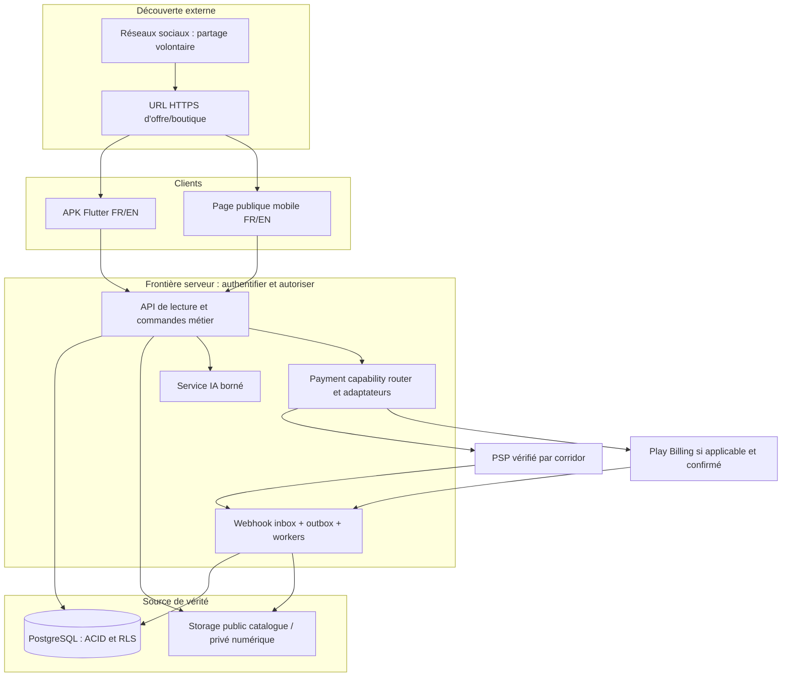
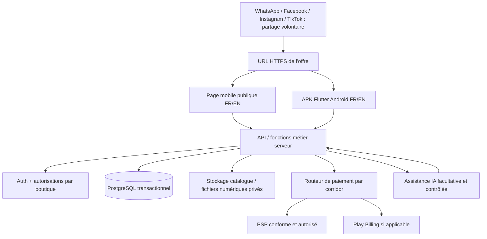

# SPÉCIFICATION MAÎTRE COMPLÈTE — D01 + D02 V2 MERCHANT-OWNED COMMERCE NETWORK

**Compilation : 28 septembre 2026.** Les sections suivantes reproduisent les documents actifs V2 dans leur ordre de préséance. Les sources V1.1 restent historiques et ne priment pas.


---

# PARTIE — 00_LIRE_EN_PREMIER.md

# 00 — LIRE EN PREMIER : D01 + D02 V2 MERCHANT-OWNED COMMERCE NETWORK

**Date : 28 septembre 2026**  
**Statut : dossier de référence pour la prochaine implémentation.**  
**Remplace comme source active :** `AI_Foundry_D01_D02_FINAL_HANDOFF_V1_1_AVEC_ADMIN.zip`. V1.1 est conservé sous `07_SOURCES_HISTORIQUES/HANDOFF_V1_1_COMPLET`.

## Ce qui a changé

Nous conservons la marketplace intelligente D01+D02 et l'administration complète, mais nous changeons le modèle de responsabilité : **chaque boutique reste propriétaire de ses ventes, paiements et fulfillment**. La plateforme fournit marketplace, demand network, OS commercial, plans SaaS, sécurité, modération, analytics et intégrations.

Le dossier incorpore :
- audit Take App/Bumpa ;
- modèle merchant-owned payments ;
- plans SaaS Basic/Business/Enterprise + add-ons à tester ;
- Play Billing in-app vs web Mobile Money ;
- custom domains et nouvelles opportunités produit ;
- WhatsApp Business réouvert comme extension ;
- corrections documentaires signalées par Codex ;
- QA Android faible puissance/réseau lent.

## Ordre de lecture obligatoire

1. `00_DECISIONS_FONDATEUR_V2.md`
2. `01_IDEATION/Analyse_D01_D02_V1_0_Merchant_Owned_Network.md`
3. `01_RECHERCHE/Audit_Take_App_Bumpa_vs_D01_D02_V1_0.md`
4. `01_RECHERCHE/Registre_Codex_Corrections_V2.md`
5. `02_PRD/PRD_Construction_V0_7_Merchant_Owned.md`
6. `03_ARCHITECTURE/Architecture_Construction_V0_5_Merchant_Owned.md`
7. `03B_ADMINISTRATION/ADMIN_PANEL_PRD_ARCHITECTURE_UX_V1_1_Merchant_Owned.md`
8. `04_UX_UI/Design_System_Premium_V1_2.md`
9. `04_UX_UI/UX_UI_Specification_Finale_V1_2.md`
10. `05_CONSTRUCTION/Backlog_Final_V1_2.md`
11. `05_CONSTRUCTION/Plan_Tests_Et_Portes_V1_2.md`
12. `06_TRACABILITE/Decisions_Et_Audit_Croise_V2.md`

## Règles de construction

- Ne pas reconstruire un split-payment marketplace ou un escrow par habitude.
- Ne pas supprimer D02 ou réduire le produit à inventaire/catalogue.
- Ne pas considérer Take App comme template UI à copier.
- Ne pas considérer tous ses modules comme scope immédiat ; utiliser la matrice opportunités.
- Ne pas exposer secrets PSP dans APK/web client.
- Ne pas diriger depuis l'APK Play Bénin vers un checkout externe de plan SaaS sans programme autorisé.
- Ne pas marquer `paid` sans source de vérification explicite.
- Ne pas traiter vendeur vérifié comme produit authentique garanti.
- Ne pas prétendre qu'un fichier documenté est déjà implémenté/testé.

## Prototypes

Les HTML V1 sous `04_UX_UI/*_V1_REFERENCE.html` et `03B_ADMINISTRATION/*_V1_REFERENCE.html` restent des références visuelles historiques. La spécification V2 prime pour les nouveaux écrans et flows.


---

# PARTIE — 00_DECISIONS_FONDATEUR_V2.md

# REGISTRE DES DÉCISIONS FONDATEUR — D01 + D02 V2

**Version : 2.0 — 28 septembre 2026**  
**Statut :** source normative de décision commerciale/produit pour la révision V2. En cas de contradiction avec V1.1, ce registre prime.

## D-V2-001 — Vision conservée
D01+D02 reste une **marketplace intelligente et dynamique + environnement commercial vendeur**. Elle n'est pas réduite à un inventaire ou une vitrine.

## D-V2-002 — Modèle structurel
La plateforme devient un **réseau de boutiques autonomes** reliées par un marketplace/demand network commun.

## D-V2-003 — Marketplace D02 conservée
Recherche globale, découverte, comparaison, besoin non satisfait, matching, propositions et choix du vendeur restent centraux.

## D-V2-004 — Merchant Commerce OS
Chaque commerçant possède boutique, catalogue, stock, commandes, clients, paiement, fulfillment et équipe selon son plan.

## D-V2-005 — Seller of Record / vendeur commercial
Par défaut, le commerçant est la partie vendeuse de ses produits. Notre plateforme fournit le logiciel, la découverte et l'orchestration. Le wording légal final doit être validé par marché ; ne pas copier les CGU Take App.

## D-V2-006 — Merchant-Owned Payments
Chaque boutique connecte **ses propres moyens/prestataires de paiement** lorsqu'un connecteur approuvé existe. Les fonds sont réglés au commerçant selon son contrat PSP ; notre plateforme ne détient pas les fonds par défaut.

## D-V2-007 — Pas d'escrow/custody par défaut
Pas de wallet vendeur obligatoire, pas de conservation d'argent jusqu'à livraison, pas de split/reversement opéré par notre société sans future décision, contrat et cadre appropriés.

## D-V2-008 — Paiements manuels
Mobile Money direct, banque, cash on delivery/retrait et méthodes locales peuvent être proposés par la boutique. `confirmé_par_vendeur` reste distinct de `confirmé_par_PSP`.

## D-V2-009 — Multi-vendeur
Un panier logique multi-vendeur est scindé en commandes et paiements propres à chaque boutique. Aucune agrégation financière par défaut.

## D-V2-010 — Fulfillment/logistique
Le vendeur choisit et exécute retrait, livraison propre ou coursier. La plateforme outille frais, adresse, créneaux, tracking et statuts mais ne se présente pas comme transporteur par défaut.

## D-V2-011 — Confiance/authenticité
Vérification vendeur/entreprise/document ≠ garantie universelle d'authenticité. Les badges doivent préciser leur périmètre. Signalements, avis, historique, taux d'annulation et contrôles de catégorie complètent la confiance.

## D-V2-012 — Modèle économique principal
Hypothèse principale : **SaaS freemium + plan(s) payant(s) + add-ons**, inspiré du mécanisme Take App, sans commission obligatoire sur les ventes.

### Structure de travail à tester
- **Basic / Free :** vraie boutique, catalogue, fonctions essentielles, paiement manuel/local et quota raisonnable de commandes enregistrées.
- **Business :** commandes étendues/illimitées, paiement automatisé connecté, domaine personnalisé, analytics, automatisations, équipe/multi-store selon limites.
- **Enterprise :** besoins réseau/chaîne/white-label/custom/API et accompagnement selon contrat.
- **Add-ons :** boutiques, collaborateurs, messages, emails, IA, stockage ou consommations coûteuses.

Les noms, quotas et prix sont **à tester localement** ; ne pas copier 50 USD ou les seuils Take App sans validation.

## D-V2-013 — Abonnement SaaS dans l'APK Google Play
Lorsque l'achat du plan numérique est initié dans l'APK Play pour un utilisateur dans un marché non éligible à une alternative, utiliser Google Play Billing selon la politique courante.

## D-V2-014 — Abonnement SaaS sur le Web
Le site de la plateforme peut vendre les plans avec Mobile Money/carte/moyens locaux. Le même compte reçoit les entitlements et l'APK reconnaît le plan déjà acquis.

## D-V2-015 — Pas de steering interdit depuis l'APK
Au Bénin, tant qu'aucun programme Play applicable ne l'autorise, ne pas mettre dans l'APK un bouton/webview/CTA conduisant au checkout externe du plan numérique. Marketing externe (web, email, social, etc.) peut diriger vers le checkout web selon les règles applicables.

## D-V2-016 — Réseaux sociaux
Le partage natif de liens produit/boutique reste essentiel. Les API sociales ne sont pas une dépendance de départ, mais **WhatsApp Business officiel, inbox, workflows, broadcast et catalog sync sont réouverts comme extensions stratégiques** à étudier.

## D-V2-017 — Marchés nationaux
Une seule plateforme technique, mais marchés configurés par pays : devise, PSP, catégories, règles, vendeurs, acheteurs, fulfillment. Bénin = premier marché commercial visé. Le commerce transfrontalier n'est pas activé automatiquement.

## D-V2-018 — Physique et numérique
Les deux restent dans la plateforme ; leurs obligations de paiement, livraison/droit d'accès, remboursement et Play sont distinctes.

## D-V2-019 — Administration complète
Le panel admin complet est maintenu. Il gouverne pays, PSP/connecteurs, marchands, plans, quotas, add-ons, modération, intégrations, incidents, sécurité et audits.

## D-V2-020 — Direction premium
FR/EN, système/clair/sombre et direction premium restent confirmés. QA obligatoire sur Android modestes, faible connexion et workflows vendeurs rapides.

## D-V2-021 — Take App comme benchmark, pas copie
Toutes les capacités Take App identifiées sont des **opportunités à évaluer** : domaine custom, SEO, CRM, fidélité, POS, multi-store, staff, automatisations, API/webhooks, intégrations, booking, subscriptions, digital, B2B, etc. Elles ne deviennent pas automatiquement obligatoires dans le premier lot.

## D-V2-022 — Codex conservé
Les incohérences et recommandations pertinentes de Codex sont intégrées à la révision ; ses suggestions de réduction qui contredisent la vision fondateur ne sont pas adoptées.

## D-V2-023 — Pas de modification répétitive
Cette V2 consolide les décisions ci-dessus en une passe cohérente. Toute future V2.x doit documenter son delta et ne pas réouvrir silencieusement les décisions confirmées.


---

# PARTIE — 01_IDEATION/Analyse_D01_D02_V1_0_Merchant_Owned_Network.md

# D01 + D02 — CONCEPT PRODUIT V2 : MERCHANT-OWNED COMMERCE NETWORK

**Version conceptuelle : 1.0 — 28 septembre 2026**  
**Base historique :** Analyse D01+D02 v0.9 préservée sans modification.  
**Motif de transition :** réduire les responsabilités financières/logistiques de la plateforme sans perdre la marketplace ni le réseau offre-demande.

## 1. Définition

Une plateforme de commerce intelligente qui combine :

1. **un Merchant Commerce OS** pour que chaque commerçant exploite sa boutique, son catalogue, son stock, ses commandes, ses clients et ses canaux ;
2. **un Demand Network** où les acheteurs découvrent, recherchent, comparent et publient leurs besoins ;
3. **une couche SaaS plateforme** qui orchestre découverte, matching, plans, sécurité, administration, marchés, analytics et intégrations.

La transaction commerciale appartient par défaut à la boutique choisie. La plateforme peut afficher et vérifier des statuts provenant des systèmes connectés sans détenir les fonds ni exécuter la livraison elle-même.

## 2. Proposition de valeur

### Acheteur
- trouver un produit précis dans son marché ;
- ouvrir une boutique fiable à partir d'un lien social ;
- comparer des vendeurs ;
- publier un besoin quand le catalogue ne suffit pas ;
- recevoir plusieurs propositions ;
- commander et payer via les moyens de paiement du vendeur ;
- suivre l'exécution de la commande.

### Commerçant
- gérer produits, stock, commandes, ventes externes et clients ;
- partager des fiches qui restent à jour ;
- disposer d'une boutique web/mobile premium ;
- connecter ses propres moyens de paiement ;
- proposer ses règles de retrait/livraison ;
- accéder à des demandes d'acheteurs pertinentes ;
- convertir une proposition en commande de sa boutique ;
- utiliser CRM, analytics, automatisations et intégrations selon son plan.

### Plateforme
- vendre un logiciel et des capacités SaaS ;
- attirer la demande et faciliter la découverte ;
- protéger l'intégrité du réseau ;
- ne pas confondre orchestration commerciale et détention des fonds.

## 3. Différenciation

**Take App-like merchant autonomy + D02 demand marketplace.**

Le vendeur peut obtenir de la valeur sans trafic marketplace ; l'acheteur peut découvrir des vendeurs sans les connaître auparavant. Si l'offre n'existe pas, la demande peut faire émerger l'offre. Cette boucle demande → proposition → commande de boutique est le mécanisme le plus différenciant à valider.

## 4. Parcours principal — offre trouvée

Acheteur → recherche/partage → fiche d'offre → boutique du vendeur → panier vendeur → checkout vendeur → moyen PSP/manual du vendeur → confirmation technique/déclaration → fulfillment vendeur → suivi.

## 5. Parcours distinctif — demande

Acheteur → besoin structuré → matching → propositions → comparaison → choix du vendeur → création de commande dans sa boutique → checkout de cette boutique → fulfillment.

## 6. Parcours vendeur hors marketplace

Vente physique/sociale → vendeur saisit/POS → stock mis à jour → client/historique → rapport séparant origine interne/externe. La plateforme reste utile même lorsque l'acquisition vient de Facebook, WhatsApp, boutique physique ou autre canal.

## 7. Trust layer

La marketplace publique nécessite plus que les boutiques autonomes :
- vérification de l'identité/entreprise selon marché ;
- badges à périmètre explicite ;
- avis et historique ;
- taux d'annulation/fulfillment factuels ;
- signalement et modération ;
- catégories à risque sous règles spécifiques ;
- preuve de livraison ou tracking si utilisé ;
- politiques vendeur visibles.

Pas de garantie d'authenticité universelle sans procédure et preuve correspondantes.

## 8. Expansion fonctionnelle inspirée de Take App

Le socle doit rester extensible vers : custom domains, SEO, multi-store, staff, CRM, fidélité, POS, wholesale, digital, booking/subscriptions, WhatsApp Business, workflows, API/webhooks, integrations et analytics. Ces fonctions sont évaluées dans l'audit concurrentiel ; elles ne sont pas toutes un prérequis au premier build.

## 9. Modèle économique

SaaS freemium/Business/Enterprise + add-ons. Les paiements de produits ne constituent pas automatiquement un revenu plateforme. Le vendeur paie pour la puissance du logiciel, les capacités avancées et les consommations.

## 10. Marchés

Bénin d'abord commercialement ; architecture multi-marché. Chaque pays active ses PSP, catégories, devises et règles. Un utilisateur peut appartenir à un compte global mais opérer dans un marché explicitement choisi. Le transfrontalier reste une capacité future conditionnelle.

## 11. Ce que V2 retire par défaut

- custody de fonds marchands ;
- escrow géré par la plateforme ;
- split payout multi-vendeur ;
- flotte/logistique propriétaire ;
- responsabilité implicite d'authenticité de tous les biens ;
- commission obligatoire par vente.

Ces capacités pourraient exister un jour uniquement comme modules séparés avec partenaires et cadre adaptés ; elles ne sont plus une hypothèse de fonctionnement de base.


---

# PARTIE — 01_RECHERCHE/Audit_Take_App_Bumpa_vs_D01_D02_V1_0.md

# AUDIT STRATÉGIQUE — TAKE APP, BUMPA ET TRANSITION D01 + D02

**Version : 1.0 — 28 septembre 2026**  
**Statut :** recherche comparative servant d'entrée normative aux décisions V2 ; les faits de concurrents sont datés et doivent être revalidés avant implémentation commerciale.  
**Règle :** s'inspirer des mécanismes, ne copier ni marque, ni UI, ni textes, ni promesses commerciales.

## 1. Pourquoi cet audit existe

Le blocage principal de D01+D02 n'était pas la difficulté du code mais l'hypothèse implicite selon laquelle une marketplace devait recevoir les fonds des acheteurs, les répartir aux vendeurs, éventuellement les séquestrer jusqu'à livraison et intervenir dans la logistique. Cela augmentait fortement les obligations opérationnelles, financières et de support.

Take App fournit un modèle alternatif : le logiciel structure boutique, catalogue, commande, paiement, livraison et relation client, tandis que le commerçant reste le vendeur et connecte ses propres moyens de paiement. Notre adaptation conserve en plus le réseau D02 : recherche multi-vendeurs, besoins non satisfaits, matching, propositions et comparaison.

## 2. Take App — faits officiels pertinents (revue 28/09/2026)

### Positionnement et responsabilités
- Take App est un logiciel de commerce orienté WhatsApp et boutiques web.
- Ses Conditions indiquent que le Store Owner est le vendeur de ses articles et reste responsable du contenu, du fulfillment et des transactions de sa boutique.
- Take App documente aussi des scénarios de plateforme et de marketplace multi-vendeur dans son offre Build/Platform API.

### Tarification officielle actuelle
- **Basic : 0 USD** ; 50 commandes/mois conservées dans le dashboard ; produits illimités ; 0 % commission ; paiements locaux.
- **Business : 50 USD/mois** après une promotion premier mois au moment de la revue ; commandes illimitées, paiements carte, automatisations WhatsApp, domaine personnalisé, suppression du branding, plusieurs boutiques/collaborateurs.
- **Enterprise :** tarification sur devis / custom build.
- Add-ons pour certaines consommations et capacités supplémentaires.

Les anciennes sources tierces montrant Premium 14 USD / Business 38 USD sont historisées comme **tarification obsolète** et ne doivent pas guider nos prix.

### Paiement
- Le commerçant peut connecter son propre compte auprès de passerelles prises en charge.
- Take App indique ne pas prendre de commission sur les commandes ; les PSP facturent leurs propres frais.
- Les paiements automatiques peuvent mettre à jour le statut de paiement automatiquement ; les méthodes manuelles restent distinguées.
- Leur catalogue d'intégrations indique actuellement de nombreuses passerelles, dont Paystack, Flutterwave, CinetPay, MTN MoMo et PawaPay selon disponibilité.

### Fonctionnalités majeures repérées
**Storefront / web :** boutique mobile, recherche, filtres, catégories, pages, bannières, domaine personnalisé, email de domaine, SEO, image de partage, analytics/pixels, répertoire public optionnel.  
**Produits :** variantes, options/add-ons, coût, stock/SKU, alertes, numérique, booking, abonnement, précommande, CSV/bulk edit, upsell, wishlist, avis, remises/bundles.  
**Commandes :** panier/checkout, champs personnalisés, brouillons, édition/duplication, statuts séparés order/payment/fulfillment, factures, payment links, notes, staff assignment, tracking, PDF/impression, QR ordering/réservations.  
**Paiements :** automatisés, locaux/manuels, preuve de paiement, COD, acompte, pay-later, payment recovery.  
**Livraison :** retrait, livraison marchand, frais zone/distance/poids/code postal, créneaux, capacité, preuve de livraison, suivi, couriers externes.  
**CRM :** profils, tags, imports/exports, membership, rewards/store credit, referrals, accès membres, wholesale pricing.  
**WhatsApp/Instagram :** inbox partagé, broadcasts, workflows, notifications, catalogue WhatsApp, Instagram comments, chatbot IA.  
**POS / omnicanal :** ventes physiques, méthodes cash/QR/link, commandes catalogue, impression Bluetooth, switch multi-store.  
**Intégrations :** API, webhooks signés, Zapier, MCP, Shopify, Wix, WooCommerce, Loyverse, Google Merchant/Instagram Shopping.  
**Analytics :** ventes, traffic, exports, receivables, daily closing.

## 3. Bumpa — pourquoi le benchmark reste utile

Bumpa est pertinent comme benchmark africain pour inventaire, commandes, POS, clients, site marchand, paiements, analytics et opérations de petites entreprises. Il prouve qu'un SaaS commerce africain peut exister face à des acteurs globaux. Toutefois, certaines documentations de Bumpa décrivent des flux où les fonds sont d'abord reçus par Bumpa puis remitted au commerçant. Pour notre objectif précis de **ne pas détenir les fonds des ventes**, Take App est un modèle opérationnel plus proche.

## 4. Ce que D01+D02 faisait déjà mieux ou différemment

- Marketplace de découverte multi-vendeur.
- Recherche multicritère et comparaison.
- Recherche infructueuse → demande structurée.
- Matching besoins → vendeurs pertinents.
- Plusieurs propositions à une même demande.
- Continuité demande → proposition → commande.
- Vente extérieure et stock commun avec activité physique/sociale.
- Fournisseurs et approvisionnement B2B plus structurés.
- Panel admin central complet.
- Marchés nationaux configurables.
- Bilingue FR/EN et thèmes clair/sombre dès la conception.

## 5. Matrice de transition

| Domaine | Take App | D01+D02 V1.1 | Décision V2 |
|---|---|---|---|
| Boutique autonome | Fort | Oui | Renforcer |
| Catalogue/stock | Fort | Fort | Conserver |
| Paiement | Compte PSP marchand | Trop orienté marketplace/corridor | Merchant-owned payments |
| Fonds plateforme | Pas de custody par défaut | Possibilité de payout/escrow étudiée | Exclu par défaut |
| Livraison | Merchant-led | Suivi potentiellement trop central | Merchant-led, plateforme outille |
| Commission | 0 % Take App | Option envisagée | Pas obligatoire ; SaaS prioritaire |
| Abonnement | Cœur du revenu | Hypothèse secondaire | Hypothèse principale |
| Domaine custom/SEO | Oui | Sous-spécifié | Ajouter |
| WhatsApp officiel | Très fort | API sociale exclue au départ | Réouvrir comme extension stratégique |
| POS | Oui | Vente externe | Renforcer en POS léger |
| CRM/fidélité | Oui | Partiel | Renforcer |
| API/webhooks | Oui | Architecture prévue | Renforcer |
| Marketplace découverte | Secondaire/variable | Cœur | Garder |
| Demandes/propositions | Pas cœur | Distinctif | Garder absolument |
| Admin central | Différent | Très fort | Garder |

## 6. Opportunités fonctionnelles à explorer — backlog produit, pas scope obligatoire immédiat

### Storefront / marque
- custom domain ;
- emails de domaine ;
- pages et navigation personnalisées ;
- SEO, meta tags, social sharing image ;
- pixels/analytics avec consentement ;
- brand removal selon plan ;
- annuaire public opt-in.

### Commerce
- variantes/options/add-ons ;
- catalog import/export CSV ;
- digital products ;
- booking/rental/subscription/preorder comme types extensibles ;
- bundles/discounts/upsell/wishlist/reviews ;
- wholesale pricing et accès groupes clients.

### Commandes et opérations
- draft order ;
- factures et payment links ;
- notes internes/fichiers ;
- staff assignment ;
- order/payment/fulfillment séparés ;
- impression/packing list ;
- QR/POS ;
- multi-store.

### Customer OS
- profils, tags, historique ;
- fidélité/rewards/referrals ;
- segmentation ;
- consentements de contact ;
- store access réservé/membres.

### Communication
- WhatsApp Business officiel ;
- inbox d'équipe ;
- workflows ;
- broadcasts ;
- catalog sync ;
- Instagram intégration si pertinente ;
- chatbot/IA avec handoff humain.

### Platform / developers
- API ;
- webhooks signés et idempotents ;
- Zapier/automation ;
- connecteurs e-commerce/POS ;
- MCP/agent tools à évaluer plus tard.

## 7. Différenciation candidate de notre V2

**Merchant Commerce OS + Demand Network.**

Le vendeur obtient un système commercial autonome utile même sans trafic marketplace. L'acheteur peut entrer par un lien direct, chercher à l'échelle du marché ou publier un besoin. Lorsqu'une demande trouve un vendeur, elle devient une commande de la boutique sélectionnée. Le paiement et le fulfillment restent sous la responsabilité commerciale de cette boutique, tout en étant suivis par notre logiciel.

## 8. Sources officielles à revalider

Take App :
- https://www.take.app/
- https://www.take.app/pricing
- https://www.take.app/terms
- https://www.take.app/build
- https://www.take.app/integrations
- https://www.take.app/help/category/products
- https://www.take.app/help/category/orders
- https://www.take.app/help/category/delivery
- https://www.take.app/help/category/customers
- https://www.take.app/help/category/whatsapp-business
- https://www.take.app/help/category/website
- https://www.take.app/help/category/analytics
- https://www.take.app/help/category/mobile-pos-app

Google Play :
- https://support.google.com/googleplay/android-developer/answer/9858738
- https://support.google.com/googleplay/android-developer/answer/10281818
- https://support.google.com/googleplay/answer/11174377

**Attention :** les fonctionnalités, prix, pays et règles changent ; ne jamais hardcoder une promesse commerciale parce qu'elle apparaît dans cet audit daté.


---

# PARTIE — 01_RECHERCHE/Registre_Codex_Corrections_V2.md

# REGISTRE CODEX — CONSTATS À CONSERVER ET CORRECTIONS V2

**Version : 1.0 — 28 septembre 2026**  
**Source :** évaluation Codex fournie par le fondateur le 27 septembre 2026.  
**Principe :** Codex est une revue externe utile, pas une autorité produit. Les réductions de vision non approuvées par le fondateur ne sont pas adoptées.

## A. Points retenus

1. **Vision complète ≠ ordre de construction.** Le dossier V1.1 décrivait un écosystème très large. V2 conserve la vision mais impose un ordre de réalisation et des portes de validation.
2. **Client et marché d'entrée à préciser.** Le fondateur a depuis clarifié : Bénin comme premier marché commercial, vendeurs/commerçants et acheteurs, particulièrement ceux utilisant réseaux sociaux et canaux informels ; extension pays par pays avec isolation de marché.
3. **Valeur vendeur indépendante du trafic marketplace.** Catalogue, stock, ventes physiques/sociales, commandes, CRM et boutique autonome doivent créer une utilité directe.
4. **Physique et numérique séparés opérationnellement.** Ils restent dans la même plateforme mais ne partagent pas les mêmes obligations de paiement/fulfillment.
5. **Modèle économique.** V2 retient comme hypothèse principale un SaaS freemium/paid/add-ons inspiré de Take App ; prix locaux non fixés.
6. **Design à tester sur vrai Android, faible réseau et usage pressé.** Le premium visuel demeure, mais vitesse, densité, contraste, gros tap targets et performance priment.
7. **Validation terrain.** Adoption réelle et retour volontaire doivent être mesurés ; une intention en entretien ne suffit pas.
8. **Références documentaires incohérentes.** Corriger les liens PRD/Architecture/UX/Backlog qui pointaient vers d'anciennes versions.

## B. Points non adoptés comme réduction produit

- Réduire D01+D02 à un simple outil de stock/catalogue : **REFUSÉ**.
- Supprimer l'administration complète : **REFUSÉ** ; l'administration reste centrale, mais son implémentation suit les fonctions activées.
- Supprimer l'acheteur, les demandes ou la marketplace D02 : **REFUSÉ**.
- Considérer les paiements intégrés comme forcément gérés par la plateforme : **REMPLACÉ** par merchant-owned payments.

## C. Anomalies documentaires vérifiées dans V1.1 et corrigées en V2

- `PRD_Construction_V0_6.md` ligne historique ~802 pointait vers `UX_UI_Specification_Finale_V1_0.md` et `Backlog_Final_V1_0.md` alors que V1.1 existait.
- `Backlog_Final_V1_1.md` ligne historique ~161 demandait encore de lire PRD v0.5, Architecture v0.3 et UX v1.0.
- `Architecture_Construction_V0_4.md` ligne historique ~12 se décrivait encore comme « cette v0.2 ».

V2 remplace ces références dans les documents actifs. Les anciennes versions restent dans `07_SOURCES_HISTORIQUES/HANDOFF_V1_1_COMPLET` comme preuve d'historique seulement.

## D. Questions toujours à prouver, pas à inventer

- volonté de payer et prix par marché ;
- fournisseurs de paiement réellement connectables par commerçant ;
- parcours KYC et responsabilité contractuelle des PSP ;
- taux de conversion des besoins acheteurs ;
- comportement de stock et ventes externes ;
- performance offline/low bandwidth ;
- catégories prioritaires au lancement ;
- conformité et canaux des produits numériques ;
- règles locales de marketplace/intermédiation et protection consommateur.


---

# PARTIE — 02_PRD/PRD_Construction_V0_7_Merchant_Owned.md

> **CORRECTION CRITIQUE DU HANDOFF — ADMINISTRATION (25 septembre 2026)** : à la demande explicite du fondateur, l’administration de la plateforme est un **domaine central** et non trois vues génériques. Lire **`03B_ADMINISTRATION/ADMIN_PANEL_PRD_ARCHITECTURE_UX_V1_0.md`** avant toute conception des permissions, des paiements, des rôles, des modules ou de la mise en production. Cette extension comprend **50 exigences ADMIN-FR, 18 vues admin, 17 tickets et 20 tests**. Elle est normative pour la construction, avec portes financières/contractuelles toujours ouvertes. Les références anciennes à O01–O03 sont conservées comme couverture historique *insuffisante*, non comme limite du panel. Le prototype admin est une **simulation navigateur**, pas un service déployé.

# PRD — Plateforme de commerce actif D01 + D02

**Product Requirements Document — dossier de spécification fonctionnelle initiale**  
**Version :** 0.7 — révision Merchant-Owned Commerce Network ; administration complète conservée ; paiements marchands autonomes, SaaS plans, marchés nationaux et opportunités Take App intégrés  
**Date :** 28 septembre 2026  
**Produit :** nom de marque non décidé ; « plateforme de commerce actif » = expression de travail, non identité finale  
**Support principal :** application Android native / véritable APK, avec éventuels points d'entrée web mobile vers des offres partageables  
**Source de vérité conceptuelle :** `AI_Foundry_D01_D02_Analyse_Commerce_Achat_Vente_V0_9.md` (annexes L, M, N ; corrections des annexes D et K)  
**Statut :** PRD de référence pour la construction, sous réserve des portes explicitement bloquantes. Annexes A (revue), B (FR/EN confirmé) et C (quatre arbitrages conçus par l’assistant à la demande du fondateur). Les solutions de C sont des **options de conception retenues pour préparer l’architecture**, pas des contrats de prestataires ni des décisions commerciales attribuées sans preuve au fondateur.

> **Décision fondateur du 25 septembre 2026 — FR/EN obligatoire :** l’application doit fonctionner en **français et en anglais** pour les parcours essentiels acheteur, vendeur et plateforme ; les deux langues sont requises dès le fonctionnement du produit, indépendamment du premier marché de commercialisation. Cette décision remplace les mentions anciennes « candidats à validation » / « ordre à confirmer ». Voir l’**annexe B** ; tous les autres arbitrages du PRD gardent leur statut.

> **Mise à jour de travail v0.4 — 25 septembre 2026 :** l’assistant prend en charge les quatre sujets qui restaient à concevoir (IA utile, porte d’entrée web, séparation des flux, paiement international/numérique), conformément à la demande d’avancer sans attendre des micro-validations. L’**annexe C fait autorité pour ces quatre points** ; les options anciennes qui semblent contraires sont des historiques. Les garanties de pays/PSP/Play ne sont pas déclarées acquises.

> **Mise à jour finale documentaire v0.5 — approuvé après le PRD v0.4 :** FR/EN obligatoires ; modes système/clair/sombre obligatoires ; direction premium approuvée ; Cursor n’est pas l’IDE choisi ni une dépendance. Les anciennes options dans les annexes historiques n’ont aucune préséance sur l’annexe D, le design system et l’architecture finale du présent pack. Le modèle économique, le PSP, les pays actifs et les preuves terrain restent non validés.

> **Mode de lecture :** **C** = orientation explicitement confirmée par le fondateur ; **S** = spécification proposée sur la base du concept consolidé, à accepter/corriger ; **X** = exclusion actuelle explicitement confirmée ; **B** = décision, faisabilité ou conformité bloquante pour *l'activation en production du flux concerné* ; **T** = hypothèse commerciale à tester avec de vrais utilisateurs. « Bloquant pour un flux » ne signifie pas « abandonner le produit ». Les exemples, seuils, délais, rôles juridiques, tarifs et fournisseurs non explicitement acceptés restent des propositions ou des paramètres.

---

## 0. Résumé exécutable

### 0.1. Définition du produit

Une plateforme commerciale commune où :

- l'acheteur cherche une offre existante **ou exprime un besoin** qui peut recevoir des propositions ;
- le commerçant gère sa boutique et ses ventes, y compris les opérations réalisées hors marketplace, et répond aux demandes pertinentes ;
- un même compte peut acheter, vendre et s'approvisionner ; un fournisseur est un vendeur dans une relation commerciale distincte ;
- les produits physiques et numériques disposent d'exigences d'exécution adaptées ;
- la fiche commerciale peut circuler sur les réseaux sociaux par **partage volontaire et lien direct**, sans connexion aux API sociales ;
- besoins, offres, propositions, commandes, paiements et résultats sont reliés, sans fusionner leurs états ni déposséder l'utilisateur des décisions engageantes.

**Promesse fonctionnelle proposée [S] :** permettre à une situation commerciale de progresser du besoin à son résultat, en limitant les ressaisies, l'incertitude et les opérations perdues entre les outils.

### 0.2. Ce qui est acquis / ce qui ne l'est pas

| Sujet | Statut | Règle pour le PRD |
|---|---|---|
| Étudier D01 et D02 ensemble ; D03 reste de côté | C | Ne pas réintroduire le programme de marketing D03 comme obligation cachée. |
| Vision complète, pas une « V1 coquille vide » | C | Décrire le système entier ; les lots de développement seront des **séquences de dépendances**, non une réduction silencieuse de la vision. |
| Android natif comme produit principal | C | Ne pas remplacer l'APK par une application web. |
| **Fonctionnement bilingue FR + EN** | **C** | Deux langues effectives et complètes dans les parcours essentiels, pas un simple modèle i18n préparatoire. |
| Produits physiques **et** numériques ; ambition internationale | C | Les deux sont modélisés dès le départ ; couverture transactionnelle à ouvrir selon vérifications pays/produit. |
| Marketplace ouverte à la découverte via réseaux sociaux | C | Partages et destinations claires. |
| Affiliation rémunérée à liens/codes/commissions | X | Ne pas créer de rôle « affilié », rémunération, ledger de commissions ou dashboard promoteur. |
| Connexions API sociales WhatsApp/Facebook/Instagram/TikTok | X | Aucun accès aux comptes/messages/publications des réseaux tiers ; partage OS volontaire seulement. |
| Réseau social généraliste ou régie publicitaire intégrée | X | Ne pas inférer ces fonctionnalités de la métaphore des « mondes ». |
| Prix, commissions, abonnements, pays de vente, prestataires de paiement | B/T | Prévoir la configuration ; ne rien présenter comme fixé/validé. |
| Architecture détaillée, framework, prestataires d'IA | Étape 4 | Le PRD énonce les contraintes et contrats fonctionnels, pas une stack arbitrairement imposée. |

### 0.3. Critères de réussite produits, à mesurer, non encore démontrés

1. Un vendeur publie une offre exploitable et peut enregistrer une vente extérieure sans double gestion contradictoire du stock.
2. Un acheteur découvre une offre partagée et retrouve **l'offre précise et à jour**, pas la page d'accueil générique.
3. Une recherche sans correspondance peut devenir une demande ; une réponse pertinente peut devenir une proposition, puis une commande sans perte des conditions acceptées.
4. Une réservation concurrente ne permet pas de promettre deux fois une quantité unique.
5. Paiement, exécution et résolution d'incident sont distincts et vérifiables ; un vendeur ne peut pas « prouver » le paiement par une capture seule.
6. Un produit numérique acheté conformément au canal autorisé donne lieu à un droit d'accès identifiable ; un échec de téléchargement ne supprime pas le droit.
7. Un vendeur comprend quelles actions exigent son attention et pourquoi, sans achats, promotions ou modifications de prix automatiques non autorisées.

---

## 1. Problèmes, publics et emplois à accomplir

### 1.1. Problèmes investigués — hypothèses à confronter au terrain

- Les informations de produit, stock, conversation, commande et caisse peuvent être dispersées ; leur rapprochement demande des ressaisies.
- Le catalogue seul ne répond pas aux besoins pour lesquels aucun vendeur n'a publié d'offre correspondante.
- Une disponibilité affichée peut être périmée, notamment si le vendeur traite aussi des ventes physiques.
- Une transaction engagée peut mal se poursuivre en cas de fournisseur défaillant, réservation concurrente, preuve de paiement insuffisante, colis non livré ou fichier numérique inaccessible.
- Un vendeur peut partager une offre dans ses réseaux existants, mais le destinataire doit ensuite pouvoir retrouver les conditions commerciales actuelles.

**Important :** l'Atlas qualifie les frictions comme potentielles. Ni leur fréquence, ni la volonté de payer, ni la rentabilité ne sont déjà prouvées.

### 1.2. Acteurs et rôles

| Rôle métier | Travaux attendus | Visibilité et responsabilités proposées |
|---|---|---|
| Visiteur | Découvrir une offre partagée, rechercher et comprendre les conditions | Contenu public seulement ; actes engageants selon authentification requise. |
| Acheteur | Chercher, demander, comparer, accepter, payer si disponible, recevoir, signaler | Accès à ses demandes/achats ; contrôle de ses coordonnées et préférences. |
| Commerçant/vendeur | Boutique, produits, prix, stock, ventes physiques et marketplace, commandes, fournisseurs, SAV | Accès uniquement à ses données commerciales et transactions autorisées. |
| Fournisseur | Répondre à un commerçant dans une relation d'approvisionnement | Les prix B2B et informations du client final ne sont pas publics par défaut. |
| Créateur numérique | Mettre en vente fichiers ou contenus, fournir accès/licence selon conditions | Déclare les droits sur ses produits ; gère l'exécution numérique autorisée. |
| Collaborateur vendeur [S] | Contribuer à une boutique selon permissions | Rôles granulaires : catalogue, caisse, commande, stock, support. |
| Opérateur plateforme [S] | Vérification proportionnée, catégories, litiges, modération, paramètres pays, support | Accès traçable et minimal ; ne pas agir comme vendeur réel par simple effet de l'interface. |

Un seul compte peut exercer les rôles acheteur, vendeur et acheteur professionnel ; la boutique est une entité commerciale distincte du compte individuel. **Un promoteur affilié rémunéré n'est pas un rôle actuel.**

### 1.3. Portée géographique

Vision internationale dès le modèle de données : devise, langues, pays, adresse, catégories, droits numériques, moyens de remise et prestataires configurables. **Ne pas confondre visibilité internationale et paiement/reversement/livraison disponibles dans tous les pays.** Chaque corridor commercial sera activé après vérification des conditions pertinentes.

---

## 2. Principes produits non négociables dans l'expérience proposée

**PR-01 [S] — Continuité.** Une demande/une offre/une proposition/une commande partagent des références vérifiables ; les informations acceptées suivent le parcours sans ressaisie inutile.

**PR-02 [S] — États séparés.** Catalogue, disponibilité, proposition, commande, paiement, exécution, droit numérique et incident n'utilisent pas un seul booléen « terminé ».

**PR-03 [S] — Information actuelle.** Une publication sociale ancienne peut rester visible ailleurs ; la fiche ouverte depuis son lien montre les conditions *actuelles* et signale les changements.

**PR-04 [S] — Transparence.** Déclaré ≠ vérifié ; sur commande ≠ en stock ; paiement initié ≠ reçu ; commande payée ≠ livrée.

**PR-05 [S] — Contrôle humain.** Toute dépense, acceptation d'un accord, révision de prix, promotion, restitution financière ou transmission non nécessaire de données exige une action/autorisaton adéquate.

**PR-06 [S] — Une même activité peut avoir plusieurs origines.** Vente née sur la marketplace, vente physique, téléphone, lien social ou relation fournisseur ; conserver la provenance connue sans inventer d'attribution.

**PR-07 [S] — Physique et numérique.** Un socle commun de commande avec des obligations de fourniture distinctes ; les produits mixtes doivent pouvoir exister sans masquer leurs règles différentes.

**PR-08 [C/X] — Ouverture sociale simple.** Partage par mécanisme du téléphone et liens profonds/landing mobile envisagés ; aucune collecte de messages sociaux, publication automatique universelle ni rémunération de partage.

---

## 3. Périmètre fonctionnel et exigences testables

**Conventions :** chaque `FR-XX` est un identifiant stable. Statut `S` = proposition fonctionnelle en cours d'examen. `B` = flux à ne pas activer publiquement tant que ses dépendances ne sont pas levées. Les critères ci-dessous peuvent être raffinés lors de l'étape UX / technique sans changer l'intention métier.

### 3.1. Comptes, identité, boutique et permissions

**FR-01 [S] — Compte multi-rôle.** L'utilisateur peut être acheteur et devenir vendeur sans créer nécessairement une identité de connexion séparée. **Acceptation :** ses achats personnels et les ventes de sa boutique sont visibles dans les bons contextes et ne se mélangent pas dans les rapports de chiffre d'affaires.

**FR-02 [S] — Profil boutique.** Nom commercial, description, moyens de contact choisis, localisation générale lorsque utile, politiques de vente, devises/territoires servis selon configuration. **Acceptation :** un visiteur voit les informations publiques et le vendeur édite les informations permises.

**FR-03 [S] — Vérifications différenciées.** Le système indique ce qui est déclaré, ce qui a été vérifié et le périmètre de la vérification. **Acceptation :** un badge d'identité ne peut être interprété comme preuve automatique d'authenticité de tous les articles.

**FR-04 [S] — Collaborateurs et audit.** Une boutique peut attribuer des permissions adaptées ; les modifications critiques sont traçables. **Acceptation :** un employé non autorisé ne peut ni changer les coordonnées de paiement ni rembourser.

**FR-05 [B] — Conformité vendeur.** Les pièces, identifiants et autorisations demandés dépendent du pays, du partenaire de paiement et de la nature des ventes ; ne pas créer de procédure KYC factice ou universelle.

### 3.2. Catalogue, offres, prix et variantes

**FR-06 [S] — Produit distinct de l'offre.** Le produit décrit l'article ; l'offre décrit vendeur, état, variante, prix, stock, territoire, conditions et durée de validité. **Acceptation :** deux vendeurs d'une même référence gardent leurs prix et stocks propres.

**FR-07 [S] — Variantes.** Taille, couleur, capacité, format, licence ou autres dimensions applicables. **Acceptation :** une commande capture la variante exacte ; le stock n'est pas décrémenté sur une variante différente.

**FR-08 [S] — Catégories physiques, numériques et mixtes.** Chaque type demande ses attributs et obligations propres. **Acceptation :** un fichier numérique ne demande pas obligatoirement une adresse de livraison physique ; un article physique nécessite un mode de remise.

**FR-09 [S] — Offre complète et contrôlée.** Photos, description, prix, devise, quantité/état, frais connus, conditions, présence ou non de garantie et délais. **Acceptation :** l'utilisateur voit les restrictions ou informations manquantes avant l'engagement.

**FR-10 [S] — Version des conditions.** Une offre peut changer, mais une commande existante conserve un instantané de ce qui a été accepté. **Acceptation :** modifier aujourd'hui le prix public ne modifie pas rétroactivement le prix convenu hier.

**FR-11 [S] — État publication.** Brouillon, publiée, suspendue, expirée/archivée ; capacité d'afficher « plus disponible ». **Acceptation :** un ancien lien résout vers la fiche et indique correctement son état.

### 3.3. Stocks, réservations et ventes extérieures

**FR-12 [S] — Stock par article/variante/emplacement si pertinent.** Le vendeur peut recevoir, ajuster et compter son stock avec motif traçable. **Acceptation :** l'historique distingue réception, vente, annulation, perte et correction manuelle.

**FR-13 [S] — Disponibilité honnête.** Au moins : disponible selon stock suivi, à confirmer, sur commande, indisponible. **Acceptation :** « sur commande » ne se présente jamais comme « en stock ».

**FR-14 [S/B technique] — Réservation concurrente atomique.** Une réservation confirmée porte sur une quantité disponible réelle et bloque les consommations concurrentes incompatibles. **Acceptation :** deux acheteurs ne réservent pas simultanément le dernier exemplaire ; l'un reçoit une suite claire.

**FR-15 [S] — Expiration de réservation.** Durée et conditions explicites, paramétrables selon contexte ; libération après expiration/annulation selon les états de paiement. **Acceptation :** une réservation expirée ne bloque plus indéfiniment le stock.

**FR-16 [S] — Vente extérieure.** Le vendeur peut enregistrer une vente en boutique ou via un canal externe ; celle-ci met à jour la bonne quantité, mais n'est pas comptée à tort comme vente générée par la marketplace. **Acceptation :** les rapports séparent ventes internes, externes et provenance inconnue.

**FR-17 [S] — Réapprovisionnement.** Fiches fournisseurs, conditions/devis, commandes fournisseur et réceptions documentées ; achat fournisseur indépendant de la commande du client final. **Acceptation :** l'échec fournisseur n'efface pas l'obligation du commerçant envers son client.

### 3.4. Découverte, recherche, comparaison, demandes

**FR-18 [S] — Recherche multicritère.** Texte, catégorie, caractéristiques, localisation pertinente, prix et disponibilité. **Acceptation :** le résultat précise les critères correspondants et n'invente pas les données absentes.

**FR-19 [S] — Comparaison exploitable.** Prix et frais connus, variante, état, mode de remise, délai, vendeur et conditions. **Acceptation :** le coût final est affiché lorsqu'il est calculable et signalé « à confirmer » sinon.

**FR-20 [S] — Recherche sans offre adéquate.** L'acheteur peut créer une demande avec catégorie, caractéristiques, quantité, budget indicatif, délai, lieu de fourniture et visibilité/consentement. **Acceptation :** une recherche vide propose une suite sans imposer la publication publique du besoin.

**FR-21 [S] — Cycle de vie de la demande.** Brouillon, active, réponses reçues, satisfaite, expirée, retirée. **Acceptation :** une demande retirée n'accepte plus de nouvelles propositions sans réactivation.

**FR-22 [S] — Correspondance pertinente.** Les vendeurs voient les besoins relevant des catégories/zones/conditions qu'ils déclarent, selon consentement. **Acceptation :** les coordonnées privées ne sont pas rendues publiques pour « faire matcher » la demande.

**FR-23 [S] — Plusieurs propositions.** Une demande peut recevoir plusieurs réponses distinctes ; chaque réponse indique quantité, variante, prix, frais, disponibilité, validité et conditions. **Acceptation :** l'acceptation d'une offre n'altère pas silencieusement les offres concurrentes ; la demande et les autres propositions passent à l'état applicable selon les règles retenues.

**FR-24 [S] — Clarification du besoin.** Questions guidées et éventuelle assistance IA facultative, sans remplacer les préférences déclarées. **Acceptation :** l'utilisateur valide le besoin final avant publication.

### 3.5. Questions, négociation, proposition et accord

**FR-25 [S] — Conversation liée au contexte.** Les échanges dans la plateforme peuvent être rattachés à produit, demande, proposition ou commande. **Acceptation :** ouvrir une demande permet de retrouver son échange pertinent sans chercher dans un fil générique.

**FR-26 [S] — Proposition structurée.** Le vendeur transforme une réponse en offre explicite avec conditions et échéance. **Acceptation :** la proposition acceptée est identifiable et non réécrite unilatéralement.

**FR-27 [S] — Modification substantielle.** Changement de prix, produit, délai essentiel ou quantité après acceptation requiert accord des parties ou solution prévue aux conditions. **Acceptation :** un vendeur ne remplace pas silencieusement un ordinateur convenu par un autre.

**FR-28 [S] — Vente sur commande.** Le vendeur distingue état de stock, délai annoncé, preuve de confirmation fournisseur et incertitudes ; le client voit les conditions avant acceptation. **Acceptation :** une simple intention d'achat fournisseur n'est pas affichée comme une disponibilité immédiate.

### 3.6. Panier, commande, paiements et comptabilité opérationnelle

**FR-29 [S] — Récapitulatif avant engagement.** Produit, variante, prix, quantité, frais, adresse ou accès numérique, devise, vendeur et conditions. **Acceptation :** l'acheteur valide explicitement les conditions pertinentes avant confirmation.

**FR-30 [S] — Commande immuable sur les engagements essentiels.** La commande reçoit référence, vendeur, acheteur, instantané de l'accord, montant et flux d'exécution. **Acceptation :** modification d'une fiche produit n'altère pas l'historique de commande.

**FR-31 [S] — États indépendants.** Commande, paiement et livraison/droit numérique sont chacun suivis séparément. **Acceptation :** la réception d'un paiement ne marque pas automatiquement le colis « livré ».

**FR-32 [C/S] — Paiement marchand par boutique.** Chaque boutique expose uniquement des méthodes de paiement qu'elle a configurées et que la plateforme autorise pour son marché. Pour un paiement automatisé, le contexte de paiement appartient au compte/contrat PSP du marchand ; notre plateforme n'est pas bénéficiaire intermédiaire par défaut. **Acceptation :** un checkout de Boutique A ne peut jamais utiliser silencieusement les credentials ou le bénéficiaire de Boutique B.

**FR-33 [C/S] — Source de vérification de paiement.** L'état de paiement conserve sa source : `provider_confirmed`, `seller_confirmed_manual`, `cash_on_delivery`, `unverified/other`. Un webhook PSP vérifié peut produire `Paid`; un paiement manuel reste explicitement déclaré/confirmé par le vendeur. **Acceptation :** une capture seule n'est jamais présentée comme confirmation PSP.

**FR-34 [S] — Retries et idempotence.** Rechargement, double tap, webhook répété ou callback tardif ne doivent pas produire un deuxième débit logique ni deux commandes contradictoires. **Acceptation :** répéter un événement déjà traité n'incrémente pas deux fois les montants.

**FR-35 [C/S] — Remboursement par la relation marchand/PSP.** Pour un paiement automatisé, un remboursement éventuel est initié via le compte marchand et confirmé par le PSP ; pour un paiement manuel, la plateforme suit le dossier sans prétendre déplacer l'argent. **Acceptation :** aucun bouton plateforme ne transforme `refund_requested` en `refunded` sans preuve adaptée.

**FR-36 [S] — Vente externe et revenu plateforme.** Séparer chiffre d'affaires commerçant, montant encaissé par PSP, chiffre d'affaires plateforme, commissions hypothétiques, frais et remboursements. **Acceptation :** enregistrer une vente cash en boutique n'augmente pas artificiellement les encaissements de la plateforme.

**FR-37 [C/S/B] — Monétisation SaaS.** Le modèle principal à tester est freemium + plan(s) payant(s) + add-ons ; aucune commission obligatoire sur les ventes. Les plans/quota/prix restent configurables. Pour les fonctionnalités numériques achetées depuis l'APK Play, utiliser Play Billing sauf programme/régime autorisant autre chose ; les achats web externes peuvent activer les mêmes droits de compte sans steering interdit depuis l'APK. **Acceptation :** l'entitlement ne dépend pas d'un seul canal de paiement et son `billing_source` est traçable.

### 3.7. Exécution physique

**FR-38 [C/S] — Fulfillment sous responsabilité de la boutique.** Le vendeur configure retrait, livraison propre, coursier ou autre option réellement disponible. La plateforme calcule/affiche les frais et suit les statuts lorsque les données existent, sans se présenter comme transporteur par défaut. **Acceptation :** chaque commande nomme clairement le mode de fulfillment et l'acteur responsable.

**FR-39 [S] — Informations de remise.** Repères, contact nécessaire, délai et frais communiqués avec permissions adaptées. **Acceptation :** un livreur ou un vendeur n'accède qu'aux informations nécessaires à la remise prévue.

**FR-40 [S] — Jalons et preuve.** À préparer, prête, remise au transporteur le cas échéant, remise déclarée, réception confirmée ou incident. **Acceptation :** « expédié » n'est pas synonyme de « reçu ».

**FR-41 [S] — Échec de livraison.** Colis perdu, destinataire absent, délai dépassé, erreur de variante : ouvrir un suivi rattaché à la commande. **Acceptation :** l'achat reste consultable pendant la résolution.

### 3.8. Produits numériques

**FR-42 [S] — Types numériques.** Téléchargement immédiat, accès à un contenu ou création personnalisée ; format, taille, version, licence et obligations affichés. **Acceptation :** le flux personnalisé prévoit un délai de réalisation, pas une promesse de téléchargement instantané.

**FR-43 [B] — Canal de paiement numérique Android.** Pour chaque catégorie et canal, validation préalable du régime Google Play et des éventuels régimes alternatifs légalement/contractuellement applicables. **Acceptation :** pas de simple lien web utilisé comme contournement présumé des règles des achats numériques intégrés.

**FR-44 [S/B paiement] — Droit d'accès.** Après paiement authentiquement confirmé selon canal autorisé, créer un droit associé à l'acheteur, à la commande, à la licence et à la version. **Acceptation :** un téléchargement raté n'efface pas le droit acquis.

**FR-45 [S] — Livraison sécurisée et nouvelle tentative.** URL ou mécanisme d'accès contrôlé, expiration des liens techniques sans disparition du droit, limites anti-abus proportionnées. **Acceptation :** acheteur autorisé peut réessayer dans les limites des conditions.

**FR-46 [S] — Mise à jour / révocation / litige.** Définir ce que la licence inclut et les cas où un accès peut être suspendu ; tracer les motifs. **Acceptation :** le vendeur ne peut supprimer sans trace l'accès déjà promis.

**FR-47 [S/B] — Vente physique + numérique.** Une commande mixte peut conserver des sous-obligations de fourniture différentes. **Acceptation :** le droit numérique n'attend pas un faux statut « livraison de colis » ; une annulation partielle ne confond pas tous les montants.

### 3.9. Partage social volontaire et points d'entrée

**FR-48 [C/S] — Fiche partageable.** Depuis produit/offre/boutique, utiliser la feuille de partage Android et fournir lien/titre/extrait autorisés. **Acceptation :** partage possible sans connecter WhatsApp, Instagram ou un autre compte social.

**FR-49 [S] — Accès direct.** Un lien ouvre le bon produit et sa variante/contexte si possible : APK installé → lien profond ; sinon page mobile de découverte envisagée. **Acceptation :** le visiteur n'atterrit pas par défaut sur la page d'accueil générale.

**FR-50 [S] — Informations actuelles.** Si prix/stock/promotion ont changé depuis la publication, la fiche affiche l'état courant et, si nécessaire, indique que les conditions partagées ont expiré. **Acceptation :** le produit vendu n'est pas présenté comme immédiatement achetable via un ancien lien.

**FR-51 [C/X/S] — Réseaux sociaux.** Toujours interdits par défaut : scraping, lecture de messages personnels, publication automatique non autorisée, affiliation rémunérée implicite. **Évolution V2 :** les intégrations officielles WhatsApp Business/Instagram (inbox, workflow, broadcast, catalog sync) peuvent être conçues comme modules optionnels futurs avec consentement, politiques Meta, quotas et fallback sans API.

### 3.10. Après-vente, incidents, support

**FR-52 [S] — Dossier d'incident.** Une commande peut recevoir un incident documenté : catégorie, description, preuves pertinentes, parties autorisées, historique, statut, résolution. **Acceptation :** preuves et engagements restent retrouvables par les acteurs autorisés.

**FR-53 [S/B] — Issues.** Échange, correction, fourniture manquante, remboursement ou autre issue selon politique/loi/prestataire applicable. **Acceptation :** une promesse de remboursement financier n'est jamais affichée sans capacité effective.

**FR-54 [S] — État et délais.** Ouvert, en examen, réponse demandée, solution proposée, résolu, contesté ; rappels selon contexte. **Acceptation :** incident ouvert n'est pas caché parce que paiement est terminé.

**FR-55 [S] — Signalement catalogue/vendeur.** Avis et signalements modérés ; ne pas garantir l'authenticité par une note moyenne. **Acceptation :** le vendeur a un mécanisme de contestation et l'acheteur peut signaler une annonce problématique.

### 3.11. Intelligence contextuelle, analyse et opérations plateforme

**FR-56 [S] — Vue des prochaines actions.** Éléments explicitement liés à une opération : commande à confirmer, stock faible, demande pertinente, incident ouvert. **Acceptation :** chaque carte permet d'ouvrir le dossier correspondant.

**FR-57 [S] — Observations commerciales honnêtes.** Afficher ventes réelles, demandes satisfaites/non satisfaites, ruptures et origine connue/inconnue ; indiquer insuffisance de données. **Acceptation :** un clic social n'est pas présenté comme vente attribuée certaine.

**FR-58 [S] — Assistance par règles avant IA obligatoire.** Suggestions explicables, validées par l'utilisateur avant action engageante ; toute IA éventuelle doit avoir coût, consentement, garde-fous et solution de repli définis. **Acceptation :** désactiver l'IA n'empêche pas de consulter/commander un produit normalement.

**FR-59 [S/B] — Opérations plateforme.** Gestion catégories, signalements, périmètres pays, politiques, accès support, traces d'audit et restrictions d'offres. **Acceptation :** un opérateur ne peut modifier une transaction sans trace et permission.

**FR-60 [S] — Notifications proportionnées.** Commandes/échéances/incidents/demandes pertinentes ; préférences et limites anti-spam. **Acceptation :** l'acheteur n'est pas sollicité arbitrairement pour des produits qu'il n'a pas demandés.

### 3.12. Compléments de couverture D01/D02 : récurrence, marge et fidélisation

**FR-61 [S] — Besoins d'achat récurrents.** L'acheteur peut conserver une liste de besoins récurrents, leurs priorités, fréquences indicatives et achats réalisés, sans prélèvement automatique implicite. **Acceptation :** retrouver ses produits récurrents et leurs anciennes conditions ne crée pas de commande involontaire.

**FR-62 [S] — Budget d'achat indicatif.** L'acheteur peut préciser budget, périodes, devises et dépenses connues pour comparer prévision et achats enregistrés ; les paiements hors plateforme sont distingués. **Acceptation :** une dépense non enregistrée ou un taux de conversion absent n'est pas inventé comme montant exact.

**FR-63 [S] — Prix de revient et marge observée côté vendeur.** Coût d'approvisionnement déclaré, transport, frais pertinents, remises et ventes peuvent alimenter une estimation expliquée de marge par offre/commande. **Acceptation :** la marge s'affiche « incomplète » lorsqu'un coût essentiel n'est pas renseigné ; ne pas confondre marge et solde disponible.

**FR-64 [S] — Suivi client et fidélisation consentie.** Après achat, le commerçant peut retrouver l'historique autorisé, gérer une réclamation et proposer un suivi sans relances intrusives. **Acceptation :** préférence de contact respectée et aucun import/scraping automatique des conversations des réseaux sociaux.

**FR-65 [S] — Renouvellement de gamme éclairé.** Les observations de demandes répétées, offres expirées, ruptures et ventes peuvent être consultées pour examiner quoi réapprovisionner ou tester ; décision de commande laissée au vendeur. **Acceptation :** le système expose les données qui sous-tendent une suggestion plutôt que déclarer qu'un produit « va se vendre » avec certitude.

---

## 4. Objets métier et relations obligatoires

| Objet | Champs/relations minimales au niveau PRD | Invariant métier |
|---|---|---|
| Compte | identifiant, rôle(s), moyens de contact autorisés, pays/langue | L'utilisateur n'hérite pas des privilèges de toutes les boutiques. |
| Boutique | propriétaire, collaborateurs, pays/devises, conditions, statut | Une boutique peut continuer à enregistrer une vente externe. |
| Référence produit | catégorie, attributs communs, type physique/numérique | La référence n'est pas une offre d'un vendeur précis. |
| Offre / SKU | boutique, variante, prix, devise, conditions, pays, version, disponibilité | Les offres de vendeurs différents restent indépendantes. |
| Stock / mouvement | SKU, emplacement, quantité, motif, horodatage, auteur | Disponible et réservé ne doivent pas être consommés deux fois. |
| Besoin / demande | acheteur, critères, budget, zone, consentement, statut | La demande peut exister sans offre préalable. |
| Proposition | besoin/offre source, vendeur, conditions, validité, état | L'accord accepté est conservé en version. |
| Commande | parties, instantané, lignes, prix/frais, références d'accord | L'état paiement n'efface pas l'état exécution. |
| Paiement | commande, fournisseur/canal, référence externe, montant, devise, statut | Confirmé seulement selon preuve autorisée. |
| Exécution | type physique/numérique, obligation, jalons, preuve | Les modes de livraison sont distincts. |
| Droit numérique | commande, acheteur, fichier/version, licence, état | Un téléchargement raté ne supprime pas l'achat. |
| Commande fournisseur | commerçant acheteur, fournisseur, coût, délai, état | Distincte de la commande du client final. |
| Incident | transaction, motif, preuves, état, décisions, historique | Impossible de supprimer sans trace un incident pour « terminer » une vente. |
| Partage / origine | URL ciblée, offre, source connue si consentie, timestamps | Pas d'attribution inventée ni de profilage social implicite. |

**Règle de confidentialité :** une relation de données entre deux commandes ne rend pas publics les prix d'achat fournisseurs ou les données personnelles du client final.

---

## 5. Automates d'état — proposition de base

Ces transitions sont à préciser lors de l'étape architecture et de l'analyse réglementaire ; elles sont **distinctes**.

| Entité | États utiles proposés | Transitions / garde-fous |
|---|---|---|
| Offre | brouillon → publiée → suspendue/épuisée/archivée | Modifier une offre publiée crée une version de conditions, non une réécriture des commandes. |
| Demande | brouillon → active → propositions reçues → satisfaite/expirée/retirée | Une demande retirée n'accepte pas de propositions actives sans réactivation. |
| Proposition | brouillon → envoyée → acceptée/refusée/expirée/retirée | Expiration et acceptation concurrente vérifiées côté serveur. |
| Réservation | envisagée → active → convertie/annulée/expirée | Allocation atomique ; TTL paramétré ; éviter la libération abusive en présence d'un paiement en vérification. |
| Commande | créée → acceptée → en exécution → complétée/annulée/contestée | « Complétée » dépend de l'obligation, pas du seul paiement. |
| Paiement | non initié → en attente → confirmé/échoué/annulé/à examiner ; remboursement demandé → confirmé/refusé/échoué | Webhook/contrôle de référence par backend ; idempotence. |
| Physique | à préparer → prêt → remis au transporteur/retiré → réception déclarée/confirmée ou incident | Colis expédié ≠ reçu. |
| Numérique | en attente du paiement → droit accordé → délivré ; échec d'accès/incident | droit ≠ nombre de clics de téléchargement. |
| Incident | ouvert → en cours → solution proposée → résolu/contesté | Historique conservé et parties notifiées selon règles. |

**Cas hors séquence à préserver :** paiement tardif après expiration, remboursement partiel, livraison après réclamation, vente physique enregistrée hors ligne puis synchronisée, modification de variante à demande, commande fournisseur qui échoue. Aucune de ces situations ne doit produire silencieusement deux obligations contradictoires.

---

## 6. Parcours bout en bout et scénarios d'acceptation

### E2E-01 — Découverte sur réseau social → achat physique

1. Vendeur publie une offre avec stock et conditions ; partage son lien depuis le téléphone.
2. Acheteur sans APK ouvre le lien et retrouve l'offre précise ; l'app peut s'ouvrir directement si installée.
3. Il sélectionne variante ; le système réévalue prix/stock actuels.
4. Il accepte conditions, crée une commande, utilise un moyen de paiement réellement autorisé ou une modalité hors ligne déclarée.
5. Vendeur prépare ; acheteur reçoit et peut retrouver sa commande.

**Échec obligatoire :** lien ancien, prix changé, taille épuisée, abandon sans installation, paiement en attente.

### E2E-02 — Recherche infructueuse → proposition → achat

1. Recherche sans offre adéquate ; acheteur formule demande explicite.
2. Vendeurs concernés y répondent, éventuellement plusieurs.
3. Acheteur compare coût complet et validité ; accepte une proposition.
4. L'accord accepté est figé dans la commande ; les autres propositions reçoivent le traitement prévu sans créer d'autres achats.
5. La transaction continue vers paiement et exécution.

**Échec obligatoire :** demande expirée, réponses non pertinentes, proposition retirée juste avant acceptation, offre sur commande incertaine.

### E2E-03 — Commerçant achète chez un fournisseur pour servir son client

1. Client adresse sa demande au commerçant.
2. Commerçant indique que le produit doit être recherché/commandé ; consulte un fournisseur.
3. Il accepte ou non l'accord fournisseur **séparément** de son engagement client.
4. Après vérification des capacités, il fait une proposition au client ; l'acheteur accepte ou refuse.
5. Les deux commandes conservent leurs montants/parties/confidentialité distincts.

**Échec obligatoire :** fournisseur en rupture après acceptation client ; négociation de délai exige nouveau consentement.

### E2E-04 — Vente extérieure enregistrée

1. Vendeur réalise une vente physique ou issue d'un canal extérieur ; la saisit dans l'application.
2. SKU et stock correspondant sont mis à jour ; revenu vendeur est consigné avec origine distincte.
3. Les rapports n'en font pas une vente payée/attribuée par notre PSP ou notre marketplace.

**Échec obligatoire :** deux appareils déconnectés enregistrent simultanément le dernier stock → conflit détectable et résolution explicite, sans écrasement silencieux.

### E2E-05 — Produit numérique acheté depuis un autre pays

1. Créateur publie format, aperçu, licence, pays/canal éligible.
2. Acheteur voit l'offre et le flux de paiement autorisé pour sa configuration réelle.
3. Après confirmation authentique, un droit d'accès est généré ; le contenu est accessible.
4. Si l'accès échoue, le droit persiste et le support peut examiner le problème.

**Blocage :** aucune transaction numérique publique dans un corridor non vérifié ; ne pas confondre téléchargement du navigateur avec exemption de facturation Play.

### E2E-06 — Paiement confirmé, livraison manquante

Commande et paiement confirmés ; retard ou échec de remise ; incident lié ; historique des engagements ; résolution et remboursement éventuel **selon capacités effectives**.

### E2E-07 — Dernier exemplaire réservé par deux acheteurs

Deux demandes concurrentes → une réservation confirmée au maximum sur le même dernier SKU disponible ; le perdant voit « indisponible » ou une alternative ; aucun double prélèvement logique en retries.

---

## 7. Politique économique et matrice paiement / territoire

### 7.1. Une matrice de vente, pas un « paiement universel »

À construire pour chaque couple **pays de la boutique / pays de l'acheteur**, canal **APK Play / web mobile / autre distribution légalement pertinente**, catégorie **physique / téléchargement numérique / contenu personnalisé / abonnement fonctionnalités vendeur**, devise, moyen de collecte, reversement, frais, responsable fiscal, conditions de remboursement et mode d'exécution.

| Achat | Besoin fonctionnel | Dépendance à lever avant activation |
|---|---|---|
| Produit matériel | Montant final, frais de remise, confirmation PSP/alternative autorisée | Prestataire/corridor/reversement/remboursement/CGV. |
| Fichier numérique accessible dans APK Play | Licence, droit d'accès, authentification achat | Analyse précise des règles Google Play pour achats numériques, exceptions/programmes et modèle multi-vendeur ; politique PSP compatible. |
| Production numérique personnalisée | Devis, étapes de réalisation, droit livré, litiges | Nature juridique exacte de la prestation, règles de facturation du canal, responsabilité. |
| Abonnement vendeur à fonctionnalités du logiciel Android | Accès et droits du plan | Règles de facturation de fonctionnalités numériques intégrées et conditions du marché. |
| Vente extérieure enregistrée | Tracer revenu vendeur et état de paiement déclaré/contrôlé | Ne pas classer comme revenu collecté par la plateforme. |

**Sources officielles à revalider lors de l'architecture :** Google Play Payments Policy `https://support.google.com/googleplay/android-developer/answer/9858738?hl=fr` ; FedaPay tarifs `https://www.fedapay.com/pricing` ; documentation historique des sous-comptes `https://docs-v1.fedapay.com/sous-comptes`. Aucune de ces sources ne vaut acceptation contractuelle de notre modèle particulier.

### 7.2. Abonnement, commission, formule hybride

Le PRD permet d'enregistrer un tarif et une source de revenu **si et seulement si** le fondateur retient ultérieurement le modèle et son implémentation est conforme au canal. Aucun pourcentage ni montant n'est approuvé dans ce document.

Indicateurs économiques à relever par flux : prix client, revenu vendeur, revenu plateforme, frais PSP, remboursements, coût de livraison ou de fourniture, support, stockage, IA le cas échéant, fiscalité selon responsabilités, acquisition vendeur/acheteur. **Revenu brut marchand ≠ bénéfice plateforme.**

---

## 8. Contraintes non fonctionnelles — cibles candidates, à confirmer avec les tests et le terrain

**NFR-01 — Android réel.** APK installable, gestes/safe areas/clavier testés sur téléphone ; aucune dépendance obligatoire à un navigateur de bureau pour les opérations métier de l'app.

**NFR-02 — Réseau variable.** États de chargement explicites, reprise après coupure, sauvegarde prudente des brouillons, formats d'images adaptés, consommation de données limitée. Aucune vente « hors ligne » ne doit promettre un stock serveur non synchronisé comme confirmé.

**NFR-03 — Sécurité.** Contrôles d'accès côté serveur, secrets prestataires hors APK, chiffrement transport/stockage adapté, journaux des actions sensibles, liens numériques temporisés, sauvegardes et procédure de reprise.

**NFR-04 — Intégrité monétaire.** Montants représentés sans flottants binaires ; devise attachée à toute somme ; rapprochement des callbacks prestataire ; idempotence et contrôle anti-rejeu.

**NFR-05 — Cohérence de stock.** Contrôle concurrent serveur, réservation atomique, reconciliation des ventes externes et gestion des conflits de synchronisation.

**NFR-06 [C] — Accessibilité et bilinguisme effectif FR/EN.** Les parcours acheteur, vendeur et opérateur, pages d’offres partageables, validations, erreurs, états de transaction, notifications transactionnelles, reçus et supports rédigés par la plateforme doivent fonctionner en **français et en anglais**, avec choix explicite de langue et préférence mémorisée. Libellés simples, navigation clavier/lecteur d’écran là où applicable, formats localisés de devise/date/numéro ; aucune langue ou devise unique codée en dur. Les textes libres de vendeurs et acheteurs ne sont pas réputés automatiquement traduits. Voir FR-66 à FR-70 et annexe B.

**NFR-07 — Vie privée.** Consentement et limitation des champs de demande, permissions explicites pour partager données, séparation informations B2B/B2C, durée de conservation définie selon obligations ; pas de scraping social.

**NFR-08 — Performance.** Mesurer sur Android milieu de gamme et réseau mobile dégradé : temps de première fiche, recherche, confirmation commande, reprise après erreur, poids d'écran. Fixer les seuils chiffrés après benchmark ; ne pas inventer un SLA.

**NFR-09 — Traçabilité.** Les preuves techniques rendent observables qui a changé prix, stock, état de paiement et commande, à quelle heure, selon quelle référence externe.

**NFR-10 — Qualité d'exploitation.** Supervision des paiements en anomalie, droits numériques non délivrés, transactions incohérentes, incidents ouverts et limites des PSP. Un signal d'erreur doit mener à une action opérateur, pas à un échec silencieux.

---

## 9. Instrumentation et validation produit

| Résultat recherché | Événement ou mesure à prévoir | Prudence d'interprétation |
|---|---|---|
| Activation vendeur | boutique créée ; premier produit ; première vente réelle enregistrée | Compte créé seul ne vaut pas adoption. |
| Utilité gestion | vendeurs revenant saisir stock, ventes, commandes | Distinguer activité forcée de valeur volontaire. |
| Entrée sociale | offre partagée volontairement ; arrivée sur lien ; action sur produit | Pas d'attribution universelle des vues sur réseaux. |
| Besoins non satisfaits | recherche sans résultat, demande réellement publiée, réponses exploitables | Demande publiée ne vaut pas intention certaine d'achat. |
| Conversion commerciale | proposition reçue/acceptée, commande, paiement confirmé, remise | Garder chaque étape distincte. |
| Fiabilité | double réservation empêchée, litige, remboursement, accès numérique échoué | Les incidents peuvent augmenter quand la plateforme améliore leur visibilité. |
| Viabilité | revenu plateforme par vendeur et transaction moins coûts imputables | Ne pas utiliser GMV comme bénéfice. |

**Étude terrain non réalisée à date :** entretiens acheteurs/vendeurs/créateurs, observation de transactions récentes, prototypes exécutés par les personnes concernées, vérification de prix explicites et tests de réutilisation. Le PRD prévoit leur traçage ; il n'invente pas leurs résultats.

---

## 10. Critères de sortie / tests de bout en bout avant démonstration et avant mise en production

### 10.1. Dossier fonctionnel et démonstration

- [ ] E2E-01 : lien social ouvre l'offre à jour ; APK installé/non installé gérés comme spécifié.
- [ ] E2E-02 : demande sans offre → propositions de plusieurs vendeurs → accord figé → commande.
- [ ] E2E-03 : achat fournisseur et vente client demeurent séparés.
- [ ] E2E-04 : vente physique met à jour le bon stock sans fausse attribution ni faux encaissement plateforme.
- [ ] E2E-05 : droits numériques et erreurs d'accès couverts par un flux de paiement réellement autorisé.
- [ ] E2E-06 : payé ≠ livré ; l'incident ne disparaît pas.
- [ ] E2E-07 : dernier exemplaire ne peut être réservé deux fois.
- [ ] Permissions : vendeur, acheteur et opérateur ne voient que leurs données nécessaires.
- [ ] Aucune affiliation rémunérée ou connexion API sociale ajoutée implicitement.

### 10.2. Portes de production conditionnelles — impossibles à déclarer « PASS » par rédaction seule

- [ ] Modèle juridique : qui vend, facture, reçoit, rembourse, assume litiges et fiscalité par flux ?
- [ ] PSP : pays, devises, sandbox, sous-comptes, reversions, frais, remboursements, annulations et gestion des paiements tardifs démontrés.
- [ ] Produits numériques : classification et règles Google Play vérifiées **pour l'expérience exacte**, canal et pays ; licences/droit d'accès opérationnels.
- [ ] Transport/remise : modes réellement proposés, coûts, délais, responsabilité et preuves.
- [ ] Vendeurs réels : vérifications, catégories admissibles, modération, sécurité et support prêts.
- [ ] Étude commerciale : intérêt et tarification confrontés à des actes réels, pas à l'enthousiasme du fondateur.
- [ ] Tests Android réels : sécurité, mauvaise connexion, paiement double, stock concurrent et récupération après panne.

**Important :** on peut produire la maquette et développer des flux simulés bien identifiés pour démonstration avant de satisfaire toutes les portes de production, mais aucun paiement fictif ne peut être présenté comme transaction réellement encaissée.

---

## 11. Décisions ouvertes à arbitrer — registre PRD initial (voir revue détaillée en annexe A)

| ID | Sujet | Proposition / éventail d'options | Statut et impact |
|---|---|---|---|
| O-01 | Nom et identité de marque | À définir lors du design produit | Ouvert ; non bloquant pour la spécification. |
| O-02 | Premier marché opérationnel et corridors | Sélection selon prestataires, logistique, règles, demande testée | B pour lancement par corridor ; vision mondiale intacte. |
| O-03 | Mode de commercialisation | Abonnement vendeur, commission, hybride, autre | T/B ; tarifs non décidés. |
| O-04 | Vendeur légal / marketplace | Intermédiaire, distributeur, autre selon flux | B juridique, fiscal et support. |
| O-05 | Paiements physiques | PSP(s), modalités et pays réellement admissibles | B pour encaisser en production. |
| O-06 | Paiements numériques Android | Classification article/service, programmes régionaux, canal, taxes | B avant activation vente numérique. |
| O-07 | Réservations | Durée, conditions, arrhes, expiration en paiement différé | S à tester ; mécanisme atomique exigé si confirmé. |
| O-08 | Retours et remboursements | Responsabilités et délais par pays/catégorie | B pour promesse/activation de remboursement. |
| O-09 | Page web mobile d'offre | Degré d'autonomie, visiteur/compte/checkout | S à arbitrer ; APK produit principal. |
| O-10 | Langues et devises initiales | **FR et EN obligatoires** ; devises et territoires configurables par marché/flux | **Langues : décision confirmée (C)** ; devises, paiement et pays d’activation restent ouverts. |
| O-11 | Intelligence IA | Cas d'usage précis, coût, consentement et fallback | S ; ne pas construire « chatbot » décoratif. |
| O-12 | Collaborateurs et rôles professionnels | Capacité et permissions souhaitées | S, dépend des vendeurs réels. |
| O-13 | Catégories commerciales admissibles | Physique, numérique, mixtes, droits d'auteur, signalements | B catalogue/modération. |
| O-14 | Livraison | Vendeur, retrait, partenaires, responsabilités par zone | B avant promesse de livraison spécifique. |

**Règle de gestion :** lorsqu'une décision est prise, renseigner *qui l'a acceptée, quand, la preuve et quelles exigences elle modifie*. Une hypothèse ne devient pas « confirmée » simplement parce qu'elle figure ici.

---

## 12. Traçabilité vers l'Atlas et le dossier d'idéation

| Source Atlas | Activités couvertes par le PRD | Modules / FR |
|---|---|---|
| D01-A01 choisir gamme ; D01-A02 fournisseurs ; D01-A03 commander/recevoir stock | Offre, approvisionnement, décision commerciale | FR-06 à 17 ; FR-56 à 58 |
| D01-A04 prix ; D01-A05 publication | Prix, variante, fiche et partage | FR-06 à 11 ; FR-48 à 50 |
| D01-A06 réponse/conseil ; D01-A07 commande | Contexte, proposition, accord, réservation | FR-23 à 31 |
| D01-A08 encaisser ; D01-A09 livraison | États paiement/exécution | FR-31 à 41 |
| D01-A10 retours/fidélisation | Dossier d'incident, suite commerciale | FR-52 à 58 |
| D02-A01 besoin ; D02-A02 recherche | Recherche, demande, critères | FR-18 à 24 |
| D02-A03 comparer ; D02-A04 vérifier | Coût total, informations vérifiables, conditions | FR-03, 09, 18, 19, 29 |
| D02-A05 négocier ; D02-A06 payer | Proposition, réservation, paiement | FR-23 à 37 |
| D02-A07 réception ; D02-A08 achats récurrents | Exécution, historique, listes et budgets d'achats récurrents | FR-38 à 47, FR-52 à 54, FR-61 à 62 |

**Signal de couverture honnête :** D02-A08 est désormais couvert fonctionnellement par FR-61/62 sans inventer une application bancaire séparée ; D01-A01/A04/A10 sont complétés par FR-63 à 65. Le détail de la planification, de la marge et du suivi consentant doit être ajusté aux usages terrain. La totalité des 72 frictions potentielles n'est pas « validée » du seul fait que le PRD couvre les 18 activités.

---

## 13. Suite de la feuille de route

1. **Revue et correction du présent PRD** : examiner les points O-01 à O-14, les règles structurantes et la couverture Atlas ; ne pas rediscuter l'idéation entière.
2. **Étape 4 — architecture/faisabilité** : décisions Android/backend/stockage, états et concurrence, preuves de paiement physiques/numériques, sécurité et droits numériques ; prototypage ciblé des dépendances bloquantes.
3. **Étape 5 — UX/UI et plan de construction** : arborescence, écrans, maquettes, états normaux/erreurs, tests utilisateur, plan de développement et qualité.
4. **Validation terrain en parallèle** : ne pas afficher « marché validé » ni « prix acceptés » avant des observations et paiements/engagements réels.

**Point de reprise exact :** réviser ce PRD candidat, puis produire ses diagrammes de flux et la matrice de décision FR ↔ écran ↔ entité ↔ test avant l'architecture. Le dossier d'idéation v0.9 reste inchangé comme archive de raisonnement et de décisions ; le présent document est le livrable de l'étape 3, non une annexe cachée.

---

## Sources documentaires et notes de conformité

- Source interne : `AI_Foundry_D01_D02_Analyse_Commerce_Achat_Vente_V0_9.md`, annexes D, K, L, M, N. Les affirmations marquées **C** correspondent à ses décisions explicites ; les mécanismes précédemment hypothétiques restent **S** dans le présent PRD.
- Atlas : `Atlas_AI_Foundry_V4_48_Domaines_Premium.html`, D01, D02 ; contrôle des 18 intitulés d'activités par `Cartographie_36_domaines_activites_actions_frictions.md`.
- Google Play, « Paiements », https://support.google.com/googleplay/android-developer/answer/9858738?hl=fr — règles et exceptions évolutives à vérifier pour chaque flux.
- FedaPay, « Tarifs », https://www.fedapay.com/pricing — tarifs publics, non contrat ni couverture garantie de notre modèle.
- FedaPay, « Sous-comptes », https://docs-v1.fedapay.com/sous-comptes — documentation historique, modalités actuelles à confirmer contractuellement.
- Commission européenne, OSS / TVA e-commerce, https://vat-one-stop-shop.ec.europa.eu/one-stop-shop_en — exemple de cadre fiscal pouvant être pertinent selon les transactions ; ne constitue pas un avis juridique.

---

# ANNEXE A — REVUE CIBLÉE DU PRD 0.1 : 14 ARBITRAGES, CORRECTIONS ET PORTES DE FAISABILITÉ

**Date :** 25 septembre 2026.  
**Statut :** revue de l'assistant, **propositions de spécification** à confirmer par le fondateur ; elle ne remplace aucune décision explicitement prise dans le dossier d'idéation.  
**Sources internes :** PRD 0.1, sections 0–13 ; dossier D01+D02 v0.9, annexes D, I, K, L, M, N.  
**Objectif :** faire avancer l'étape 3 sans inventer de validation de marché, de contrat PSP, de couverture pays ni de conformité Play.

## A.1. Conclusion de la revue

Le PRD décrit correctement le cœur du produit : commerce physique et numérique ; acheteur et commerçant dans une même plateforme Android ; besoin → offre/proposition → commande → paiement distinct de l'exécution ; vente externe et approvisionnement ; partage social **sans affiliation rémunérée ni API sociales** ; possibilité internationale sans faux paiement universel. Les 65 exigences sont une bonne base, mais leur présence n'équivaut pas à leur approbation par le fondateur, ni à un résultat de tests.

**Correction de méthode :** classer les 14 points ouverts dans trois groupes :

- **A — Règle de conception à adopter éventuellement dans le PRD :** nous pouvons proposer une option par défaut testable, sans en faire une décision confirmée.
- **F — Porte de faisabilité / conformité :** une exigence existe, mais un flux financier, contractuel, juridique ou opérationnel ne doit pas être activé sans preuve.
- **M — Hypothèse marché / produit :** conserver plusieurs options jusqu'à observations, essais et arbitrage du fondateur.

Les options de test ne sont **pas** des suppressions de modules pour fabriquer une « coquille vide ». Les pays où un flux sera *commercialement activable* peuvent différer de la portée internationale des comptes, catalogues et produits.

## A.2. Revue individualisée des décisions O-01 à O-14

| Réf. | Règle recommandée pour poursuivre la conception | Statut | Preuve / arbitrage encore requis |
|---|---|---|---|
| **O-01 Marque** | Garder « Plateforme de commerce actif » comme **nom de travail**, sans engager architecture, domaine ou design final. | A | Choix du nom, disponibilité et identité lors de l'étape UX/UI ; le PRD peut avancer. |
| **O-02 Marché opérationnel** | Modèle **international**, mais activation par **couples pays vendeur/acheteur + moyen de paiement + catégorie + mode de fourniture**. Le Bénin peut être un **terrain de recherche candidat**, pas un plafond géographique ni un corridor déclaré actif. | F/M | Marché de démarrage retenu par fondateur après premiers entretiens et PSP/logistique/conformité confirmés. |
| **O-03 Monétisation** | Préserver deux sources de valeur distinctes : **outil vendeur** (abonnement professionnel à tester) et **transaction marketplace** (commission à tester). Ne jamais prélever implicitement une commission de marketplace sur les ventes externes seulement enregistrées. Le modèle hybride est une **hypothèse**, pas un tarif adopté. | M/F | Prix, seuils, coûts unitaires, modalités Play pour abonnement vendeur, tests de disposition à payer. |
| **O-04 Vendeur légal / responsabilité** | Décrire chaque vente avec **identité du vendeur contractuel** et responsabilités déclarées ; la plateforme assure l'intermédiation et les outils selon son rôle effectivement adopté, sans se proclamer dépositaire des fonds ni garant universel. | F | Validation locale juridique, fiscale, CGV, procédure litiges et relation PSP par corridor. |
| **O-05 Paiement physique** | Séparer **paiement en ligne authentifié par PSP**, **espèces/collecte vendeur déclarées** et **paiement en attente** ; conserver des libellés distincts. Aucun screenshot acheteur ne confirme un paiement PSP. | A/F | Prestataires, collecte, reversements, refunds, sandbox et termes contractuels confirmés. |
| **O-06 Paiement numérique Android** | Modéliser produit physique, fichier, prestation numérique personnalisée, produit mixte et abonnement vendeur comme flux classés séparément. Aucun lien web présumé contourner les conditions Play. Ne montrer un checkout que si canal/pays/catégorie réellement autorisé. | F | Examen du parcours **exact** pour l'app distribuée sur Play, régime de facturation admissible, prestataire, taxes et reversements multi-vendeurs. |
| **O-07 Réservation** | Réservation serveur **atomique par SKU**, avec durée **configurable**, expiration et effet du paiement en attente. Aucun délai fixe inventé ni réservation garantie si stock hors ligne non synchronisé. | A/F technique | Prototype concurrence et cas paiement tardif ; décider paramètres selon catégories et paiements. |
| **O-08 Retours / remboursements** | Afficher politique et vendeur responsable de chaque offre ; dossier de réclamation ; remboursement seulement « confirmé » après preuve PSP/registre approprié, sinon « demandé/en cours/à examiner ». | A/F | Règles de protection consommateur, modalités PSP, consentement et coûts, responsabilités support. |
| **O-09 Page web de l'offre** | **Page mobile légère de découverte** avec produit, variante si possible, prix et état actuels ; application Android ouvre le contenu exact via lien vérifié ; parcours sans APK ne doit pas être une impasse. Ne pas décider un web app complet ou checkout navigateur par défaut. | A/M/F | Décider jusqu'où un visiteur peut demander/acheter sans installation et selon canaux de paiement autorisés. |
| **O-10 Langues / devises** | **Décision confirmée : fonctionnement complet de l’app en français ET en anglais** ; préférence de langue indépendante du pays et de la devise, autres langues extensibles ; montant dans **devise de l’offre**, conversion seulement si source et date explicites. | **C pour FR/EN** ; A/M pour devises et autres langues | Traductions FR/EN, scénarios bilingues et terminologie commerciale à tester ; devises/corridors et éventuelles langues supplémentaires demeurent à vérifier. |
| **O-11 IA** | Pas de chatbot décoratif imposé. Première assistance **par règles fiables** : besoin incomplet, stock faible, demande pertinente, commande en attente ; IA candidate pour reformuler recherches/descriptions, jamais certifier stock, compatibilité ou paiement. | A/M | Cas utile observé, coût par tâche, consentement, évaluation qualité et voie sans IA. |
| **O-12 Collaborateurs** | Boutique distincte du compte ; modèle de permissions compatible plusieurs collaborateurs. Actions financières, modification prix/stock et données personnelles sont autorisées par rôle et auditées. | A/M | Profils de permissions précis à confronter aux vendeurs seuls/équipes ; tests accès croisés. |
| **O-13 Catégories** | Catégories physiques/numériques/mixtes paramétrables ; exiger propriété/licence des contenus, signalement et modération ; ne pas présumer qu'une catégorie est légale, assurable ou encaissable dans tous les pays. | A/F | Catalogue admissible + règles PSP/Play/droit local, signalement et preuve de droits numériques. |
| **O-14 Livraison** | Proposer **retrait vendeur / remise vendeur / livraison assurée par vendeur ou partenaire déclaré** selon offre ; ne pas promettre une flotte appartenant à la plateforme. États et preuves distincts « expédié » / « reçu ». | A/F | Couverture, frais, assurance, zones, responsabilité perte et délai avant promesse publique. |

**Conséquence immédiate :** le fondateur peut valider ou corriger les règles A, tandis que les flux F restent sous portes de production et que les paramètres M sont testés. Aucune catégorie ne doit être rebaptisée « approuvée » sans son accord explicite.

## A.3. Huit corrections fonctionnelles issues de la revue croisée

Ces points complètent FR-01 à FR-65 et ne les remplacent pas :

**C-01 — Paiements déclarés et paiements attestés.** La vente cash enregistrée par le commerçant a un état « encaissé déclaré par vendeur » : ce n'est **pas** un encaissement vérifié par le PSP de la plateforme. Une capture d'écran acheteur ne confirme pas un paiement numérique. Un remboursement « demandé » n'est pas « exécuté ».

**C-02 — Séparer les montants par vendeur et par obligation.** Si un panier regroupe plusieurs vendeurs ou des biens physiques et numériques, conserver sous-commandes, lignes, obligations, frais, bénéficiaires et règles de remboursement distincts. L'acceptation d'un paiement multi-vendeur dépend du prestataire et du statut juridique ; pas de « pot commun » implicite.

**C-03 — Demandes avec plusieurs réponses.** Les propositions concurrentes restent indépendantes. Si l'acheteur accepte une proposition pour toute la quantité demandée, notifier le nouveau statut aux autres selon les règles ; si besoin partiellement satisfait, conserver explicitement la quantité restante. Ne pas accepter automatiquement un deuxième achat pour le même besoin.

**C-04 — Paiement tardif après expiration de réservation.** Ne pas libérer sans examen un article si le prestataire indique paiement en cours ; ne pas rétablir le stock au prix d'un double engagement. Si paiement arrive trop tard et stock attribué ailleurs, ouvrir un cas de correction/remboursement selon règles réelles ; ne jamais marquer un colis expédié fictivement.

**C-05 — Vente externe et mode hors connexion.** Autoriser brouillons/enregistrements locaux prudents si retenu ; jamais présenter une vente hors ligne sur plusieurs appareils comme stock serveur garanti tant que la synchronisation et les conflits ne sont pas résolus. Prévoir ajustement avec motif et audit.

**C-06 — Produit numérique : droits distincts des liens et des fichiers.** L'achat confirmé donne un droit selon licence ; le lien temporaire peut expirer sans effacer le droit. Prévoir retrait d'un produit pour violation de droits, chargeback ou litige avec examen des conséquences contractuelles sur les acheteurs existants.

**C-07 — Promesses limitées à ce qui est vérifié.** « identité vérifiée » ≠ « produit authentique » ; « disponible selon vendeur » ≠ « stock certifié » ; « remis au transporteur » ≠ « reçu » ; une recherche d'image ou une IA ne certifie pas une compatibilité sans preuve suffisante.

**C-08 — Protection contre abus de demandes et promotions.** Limites raisonnables, signalement, traitement des faux vendeurs/offres, confidentialité des demandes, opt-in de contact ; pas de scraping/import automatique de messages ni de collecte de listes personnelles sur réseaux sociaux.

## A.4. Contrats de flux pour les trois risques structurants

### Flux 1 — Offre partagée depuis un réseau social

**Entrée :** une URL de notre propre domaine associée à l'offre et éventuellement à sa variante. **Action :** ouvrir l'application Android si lien vérifié et app installée, sinon ouvrir la fiche web légère à jour. **Contrôles :** produit/variante, disponibilité, prix, frais et conditions revalidés à l'engagement ; offre retirée ≠ page d'accueil générique ; aucune API sociale. **Test :** ancien message dont prix et stock ont changé, ouverture avec/sans APK.

### Flux 2 — Recherche infructueuse → demande → propositions → commande

**Entrée :** critères de recherche et choix explicite de demander. **Action :** publier avec visibilité/consentement choisis ; vendeur concerné répond ; acheteur compare et accepte. **Contrôles :** proposition valable et quantité restante, instantané de l'accord, autres propositions non transformées en commandes, annulation/expiration traçable. **Test :** deux propositions acceptées presque simultanément, retrait de demande et satisfaction partielle.

### Flux 3 — Commande → paiement → exécution ou incident

**Entrée :** accord accepté, panier/lignes/parties fixés. **Action :** tentative de paiement compatible avec le flux réel ; état PSP ou collecte vendeur ; fourniture physique ou droit numérique distinct ; suivi et incident. **Contrôles :** idempotence, paiement tardif, quantité atomique, droits numériques persistants, responsabilité remboursement connue. **Test :** double tap + webhook répété ; paiement payé sans livraison ; fichier payé dont le lien expire ; remboursement échoué.

## A.5. Ce qu'il faut encore recevoir comme preuve sans immobiliser tout le projet

| Preuve recherchée | Travail possible immédiatement | Ce qui ne peut pas être déclaré approuvé avant preuve |
|---|---|---|
| Besoin et adoption | Prototype UX et entretiens sur ventes/achats réels ; parcours de demandes et vendeurs | Rétention, volonté de payer, taux de conversion et « marché validé ». |
| Choix du marché d'amorçage | Comparaison de corridors, moyens de remise et catégorie | Activation internationale universelle ; premier pays arrêté sans fondateur. |
| Monétisation | Calcul coûts par vente/vendeur, simulation abonnement/commission | Tarif approuvé, marge positive ou prêt à payer observé. |
| Paiements et rôle contractuel | Diagramme flux de fonds et questions écrites aux PSP/juriste | Paiement, reversement, remboursement automatique en production. |
| Play pour numérique | Matrice précise « item × lieu d'usage × canal × territoire × rôle vendeur » | Checkout numérique Android et abonnement vendeur activés avant conformité. |
| Fiabilité technique | Tests réservation atomique, reprise de paiement, entitlement numérique | Statut « fiable » sans tests sur vraie stack et vrais appareils. |

## A.6. Passage à l'étape 4 : livrables qui doivent sortir de l'architecture

Sans sélectionner ici arbitrairement un framework ou un PSP, l'architecture doit livrer : (1) diagramme des composants et responsabilité Android/web/serveur ; (2) modèle de données et frontières boutique/compte/commande fournisseur ; (3) automates d'états et événements avec concurrence/idempotence ; (4) matrice paiement et justificatifs de conformité ; (5) architecture stockage et droits numériques ; (6) modèle permissions/support/journaux ; (7) design de liens profonds vérifiés et page web d'offre ; (8) scénarios de reprise hors connexion ; (9) estimation des coûts opérationnels ; (10) tests de faisabilité des flux bloquants.

**Sortie de revue PRD :** le document est désormais **prêt pour la préparation de l'architecture sous réserve des arbitrages fondateur sur les options A/M et des portes F de production**, pas « PRD définitif approuvé », « rentabilité démontrée » ou « intégrations de paiements opérationnelles ».

### Références publiques à revérifier au moment d'implémenter

- Google Play, Politique de paiements : https://support.google.com/googleplay/android-developer/answer/9858738?hl=fr (achat physique et achats numériques, exemptions/programmes selon cas exact).
- Android Developers, About App Links : https://developer.android.com/training/app-links/about ; Verify App Links : https://developer.android.com/training/app-links/verify-applinks (lien vérifié et page web du même domaine).


---

# ANNEXE B — DÉCISION CONFIRMÉE : FONCTIONNEMENT BILINGUE FRANÇAIS / ANGLAIS

**Date :** 25 septembre 2026.  
**Source :** instruction explicite du fondateur : « l’app devra être fonctionnel en français et anglais. Forcément les deux langues sont nos ouvertures sur plusieurs monde. Donc ça doit être vraiment appuyer ».  
**Statut :** **C — décision produit confirmée.** Cette annexe prévaut sur les anciennes mentions de FR/EN comme « candidats », sans modifier les autres arbitrages ouverts. **Français et anglais : obligation fonctionnelle ; autres langues : possibilité future, non exigence confirmée.**

## B.1. Portée réelle de l’obligation

1. L’application Android dispose d’interfaces acheteur et commerçant utilisables en français et en anglais, y compris création de compte, boutique, publication, stock, recherche, demande, négociation structurée, proposition, commande, paiement, livraison/remise, produits numériques, incident et support proposé par la plateforme.
2. Les points d’entrée web mobiles envisagés (fiche produit/boutique, états d’offre et erreurs) respectent la langue choisie lorsqu’elle est connue et proposent un moyen clair de la changer ; le fonctionnement sans APK n’est pas artificiellement uniquement francophone.
3. Notifications, confirmations, états de paiement, reçus produits par notre système, messages transactionnels et contenus éditoriaux obligatoires de la plateforme disposent des deux versions lorsqu’ils existent. Aucun parcours critique ne comporte de texte système non traduit ; ne jamais masquer une information contractuelle faute de traduction.
4. Le choix de langue dépend de la préférence de l’utilisateur, **pas du pays, de la monnaie ou de la langue du téléphone**. La langue détectée du téléphone peut proposer un défaut ; l’utilisateur peut basculer FR ↔ EN depuis les deux espaces, à tout moment, sans perdre son travail ni changer ses montants.
5. Les objets métier sont indépendants de la langue : références de produits, identifiants, prix, quantité, devise, états, horodatages et conditions acceptées ne changent pas lors d’une bascule d’interface. Les montants ne sont pas convertis parce que l’utilisateur passe de FR à EN.
6. **Frontière à ne pas masquer :** la disponibilité de l’interface en deux langues ne constitue ni traduction automatique de chaque description libre publiée par un vendeur ni garantie qu’une conversation entre deux personnes parlant des langues différentes sera traduite. La traduction facultative des contenus utilisateurs peut être évaluée séparément, avec indication claire de l’original et des limites d’une traduction. L’interface bilingue demeure obligatoire même si aucun service de traduction IA n’est installé.
7. Pour favoriser la découverte entre langues, prévoir des champs structurés de catégories, caractéristiques, variantes et états avec identifiants indépendants de la langue et libellés localisés. La recherche FR↔EN sur texte libre est une capacité candidate à spécifier/tester, non une promesse de traduction parfaite de toutes les annonces.
8. Conditions de vente, licences numériques, consignes de sécurité, retour et remboursement : l’utilisateur doit comprendre **la version effectivement présentée et acceptée**. Conserver la langue et la version du texte contractuel accepté ; toute traduction juridiquement déterminante nécessite une revue adaptée aux marchés opérés.

## B.2. Exigences fonctionnelles ajoutées au PRD v0.3

| ID | Exigence | Critère d’acceptation |
|---|---|---|
| **FR-66 [C]** | Sélecteur FR / EN disponible dans les espaces acheteur, vendeur et paramètres ; préférence liée au compte lorsque connecté et choix utilisable en visiteur lorsque pertinent. | Un utilisateur peut changer la langue sans devoir changer de compte, de pays ou de devise ; préférence conservée après reconnexion selon le mode d’authentification. |
| **FR-67 [C]** | Localisation complète des textes appartenant à la plateforme pour les flux essentiels : formulaires, erreurs, confirmations, statuts et notifications, contenus de support intégrés, fiches web de partage. | Les scénarios E2E-01 à E2E-07 peuvent être exécutés intégralement en FR puis en EN, y compris chacun de leurs cas d’échec, sans retour involontaire à une autre langue. |
| **FR-68 [C]** | Structure de données localisable : clés pour catégories, caractéristiques et états ; champs localisés pour contenus éditoriaux du système ; texte utilisateur conservé dans sa langue d’origine. | Une offre et sa commande conservent même identifiant, prix, variante et engagement après changement d’interface ; les contenus libres ne sont pas présentés comme automatiquement traduits. |
| **FR-69 [C]** | Affichage des documents/conditions contractuelles ou licences selon langue proposée, avec traçabilité de la version et de la langue acceptées. | Une contestation permet de retrouver exactement les conditions présentées lors de l’acceptation, sans remplacement rétroactif par une traduction éditée ultérieurement. |
| **FR-70 [C]** | Parcours de partage et d’entrée mobile bilingues : page d’offre actuelle, disponibilité, conditions et chemin de poursuite dans la langue choisie. | Depuis le même lien partagé, un visiteur FR et un visiteur EN accèdent à la même offre en voyant l’interface dans leur langue et les mêmes prix/états métier. |

**NFR-06, O-10 et la matrice des orientations du §0.2 sont mis à jour dans le corps du PRD.** Les exigences FR-01 à FR-65 et les corrections de l’annexe A restent conservées.

## B.3. Vérification qualité à prévoir avant validation d’un lot fonctionnel

- Établir une couverture FR/EN par écran et par état : normal, vide, chargement, erreur, paiement en attente, stock épuisé, remboursement en traitement et droit numérique inaccessible.
- Tester les deux langues sur Android réel, y compris longueur des libellés, retours à la ligne, boutons, lecteurs d’écran et claviers ; vérifier également les fiches ouvertes dans un navigateur mobile.
- Tester une session dans laquelle vendeur et acheteur utilisent **des langues d’interface différentes** : même offre/commande et mêmes engagements, sans supposer que leurs messages libres sont traduits.
- Relire par des locuteurs compétents la terminologie métier (réservation, acompte, commande, livraison, licence, remboursement) et les informations contractuelles applicables.
- Bloquer la clôture fonctionnelle d’un parcours dont une information système critique manque dans l’une des deux langues ; ne pas bloquer le fonctionnement de base sur une traduction IA non retenue.

## B.4. Journal des changements v0.3 et reprise

| Élément | État avant | État après |
|---|---|---|
| FR/EN | Candidats à validation dans NFR-06 et O-10 | **Obligatoires et confirmés par le fondateur** |
| Devises, pays de paiement | À vérifier | **Toujours à vérifier**, sans confusion avec le choix de langue |
| Traduction de textes libres | Non définie | **Non présumée**, extension distincte à spécifier si souhaitée |
| PRD complet | Candidat, 65 FR + revue de 14 arbitrages | Candidat, **70 FR**, dont FR-66 à 70 reflètent une instruction explicitement confirmée |

**Point de reprise :** poursuivre l’architecture et la faisabilité technique en intégrant l’internationalisation FR/EN dès la structure applicative et les écrans. Le PRD reste candidat dans son ensemble : la décision linguistique ne transforme pas les autres règles proposées en décisions approuvées et ne valide ni PSP, ni prix, ni corridors commerciaux.


---

# ANNEXE C — QUATRE POINTS DE CONCEPTION SÉCURISÉS AVANT L'ARCHITECTURE

**Date :** 25 septembre 2026  
**Déclencheur :** le fondateur demande à l’assistant d’apporter des solutions de conception complètes et de cesser de lui renvoyer les arbitrages techniques ordinaires.  
**Nature du document :** propositions de référence pour concevoir et tester l’application, sans prétendre qu’un contrat PSP, une interprétation Play spécifique à notre modèle multivendeur ou une validation terrain ont été obtenus. **La décision confirmée FR/EN, l’APK, la portée internationale, les produits physiques/numériques et le refus actuel de l’affiliation rémunérée et des API sociales restent inchangés.**

## C.1. Point 1 — IA : valeur de métier, contrôle et coût

**Solution : IA de compréhension et de préparation, avec moteur transactionnel déterministe.** Ne pas confondre « application AI Foundry » avec un chatbot générique.

| Assistance ciblée | Entrée | Résultat structuré | Action utilisateur | Interdiction métier |
|---|---|---|---|---|
| Achat : expression d'un besoin | Texte libre FR/EN + champs facultatifs | Catégorie candidate, attributs, budget, lieu, délai, questions manquantes | Éditer puis confirmer demande/recherche | Inventer budget, taille, lieu, disponibilité, compatibilité ou intention |
| Vendeur : préparer une fiche | Texte/photos fournis et champs déclarés | Titre, description claire, caractéristiques candidates, questions de vérification | Vérifier et publier manuellement | Affirmer marque/authenticité, prix, stock ou licence non prouvés |
| Rapprochement besoin/offre | Besoin validé + catalogues autorisés | Candidats classés avec raisons, champs incompatibles et inconnus | Comparer, demander confirmation ou proposer | Garantir match ou conclure une vente sur score sémantique seul |
| Information en deux langues [option candidate] | Fiche utilisateur et langue de l'interface | Traduction étiquetée « traduction assistée », original accessible | Vendeur approuve avant diffusion de descriptifs sensibles | Présumer que textes libres/contrats/licences sont automatiquement et juridiquement traduits |

**Implémentation de référence :** (a) extraction IA vers schéma JSON strict ; (b) validation côté serveur des types, unités, enums et autorisations ; (c) comparaison **déterministe** des critères non négociables (catégorie, prix maximal, variante et disponibilité déclarée) ; (d) IA utilisée pour synonymes, reformulation et classement explicable ; (e) aucune modification de données engageantes sans confirmation. Le catalogue et la recherche restent utilisables si l’IA est désactivée ou en panne.

**Coût contrôlé :** appel explicite par tâche, limites de longueur/images, cache sûr pour résultats non personnels lorsque valable, quotas par compte, compteur de coût par opération, fournisseur substituable ; prévoir coût de secours sans génération et journal de qualité. Aucune API d’IA ni prix n'est contractuellement choisie. Données de clients minimisées, pas d'entraînement externe supposé, consentement et clauses fournisseurs à examiner.

**Critères d'acceptation IA :** une demande vague reçoit des questions et non un achat inventé ; une photo ambiguë ne déclenche pas une affirmation de compatibilité ; FR/EN fonctionnent avec règles métier identiques ; panne du modèle laisse possibles catalogue, commandes et demandes manuelles ; un coût IA est attribuable à sa tâche.

## C.2. Point 2 — Lien social : porte d'entrée commerciale légère et autonome

**Solution : une URL HTTPS canonique et partageable par offre/boutique, reliée aux Android App Links vérifiés.** Aucune API WhatsApp, Instagram, TikTok ou Facebook ; le partage est initié volontairement par la personne dans le menu natif du téléphone.

**Sans APK :** la page web mobile légère permet de découvrir l'offre précise, les variantes, les conditions, l'état actuel et des propositions voisines pertinentes ; elle présente le français/l’anglais et une suite claire. La consultation ne requiert pas de création de compte. La demande d'achat ou la poursuite d'une commande peuvent être prévues sur une page web transactionnelle **seulement si** auth, protection anti-abus, canal de paiement, obligations légales et tests concernés sont réellement opérationnels. Sinon, invitation claire à ouvrir/installer l’APK et conservation du lien de l’offre, sans promettre qu'un « deferred deep link » universel fonctionne spontanément.

**Avec APK :** le même lien ouvre l'offre exacte, variante et contexte autorisé conservés ; si une ancienne publication contient un prix périmé, l'offre courante affiche le changement et demande un nouvel accord. Une photo de publication ou son aperçu en cache sur un réseau tiers n'est pas synchronisable par notre application.

**Contrat minimal URL :** identifiant opaque d'offre et éventuellement variante publique, paramètres de campagne *facultatifs* ne révélant aucune donnée privée. Pas de montant signé dans l'URL comme vérité de paiement ; prix/stock sont revalidés au serveur au moment de s'engager. SEO/Open Graph adaptés, sans supposer que tous les réseaux rafraîchissent leur aperçu. Ne jamais utiliser une redirection web comme contournement présumé des règles de paiement numérique Android.

**Critères d'acceptation :** lien ouvert depuis WhatsApp avec/sans APK → même produit ; page non authentifiée ne révèle ni fournisseur privé ni coordonnées client ; prix modifié visible ; contenu FR/EN ; produit retiré donne un état honnête ; installation ne mène pas à une page d'accueil sans moyen de retrouver l'offre.

## C.3. Point 3 — Trois flux commerciaux, une infrastructure de stock et un modèle de revenu non confondu

**Solution : toutes les opérations ont des références métier et une origine explicite, mais ne deviennent pas fictivement le même événement financier.**

| Flux | Qui contracte avec qui ? | Stock et dossier | Revenu plateforme / paiement |
|---|---|---|---|
| `MARKETPLACE_SALE` | Acheteur final ↔ vendeur contractuel déclaré | Commande marché, réservation, exécution et incident ; stock réel affecté | Commission **seulement si** modèle adopté et transaction éligible ; PSP réel si activé |
| `EXTERNAL_SALE` | Client extérieur ↔ commerçant | Vente de caisse ou issue d'un canal externe ; même SKU et stock ; provenance « externe/ inconnue » | **Aucune commission de marketplace automatique** ; paiement caisse déclaré par vendeur ≠ vérification PSP |
| `SUPPLIER_PURCHASE` | Commerçant-acheteur ↔ fournisseur-vendeur | Commande d'approvisionnement avec coûts/prix B2B et réception propres ; relier par référence à besoin client si consenti | Jamais assimiler au chiffre d'affaires de la vente finale ; des frais éventuels exigeraient un modèle adopté |

**Invariants :** un article/variante peut alimenter plusieurs canaux sans être vendu deux fois ; commandes fournisseur et client ne fusionnent pas ; plusieurs vendeurs dans un panier exigent sous-commandes, vendeurs contractuels, montants, remboursements et permissions séparés ; accord accepté = instantané versionné. Les montants de chaque opération conservent `currency`, `origin`, `payment_evidence_source`, `seller_of_record`, `fulfillment_type`, `tax_and_fee_breakdown` lorsque applicable.

**Critères d'acceptation :** une vente cash externe baisse le stock et augmente le CA commerçant *déclaré*, mais n'augmente pas le montant PSP ni la commission marketplace ; échec d'approvisionnement n'efface pas la commande client ; autre boutique ne voit pas le prix fournisseur privé ; répétition d'événement n'engendre pas double mouvement.

## C.4. Point 4 — Paiements internationaux et numériques : routeur de conformité, adaptateurs et séparation des obligations

**Solution : ne pas coder « payer » comme un appel universel à un seul PSP.** Chaque tentative est déterminée par `(pays_vendeur, pays_acheteur, canal, produit, vendeur_contractuel, devise, montant, mode_exécution)`. Un routeur serveur retourne les options **vérifiées** et interdit celles sans capacité ou fondement applicable.

**Canaux et produits :**

1. Biens physiques : utiliser un PSP/paiement externe autorisé pour le corridor considéré ; les biens physiques ne passent pas par Google Play Billing.
2. Biens ou contenus numériques achetés dans l’APK distribué sur Play et fonctionnalités/abonnements premium de l'APK : considérer Play Billing comme règle de référence sauf exception ou programme applicable **vérifié pour le parcours exact** ; la marketplace multivendeur nécessite aussi une vérification concrète du destinataire des fonds et du modèle de reversement. Pas d'astuce « bouton web » pour éviter cette règle.
3. Prestations personnalisées et offres mixtes : classifier chaque composante et le panier avant de proposer le canal ; des obligations et paiements séparés peuvent être nécessaires. Ne pas vendre de panier multi-vendeur ou physique+numérique via un checkout unique avant test des règles et capacités effectives.
4. Vente externe : enregistrer le paiement déclaré ou attesté selon source, sans le réétiqueter « encaissé par notre PSP ».

**Architecture de paiement :** `PaymentIntent` interne → `PaymentProviderAdapter` (PSP régional / Play Billing / autre canal approuvé) → identifiant transaction externe → événement signé/vérifié serveur → `PaymentLedgerEntry` idempotent → effets métier autorisés → rapprochement → remboursement/reversement distinct. Pas de clés privées dans APK. Captures acheteurs ne valent pas confirmation. Un paiement tardif et un webhook répété ne créent pas double accès numérique ou double réservation.

**Déploiement international :** visibilité/catalogue multi-pays indépendante de l'autorisation d'encaisser et reverser. Matrice des corridors tenue par mode d'exécution, frais, taxe, remboursement, chargeback, vendeur légal et conditions de support. Aucune couverture globale n'est affirmée ; aucun PSP n'est retenu sur sa seule documentation promotionnelle.

**Critères d'acceptation :** flux physique et numérique n'empruntent pas aveuglément le même paiement ; variante pays non admissible affiche indisponibilité honnête sans prélèvement ; paiement pending ne libère pas accès numérique ; PSP envoie événement deux fois → une seule écriture logique ; remboursement demandé ≠ confirmé ; abonnement vendeur compatible avec les règles du canal avant monétisation.

## C.5. Exigences d'architecture induites et ordre de démonstration

- **EX-01 :** identité unique / plusieurs boutiques et rôles avec accès limités.
- **EX-02 :** référence produit séparée de l'offre vendeur, SKU, disponibilité et réservation atomiques.
- **EX-03 :** besoin, proposition, accord et commande versionnés ; événements audités.
- **EX-04 :** séparation physique/numérique, droits numériques indépendants du lien temporaire.
- **EX-05 :** grand livre paiement indépendant du stock, de l'exécution et du chiffre d'affaires vendeur déclaré.
- **EX-06 :** routeur de canal/produit/pays et PSP substituables ; modes non prouvés désactivés.
- **EX-07 :** domaine de lien public vérifié, landing légère, app links et i18n FR/EN.
- **EX-08 :** IA isolée derrière service optionnel avec schémas, validation, coût, fallback.
- **EX-09 :** tests sûreté : deux réservations, paiement tardif, double webhook, sortie/retour réseau, livraison ratée, accès numérique inaccessible, permissions inter-boutiques, FR/EN end-to-end.

**Ce qui demeure réellement ouvert :** contractualisation et conformité PSP/Play, pays opérationnels, fiscalité/CGV, modèles de revenus/tarifs, couverture logistique, disposition à payer et validation terrain. Ce sont des **portes de production ou preuves marché**, pas des questions de conception à remettre indéfiniment au fondateur.

**Point de reprise après PRD 0.4 :** étape 4 — architecture de référence, carte des entités, frontières backend/client, transitions, sécurité, intégrations, preuve de faisabilité et plan de construction. L’étape 5 UX/UI suit cette architecture, sans sacrifier la vision à une « coquille vide ».

### Références officielles vérifiées pour l'annexe C (consultation 25 septembre 2026)
- Google Play, Payments policy : https://support.google.com/googleplay/android-developer/answer/9858738?hl=fr
- Google Play, Understanding Payments : https://support.google.com/googleplay/android-developer/answer/10281818?hl=fr
- Android App Links : https://developer.android.com/training/app-links/about
- Vérification des liens : https://developer.android.com/training/app-links/verify-applinks
- Intégration Google Play Billing + backend : https://developer.android.com/google/play/billing/integrate?hl=fr ; https://developer.android.com/google/play/billing/backend


---

# ANNEXE D — DÉCISIONS DE DESIGN ET RÈGLES DE PASSAGE À LA CONSTRUCTION (HANDOFF V0.5)

**Statut :** orientations expressément confirmées par le fondateur au cours des échanges de septembre 2026 ; exceptions de faisabilité externes inchangées.

## D.1. Décisions confirmées

- Le produit principal est une **véritable application Android installable au format APK**, et non une simple web app ; Flutter est une référence d'ingénierie à éprouver, non une obligation d'utiliser un IDE spécifique.
- **Français et anglais** disponibles dès les flux essentiels acheteur, vendeur, visiteur et opérateur, sans juxtaposer les deux langues sur chaque libellé.
- **Thème système / clair / sombre** avec contrôle utilisateur, persistance et équivalence fonctionnelle pour acheteur et vendeur ; aucun écran métier ne reste figé en clair ou en sombre.
- **Direction visuelle premium approuvée** : ivoire/pierre, nuit/ardoise, vert émeraude d'action, champagne décoratif discret ; typographies éditoriale et d'interface différenciées. Les couleurs numériques sont les tokens de référence du design system, à ajuster seulement si test de contraste/accessibilité révèle un problème.
- **L'outil Cursor n'est pas retenu comme contrainte de travail.** Aucun ticket ou instruction ne doit imposer cet IDE.
- Fiches publiques et liens de partage sociaux **sans API sociales ni programme d'affiliation rémunérée** ; même compte acheteur/vendeur ; produits physiques/numériques ; logique internationale à activation par corridor.

## D.2. Couverture et preuve UX

La spécification UX finale couvre chaque Screen ID du blueprint avec objectifs, structure, action, cas d'échec et rattachement métier. La démo premium navigable couvre **quatre écrans de référence** S01, S03, S07, S20. Le prototype plus large est un parcours simulé pour les autres écrans, pas autant de maquettes hautes fidélités exhaustives. Les écrans de checkout réglementé sont conditionnés aux routes effectivement autorisées. Une image de référence de produit de luxe ne vaut ni badge vendeur vérifié, ni garantie d'authenticité, ni catégorie exclusive du produit.

## D.3. Critères obligatoires de construction et de sortie

- Implémenter les tokens des deux modes et la locale FR/EN avant de coder les écrans de production.
- Conserver le même identifiant de transaction, montant, devise, version des conditions et état lors d'un changement de langue ou de thème.
- Chaque écran a au minimum ses états normal, vide, attente, erreur récupérable, hors ligne si pertinent et action bloquée par règle métier.
- Démonstration fictive ≠ validation paiement/stock/identité. POC Android, App Links, concurrence stock et isolation boutique sont encore à exécuter.
- Les décisions externes (tarification, PSP, contrats, Google Play exact, pays, fiscalité, livraison et preuve de marché) ne sont pas implicitement approuvées par ce PRD.

**Document(s) faisant autorité pour l'implémentation visuelle :** `04_UX_UI/Design_System_Premium_V1_2.md` et `04_UX_UI/UX_UI_Specification_Finale_V1_2.md`. **Document de construction :** `05_CONSTRUCTION/Backlog_Final_V1_2.md`.


---
# ANNEXE E — DOMAINE ADMINISTRATION COMPLÉMENTAIRE ET OBLIGATOIRE

**Constat :** `FR-59` et les trois vues opérateur historiques ne spécifiaient pas suffisamment le propriétaire et son équipe, la gouvernance des permissions, le contrôle pays/PSP, le support, le ledger, les feature flags, les opérations et la supervision. La clôture documentaire antérieure était incomplète sur ce domaine.

**Source normative détaillée :** `03B_ADMINISTRATION/ADMIN_PANEL_PRD_ARCHITECTURE_UX_V1_0.md`, sections 0 à 10 : **ADMIN-FR-001 à ADMIN-FR-050**, 18 vues, RBAC et approbations, contrôles pour chaque moyen de paiement, revue vendeurs/utilisateurs et tests ADMIN-T01 à ADMIN-T20. Ces exigences **s'ajoutent** à FR-01–70, sans les renuméroter.

**Instruction :** mettre en place auth/MFA/admin RBAC, audit append-only, default OFF par corridor et coupe-circuit AVANT la première opération financière réelle ; les vues plus avancées peuvent suivre par lots. Voir le backlog v1.1. Le contrôle de plateforme s'exerce dans les limites contractuelles, techniques et réglementaires de chaque PSP/canal ; aucune validation de prestataire n'est inventée.


---
# ANNEXE F — V2 MERCHANT-OWNED COMMERCE NETWORK (NORMATIVE)

**Priorité :** cette annexe complète et, en cas de contradiction, remplace les hypothèses V1.1 relatives à custody, split payout, escrow, commission obligatoire, livraison opérée par la plateforme et redirection de paiement SaaS.

## F.1. Nouvelles exigences FR-71 à FR-95

**FR-71 [C] — Seller of record par boutique.** Le checkout identifie la boutique qui vend, ses politiques et ses coordonnées requises. Le libellé juridique exact est validé par marché. **Acceptation :** aucune commande ne laisse croire que la plateforme vend elle-même un produit marchand si ce n'est pas le cas.

**FR-72 [C] — Payment connection par boutique.** Une boutique peut connecter un ou plusieurs PSP/moyens approuvés pour son marché ; la connexion appartient à `shop_id`, non simplement à `user_id`. **Acceptation :** deux boutiques d'un même propriétaire peuvent avoir des configurations différentes.

**FR-73 [C] — Credentials marchands protégés.** OAuth/connected-account privilégié quand disponible ; sinon secrets stockés serveur/coffre, jamais dans APK ou client web. **Acceptation :** aucune clé secrète marchande n'est renvoyée au client.

**FR-74 [C] — Checkout un vendeur.** Un paiement automatisé correspond à une seule boutique bénéficiaire. **Acceptation :** le système n'envoie pas une commande multi-vendeur à une seule transaction nécessitant un split plateforme.

**FR-75 [C] — Panier multi-vendeur scindé.** Une expérience panier globale peut créer des sous-commandes indépendantes et plusieurs paiements. **Acceptation :** échec paiement B n'annule pas silencieusement le paiement A.

**FR-76 [C] — Manual payments.** Le vendeur peut activer des instructions locales/manual/COD si autorisées ; la source de confirmation est visible. **Acceptation :** `seller_confirmed` n'est jamais rendu comme `provider_confirmed`.

**FR-77 [C] — SaaS entitlement multi-source.** Un plan marchand peut être acheté via Play Billing ou via checkout web externe ; le backend normalise le droit et conserve source, période, statut, renouvellement et preuve. **Acceptation :** même compte reçoit les mêmes fonctionnalités lorsque le même plan est actif.

**FR-78 [C/B] — Play Billing / web.** Dans l'APK Play, ne pas diriger l'utilisateur béninois vers un checkout externe de fonctionnalités numériques tant qu'un programme applicable ne l'autorise pas. Les campagnes et pages web externes peuvent vendre le plan par Mobile Money/carte. **Acceptation :** aucune webview ou CTA in-app ne contourne la règle courante.

**FR-79 [S] — Basic/Business/Enterprise configurables.** Les plans, quotas et add-ons sont data-driven. **Acceptation :** modifier un quota ne nécessite pas publier une nouvelle APK.

**FR-80 [S] — Custom domain.** Une boutique éligible peut connecter un domaine, avec vérification DNS, TLS, statut et fallback URL plateforme. **Acceptation :** un domaine non vérifié n'est pas marqué actif.

**FR-81 [S] — SEO et social preview.** Titre, description, image de partage, favicon et métadonnées par boutique/offre ; consentement pour trackers. **Acceptation :** le lien partagé produit des métadonnées actuelles sans exposer de données privées.

**FR-82 [S] — Multi-store et staff.** Un compte marchand peut gérer plusieurs boutiques/branches et collaborateurs selon plan et permissions. **Acceptation :** aucun staff d'une boutique ne lit les données d'une autre sans rôle.

**FR-83 [S] — CRM vendeur.** Profils clients, tags, historique, consentements, segmentation et suivi. **Acceptation :** aucune importation/scraping de conversations privées sans consentement et intégration officielle.

**FR-84 [S] — Fidélité et referrals.** Rewards/store credit/referral peuvent être ajoutés comme modules ; obligations financières et anti-abus définies avant activation. **Acceptation :** un crédit boutique n'est pas présenté comme monnaie bancaire.

**FR-85 [S] — POS / vente physique.** Mode de saisie rapide par montant ou catalogue, cash/QR/link/manual ; impression éventuelle. **Acceptation :** la vente physique met à jour le stock et garde une origine externe/pos distincte.

**FR-86 [S] — Automations.** Workflows événementiels pour commande, paiement, stock, winback, staff et livraison ; quotas et consentement. **Acceptation :** tout workflow a source d'événement, limite et historique.

**FR-87 [S] — WhatsApp Business officiel.** Inbox, broadcasts, workflows et catalog sync sont modules futurs possibles ; fallback par partage/contact manuel. **Acceptation :** désactiver l'intégration n'empêche pas la boutique de fonctionner.

**FR-88 [S] — API et webhooks.** API marchand et webhooks signés, idempotents, versionnés ; scopes par boutique. **Acceptation :** doublon webhook n'applique pas deux fois la mutation.

**FR-89 [S] — Imports/connecteurs.** CSV et connecteurs e-commerce/POS sont extensibles ; import en lecture d'abord. **Acceptation :** un import ne détruit pas silencieusement les références existantes.

**FR-90 [S] — Analytics.** Ventes, commandes, traffic, conversion, receivables, origine, demandes et réponses ; qualité des données explicite. **Acceptation :** métrique inconnue n'est pas inventée.

**FR-91 [S] — Types de produits extensibles.** Numérique, booking, abonnement produit, précommande, location peuvent être activés par catégorie/marché. **Acceptation :** chaque type possède fulfillment et paiement appropriés.

**FR-92 [S] — Wholesale/B2B pricing.** Prix/groupes clients et fournisseurs peuvent exister sans exposer les tarifs privés au public. **Acceptation :** acheteur retail n'accède pas à un tarif B2B privé.

**FR-93 [S] — Trust metrics.** Avis, ancienneté, annulation, fulfillment et signalements sont factuels et contextualisés. **Acceptation :** aucun score ne garantit l'authenticité d'un article.

**FR-94 [C/S] — Marché national.** La découverte et les capacités par défaut sont scoped à un `market_id`/pays ; l'utilisateur peut changer explicitement de marché si autorisé. **Acceptation :** un vendeur Nigeria n'apparaît pas automatiquement à un acheteur Bénin lorsque le corridor est désactivé.

**FR-95 [S] — Faible connectivité.** Catalogue vendeur consulté localement, brouillons et ventes POS peuvent tolérer l'offline ; paiements automatiques et stock partagé exigent réconciliation serveur. **Acceptation :** l'UI ne présente pas une donnée offline comme garantie globale.

## F.2. Modèle économique

Le modèle de référence à tester devient : `Basic/Free → Business → Enterprise + add-ons`. Take App sert de benchmark mais ses prix/quotas ne sont pas repris comme décision. Les ventes marchandes n'entraînent aucune commission plateforme par défaut.

## F.3. Responsabilités

- **Marchand :** produits, prix, disponibilité déclarée, fulfillment, service client, conformité propre, compte PSP.
- **PSP du marchand :** traitement financier et règlement selon contrat.
- **Plateforme :** logiciel, marketplace, matching, statuts reçus, sécurité, modération, plans SaaS et administration.
- **Coursier externe :** exécution logistique selon contrat distinct lorsqu'utilisé.

## F.4. Sources à revalider

Take App pricing/terms/help/build et politiques Google Play Payments datées de septembre 2026. Elles sont référencées dans `01_RECHERCHE/Audit_Take_App_Bumpa_vs_D01_D02_V1_0.md`.


---

# PARTIE — 03_ARCHITECTURE/Architecture_Construction_V0_5_Merchant_Owned.md

> **CORRECTION CRITIQUE DU HANDOFF — ADMINISTRATION (25 septembre 2026)** : à la demande explicite du fondateur, l’administration de la plateforme est un **domaine central** et non trois vues génériques. Lire **`03B_ADMINISTRATION/ADMIN_PANEL_PRD_ARCHITECTURE_UX_V1_0.md`** avant toute conception des permissions, des paiements, des rôles, des modules ou de la mise en production. Cette extension comprend **50 exigences ADMIN-FR, 18 vues admin, 17 tickets et 20 tests**. Elle est normative pour la construction, avec portes financières/contractuelles toujours ouvertes. Les références anciennes à O01–O03 sont conservées comme couverture historique *insuffisante*, non comme limite du panel. Le prototype admin est une **simulation navigateur**, pas un service déployé.

# ARCHITECTURE TECHNIQUE DE RÉFÉRENCE — D01 + D02

**Version : 0.5 — Merchant-Owned Commerce Network, SaaS billing multi-source et intégrations marchandes**  
**Date : 28 septembre 2026**  
**Support produit confirmé : vrai APK Android ; fonctionnement intégral FR/EN ; produits physiques ET numériques ; portée internationale du modèle.**  
**Source :** `02_PRD/PRD_Construction_V0_7_Merchant_Owned.md` (FR-01…FR-70, annexes A–C), analyse commerciale v0.9, architecture v0.1 reproduite intégralement en **annexe historique H** à la fin de ce fichier.  
**Statut :** solution de conception retenue pour préparer le développement et les POC ; **aucun APK, base déployée, webhook financier, PSP sous contrat ou test terrain n'a été exécuté par la seule rédaction de ce document**. Les décisions portant sur la vente réelle, l'activation des corridors, les taxes et la répartition d'argent restent sous portes de faisabilité/validation.  
**Mise à jour handoff 0.3 :** l’IDE Cursor est explicitement écarté comme contrainte ; les occurrences présentes dans l’annexe H reproduisent uniquement un document ancien. Le fonctionnement clair/sombre/système, le design system premium et FR/EN s’appliquent à la totalité des modules Android et pages publiques. Les 12 POC sont à exécuter, pas présumés réussis. Toute mention historique d’un prochain UX Blueprint est supplantée par l’UX final et le backlog du pack.

**Règle de préséance :** les sections actives de cette v0.5 et son annexe V2 précisent les versions antérieures ; en cas de contradiction, la v0.5 puis le registre `00_DECISIONS_FONDATEUR_V2.md` priment. Les orientations explicites du fondateur et les exclusions du PRD demeurent prioritaires.

---

## 0. Résultat de l'étape 4 — ce que l'équipe peut et ne peut pas démarrer

L'équipe peut **immédiatement** préparer le monorepo, le shell APK bilingue, les migrations, les rôles, le catalogue, les demandes, les propositions, les écrans de parcours, les commandes et l'inventaire sur jeu de test ; elle peut construire des **adaptateurs de paiement simulés exclusivement dans l'environnement de développement**. Elle ne doit **pas** utiliser une fausse réussite de paiement comme preuve d'une vente encaissée, rendre un corridor réel actif sans conformité, ni attribuer à Google Play un modèle de reversement multivendeur que nous n'avons pas vérifié.

### Décisions d'ingénierie retenues comme référence de construction

| ID | Décision | Justification et garde-fou | Repli si POC échoue |
|---|---|---|---|
| ADR-01 | Flutter/Dart pour un **APK Android réel**, IDE ou agent de développement au choix du fondateur ; architecture modulaire par domaine | Un seul client vendeur/acheteur, FR/EN et expérience Android ; ce n'est pas un wrapper web | Examiner React Native/Expo ou Kotlin **seulement si** la preuve sur téléphone révèle un blocage concret, en conservant les contrats métier |
| ADR-02 | Supabase : PostgreSQL transactionnel, Auth, Storage ; migrations SQL versionnées | Stock, réservations, états, cohérence et RLS | PostgreSQL géré ailleurs ; ne pas modifier les invariants métier |
| ADR-03 | Fonctions serveur / API HTTPS comme **façade des écritures sensibles** ; fonctions SQL atomiques pour une mutation locale | Ne pas laisser le client écrire directement prix acceptés, stock réservé, paiement confirmé ou droits numériques | Service applicatif dédié si les fonctions hébergées échouent aux tests de latence, limites ou fiabilité |
| ADR-04 | Petite surface web publique HTTPS, rendue côté serveur, pour les **offres et boutiques** | Visiteur sans APK voit la bonne offre ; partage social sans API sociales | Hébergement web différent, mêmes URL et règles |
| ADR-05 | Registre de capacités par marché + **payment connections par boutique** | Le PSP appartient au marchand ; notre plateforme n'est pas custodian par défaut | Paiement manuel/COD si permis ; jamais de faux `provider_confirmed` |
| ADR-06 | Moteur de correspondance déterministe d'abord, IA isolée en enrichissement **non décisionnaire** | Résultats justifiables, FR/EN, coût maîtrisable, fallback | Parcours manuel et filtres métier restent utilisables |
| ADR-07 | Un compte / plusieurs rôles ; boutique distincte ; droits server-side par boutique | Empêcher lecture et action inter-boutiques | Pas de permissions calculées uniquement côté UI |
| ADR-08 | Journal événementiel d'audit + grand livre financier append-only et états courants contrôlés | Prouver les engagements, doublons, remboursements et conflits | Corriger le modèle avant de traiter de l'argent réel |

**Précision sur « natif » :** le livrable est une application Android installable sous forme d'APK, avec fonctionnalités mobiles et non une simple page web emballée. Flutter est un framework multiplateforme compilant l'application Android ; ne pas prétendre que l'ensemble du code est Kotlin/Java natif.

---

## 1. Diagramme des composants et frontières de confiance



**Interdits :** secret de PSP/IA ou clé privilégiée dans APK ; prix ou stock « confirmés » par le client ; écriture d'un statut `paid` depuis une requête utilisateur ; lecture de pièces KYC, preuves de litige et fichiers numériques depuis URL publiques ; appel LLM à la place d'une transaction SQL.

**Règle d'accès aux données :** la RLS protège les tables exposées au SDK client, mais ne remplace pas l'authentification, les GRANT SQL ni les contrôles dans les fonctions privilégiées. Restreindre les GRANT sur les objets sensibles ; fonctions privées, `search_path` fixé et permissions explicitement auditées. La clé privilégiée doit rester sur serveur et ses utilisations doivent être minimales.

---

## 2. Organisation de dépôt, conventions et environnements

```text
commerce-platform/
  apps/
    android/                   # Flutter, APK, l10n/app_en.arb + app_fr.arb
    offer-web/                 # Pages publiques HTTPS : offers/shops, FR/EN
  backend/
    functions/                 # API orchestration et webhooks : TypeScript/Deno si Edge Functions
      offers/ requests/ proposals/ reservations/ orders/
      inventory/ external-sales/ suppliers/ payments/ entitlements/
      incidents/ ai/ share-links/ provider-webhooks/
    db/
      migrations/              # Schéma, contraintes, RLS, RPC, triggers
      seeds/                   # Test et démonstration : jamais des ventes réelles
      tests/                   # Concurrence, permissions, montants, états
    policies/                 # Pays, catégorie, conformité, langues, reçus
  packages/
    contracts/                 # Schémas API, statuts et erreurs versionnés
    domain-docs/               # Diagrammes, décisions et matrice PRD
    i18n/                      # Messages web/mail/push FR/EN
  tests/
    e2e/ security/ concurrency/ payments-sandbox/ localization/
  docs/
    ADR/ RUNBOOKS/ PROVIDER_MATRIX/ QA/ UX_HANDOFF/
```

**Architecture Flutter :** `core/{auth,network,i18n,errors,design_system,analytics}` ; `features/{discover,requests,proposals,shop,catalog,inventory,checkout,orders,supplier,digital,incidents,settings}` avec UI → état/application → repository/API → DTO. Les objets financiers sont en entier minor-unit + devise ; les identifiants sont opaques. Une feature ne touche pas les tables d'une autre feature via une écriture arbitraire.

**Environnements :** local, staging et production séparés (base, buckets, secrets, signatures, app IDs, webhooks, jeux de données) ; CI exécute lint/test Flutter, test migration SQL, tests RLS, traduction manquante, contrat API et compilation APK. Aucune donnée utilisateur réelle dans les seeds ni dans les prompts IA de test.

**Déploiement :** domaine canonique d'offre à choisir ultérieurement ; TLS ; suivi des versions mobiles/API ; migrations rétrocompatibles avec anciens APK ; feature flags côté serveur pour paiements/corridors et catégories. Sauvegardes + restauration répétée en staging avant lancement. Logs et alertes ne contiennent pas de tokens d'achat ni de données sensibles brutes.

---

## 3. Données : noyau relationnel précis (proposition de schéma, non migration exécutée)

### 3.1. Identité et séparation des responsabilités

| Table | Colonnes centrales proposées | Contraintes utiles |
|---|---|---|
| `profiles` | `user_id`, `preferred_locale`, `home_country?`, timestamps | `user_id` lié à Auth ; FR/EN indépendants du pays |
| `shops` | `id`, `owner_user_id`, `status`, `country`, `default_currency`, données publiques | Ne pas utiliser l'utilisateur comme identifiant de boutique |
| `shop_memberships` | `shop_id`, `user_id`, `role`, `status` | UNIQUE `(shop_id,user_id)` ; permission vérifiée serveur |
| `shop_policies` | `shop_id`, `policy_type`, `language`, `version`, `content`, `effective_at` | Conditions acceptées référencées par version/langue |
| `seller_verifications` | `shop_id`, `scope`, `status`, `provider_ref`, private_evidence_ref | « identité vérifiée » n'atteste pas tous les articles |

### 3.2. Offre, stock et demandes

| Table | Colonnes centrales proposées | Invariant |
|---|---|---|
| `product_references` | `id`, `product_type`, catégorie, attributs normalisés | Description commune ≠ prix ni vendeur |
| `shop_offers` | `id`, `shop_id`, `product_ref_id`, `status`, pays éligibles | L'offre appartient à un vendeur précis |
| `offer_variants` | `id`, `offer_id`, `sku`, attributs, suivi stock | Un SKU = variante exacte de cette offre |
| `offer_versions` | `offer_id`, `version`, `price_minor`, `currency`, `terms_ref`, `valid_from`, `valid_until?` | UNIQUE `(offer_id,version)` ; commande garde sa version |
| `inventory_balances` | `shop_id`, `variant_id`, `location_id`, `on_hand`, `reserved`, `updated_at` | `on_hand >= 0`, `reserved >= 0`, `reserved <= on_hand` pour stock géré et synchronisé ; disponibilité=`on_hand-reserved` |
| `stock_movements` | `id`, `variant_id`, `quantity_delta`, `type`, `source_ref`, `actor_id`, `created_at` | Append-only, correction par mouvement inverse explicite |
| `reservations` | `id`, `variant_id`, `quantity`, `status`, `expires_at`, `order_id?`, `idempotency_key`, `payment_hold_state` | Pas de double allocation ; expiration conciliée avec paiements en cours |
| `purchase_requests` | `id`, `buyer_id`, critères, `quantity_target`, `quantity_fulfilled`, budget, zone, visibilité, consentement, `status` | Un besoin ne vaut ni offre, ni consentement à acheter |
| `seller_proposals` | `id`, `request_id`, `shop_id`, `status`, `expires_at` | Plusieurs propositions indépendantes |
| `proposal_versions` | `proposal_id`, `version`, `line_snapshot`, `price_minor`, conditions, devise | Acceptation d'une version exacte, pas du « dernier texte » |

**Stock multi-emplacements :** `inventory_balances` porte l'état actuel ; `stock_movements` explique son histoire. Pas de « stock global » reconstruit depuis le client lors du checkout. Offres `ON_ORDER` ne doivent pas créer un stock fictif ; les offres `TO_CONFIRM` ne doivent pas recevoir de réservation garantie.

### 3.3. Engagement, argent, fourniture, numérique

| Table | Colonnes centrales proposées | Invariant |
|---|---|---|
| `orders` | `id`, `buyer_id`, `seller_shop_id`, `origin`, `status`, `accepted_terms_version`, `created_at` | **Une commande opérationnelle par vendeur contractuel** ; panier multi-vendeur ventilé en commandes |
| `order_lines` | `id`, `order_id`, `variant_id`, `offer_version`, qty, `unit_price_minor`, `currency` | Instantané immuable des lignes acceptées ; modifications = avenant versionné |
| `fulfillment_obligations` | `id`, `order_line_id`, `kind`, `status`, `due_at`, `responsible_party` | Obligations physique/numérique indépendantes même si vente mixte |
| `payment_intents` | `id`, `order_id`, `amount_minor`, `currency`, `channel`, `status`, `provider`, `idempotency_key` | Une intention n'est pas un paiement confirmé |
| `payment_attempts` | `id`, `intent_id`, `provider_ref`, `status`, attempt_number | Tentatives et reprises ne créent pas commande doublon |
| `provider_events` | `provider`, `external_event_id`, `signature_verdict`, `payload_ref`, `processed_at` | UNIQUE `(provider,external_event_id)` quand ID fiable disponible ; relecture possible |
| `money_ledger_entries` | `id`, `source`, `entry_type`, `amount_minor`, `currency`, `order_id?`, `external_ref?` | Append-only, correction par contre-écriture ; distinguer cash déclaré, PSP, revenu plateforme, reversement, remboursement |
| `refund_cases` | `id`, `order_id`, `amount_minor`, `currency`, `responsible_party`, `status`, `provider_ref?` | Remboursement demandé ≠ confirmé |
| `supplier_orders` | `id`, `buyer_shop_id`, `supplier_shop_id`, `status`, coûts et conditions | Contrat B2B distinct, marges non visibles client final |
| `digital_assets` | `id`, `seller_shop_id`, `current_version`, `private_storage_key`, mime, size, checksum | Binaire privé ; pas de URL publique durable |
| `digital_entitlements` | `id`, `order_line_id`, `buyer_id`, `asset_id`, `license_version`, `status`, `granted_at` | UNIQUE logique par achat/droit ; le lien signé n'est pas le droit |
| `incidents` + `incident_events` | commande, motif, éléments privés, statut, auteur, dates | Archivage/audit ; pas de suppression silencieuse des réclamations |
| `commercial_events` + `outbox_events` | action métier, idempotency, payload minimisé, état delivery | Notification, statistiques et synchronisation **après commit** |

**Important :** un « grand livre » opérationnel ne signifie pas que la plateforme est un établissement financier ni qu'elle conserve de l'argent. Représenter les montants dans les unités monétaires officielles exactes de chaque devise ; conversion seulement avec taux, source et horodatage tracés. Jamais de flottants binaires pour les montants.

### 3.4. Index, intégrité et évolutivité

- Index de recherche initial : `(offer.status, category, country)`, `GIN` sur texte contrôlé, `(shop_id, variant_id)` pour stock ; affiner après mesures plutôt qu'ajouter d'emblée un moteur externe.
- Contraintes uniques : SKU par boutique/variante selon règle, `provider_event_id`, `idempotency_key` par acteur/opération, version offre/proposition, accès numérique par achat.
- `created_at`, `updated_at`, actor_id, version de ligne lorsqu'applicable ; UTC pour stockage temporel, fuseau local dans UI ; timestamps signés/identifiants serveur pour preuves.
- Soft-delete des entités commerciales lorsqu'il existe une obligation de conservation ; retrait public ≠ destruction des engagements déjà acceptés.
- Les identifiants URL publics n'autorisent pas une lecture de ligne privée.

---

## 4. Contrats API : conventions communes et commandes critiques

### 4.1. Convention de requête/réponse

- API versionnée `/v1/…`, TLS ; session Auth pour actions privées ; visiteurs limités aux fiches publiques publiées et explicitement visibles.
- Mutation critique = `Idempotency-Key` stable par tentative logique, identité et permission serveur, vérification `expected_version` quand accord/offre susceptible de changer, journal/audit ; une réponse rejouée indique le même résultat.
- Montant calculé sur serveur depuis version d'offre acceptée ; jamais à partir de `client_price` ; erreurs structurées avec `code`, `message_key`, `retryable`, `details` limités, `request_id` ; textes FR/EN côté UI.
- Pagination et limite de consultation sur endpoints de demandes ; délais/TTL produits côté serveur ; rate limits contre propositions et demandes abusives ; logs de création de commandes et incidents consultables selon rôle.

```json
{
  "error": {
    "code": "OFFER_VERSION_CHANGED",
    "message_key": "checkout.offerChanged",
    "retryable": false,
    "details": {"current_offer_version": 9},
    "request_id": "trace-redacted"
  }
}
```

### 4.2. Contrats minimum pour développement

| Commande | Entrée minimale (exemple) | Sortie / règle |
|---|---|---|
| `POST /v1/requests` | critères confirmés FR/EN, visibilité, consentement | demande active ; texte IA jamais publié sans confirmation |
| `POST /v1/requests/{id}/proposals` | vendeur, version, lignes, prix/devise, délai, échéance | proposition structurée, pas commande automatique |
| `POST /v1/proposals/{id}/accept` | version exacte, quantité acceptée, `Idempotency-Key` | si active : accord figé + commande par vendeur ; quantités restantes correctes |
| `POST /v1/reservations` | offer_variant, qty, offer_version, clé | succès confirmé ou stock indisponible ; transaction DB atomique |
| `POST /v1/orders` | références versions, mode de remise et acceptation | revalidation prix/stock et commande ; ne fusionne pas plusieurs vendeurs |
| `POST /v1/external-sales` | shop, SKU, qty, prix cash déclaré, origin | mouvement stock après synchronisation, rapport externe séparé |
| `POST /v1/supplier-orders` | commerçant acheteur, fournisseur, conditions | commande B2B ; réception ultérieure seule alimente `on_hand` |
| `POST /v1/payments/options` | commande, pays, canal, catégorie, devise | liste vérifiée ou indisponibilité précise, **sans créer de prélèvement** |
| `POST /v1/payments/intents` | order_id, route choisie, clé | montant serveur, tentative liée, jamais `paid` sur requête client |
| `POST /v1/providers/{name}/webhook` | signature et événement externe | validation cryptographique, dédoublonnage, réponse appropriée aux retries |
| `POST /v1/digital-entitlements/{id}/access` | session acheteur | contrôle du droit puis lien temporaire ; pas droit fondé sur simple URL |
| `POST /v1/incidents` | order_id, catégorie, éléments utiles | dossier lié, notifications éventuelles après commit |
| `POST /v1/ai/parse-need` | langue, texte, consentement | **draft** typé + inconnues + questions ; aucun changement de commande |
| `POST /v1/ai/draft-offer` | texte/photo seller autorisés | **draft** soumis au vendeur ; prix/stock ne sont jamais inventés |

**Exemples contractuels à générer ensuite en OpenAPI + JSON Schema :** cette matrice est la source initiale ; les schémas exacts seront versionnés dans `packages/contracts` pendant le premier lot de développement. Ne pas laisser plusieurs agents inventer des champs incompatibles en parallèle.

---

## 5. Algorithmes obligatoires — invariants testables

### 5.1. Réserver le dernier exemplaire

```text
reserve_stock(actor, variant, qty, offer_version, key):
  BEGIN DB TRANSACTION
    verify_authorization_and_offer_version()
    if idempotency_key_already_processed(): return_original_result()
    lock inventory_balance row FOR UPDATE
    reject if offer not tracked/available or qty <= 0
    reject if on_hand - reserved < qty
    insert reservation(status=ACTIVE, qty, expires_at=server_time+policy_TTL)
    update inventory_balance set reserved=reserved+qty
    append audit/outbox events and idempotent result
  COMMIT
```

**Contraintes :** ne pas tenir le verrou DB pendant appel PSP/réseau ; expiration dans transaction séparée ; si paiement `PENDING/UNKNOWN`, ne pas libérer mécaniquement sans politique d'attente/réconciliation ; si deux demandes pour 1 unité, exactement une doit être confirmée. Politique TTL chiffrée à fixer par parcours, pas un « 15 minutes » inventé.

### 5.2. Commande, accord et propositions multiples

1. Une demande `quantity_target` peut recevoir plusieurs propositions indépendantes ; accepter une proposition exige `expected_proposal_version` et quantité ≤ quantité restante.
2. Si achat partiel : `quantity_fulfilled` reflète les quantités **effectivement contractualisées** selon règle, et `quantity_remaining` est dérivé, pas manipulé par l'UI. L'acheteur peut choisir de fermer la demande ; les autres vendeurs reçoivent une notification proportionnée sans divulguer d'informations privées.
3. `accept_proposal` crée une commande d'un vendeur, fige lignes, devise, conditions/langue/version, crée obligations selon nature et reservation si stock suivi ; sur commande = obligation conditionnelle claire, sans stock inventé.
4. Acceptation simultanée ou répétée : idempotence + contrôle transactionnel de quantité et statut de demande ; pas de deux achats involontaires.
5. Changement substantiel après acceptation = proposition d'avenant à accepter, conserver ancienne version et historique ; pas d'UPDATE silencieux sur prix contractuel.

### 5.3. Vente extérieure, approvisionnement et conflits hors connexion

- `EXTERNAL_SALE` confirmée côté serveur applique mouvements sur le SKU ; source `seller_declared_cash`/autre distincte de `platform_psp_confirmed`. Si appareil offline : brouillon local `LOCAL_PENDING_SYNC`, non affiché comme stock global garanti ; détection conflit si quantité devenue insuffisante ; résolution manuelle autorisée et auditée.
- `SUPPLIER_PURCHASE` ne réduit pas/augmente pas automatiquement stock retail au moment de la commande fournisseur ; `goods_receipt` vérifiée augmente le stock. Si fournisseur échoue après engagement client, ticket visible côté vendeur et acheteur selon confidentialité, avenant ou résolution ; ne pas supprimer la commande client.
- Trois relations ne partagent **pas** le même `payment_intent` ni les mêmes obligations par simple présence du même produit.

### 5.4. Paiement et livraison numérique

```text
provider_webhook(event):
  verify_provider_signature_and_reference()
  persist_raw_event_securely_and_dedupe()
  match expected intent amount/currency/beneficiary/corridor
  reconcile with provider if event ambiguous
  BEGIN DB TRANSACTION
    append verified event + financial ledger entries exactly once
    transition payment state only if transition allowed
    if purchase fully eligible and confirmed: grant entitlement idempotently
    append outbox notification and audit
  COMMIT
  acknowledge event / support retry, then process outbox
```

- Événement « success » non signé, capture acheteur ou retour navigateur n'active jamais `paid` ; montant différent = `REVIEW_REQUIRED`, pas achat forcé.
- Google Play si applicable : valider achat côté backend ; état `PENDING` ne donne pas accès ; `PURCHASED` authentifié peut donner accès puis acknowledgment/consumption conformément à la catégorie ; prendre en charge révocation/voided purchase et rapprochement. Le **purchase token**, pas uniquement l'orderId, doit assurer l'unicité de l'achat Play.
- Annulation/chargeback/remboursement : événements additionnels et règles propres au droit numérique déjà livré ; ne pas prétendre pouvoir effacer un fichier déjà téléchargé.
- Paiement tardif alors que réservation expirée/stock attribué : `PAID_EXCEPTION`, aucune survente ni livraison fictive ; traitement par résolution ou remboursement selon capacités réellement validées.

---

## 6. Machines à états — transitions gardées par le serveur

| Agrégat | États candidats | Transition refusée impérativement |
|---|---|---|
| Offre | DRAFT, PUBLISHED, PAUSED, OUT_OF_STOCK, ARCHIVED | ARCHIVED → commande sur ancienne condition sans revalidation |
| Demande | DRAFT, ACTIVE, PARTIALLY_SATISFIED, SATISFIED, WITHDRAWN, EXPIRED | WITHDRAWN → nouvelle proposition sans réactivation |
| Proposition | DRAFT, SENT, ACCEPTED, DECLINED, EXPIRED, WITHDRAWN | EXPIRED/withdrawn → acceptée sans nouveau consentement |
| Réservation | ACTIVE, PAYMENT_REVIEW, CONVERTED, RELEASED, EXPIRED | Ré-attribution de quantité lors de vérification de paiement non résolue |
| Commande | CREATED, ACCEPTED, IN_PROGRESS, FULFILLED, CANCELLED, DISPUTED | `FULFILLED` uniquement parce que paiement confirmé |
| Paiement | NOT_STARTED, PENDING, CONFIRMED, FAILED, UNKNOWN, REVIEW_REQUIRED ; remboursement séparé | `CONFIRMED` depuis simple client/screenshot |
| Obligation physique | TO_PREPARE, READY, HANDED_OVER, DELIVERED_DECLARED, RECEIVED_CONFIRMED, INCIDENT | HANDED_OVER = réception confirmée sans preuve |
| Obligation numérique | AWAITING_ELIGIBLE_PAYMENT, ENTITLED, ACCESS_DELIVERED, ACCESS_ISSUE, REVOKED_AFTER_REVIEW | lien expiré = achat effacé |
| Incident | OPEN, NEEDS_REPLY, UNDER_REVIEW, RESOLUTION_OFFERED, RESOLVED, DISPUTED | effacement silencieux par le vendeur |

**Statuts orthographiés ici sont une proposition de contrat, pas des ENUM SQL déployés.** Séparer état objet et journal transition ; transition = `from`, `to`, `actor`, `reason`, `time`, `source_ref`, `policy_version`. Vérifier permissions et préconditions à chaque transition.

---

## 7. Paiements et marchés — modèle d'habilitation opérationnelle

### 7.1. Matrice de capacité

`payment_capabilities`: `(seller_country, buyer_country/zone, seller_eligibility, category, android_distribution, checkout_channel, currency, provider, seller_of_record, payout_country, refund_mode, tax_model, evidence_ref, status)`.

Valeurs de `status` : `UNREVIEWED`, `IN_TEST`, `VERIFIED_FOR_PILOT`, `ACTIVE`, `SUSPENDED`. **Par défaut : aucune capacité monétaire active.** Les tests peuvent utiliser un faux PSP *staging* marqué visiblement simulation.

Le routeur doit répondre : `eligible routes[]`, `ineligibility_reason`, `required_next_step` et identifiant/version de règle. Il n'autorise que les capacités ayant franchi les vérifications pour **le flux exact** ; si aucune route, permettre exploration et demande lorsque approprié, sans faux bouton « Pay now ».

### 7.2. Comportements distincts

- **Article physique** : paiement partenaire réellement disponible, éventuellement accord vendeur/acheteur pour remise et paiement en personne déclaré, politique d'annulation claire.
- **Fichier ou contenu numérique dans APK Play** : analyser catégorie, règles de facturation, modèle marchand/reversement et régions ; Play Billing si requis et possible, exception/programme seulement après preuve ; pas de détournement automatique vers checkout web.
- **Fonctionnalités premium vendeur intégrées à l'APK** : classification indépendante ; ne pas brancher la simple infrastructure de paiement physique.
- **Prestation numérique personnalisée** : nature exacte de service, jalons, preuves de livraison, classification de paiement et remboursement distincts.
- **Panier mixte / multivendeur** : grouper à l'affichage si UX le demande, mais créer commandes par vendeur et obligations/paiements séparés si requis. Pas de split-payout improvisé.

**Preuves pour activer une route réelle :** pays clients/marchands explicitement supportés ; dossier KYC/KYB ; contrat PSP ; mode reversement ; tests sandbox signés/idempotents ; responsabilités de facture et taxes ; politique retour/remboursement opérable ; classification Play documentée ; mode de livraison réel ; journal de réconciliation et runbook incident.

---

## 8. IA commerciale : protocole sûr et utile en FR/EN

| Tâche IA | Entrée autorisée | Sortie exigée | Validation et fallback |
|---|---|---|---|
| `parse_need` | texte utilisateur, locale, champs consentis | JSON validé : `category_candidate`, `attributes[]`, `missing_questions[]`, `confidence_notes` | aucune valeur budgétaire/lieu/taille si absente ; formulaire éditable sans IA |
| `draft_offer` | notes vendeur, photos fournies, champs prouvés | brouillon titre/description/attributs + incertitudes | publication exclusivement après action vendeur ; pas de prix/authenticité inventés |
| `candidate_matches` | critères structurés + catalogue autorisé | IDs d'offres et raisons correspondance ; incompatibilités filtrées avant ranking | filtre déterministe toujours possible, score IA jamais preuve de disponibilité |
| `next_action` | données métier minimales et autorisées | actions fondées sur règle avec `reason_code` et lien vers objet | pas de dépenses automatiques, promotions non demandées, relances spam |

- **Langues :** schémas identiques FR/EN, labels plateforme traduits humainement ; originaux libres conservés. Ne pas rendre une traduction machine invisible : identifier langue et version traduite si elle est proposée ; messages privés/contrats non traduits par défaut.
- **Coût :** budget par utilisateur/boutique/tâche, taille d'image, quotas, latence mesurée, prix modèle versionné ; refus doux et formulaire manuel si quota ou fournisseur en panne.
- **Protection :** ne pas envoyer pièces KYC, preuve de paiement, client final ni clés privées au modèle pour rédiger une annonce ; modération de contenu et validation du JSON côté serveur ; résistance aux instructions malveillantes présentes dans une description fournie.
- **Critères d'essai :** jeu FR/EN incluant besoin vague, besoin contradictoire, marque non prouvée, article hors stock, photos floues, prix absent, panne modèle et donnée interdite. Mesurer extraction correcte, omissions, hallucinations, coût et nombre de corrections avant publication.

---

## 9. Web d'offre, Android App Links et retour après connexion

1. URL canonique stable de type `https://<domaine-a-choisir>/offers/<public_id>` ; ne pas afficher un domaine inventé comme acquis ; aucune coordonnée personnelle dans URL. Les locales sont des préférences de présentation, pas deux offres distinctes ; sélecteur FR/EN, URL éventuellement paramétrée par langue sans casser le partage.
2. Page publique rendue côté serveur : offre, vendeur autorisé à afficher, prix/devise actuels, variante, disponibilité nuancée, conditions et action permise. Métadonnées pour aperçu social possibles mais **aperçus partagés restent potentiellement en cache**, la fiche fait foi.
3. APK installé : App Link mène à la fiche exacte ; si session requise, conserver `return_to` validé vers route interne sûre, authentifier puis revenir à la même offre/variante ; empêcher les redirect ouverts.
4. APK absent : page légère accessible ; consulter d'abord, puis proposer action de continuation réelle (installer/ouvrir, demander, éventuellement checkout web **uniquement si autorisé**). Ne pas bloquer d'emblée toute consultation par inscription.
5. `assetlinks.json` HTTPS au chemin `/.well-known/assetlinks.json`, JSON accessible sans redirection, package name et SHA-256 du certificat de **signature de publication** ; variantes de debug distinctes. Tester installation et absence d'installation sur téléphone, pas seulement émulateur.
6. Offres supprimées/expirées : conserver page d'état sans checkout mensonger ; alternative ou demande d'achat quand la politique l'autorise.

---

## 10. Sécurité, confidentialité et continuité de service

**Données personnelles :** minimisation des coordonnées de demande, consentement de visibilité, contact vendeur sans exposition générale, documents sensibles privés ; journaliser qui accède à une preuve. Règles de conservation/suppression à qualifier selon pays et obligations avant production.

**Multi-tenant :** tester chaque table/action en utilisateur A, collaborateur A, propriétaire B, visiteur, opérateur ; défaut DENY. RLS + GRANT + fonctions privées sécurisées ; un compte pouvant gérer plusieurs boutiques doit sélectionner explicitement le contexte de commande vendeur.

**Paiements :** signature, anti-rejeu, rapprochement différé, outbox durable, alertes en cas d'événement non rapproché, ledger append-only ; jamais loguer secret ou corps de paiement complet non nécessaire. Les callbacks sont des entrées non fiables jusqu'à validation.

**Stocks :** verrou DB bref, audit, réconciliation ; pas de réservation autoritative en mode offline. Les tâches expirations sont idempotentes et rejouables ; worker en panne ne doit pas produire de statut « inventé ».

**Numérique :** contrôle droit à chaque demande d'accès, liens temporaires, buckets privés, version et empreinte fichier, scans de fichiers et limites taille/type à définir ; acheteur autorisé garde son entitlement en cas d'erreur technique de téléchargement.

**Exploitation :** backups, restauration vérifiée, migration avec rollback ou correction testée, logs corrélés `request_id`, alertes pour callbacks bloqués, droits non accordés et surventes évitées. Aucun support promesse de « remboursement immédiat » sans prestataire et procédure prouvés.

**Fonctions hébergées :** ne pas compter sur une fonction serveur courte comme worker permanent ou moteur de traitement d'image lourd ; distinguer requête interactive, tâches durables en base/outbox et workers/retries. Tester les limites du fournisseur avant de figer le déploiement.

---

## 11. Contrats de qualité : conditions d'acceptation et preuves techniques

| POC | Travail vérifiable sur projet | Preuve attendue | Blocage de passage |
|---|---|---|---|
| T01 APK FR/EN | Flutter sur téléphone Android ; acheteur + vendeur ; permutation de langue | APK signé debug testable ; vidéo ou logs FR/EN écran, erreur, notification factice | Pas de passage UX final si client mobile pas viable |
| T02 URL publique | app link + page sans APK + offre modifiée + retour après connexion | Même identifiant/variante sur app et web ; test du `assetlinks.json` réel | Pas d'acquisition par partage sans accès fiable |
| T03 Stock | 100 tentatives parallèles de réservation sur SKU quantité 1 (seuil d'essai, non charge finale) | exactement 1 confirmation ; jamais bilan négatif ; répétition idempotente | Interdit de lancer réservation réelle sans réussite |
| T04 RLS | tests automatiques A/B/visiteur/opérateur sur tables sensibles | 0 fuite et 0 écriture illégitime sur jeu de tests | Bloque toute donnée réelle |
| T05 Paiement fictif | provider fake staging, webhooks répétés, événement tardif, montant faux | ledger exact, aucun double accès, erreurs en examen | Ne signifie pas paiement réel validé |
| T06 PSP réel/sandbox | provider éligible, signatures, remboursements, pays et bénéficiaire vérifiés | preuve sandbox, documents contractuels et chemin de retour | Bloque cette route de paiement en production |
| T07 Play numérique | classement exact, démonstration achat sandbox selon circuit réellement autorisé | token vérifié serveur, droit, acknowledgement et révocation | Bloque numérique concerné en APK public |
| T08 IA FR/EN | cas vagues, ambiguïtés, photos floues, panne/quota, prompt injection | sortie typée, inconnues explicites, coût, formulaire manuel disponible | Pas d'assistance IA présentée comme fiable |
| T09 Offline | enregistrer vente externe sans réseau puis sync concurrente | conflit détecté sans faux stock serveur | Pas d'engagement de stock garanti offline |
| T10 Résolution | paiement confirmé, livraison absente ; droit numérique inaccessible | incident visible, preuves, retour/réessai sans faux remboursement | Bloque promesse de gestion incidents |
| T11 Bilinguisme intégral | exécuter E2E-01…07 en FR/EN, cas d'erreur inclus | grille écran/locale/état sans message essentiel manquant | Bloque clôture UX d'un parcours incomplet |
| T12 Reprise | tuer client/worker pendant mutation et relancer | zéro double vente/paiement logique, outbox rattrapable | Bloque toute mutation critique concernée |

**Tous les POC ci-dessus sont actuellement « À EXÉCUTER ».** Aucun verdict PASS inventé. T05 utilise *fake PSP exclusivement staging* ; T06/T07 sont des preuves différentes.

---

## 12. Traçabilité PRD → domaine → APIs → tests → intentions UX

| Exigences PRD | Domaine / données | Commande dominante | Tests prioritaires | UX à produire étape 5 |
|---|---|---|---|---|
| FR-01…05 | Auth, shop, membership | session, create shop, memberships | T04/T11 | démarrer, identité, boutique, collaborateurs |
| FR-06…11 | Product, offer, version, asset | publish/update offer | T02/T11 | créer offre, fiche publique, variante, version |
| FR-12…17 | Stock, reservation, supplier | reserve, external sale, supplier receipt | T03/T09 | stock, réservation, caisse extérieure, fournisseur |
| FR-18…24 | Search, purchase request, proposal | search, parse need, publish request | T08/T11 | découverte, recherche vide, demande, comparaison |
| FR-25…28 | Conversation context, proposal | propose, accept/revise | T03/T11 | questions, proposition, conditions et acceptation |
| FR-29…37 | Order, payment, ledger, refund | checkout, payment route, webhook | T05/T06/T07 | récapitulatif, moyen de paiement, statut, reçu |
| FR-38…41 | Physical fulfillment | update milestone, incident | T10/T11 | préparation, remise, suivi, incident |
| FR-42…47 | Digital asset, entitlement | grant access, renew link | T07/T10 | fiche numérique, bibliothèque, téléchargement |
| FR-48…51 | Share link, web offer | GET offer URL, share | T02/T11 | partager, visiteur, app link, offre expirée |
| FR-52…55 | Support/moderation | open/resolve incident | T10/T04 | litige, pièces, issue, signalement |
| FR-56…60 | Recommendations, notifications, admin | next actions, notify | T08/T04 | À faire, alertes, modération |
| FR-61…65 | Repeat purchases, budgets, margins, CRM | save lists, aggregate metrics | T04/T11 | liste récurrente, budget, marge, clients |
| FR-66…70 | Localization, policies | locale, translated receipt | T01/T11 | sélecteur langue, parcours complets FR/EN |

**Validation terrain (indépendante des POC techniques) :** vendeurs réels, acheteurs et créateurs numériques n'ont pas encore prouvé usage et disposition à payer. Ne pas rebaptiser un test automatisé « validation du marché ».

---

## 13. Ordre de développement et parallélisme — sans rétrécir la vision

| Lot | Dépendance et livrable montrable | Peut progresser en parallèle |
|---|---|---|
| L0 Fondation | monorepo, Flutter FR/EN, auth, migrations, contrats, staging, CI, page web vide, accès ; tests T01/T04 | recherche PSP/Play, UX sitemap |
| L1 Offre vivante | boutique, produit, variante, offre/version, partage, lien app/web, recherche, pages FR/EN ; T02 | design catalogue, tests terrain |
| L2 Demande vers commande | demande, IA brouillon, propositions multiples, comparaison, acceptation/version, commande par vendeur ; T08 | UX acheteur et vendeur |
| L3 Stock et commerce vendeur | balances/mouvements, réservation atomique, vente externe, approvisionnement B2B, offline brouillon ; T03/T09 | analyse corridors |
| L4 Exécution et argent | obligations, paiement fake staging + ledger + incidents, numérique privé/droits ; T05/T10 | sandbox PSP, qualification Play |
| L5 Paiement effectif conditionnel | routes PSP/Play **uniquement vérifiées**, reconcile, refund selon capacité ; T06/T07 | design final et tests utilisateurs |
| L6 Récurrence et intelligence commerciale | achats récurrents, budgets, marges, clients consentis, À faire, analytics, notifications FR/EN | optimisation et pilote |
| L7 Qualité/intégration | E2E-01…07 × FR/EN + erreur, T01…T12, performance, sécurité, démonstration APK, documentation | support et exploitation pilote |

Les lots expriment un **ordre de dépendances techniques**, pas une déclaration que les fonctionnalités des derniers lots sont retirées. L'exécution peut utiliser des équipes/agentes parallèles dès lors que contrats et migrations sont intégrés sur une branche coordonnée. Un cycle de 4 semaines AI Foundry impose d'arbitrer le **périmètre effectivement démontrable**, sans falsifier un paiement ou renommer une version incomplète « plateforme mondiale finie ».

---

## 14. Décisions réellement encore externes — assignation claire

| Dossier | Qui apporte la preuve | Impact si non résolu | Ce qu'on construit malgré tout |
|---|---|---|---|
| Pays/corridor initial et support marchand | Fondateur + PSP + retour terrain | route paiement désactivée pour corridor | modèle global + catalogue/demandes |
| Vendeur légal, contrat, taxes, remboursement | Conseil compétent + PSP + fondateur | pas de checkout public concerné | contrat et états abstraits, incident |
| Google Play / multivendeur numérique exact | Analyse Play et prestataire, éventuellement conseil | achat numérique APK public désactivé | catalogue numérique, licence, bibliothèque et sandbox si autorisé |
| Modèle tarifaire | tests coûts + usage + décision fondateur | aucune facturation vendeur mise en production | instrumentation et plan configurable |
| Transport/politiques locales | vendeurs/partenaires, conditions vérifiées | zones/modes non annoncés | retrait/remise déclarés et suivi |
| Nom/domaine/signature finale | fondateur, disponibilité, certificats | app links de **production** non activables | routes fictives staging et structure identique |

**Ce ne sont pas de nouvelles questions d'idéation.** Elles correspondent à des preuves contractuelles, réglementaires, techniques et commerciales qu'aucun assistant ne doit inventer. L'UX/UI et la construction peuvent avancer sur le reste.

---

## 15. Handoff immédiat vers l'étape 5 UX/UI

Créer un dossier UX distinct dont chaque écran comporte : `screen_id`, utilisateur/permission, intention, source des données, condition d'entrée, action primaire/secondaire, états `loading/empty/ready/error/offline`, texte FR/EN, règles de confidentialité, résultat du clic, erreurs et lien FR/POC. **Démarrer par un plan de navigation et les parcours**, puis composants visuels, pas par une galerie de dashboards sans mécanique métier.

Parcours prototypes obligatoires :

1. visiteur ouvre offre WhatsApp sans APK → comprend et retrouve cette offre après installation ;
2. acheteur exprime besoin libre → IA propose brouillon → édition → vendeurs répondent → comparaison → commande ;
3. vendeur crée boutique/produit, enregistre vente externe, vérifie stock → prépare proposition ;
4. fournisseur confirme ou échoue → client reçoit le bon suivi sans connaître les marges B2B ;
5. achat numérique admissible, droit et erreur de téléchargement ;
6. paiement `PENDING` puis `CONFIRMED` ou `REVIEW_REQUIRED` ; incident physique et résolution ;
7. utilisateur change FR↔EN sans altérer prix, accord, SKU, commande ou devise.

**Prochaine livraison attendue :** `UX_UI_Blueprint_V0_1.md` (arborescence, inventaire des écrans et composants, 7 flux, wireframes textuels, matrice screen↔FR↔data↔test, exigences FR/EN) puis backlog neutre à l’IDE. Ne pas revenir demander au fondateur comment doit se comporter un simple bouton déjà déterminé par les contrats métier.

---

## 16. Sources techniques officielles contrôlées (25 septembre 2026)

- Flutter, internationalisation et fichiers ARB : https://docs.flutter.dev/ui/internationalization
- Supabase, RLS, GRANT et secret admin côté serveur : https://supabase.com/docs/guides/database/postgres/row-level-security
- Supabase, limites des Edge Functions : https://supabase.com/docs/guides/functions/limits
- Supabase, tâches en arrière-plan : https://supabase.com/docs/guides/functions/background-tasks
- Android, lien vérifié et fichier `assetlinks.json` : https://developer.android.com/training/app-links/about et https://developer.android.com/training/app-links/configure-assetlinks
- Google Play, achat backend, notification et fraude : https://developer.android.com/google/play/billing/backend et https://developer.android.com/google/play/billing/security
- Règles de paiement Play à vérifier pour le modèle exact : https://support.google.com/googleplay/android-developer/answer/9858738?hl=fr

Les sources officielles établissent les capacités **génériques** des technologies, non la validité contractuelle de **notre** marketplace particulière.

---

## 17. Historique et conclusion de passage

**v0.1 → v0.2 :** spécification de dépôt et composants, schéma relationnel, invariants/transactions, conventions API, machines à états, politique capacités paiement, IA contrôlée, App Links, sécurité/exploitation, 12 POC, matrice PRD 70 FR, ordre de développement et handoff UX. **Aucune preuve POC faussement ajoutée.**

**Étape 4 : conception architecturale documentée ; exécution des preuves techniques à effectuer au démarrage du build. Étape 5 : UX/UI et plan de construction à engager maintenant, en parallèle des POC.**

---

# ANNEXE H — ARCHIVE INTÉGRALE DE L'ARCHITECTURE V0.1 (HISTORIQUE, NE PAS SUIVRE SES ANCIENS JALONS COMME POINTS DE REPRISE ACTUELS)

# Architecture technique de référence — Plateforme de commerce actif D01 + D02

**Version :** 0.1 — première proposition d'architecture (étape 4)  
**Date :** 25 septembre 2026  
**Traçabilité :** PRD `AI_Foundry_D01_D02_PRD_V0_4_4_Points_Securises.md`, annexe C ; dossier d'idéation v0.9.  
**Statut :** architecture candidate exploitable. Les spécifications techniques ordinaires sont recommandées par l'assistant ; aucun prestataire de paiement, tarif, pays de vente ni montage juridique n'est présenté comme déjà approuvé. Le prototype technique reste à exécuter.

## 1. Architecture proposée en une phrase

**Une application Flutter Android FR/EN, une base commerciale transactionnelle PostgreSQL sécurisée, des services métier côté serveur, une petite surface web publique pour les liens d'offres, des adaptateurs de paiement par corridor et un service IA optionnel qui prépare des informations mais n'autorise jamais une vente à la place de l'utilisateur.**

Choix technique candidat pour la phase 4 : **Flutter/Dart + Supabase (PostgreSQL/Auth/Storage) + fonctions serveur dédiées + pages d'offres HTTPS rendues côté serveur**. Flutter est retenu provisoirement comme proposition d'ingénierie pour une vraie application Android et une internationalisation FR/EN générée ; Cursor est utilisé comme environnement de développement. Ce choix est réversible tant que la preuve APK + app links + paiement et localisation n'est pas passée ; ne pas réécrire le PRD comme s'il imposait déjà ce framework.



## 2. Frontières de confiance et responsabilités

| Couche | Responsabilité | Ne doit jamais faire |
|---|---|---|
| APK Flutter | Interfaces acheteur/vendeur, saisie, brouillons, lecture, navigation, FR/EN, partage natif | Déclarer paiement confirmé, prendre le dernier stock sans serveur, contenir des clés PSP/IA |
| Page mobile HTTPS | Présenter offre publique actuelle et lien vers app ; éventuelle poursuite web autorisée | Révéler données privées, simuler une prise en charge du paiement numérique Play |
| API / fonctions serveur | Auth, règles métier, validation, transactions, autorisations, orchestration paiements/IA | Faire confiance au prix/role/statut payé transmis par téléphone |
| PostgreSQL | Source de vérité stock, accords, commandes, obligations, journaux, idempotence | Laisser une lecture inter-boutiques ou un stock négatif silencieux |
| Stockage | Images publiques validées, fichiers numériques privés, accès temporaires | Confondre lien public et droit permanent de l'acheteur |
| PSP / Play | Confirmation externe authentifiée | Être supposé universel ou gérer des remboursements non documentés |

### Politique d'accès
- `auth_user` distinct de `shop`; `shop_membership(shop_id, user_id, role)` avec permissions granulaires. RLS et privilèges minimaux pour toute table exposée ; commandes financières via fonctions backend/SQL contrôlées ; clés de service strictement serveur.
- Audit inaltérable au niveau applicatif pour changements prix, stock, permissions, paiements, incidents et licences ; stockage privé des preuves sensibles.
- Multi-boutiques : acheteur personnel et vendeur boutique ne partagent pas automatiquement les données ; fournisseur ne voit ni marge du revendeur ni coordonnées du client final non nécessaires.

## 3. Modèle de données de référence

**Identité / boutique :** `users`, `shops`, `shop_memberships`, `shop_verifications`, `shop_policies`.  
**Catalogue :** `product_references`, `shop_offers`, `offer_variants`, `offer_versions`, `media_assets`, `offer_visibility`.  
**Inventaire :** `inventory_locations`, `inventory_balances`, `stock_movements`, `reservations`.  
**Demande :** `purchase_requests`, `request_criteria`, `seller_proposals`, `proposal_versions`, `proposal_items`.  
**Vente :** `orders`, `order_lines`, `fulfillment_obligations`, `fulfillment_events`, `incidents`, `incident_events`.  
**Approvisionnement :** `supplier_orders`, `supplier_order_lines`, `goods_receipts`.  
**Paiement / droits :** `payment_intents`, `payment_attempts`, `payment_events`, `payment_ledger_entries`, `refund_requests`, `refund_events`, `digital_entitlements`, `digital_asset_versions`, `provider_capabilities`.  
**Expérience :** `share_links`, `user_preferences`, `notifications`, `ai_job_runs`, `audit_events`.

Tout montant est représenté en entier dans l'unité mineure de sa devise quand celle-ci l'admet, avec règles explicites pour les devises sans décimales ; aucune conversion implicite, taux et date attachés aux conversions réelles. La référence produit n'est pas le stock ; l'offre n'est pas la commande ; le paiement n'est pas la livraison. Les achats mixtes et multivendeurs possèdent des obligations et répartitions séparées.

## 4. Trois flux, stock unique par variante et source de vérité serveur

- `MARKETPLACE_SALE` : commande acheteur/vendeur ; lieu de découverte éventuellement social ; acceptation et prix figés, PSP si autorisé.
- `EXTERNAL_SALE` : opération déclarée par vendeur (boutique/téléphone/autre) ; même SKU et mouvement de stock ; provenance externe ; aucune commission marketplace automatique et aucune fausse attestation PSP.
- `SUPPLIER_PURCHASE` : relation indépendante entre commerçant et fournisseur, coût et confidentialité B2B, réception qui augmente le stock après contrôle ; lien optionnel vers une commande client, sans fusionner les deux contrats.

**Réservation concurrente :** fonction SQL transactionnelle `reserve_stock(sku, quantity, expected_offer_version, idempotency_key)` avec verrouillage de lignes ou UPDATE conditionnel et vérification de quantité, émission d'un seul résultat confirmé ; TTL et paiements en attente réconciliés côté serveur. Ventes offline : brouillons locaux synchronisables, mais aucune promesse de stock confirmé tant que serveur non synchronisé.

**Pannes à tester :** double tap et deux mobiles sur dernière unité, paiement après expiration, webhook répété, vente physique hors ligne synchronisée après commande marketplace, annulation puis ré-attribution.

## 5. Contrats métier et états

| Domaine | Événement d'entrée autorisé | Sortie métier | Garantie |
|---|---|---|---|
| Besoin | confirmation acheteur | demande versionnée | un besoin non satisfait n'est pas commande |
| Proposition | réponse vendeur + conditions complètes | proposition expirante | acceptation vérifiée au serveur |
| Commande | accord accepté et stock/contexte revalidés | engagements figés | chaque vendeur identifiable ; obligations séparées |
| Paiement | validation prestataire ou caisse déclarée | journal financier de source explicite | capture ≠ paiement PSP, webhooks idempotents |
| Exécution | vendeur/service fourniture après préconditions | jalons physiques ou droit numérique | payé ≠ livré, droit ≠ lien temporaire |
| Incident | acteur autorisé + commande | dossier suivi | remboursement demandé ≠ confirmé |

**Référence d'API fonctionnelle (pas schéma JSON définitif)** : `GET /offers/{id}`, `POST /requests`, `POST /requests/{id}/proposals`, `POST /proposals/{id}/accept`, `POST /reservations`, `POST /orders`, `POST /external-sales`, `POST /supplier-orders`, `POST /payment-intents`, `POST /provider-webhooks/{provider}`, `POST /incidents`, `POST /ai/parse-request`, `POST /ai/draft-listing`. Écritures à risque exigent auth + rôle + jeton d'idempotence + contrôle serveur ; ne pas exposer directement des updates financières depuis le client.

## 6. IA : deux parcours utiles, pas un chatbot décoratif

1. Acheteur : entrée libre français/anglais → extraction structurée avec inconnues → formulaire prérempli → validation → recherche/demande ; aucune donnée inventée.
2. Commerçant : notes/photos → brouillon de fiche FR/EN selon les données déclarées → vérification des attributs/conditions → publication volontaire.
3. Appariement : filtres déterministes d'abord ; classement sémantique optionnel avec explication et rejet des incompatibilités certaines.
4. Moteur d'actions suivant des règles explicites (commande en attente, stock faible, demande compatible, incident) : utilisable sans modèle IA. Traductions de champs libres optionnelles, identifiées et contrôlées ; les libellés plateforme sont bilingues **sans dépendre de l’IA**.
5. Service isolé + schémas de sortie, limites et métriques par tâche ; fournisseur/ modèle non verrouillé. Évaluer sur données d'essai FR/EN et ne pas traiter des documents personnels non nécessaires.

## 7. Ouverture sociale sans intégration sociale

- Une seule URL publique canonique par offre/boutique ; partager via feuille Android. App Links vérifiés et fichier `/.well-known/assetlinks.json` contrôlé par notre domaine.
- Avec APK : ouvrir offre exacte. Sans APK : landing mobile FR/EN indexable si pertinent ; voir prix et disponibilité courants, variante, conditions, moyens de poursuite honnêtes.
- Offre expirée ou retirée : état visible, produits alternatifs ou dépôt de demande autorisé. La publication externe et son aperçu peuvent rester anciens. Pas de code d’affiliation, commissions, lecture des conversations ou publication automatique vers réseaux sociaux.
- Pour l'accès web au paiement : ouvrir uniquement les flux effectivement admissibles ; ne pas détourner l’APK vers le web pour esquiver la politique de facturation numérique.

## 8. Paiements, distribution internationale et services numériques

**Routeur serveur :** `(seller_country, buyer_country, channel, product_type, fulfillment_type, currency, provider_capability, seller_of_record)` → canaux disponibles ou refus explicite. Pays et paiement configurables indépendamment des langues FR/EN et de la visibilité des catalogues.

- Biens physiques : PSP adapté aux pays et méthodes disponibles, ou encaissement en personne **déclaré** lorsque autorisé et correctement signalé. PSP multi-vendeurs et reversement ne sont pas supposés acquis.
- Achats numériques et fonctions premium via APK Play : classification Play avant activation, Play Billing par défaut lorsque requis, exceptions/programmes uniquement après éligibilité vérifiée ; modèle multivendeur et payee à éprouver avec solution choisie. Les produits numériques sont maintenus dans le modèle, même si certains corridors restent sous porte de production.
- Produits mixtes : sous-obligations et, lorsque requis, paiements/commandes scindés selon type ; ne pas assembler une transaction juridique impossible en un clic.
- Adaptateurs isolés : `PaymentsPort` avec `createAttempt`, `verifyEvent`, `queryStatus`, `requestRefund`, `queryRefund`, `payoutCapability`; état de disponibilité/limites contrôlé ; reconnaissance idempotente et journal de rapprochement.
- Entitlements numériques : après paiement autorisé et confirmé, droit persistant `order_id + buyer_id + license_version`, lien technique temporaire régénérable ; pas de libération sur simple callback local.

**Aucune déclaration prématurée :** pas de devise mondiale, escrow, garantie de remboursement, transaction internationale générale ou stratégie fiscale tranchée avant validation. Les règles de Google Play et les contrats PSP sont des portes de lancement et doivent être revalidés sur le flux réel.

## 9. FR/EN : exigence d'architecture, pas traduction finale

- `app_en.arb` et `app_fr.arb` (Flutter l10n) couvrent l'app ; pages publiques, emails, notifications, statuts et erreurs ont leurs ressources FR/EN ; préférence de langue distincte de devise/pays.
- Identifiants et états communs en base ; noms des catégories et statuts localisables ; original des textes libres conservé. Traduction assistée éventuellement proposée, non supposée pour messages privés ou contrats.
- Prix et devise d'offre inchangés lors de changement de langue. Version/langue des conditions acceptées conservées avec l'ordre.
- Tests E2E FR, EN et session où acheteur FR achète à vendeur EN ; longueurs UI, format de date, erreurs et lecteur d'écran.

## 10. Preuves techniques à exécuter avant gel de l'architecture

| Test | Démonstration indispensable | État actuel |
|---|---|---|
| POC-01 APK + FR/EN | APK Flutter lancé sur Android milieu de gamme ; passage FR↔EN écran achat/vente | NON EXÉCUTÉ |
| POC-02 App Links | Même URL ouvre offre exacte APK ou page publique ; ancienne annonce affiche prix courant | NON EXÉCUTÉ |
| POC-03 Stock | Deux appels simultanés dernier SKU → un seul gagnant ; expiration/paiement tardif contrôlé | NON EXÉCUTÉ |
| POC-04 Sécurité boutique | vendeur A ne peut lire/modifier stock, client, paiement de B ; service keys absentes APK | NON EXÉCUTÉ |
| POC-05 Contrat paiement | sandbox PSP envisagé, webhook vérifié, double webhook sans doublon ; pays/canal validé | PARTENAIRE NON CHOISI |
| POC-06 Numérique | classification Play et modèle multivendeur vérifiés ; achat sandbox + droit persistant | RÈGLES À CONFIRMER POUR CAS EXACT |
| POC-07 IA | demande vague FR/EN → champs + questions, aucune fausse donnée ; sortie en panne → saisie manuelle | NON EXÉCUTÉ |
| POC-08 Expérience web | fiche publique sur réseau mobile et connexion lente ; aucun checkout interdit | NON EXÉCUTÉ |

**Dépendances restantes qui ne relèvent pas d’une « opinion technique » :** pays et profils marchands autorisés par PSP, identité du vendeur légal, taxes/reversements/retours, classification Play du cas précis, logistique, preuves terrain d'intérêt et de paiement. Préparer les modèles et contrats sans déclarer ces portes levées.

## 11. Passage à l'étape UX/UI

Concevoir écrans autour des intentions : `Acheter`, `Mes demandes`, `Mes achats`, `Ma boutique`, `Opportunités`, `Commandes/Stock`, `À faire`, plutôt que pages techniques. Pour chaque écran : données autorisées, états vide/chargement/erreur, FR/EN, action, lien au FR et scénario E2E. Préparer navigation vendeur/acheteur dans le même compte et retour au produit après connexion. Prototyper FR/EN et états d'erreur avant verrouillage visuel.

### Sources techniques officielles consultées le 25 septembre 2026
- Flutter, internationalisation : https://docs.flutter.dev/ui/internationalization
- Android, App Links : https://developer.android.com/training/app-links/about ; https://developer.android.com/training/app-links/verify-applinks
- Supabase PostgreSQL : https://supabase.com/docs/guides/database/overview ; RLS : https://supabase.com/docs/guides/database/postgres/row-level-security
- Supabase, fonctions DB : https://supabase.com/docs/guides/database/functions
- Google Play Payments : https://support.google.com/googleplay/android-developer/answer/9858738?hl=fr
- Google Play Billing côté serveur : https://developer.android.com/google/play/billing/backend


---

# ADDENDUM FINAL V0.3 — PORTES TECHNIQUES ET HANDOFF

**Décision outillage :** l’application peut être construite dans un éditeur/agent autorisé par le fondateur ; aucune dépendance à Cursor. Flutter + PostgreSQL/Supabase restent architecture candidate documentée, soumise au POC Android/permissions/concurrence.

**Design :** utiliser les tokens du design system final ; conserver thèmes système/clair/sombre et FR/EN pour les champs, reçus, emails transactionnels, messages d’erreur et pages web. L’app présente des contenus marchands saisis dans leur langue originale, sauf traduction distincte explicitement acceptée.

**État exécutable :** spécifications et plans de tests prêts. Migrations exécutées : NON. APK testé : NON. App Links sur domaine effectif : NON. RLS sur serveur déployé : NON. PSP/Play qualifiés : NON. Validation terrain : NON. Les tests et preuves demeurent tickets bloquants pour les capacités concernées, non un blocage pour commencer à coder en staging.

**Preséance :** cet addendum > sections 1–17 de l'architecture 0.2 > annexe H de l'architecture 0.1 historique. La conception commerciale appartient au PRD final ; la direction visuelle au design system final ; les preuves d’exécution au plan de tests.


---
# ADDENDUM NORMATIF ADMIN — ARCHITECTURE v0.4

Voir `03B_ADMINISTRATION/ADMIN_PANEL_PRD_ARCHITECTURE_UX_V1_0.md` §2, §5, §7, §8. Ajouter `admin_membership`, `role_permission`, `admin_action_request`, `admin_approval`, `admin_audit_event`, `feature_policy`, `payment_capability`, `provider_health`, `country_corridor_policy`, `operations_incident` et ledger de plateforme à l'architecture. La console est **interne, distincte de l'APK client** et desservie par API admin sécurisée.

**Invariant :** UI/flag admin ne remplace jamais les préconditions PSP/Play/contrat ; l'API valide acteur, périmètre, MFA, approbation, version configuration et preuves ; audit et effet métier sont corrélés et reprenables. Panne PSP → pause nouvelles transactions, sans effacer callbacks/commandes en cours. Les mentions antérieures « trois vues opérateur » sont des résumés incomplets supplantés par A01–A18.


---
# ANNEXE V2 — ARCHITECTURE MERCHANT-OWNED (NORMATIVE)

## V2.1. Invariants nouveaux

1. `shop_id` est le propriétaire de toute `payment_connection`.
2. Un checkout automatisé a un seul `seller_shop_id` et un seul bénéficiaire PSP.
3. Aucun solde marchand n'est maintenu par la plateforme dans le flux standard.
4. `payment_status` et `fulfillment_status` restent indépendants.
5. `payment_verification_source` ∈ `{provider, seller_manual, cod, unknown}`.
6. Un panier multi-vendeur est une agrégation UX ; persistance = `purchase_group` + N `orders` + N intents/paiements.
7. Les secrets PSP ne quittent jamais le serveur/coffre.
8. Les abonnements SaaS utilisent une table d'entitlements indépendante du canal de facturation.
9. Pays/marché est une portée explicite (`market_id`) pour découverte, PSP, devise, catégorie et intégrations.

## V2.2. Nouvelles entités

```text
market
  id, country_code, default_currency, locale_set, state

shop_payment_connection
  id, shop_id, market_id, provider, connection_type
  secret_ref, public_ref, capabilities, verification_state, enabled_at

merchant_payment_method
  id, shop_id, connection_id?, type, display_name, verification_mode
  instructions_redacted, enabled, sort_order

purchase_group
  id, buyer_id, market_id, created_at

order
  id, purchase_group_id?, seller_shop_id, buyer_id, currency, totals_snapshot

payment_attempt
  id, order_id, shop_payment_connection_id?, provider_ref
  verification_source, status, amount_minor, currency, idempotency_key

saas_subscription
  account/shop_id, plan_id, billing_source
  external_subscription_ref, state, current_period_end

plan_entitlement
  plan_id, feature_key, limit_value, effective_version

custom_domain
  shop_id, hostname, dns_state, tls_state, verified_at

integration_connection
  shop_id, integration_type, secret_ref, scopes, state
```

## V2.3. Paiement automatique marchand

```text
Buyer -> Platform checkout (order for Shop A)
Platform server -> load Shop A payment connection
Platform server -> Provider API using Shop A credential/connected account
Provider -> buyer payment UI / mobile-money prompt
Provider -> signed callback/webhook
Platform server -> verify provider + merchant context + amount + currency
Platform server -> payment_attempt=confirmed(provider)
Platform -> order payment status=paid
Provider -> settles according to Shop A's provider contract
```

**Interdit :** utiliser la clé d'une autre boutique, écrire `paid` à partir du client, regrouper plusieurs vendeurs dans un paiement plateforme sans module séparé approuvé.

## V2.4. Paiement manuel

Le système génère des instructions et crée un `payment_attempt` manuel. L'action « J'ai payé » peut mettre `confirming`; seul le vendeur peut confirmer réception selon sa procédure. L'UI indique `Confirmé par le vendeur`, jamais `Vérifié par PSP`.

## V2.5. Remboursement

- Provider payment : appel refund via la connexion de la boutique si le provider et le contrat l'autorisent ; confirmation asynchrone.
- Manual/COD : dossier suivi, action financière externe par marchand ; état `seller_reported_refund` distinct de `provider_refunded`.
- L'admin plateforme peut assister/modérer mais ne fabrique pas une confirmation financière.

## V2.6. SaaS billing

### APK Play
- Play Billing pour plan numérique initié in-app lorsqu'exigé par politique.
- Backend valide purchase token/subscription, mappe vers `saas_subscription` et `plan_entitlement`.

### Web
- Checkout web peut utiliser Mobile Money/carte/provider local.
- Webhook valide → même `saas_subscription`.
- APK se contente de lire l'entitlement déjà actif.
- Pour marché Bénin : pas de bouton in-app menant au checkout externe du plan tant qu'aucun programme Play applicable ne l'autorise.

## V2.7. Custom domains et storefront

- chaque boutique possède URL plateforme stable ;
- plan éligible peut ajouter domaine custom ;
- vérification DNS ;
- certificats TLS automatisés ;
- OpenGraph/meta par offre ;
- canonical URL ;
- redirection sûre ;
- tracker/pixel seulement après consentement et politique marché.

## V2.8. WhatsApp/Instagram

Architecture modulaire :
- V2 initiale : share sheet + deep links + contact manuel ;
- extension : OAuth/onboarding officiel Meta, inbox, workflows, templates, broadcast, catalog sync ;
- aucune lecture de compte/message sans permission ;
- quotas et opt-out ;
- si integration OFF, commerce principal reste utilisable.

## V2.9. Low connectivity / offline

- cache catalogue et stock local informatif ;
- draft order/POS offline avec queue ;
- conflit détecté au sync ;
- paiement provider requiert réseau ;
- pas de stock global garanti depuis donnée locale non synchronisée.

## V2.10. POC révisés prioritaires

1. Deux boutiques connectées au même type de PSP avec isolation stricte.
2. Paiement Shop A confirmé sans créditer/affecter Shop B ou compte plateforme.
3. Multi-vendor group → 2 orders → 2 paiements.
4. Manual payment → `confirming` → seller-confirmed distinct.
5. Web SaaS Mobile Money → entitlement visible dans APK.
6. Play Billing subscription → même entitlement backend.
7. Vérification qu'aucun CTA in-app Benin ne mène au checkout SaaS externe.
8. Custom domain + TLS + social preview.
9. Market isolation Benin/Nigeria.
10. Offline POS conflict stock.
11. WhatsApp share sans API ; intégration officielle behind feature flag.
12. Android low-end 360dp/slow network performance.


---

# PARTIE — 03B_ADMINISTRATION/ADMIN_PANEL_PRD_ARCHITECTURE_UX_V1_1_Merchant_Owned.md

# DOMAINE CENTRAL — ADMINISTRATION & OPERATIONS DE PLATEFORME D01 + D02

**Version :** 1.1 — 28 septembre 2026 — Merchant-Owned Commerce Network  
**Statut :** spécification de référence pour construction, à intégrer au PRD, architecture, UX, backlog et tests. Fonctionnalités proposées en réponse à la demande explicite du fondateur d'un **panel admin sophistiqué**, de contrôle des permissions, utilisateurs, commerçants, produits, transactions et moyens de paiement. Les conditions réelles des prestataires/pays restent des portes d'activation externes.  
**Sources internes :** dossier d'idéation v0.9, PRD construction v0.5, architecture construction v0.3, UX finale v1.0, et correction du fondateur du 25 septembre 2026.  
**Règle de préséance :** ce module complète et précise les mentions sommaires de `FR-59`, O01–O03 et `UX-021` ; il ne retire aucune exigence acheteur/vendeur. Les numéros ADMIN-FR n'altèrent pas FR-01–FR-70.

## 0. Diagnostic de la lacune et positionnement

Le pack initial couvrait la gestion de la plateforme par **trois vues opérateur seulement**, sans spécification transverse suffisante des réglages, des permissions administratives, de la monétisation, des corridors de paiement et de la supervision globale. Il était donc **prêt comme base de construction acheteur/vendeur**, mais **pas complet au niveau de l'exploitation**. Ce module ferme la lacune *documentaire*. Aucun écran admin déployé, contrôle réellement exécuté ou contrat PSP signé n'en résulte automatiquement.

**Promesse :** depuis une console interne premium FR/EN et clair/sombre/système, le propriétaire de la plateforme et son équipe autorisée peuvent *observer*, *configurer*, *autoriser*, *restreindre*, *assister* et *auditer* tout ce qui relève effectivement de la plateforme, sans accès illimité secret aux comptes, sans prétendre modifier un paiement chez un PSP par simple clic et sans contournement de la loi ou des règles de distribution.

Trois univers liés, aux frontières fermes : `app client` (achat et vente), `plateforme back-end` (vérité métier et exécution), `console admin` (commandes autorisées et supervision). **Une console admin ne remplace pas la sécurité serveur** et ne doit pas être une section publique de l'APK acheteur/vendeur. Surface proposée : application web privée responsive sur domaine/sous-domaine dédié, avec backend autorisé ; interface adaptée mobile pour consultation/urgences, bureau recommandé pour opérations financières et audits complexes. L'APK Android public demeure le produit principal.

## 1. Principes de gouvernance incontournables

1. **Contrôle configurable ≠ omnipotence bancaire.** L'admin choisit les moyens *affichés et autorisés par notre plateforme* seulement lorsqu'un contrat, un corridor, les droits requis et une intégration le permettent. Il ne peut ni forcer un PSP à accepter un paiement, ni transformer `pending` en `confirmed` sans preuve, ni ignorer une règle Play.
2. **Deny by default.** Absence de configuration/éligibilité/proof = OFF pour vente réelle ; le mode catalogue/consultation peut rester actif quand il est sans risque.
3. **Deux types de OFF :** `stop_new` interdit les nouvelles opérations, mais conserve le traitement des commandes/payments existants ; `incident_freeze` stoppe les actes engageants du périmètre tout en conservant réconciliation, accès aux dossiers et procédures d'urgence. Aucun OFF ne supprime la preuve d'une opération antérieure.
4. **Une valeur opérateur n'est pas vérité financière.** L'interface n'affiche jamais « remboursé » sans confirmation autorisée du prestataire ou preuve de règlement dans le flux admis.
5. **Moindre privilège.** Le fondateur définit qui peut voir, proposer, approuver et exécuter. Même le propriétaire reçoit des avertissements et confirmations pour les actions graves ; les administrateurs n'héritent pas des données privées de tous les clients par défaut.
6. **Traçabilité non effaçable par UI.** Chaque mutation sensible écrit un événement append-only avec auteur, session, motif, version, valeurs expurgées avant/après, corrélation et résultat. Conservation paramétrée selon besoin légal ; secrets et documents intimes exclus des traces ordinaires.
7. **Évolution contrôlée.** Brouillon → validation → éventuellement seconde approbation → activation prévue/immédiate → observation → rollback vers une configuration antérieure *si compatible*, avec journal. Aucune publication sauvage de règles globales.
8. **Priorité des obligations existantes.** Suspendre vendeur/produit/pays/paiement n'efface pas automatiquement commande payée, remboursement, licence délivrée, preuve ou réclamation. Une file de résolution doit rester accessible.
9. **Un environnement n'est pas un autre.** Dev/staging/production isolés ; simulation PSP réservée à dev/staging ; les acteurs admin ne peuvent confondre la bascule d'environnement avec un bouton de production.
10. **Bilingue intégral et thème.** FR/EN ; système/clair/sombre ; aucune couleur unique pour indiquer suspension, risque ou paiement.

## 2. Organisation et rôles — RBAC + périmètre + approbation

**Rôles de départ recommandés (configurables ensuite) :**

| Rôle | Lecture / actions autorisées | Restrictions |
|---|---|---|
| `platform_owner` | Politique de gouvernance, membres admin, activation des modules et rapports consolidés, approbation des changements critiques | Pas de contournement silencieux des préconditions financières/contractuelles ; toutes actions sensibles auditées. |
| `operations_admin` | Comptes/boutiques, files opérationnelles, activation des fonctions non financières selon délégation | Ne gère ni ses propres droits élevés ni seul un PSP/clé/payout. |
| `merchant_reviewer` | Dossiers de vendeurs, documents nécessaires, états de vérification, suspension limitée | Ne voit pas les détails financiers non requis ; ne s'auto-approuve pas. |
| `content_moderator` | Produits, avis, demandes signalées, preuves pertinentes, mesures temporaires et appels | Ne confirme aucun paiement ni ne change les frais. |
| `finance_operator` | Transactions, remboursements, reversements, rapprochement, cas bloqués ; initie une intervention | Pas d'édition directe du ledger ; seuils et actes sensibles sous double contrôle. |
| `finance_approver` | Examine/autorise un acte financier selon périmètre/seuils | Ne valide pas sa propre demande, pas de clé PSP en lecture. |
| `support_agent` | Incidents attribués, réponse aux parties, consultation minimale nécessaire | Pas d'export global de PII, pas de changement de statut payé. |
| `growth_analyst` | Rapports agrégés, campagnes et métriques autorisées | PII masquées ; pas de changements opérationnels. |
| `tech_operator` | Santé services, files, feature flags techniques, incidents et retour arrière autorisé | Pas de lecture de secrets en clair ni de montant financier arbitraire. |
| `auditor_readonly` | Historique immuable, décisions et preuves expurgées | Aucune modification ni export non autorisé. |

**Matrice d'action, pas simple rôle de façade :** `resource`, `verb`, `scope` (global/pays/boutique/case), `field_mask`, `risk_level`, `requires_mfa`, `requires_second_approval`, `limit_amount`, `environment`, `expires_at`. En cas de cumul de rôles, refuser les incompatibilités de séparation des fonctions ; test d'auto-approbation négatif. Les droits de vendeurs (`shop_membership`) et droits admin (`admin_membership`) restent dans des domaines différents.

**Sécurité admin :** MFA renforcée obligatoire ; session courte/reauth pour fonds, privilèges, activation PSP ; notifications changement droits ; gestion des appareils/session ; révocation immédiate ; réponse aux incidents d'accès ; compte de secours limité et contrôlé avec justification, alerte et revue après usage. Pas d'identifiants admin partagés.

## 3. Modules du centre de commande — périmètre complet

### ADM-01 — Vue de supervision : « état du monde »

Tuiles actionnables et explicables : utilisateurs actifs, vendeurs en attente de contrôle, offres actives/suspendues, demandes en attente, commandes par état, encaissements PSP confirmés, reversements en attente, remboursements, incidents non résolus, droits numériques en échec, statut des corridors, taux d'erreur/intégrations, consommation IA, coûts et revenu *propre à la plateforme*. Dates, source et fraîcheur affichées. Toute métrique renvoie à une liste filtrée ; pas de faux revenu basé sur ventes externes déclarées. Alertes `critical/high/normal` avec propriétaire, accusé de prise en charge et historique.

### ADM-02 — Utilisateurs acheteurs et comptes

Recherche, filtres pays/état/role/date, fiche compte, activité et transactions visibles selon rôle, vérification des coordonnées si fournie, dossiers de support et consentements pertinents. États : `active`, `restricted`, `suspended`, `closed_pending_obligations`, `closed`. Actions avec motif : restreindre achats/annonces/messages, suspendre, réactiver, fermer selon obligations, aide récupération compte ; processus d'appel, export/rectification/suppression des données quand applicable ; jamais lire mots de passe, conversations privées sans justification/permission, ou usurper un compte silencieusement. Une suspension préserve commandes/éventuels droits et obligations légitimes.

### ADM-03 — Vendeurs, boutiques, vérifications et collaborateurs

Répertoire boutiques, propriétaires, rôles, catégorie, pays, statut de vente, performances et incidents factuels, documents KYC/KYB uniquement via accès nécessaire et sécurisé, horodatage de revue, périmètre de badge. Workflow `application → additional_info → verified_for_scope / rejected` avec expiration/revue. Commandes admin `pause_publication`, `pause_new_orders`, `freeze_payout_if_contract_allows`, `suspend_shop`, `restore` ; chacune a effets explicités sur annonces, commandes existantes, remboursement/accès numérique et vente extérieure enregistrée. Pas de « identité vérifiée = produits authentiques ».

### ADM-04 — Produits, catégories, offres, numérique et modération

Taxonomie FR/EN et attributs, catégories pays/canal, interdictions selon politique validée, règles publication, file signalements, détection doublons/abus, politiques de preuves, retraits temporaires/permanents, appel vendeur. Produits physiques, numériques et mixtes contrôlés séparément ; preuves droits numériques et politique licence ; retrait ne révoque pas automatiquement des droits acquis. Traçabilité de l'auteur et de la raison ; dépublication d'une offre ne falsifie pas l'historique des commandes.

### ADM-05 — Centre commandes et exécutions

Recherche par order ID, seller, buyer, corridor, statut paiement, obligation, date et incident ; chronologie non confondue `order/payment/fulfillment/incident`; plusieurs vendeurs = sous-commandes ; fournisseur B2B jamais exposé à l'acheteur retail. Opérations limitées : demande d'informations, marquage d'examen, médiation, escalade, annulation selon politique et état réel. Aucun bouton admin « terminé » qui efface une livraison non réalisée. Montant / devise / vendeur contractuel figés et visibles.

### ADM-06 — Centre de configuration des paiements (**central**)

Inventaire PSP + Play Billing lorsque applicable, adaptateur, état `not_configured`, `sandbox_only`, `verification_pending`, `eligible_disabled`, `enabled`, `degraded`, `paused`, `retired` ; méthode (`MTN MoMo`, autre wallet, carte, Play selon intégration), **sens de flux** (collecte / remboursement / reversement / abonnement), pays acheteur/vendeur, devise, catégorie physique/numérique/service, canal APK Play/web, profil vendeur, limites, frais et taxes paramétrées selon accord, capacité webhook/réconciliation et preuve contractuelle. Un moyen peut être actif pour collecte mais indisponible en remboursement ; afficher ces capacités distinctement. Le nom d'un PSP dans le catalogue ne vaut pas éligibilité effective.

**Activation = règle calculée, pas `payment_enabled = true`.** `eligible = contract_verified && provider_live_ready && seller_approved && buyer_country_allowed && seller_country_allowed && currency_supported && category_allowed && distribution_policy_satisfied && compliance_current && operational_health_ok && admin_switch_enabled`. Les composantes non applicables doivent être explicitement justifiées, pas automatiquement vraies. Une règle peut être restreinte pays/corridor/boutique et date de début/fin. Pas de code secret PSP en clair ; secrets stockés dans service sécurisé, saisie/rotation contrôlée sans restitution. Tester sandbox/routage avant GO LIVE. Double approbation pour activer prod, changer destination de fonds, commission sensible, clés/routage et gros remboursements.

**Désactivation d'urgence :** stop `new_payment_intents` dans le périmètre ; ne pas effacer transactions initiées ; callbacks, rapprochement et demandes de remboursement persistent ; l'UI annonce l'indisponibilité honnêtement. PSP dégradé : notifier, cesser proposition si risque réel, alternative **seulement éligible**, jamais redirection interdite d'achat numérique. L'admin peut configurer Play et ses catégories, **pas contourner sa politique**. Toute activation et tout refus de routage sont traçables.

### ADM-07 — Finance plateforme / Ledger / reversements / remboursements

Écrans distincts `transactions`, `reconciliation`, `payouts`, `refunds`, `chargebacks`, `platform_revenue`, `fees_and_costs`. Chiffre d'affaires vendeur, encaissement PSP, revenu commission/abonnement plateforme et fonds à reverser ≠ synonymes. Pas de solde fictif déduit des captures. Écritures compensatoires plutôt que modifier l'historique ; rapprochement par référence externe, devise et période ; événements PSP dupliqués idempotents ; anomalie triable et assignable. Remboursement `requested/approved/submitted/confirmed/failed/rejected` et reversement distinct. Autorisation conforme à la véritable capacité du PSP ; si remboursement manuel admis, exiger pièce et confirmation indépendante. Deux paires d'yeux sur changements monétaires sensibles ; aucun opérateur ne valide sa demande.

### ADM-08 — Plans, prix, commission, limites et économie

Configurer **après arbitrage commercial** plans vendeur, essais, fonctionnalités, tarifs par devise, commissions par catégorie/corridor, seuils, coupons éventuels, limites de stockage/IA, taxes et dates d'effet ; afficher impact en simulation avant activation ; conserver version tarifaire sur vente déjà acceptée. Pas de commission automatique sur ventes externes seulement enregistrées sauf modèle accepté expressément. Ne pas activer checkout d'abonnement numérique dans APK Play tant que règles exactes vérifiées. Résultats : marge plateforme après frais réels, coûts support/IA/fichiers, pertes, cohortes ; toute donnée incomplète signalée.

### ADM-09 — Pays, corridors, devises, livraison et disponibilité commerciale

Registre des pays de comptes/découverte, pays d'achats réels, relations transfrontalières, mode remise, transporteur/partenaire déclaré, frais, support, langue, devise et catégorie. Statuts `discoverable`, `seller_onboarding`, `transactions_disabled`, `physical_enabled`, `digital_enabled` et variantes ciblées. FR/EN partout, jamais conditionnés à un pays. Changer un corridor ne modifie pas rétroactivement les commandes conclues ; commandes en cours restent visibles et gérables. Politique locale/retrait/livraison/numérique et contrats enregistrés avec preuves et échéances.

### ADM-10 — Modules, feature flags et kill switches

Console de capacités par `global → pays/corridor → type de compte → boutique → cohorte`, avec prévalence restrictive des interdictions contractuelles et de sécurité. Flag d'expérience séparé du droit de commercialiser. Exemples : publication produit, création demande, IA d'aide, numériques, recherche, avis, promotions, ventes extérieures, fournisseurs, notifications, checkout physique, checkout numérique, nouveaux vendeurs. **Un flag OFF n'enlève pas silencieusement une fonction essentielle promise à un achat déjà confirmé.** Rollout ciblé, prévisualisation FR/EN, échéance, auteur, raison, état précédent, dernière modification et retour arrière. Aucune activation d'une capacité bloquée par une porte externe via simple flag.

### ADM-11 — Centre IA, fournisseurs, modèles et coûts

Cas d'usage autorisés, fournisseur/modèle actif par langue et usage, budget mensuel / par boutique / tâche, limite de volume, latence/erreurs, mode repli manuel ; prompt/version, règles sur PII, journaux expurgés, revue qualité, arrêt d'urgence IA sans arrêter achat/vente. L'IA propose des brouillons, pas des décisions d'argent, de légalité, de stock ou de vérification de vendeurs ; absence de résultat est affichée.

### ADM-12 — Service client, litiges, appels et arbitrage

Boîte unifiée dossiers acheteur/vendeur/catégorie/sevérité/statut, propriétaire d'incident, SLA internes candidats réglables après mesure, pièces autorisées, chronologie, message bilingue de plateforme, version des CGV, pièces expurgées ; procédures de recours pour suspension/remboursement/modération ; décisions motivées et notification ; escalade finance/juridique/sécurité. Aucun agent support ne doit agir sur une transaction par l'édition d'un statut de base.

### ADM-13 — Messages, notifications, éditorial FR/EN et contenu plateforme

Modèles de notifications transactionnelles, emails, aide, politique, pages statiques, messages de maintenance, FAQ, bannières, version FR et EN, version acceptée, possibilité d'aperçu clair/sombre/Android/web ; ciblage conforme au consentement. Pas de diffusion marketing confondue avec notification transactionnelle ; pas d'envoi à tous sans prévisualisation, autorisation et limite anti-spam.

### ADM-14 — Rapports, insights et exports

Volumes et qualité utilisateurs, boutiques actives, offre/demande, propositions acceptées, conversion par étape, incidents, temps de réponse, GMV **distinct** revenu plateforme, paiements confirmés, reversements, chargebacks, stockage, IA, coûts/transaction ; filtres et export limité au rôle, masquage de données personnelles, événements de téléchargement audités ; chiffres datés, sourcés et pas de certitude causale fictive.

### ADM-15 — Santé système, logs, jobs, incidents et maintenance

PSP webhook age/failures, queue retry, base/storage/error rates, réconciliation due, entitlements manquants, jobs bloqués, latence, appels IA, disponibilité pages, lien Android, sauvegardes et restauration testées. Files d'alertes, responsable, accusé et escalade ; `read_only_maintenance`, `pause_new_orders`, `pause_provider`, `pause_digital_checkout`, `pause_AI` séparés ; exécution sans double traitement. Journal des déploiements/config versions et feuille d'incident. Ne pas afficher secrètement un service en panne comme disponible.

### ADM-16 — Centre de gouvernance, rôles et journal

Invitations/suppression admin, rôles, sessions/MFA, autorisations, changement de portée, approbations croisées, journal append-only, comparaison diff config, date d'expiration des preuves PSP, contrôle accès exports, inventaire des secrets par *référence* non valeur, politiques conservation/privacy, opérations de sauvegarde/reprise. L'admin ne peut effacer son propre audit ni désactiver toute traçabilité via UI ; journaux protégés hors de sa surface de modification ordinaire.

## 4. Navigation UX haute classe — console dédiée

**Identité visuelle :** reprendre le Design System Premium v1.1 ; surfaces bureau et tablette adaptées, hiérarchie forte, typographie sans-serif pour données/tabulaires, fond ivoire/nuit/émeraude avec champagne parcimonieux, focus et contrastes vérifiés ; apparence `system/light/dark`, FR/EN intégral. La console n'est pas un clone mobile acheteur ni un empilement de dashboards ; tâches et exception avant décoration. Aucune iconographie « paiement sûr » sans preuve.

**Navigation proposée :**

```text
Vue d'ensemble                   A01 Dashboard / Santé / Alertes
Personnes                        A02 Utilisateurs / Acheteurs
Commerces                        A03 Vendeurs / Boutiques / KYB
Catalogue & contenu              A04 Catégories / Offres / Modération
Commerce                         A05 Commandes / Fourniture / Incidents
Finance                          A06 Transactions & Réconciliation
                                 A07 Reversements & Remboursements
                                 A08 Revenus / Abonnements / Commissions
Paiements & Couverture           A09 PSP / Moyens / Éligibilité / Couloirs
                                 A10 Pays / Devises / Livraisons
Configuration produit            A11 Modules / Feature Flags
                                 A12 IA / Modèles / Budgets
                                 A13 Notifications / Traductions / Politiques
Support                          A14 Litiges / Appels / Centre de réponses
Analyses                         A15 Rapports / Exports
Sécurité & exploitation          A16 Santé / Files / Maintenance
                                 A17 Équipe admin / Rôles / Approbations
                                 A18 Audit / Versions / Accès
```

**Fiche écran obligatoire** (pour A01–A18) : intention, permission, objet(s), filtres, données, actions, confirmation, statut, état vide/chargement/échec, texte FR/EN, thème clair/sombre, accessibilité, journal, lien ADMIN-FR/test. Nav cachée pour un rôle = confort UX ; le serveur refuse également l'opération.

### Parcours admin majeurs

**P-ADMIN-01 Activer un nouveau moyen de paiement :** découvrir adaptateur → config non secrète et secret côté coffre → preuve contrat/corridor/canal/produit/remboursement/reversement → sandbox → rapport vérifié → proposition de config versionnée → approbation séparée → activation limitée → surveillance → généralisation ou rollback ; échec à n'importe quelle porte = OFF sans option de paiement mensongère à l'acheteur.

**P-ADMIN-02 PSP en panne :** alerte → pause des **nouvelles** transactions du périmètre → le client voit le moyen indisponible → commandes en cours et callbacks toujours enregistrés → autre route éligible si disponible → rapprochement → levée par acteur autorisé après contrôle.

**P-ADMIN-03 Vendeur problématique :** signalement → revue des éléments nécessaires → mesure proportionnée (annonces/new orders/payout selon contrat) → notification et recours → stock historique, commandes payées et litiges toujours suivis → levée si conditions réunies.

**P-ADMIN-04 Demande de remboursement :** dossier + identité/transaction → politique + capacité PSP → finance initie → autre acteur approuve au besoin → PSP confirme ou traitement manuel documenté → ledger compensatoire → acheteur/vendeur informés ; jamais `pending → refunded` par seule action UI.

**P-ADMIN-05 Bascule global numérique :** catalogue numérique peut rester consultable selon politique ; nouveau checkout Play suspendu si conformité/capacité en défaut ; commandes payées, licences existantes et support restent gérables ; retour conditionné aux portes de production.

**P-ADMIN-06 Changement plan ou commission :** brouillon avec simulation revenus/vendeurs touchés → version + date d'effet → approbation + notification selon termes applicables → nouvelles opérations seulement → historique des commandes et prix acceptés préservés.

**P-ADMIN-07 Incident de sécurité :** alerte → limitation ciblée → révocation sessions/secrets depuis systèmes appropriés → audit préservé → obligations existantes accessibles pour gestion → restauration vérifiée → compte rendu.

**P-ADMIN-08 Réclamation acheteur en FR, vendeur en EN :** réponse plateforme traduite via modèles validés, texte libre original conservé, version accord consultable, décisions identiques dans les deux langues.

## 5. Modèle de données et API — extensions de l'architecture

**Entités nouvelles ou explicitées** (champs minimum, à adapter avec migrations) :

| Entité | Champs/relations essentiels | Invariant |
|---|---|---|
| `admin_membership` | user_id, role_id, scope, state, granted_by, expiry | indépendant de shop membership ; révocable |
| `admin_role_permission` | role/action/resource/scope/limit/approval | deny-by-default et séparation des fonctions |
| `admin_session_security` | actor_id, MFA state, last_step_up, session_revoked | contrôle serveur, aucune confiance dans local storage |
| `admin_action_request` | actor, type, target, policy/config version, reason, evidence_ref, status | procédure avant effet externe |
| `admin_approval` | request, approver, decision, time, independence_check | initiateur ≠ approbateur si exigé |
| `admin_audit_event` | event_id, actor, request_id, action, target, redacted_diff, result, occurred_at | append-only; admin UI ne le supprime pas |
| `platform_config_version` | scope, config_type, schema_version, before_hash, after_hash, status, effective_at | historique/rollback conditionnel |
| `feature_policy` | feature, scope, state, start/end, dependencies, version | aucune fail-open de compliance |
| `payment_capability` | provider, flow, countries, category, channel, currency, limits, proof refs, state | collecte/remboursement/payout séparés |
| `provider_health` | provider, method, observed_at, failures, incident, health | santé ne remplace contrat |
| `country_corridor_policy` | buyer/seller country, product/channel, logistics, tax/refund reference, state | route default off |
| `merchant_review_case` | shop, reviewer, scope, evidence, decision, expiry, appeal | badge précis, pas garantie d'articles |
| `moderation_case` | target, reporter, evidence, reason, decision, appeal | décision motivée, preuves protégées |
| `support_case` | order/shop/user, assigned_role, priority, events, resolution | historique non effacé |
| `operations_incident` | severity, impact_scope, owner, ack, actions, closure | traçabilité de crise |
| `platform_finance_entry` | ref paiement externe, devise, type, amount_minor, status, source | append-only ou compensations |
| `admin_export_job` | actor, scope, fields, file_expiry, purpose | export limité, trace, durée |
| `localised_policy` | policy_id, revision, FR/EN, effective_at, historical | la version acceptée persiste |

**Commandes d'API exemples (HTTPS admin exclusivement, validation côté serveur) :**

```text
GET    /admin/v1/overview
GET    /admin/v1/users?status=&country=
POST   /admin/v1/users/{id}/restrictions:propose
GET    /admin/v1/shops?review_state=
POST   /admin/v1/shops/{id}/review:decide
GET    /admin/v1/orders/{id}/timeline
GET    /admin/v1/payment-capabilities
POST   /admin/v1/payment-capabilities/config:propose
POST   /admin/v1/actions/{requestId}:approve
POST   /admin/v1/actions/{requestId}:execute
POST   /admin/v1/payment-capabilities/{id}:pause-new
GET    /admin/v1/finance/reconciliation
POST   /admin/v1/refunds/{id}:request
GET    /admin/v1/feature-policies
POST   /admin/v1/feature-policies:propose
GET    /admin/v1/incidents
POST   /admin/v1/incidents/{id}:acknowledge
GET    /admin/v1/audit?request_id=
```

**Contrat mutation sensible :** `request_id`, `idempotency_key`, authenticated actor, MFA/step-up, permission+scope, expected_config_version / optimistic lock, reason, source evidence, dry-run impact where applicable, approval state, server-side validation, audit atomic/outbox, response deterministic, monitoring. A stale config update gets `409 conflict`, not a silent overwrite. For refunds, asynchronous PSP confirmation controls `confirmed`; retries reuse an idempotency key. Exports privileged require justification, controlled expiry and optional approval.

**Séparation technique :** serveur privé admin isolé ou groupe de routes spécialisé ; jamais clé de service dans navigateur/Flutter ; RLS+GRANT pour toutes tables exposées, et permissions métier explicitement contrôlées *avant* toute opération avec clé élevée. Ne pas exposer `admin_membership` en écriture aux comptes. Une table de logs seule n'est pas une garantie de non-altération : permissions DB restreintes + export/tamper evidence/rétention appropriés.

## 6. Exigences fonctionnelles testables — ADMIN-FR-001 à ADMIN-FR-050

| ID | Exigence | Critère d'acceptation |
|---|---|---|
| ADMIN-FR-001 | Connexion admin distincte, MFA forte | compte client normal → 403 ; admin sans MFA → refus des actes administratifs |
| ADMIN-FR-002 | Rôles et périmètres | support ne peut modifier PSP, vendeur ne voit pas console |
| ADMIN-FR-003 | Créer/révoquer membres admin | révocation effective avant prochaine action |
| ADMIN-FR-004 | Séparation initiateur/approbateur | auto-approbation d'un acte financier risqué refusée |
| ADMIN-FR-005 | Journal de toute action sensible | qui/quoi/quand/pourquoi/issue/version traçables |
| ADMIN-FR-006 | Tableau santé et alertes | chaque alerte possède source/fraîcheur/propriétaire |
| ADMIN-FR-007 | Répertoire acheteurs/utilisateurs | filtres et masquage champs selon permissions |
| ADMIN-FR-008 | Restriction et suspension compte | les commandes et preuves historiques restent consultables |
| ADMIN-FR-009 | Demande de correction/export/effacement | état explicite et obligations de conservation documentées |
| ADMIN-FR-010 | Appel contre sanction compte | décision et communications historisées |
| ADMIN-FR-011 | Dossiers de boutiques | identité vendeur et entité boutique distinctes |
| ADMIN-FR-012 | Vérification vendeur ciblée | badge dit exactement ce qui a été vérifié et quand |
| ADMIN-FR-013 | Pause publication/nouvelles commandes/payout | scopes distincts et effets sur existants expliqués |
| ADMIN-FR-014 | Permissions collaborateurs et multi-boutiques | aucune permission admin héritée d'un rôle boutique |
| ADMIN-FR-015 | Modération annonces/demandes/avis | mesures motivées, recours possible |
| ADMIN-FR-016 | Taxonomie et règles de catégorie FR/EN | catégorie bloquée uniquement dans le périmètre configuré |
| ADMIN-FR-017 | Droits numériques et licences | suppression annonce ne détruit pas automatiquement droits acquis |
| ADMIN-FR-018 | Recherche/chronologie commande | paiement, exécution et incident sont distincts |
| ADMIN-FR-019 | Supervision commandes en anomalie | paiement confirmé mais non livré visible et assignable |
| ADMIN-FR-020 | Liste PSP et adaptateurs | state sandbox/production et capacités visibles séparément |
| ADMIN-FR-021 | Configuration méthodes/pays/devises/canaux | une option non éligible n'apparaît pas au checkout |
| ADMIN-FR-022 | Collecte/remboursement/reversement distincts | collecte active n'implique pas remboursement actif |
| ADMIN-FR-023 | Porte d'activation preuve/corridor | sans contrat ou Play admissible → impossible activer prod |
| ADMIN-FR-024 | Validation + version du changement PSP | auteur, approbateur et config avant/après traçables |
| ADMIN-FR-025 | Coupure d'urgence PSP ciblée | nouveaux paiements arrêtés, callbacks/anciens dossiers continuent |
| ADMIN-FR-026 | Alternative de paiement éligible | fallback n'affiche jamais PSP/canal interdit |
| ADMIN-FR-027 | Consultation paiements et preuve PSP | capture acheteur ne marque pas paid |
| ADMIN-FR-028 | Idempotence reconciliation/webhooks | double événement n'inscrit pas deux revenus |
| ADMIN-FR-029 | Workflow remboursement | demandé/accepté/soumis/confirmé/échoué distincts |
| ADMIN-FR-030 | Reversement et chargeback | soldes vendeur/plateforme séparés, traces consultables |
| ADMIN-FR-031 | Ledger à écriture compensatoire | audit ne modifie pas silencieusement le passé |
| ADMIN-FR-032 | Config plans/commissions versionnés | prix ancien de commande déjà acceptée conservé |
| ADMIN-FR-033 | Frais/coûts et marge plateforme | GMV ≠ revenu plateforme ; champs incomplets signalés |
| ADMIN-FR-034 | Corridor pays/boutique/canal/catégorie | visibilité catalogue possible sans checkout illégal |
| ADMIN-FR-035 | Livraison/retrait par zone | pas de garantie logistique non validée |
| ADMIN-FR-036 | Feature flags ciblés et auditables | globale OFF prime sur ciblage boutique ON si restrictive |
| ADMIN-FR-037 | Retour arrière configuration | version antérieure restaurée si compatible, journal conservé |
| ADMIN-FR-038 | Préservation obligations sous coupure | droit numérique et commande déjà payée restent gérables |
| ADMIN-FR-039 | Gouvernance IA / modèles / budgets | dépassement coupe IA, pas la saisie manuelle |
| ADMIN-FR-040 | Support et litiges assignables | cas ouvert persiste après suspension vendeur |
| ADMIN-FR-041 | Notifications et templates FR/EN | message critique traduit en langue choisie |
| ADMIN-FR-042 | Politiques légales versionnées | conditions d'achat acceptées retrouvables langue/version |
| ADMIN-FR-043 | Rapports contrôlés et export | chaque export affiche portée et journalise extraction |
| ADMIN-FR-044 | Santé jobs, PSP, stockage et IA | alerte déclenche responsabilité et action documentée |
| ADMIN-FR-045 | Mode maintenance / kill switches | OFF nouvelles actions sans supprimer traitement historique |
| ADMIN-FR-046 | Historique approbations admin | acteur ne s'attribue pas seul l'accès superadmin |
| ADMIN-FR-047 | Séparation dev/staging/prod | simulation PSP n'apparaît pas sur domaine prod |
| ADMIN-FR-048 | UX premium FR/EN clair/sombre | tâches sensibles accessibles et lisibles sur deux langues/thèmes |
| ADMIN-FR-049 | PII / secrets à accès minimal | compte sans permission ne voit ni données non nécessaires ni secrets |
| ADMIN-FR-050 | Rapport gouvernance de production | portes non levées = module concerné OFF avec cause et responsable |

## 7. Tickets de backlog — le panel commence dès la fondation, pas après le lancement

| Lot / ticket | Travail | Dépendances | Preuve de sortie |
|---|---|---|---|
| ADMIN-L0-01 | Modèle rôles admin, MFA, sessions, restrictions API | auth, schéma privé | non-admin 403, MFA, révocation |
| ADMIN-L0-02 | Audit append-only et request ID/approbations | commandes sensibles et outbox | refus auto-approbation + log complet |
| ADMIN-L0-03 | Registre pays/capacités PSP et feature policies default OFF | modèle pays/paiement | aucune route non prouvée active |
| ADMIN-L1-01 | Console shell premium FR/EN thème, menu selon rôle | Design System + auth admin | navigation A01–A18 maquette/test |
| ADMIN-L1-02 | Overview santé, alertes, assignation | métriques + logs | aucun KPI sans provenance |
| ADMIN-L2-01 | Utilisateurs, restrictions, recours | comptes + cas support | états historique conservés |
| ADMIN-L2-02 | Boutiques, KYB/KYC, vérification et sanctions | shop + documents privés | vendeur suspendu n'efface pas obligations |
| ADMIN-L2-03 | Modération/taxonomie/propriété numérique | offre/demandes/entitlements | retrait avec trace et recours |
| ADMIN-L3-01 | Centre commandes et litiges | order/payment/fulfillment | payé ≠ livré, multi-vendeur isolé |
| ADMIN-L3-02 | Centre PSP config/corridor et activation contrôlée | adaptateurs + preuves + approbations | méthode OFF si porte manquante |
| ADMIN-L3-03 | Finance ledger/reconcile/refunds/payouts | PSP + ledger | double webhook unique, double validation |
| ADMIN-L3-04 | Tarification/commission/plans | modèle économique validé + Play | changements non rétroactifs |
| ADMIN-L4-01 | Feature flags/kill switches | policy engine | disable new, previous obligations persist |
| ADMIN-L4-02 | IA et coût, modèles/fallback | IA provider + policy | IA coupée, saisie manuelle marche |
| ADMIN-L4-03 | Notifications/conditions FR EN | l10n + policy versions | bonne version au bon destinataire |
| ADMIN-L4-04 | Rapports, exports, sécurité et maintenance | instrumentation/permissions | données masquées + audit export |
| ADMIN-L5-01 | QA complète admin + audit indépendant | A01–A18 | tous ADMIN-T PASS, preuves |

**Ordre critique :** ADMIN-L0 (permissions/config/audit) démarre *avant ou en parallèle* des commandes sensibles ; la console visuelle détaillée peut suivre progressivement mais la possibilité de couper les nouvelles ventes et d'inspecter les dossiers doit exister avant la première transaction réelle. Aucun grand panneau facultatif « après lancement » pour gouvernance paiement.

## 8. Matrice de preuves et tests ADMIN-T01…ADMIN-T20

| Test | Manipulation | PASS |
|---|---|---|
| ADMIN-T01 | Acheteur accède console/API admin | 403 / aucun champ privé |
| ADMIN-T02 | Admin support lance activation PSP | 403 / refus côté serveur |
| ADMIN-T03 | Admin sans MFA tente action sensible | refus + événement |
| ADMIN-T04 | Finance initiateur approuve sa propre opération | refus séparation fonctions |
| ADMIN-T05 | Compte admin révoqué utilise token/session ancien | refus / session invalidée |
| ADMIN-T06 | Pays/méthode hors contrat activé via UI et API | impossible, raison précise |
| ADMIN-T07 | Collecte active mais refunds absents | aucun remboursement automatique promis |
| ADMIN-T08 | PSP coupé pendant `pending` | nouveaux paiements stoppés, callbacks anciens traités |
| ADMIN-T09 | Réception webhook dupliqué | unique transaction logique |
| ADMIN-T10 | Admin essaie confirmer paiement sans preuve PSP | refus, aucune écriture paid |
| ADMIN-T11 | Coupure catégorie numérique | checkout suspendu, droits achetés conservés |
| ADMIN-T12 | Vendeur suspendu ayant commandes payées | achat/historique/litige restent suivables |
| ADMIN-T13 | Double update config même version | second obtient conflit, pas écrasement |
| ADMIN-T14 | Off global + boutique on | refus nouvelle action dans périmètre |
| ADMIN-T15 | Modification commission après accord | commandes anciennes intouchées |
| ADMIN-T16 | Support exporte tout le fichier client | refus / masquage + audit |
| ADMIN-T17 | A/B vendeurs et admin périmètre pays limité | aucun accès excessif inter-boutiques/pays |
| ADMIN-T18 | FR/EN × light/dark/système A01…A18 + erreur | lisible, cohérent, pas données changées |
| ADMIN-T19 | Panne IA puis action utilisateur | mode manuel complet, logs/coûts imputables |
| ADMIN-T20 | Simulation prod/rollback/incident | version et conséquences explicites, audit et rapport |

**QA non réalisée à la rédaction** : les scénarios sont des exigences, pas des tests PASS. Conserver vidéos/captures, logs expurgés, IDs de test, rapports signés et anomalies. Tests PSP/Play en sandbox selon flux exact ; preuves partenaires, droit/fiscalité et traitement des données selon marchés envisagés.

## 9. Instructions au futur agent / ordre de lecture

1. Lire `00_LIRE_EN_PREMIER.md`, puis ce document avant de coder le modèle utilisateur/paiement/feature flags.
2. Étendre le PRD avec ADMIN-FR-001–050 et l'architecture avec les entités, contrôles et commandes ci-dessus ; ne jamais considérer trois vues O01–03 comme couverture suffisante.
3. Étendre l'UX aux A01–A18 sans copier d'identité premium de banque/luxe ou promesses factices. Le fondateur n'a pas encore validé des maquettes admin haute fidélité.
4. Construire les fondations ADMIN-L0, puis l'exploitation par domaines en parallèle du client, conformément aux dépendances.
5. Tester ADMIN-T01–20 et enregistrer les portes avant la première mise en service publique ; aucun PSP mis en production via un toggle seul.
6. Reporter explicitement : `documented`, `implemented`, `tested`, `production-eligible`, `enabled` comme statuts **différents**.

## 10. Références officielles à vérifier lors de la construction

- Google Play Payments Policy (les flux numériques et physiques n'ont pas les mêmes régimes) : https://support.google.com/googleplay/android-developer/answer/9858738?hl=fr
- Supabase Row Level Security (politiques, GRANT et clés privilégiées strictement serveur) : https://supabase.com/docs/guides/database/postgres/row-level-security
- Supabase API keys et risques de clé privilégiée : https://supabase.com/docs/guides/getting-started/api-keys

**Ces références justifient des contraintes générales ; aucune ne constitue l'approbation contractuelle de notre configuration exacte ni un avis juridique.**


---
# ANNEXE V2 — GOUVERNANCE MERCHANT-OWNED

## A. Changement de responsabilité financière

Le panel admin ne doit plus supposer que la plateforme possède un ledger de dettes vendeurs ou qu'elle orchestre systématiquement des payouts. Les vues Finance sont séparées :

1. **Finance plateforme SaaS** : abonnements, Play Billing, web billing, add-ons, taxes/frais propres à notre société.
2. **Supervision paiements marchands** : état des connexions PSP, webhooks, incidents, références et capacités, sans accès arbitraire aux fonds marchands.
3. **Paiements manuels** : déclarations/confirmations vendeur et dossiers d'incident, jamais transformés en confirmation PSP.

## B. Nouveaux contrôles admin

- `A06 Merchant Payment Connections` : provider, shop, market, capabilities, health, KYC/connection state ; aucun secret visible.
- `A08 SaaS Billing & Plans` : Basic/Business/Enterprise, quota, add-ons, Play/web entitlement, grace/cancel.
- `A09 Provider Registry` : providers autorisés par marché et fonctions (collect/card/mobile-money/refund) ; default OFF.
- `A10 Markets` : country/currency/categories/fulfillment/integrations.
- `A11 Feature Flags` : custom domain, POS, CRM, WhatsApp Business, digital, booking, B2B, etc.
- `A13 Communication Integrations` : Meta/WhatsApp templates, consent, quotas, health.
- `A15 Analytics` : marketplace demand, merchant SaaS activation, plan conversion, no false GMV attribution.

## C. Actions interdites

- « déplacer » l'argent d'un marchand depuis l'admin sans API/contrat et permission explicites ;
- marquer provider-paid depuis un bouton arbitraire ;
- afficher une clé API secrète marchande ;
- activer un provider pour un marché non vérifié ;
- transformer une vérification d'identité en garantie produit ;
- diriger un user Play Bénin vers checkout SaaS externe depuis l'APK tant que non autorisé.

## D. Audit

Chaque changement plan/quota/provider/market/integration est versionné, avec before/after, acteur, raison et rollback lorsque possible. Toute consultation de données sensibles ou export marchand est auditée.


---

# PARTIE — 04_UX_UI/Design_System_Premium_V1_2.md

# DESIGN SYSTEM PREMIUM — D01 + D02

**Version :** 1.1 — direction artistique approuvée ; handoff des tokens et composants  
**Date :** 25 septembre 2026  
**Référence normative :** PRD de construction v0.5 (FR-01…FR-70), architecture 0.3, UX finale 1.0. Anciennes versions préservées dans les sources historiques.  
**Décision du fondateur :** direction visuelle premium approuvée ; thème clair + sombre ; français + anglais ; APK Android comme produit principal.  
**Nom et logo :** non déterminés. « Commerce Studio / Commerce » affiché dans les démonstrations est un **placeholder**, pas une marque validée.

## 1. Signature visuelle

**Premium contemporain, éditorial et accessible à un commerce ordinaire.** Photographies d'offres dominantes et composition respirante pour l'acheteur ; tableau opérationnel plus dense mais hiérarchisé pour le vendeur. Même langage de marque, densités d'information distinctes. Ne pas imiter une boutique réservée aux bijoux/montres, ni une interface SaaS saturée de cartes, ni un style « IA générique » à dégradés gratuits.

**Direction approuvée :** ivoire et pierre en mode clair ; nuit ardoise en mode sombre ; vert émeraude comme couleur d'action ; champagne réservé aux accents éditoriaux. Le doré ne communique jamais « payé », « vérifié », « garanti » ou « succès ».

## 2. Design tokens sémantiques — référence d'implémentation

| Token | Clair | Sombre | Usage |
|---|---|---|---|
| `bg.canvas` | `#FAF9F6` | `#0B141A` | fond application |
| `bg.surface` | `#FFFFFF` | `#132129` | cartes, modales |
| `bg.subtle` | `#F2F0EA` | `#1B2D34` | champs, encarts |
| `bg.elevated` | `#FFFFFF` | `#22343B` | menus, overlays |
| `text.primary` | `#151E1C` | `#F5F7F3` | texte essentiel |
| `text.secondary` | `#5B6661` | `#BBC9C3` | description / aide |
| `border.default` | `#DFE4DE` | `#34464C` | séparateurs |
| `action.primary` | `#075D49` | `#63DBB6` | bouton principal |
| `action.onPrimary` | `#FFFFFF` | `#0B141A` | texte bouton |
| `accent.champagne` | `#AD8455` | `#D3B98E` | décoration non critique |
| `focus.ring` | `#075D49` | `#63DBB6` | focus visible + contour |
| `status.success.bg` | `#E6F4EE` | `#163D33` | fond succès |
| `status.success.fg` | `#185F46` | `#9BE9C5` | texte succès |
| `status.pending.bg` | `#FFF3DF` | `#42311D` | fond attente |
| `status.pending.fg` | `#7A4A12` | `#F0D3A4` | texte attente |
| `status.error.bg` | `#FFF1F2` | `#46242B` | fond erreur |
| `status.error.fg` | `#B42C3E` | `#FFB7C3` | texte erreur |

**Valeurs contrôlées** (ratio WCAG calculé, texte normal cible >= 4,5:1) : `text.primary` sur `bg.canvas` clair ≈ 16,16 ; `text.secondary` sur `bg.canvas` clair ≈ 5,67 ; `text.primary` sur `bg.canvas` sombre ≈ 17,25 ; `text.secondary` sombre ≈ 10,85 ; `action.onPrimary` sur `action.primary` clair ≈ 7,86 et sombre ≈ 10,93. `accent.champagne` clair sur surface blanche ≈ 3,38 : **interdit en texte normal informatif sur blanc** ; utiliser le champagne en accent ou avec fond/texte vérifiés. Ces calculs ne remplacent pas un audit sur appareil et états réels.

### Convention de nommage pour Flutter/CSS

Ne jamais écrire `if dark: text = white` dans un écran métier. Utiliser des noms sémantiques `AppColors.of(context).textPrimary`, `primaryAction`, `surface`, `onPrimary` et des variantes de statut. Les couleurs du produit/photo ne remplacent pas les tokens de texte. Les thèmes suivent « système » par défaut ; choisir clair/sombre manuellement prend priorité ; préférence sauvegardée et réutilisable indépendamment de FR/EN, pays et devise.

## 3. Typographie

- **Titres éditoriaux :** Playfair Display (ou police serif de substitution licenciée et testée), uniquement accueil, introduction de catégorie, grandes accroches. Ne pas l'employer pour les montants ou formulaires. Aucune police n'est distribuée dans ce dossier.
- **UI courante :** Inter (ou police sans-serif système testée). Statuts et nombres avec chiffres tabulaires lorsqu'alignés.
- Échelle mobile candidate : display `36/40`, H1 `28/34`, H2 `23/29`, H3 `19/25`, corps `16/24`, secondaire `14/21`, annotation `12/17`. Boutons `15/20` medium/semibold ; montants `23/28` semibold, pas italique.
- Les polices doivent être intégrées dans l'application selon leurs licences et sans fichiers de police envoyés à l'utilisateur par ChatGPT. Taille de police Android agrandie : croissance des cartes, aucun prix/CTA coupé.

## 4. Grille et rythme

- Mobile cible conceptuelle `360–430dp` ; marges `20dp` (petit écran 16), grille 4dp ; intervalles `4, 8, 12, 16, 20, 24, 32, 40`.
- Zones tactiles >= `48×48dp`. Rayon : champs `14dp`, cartes `18dp`, grandes sections `24dp`, pilules `999dp`. Rayons modérés pour conserver une apparence professionnelle.
- Les images produits réelles doivent être de bonne qualité mais jamais surexposées par des ombres/effets. Ratio image listing recommandé `4:5` ou carré selon catégorie ; fiches 1:1/4:5 et zoom.
- Ombres discrètes en clair, séparation par luminance/bordure en sombre. Pas de « verre flou » systématique.

## 5. Composants et variantes obligatoires

| Composant | États/variants minimum | Règle métier |
|---|---|---|
| `PrimaryButton` | ready, loading, disabled, danger, focus | bouton double tap n'ouvre pas deux commandes |
| `SecondaryButton` | normal, focus, disabled | CTA de secours lisible |
| `TextField` | vide, saisi, erreur, assistant IA indisponible | conserver la saisie après erreur |
| `ProductCard` | disponible, à confirmer, sur commande, épuisé, numérique | statut honnête et devise de l'offre |
| `RequestCard` | active, réponses, partielle, expirée | coût « à confirmer » si manquant |
| `ProposalCard` | envoyée, acceptée, expirée, retirée | acceptation fixe conditions/version |
| `OrderRow` | commande / paiement / exécution séparés | « en attente » ≠ payé |
| `StatusBadge` | success, pending, error, neutral | texte + forme et éventuellement icône, jamais couleur seule |
| `ProductGallery` | zoom, variante, vide, chargement | réserve la place pour éviter saut d'interface |
| `MerchantKPI` | valeur réelle, données insuffisantes, source externe | pas de marge inventée ni de faux GMV |
| `LocaleSwitch` | FR, EN | modifie langue sans changer devises et engagements |
| `ThemeSwitch` | système, clair, sombre | respecte préférence app et changements OS |
| `BottomNav` | acheteur/vendeur contextuel | une identité, espaces séparés ; nav limitée |
| `FeedbackPanel` | offline, conflict, pending payment, policy blocked | prochaine action réelle et message FR/EN |

## 6. Quatre écrans de référence haute fidélité

1. `S01` — Accueil acheteur : recherche en haut, catégories sobres, collection/présentation éditoriale, offres de catégories diverses, point d'entrée vers « Exprimer un besoin ». Aucun classement payant ou recommandation prétendument personnalisée sans données.
2. `S07` — Fiche offre : image dominante, variante, montant/devise, disponibilité déclarée, vendeur, frais connus/à confirmer, conditions, action admissible. Ancien lien ouvre état actuel.
3. `S03` — Exprimer un besoin : saisie manuelle prioritaire, aide IA explicite avec confirmation, budget indicatif, territoire, caractéristiques, consentement, publication ; ne pas inventer le budget.
4. `S20` — Tableau vendeur : « À faire » avant statistiques décoratives, ventes internes/externes distinguées, commandes, demandes pertinentes, stocks, boutique active visible, actions rapides ; valeurs de la démo uniquement fictives.

**Portée exacte du lot :** les autres écrans du blueprint sont désormais **spécifiés écran par écran** dans `UX_UI_Specification_Finale_V1_2.md`, mais ils ne sont pas tous dessinés en haute fidélité. Le prototype de parcours complet est une simulation ; la démo premium HTML couvre les quatre écrans maîtres. La déclinaison Flutter définitive, les preuves Android et la QA visuelle restent des tâches de construction.

## 7. Règles FR/EN

Traduire les messages de la plateforme dans la locale sélectionnée, pas afficher les deux langues dans le même bouton. Données créées par acheteurs/vendeurs conservées dans leur langue ; aucune traduction IA silencieuse. Les prix, devises et engagements restent identiques après bascule FR/EN. Même `offer_id` et même version des conditions. Versionner langue du contrat accepté. Systématiquement tester libellés longs EN, termes métier FR et taille de police Android à 200 %.

## 8. QA visuelle et fonctionnelle / conditions de passage

- [ ] 4 écrans validés visuellement FR clair, FR sombre, EN clair, EN sombre (16 configurations) ; téléphone étroit 360dp et écrans 430dp.
- [ ] Mode système suit OS ; mode manuel ne se perd pas à la navigation.
- [ ] Visibilité texte, boutons, focus et statuts vérifiée sur mobile réel et outils de contraste ; ne jamais se baser uniquement sur la planche générée.
- [ ] `S03` sans IA reste complet ; l'utilisateur corrige le résultat IA avant publication.
- [ ] `S07` prix et stock actuels ; paiement absent si corridor inactif ; démo n'invente aucune transaction.
- [ ] `S20` une vente extérieure n'est pas un encaissement PSP ; une marge incomplète est étiquetée.
- [ ] Aucun logo de marchand réel, avis réel, badge « vérifié », revenu authentique ou promesse contractuelle copiés d'un exemple visuel.
- [ ] Écrans de support, erreurs, numérique et vendeur à décliner avec mêmes tokens avant production.

## 9. Registre final de décision et exécution

| Sujet | État |
|---|---|
| Direction éditoriale premium vert/ivoire/nuit/champagne | **Approuvée par le fondateur sur les images de référence** |
| Palette HEX et métriques ci-dessus | **Spécification proposée pour implémentation ; réajustements accessibles si QA l'exige** |
| Thèmes clair/sombre + système | **Obligatoires** |
| Français/anglais complet de l'UI | **Obligatoires** |
| Outil IDE Cursor | **Non imposé / exclu comme choix de travail du fondateur** |
| Nom commercial, logo, contrat PSP, pays activés, tarification | **Non fixés** |
| Application Android ou POC exécutés | **Non encore** |

**Point de reprise final :** démarrer les POC et le backlog du pack ; utiliser `UX_UI_Specification_Finale_V1_2.md` pour toutes les variantes de chaque Screen ID. Ne pas refaire l’idéation ou rediscuter la palette hors anomalie QA.


## 10. Convention de design finale complémentaire

- Nomenclature sémantique obligatoire : aucune couleur HEX directement dans un écran métier ; maps de tokens clair/sombre.
- États d'action : primaire (une par section), secondaire, destructif avec confirmation, désactivé motivé, en cours avec prévention double action.
- Typographie : sérif pour accroche éditoriale uniquement, sans-sérif pour prix, formulaires, transactions, badges, tableaux et montants.
- Photos de produits de toutes catégories : privilégier les biens ordinaires et le numérique, en plus des références esthétiques premium ; ne jamais copier logos, allégations de confiance, taux de croissance ou offres d’exemple dans le produit réel.
- Livrables visuels de référence : `Demo_Premium_4_Ecrans.html`, `Prototype_Parcours_Complets_Premium.html` (simulations), images d'inspiration du sous-dossier `References_visuelles/`.
- Un contraste annoncé sur quelques couples de tokens ne valide PAS les 4×2 combinaisons de tous les écrans ; test visuel sur Android et vérification automatisée restent nécessaires.


---
# V1.2 — Performance premium et West-Africa-first

La direction premium reste approuvée, mais **premium ne signifie jamais décoratif au détriment de la vitesse**.

- Seller screens : densité organisée, gros tap targets, statuts et actions prioritaires avant hero imagery.
- Buyer storefront : visuel produit fort, mais images adaptatives, lazy loading, formats compressés et skeletons.
- Android 360dp / RAM modeste / réseau lent : critères QA obligatoires.
- Offline/poor network : état explicite, retry, drafts ; pas de spinners infinis.
- Payment source visible : `Vérifié par PSP`, `Confirmé par vendeur`, `Paiement à la remise`.
- Merchant storefront custom domain reprend la marque du vendeur tout en gardant les composants de confiance plateforme.
- Plan/paywall : expliquer valeur et quotas, pas dark patterns.
- FR/EN : textes courts, champs Mobile Money/local adaptés ; aucune hypothèse carte-only.
- Custom domains/SEO/social previews deviennent des composants produit à designer.
- WhatsApp integration future : inbox/workflow reste visuellement distinct de messages personnels non connectés.


---

# PARTIE — 04_UX_UI/UX_UI_Specification_Finale_V1_2.md

> **CORRECTION CRITIQUE DU HANDOFF — ADMINISTRATION (25 septembre 2026)** : à la demande explicite du fondateur, l’administration de la plateforme est un **domaine central** et non trois vues génériques. Lire **`03B_ADMINISTRATION/ADMIN_PANEL_PRD_ARCHITECTURE_UX_V1_0.md`** avant toute conception des permissions, des paiements, des rôles, des modules ou de la mise en production. Cette extension comprend **50 exigences ADMIN-FR, 18 vues admin, 17 tickets et 20 tests**. Elle est normative pour la construction, avec portes financières/contractuelles toujours ouvertes. Les références anciennes à O01–O03 sont conservées comme couverture historique *insuffisante*, non comme limite du panel. Le prototype admin est une **simulation navigateur**, pas un service déployé.

# SPÉCIFICATION UX/UI FINALE POUR LA CONSTRUCTION — D01 + D02

**Version :** 1.2 — 2026-09-28 — Merchant-Owned Commerce Network  
**Statut :** dossier UX de référence pour construction ; spécification de chaque écran, NON trente-six maquettes pixels exécutées.  
**Priorité :** PRD v0.6 + architecture v0.4 + Design System Premium v1.1 ; palette premium approuvée, textes FR/EN et système/clair/sombre confirmés.

## 0. Critère de clôture

Tous les Screen IDs du blueprint (S01…S42, avec numérotation discontinue) sont spécifiés ici, ainsi que trois écrans opérateur proposés O01–O03. Les quatre écrans maîtres haute fidélité réellement développés en démonstration navigateur sont S01, S03, S07 et S20. Le prototype navigable élargi contient 31 écrans acheteur/vendeur ; les pages S41/S42 et les vues O01–O03 restent spécifiées ici mais non simulées individuellement dans le HTML. Ce prototype est une simulation premium légère, pas une preuve de design haute fidélité final écran par écran, ni du backend. **La déclinaison de chaque écran en Flutter, les tests FR/EN et clair/sombre, et les états d’erreur restent dans le backlog de construction.**

## 1. Règles de design communes

- Expérience acheteur : photographie/visuel offert prioritaire, hiérarchie éditoriale, un CTA majeur ; vendeur : activités à faire, densité organisée, une action explicite par ligne.
- Même compte peut être acheteur et vendeur ; boutique active toujours visible côté vendeur, accès distinct selon permissions.
- Thèmes système / clair / sombre ; même structure et éléments critiques. Fond ivoire/pierre en clair, nuit/ardoise en sombre ; émeraude=action et champagne=accent jamais statut financier.
- FR et EN complets ; pas de double langue dans un bouton. Texte vendeur original éventuellement non traduit ; version et langue des conditions acceptées conservées.
- 360–430dp conceptuellement, échelle de police agrandie, barre système/clavier et safe areas ; état vide, loading, offline, erreur, action interdite et reprise à tester.
- Pas d’obligation de payer/installer pour consulter une offre publique ; tout CTA d’achat dépend de la capacité effective de la route pays/canal/produit.
- Les images de luxe constituent une direction de présentation, PAS une catégorie unique ni preuve de produits authentiques ; inclure biens courants, B2B et fichiers numériques lors de la construction.

## 2. Arborescence de navigation

```text
Visiteur web HTTPS -> S40 offre / S41 boutique -> S42 authentification si nécessaire -> même objet dans APK
Acheteur -> S01 Découvrir -> S02 Recherche -> S07 Offre -> S09 Accord -> S10 Paiement -> S11 Mes achats -> S13 incident
Acheteur -> S02 sans résultat -> S03 Besoin -> S04/S05 Réponses -> S06 Comparer -> S09 Accord
Acheteur -> S12 Bibliothèque numérique / S15 achats récurrents / S14 Profil (langue & apparence)
Vendeur -> S20 Aujourd’hui -> S22/S23 Catalogue -> S24/S25 Stock & vente extérieure
Vendeur -> S26/S27 Opportunités -> S28/S29 Commandes & exécution -> S30 fournisseurs
Vendeur -> S31 numérique / S32 résultats / S33 SAV / S34 membres / S21 création boutique
Opérateur autorisé -> O01 politiques/corridors -> O02 modération -> O03 litiges et rapprochement
```

## 3. Contrat transversal par composant

| Composant | Informations indispensables | États non négociables |
|---|---|---|
| Produit | image, prix/devises, variante, vendeur, disponibilité, coûts connus | publié, à confirmer, sur commande, indisponible |
| Demande | auteur selon consentement, critères, quantité, date, zone | active, partielle, satisfaite, retirée, expirée |
| Proposition | vendeur, montant, livraison, validité, source de disponibilité | envoyée, acceptée, expirée, retirée |
| Commande | instantané accord, vendeur, paiement, exécution | ne jamais fusionner payé/livré |
| Transaction financière | moyen admissible, état PSP/référence, remboursement distinct | pending ≠ confirmed, requested ≠ refunded |
| Stock | disponible, réservé, physique, source de mise à jour | synchronisation offline non confirmée |
| Numérique | licence, fichier, version, droit, lien technique | lien expiré ≠ droit perdu |
| IA assistive | source, inconnues, brouillon modifiable, accord explicite | panne/quota ⇒ saisie manuelle |

## 4. Fiches écrans exhaustives

### S01 — Découvrir / Discover

**Composition :** Recherche en tête ; catégories illustrées ; sélection éditoriale multi-catégories ; cartes produit ; entrée « Exprimer un besoin ».

**Action principale et suite :** Ouvrir recherche, offre ou demande.

**Cas particuliers et interdictions :** Aucune offre admissible, région sans checkout, contenu de vendeur non traduit : afficher vérité et suite.

**Références :** PRD `FR-18/19/48` ; tests `T02/T11`. **Apparence et langue :** mêmes informations, droits et actions en clair/sombre, FR/EN ; libellés localisés sans modifier devise, conditions ni objets.

### S02 — Recherche / Search

**Composition :** Barre recherche persistante ; filtres prix/devise, catégorie, variante, état, lieu ; résultats avec disponibilité et coût connu.

**Action principale et suite :** Ouvrir offre ou exprimer un besoin.

**Cas particuliers et interdictions :** 0 résultat ⇒ demande ; filtre incompatible ⇒ effacer ; frais inconnus ⇒ à confirmer.

**Références :** PRD `FR-18/19/20` ; tests `T08/T11`. **Apparence et langue :** mêmes informations, droits et actions en clair/sombre, FR/EN ; libellés localisés sans modifier devise, conditions ni objets.

### S03 — Exprimer un besoin / Post a request

**Composition :** Texte libre d’abord ; aide IA facultative ; critères éditables ; budget/devise ; lieu ; délai ; consentement ; aperçu avant publier.

**Action principale et suite :** Vérifier puis publier, ou sauvegarder brouillon.

**Cas particuliers et interdictions :** IA lente/indisponible, refus partage, budget omis ; ne jamais inventer champs.

**Références :** PRD `FR-20/24/58` ; tests `T08/T11`. **Apparence et langue :** mêmes informations, droits et actions en clair/sombre, FR/EN ; libellés localisés sans modifier devise, conditions ni objets.

### S04 — Mes demandes / My requests

**Composition :** Liste par état et quantité restante, compteur de propositions, date/validité ; CTA reprendre/retirer.

**Action principale et suite :** Ouvrir détail, modifier brouillon.

**Cas particuliers et interdictions :** Demande expirée, retirée, partiellement remplie ; pas de réponse active après retrait.

**Références :** PRD `FR-20/21/23` ; tests `T11`. **Apparence et langue :** mêmes informations, droits et actions en clair/sombre, FR/EN ; libellés localisés sans modifier devise, conditions ni objets.

### S05 — Détail de demande / Request details

**Composition :** Résumé des critères, visibilité, timeline ; liste propositions individuelles, questions et historique.

**Action principale et suite :** Comparer, clarifier, fermer demande.

**Cas particuliers et interdictions :** Offre retirée, expiration proche, vendeur indisponible ; ne pas accepter en douce.

**Références :** PRD `FR-21/23/25` ; tests `T11`. **Apparence et langue :** mêmes informations, droits et actions en clair/sombre, FR/EN ; libellés localisés sans modifier devise, conditions ni objets.

### S06 — Comparer les propositions / Compare proposals

**Composition :** Colonnes/cartes comparables : prix+devise, frais connus, total, délai, état, variante, vendeur et date limite.

**Action principale et suite :** Choisir une proposition précise.

**Cas particuliers et interdictions :** Frais inconnus à confirmer ; quantité partielle ; proposition périmée ; aucune notion de « gagnant » IA.

**Références :** PRD `FR-19/23/26` ; tests `T11`. **Apparence et langue :** mêmes informations, droits et actions en clair/sombre, FR/EN ; libellés localisés sans modifier devise, conditions ni objets.

### S07 — Fiche offre / Offer details

**Composition :** Galerie photo dominante, titre, prix+devise, disponibilité vérifiable, variante, vendeur, modalités, livraison/licence, version conditions.

**Action principale et suite :** Réserver/acheter si autorisé, partager, poser question.

**Cas particuliers et interdictions :** Lien périmé, rupture, sur commande, corridor inactif ; aucun faux bouton paiement.

**Références :** PRD `FR-06…11/48…50` ; tests `T02/T11`. **Apparence et langue :** mêmes informations, droits et actions en clair/sombre, FR/EN ; libellés localisés sans modifier devise, conditions ni objets.

### S08 — Boutique publique / Public shop

**Composition :** Couverture sobre, identité déclarée/vérifiée selon périmètre, politique, offre filtrable.

**Action principale et suite :** Ouvrir offre et contacter via canal consentant.

**Cas particuliers et interdictions :** Vendeur suspendu, aucune annonce, information non prouvée.

**Références :** PRD `FR-02/03/09` ; tests `T04/T11`. **Apparence et langue :** mêmes informations, droits et actions en clair/sombre, FR/EN ; libellés localisés sans modifier devise, conditions ni objets.

### S09 — Récapitulatif / Order review

**Composition :** Vendeur contractuel, ligne et variante, quantité, devise, frais connus, délai, canal, version/langue de conditions.

**Action principale et suite :** Confirmer accord explicitement.

**Cas particuliers et interdictions :** Changement prix/stock avant accord ⇒ nouveau consentement ; coûts inconnus ⇒ ne pas les masquer.

**Références :** PRD `FR-27/29/30/69` ; tests `T03/T11`. **Apparence et langue :** mêmes informations, droits et actions en clair/sombre, FR/EN ; libellés localisés sans modifier devise, conditions ni objets.

### S10 — Réservation et paiement / Reserve and pay

**Composition :** État stock, durée paramétrée si applicable, moyens réellement éligibles, référence, reprise.

**Action principale et suite :** Choisir route autorisée puis poursuivre.

**Cas particuliers et interdictions :** Paiement pending, refus corridor, double tap, paiement tardif, indisponibilité.

**Références :** PRD `FR-14/15/31…37` ; tests `T03/T05/T06/T07`. **Apparence et langue :** mêmes informations, droits et actions en clair/sombre, FR/EN ; libellés localisés sans modifier devise, conditions ni objets.

### S11 — Mes achats et suivi / Purchases and tracking

**Composition :** Résumé commande ; trois lignes séparées accord/paiement/exécution ; jalons physiques et numérique ; aide.

**Action principale et suite :** Voir preuve, demander aide, confirmer remise lorsque pertinent.

**Cas particuliers et interdictions :** Payé non livré, callback ambigu, livraison partielle, incident actif.

**Références :** PRD `FR-29…41` ; tests `T10/T11`. **Apparence et langue :** mêmes informations, droits et actions en clair/sombre, FR/EN ; libellés localisés sans modifier devise, conditions ni objets.

### S12 — Bibliothèque numérique / Digital library

**Composition :** Droit d’accès lié à commande/licence/version ; contenu et action de téléchargement contrôlée.

**Action principale et suite :** Ouvrir / régénérer accès selon droit.

**Cas particuliers et interdictions :** Lien expiré ≠ achat perdu, fichier inaccessible, accès pas encore payé.

**Références :** PRD `FR-42…47` ; tests `T07/T10`. **Apparence et langue :** mêmes informations, droits et actions en clair/sombre, FR/EN ; libellés localisés sans modifier devise, conditions ni objets.

### S13 — Incident et support / Issue and support

**Composition :** Raison, résumé accord, preuves pertinentes, étapes, solution proposée, historique accessible aux parties autorisées.

**Action principale et suite :** Ouvrir et suivre une réclamation.

**Cas particuliers et interdictions :** Remboursement demandé ≠ remboursé, litige contesté, livraison retardée.

**Références :** PRD `FR-52…55` ; tests `T10/T04`. **Apparence et langue :** mêmes informations, droits et actions en clair/sombre, FR/EN ; libellés localisés sans modifier devise, conditions ni objets.

### S14 — Moi et préférences / Profile and preferences

**Composition :** Identité, bascule rôle, FR/EN, système/clair/sombre, sécurité et confidentialité.

**Action principale et suite :** Modifier préférence indépendante du pays/devise.

**Cas particuliers et interdictions :** Reconnexion, thème OS modifié, changement langue pendant une commande.

**Références :** PRD `FR-01/66…70` ; tests `T01/T11`. **Apparence et langue :** mêmes informations, droits et actions en clair/sombre, FR/EN ; libellés localisés sans modifier devise, conditions ni objets.

### S15 — Achats récurrents / Repeat purchases

**Composition :** Listes sauvegardées, fréquence indicative, budget déclaré et achats enregistrés séparément.

**Action principale et suite :** Réexaminer un achat et choisir manuellement.

**Cas particuliers et interdictions :** Prix ancien, hors budget, achat externe inconnu ; jamais achat automatique.

**Références :** PRD `FR-61/62` ; tests `T11`. **Apparence et langue :** mêmes informations, droits et actions en clair/sombre, FR/EN ; libellés localisés sans modifier devise, conditions ni objets.

### S20 — Aujourd’hui dans ma boutique / Seller today

**Composition :** Boutique active visible ; tâches urgentes avant KPI ; raccourcis produit/vente/demande ; ventes internes et externes distinguées.

**Action principale et suite :** Ouvrir tâche réelle ou créer opération.

**Cas particuliers et interdictions :** Aucune activité, marge incomplète, commande en anomalie ; 0 métrique fictive présentée réelle.

**Références :** PRD `FR-56/57/63` ; tests `T04/T11`. **Apparence et langue :** mêmes informations, droits et actions en clair/sombre, FR/EN ; libellés localisés sans modifier devise, conditions ni objets.

### S21 — Créer une boutique / Create a shop

**Composition :** Coordonnées publiques contrôlées, profil, règles boutique, territoires déclarés et éventuelle vérification.

**Action principale et suite :** Créer brouillon boutique puis demander ouverture d’options admissibles.

**Cas particuliers et interdictions :** Pas de PSP admissible ≠ boutique impossible ; KYC non confirmé affiché honnêtement.

**Références :** PRD `FR-01…05` ; tests `T04`. **Apparence et langue :** mêmes informations, droits et actions en clair/sombre, FR/EN ; libellés localisés sans modifier devise, conditions ni objets.

### S22 — Catalogue / Catalog

**Composition :** Table/liste illustrée offres avec status, variantes, stock, catégorie, dernière mise à jour, liens de partage.

**Action principale et suite :** Éditer, suspendre ou partager annonce.

**Cas particuliers et interdictions :** Stock inconnu, brouillon, offre modifiée, lien externe ancien.

**Références :** PRD `FR-06…16/48` ; tests `T02/T03`. **Apparence et langue :** mêmes informations, droits et actions en clair/sombre, FR/EN ; libellés localisés sans modifier devise, conditions ni objets.

### S23 — Créer offre / Create listing

**Composition :** Galerie et médias, type physique/numérique, champs de variante, coût, frais, statut, conditions et aide IA optionnelle.

**Action principale et suite :** Vérifier et publier la version courante.

**Cas particuliers et interdictions :** IA invente attribut, taille vide, fichier pas autorisé, prix non valide.

**Références :** PRD `FR-06…11/42/58` ; tests `T08/T11`. **Apparence et langue :** mêmes informations, droits et actions en clair/sombre, FR/EN ; libellés localisés sans modifier devise, conditions ni objets.

### S24 — Stock et mouvements / Inventory

**Composition :** SKU, disponible/réservé/physique, réception, vente, correction motivée, horodatage et source.

**Action principale et suite :** Réceptionner ou ajuster sous permission.

**Cas particuliers et interdictions :** Dernier exemplaire, vente offline concurrente, écriture double, état à rapprocher.

**Références :** PRD `FR-12…17` ; tests `T03/T09`. **Apparence et langue :** mêmes informations, droits et actions en clair/sombre, FR/EN ; libellés localisés sans modifier devise, conditions ni objets.

### S25 — Vente extérieure / External sale

**Composition :** Choisir article/variante, quantité, montant+devise, mode déclaré, origine hors marketplace ; écran de confirmation de saisie.

**Action principale et suite :** Enregistrer événement et ajustement contrôlé.

**Cas particuliers et interdictions :** Offline en attente de sync, double saisie, stock réservé ailleurs ; faux PSP interdit.

**Références :** PRD `FR-16/36` ; tests `T09/T03`. **Apparence et langue :** mêmes informations, droits et actions en clair/sombre, FR/EN ; libellés localisés sans modifier devise, conditions ni objets.

### S26 — Opportunités / Buyer requests

**Composition :** Demandes rendues visibles selon catégories, zone et consentement ; filtres ; pertinence expliquée.

**Action principale et suite :** Examiner besoin et préparer proposition.

**Cas particuliers et interdictions :** Demandes retirées, coordonnées privées, spam, stock inconnu.

**Références :** PRD `FR-20…24/60` ; tests `T08/T04`. **Apparence et langue :** mêmes informations, droits et actions en clair/sombre, FR/EN ; libellés localisés sans modifier devise, conditions ni objets.

### S27 — Préparer proposition / Prepare proposal

**Composition :** Besoin source, variantes, stock ou fournisseur, prix+frais+devise, validité, livraison et conditions.

**Action principale et suite :** Envoyer proposition après confirmation vendeur.

**Cas particuliers et interdictions :** Disponibilité non garantie, offre expirée, achat fournisseur distinct, montant incomplet.

**Références :** PRD `FR-23…28` ; tests `T03/T11`. **Apparence et langue :** mêmes informations, droits et actions en clair/sombre, FR/EN ; libellés localisés sans modifier devise, conditions ni objets.

### S28 — Commandes boutique / Seller orders

**Composition :** Liste actionnable avec paiement séparé, exécution et échéance ; détail des modifications convenues.

**Action principale et suite :** Accepter/préparer, répondre incident, consulter accord.

**Cas particuliers et interdictions :** Payé mais non livré ; paiement en examen ; retard fournisseur ; pas de faux succès.

**Références :** PRD `FR-29…41` ; tests `T05/T10`. **Apparence et langue :** mêmes informations, droits et actions en clair/sombre, FR/EN ; libellés localisés sans modifier devise, conditions ni objets.

### S29 — Exécution physique / Physical fulfillment

**Composition :** Préparation, retrait/remise/transporteur selon prestataire, frais/délais déclarés, preuve et jalons.

**Action principale et suite :** Consigner preuve autorisée et avertir acheteur.

**Cas particuliers et interdictions :** Remis transporteur ≠ reçu, incident et destinataire absent.

**Références :** PRD `FR-38…41` ; tests `T10`. **Apparence et langue :** mêmes informations, droits et actions en clair/sombre, FR/EN ; libellés localisés sans modifier devise, conditions ni objets.

### S30 — Approvisionnement / Suppliers

**Composition :** Fournisseurs privés, devis B2B, coût confidentiel, commande achat et réception, lien possible à besoin client non public.

**Action principale et suite :** Commander ou enregistrer réception distinctement.

**Cas particuliers et interdictions :** Rupture fournisseur, nouveau délai exige accord client, confidentialité.

**Références :** PRD `FR-17/28/63` ; tests `T04/T11`. **Apparence et langue :** mêmes informations, droits et actions en clair/sombre, FR/EN ; libellés localisés sans modifier devise, conditions ni objets.

### S31 — Produits numériques vendeur / Digital products

**Composition :** Fichiers privés, aperçu autorisé, licence, version, droits délivrés, erreurs d’accès et prestations personnalisées.

**Action principale et suite :** Publier si canal permis, gérer accès selon contrat.

**Cas particuliers et interdictions :** Fichier raté, droit déjà accordé, révocation litigieuse, canal Play bloqué.

**Références :** PRD `FR-42…47` ; tests `T07/T10`. **Apparence et langue :** mêmes informations, droits et actions en clair/sombre, FR/EN ; libellés localisés sans modifier devise, conditions ni objets.

### S32 — Résultats / Results

**Composition :** Ventes marketplace et externes séparées, marges uniquement si coûts suffisants, périodes et provenances.

**Action principale et suite :** Explorer détail de chiffre et décider manuellement.

**Cas particuliers et interdictions :** Données insuffisantes, devise incompatible, métrique inventée.

**Références :** PRD `FR-36/57/63/65` ; tests `T04/T11`. **Apparence et langue :** mêmes informations, droits et actions en clair/sombre, FR/EN ; libellés localisés sans modifier devise, conditions ni objets.

### S33 — Clientèle et SAV / Customer care

**Composition :** Achats et demandes consentis, dossier SAV, préférences contact, historique non importé des réseaux.

**Action principale et suite :** Suivre incident ou contacter si autorisé.

**Cas particuliers et interdictions :** Pas d’opt-in, données privées B2B/B2C, mauvais rôle.

**Références :** PRD `FR-52…55/64` ; tests `T04/T10`. **Apparence et langue :** mêmes informations, droits et actions en clair/sombre, FR/EN ; libellés localisés sans modifier devise, conditions ni objets.

### S34 — Équipe et accès / Team and access

**Composition :** Membres boutique, rôles précis, accès stock, catalogue, commande, financier et audit.

**Action principale et suite :** Ajouter/révoquer permission sous rôle autorisé.

**Cas particuliers et interdictions :** Collaborateur tente paiement ou données boutique B ; accès refusé.

**Références :** PRD `FR-04/05/59` ; tests `T04`. **Apparence et langue :** mêmes informations, droits et actions en clair/sombre, FR/EN ; libellés localisés sans modifier devise, conditions ni objets.

### S40 — Page web offre / Web offer

**Composition :** Offre HTTPS actuelle accessible sans installation : visuel, prix, état, conditions et action ouvrir APK ou navigation web permise.

**Action principale et suite :** Ouvrir même offer_id/variante dans APK.

**Cas particuliers et interdictions :** URL ancienne, sans APK, consentement visiteur, limite du checkout numérique.

**Références :** PRD `FR-48…50/70` ; tests `T02/T11`. **Apparence et langue :** mêmes informations, droits et actions en clair/sombre, FR/EN ; libellés localisés sans modifier devise, conditions ni objets.

### S41 — Page web boutique / Web shop

**Composition :** Identité publique, catalogue filtrable, liens offres et déclaration de pays/services effectifs.

**Action principale et suite :** Découvrir offres et ouvrir l’app si souhaité.

**Cas particuliers et interdictions :** Boutique sans offre, vendeur suspendu, absence de transaction admissible.

**Références :** PRD `FR-02/49/70` ; tests `T02/T11`. **Apparence et langue :** mêmes informations, droits et actions en clair/sombre, FR/EN ; libellés localisés sans modifier devise, conditions ni objets.

### S42 — Connexion et retour / Sign-in and return

**Composition :** Écran login/onboarding ; résumé origine et trajet du visiteur ; sauvegarde intention sans fuite de secrets.

**Action principale et suite :** Se connecter puis retourner vers offer_id/variante/demande.

**Cas particuliers et interdictions :** Lien invalide, réseau coupé, compte sans autorisation boutique, APK absent.

**Références :** PRD `FR-01/49` ; tests `T02/T04`. **Apparence et langue :** mêmes informations, droits et actions en clair/sombre, FR/EN ; libellés localisés sans modifier devise, conditions ni objets.

### O01 — Console opérateur / Operations

**Composition :** Interface opérateur séparée de l’APK public : routes de paiement/pays, catégories, politiques versionnées, droits spécifiques.

**Action principale et suite :** Activer uniquement une route prouvée et autorisée.

**Cas particuliers et interdictions :** PSP non signé, Play non qualifié, pays inactif, absence journal.

**Références :** PRD `FR-05/32/59` ; tests `T04/T06/T07`. **Apparence et langue :** mêmes informations, droits et actions en clair/sombre, FR/EN ; libellés localisés sans modifier devise, conditions ni objets.

### O02 — Modération / Moderation

**Composition :** Signalements, preuve, article/boutique, décision motivée, historique et possibilité de contestation.

**Action principale et suite :** Limiter une annonce après examen autorisé.

**Cas particuliers et interdictions :** Contenu numérique non licencié, vendeur frauduleux, faux badge.

**Références :** PRD `FR-03/46/55/59` ; tests `T04/T10`. **Apparence et langue :** mêmes informations, droits et actions en clair/sombre, FR/EN ; libellés localisés sans modifier devise, conditions ni objets.

### O03 — Réconciliation et litiges / Reconciliation

**Composition :** Événements PSP signés, ordre, remboursement demandé/confirmé, accès numérique et incident ; journal opérateur.

**Action principale et suite :** Examiner anomalie ou exécuter acte seulement si capacité valide.

**Cas particuliers et interdictions :** Callback dupliqué, chargeback, payé sans livraison, paiement tardif.

**Références :** PRD `FR-31…37/52…54` ; tests `T05/T06/T10/T12`. **Apparence et langue :** mêmes informations, droits et actions en clair/sombre, FR/EN ; libellés localisés sans modifier devise, conditions ni objets.

## 5. Flux éditoriaux / interaction essentiels

| Flux | Chaîne de référence | Cas d’erreur à rendre visible |
|---|---|---|
| F01 Entrée sociale | S40 → S07 → S09 → S10 → S11 | produit actualisé/épuisé, sans APK, route bloquée |
| F02 Besoin sans offre | S02 → S03 → S04 → S05 → S06 → S09 | zéro réponse, expiré, partiel, IA indisponible |
| F03 Vente externe | S20 → S25 → S24 | offline, conflit, revenu déclaré non PSP |
| F04 Chaîne fournisseurs | S26 → S30 → S27 → S28 | achat fournisseur distinct, défaut approvisionnement |
| F05 Numérique | S07 → S09 → S10 → S12 / S31 | Play non admissible, fichier KO, droit persistant |
| F06 Incident | S11 → S13 ↔ S28 / O03 | payé non livré, remboursement demandé non exécuté |
| F07 Même commande FR/EN | acheteur S09 FR, vendeur S28 EN | mêmes identifiants, montants, conditions et statut |

## 6. Maquettes et matérialisation réellement livrées

- `Demo_Premium_4_Ecrans.html` : quatre écrans haute fidélité représentatifs, navigation et contrôles FR/EN + apparence.
- `Prototype_Parcours_Complets_Premium.html` : parcours simulés sur 33 Screen IDs métier, en habillage premium cohérent ; les écrans secondaires ne sont pas présentés comme des maquettes pixel perfect.
- `Design_System_Premium_V1_1.md` : tokens, composants et règles de qualité.
- `References_visuelles/` : moodboards générés, exemples fictifs et marques/photos de démonstration sans licence commerciale présumée.

## 7. Conditions d’acceptation à l’implémentation

- Un catalogue de composants implémentés permet de décliner les états de toutes les fiches et le contraste est mesuré ; le design system n’est pas seulement un fichier.
- Un téléphone Android réel démontre S01/S03/S07/S20 en FR/EN × clair/sombre ; le reste des parcours reçoit une QA progressive par lots.
- État système suit OS ; choix manuel persiste ; pas de flash blanc au lancement sombre ; éléments natifs et clavier suivent le thème.
- Pour chaque écran qui accepte, paie, publie ou réserve : double tap sans doublon, erreurs récupérables, offline honnête et autorisations vérifiées côté serveur.
- Aucune sortie IA, maquette d’un paiement ou badge esthétique ne devient affirmation de vérification réelle.
- L’interface opérateur O01–O03 est strictement interne ; jamais exposée par « Ma boutique ».

## 8. Point de sortie de la conception documentaire

**Clôture documentaire UX : OK.** Inventaire/contrat des écrans complet. **Clôture de la QA visuelle sur APK : NON**, le développement et les tests ne sont pas exécutés. Le backlog construit les écrans en respectant le design system ; créer une nouvelle phase d’idéation n’est pas nécessaire.


---
# EXTENSION UX ADMIN — CONSOLE PREMIUM (A01–A18)

Les O01–O03 de l'historique ne sont **pas** un écran admin complet. La console privée et responsive comprend **18 vues A01–A18**, décrites dans `03B_ADMINISTRATION/ADMIN_PANEL_PRD_ARCHITECTURE_UX_V1_0.md` §4, avec parcours d'activation PSP, désactivation en incident, restriction vendeur, remboursement, feature flags, conditions et appels. À décliner FR/EN, système/clair/sombre, niveaux d'accès et états d'erreur ; les composants du Design System Premium v1.1 s'appliquent, avec densité desktop appropriée.

**Prototype :** `03B_ADMINISTRATION/Console_Admin_Premium_Demo.html` = simulation HTML de découverte, **pas** une interface de production ni une preuve RBAC. Aucun rôle admin ne provient du compte vendeur par héritage.


---
# ANNEXE V2 — NOUVEAUX PARCOURS ET ÉCRANS

## 1. Révision du checkout acheteur

`S10` devient un checkout **scopé à une boutique** : méthodes automatiques connectées par le vendeur + méthodes manuelles/COD. Le client voit la source de vérification et le responsable fulfillment. Un panier global multi-vendeur présente un résumé puis des sous-commandes/paiements séparés.

## 2. Nouveaux Screen IDs

### S35 — Paiements de ma boutique / Store payments
- pays/marché actif ;
- providers disponibles ;
- `Connecter` / `Créer un compte` / `Déconnecter` ;
- méthodes automatiques vs manuelles ;
- santé connexion ;
- jamais de secret API affiché.

### S36 — Plans et facturation / Plans & billing
- Basic / Business / Enterprise ;
- quotas et fonctionnalités ;
- source de facturation ;
- dans APK Bénin : Play Billing pour upgrade initié in-app ;
- sur web : Mobile Money/carte ;
- plan actif synchronisé au compte.

### S37 — Domaine et présence web / Domain & storefront
- URL plateforme ;
- custom domain ;
- DNS/TLS status ;
- favicon/social image/title/meta ;
- preview partage.

### S38 — CRM et automatisations / Customers & automations
- clients, tags, consentements ;
- workflows ;
- limites plan ;
- historique actions/messages ;
- intégrations officielles seulement.

### S39 — Intégrations / Integrations
- WhatsApp Business (future/flag), API/webhooks, imports, POS/connecteurs ;
- scopes et état connexion ;
- coût/quota si applicable.

## 3. Buyer marketplace conservé

`S01–S06` restent centraux : discovery, search, need, requests, proposals, compare. Une proposition acceptée crée une commande dans la boutique vendeuse ; elle n'est pas convertie en « paiement plateforme ».

## 4. Storefront public

`S40/S41` sont renforcés : social preview, domain custom, SEO, politiques vendeur, méthodes paiement affichées sans exposer credentials, modes fulfillment et badge de vérification à périmètre explicite.

## 5. États de paiement obligatoires

- Non payé ;
- Paiement lancé ;
- Confirmation PSP en attente ;
- Confirmé par PSP ;
- Paiement manuel déclaré ;
- Paiement manuel confirmé vendeur ;
- COD / à la remise ;
- Remboursement demandé ;
- Remboursé par provider ;
- Remboursement manuel déclaré.

Jamais fusionner ces états.

## 6. Plans SaaS et web

L'APK n'affiche pas de lien vers checkout externe du plan au Bénin tant que Google Play ne l'autorise pas. Le site web peut vendre le plan par Mobile Money ; après connexion, l'APK affiche le plan actif. Le même design system couvre portail web et app.

## 7. QA issue Codex

Chaque parcours vendeur critique est testé : 360dp, police 200 %, Android milieu/entrée de gamme, réseau lent/intermittent, une main, temps d'action, erreurs. Si l'esthétique premium ralentit ou cache l'action, l'ergonomie prime.


---

# PARTIE — 05_CONSTRUCTION/Backlog_Final_V1_2.md

> **CORRECTION CRITIQUE DU HANDOFF — ADMINISTRATION (25 septembre 2026)** : à la demande explicite du fondateur, l’administration de la plateforme est un **domaine central** et non trois vues génériques. Lire **`03B_ADMINISTRATION/ADMIN_PANEL_PRD_ARCHITECTURE_UX_V1_0.md`** avant toute conception des permissions, des paiements, des rôles, des modules ou de la mise en production. Cette extension comprend **50 exigences ADMIN-FR, 18 vues admin, 17 tickets et 20 tests**. Elle est normative pour la construction, avec portes financières/contractuelles toujours ouvertes. Les références anciennes à O01–O03 sont conservées comme couverture historique *insuffisante*, non comme limite du panel. Le prototype admin est une **simulation navigateur**, pas un service déployé.

# BACKLOG FINAL DE CONSTRUCTION — D01 + D02

**Version :** 1.1 — 2026-09-25  
**Mode d’emploi :** indépendant de Cursor et de tout IDE ; suivre les tickets par dépendance, preuves et statut. Flutter + PostgreSQL/Supabase restent une proposition d’ingénierie à éprouver ; aucun POC est déclaré PASS.

## 0. Statuts et obligations

Statuts `TODO → IN_PROGRESS → REVIEW → TESTED → DONE` ; `BLOCKED` = obstacle documenté. **Tous les tickets ci-dessous sont TODO** sauf dossiers documentaires déjà livrés, qui ne sont pas du code. Un test automatisé exécutable et un artefact de preuve sont nécessaires pour fermer un ticket technique. La démonstration HTML est une simulation, pas un APK.

## 1. Séquence critique de démarrage — exécuter sans attendre de nouvelles validations de maquettes

| Ordre | Travail | Résultat de sortie | Dépendances |
|---|---|---|---|
| 1 | Fondation APK FR/EN, thèmes, pipeline build | APK installé et navigable sur téléphone | choix IDE libre, Android SDK |
| 2 | Auth, tenants boutiques, RLS, migrations | session et isolation boutique prouvées | base staging |
| 3 | Produit/offre/stock, pages web HTTPS | S07/S40 liés au même offer_id | HTTPS test et seed fictive |
| 4 | Réservation atomique et mouvements | une seule réservation dernier SKU | transactions Postgres |
| 5 | Demande/proposition/accord | recherche vide→commande versionnée | rôles/offres |
| 6 | Commande/paiement fictif staging/exécution | états distincts, zéro double ledger | offre/réservation |
| 7 | Paiement réel par route + numérique | seulement après preuves PSP/Play | tiers/juridique |
| 8 | QA intégrée et pilote terrain | rapports T01…T12 et tests d’usage | lots précédents |

## 2. Tickets initialement définis (conservés)

> Les tickets ci-dessous sont conservés sans prétendre qu’ils sont exécutés. Le ticket P0-01 est reformulé « environnement choisi par le fondateur » et non Cursor.

# BASE HISTORIQUE V0.1 — TICKETS À REPRENDRE

**Archive fonctionnelle des tickets : état TODO**  
**Sources :** PRD v0.4, architecture v0.2 (T01–T12), UX blueprint v0.1, design system premium v1.0.  
**Non spécifique à un IDE :** aucune dépendance Cursor. Flutter + PostgreSQL/Supabase = proposition technique documentée, à éprouver par POC. Chaque tâche possède un résultat testable. Les POC et tests terrain ne sont **pas** exécutés au seul motif qu'ils figurent dans ce backlog.

## Règle de pilotage

Statuts : `TODO → IN PROGRESS → REVIEW → TESTED → DONE`, ou `BLOCKED` motivé. Aucune tâche critique ne peut passer `DONE` sans preuve de test associée. Ne pas confondre composants démonstratifs du HTML avec code Android prêt à déployer.

## Lot P0 — Preuves en parallèle de l'UX (n'affectent aucun argent réel)

| ID | Ticket | Dépendance | Preuve de sortie |
|---|---|---|---|
| P0-01 | Choisir IDE librement et générer APK Flutter test FR/EN | environnement Android | APK installé sur un téléphone, bascule FR/EN |
| P0-02 | Implémenter ThemeMode système/clair/sombre + persistance | P0-01 | apparence OS et surclassement manuel sur APK |
| P0-03 | Configurer domaine HTTPS de test et App Links vérifiés | P0-01 + domaine | même lien avec APK présent/absent, `assetlinks.json` vérifié |
| P0-04 | Base de test : boutiques A/B, SKU et rôles + RLS | PostgreSQL | A ne peut lire/écrire les données privées de B |
| P0-05 | RPC réserver dernier SKU + idempotence | P0-04 | deux appels concurrentiels = un seul succès |
| P0-06 | Sortie IA structurée FR/EN avec entrée manuelle fallback | P0-01 + API test | zéro budget/stock inventé ; panne non bloquante |

## Lot L0 — Fondation

| ID | Ticket | PRD/Screen | Critère de fin |
|---|---|---|---|
| L0-01 | Dépôt, environnements local/test, CI, secrets | NFR | installation reproductible ; secrets hors APK |
| L0-02 | Design tokens Flutter light/dark & typographie | Design system / S01…S42 | rendu cohérent des surfaces/états, tailles texte étendues |
| L0-03 | Catalogue composants boutons/champs/cartes/badges | FR-01…70 | 4 états communs, FR/EN, clair/sombre |
| L0-04 | Navigation acheteur/vendeur même compte | FR-01 / S14/S20 | pas de mélange données ni session |
| L0-05 | Auth, profil, boutique et contrôles de rôle | FR-01…05 / S21 | aucun privilège indu entre boutiques |
| L0-06 | Journal audit, erreurs typées et outbox événements | Arch v0.2 | crash/retry sans mutation contradictoire |

## Lot L1 — Offres et découverte

| ID | Ticket | PRD/Screen | Critère de fin |
|---|---|---|---|
| L1-01 | Modèle produit/offre/SKU/version/stock | FR-06…16 / S22–24 | variation prix n'altère pas commande passée |
| L1-02 | CRUD catalogue et média, politique publication | FR-06…11 / S23 | image absente et produits incomplets traités |
| L1-03 | Fiche offre premium FR/EN light/dark | FR-06…11 / S07 | état courant, variante, coût connu et conditions |
| L1-04 | Découverte, recherche, filtres et état vide | FR-18…20 / S01/S02 | recherche infructueuse ouvre demande |
| L1-05 | Web fiche partageable et lien cible | FR-48…51/70 / S40 | pas redirection générique ni fuite de données |

## Lot L2 — Besoins → propositions → accord

| ID | Ticket | PRD/Screen | Critère de fin |
|---|---|---|---|
| L2-01 | Formulaire besoin FR/EN avec IA facultative | FR-20…24 / S03 | contrôle final par acheteur et fallback |
| L2-02 | Publication, visibilité, retrait, expiration besoin | FR-20…23 / S04/S05 | demande retirée ne reçoit plus de réponse active |
| L2-03 | Correspondance vendeurs et consentement contact | FR-22…24 / S26 | données privées non divulguées |
| L2-04 | Proposition vendeur avec coût/validité/stock | FR-23…28 / S27 | état sur commande explicite |
| L2-05 | Comparaison et acceptation concurrente | FR-19/23/27 / S06/S09 | un achat non voulu jamais accepté |

## Lot L3 — Opérations commerçant

| ID | Ticket | PRD/Screen | Critère de fin |
|---|---|---|---|
| L3-01 | Tableau vendeur « À faire » et commandes | FR-56…58 / S20/S28 | tâches ont destination réelle ; KPI non inventés |
| L3-02 | Stock, réservations, annulations et expiration | FR-12…16 / S24 | stock non négatif et audit |
| L3-03 | Vente extérieure et conflit sync | FR-16/36 / S25 | jamais attribuée au PSP de la plateforme |
| L3-04 | Fournisseurs et commande achat séparée | FR-17/28 / S30 | prix B2B privé ; échec fournisseur répercuté |
| L3-05 | Marge, achats récurrents, budgets et clients | FR-61…65 / S15/S32/S33 | coûts incomplets signalés ; consentement |

## Lot L4 — Commandes / paiement / exécution

| ID | Ticket | PRD/Screen | Critère de fin |
|---|---|---|---|
| L4-01 | Récapitulatif, version conditions et acceptation | FR-29/30 / S09 | accord historique non réécrit |
| L4-02 | Order/service obligations séparées | FR-31/38/42 / S11 | payé ≠ livré |
| L4-03 | Routeur de moyens de paiement et fake PSP staging | FR-32…37 / S10 | corridor interdit = aucun checkout, fake signalé |
| L4-04 | Adaptateur PSP sandbox autorisé et webhook vérifié | FR-33…35 / S10 | double événement = une seule écriture |
| L4-05 | Classification achat numérique et Play sandbox si applicable | FR-43 / S10 | porte conformité du cas exact documentée |
| L4-06 | Produit numérique, droits et accès renouvelable | FR-42…47 / S12/S31 | lien expiré ne retire pas droit |
| L4-07 | Livraison/remise et incident acheteur/vendeur | FR-38…41/52…54 / S11/S13/S29 | commande payée non livrée reste suivie |

## Lot L5 — Qualité et mise en service

| ID | Ticket | Preuve |
|---|---|---|
| L5-01 | Matrice FR/EN × light/dark × 31 écrans + opérateur | aucune info essentielle non traduite, contrastes et focus testés |
| L5-02 | POC T01–T12 et récupération panne | rapports PASS/FAIL explicites, pas hypothèses |
| L5-03 | Essais vendeurs/acheteurs et rentabilité | témoignages séparés des comportements observés |
| L5-04 | PSP/Play/CGV/taxes/retours/pays/livraisons | preuves externes / décision juridique, pas faux PASS |
| L5-05 | Builds signés / tests Android / journal de version | démonstration honnête puis production seulement si portes levées |

**Chaîne critique :** P0-01/04 → L0-01/05 → L1-01 → P0-05/L3-02 → L2-05 → L4-01/02 → L4-03/04 → L5. **Parallélisme :** L0-02/03 et maquettes peuvent avancer pendant P0; P0-03 travaille avec L1-05 ; validation utilisateurs continue indépendamment des POC. Aucune réduction silencieuse des produits numériques, acheteurs, vendeurs ou FR/EN.


## 3. Compléments obligatoires issus de la clôture UX/PRD

| ID | Ticket supplémentaire / écran | Pré-requis | Conditions de réussite |
|---|---|---|---|
| `UX-001` | Système de design tokens clair/sombre et mode système | P0-01 + design system | Aucune couleur métier codée en dur ; statut et focus contrastés |
| `UX-002` | Gamme composants universels : Card/Button/Field/Badge/Navigation/Dialog | UX-001 | États normal, vide, chargement, erreur, interdit ; touch >=48dp |
| `UX-003` | FR/EN : UI, erreur, notification, reçus, web ; conservation de choix | P0-01 | même objet et devise après bascule, couverture screen-state |
| `UX-004` | S01/S02 découverte et recherche sans résultat | UX-002 + L1-04 | offre à jour, branche vers S03, données fictives distinctes en tests |
| `UX-005` | S03/S04/S05 créer, retrouver et retirer besoin | L2-01/L2-02 | formulaire sans IA, consentement, quantité résiduelle visible |
| `UX-006` | S06/S09 comparaison/accord versionné | L2-05 + L4-01 | frais inconnus signalés, acceptation non automatique |
| `UX-007` | S07/S08 et S40/S41 offre et boutique publiques | L1-03/L1-05 | liens exacts, sans compte possible en lecture, historique prix non falsifié |
| `UX-008` | S10/S11 paiement et suivi distincts | L4-02/L4-03 | pending≠paid, aucun CTA lorsque route désactivée |
| `UX-009` | S12/S31 cycle numérique acheteur/vendeur | L4-05/L4-06 | accès persistant sans lien, produit personnalisé distingué |
| `UX-010` | S13/S33 réclamation et relation consentie | L4-07 | remboursement demandé ≠ confirmé ; historique et consentement |
| `UX-011` | S14/S15 profil/récurrence/budget | L0-04/L3-05 | préférence FR/EN/thème stable, achat récurrent pas automatique |
| `UX-012` | S20/S21 tableau et création boutique | L0-05/L3-01 | boutique active, tâches actionnables, corridor fermé expliqué |
| `UX-013` | S22/S23 catalogue/publication/IA assistive | L1-01/L1-02 | aucune photo/attribut inventé, correction obligatoire |
| `UX-014` | S24/S25 stock et vente extérieure | L3-02/L3-03 | stock consolidé, pending sync honnête, pas de revenu PSP inventé |
| `UX-015` | S26/S27 demande vendeur/proposition fournisseur | L2-03/L2-04 | infos privées non exposées, sur commande ≠ en stock |
| `UX-016` | S28/S29 commandes, livraison et incidents vendeur | L4-02/L4-07 | paiement/exécution visibles séparément |
| `UX-017` | S30 fournisseur et prix B2B | L3-04 | commande fournisseur indépendante et prix B2B privé |
| `UX-018` | S32 résultats : sources/marge incomplète | L3-05 | ventes externes et internes non fusionnées |
| `UX-019` | S34 équipe & permissions | L0-05 | non autorisé ne change pas le paiement, audit présent |
| `UX-020` | S42 login/retour et redirections sûres | L0-04/L1-05 | offer_id conservé sans token privé dans URL |
| `UX-021` | O01/O02/O03 interface opérateur séparée | L0-05 + audit | rôles stricts, décisions PSP/politique tracées |
| `UX-022` | Nouveaux jeux de données exemples : produits courants et fichiers numériques | L1-01 | pas de dépendance aux logos/avis des marques des moodboards |
| `QA-001` | Matrice 33 Screen IDs + 3 opérateur × 2 locales × 2 thèmes | UX-001/003/004–021 | aucun état critique manquant, rapports vidéo/capture Android |
| `QA-002` | Test mode système, persistance, barres natives et clavier | UX-001 | pas de flash blanc sombre, pas de CTA caché |
| `QA-003` | Tests accessibilité 360/430dp, police Android x2 | UX-002 | prix, variante, accord, statut, CTA lisibles |
| `QA-004` | Tests origine lien et cookies/consentement visiteur | UX-007/020 | aucune fuite, clic renvoie même objet |
| `QA-005` | Contrôles UX anti-promesse fausse | UX-008/009/014/018 | aucune affirmation de paiement, disponibilité ou identité non prouvée |

## 4. Registre de parallélisme et dépendances externes

- En parallèle du shell APK : UX-001…003, P0-03 App Links, P0-04/05 RLS/stock, tests d’entretiens et cadrage PSP/Play.
- Adapter PSP factice strictement staging **sans effet monétaire** ; une vraie route n’est ouverte que si T06 et le rôle légal du vendeur sont prouvés ; numérique Play seulement si T07 pour le modèle exact.
- Logistique par zone, licences numériques, taxes et droit de rétractation/remboursement : validation nécessaire avant promesse publique, pas avant créer l’architecture.
- Le backlog d’écrans constitue une déclinaison du système approuvé, pas un retrait des fonctions D01/D02.

## 5. Clôture des tâches

Chaque ticket fournit : commit/lien artefact, environnement, tests exécutés, logs, captures FR/EN clair/sombre, résultat, régression, date et éventuel blocage. Les tickets non exécutés sont **TODO** au moment du ZIP.

## 6. Démarrage recommandé par l’agent

Commencer par lire `00_LIRE_EN_PREMIER.md` → `PRD_Construction_V0_7_Merchant_Owned.md` → `Architecture_Construction_V0_5_Merchant_Owned.md` → `ADMIN_PANEL_PRD_ARCHITECTURE_UX_V1_1_Merchant_Owned.md` → `Design_System_Premium_V1_2.md` → `UX_UI_Specification_Finale_V1_2.md` → ce backlog → plan de tests. Ne pas imposer un IDE, nom commercial, prestataire de paiement ou corridor à partir des mockups.


---
# LOT TRANSVERSE ADMIN — OBLIGATOIRE

Ajouter les **17 tickets ADMIN-L0-01 à ADMIN-L5-01** de `03B_ADMINISTRATION/ADMIN_PANEL_PRD_ARCHITECTURE_UX_V1_0.md` §7 aux lots existants. Les trois fondations `ADMIN-L0-01` RBAC+MFA, `ADMIN-L0-02` audit+approbations, `ADMIN-L0-03` registre PSP/corridors+flags default OFF sont des **dépendances de la première vente réelle**. L'interface complète est réalisée par tranches alignées sur les domaines : utilisateurs, vendeurs, catalogue, commandes, finance, configuration, IA, support, sécurité.

**Ajout du statut `NOT_DESIGNED/DEFINED/IMPLEMENTED/TESTED/ELIGIBLE/ENABLED` dans la gouvernance** : un écran simulé ne prouve pas permission serveur, un sandbox ne prouve pas prod et une option active ne garantit pas un PSP. Aucun ticket admin n'est déclaré CODE DONE par cette mise à jour.


---
# LOT V2 — MERCHANT-OWNED COMMERCE NETWORK

## V2-L0 — Fondations

| ID | Ticket | Preuve |
|---|---|---|
| V2-L0-01 | `market_id` et isolation pays | Bénin/Nigeria test data ne se mélange pas |
| V2-L0-02 | Shop-owned payment connections + vault | secret inaccessible client ; shop isolation PASS |
| V2-L0-03 | Purchase group + one order/payment per shop | panier 2 vendeurs → 2 orders |
| V2-L0-04 | SaaS entitlement multi-source | Play/web map vers même plan |
| V2-L0-05 | Plan/feature/quota engine | changements server-side sans APK |
| V2-L0-06 | Trust scopes seller/business/product | badge ne sur-promet pas |

## V2-L1 — Merchant OS

- payment settings S35 ;
- manual payments/COD ;
- automated provider adapter interface ;
- seller fulfillment settings ;
- POS/external sale low-connectivity ;
- CRM baseline ;
- multi-store/staff ;
- custom domain + storefront metadata.

## V2-L2 — Demand marketplace

- discovery/search multi-shop ;
- request/matching/proposal/compare conservés ;
- accepted proposal → order for chosen shop ;
- market-scoped ranking ;
- no cross-country by default.

## V2-L3 — SaaS monetization

- Basic/Business/Enterprise config ;
- Play Billing subscription ;
- web Mobile Money/card subscription ;
- add-ons/usage counters ;
- entitlement sync ;
- no prohibited external CTA in APK Benin.

## V2-L4 — Communication and growth capabilities

Phased behind flags: WhatsApp Business onboarding, inbox, workflows, broadcasts, catalog sync, customer segmentation, loyalty/referrals, analytics, API/webhooks, imports/connectors.

## V2-L5 — Product-type extensions

Digital, booking, subscription products, preorder, rental, B2B wholesale. Each requires separate acceptance criteria; do not assume same checkout/fulfillment.

## V2-L6 — Codex correction gates

- all active docs cross-reference current versions only ;
- low-end Android test ;
- slow network test ;
- field validation plan ;
- implementation order explicit ;
- no feature considered production-ready because documented.

## Recommended implementation order

1. Identity/shop/market + storefront + catalog + stock.
2. Merchant payment connections/manual fallback + one-shop checkout.
3. Demand network request/proposal → shop order.
4. Fulfillment seller-led + order tracking.
5. SaaS billing Play/web + plans.
6. Admin controls for the above.
7. CRM/analytics/custom domain.
8. WhatsApp Business/automation.
9. POS/multi-store/staff/API.
10. Digital/booking/B2B extensions as validated.

**Cette séquence est un ordre d'implémentation, pas une suppression de la vision.**


---

# PARTIE — 05_CONSTRUCTION/Plan_Tests_Et_Portes_V1_2.md

> **CORRECTION CRITIQUE DU HANDOFF — ADMINISTRATION (25 septembre 2026)** : à la demande explicite du fondateur, l’administration de la plateforme est un **domaine central** et non trois vues génériques. Lire **`03B_ADMINISTRATION/ADMIN_PANEL_PRD_ARCHITECTURE_UX_V1_0.md`** avant toute conception des permissions, des paiements, des rôles, des modules ou de la mise en production. Cette extension comprend **50 exigences ADMIN-FR, 18 vues admin, 17 tickets et 20 tests**. Elle est normative pour la construction, avec portes financières/contractuelles toujours ouvertes. Les références anciennes à O01–O03 sont conservées comme couverture historique *insuffisante*, non comme limite du panel. Le prototype admin est une **simulation navigateur**, pas un service déployé.

# PLAN DE TESTS, PORTES DE PRODUCTION ET JOURNAL DE PREUVES

**Version :** 1.1 — 2026-09-25  
**Situation à la constitution du ZIP :** aucun POC T01–T12 exécuté comme partie de ce dossier. Tests de fichiers et de prototypes HTML = QA documentaire/navigateur, pas tests Android, PSP, Play ou clients.

## 1. Ordre des preuves

| ID | Objet | Critère de réussite | Trace à conserver | Statut initial |
|---|---|---|---|---|
| T01 | APK + bilinguisme | APK installé sur appareil Android ; acheteur/vendeur FR⇄EN ; paramètres persistants | capt. appareils + logs + APK | **NON EXÉCUTÉ** |
| T02 | Lien offre HTTPS/App Links | même offer_id/variante avec et sans installation, lien ancien à prix réel | URL test, assetlinks vérifié, vidéo | **NON EXÉCUTÉ** |
| T03 | Stock dernier SKU | 100 tentatives simultanées sur 1 unité : 1 seule confirmée, stock ≥0 | test DB concurrence et logs | **NON EXÉCUTÉ** |
| T04 | Isolation boutiques/RLS | A ne voit/modifie ni paiements ni stock/clients de B ; visiteur limité | tests négatifs autorisations | **NON EXÉCUTÉ** |
| T05 | Fake PSP en staging | webhook répété ou tardif, montant faux : ledger sans doublon | logs idempotence sous fake PSP | **NON EXÉCUTÉ** |
| T06 | PSP réel en sandbox | route pays/devise/marchand/reversement/remboursement contractuellement compatible | preuves PSP et sandbox | **NON EXÉCUTÉ** |
| T07 | Numérique & Play | catégorie achat et modèle multivendeur qualifiés, token serveur et entitlement | preuve qualification, sandbox Play si applicable | **NON EXÉCUTÉ** |
| T08 | IA FR/EN | besoin ambigu et photo floue sans invention, fallback en panne, coût mesuré | jeu de cas annotés et logs | **NON EXÉCUTÉ** |
| T09 | Offline vente extérieure | double vente offline puis synchronisation détecte conflit sans prétention de garantie | test offline/reconnexion | **NON EXÉCUTÉ** |
| T10 | Incidents / droit | payé ≠ livré et lien expiré ≠ droit perdu ; remboursement demandé ≠ effectif | tests e2e incidents | **NON EXÉCUTÉ** |
| T11 | Bilinguisme E2E | sept scénarios et erreurs exécutés en FR puis EN, avec thèmes clair/sombre | matrice écran/locale/thème/état | **NON EXÉCUTÉ** |
| T12 | Crash et reprise | tuer processus pendant mutation, relancer sans double écriture ni commande | tests reprise logs outbox | **NON EXÉCUTÉ** |

## 2. Vérifications design et traduction

- D01/D02 : même compte, mais séparation des contextes acheteur/boutique et confidentialité B2B.
- Tous les Screen IDs `S01–S42` listés en UX finale + `O01–O03` : cas normal/vide/erreur/hors connexion ou blocage quand pertinent.
- Tests FR clair, FR sombre, EN clair, EN sombre ; `Système` suit OS ; préférence manuelle persiste ; libellés longs EN et polices Android agrandies.
- Contraste des tokens sur composants réellement rendus ; ne pas présumer qu’un contraste mesuré pour quatre couleurs vaut pour tous les états.
- Test mobile 360dp et 430dp, clavier natif, erreurs paiement/réservation ; pas de contenu important coupé.

## 3. Portes commerciales/juridiques distinctes du build

| Porte | Critère externe avant activation publique | Responsabilité à assigner | État |
|---|---|---|---|
| G01 Marché | segment initial, pays vendeur/acheteur, langues et attentes testés | fondateur / enquête terrain | OUVERT |
| G02 Modèle financier | tarif, commissions, frais PSP, support et marge unitaire démontrés | fondateur / finance | OUVERT |
| G03 Vendeur légal | CGV, entité qui vend, facture, reçoit et rembourse par flux/pays | conseil juridique/finance | OUVERT |
| G04 PSP physique | agréments pays, KYC, reversements, remboursements et contrat signé | PSP + fondateur | OUVERT |
| G05 Play numérique | analyse achats APK, abonnement vendeur, multivendeur et exceptions régionales exactes | conformité Play + juridique | OUVERT |
| G06 Produits numériques | droits d’auteur/licences, stockage et redélivrance | opérateur / juridique | OUVERT |
| G07 Livraison | zones, frais, preuve, responsabilités et SAV | vendeurs/partenaires | OUVERT |
| G08 Sécurité | RLS, secrets, logs, incident response, sauvegardes | ingénierie | OUVERT |

**Ces portes ne bloquent pas la programmation du shell, des modèles, des écrans ni des simulateurs explicitement cantonnés au staging. Elles bloquent l’activation réelle des capacités associées.**

## 4. Journal de preuve pour tickets / tests

```text
ID:
Version / commit:
Environnement:
Date:
Commandes de test:
Jeu de données:
Résultat: PASS | FAIL | BLOCKED
Fichiers logs/captures:
Régression / incident:
Responsable:
```

## 5. Definition of Done du premier APK démontrable

- APK Android installé sur téléphone, FR/EN et trois modes système/clair/sombre ; pas simple aperçu navigateur.
- S01, S02, S03, S07, S20, S23 et S24 reliés à données de test ; vrais rôles isolés.
- Démonstration de demande → proposition → accord → commande simulée, avec états réels du serveur en staging.
- POC stock T03 et sécurité T04 PASS pour les modules présentés ; fake PSP étiqueté non transaction réelle.
- Démonstration honnête, noms et chiffres fictifs explicitement signalés, aucune vente PSP live avant G03…G05.

## 6. Definition of Done de la mise en production

POC et tests de sécurité correspondants PASS, capacité PSP/Play validée par flux, disponibilité/logistique et retours contractualisés, CGV/licences revues, retours utilisateurs observés, support et exploitation prêts. Le ZIP de préparation **n’est pas** la preuve de ce statut.


---
# MATRICE ADMIN — PREUVES ADDITIONNELLES (NON EXÉCUTÉES)

Ajouter les **20 cas ADMIN-T01…ADMIN-T20** du dossier `03B_ADMINISTRATION/ADMIN_PANEL_PRD_ARCHITECTURE_UX_V1_0.md` §8 à T01–T12 (qui demeurent tous non exécutés ici). **ADMIN-T06, T07, T08, T10, T11 et T12** sont des portes spécifiques : aucune activation d'un moyen non éligible, aucune fausse restitution financière et aucune perte des obligations existantes sous suspension. MFA, permissions, séparation des fonctions, fail closed, audit et rollback doivent être démontrés dans un environnement de test avant la première transaction réelle. Les tests admin navigateur ne valent pas QA serveur.


---
# TESTS V2 — MERCHANT-OWNED / SAAS

| ID | Test | PASS indispensable |
|---|---|---|
| V2-T01 | Isolation provider Shop A / Shop B | aucun credential/ref croisé |
| V2-T02 | Paiement automatisé Shop A | provider callback vérifié ; statut provider-confirmed |
| V2-T03 | Paiement manuel | buyer-declared/confirming ≠ provider-paid |
| V2-T04 | Multi-vendeur | 2 shops → 2 orders + 2 payment flows |
| V2-T05 | Refund provider | utilise connexion shop ; asynchrone ; idempotent |
| V2-T06 | Manual refund | jamais présenté comme provider-refunded |
| V2-T07 | Web SaaS Mobile Money | entitlement Business actif dans APK |
| V2-T08 | Play Billing SaaS | entitlement identique ; renouvellement/cancel sync |
| V2-T09 | Play policy Benin | aucun CTA/webview in-app vers checkout externe SaaS |
| V2-T10 | Custom domain | DNS/TLS/redirect/social preview PASS |
| V2-T11 | Market isolation | Bénin discovery n'affiche pas Nigeria par défaut |
| V2-T12 | Proposal → shop order | seller selected owns checkout/payment |
| V2-T13 | Fulfillment seller-led | platform never claims own delivery |
| V2-T14 | Trust badge scope | identity badge cannot imply product authenticity |
| V2-T15 | Offline POS conflict | conflict resolved, no silent overwrite |
| V2-T16 | Low-end Android | 360dp, low RAM, slow network usable |
| V2-T17 | FR/EN + light/dark | V2 screens S35–S39 full parity |
| V2-T18 | Plan quota | Basic limit and upgrade state deterministic |
| V2-T19 | Webhook duplicate | one logical update only |
| V2-T20 | WhatsApp module disabled | core commerce fully usable |

## Validation terrain

Mesurer au minimum : time-to-first-store, products published, links shared, store visits, orders, searches without result, requests posted, proposals received, repeat merchant activity, stock updates, plan upgrade intent/actual purchase, support burden. Ne jamais qualifier le marché de validé sur intentions seules.


---

# PARTIE — 06_TRACABILITE/Decisions_Et_Audit_Croise_V2.md

# DÉCISIONS ET AUDIT CROISÉ — V2

**Date : 28 septembre 2026**

## Sources normatives, ordre de préséance

1. `00_DECISIONS_FONDATEUR_V2.md`
2. `02_PRD/PRD_Construction_V0_7_Merchant_Owned.md`
3. `03_ARCHITECTURE/Architecture_Construction_V0_5_Merchant_Owned.md`
4. `03B_ADMINISTRATION/ADMIN_PANEL_PRD_ARCHITECTURE_UX_V1_1_Merchant_Owned.md`
5. `04_UX_UI/Design_System_Premium_V1_2.md`
6. `04_UX_UI/UX_UI_Specification_Finale_V1_2.md`
7. `05_CONSTRUCTION/Backlog_Final_V1_2.md`
8. `05_CONSTRUCTION/Plan_Tests_Et_Portes_V1_2.md`
9. `01_RECHERCHE/*` pour preuves/benchmarks datés.

Toute version V1.1 sous `07_SOURCES_HISTORIQUES` est historique seulement.

## Contrôles de cohérence V2

- Marketplace D02 conservée : PASS.
- Merchant OS D01 conservé : PASS.
- Custody/escrow par défaut retirés : PASS.
- Paiement par boutique spécifié : PASS.
- Panier multi-vendeur scindé : PASS.
- Fulfillment vendeur : PASS.
- SaaS freemium/plans/add-ons : PASS comme hypothèse principale, prix non fixé.
- Google Play vs web billing séparés : PASS conceptuel, politique à revalider au lancement.
- FR/EN + clair/sombre + premium : PASS.
- Administration complète : PASS, responsabilités financières recadrées.
- Take App features : intégrées comme opportunities/backlog, pas toutes obligatoires immédiatement.
- Codex references obsolètes : corrigées dans les fichiers actifs V2.

## Points toujours ouverts

- PSP exacts par marché et leurs modalités d'onboarding merchant-owned.
- Tarifs locaux plans/add-ons.
- Catégories de lancement prioritaires.
- CGU/contrats et responsabilité locale.
- Priorité exacte des extensions Take App-like après socle.
- Validation terrain.

## Interdiction documentaire

Ne pas remettre un ancien PRD/architecture V1.1 à un agent comme source active sans le dossier V2. Ne pas interpréter le benchmark Take App comme une obligation de clonage.


---

# PARTIE — 06_TRACABILITE/Audit_Cloture_Documentaire_V2.md

# AUDIT DE CLÔTURE DOCUMENTAIRE — HANDOFF V2

**Objet :** vérifier que la transition merchant-owned, l'inspiration Take App et les corrections Codex sont consolidées avant remise à un agent de build.

## Contrôles réalisés

- V1.1 intégralement archivé.
- Nouveau registre fondateur V2 présent.
- Concept V2 présent.
- Audit Take App/Bumpa présent.
- Registre Codex présent.
- PRD actif versionné 0.7.
- Architecture active versionnée 0.5.
- Admin actif versionné 1.1 Merchant-Owned.
- Design 1.2.
- UX 1.2 avec S35–S39.
- Backlog 1.2.
- Tests 1.2.
- Références V1.0 obsolètes corrigées dans les chemins de démarrage actifs.
- Ancienne mention architecture « cette v0.2 » corrigée dans le fichier actif.
- Aucun PSP déclaré contractuellement approuvé.
- Aucun prix SaaS local présenté comme validé.
- Aucun APK ou paiement réel présenté comme exécuté par la seule documentation.

## Statut

**Prêt pour reprise de construction en tant que dossier V2**, sous les portes techniques/commerciales explicitement ouvertes. « Prêt pour build » ≠ « marché validé » ni « paiement production autorisé ».


---

# PARTIE — 06_TRACABILITE/QA_Automatique_Package_V2.md

# QA AUTOMATIQUE PACKAGE V2

- PASS — Backlog points to V0.7
- PASS — Backlog points to Architecture V0.5
- PASS — Backlog points to UX V1.2
- PASS — PRD points to UX V1.2
- PASS — PRD points to Backlog V1.2
- PASS — Architecture source PRD V0.7
- PASS — Architecture no active "cette v0.2" precedence
- PASS — Merchant-owned FR present
- PASS — Take App audit present
